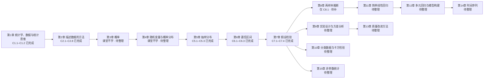

# 统计学 Statistics — 课程索引 MOC

> [!info] 课程速览
> - **课程**：统计学 Statistics（**全英授课**：幻灯片、教材、例题全英文；本库讲义用中文写，术语首次出现给英文）
> - **授课**：周老师 Yuhong Zhou，华南理工大学 **经济与金融学院** 教授
> - **联系方式**：yhzhou@scut.edu.cn（课程群二维码课上发；有问题群里问）
> - **学术背景**：本硕博均在本校，之后在 **MIT** 做博士后；研究方向为**创业投资 Venture Capital** 与**私募股权 Private Equity**
> - **教材**：*Statistics for Business and Economics*（Pearson；课件即该书配套幻灯片，ch01 为周老师 2021 改版）
> - **成绩构成**：课堂参与与出勤 **20%** ｜作业 **10%** ｜期末考试 **70%**
> - **考核提醒**：考试成绩是最终成绩，出分后不再改分；反复来要求改分者，每来一次扣 5 分
> - **课堂作业**：主要用于考勤，题量不大、不给太多时间；不要替别人写（替写视为缺席）

> [!tip] 这门课的一句话定位
> 统计学 = **数据 + 方法 + 概率**，目的是让机器（或人）按逻辑规律模拟人的思维：误差越来越小、置信度越来越高。
> 老师原话："人工智能本质上就是统计学，只是用了一个更华丽的说法。"（课上引用一位诺贝尔奖得主在科技创新论坛上的说法）

---

## 课程内容地图

**主链路**：先会**看数据**（第 1–2 章）→ 再学会**概率的语言**（第 3–4 章）→ 于是能算**抽样分布**（第 5 章）→ 有了抽样分布，才有**区间估计**（第 6 章）与**假设检验**（第 7 章）→ 之后所有章节都是这两把刀在不同场景上的复用：两样本（第 8 章）、多组（第 9 章）、分类数据（第 10 章）、回归（第 11–12 章）、质量（第 13 章）、时间序列（第 14 章）、非参数（第 15 章）。

> [!note] 阅读顺序与当前进度
> 篇号顺序 = 教材章序 = 推荐阅读顺序。
> **第 3、4 章课堂上明确不学**（老师原话："第三第四章我们不学，它是 probability 和分布，我们在数理统计里面已经学过了"），
> 但它们是第 5 章的直接前置（抽样分布就是统计量的概率分布），将来补写时仍按章序排在前面。
> **目前整理到第 8 章 8.1**：第 1、2、5、6、7 章已完整成篇；第 3、4 章与第 9–15 章尚未整理，第 8 章只完成 8.1。

---

## 笔记索引

### 第 1 章 统计学、数据与统计思维

| 笔记 | 对应课件 | 核心内容 |
|---|---|---|
| [[C1.1 统计学是什么：从数据到决策]] | ch01 p.1–27（1.1–1.5） | 彩票返还率与期望回报、私彩为什么能搞干一个镇；统计学的定义与词源；数据≠信息；描述统计 vs 推断统计；总体/个体/变量/样本/参数/统计量；过程与黑箱；定量与定性（定类/定序） |
| [[C1.2 收集数据：抽样方法与代表性]] | ch01 p.28–47（1.6–1.7） | 四种获取数据的方式；代表性样本与简单随机抽样；系统、分层、整群、多阶段与随机化回答；三类非抽样误差；统计思维与管理问题↔统计问题的循环 |

> [!note] 第 1 章的两条实务结论（考试易考）
> 1. **多阶段调查的前期阶段只能用整群抽样**，只有最后一个阶段才考虑简单随机、系统或分层抽样——因为整群能简化操作、降低成本。
> 2. **简单随机抽样适用于总体规模不太大的场合**；总体太小也不行，因为统计学的研究对象本身带有"大量性"特征。

### 第 2 章 描述数据的方法

| 笔记 | 对应课件 | 核心内容 |
|---|---|---|
| [[C2.1 定性数据的呈现]] | ch02 p.1–21（2.1） | 汇总表、条形图、饼图、帕累托图；相对频数与百分比；帕累托图为什么必须降序 |
| [[C2.2 定量数据的图形：点图、茎叶图与直方图]] | ch02 p.22–31（2.2） | 点图、茎叶图、直方图；组距与组数；分布形状的读法 |
| [[C2.3 集中趋势：均值、中位数、众数]] | ch02 p.32–49（2.3） | 数据的两个特征；三个中心；均值为什么是平衡点；异常值敏感性；偏态与三者位置 |
| [[C2.4 离散程度：极差、方差与标准差]] | ch02 p.50–60（2.4） | 极差的两处硬伤；平方和；样本方差为什么除以 n−1；自由度；标准差与单位 |
| [[C2.5 标准差怎么用：切比雪夫定理与经验法则]] | ch02 p.61–69（2.5） | 任意分布下的切比雪夫（1−1/k²）；近似正态下的经验法则（68/95/99.7）；"至少"与"大约"的分寸 |
| [[C2.6 百分位数与 z 分数]] | ch02 p.70–78（2.6） | 百分位数定位公式；四分位数；z 分数 = 减均值除以标准差；跨总体比较 |
| [[C2.7 异常值、四分位数与箱线图]] | ch02 p.79–94（2.7） | 异常值三种成因；Q1/Q2/Q3；IQR 与 1.5×IQR 判据；五数概括；箱线图读形状 |
| [[C2.8 散点图、时间序列图与误导性图表]] | ch02 p.95–119（2.8–2.10） | 散点图、时间序列图；六种"用真数据说假话"的作图手法 |

> [!note] 第 2 章考点提示
> - 第五节课开头亲手画了一张右偏分布的箱线图，并说"**这个有可能会考试**"——见 [[C2.7 异常值、四分位数与箱线图]]。
> - **切比雪夫定理**被明确点名为考点（第四节课，出现十几次）——见 [[C2.5 标准差怎么用：切比雪夫定理与经验法则]]。

### 第 5 章 抽样分布

| 笔记 | 对应课件 | 核心内容 |
|---|---|---|
| [[C5.1 抽样分布：统计量也是随机变量]] | ch05 p.1–19（5.1–5.2） | 三种分布只差一个字母；抽样分布的定义与生成方式；用 N=4、n=2 手工枚举；点估计与无偏性、最小方差 |
| [[C5.2 样本均值的抽样分布与中心极限定理]] | ch05 p.20–32（5.3） | 样本均值的期望为什么等于总体均值；标准误 σ/√n；定理 5.1；中心极限定理（n≥30） |
| [[C5.3 样本比例的抽样分布]] | ch05 p.33–37（5.4） | 样本比例的期望与标准误；可重复抽样的可能性计数；正态近似的判据 |

### 第 6 章 单样本推断：置信区间

| 笔记 | 对应课件 | 核心内容 |
|---|---|---|
| [[C6.1 参数估计与置信区间]] | ch06 p.1–25（6.1–6.2） | 点估计 vs 区间估计；置信系数的正确读法；大样本均值区间；90% 对应 z=1.645 的查表过程 |
| [[C6.2 小样本 t 区间与比例的置信区间]] | ch06 p.26–45（6.3–6.4） | t 分布与自由度的来历；t 表与 z 表的查法差异；比例的区间与调整区间 |
| [[C6.3 样本量、有限总体校正与方差的置信区间]] | ch06 p.46–74（6.5–6.7） | 样本量公式；π 未知时取 0.5 的保守性；有限总体校正因子；方差的卡方区间 |

### 第 7 章 单样本推断：假设检验

| 笔记 | 对应课件 | 核心内容 |
|---|---|---|
| [[C7.1 假设检验的要素与假设的建立]] | ch07 p.1–38（7.1–7.2） | 原假设与备择假设、为什么假设要带等号、两类错误、拒绝域、单尾与双尾 |
| [[C7.2 p 值与显著性水平]] | ch07 p.39–58（7.3） | p 值的定义与三个常见误读；怎么算、怎么报、怎么判；接回"顶刊三颗星" |
| [[C7.3 均值与比例的假设检验]] | ch07 p.59–93（7.4–7.6） | z 检验与 t 检验的选择；四种结论的措辞纪律；比例的 z 检验 |
| [[C7.4 方差的检验、第二类错误与功效]] | ch07 p.94–125（7.7–7.8） | 方差的卡方检验；第二类错误 β 的计算；功效与样本量、效应量的关系 |

### 第 8 章 两样本推断（仅完成 8.1）

| 笔记 | 对应课件 | 核心内容 |
|---|---|---|
| [[C8.1 两个总体均值之差]] | ch08 p.1–39（8.1–8.2） | 独立样本；大样本与小样本；合并方差；两样本均值之差的抽样分布 |

> [!todo] 尚未整理的章节
> **第 3 章 概率**、**第 4 章 随机变量与概率分布**（课堂不学，但为第 5 章前置）、
> **第 8 章 8.2–8.6**、**第 9 章 实验设计与方差分析**、**第 10 章 分类数据与卡方检验**、
> **第 11 章 简单线性回归**、**第 12 章 多元回归与模型构建**、**第 13 章 质量改进方法**、
> **第 14 章 时间序列**、**第 15 章 非参数统计**。
> 课件已全部就位（`courseware/msb12e_ppt_ch03–15.ppt`），后续按同样的体例补写即可。

---

## 标注约定

> [!info] 标注说明
> 标有 **（拓展）** 或 **【拓展】** 的内容，是**课堂上没有展开、由教材与通行讲法延伸补充**的部分。
> 复习优先级：先掌握未标注的主干内容（考点集中在这里），行有余力再看拓展。

> [!info] 授课进度说明
> 目前拿到的授课转写稿是**前 6 节课**（每节约 2.5 小时），内容截止于**第 6 章 6.2 节**（大样本均值置信区间）。
> 课堂实际讲授范围：**第 1 章（1.1–1.7）→ 第 2 章（2.1–2.7）→ 第 3、4 章明确不学 → 第 5 章（5.1–5.4）→ 第 6 章（6.1–6.2）**。
> 因此：
> - **第 1 章、第 2 章（2.1–2.7）、第 5 章、第 6 章（6.1–6.2）** 是按"课件 + 课堂原话"双线写成的，正文里的口头补充、案例、当场纠错都来自转写稿。
> - **第 2 章 2.8–2.10、第 6 章 6.3 之后、第 7 章、第 8 章** 尚未在课堂上讲授，这些篇目来自**教材与通行讲法整理**，篇首均有进度说明，正文不逐段标拓展。
> 等后续转写稿补充进来后，会按与第 1、2、5 章相同的规则标注"课堂讲过"与"拓展补充"的差别。

---

## 授课进度与课件情况

> [!note] 课件与笔迹检查结论
> 课件为 Pearson《Statistics for Business and Economics》配套幻灯片共 15 份（`courseware/msb12e_ppt_ch01.ppt` … `ch15.ppt`），
> 其中 **ch01 是周老师 2021 改版**（页脚为 `Copyright © 2021 Yuhong Zhou`），其余 14 份是出版社原版。
> **笔迹检查：15 份课件全部无手写笔迹。** 逐份检查了二进制 `.ppt` 的 OLE 流与 UTF-16 字符串：
> 没有 InkML 墨迹流、没有 `contentPart` 墨迹引用（命中的 `ink` 字符串全部来自 `Thinking Challenge` 之类的正文）；
> 另外抽查渲染页（ch01 p7、p13、p16、p40，ch02 p24 等）确认印刷内容干净、页面上没有任何手绘笔画。
> 因此本库讲义**没有板书图**，全部插图要么自绘，要么从印刷页裁切。

> [!warning] 课件问题清单
> 1. **开场案例的幻灯片不在提供的课件里**。第一节课的彩票案例、毒胶囊、崔永元转基因调查、电视民调、啤酒与尿布、纸牌屋、人体第二套基因组等内容，
>    课堂上都配了幻灯片，但 `ch01` 里没有这些页——它们来自另一份绪论课件，本次未提供。
>    讲义里这些内容**全部按课堂讲授（转写稿）整理**，见 [[C1.1 统计学是什么：从数据到决策]] 第 0、2 节。
> 2. **彩票奖级数字**：总发行 500 万张、总销售额 1000 万元、中奖 250 万张、奖金总额 400 万元，
>    由此得中奖率 50%、返还率 40%、每 2 元票的期望回报 0.8 元。课堂口述中的"一等奖概率"与"500 万张里 1 张头奖"
>    不完全一致，讲义按票面结构复算为 $1/5{,}000{,}000$，并注明这是按票面结构算的。
> 3. **`ch01` p.40 "Real-World Problem"** 的流程图中有一处指向不完整（"Reformulation of problem" 箭头跨过两列框），
>    讲义改写成了等价的 mermaid 图，语义按"管理问题→统计问题→统计分析→统计答案→管理答案→解决方案，并有回炉重问的两条反馈"还原。
> 4. **第 3、4 章课件完整但课堂不学**，属"已备未讲"；这两章尚未整理成篇。
> 5. 逐篇发现的原稿数值与印误（如 ch02 p.60 总体标准差下标多印一个 x、p.82 的 Q2 印作 8.8 而实际 8.3、p.93 箱线图与密度曲线面积不自洽等），
>    均写在相应篇目的 `[!warning]` 或勘误段落里。

---

## 公式速查

### 第 1–2 章：描述统计

| 名称 | 公式／判据 |
|---|---|
| 样本均值 | $\bar x=\dfrac{\sum x_i}{n}$ |
| 中位数位置 | 排序后第 $(n+1)/2$ 位（偶数个取中间两个的平均） |
| 样本方差 | $s^2=\dfrac{\sum (x_i-\bar x)^2}{n-1}$ |
| 样本标准差 | $s=\sqrt{s^2}$ |
| 极差 | $R=\max-\min$ |
| 百分位数位置 | $L=\dfrac{p}{100}(n+1)$ |
| z 分数 | $z=\dfrac{x-\bar x}{s}$（总体用 $\mu,\sigma$） |
| 四分位距 | $\mathrm{IQR}=Q_3-Q_1$ |
| 异常值判据 | $x<Q_1-1.5\,\mathrm{IQR}$ 或 $x>Q_3+1.5\,\mathrm{IQR}$ |
| 切比雪夫定理 | 落在 $\bar x\pm ks$ 内的比例 $\ge 1-\dfrac{1}{k^2}$（$k>1$） |
| 经验法则 | 约 68%／95%／99.7% 落在 $\bar x\pm s,\ \pm2s,\ \pm3s$ |

### 第 5–6 章：推断统计地基

| 名称 | 公式／判据 |
|---|---|
| 样本均值的期望 | $\mu_{\bar x}=\mu$ |
| 均值的标准误 | $\sigma_{\bar x}=\dfrac{\sigma}{\sqrt n}$ |
| 样本比例的期望 | $\mu_{\hat p}=\pi$ |
| 比例的标准误 | $\sigma_{\hat p}=\sqrt{\dfrac{\pi(1-\pi)}{n}}$ |
| 中心极限定理 | $n\ge 30$ 时 $\bar x\approx N\!\left(\mu,\dfrac{\sigma^2}{n}\right)$ |
| 标准化 | $z=\dfrac{\bar x-\mu}{\sigma/\sqrt n}$ |
| 大样本均值置信区间 | $\bar x\pm z_{\alpha/2}\dfrac{\sigma}{\sqrt n}$ |
| 小样本均值置信区间 | $\bar x\pm t_{\alpha/2}\dfrac{s}{\sqrt n}$（自由度 $n-1$） |
| 大样本比例置信区间 | $\hat p\pm z_{\alpha/2}\sqrt{\dfrac{\hat p(1-\hat p)}{n}}$ |
| 估计均值所需样本量 | $n=\dfrac{(z_{\alpha/2})^2\sigma^2}{SE^2}$ |

### 第 7 章：假设检验

| 名称 | 公式／判据 |
|---|---|
| 均值检验（大样本或 $\sigma$ 已知） | $z=\dfrac{\bar x-\mu_0}{\sigma/\sqrt n}$ |
| 均值检验（小样本、$\sigma$ 未知） | $t=\dfrac{\bar x-\mu_0}{s/\sqrt n}$，自由度 $n-1$ |
| 比例检验 | $z=\dfrac{\hat p-\pi_0}{\sqrt{\pi_0(1-\pi_0)/n}}$ |
| 决策（临界值法） | 双尾：$|z|>z_{\alpha/2}$ 拒绝 $H_0$；单尾看方向 |
| 决策（$p$ 值法） | $p<\alpha$ 拒绝 $H_0$ |
| 两类错误 | $\alpha=P(\text{拒绝}H_0\mid H_0\text{真})$；$\beta=P(\text{不拒绝}H_0\mid H_0\text{假})$ |
| 功效 | $1-\beta$ |

### 常用 z 临界值

| 置信水平 | $1-\alpha$ | $z_{\alpha/2}$ | 查表用的中间面积 |
|---|---|---|---|
| 90% | 0.90 | **1.645** | 0.45 |
| 95% | 0.95 | **1.96** | 0.475 |
| 98% | 0.98 | 2.33 | 0.49 |
| 99% | 0.99 | **2.575** | 0.495 |

> [!warning] 查表最常见的坑
> 标准正态表给的是 **0 到 $z$ 之间**的面积（中间一块的一半）。所以查 90% 时要用 **0.45**，不是 0.05，也不是 0.90。
> 这一条在 [[C6.1 参数估计与置信区间]] 里带完整过程走过一遍。

---

## 常用数值速查（课程案例里的真实数字）

| 场景 | 数值 | 出处 |
|---|---|---|
| 某期彩票：发行量／销售额 | 500 万张／1000 万元（2 元一张） | [[C1.1 统计学是什么：从数据到决策]] |
| 该彩票：中奖率／返还率 | 50%／40% | 同上 |
| 该彩票：每 2 元的期望回报 | 0.8 元（末奖 1 元的概率 49.8%） | 同上 |
| 官方彩票 6 轮后剩 | $2000\to800\to320\to128\to51.2\to20.5\to8.2$ 元 | 同上 |
| 私彩返还率／抽水率 | 80%／20% | 同上 |
| 私彩 14 轮后全村剩 | $2000\times0.8^{14}\approx88$ 万元 | 同上 |
| 林肯首次当选得票率 | 39.82%（**参数**） | 同上 |
| 877 人调查：不聘用有拼写错误者 | 45%（**统计量**） | 同上 |
| 2 升瓶装饮料：$\sigma$／$n$／$\bar x$ | 0.05 L／100／1.99 L | [[C6.1 参数估计与置信区间]] |
| 该题的 90% 置信区间 | $(1.9818,\ 1.9982)$ L | 同上 |
| 管理人员总体／样本容量 | 2500 人／36 人 | [[C5.3 样本比例的抽样分布]] |

---

## 怎么用这份 MOC

1. **第一次学**：按篇号顺序读已完成的章节。每篇开头的 `> [!abstract] 这一讲的任务` 告诉你它在解决上一讲的什么遗留问题。
2. **考试前**：先看每篇的 `## 这一讲的三句话`，再看本页的"公式速查"与"常用数值速查"。
3. **卡住时**：先查本篇的"停顿问题"，答案通常在后一段叙述里；仍然不懂，往上翻到它的前置篇（每篇末尾的"相关笔记"都指回了哪里）。
4. **想深入**：带 **（拓展）** 标记的段落是教材与通行讲法的延伸，不影响主干。
