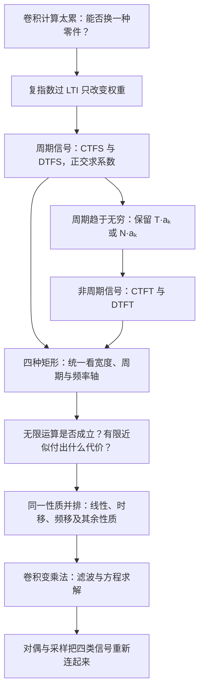

# 第 3–5 章：四种傅里叶表示并行讲义

> [!abstract] 这一讲的任务
> 给你一个信号，先判断连续还是离散、周期还是非周期；再写对它的分析与综合公式。随后对四种信号同时问：能否收敛？平移后谱怎么变？卷积为什么变乘法？同一个性质的系数、取值范围与周期在哪里改变？
> 本篇按老师将第 3、4、5 章并行授课的思路重排，所有原有推导、例题、随堂题、图像、复盘和阅读线索均收入本文件正文；读本篇即可看到这些内容，不依赖嵌入其他笔记。

> [!info] 阅读说明与课堂证据
> 本篇整合原有 **16 篇**笔记，并重新考虑已经标记“已合并”的转写稿。原笔记保留原位；这里另成一份讲义。
> 第 10 节提供复指数与 LTI 的起点；第 11–12 节建立四套公式与四种矩形；第 13 节进一步讲收敛、吉布斯、语音分帧加窗、二维图像的平移与相位实验，以及线性、时移和频移。其余性质和系统求解的原有完整内容仍保留，不能因为本节暂未讲到而删去。
> 每一主题先给并排比较，再展开原有完整讲解。同一主题里仍保留有用的重复推导，便于逐项核对；原篇任务导读、历史进度和收尾集中在第 17 节。那里“未讲”等旧状态是历史快照，现时进度见第 18 节。**校正框优先于其后保留的旧稿措辞。**
> 第十三节课没有时间戳，开头、若干中间位置有明显的识别重复，原图也未随转写提供。本篇还原能确认的讲解与实验动作；听不清的通信缩写、图像的具体像素和未定的考试日期不作补猜。

## 0. 开场：同一个矩形，为什么要学四套公式

你拿到一段宽度固定的矩形脉冲。让它周期重复，频域只需基频整数倍的权重；把周期拉远，谱线变密，却不能直接拿趋于零的系数当作连续谱。再把时间改成整数采样点，频率又会绕一圈重复。四套公式正是这几个改变的结果。

本篇采用 $\Omega_0=2\pi/T$ 表示连续周期信号的基频，采用 $\omega_N=2\pi/N$ 表示离散周期信号的基频；原有讲解里的 $\omega_0$、$T_0$、$N_0$ 按各段自己的定义读。连续频率 $\Omega$ 的单位是 rad/s；离散频率 $\omega$ 的单位是 rad/sample，模 $2\pi$ 等价。$k$ 是谐波编号，不是时间。

| 工具 | 时域对象 | 频谱的变量与结构 | 分析用什么运算 | 综合用什么运算 |
|---|---|---|---|---|
| CTFS | 连续，周期 $T$ | $a_k$，离散谐波，通常不周期 | 一个 $T$ 上积分并除以 $T$ | 对全部整数 $k$ 求和 |
| DTFS | 离散，周期 $N$ | $a_k$，离散且以 $N$ 为周期 | 任意连续 $N$ 个样本求和并除以 $N$ | 任意连续 $N$ 个系数求和 |
| CTFT | 连续非周期信号的通常表示，也可扩展到周期信号 | $X(j\Omega)$，连续频率轴；允许广义冲激谱 | 全时间轴积分 | 全频率轴积分并除以 $2\pi$ |
| DTFT | 离散非周期信号的通常表示，也可扩展到周期信号 | $X(e^{j\omega})$，连续频率变量且 $2\pi$ 周期 | 全整数时间轴求和 | 任意一个 $2\pi$ 上积分并除以 $2\pi$ |

> [!warning] 四象限是记公式的结构，不能用来排除特例
> “连续”首先指自变量连续，不保证函数处处连续。DTFT 即便含冲激，仍定义在连续频率变量上；连续时间冲激串的 CTFT 也可以是周期谱。非周期信号还可能有离散或混合谱，例如两个不可公度的正弦之和。因此课堂“周期对应离散、离散对应周期”的口诀，要结合对象、单位和傅里叶对的适用范围读，不能机械地把所有箭头都当成无条件充要关系。

阅读入口：[[#2. 四套公式：正交、有限维与周期趋于无穷|四套公式]] · [[#3. 四种矩形并排：占空比、半角技巧与时宽带宽|四种矩形]] · [[#5. 收敛与有限近似：四种情形到底各需要什么条件|收敛与吉布斯]] · [[#7. 时移与相位：幅度不变为什么仍会改变图像|时移与相位]] · [[#13. 卷积与相乘：普通卷积、周期卷积及归一化|卷积归一化]] · [[#18. 课堂补充、考试安排与证据边界|课堂进度与考试]]。
