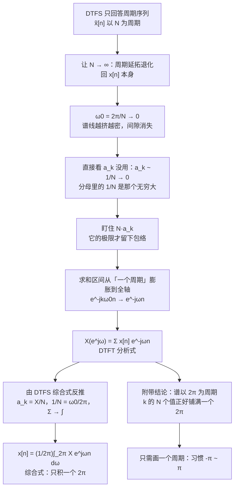
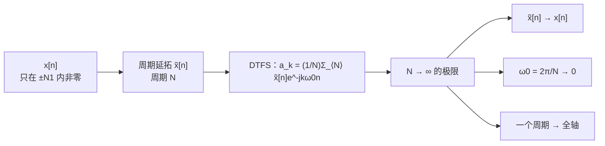

# 5.1 非周期信号的表示：离散时间傅里叶变换

> [!abstract] 这一讲的任务
> 第 4 章把**连续时间**信号的周期推到无穷，谱线连成了一条曲线，得到 CTFT。这一节对**离散序列**做同一件事，可结果并不平行：谱不但变成连续的，还**必须是以 $2\pi$ 为周期的**。
> 多出来的这条周期性不是巧合，它是"时域离散"的直接后果：让 $N\to\infty$ 时，$k$ 只取 $N$ 个值，而 $\omega=k\omega_0$ 走完 $2\pi$ 就把 $N$ 个值用光了，再往前走只能重复。
> 这一节要拿到三样东西：**DTFT 的分析式与综合式**、**为什么它的谱是 $2\pi$ 周期的**、以及**离散矩形序列的闭式结果**——它和第 3 章离散周期方波的 $a_k$ 长得一模一样，只是"谱线"换成了"曲线"。

> [!info] 授课进度说明
> 课堂转写稿覆盖到**第 12 节课**。这节课在第 5 章讲了 §1 的全部推导（$Na_k$ 的极限、分析与综合公式、$X(e^{j\omega})$ 的记法）、**$2\pi$ 周期性的证明**、反变换的推导，以及 §3 的**矩形序列例**。
> **课堂未展开**：§4 的两个基本变换对（$a^nu[n]$、$a^{|n|}$）与 $\delta[n]\leftrightarrow1$ 的图示、§5 的收敛问题与加窗逼近、§6 的三道随堂测。老师当堂说"时间不太充裕""这个例子的计算过程在这儿"，所以这几处按教材整理，**本篇不逐条标注「拓展」**。

---

## 0. 开场：一段鼓点录音，为什么只有一半频率点是"新"的

你录了 8 秒鼓点，采样率 8 kHz，拿去做 FFT，得到 32000 个频率点。理论上"频率"是个连续量，怎么会只给出有限个点？

把采样率提高到 16 kHz 再算一遍，点数翻了一倍。但奇怪的是：**新出现的点并没有落在旧点之间**——它们落在同一根曲线上，只是更密。也就是说，存在一根与采样率无关的连续曲线，FFT 给出的永远只是这根曲线上的**采样值**。

这根曲线就是离散时间傅里叶变换 $X(e^{j\omega})$。它回答的问题是：**这个离散序列里，频率 $\omega$ 的成分占多大比重。** 而 FFT 给出的离散点，是"在一个 $2\pi$ 周期上均匀取 $N$ 个样"——取多少个样由你说了算，曲线本身不变。

顺带还有一个更反直觉的事实：这根曲线的真正"独立"区间只有 $2\pi$ 宽。$\omega$ 从 $-\pi$ 走到 $\pi$，所有能出现的频率就都出现了；再往前走，看到的是同一段曲线的复制品。这就是下面要证的 **$2\pi$ 周期性**。

上一章对连续信号做的是"把周期推到无穷"；这一节对离散序列做同一件事，但推到尽头会多撞出一堵墙。我们先看这堵墙是怎么竖起来的。

---

## 1. 从 DTFS 出发：让 $N$ 趋于无穷（p.3–7）

### 1.1 出发点是周期延拓，不是周期信号本身

$N\to\infty$ 这个动作在数学上必须有个落脚点。$x[n]$ 本身不是周期的，谈不了 DTFS；所以先构造它的**周期延拓** $\tilde x[n]$：取 $x[n]$ 在 $[-N_1,N_1]$ 里的那一段，以 $N>2N_1+1$ 为周期复制出去。

四条变换的分工，先钉在墙上：判断该用求和还是积分、该在一个周期上取还是全轴取，只看**信号自己的两个性质**——连续还是离散、周期还是非周期：

| 时域 | 频域 | 工具 | 用求和还是积分 | 在什么范围上取 |
|---|---|---|---|---|
| 连续 + 周期 | 离散 + 非周期 | CTFS | 求和（无穷项） | 一个周期 |
| 离散 + 周期 | 离散 + 周期（以 $N$ 为周期） | DTFS | 求和（$N$ 项） | 一个周期 |
| 连续 + 非周期 | 连续 + 非周期 | CTFT | 积分 | 全轴 |
| **离散 + 非周期** | **连续 + 周期（以 $2\pi$ 为周期）** | **DTFT** | **求和（无穷项）** | **全轴** |

规律一句话：**时域连续 ⇒ 频域用积分；时域离散 ⇒ 频域用求和；时域周期 ⇒ 只取一个周期；时域非周期 ⇒ 全部拿过来。** 这张表第 4 行就是本节要建的东西。

### 1.2 撞墙：$a_k$ 的极限一定是零

先做最自然的尝试：$\tilde x[n]\to x[n]$ 时，让 $a_k$ 跟着趋于无穷试试。

$$a_k=\frac1N\sum_{n=\langle N\rangle}\tilde x[n]e^{-jk\omega_0n}$$

$x[n]$ 的能量是有限的（它只在 $[-N_1,N_1]$ 里非零），而 $\frac1N\to0$。所以对任意的 $k$，

$$|a_k|\le\frac1N\sum_{n}|x[n]|\;\xrightarrow[N\to\infty]{}\;0.$$

**每个系数都趋于零，极限是 0。** 这不是"还没算完"，而是这条路本来就没信息：所有 $a_k$ 一起变成 0，$k$ 之间的相对大小被无穷大的分母抹平了。

> [!warning] 为什么不能就此收工
> 如果只看 $a_k\to0$，会得出"非周期序列的频谱处处为零"这种荒唐结论。问题出在写法上：$a_k$ 是**离散指标上的一个数**，随着 $N$ 变大，它在同一个 $k$ 上的值同时在变小、可用的 $k$ 又同时在变多。这不是一个可以取极限的对象。

### 1.3 转机：把分母搬进待求变量里

$a_k$ 里那个致命的因子是 $\frac1N$。**把它乘回去**，定义一个新对象：

$$Na_k=\sum_{n=\langle N\rangle}\tilde x[n]e^{-jk\omega_0n}.$$

同一个 $k$ 上，它不再趋于零。下一步把 $\omega_0=\frac{2\pi}{N}$ 显式写出来：$\omega=k\omega_0$ 就成了一个**可以连续变动的量**。$N$ 增大时，$\omega_0$ 变小，$k$ 取遍一个周期，$\omega$ 就从 $0$ 一路铺到 $2\pi$，**采样间隔越来越细，但铺的位置不变**。

![[C5.1-周期延拓的频谱采样.png]]

三张图用的是同一个 $N_1=2$ 的矩形延拓，只改周期 $N=10,20,40$。虚线是**包络**（它不随 $N$ 变），竖条是离散的 $Na_k$：

- $N=10$ 时只有 10 根谱线，间隔 $\omega_0=\frac{2\pi}{10}$，看得见包络的轮廓，但很粗；
- $N=20$ 时谱线加倍、间隔减半，**每根的高度没变**，只是插在包络上的位置更密；
- $N=40$ 时已经看不出"离散"，谱线贴满整条曲线。

这就是"量变导致质变"的具体形态：**离散谱线的间隔趋于零，离散谱就变成了连续谱**。而包络本身，就是非周期序列的频谱。

> [!important] DTFT 的分析式
> $$\boxed{\ X(e^{j\omega})=\sum_{n=-\infty}^{+\infty}x[n]\,e^{-j\omega n}\ }\qquad\text{（离散 }x[n]\text{ 的离散时间傅里叶变换）}$$
> 三处替换一步到位：求和区间从"一个周期"膨胀到全轴（$N\to\infty$ 把窗口撑满了整个序列）；$k\omega_0$ 换成连续变量 $\omega$；离散的 $e^{-jk\omega_0n}$ 换成 $e^{-j\omega n}$。

### 1.4 综合式：把 $a_k$ 换成 $X(e^{j\omega})$ 再量变一次

现在要反过来：知道 $X(e^{j\omega})$，怎么还原 $x[n]$？起点仍是 DTFS 的综合式，只是在里面塞进"$a_k$ 与 $X$ 的桥"。

第 1.3 节的结论换个写法就是那个桥：

$$a_k=\frac1N X(e^{j\omega})\Big|_{\omega=k\omega_0}.$$

代进 $\tilde x[n]=\sum_{k=\langle N\rangle}a_ke^{jk\omega_0n}$：

$$\tilde x[n]=\frac1N\sum_{k=\langle N\rangle}X(e^{jk\omega_0})e^{jk\omega_0n}.$$

接下来一步是整段推导的关键：**把 $\frac1N$ 改写成 $\frac{\omega_0}{2\pi}$**。这不是凑数，它就是 $N\omega_0=2\pi$ 的改写：

$$N=\frac{2\pi}{\omega_0}\quad\Longrightarrow\quad\frac1N=\frac{\omega_0}{2\pi}.$$

于是

$$\tilde x[n]=\frac1{2\pi}\sum_{k=\langle N\rangle}X(e^{jk\omega_0})e^{jk\omega_0n}\,\omega_0.$$

右边这个求和，形状已经是一个**黎曼和**了：被加的函数是 $X(e^{j\omega})e^{j\omega n}$，在等间隔的点 $\omega=k\omega_0$ 上取值，再乘上间隔 $\omega_0$。间隔趋零时它就是积分：

$$\sum_{k=\langle N\rangle}(\cdots)\omega_0\;\longrightarrow\;\int_{2\pi}(\cdots)\,d\omega.$$

> [!important] DTFT 的综合式（反变换）
> $$\boxed{\ x[n]=\frac1{2\pi}\int_{2\pi}X(e^{j\omega})\,e^{j\omega n}\,d\omega\ }$$
> 这是 $x[n]$ 的**复指数加权和**：$X(e^{j\omega})\frac{d\omega}{2\pi}$ 是频率落在 $[\omega,\omega+d\omega]$ 里的那一份振幅。积分只取**一个 $2\pi$ 区间**（习惯取 $-\pi\sim\pi$，也可以取 $0\sim2\pi$）——理由就是下一节要证的 $2\pi$ 周期性：整条实轴上的被积函数是同一段曲线的复制品，多积没有新内容。

> [!note] 那个 $\frac1{2\pi}$ 是从哪里冒出来的
> 不是硬加的。它来自"**积分比求和多一个 $2\pi$**"：连续端的基底 $e^{j\omega t}$ 在一个周期上积分给出 $2\pi$（$\int_0^{2\pi}e^{j\theta}d\theta=2\pi$），于是综合式的分母上就需要 $2\pi$ 来除掉它。CTFT 与 DTFT 的综合式都带 $\frac1{2\pi}$，而 CTFS / DTFS 的综合式不带——因为级数那一侧是求和，不产生这个 $2\pi$。

### 1.5 记法：为什么写 $X(e^{j\omega})$ 而不是 $X(j\omega)$

连续时间写 $X(j\omega)$，括号里放的是 $j\omega$——一个纯虚数。离散时间写 $X(e^{j\omega})$，括号里放的是 $e^{j\omega}$——**单位圆上的一个点**。

理由在基底里。离散时间的复指数基底是 $z^n$，$z$ 是任意复数；当 $z$ 被限制在单位圆上，$z=e^{j\omega}$，它就退化成"纯振荡"。所以

$$X(z)=\sum_n x[n]z^{-n}\ \Longrightarrow\ X(e^{j\omega})=\sum_nx[n]e^{-j\omega n}.$$

**括号里那个 $e$ 记录的是"代进去的是什么"**：一个模为 1、辐角为 $\omega$ 的复数。写成 $X(j\omega)$ 会让人以为参数是虚数 $\omega$，实际上那个量的模被钉死成 1 了——这正是"离散时域 ⇒ 频域只剩一个圆周"的含义，第 10 章的 Z 变换会把它讲透。

> [!tip] 一眼区分两个频谱
> 看见 $X(j\omega)$ 就是连续时间；看见 $X(e^{j\omega})$ 就是离散时间。考试里写错这个括号，往往意味着整个式子都按错的那一类在套——老师在第 12 节课上反复强调过：**这四种变换的符号，一写错就说明根本没理解信号是什么**。

---

## 2. $2\pi$ 周期性：离散时域的副产品（p.5、p.23）

### 2.1 证明只有一行

> [!important] 离散时间信号的谱一律以 $2\pi$ 为周期
> $$X(e^{j(\omega+2\pi)})=X(e^{j\omega}).$$

证明就是把它代回定义：

$$X(e^{j(\omega+2\pi)})=\sum_{n=-\infty}^{+\infty}x[n]e^{-j(\omega+2\pi)n}=\sum_nx[n]e^{-j\omega n}\underbrace{e^{-j2\pi n}}_{\equiv 1}=X(e^{j\omega}).$$

关键在于 $n$ 是**整数**：$e^{-j2\pi n}=\cos 2\pi n-j\sin2\pi n=1$。连续时间里 $t$ 是实数，$e^{-j2\pi t}$ 随 $t$ 一直在转，永远不恒等于 1，所以 CTFT 的谱不是周期的。**"离散"这件事，在频域上就是"以 $2\pi$ 为周期"。**

### 2.2 为什么周期正好是 $2\pi$

不用背，从 DTFS 的 $k$ 就能推出来。DTFS 里 $k$ 只取满 $N$ 个整数值（约定取 $0\sim N-1$，或 $-N/2\sim N/2-1$），而

$$\omega_k=k\omega_0=k\cdot\frac{2\pi}{N}.$$

$k=0$ 时 $\omega=0$；$k=N$ 时 $\omega=N\cdot\frac{2\pi}{N}=2\pi$。也就是说，**$k$ 的 $N$ 个取值，正好把 $\omega$ 的一个 $2\pi$ 区间铺满**。再往后 $k=N+1$ 给出的 $\omega$ 与 $k=1$ 给出的只差 $2\pi$，而 $N$ 点 DTFS 也认为 $a_{k+N}=a_k$——两边都对上了。

| 对象 | 周期性 | 原因 |
|---|---|---|
| DTFS 系数 $a_k$ | 以 $N$ 为周期：$a_{k+N}=a_k$ | 基底 $e^{j2\pi n}=1$，$k$ 与 $k+N$ 是同一根基底 |
| DTFT 谱 $X(e^{j\omega})$ | 以 $2\pi$ 为周期 | $e^{-j2\pi n}=1$，$\omega$ 与 $\omega+2\pi$ 是同一个频率 |

两条是同一件事的两种说法：**$k$ 的周期对应 $\omega$ 的 $2\pi$**。

### 2.3 推论：只需要画一个周期

谱是 $2\pi$ 周期的，所以画图时约定俗成只画一个周期，**最常用 $-\pi\sim\pi$**。同时要记住一个物理含义：

> [!important] $\omega=\pi$ 是离散时间的最高频
> $\omega=\pi$ 对应的序列是 $e^{j\pi n}=(-1)^n$：一个样本翻一次符号，这是"逐点翻"的极限，再快就分辨不出来了。所以 $\omega$ 与 $2\pi-\omega$ 描述的是同一件事（一个是正转、一个是反转），**离散时间信号的频率范围是 $[0,\pi]$ 加一个镜像**。
> 第 3 章的 $H(e^{j\omega})$、第 7 章的采样定理都会回到这一点：所谓"混叠"，在频域上就是 $2\pi$ 周期里那些副本互相压上了。

> [!question] 停一下，先自己想想
> 如果 $x[n]$ 本身是周期的（以 $N$ 为周期），它的 DTFT 会周期多少？
> 答案在下一讲：仍是 $2\pi$，但一个 $2\pi$ 里只**有 $N$ 根冲激**，其余地方为零。周期信号的谱是"冲激串"，冲激的位置由信号自己的周期决定。

---

## 3. 离散矩形序列：把 DTFS 的 $a_k$ 采样一遍（p.11–12）

### 3.1 直接按定义算

$$x[n]=\begin{cases}1,&|n|\le N_1\\0,&|n|>N_1\end{cases}$$

求和只有 $2N_1+1$ 项，是等比级数：

$$X(e^{j\omega})=\sum_{n=-N_1}^{N_1}e^{-j\omega n}=e^{j\omega N_1}\sum_{m=0}^{2N_1}e^{-j\omega m}=e^{j\omega N_1}\cdot\frac{1-e^{-j\omega(2N_1+1)}}{1-e^{-j\omega}}.$$

### 3.2 提一半指数：两把钥匙互相抵消

分子分母各用一次"半角"改写 $1-e^{-j\theta}=e^{-j\theta/2}\cdot2j\sin\frac\theta2$：

- 分子：$1-e^{-j\omega(2N_1+1)}=e^{-j\omega(2N_1+1)/2}\cdot2j\sin\dfrac{\omega(2N_1+1)}{2}$；
- 分母：$1-e^{-j\omega}=e^{-j\omega/2}\cdot2j\sin\dfrac{\omega}{2}$。

把指数部分单独看：$e^{j\omega N_1}\cdot e^{-j\omega(2N_1+1)/2}\cdot e^{+j\omega/2}=e^{j\omega N_1-j\omega N_1-j\omega/2+j\omega/2}=e^{0}=1$。

**三个指数恰好抵光。** 这不是运气：矩形是**偶对称**的，它的变换必须**实**（相位只能是 0 或 $\pi$），指数项抵光是"实"在代数上的体现。于是

> [!important] 离散非周期矩形序列的 DTFT
> $$X(e^{j\omega})=\frac{\sin\left[\omega\left(N_1+\frac12\right)\right]}{\sin\left(\frac{\omega}{2}\right)},\qquad X(e^{j0})=2N_1+1.$$
> $\omega=0$ 处是 $\frac00$，用洛必达或"分子分母同时用小角近似"取极限：$\frac{\omega(N_1+1/2)}{\omega/2}=2N_1+1$。零点在 $\omega(N_1+\frac12)=k\pi$ 上，也就是**主瓣宽度由 $N_1$ 决定**，与连续端 $\mathrm{Sa}$ 的主瓣由脉宽决定完全对应。

![[C5.1-矩形序列的DTFT.png]]

左图是 $N_1=2$ 的序列本身；右图绿线就是上面的结果（峰值 5），红线是把**对应的周期矩形**（周期 $N=10$）的 DTFS 系数乘上 $N$ 之后画在同一张图上。

> [!important] 这两张图讲的是同一件事
> $$a_k=\frac1N X(e^{j\omega})\Big|_{\omega=k\omega_0=k\frac{2\pi}{N}}$$
> 周期序列的 $a_k$，就是非周期序列的 DTFT 在 $k\omega_0$ 上的**采样值再除以 $N$**。把这条式子乘上 $N$，红点就整整齐齐落在绿线上——第 12 节课上老师就是这样把两个结果并排放在一起的：
> - **周期化**（时域复制 $\Rightarrow$ 频域采样）：非周期矩形的连续谱，被采样成离散谱线；
> - **离散化**（时域采样 $\Rightarrow$ 频域周期化）：连续矩形的非周期谱，被复制成 $2\pi$ 周期的谱。
> 一正一反两个动作，正好把"四种矩形信号"里的两格连起来。四种全貌见 [[C4.1 非周期信号的表示：连续时间傅里叶变换]] §4 的对照表。

> [!warning] 两个"看起来一样"的结果，别混用
> 离散周期矩形的 $a_k=\dfrac1N\cdot\dfrac{\sin\left[\frac{2\pi k}{N}\left(N_1+\frac12\right)\right]}{\sin\left(\frac{\pi k}{N}\right)}$ 与这里的 $X(e^{j\omega})=\dfrac{\sin\left[\omega\left(N_1+\frac12\right)\right]}{\sin(\omega/2)}$ 确实只差一个"$\omega$ 换成 $\frac{2\pi k}{N}$、再除以 $N$"。但**能用 $a_k$ 的场合只有周期序列**；遇到非周期序列，必须用 $X(e^{j\omega})$，然后接受"谱是连续曲线"这件事。

---

## 4. 两个基本变换对与一个冲激（p.8–10、14）

### 4.1 例：$x[n]=a^nu[n]$，$|a|<1$

$$X(e^{j\omega})=\sum_{n=0}^{\infty}a^ne^{-j\omega n}=\sum_{n=0}^{\infty}\left(ae^{-j\omega}\right)^n=\frac{1}{1-ae^{-j\omega}}.$$

收敛条件就是 $|a|<1$（等比级数）；$|a|=1$ 时这个和发散，那一类序列留到 5.2 节用冲激处理。

模与相位分开写：

$$\left|X(e^{j\omega})\right|=\frac{1}{\left|1-ae^{-j\omega}\right|}=\frac{1}{\sqrt{(1-a\cos\omega)^2+(a\sin\omega)^2}}=\frac{1}{\sqrt{1+a^2-2a\cos\omega}},$$

$$\angle X(e^{j\omega})=-\arctan\frac{a\sin\omega}{1-a\cos\omega}.$$

![[C5.1-指数序列的幅相谱.png]]

上排是幅频，下排是相频，横轴画了两个周期（$-2\pi\sim2\pi$）——正好用来看清 $2\pi$ 周期性：两张图的形状每隔 $2\pi$ 重复一次。

> [!important] 一个符号决定低通还是高通
> 幅频在两端的取值只由 $a$ 决定：
> - $\omega=0$：$|X|=\dfrac{1}{1-a}$；$\omega=\pm\pi$：$|X|=\dfrac{1}{1+a}$。
> - $0<a<1$：$\frac{1}{1-a}>\frac{1}{1+a}$，**低频高、高频低 ⇒ 低通**。$a$ 越接近 1，峰越尖、通带越窄。
> - $-1<a<0$：$\frac{1}{1-a}<\frac{1}{1+a}$，峰搬到了 $\pm\pi$，**高频高、低频低 ⇒ 高通**。
> 数值核对（已复算）：$a=0.5$ 时 $\omega=0$ 取 $2$、$\omega=\pm\pi$ 取 $0.667$，峰在低频；$a=-0.5$ 时两个数互换——$\omega=0$ 取 $0.667$、$\omega=\pm\pi$ 取 $2$，峰跑到了高频。

相频也有一个干净的读法：$a>0$ 时相位在 $\omega=0$ 附近为零、在 $\pm\pi$ 附近翻到 $\mp\arctan\frac{a}{\sqrt{1-a^2}}$；$a<0$ 时相位曲线整体反号。**相位是"符号"的另一种表达**：同样的幅度、反一个相，时域里就是正负交替的衰减。

### 4.2 例：$x[n]=a^{|n|}$，$|a|<1$

这个序列是**实且偶**的，预期它的谱也是**实且偶**。先拆成两段再求和：

$$x[n]=a^{-n}u[-n-1]+a^nu[n],$$

$$X(e^{j\omega})=\sum_{n=-\infty}^{-1}a^{-n}e^{-j\omega n}+\sum_{n=0}^{\infty}a^{n}e^{-j\omega n}=\sum_{n=1}^{\infty}a^{n}e^{j\omega n}+\sum_{n=0}^{\infty}a^{n}e^{-j\omega n}=\frac{ae^{j\omega}}{1-ae^{j\omega}}+\frac{1}{1-ae^{-j\omega}}.$$

通分并合并：

$$X(e^{j\omega})=\frac{1-a^2}{1+a^2-2a\cos\omega}.$$

确实全是实的，而且对 $\omega$ 偶函数 ✓。

> [!tip] 拿它和上一例对一下
> $a^nu[n]$ 的模与 $a^{|n|}$ 的谱是**同一个分母**：$\sqrt{1+a^2-2a\cos\omega}$ 与 $1+a^2-2a\cos\omega$。差别在分子——多出来的 $1-a^2$ 只是把曲线整体缩了一下，形状（两个峰的高低比）完全一样。
> 峰值处：$a=0.5$ 时 $\omega=0$ 给 $\frac{1+a}{1-a}=3$，$\omega=\pm\pi$ 给 $\frac{1-a}{1+a}=0.333$（已复算）。

### 4.3 $\delta[n]\leftrightarrow 1$

代进定义立刻得到：$n=0$ 之外全为 0，只剩 $x[0]e^{0}=1$。**这一对是整套 DTFT 的单位元**：时域里"存在感最小"的序列，频域里是"处处为 1"的平线。它在第 6 章的频率响应、第 7 章的采样里反复出现。

---

## 5. 收敛：什么样的序列才有 DTFT（p.14–15）

### 5.1 两套条件

> [!important] 收敛条件
> 1. **有限能量**：$\sum\limits_{n=-\infty}^{+\infty}|x[n]|^2<\infty$ —— 此时部分和在**均方（能量）意义**下收敛；
> 2. **绝对可和**：$\sum\limits_{n=-\infty}^{+\infty}|x[n]|<\infty$ —— 此时部分和**一致收敛**，可以逐项操作（求导、交换求和与积分都不出事）。

和第 4 章的结论同构：绝对可和是更强的条件，它直接推出有限能量，反之不成立。**"平方可和但不绝对可和"的序列（比如理想低通的冲激响应 $\frac{\sin Wn}{\pi n}$）仍然有 DTFT，只是收敛要按能量意义理解。**

### 5.2 加窗逼近：为什么离散时间看不到吉布斯

取 $\delta[n]\leftrightarrow1$，只保留 $|\omega|\le W$ 那一段，反变换得

$$\hat x[n]=\frac1{2\pi}\int_{-W}^{W}e^{j\omega n}d\omega=\frac{\sin Wn}{\pi n},$$

$n=0$ 处取极限 $\frac{W}{\pi}$。

![[C5.1-加窗逼近.png]]

$W$ 从 $\frac\pi4$ 一路加宽到 $\pi$：主瓣越来越高、越来越窄，旁瓣的**振荡频率变快**，但两边尾部始终不为零（这是"频域被硬截断"必然留下的旁瓣）。

> [!important] 与连续端最不一样的一处
> 在连续端，用有限项去逼近**方波的跳变**会产生固定比例的过冲（吉布斯，约 9%）。在这里，被逼近的是 $\delta[n]$，而部分和的峰值恰好是 $\frac{W}{\pi}$，**永远不超过 1**；$W$ 越接近 $\pi$，峰越接近 1，到 $W=\pi$ 时精确变成 $\delta[n]$。
> 换句话说：**离散时间的傅里叶级数/变换部分和不存在吉布斯现象**。这不是巧合——离散信号的"跳变"只占一个样本，有限项和无法在单点上制造出一个越界的尖峰，只能把旁瓣的能量摊到更远的 $n$ 上去。
> 考试里问"为什么离散没有吉布斯"，标准答法就是这一条：**跳变的宽度以样本为单位，最窄也就是一个样本，而连续端可以无限窄。**

---

## 6. 随堂测（p.16–17）

### 6.1 随堂测 1（10 分）：时域反转 + 半角

> [!question] 题目
> 求 $x[n]=2^n\sin\left(\frac\pi4n\right)u[-n]$ 的傅里叶变换。

这道题只有一个地方会翻车：$2^n$ 在 $n\to-\infty$ 时趋于 0，所以求和收敛；但**不能**把它当成"$a^nu[n]$ 那一类"直接套公式，因为 $u[-n]$ 把时间轴撑到了负半轴。

把 $n$ 换成 $-m$（$m\ge0$）：

$$X(e^{j\omega})=\sum_{n=-\infty}^{0}2^n\sin\left(\frac\pi4n\right)e^{-j\omega n}=\sum_{m=0}^{\infty}2^{-m}\sin\left(-\frac\pi4m\right)e^{j\omega m}=-\sum_{m=0}^{\infty}\left(\frac{e^{j\omega}}{2}\right)^{m}\sin\left(\frac\pi4m\right).$$

用 $\sin\theta=\frac{e^{j\theta}-e^{-j\theta}}{2j}$ 把每一项拆成两个等比级数：

$$X(e^{j\omega})=-\frac1{2j}\left[\frac{1}{1-\frac12e^{j(\omega+\pi/4)}}-\frac{1}{1-\frac12e^{j(\omega-\pi/4)}}\right].$$

两个分式通分，分子出现 $e^{j(\omega+\pi/4)}-e^{j(\omega-\pi/4)}=2j\sin\frac\pi4\,e^{j\omega}$：

$$X(e^{j\omega})=-\frac{\frac{\sqrt2}{4}\,e^{j\omega}}{1-\frac{\sqrt2}{2}e^{j\omega}+\frac14e^{2j\omega}}.$$

数值核对：$\omega=0$ 给 $-0.6512$，与直接把前几十项加起来的结果一致（误差 $10^{-16}$ 量级）；$\omega=\frac\pi4$ 给 $-0.2-0.6j$，也吻合。

> [!tip] 三个可以用来检查的记号
> - $\omega=0$：$X(e^{j0})=\sum_nx[n]$，可以直接把序列加起来对答案；
> - $x[n]$ 实 ⇒ $X(e^{-j\omega})=X^*(e^{j\omega})$，实部偶、虚部奇；
> - $x[n]$ 不是偶对称的，所以**谱不是实的**——上面那个式子里还留着 $e^{j\omega}$，就是"非偶"的痕迹。

### 6.2 随堂测 2（10 分）：由 $X$ 反求 $x[n]$，靠部分分式

> [!question] 题目
> 已知 $X(e^{j\omega})=\dfrac{1-\frac13e^{-j\omega}}{1-\frac14e^{-j\omega}-\frac18e^{-2j\omega}}$，求 $x[n]$。

先因式分解分母（把 $e^{-j\omega}$ 看成一个整体变量 $q$）：

$$1-\frac14q-\frac18q^2=\left(1-\frac12q\right)\left(1+\frac14q\right).$$

检验：$(1-\frac q2)(1+\frac q4)=1+\frac q4-\frac q2-\frac{q^2}{8}=1-\frac q4-\frac{q^2}{8}$ ✓。

于是拆成两个一阶项：

$$\frac{1-\frac13q}{(1-\frac q2)(1+\frac q4)}=\frac{A}{1-\frac q2}+\frac{B}{1+\frac q4},$$

$$A+B=1,\qquad \frac A4-\frac B2=-\frac13\ \Longrightarrow\ A=\frac29,\quad B=\frac79.$$

每一项都对应一个标准变换对 $\dfrac{1}{1-\alpha e^{-j\omega}}\leftrightarrow\alpha^nu[n]$：

$$\boxed{\ x[n]=\frac29\left(\frac12\right)^nu[n]+\frac79\left(-\frac14\right)^nu[n]\ }$$

两处验算：
- **直流**：$X(e^{j0})=\sum_nx[n]=\frac{2/9}{1/2}+\frac{7/9}{5/4}=\frac49+\frac{28}{45}=\frac{16}{15}$；另一边直接代 $q=1$ 得 $\frac{1-\frac13}{1-\frac14-\frac18}=\frac{2/3}{5/8}=\frac{16}{15}$ ✓。
- **首项**：让 $e^{-j\omega}\to0$（形式上 $q\to0$），$X\to1$，而 $\sum_nx[n]q^n$ 在 $q\to0$ 时只剩 $x[0]$，所以 $x[0]=1$，与 $\frac29+\frac79=1$ 一致 ✓。

> [!warning] 两个高频错误
> - 把 $\dfrac{1}{1-\frac12e^{-j\omega}}$ 写成 $\left(\frac12\right)^{-n}u[n]$——**系数是 $a$ 的 $n$ 次方，不是倒数**；
> - 部分分式的两个根来自 $q=e^{-j\omega}$，所以 $1-\frac12q=0$ 给出的极点是 $\alpha=\frac12$。**在 $q$ 上解的根，直接就是 $a$ 的值**，不必再取倒数（这与在 $z=1/q$ 上解再取倒数等价，但别混着算）。

### 6.3 随堂测 3（5 分）：用综合式反变换，再问零点

> [!question] 题目
> 用综合式求 $X(e^{j\omega})=|X(e^{j\omega})|e^{j\angle X(e^{j\omega})}$ 的反变换，其中
> $$|X(e^{j\omega})|=\begin{cases}1,&0\le|\omega|<\frac\pi4\\0,&\frac\pi4\le|\omega|<\pi\end{cases},\qquad \angle X(e^{j\omega})=-\frac{3\omega}{2}.$$
> 再用结果判断哪些 $n$ 上 $x[n]=0$。

这是一个**理想低通乘上一个纯延迟**：幅度是频率上的矩形，相位是线性的 $-\frac{3\omega}{2}$，对应时域"延迟 $\frac32$ 个样本"。

$$x[n]=\frac1{2\pi}\int_{-\pi/4}^{\pi/4}e^{-j\frac{3\omega}{2}}e^{j\omega n}d\omega=\frac1{2\pi}\int_{-\pi/4}^{\pi/4}e^{j\omega\left(n-\frac32\right)}d\omega=\frac{\sin\left[\frac\pi4\left(n-\frac32\right)\right]}{\pi\left(n-\frac32\right)}.$$

> [!important] 零点落在哪里
> 分子为零要求 $\frac\pi4\left(n-\frac32\right)=k\pi$，即 $n=\frac32+4k$（$k\ne0$）。
> **$n=\frac32+4k$ 永远不是整数**——所以这道题的答案是：**没有任何整数 $n$ 使 $x[n]=0$**。
> 这不是"题目出错了"，恰是半个样本延迟的直接后果：没有延迟时 $\frac{\sin(\pi n/4)}{\pi n}$ 的零点在整数格点 $n=4k$ 上；延迟 $\frac32$ 把整条 sinc 推到半整数格点上，整数点上的值就全部非零了（$n=3$ 处约为 $0.196$，已复算）。

> [!tip] 这类题的两步法
> 1. **先剥相位**：$\angle X=-n_0\omega$ 就是时域延迟 $n_0$（可能非整数）；
> 2. **再算矩形**：剩下的是理想低通的反变换 $\frac{\sin(Wn)}{\pi n}$，$W$ 是截止频率。
> 零点问题最终总是化归为"$\frac{\sin(Wn)}{\pi n}$ 的零点 + 延迟量"这两件事。

---

## 这一讲的三句话

1. **DTFT 是 DTFS 在 $N\to\infty$ 时的极限，但必须盯住 $Na_k$**：$a_k$ 本身趋于 0、不含信息；$Na_k$ 的极限才是包络 $X(e^{j\omega})=\sum_n x[n]e^{-j\omega n}$，而 $a_k=\frac1NX(e^{j\omega})\big|_{\omega=k\omega_0}$ 是这条极限的"采样"版本。
2. **离散时域 ⇒ 频域以 $2\pi$ 为周期**：$e^{-j2\pi n}=1$ 一行证完；$k$ 的 $N$ 个取值正好把 $\omega$ 的一个 $2\pi$ 铺满，所以只需要画 $-\pi\sim\pi$，而 $\omega=\pi$ 就是最高频。
3. **矩形序列给出"正弦除正弦"**：$X(e^{j\omega})=\dfrac{\sin[\omega(N_1+\frac12)]}{\sin(\omega/2)}$，峰值 $2N_1+1$、实且偶；它与离散周期矩形的 $a_k$ 只差"采样 + 除以 $N$"。

> [!tip] 速查表
> | 对象 | 结论 |
> |---|---|
> | 分析式 | $X(e^{j\omega})=\sum_{n=-\infty}^{\infty}x[n]e^{-j\omega n}$ |
> | 综合式 | $x[n]=\frac1{2\pi}\int_{2\pi}X(e^{j\omega})e^{j\omega n}d\omega$（积一个 $2\pi$） |
> | 周期性 | $X(e^{j(\omega+2\pi)})=X(e^{j\omega})$，最高频 $\omega=\pi$ |
> | 与 DTFS 的桥 | $a_k=\frac1NX(e^{j\omega})\big|_{\omega=k\omega_0}$，$\omega_0=\frac{2\pi}{N}$ |
> | $\delta[n]$ | $1$ |
> | $a^nu[n]$（$\lvert a\rvert<1$） | $\frac{1}{1-ae^{-j\omega}}$，模 $\frac{1}{\sqrt{1+a^2-2a\cos\omega}}$ |
> | $a^{\lvert n\rvert}$（$\lvert a\rvert<1$） | $\frac{1-a^2}{1+a^2-2a\cos\omega}$（实且偶） |
> | 矩形 $\lvert n\rvert\le N_1$ | $\frac{\sin[\omega(N_1+\frac12)]}{\sin(\omega/2)}$，峰 $2N_1+1$ |
> | 收敛 | 绝对可和 ⇒ 一致收敛；平方可和 ⇒ 均方收敛 |
> | 加窗 | $\hat x[n]=\frac{\sin Wn}{\pi n}$，$W\to\pi$ 时趋于 $\delta[n]$，**无吉布斯** |

> [!tip] 下一讲预告
> 到这里，非周期序列的谱有了：一条连续的、以 $2\pi$ 为周期的曲线。可是手里还有另一半没处理——**周期序列**。它不绝对可和，按本节的定义写不出 $X(e^{j\omega})$。
> 下一讲用和第 4 章同样的办法解决：允许谱里出现**冲激**。而对离散信号来说，冲激会**每 $2\pi$ 复制一份**，于是一个 $2\pi$ 里只能站下 $N$ 根——周期序列、冲激串、$(-1)^n$ 这些老朋友都会回来。

---

## 相关笔记 Related Notes

- 相关：[[C3.5 离散时间傅里叶级数DTFS及性质]]（$a_k$ 与半角技巧）、[[C4.1 非周期信号的表示：连续时间傅里叶变换]]（连续端的同一步推导与四种矩形信号）、[[C1.2 自变量的变换]]（离散频率的 $2\pi$ 周期性）、[[实验1.2 基本信号的产生与序列运算]]（`fft` 与 `fftshift` 给出的是哪一段）

- 上一讲：[[C4.2 周期信号的傅里叶变换]]
- 下一讲：[[C5.2 周期信号的傅里叶变换]]
- 返回：[[信号与系统 MOC]]
