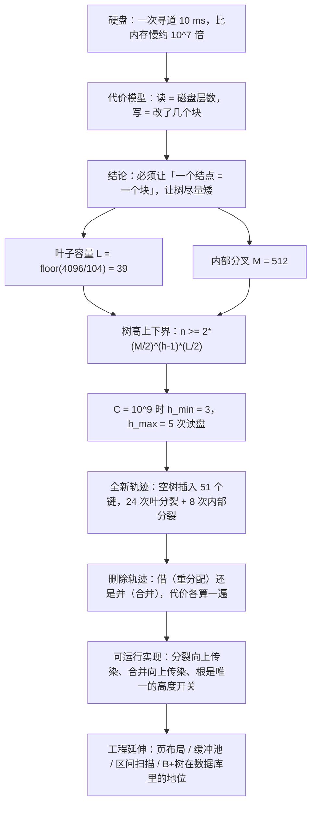

# C6.10 B+树 详解

> [!abstract] 这一篇的任务
> [[C6.10 B+树]] 已经把 B+ 树"是什么、规则有哪些、分裂与合并长什么样"讲完了。这一篇补三件事，都是那份讲义**故意留着没展开**的：
>
> 1. **把代价算成公式**。硬盘为什么慢、一次操作到底读写几个块、树高上下界怎么推、为什么十亿条记录只要几次读盘——全部给出推导，并指出课程讲义里那句话在严格意义下偏乐观。
> 2. **把每一步算给你看**。从一棵空树出发，51 个键按升序插进去，每一次分裂的**触发点、切法、路标怎么变**都列出来；再在 $M=5$、$L=3$ 的树上把 6 次删除的每一帧拆开，重分配与合并两条路各自算清代价。
> 3. **把实现写出来**。一份能编译、能过 60 万次随机对照测试的 C++ 参考实现，包含查找、插入、删除、区间查询；并附上真实数据库关心的页布局与缓冲池。

> [!info] 怎么读这一篇
> **它不能替掉 [[C6.10 B+树]]。** 那一篇是"课"，这一篇是"习题课 + 工程课"。建议顺序：
>
> - 只想过考试：读**第一、二节**（代价模型与树高上下界），然后跳到**第十一节**（题型与易错清单）；第七节末尾的选段里覆盖了考试常问的"路标该不该改"。
> - 想真的会手画：读**第三、四节**（全新轨迹），拿纸跟着画一遍，再对照**第五节**的删除。
> - 想动手写代码：读**第七、八节**。
> - 只想搞懂"数据库为什么用它"：读**第九节**。
>
> 标有 **（拓展）** 或 **【拓展】** 的内容，是课堂上没有展开、由教材与通行工程实践延伸补充的部分。

> [!info] 标注说明与授课进度
> 标有 **（拓展）** 或 **【拓展】** 的内容，是**课堂上没有展开讲、由教材与通行讲法延伸补充**的部分。
> **授课进度**：现有转写稿只到第四节课（停在第 3 章栈的扩容），树尚未开讲，本篇按整篇尚未授课理解。

> [!info] 课程信息与来源
> **Ya-Hui Jia（贾雅慧）｜SFT SCUT｜jiayahui@scut.edu.cn**。全课程信息见 [[C1.0 课程信息与C++预备]] 与 [[数据结构 MOC]]。
> 本篇与 [[C6.10 B+树]] 共用 `tree_part3` 的 **p.52–175**；这一段**没有布置作业**。
> 记号沿用上一讲：$M$ 是内部结点最多几个孩子，$L$ 是一个叶子块最多装几条记录，$C$ 是记录总数。



## 目录与页码对应

| 阅读入口 | 页码 | 内容 |
| --- | --- | --- |
| [[#一、代价模型：把 10 毫秒算进公式]] | 53–63 | 层次结构、块与浪费、**读写块数记账表** |
| [[#二、树高上下界：从定义推到公式]] | 64–102 | 容量公式、最好/最坏高度、对上一讲结论的严格校核 |
| [[#三、全新轨迹：从空树插到 51 条]] | 全篇（结构类） | 从空树开始，每一次分裂的触发点、切法与路标变化 |
| [[#四、插入顺序的代价差别]] | —（自建轨迹） | 升序、降序、随机三种顺序的分裂次数与占用率对比 |
| [[#五、删除轨迹：借还是并]] | 150–174 | 两条路逐一算代价、向上传染的全过程 |
| [[#六、路标维护：什么时候必须改]] | 159–160 等 | 路标的不变式、什么时候必须改、什么时候可以不写盘 |
| [[#七、参考实现（一）：结构与查找]] | — | 结点定义、二分定位、叶子链表、区间查询 |
| [[#八、参考实现（二）：插入与删除]] | — | 分裂、重分配、合并、根的两个开关 |
| [[#九、B+ 树在真实系统里长什么样]] | — | 页布局、缓冲池、B 树与 B\* 树、数据库索引 |
| [[#十、把两个模型对起来]] | — | Python 模型与 C++ 实现的一致性、口径差异清单 |
| [[#十一、题型清单与易错清单]] | — | 考试会怎么考、错在哪里 |

## 一、代价模型：把 10 毫秒算进公式

### 1.1 先看这张图

[[C6.10 B+树]] 第一节讲了三层存储的容量与速度，但只给了一张表。这张图把同一件事画在一起：**容量往下走，访问速度塌下来**。

![[C6-B+树-详解-存储层次.png]]

横轴是对数刻度的容量，条形长度就是这一层能装多少。缓存 1 KiB–1 MiB、内存 1 MiB–1 GiB、硬盘 1 GiB–1 TiB；右边的数字是这一层每秒大约能接受多少次访问，从 1 GHz 掉到 100 Hz。$\frac{10^9}{10^2}=10^7$，**一千万倍**。

关键不是"硬盘慢"，而是**下一段那句话**：读一个块和读块里一个字节**代价完全相同**。所以如果把一台机器的设计目标写成一句话，就是"**让每次读盘搬进来的 4096 个字节都别浪费**"。

> [!question] 停一下，先自己想想
> 既然读一个块和读一个字节一样贵，那为什么不把块做得特别大（比如 1 MiB），一次多搬点？
>
> 因为**每次读盘都要把整块搬进内存**，而块越大，平均浪费越多。一个文件占整数个块，最后一块平均空掉半个块：
> $$\text{平均浪费}=\frac{B}{2}.$$
> 块从 4 KiB 变成 1 MiB，平均浪费从 2048 字节变成 524 288 字节。更实际的问题是：**你要的往往只是块里的一条记录**，块越大，搬回来的无关数据越多，缓冲池能放下的块数越少。所以块大小是"浪费空间"和"一次多拿"之间的折中，现实中 4 KiB–16 KiB 是常见选择。

### 1.2 读写代价公式

> [!important] 代价模型（本篇后面所有时间都按它算）
> 设树高为 $h$（根的深度为 0，叶子在最底层，$h$ 数边数），**根常驻内存**。
>
> | 操作 | 读块数 | 写块数 | 时间（10 ms / 块） |
> | --- | --- | --- | --- |
> | 查找 | $h$ | 0 | $10h$ ms |
> | 查找 + 改这条记录 | $h$ | 1 | $10(h+1)$ ms |
> | 插入，叶子没满 | $h$ | 1 | $10(h+1)$ ms |
> | 插入，叶子分裂、父亲没满 | $h$ | 3 | $10(h+3)$ ms |
> | 插入，叶子 + 父亲分裂 | $h$ | 5 | $10(h+5)$ ms |
> | 插入，叶子 + 父亲 + 根分裂 | $h$ | 7 | $10(h+7)$ ms |
> | 删除，删完仍半满 | $h$ | 1 | $10(h+1)$ ms |
> | 删除，要重分配 | $h$ | 3 | $10(h+3)$ ms |
> | 删除，要合并（可能连锁） | $h$ | 逐层累加 | 见第五节 |
>
> **读块数恒等于 $h$**：从根往下走，每离开一层就要把下一层的块读进来；根在内存里，所以不计。这就是 B+ 树最值钱的性质——**任何一次查找的读盘次数都相同**，而且等于树高。

把 $h=3$（十亿条记录那棵树）代进去：

$$\text{查找}=30\text{ ms},\qquad \text{改一条记录}=40\text{ ms},\qquad \text{叶分裂}+父亲=60\text{ ms}.$$

> [!warning] 最常算错的地方：写块的个数
> 记账规则只有一条：**每改写一个已有块算 1 次写，每新建一个块算 1 次写。** 一次分裂必定产生"**1 个新块 + 1 个被改写的旧块**"（旧块留下一半记录，所以要写回）。
>
> | 场景 | 被改写 | 新建 | 写块数 |
> | --- | --- | --- | --- |
> | 插入，叶子没满 | 叶子 | — | **1** |
> | 叶子分裂、父亲没满 | 叶子、父亲 | 新右叶 | **3** |
> | 叶子 + 父亲分裂 | 叶子、父亲、祖父 | 新右叶、新右内 | **5** |
> | 叶子 + 父亲 + 根分裂 | 叶子、父亲、旧根 | 新右叶、新右内、新右根、**新根** | **7** |
>
> 逐档验算，并且和 [[C6.10 B+树]] 记的 30 / 50 / 70 / 90 ms 对一遍（$h=3$，读 20 ms）：
>
> | 插入的键 | 发生什么 | 写块数 | 本篇算出的时间 | [[C6.10 B+树]] 记的 |
> | --- | --- | --- | --- | --- |
> | 55 | 叶子没满 | 1 | $20+10=\mathbf{30}$ ms | 30 ms ✔ |
> | 60 | 叶分裂、父亲没满 | 3 | $20+30=\mathbf{50}$ ms | 50 ms ✔ |
> | 35 | 叶分裂 + 父亲分裂（还没到根） | 5 | $20+50=\mathbf{70}$ ms | 70 ms ✔ |
> | 86 | 叶 + 父亲 + 根分裂 | 7 | $20+70=\mathbf{90}$ ms | 90 ms ✔ |
>
> 四档全对上。注意最后一档：旧根被劈成两半，**原地留下左半边（写 1 次）**、新块装右半边（写 1 次），**再新建一个根（写 1 次）**——根这一层是 3 次写，三层合计 $2+2+3=7$。**不是 6**：如果漏掉"新建根"那一次，就会算成 80 ms，和 90 ms 对不上。

### 1.3 一个具体例子：块内浪费

一张 69 714 字节的图片：

$$\lceil 69714/4096\rceil=18\ \text{块},\qquad 18\times4096=73\,728\ \text{字节},\qquad \text{浪费 }73\,728-69\,714=4014\ \text{字节}.$$

> [!bug] 原稿的一处笔误
> 原文写的是 $18\times4098\text{ bytes}=73\,728\text{ bytes}$。$18\times4098=73\,764$，与右边结果不符；把 4098 改成 **4096** 才自洽。块大小是 4 KiB = 4096 字节，4098 是印错的。

## 二、树高上下界：从定义推到公式

这一节把 [[C6.10 B+树]] 6.1 节那张表**重新推一遍**，并且指出其中一处结论需要修正。**这是本篇最重要的部分之一，因为"树有多高"直接决定"读几次盘"，而这一类题考试极爱考。**

### 2.1 先定死记号

- $M$：内部结点最多 $M$ 个孩子（$M-1$ 个键）。
- $L$：叶子块最多 $L$ 条记录。
- $C$：记录总数。
- $h$：**含叶子层**的高度，即根到叶子的边数。根是内部结点时 $h\ge1$；整棵树只有一个叶子块时 $h=0$。

两个下限：

$$\text{叶子最少 } \left\lceil \frac{L}{2}\right\rceil \text{ 条},\qquad \text{内部结点最少 } \left\lceil \frac{M}{2}\right\rceil \text{ 个孩子}.$$

**所有叶子在同一深度。**

### 2.2 最好情况：每个结点都装满

叶子块数最少是 $\left\lceil C/L\right\rceil$。内部结点每层能分出 $M$ 叉，所以

> [!important] 最好高度
> $$h_{\min}=\left\lceil \log_M \left\lceil \frac{C}{L}\right\rceil\right\rceil .$$

代入 $M=512$、$L=39$、$C=10^9$：

$$\left\lceil \frac{10^9}{39}\right\rceil=25\,641\,026\ \text{个叶子块},\qquad \log_{512}25\,641\,026=2.7347,\qquad h_{\min}=3.$$

> [!warning] 别把 $\lfloor\cdot\rfloor$ 和 $\lceil\cdot\rfloor$ 混了
> $512^2=262\,144$，$512^3=134\,217\,728$。叶子块有 2564 万个，落在 $512^2$ 和 $512^3$ 之间，所以**第 3 层才装得下**。
> 如果按 $\lfloor\log_{512}10^9\rfloor$ 直接算记录数会得到 3（因为 $\log_{512}10^9=3.32$），数字碰巧一样，但**口径不同**：一个数的是"记录数除以分叉"，一个数的是"叶子块数除以分叉"。$C$ 和 $C/L$ 差 39 倍，取整结果可能差一层。考试按"叶子块数"算最稳。

### 2.3 最坏情况：每个结点都只半满

最坏情况要**自下而上**数容量：设 $N_{\min}(h)$ 是高度为 $h$ 的 B+ 树**至少**能装多少条记录。

- $h=0$：根就是叶子块，$N_{\min}(0)=L$。
- $h\ge1$：根至少有 **2** 个孩子（这是定义里根的特例），第 2 层及以下每个内部结点至少有 $\lceil M/2\rceil$ 个孩子，最底下每个叶子块至少有 $\lceil L/2\rceil$ 条记录：

$$N_{\min}(h)=2\cdot\left\lceil \frac{M}{2}\right\rceil^{\,h-1}\cdot\left\lceil \frac{L}{2}\right\rceil .$$

反过来解 $h$：

> [!important] 最坏高度
> $$h_{\max}=\min\left\{h:\ 2\left\lceil \frac{M}{2}\right\rceil^{\,h-1}\left\lceil \frac{L}{2}\right\rceil \ge C\right\}.$$
>
> （也可以把它写成 $\left\lceil\log_{\lceil M/2\rceil}\left\lceil C/\lceil L/2\rceil\right\rceil\right\rceil$，但那个写法**默认根也有 $\lceil M/2\rceil$ 个孩子**，比定义要求的 2 个强，算出来会偏小。见 2.4。）

代入 $M=512$、$L=39$（$\lceil M/2\rceil=256$，$\lceil L/2\rceil=20$）：

| $h$ | $N_{\min}(h)$ |
| --- | --- |
| 0 | 39 |
| 1 | $2\times20=40$ |
| 2 | $2\times256\times20=10\,240$ |
| 3 | $2\times256^2\times20=2\,621\,440$ |
| 4 | $2\times256^3\times20=671\,088\,640$ |
| 5 | $2\times256^4\times20=1.718\times10^{11}$ |

$C=10^9$ 落在 $N_{\min}(4)$ 和 $N_{\min}(5)$ 之间：

$$671\,088\,640<10^9<171\,798\,691\,840\ \Longrightarrow\ h_{\max}=5 .$$

$C=10^{13}$：

$$N_{\min}(5)\approx1.72\times10^{11}<10^{13}<N_{\min}(6)\approx4.40\times10^{13}\ \Longrightarrow\ h_{\max}=6 .$$

### 2.4 上一讲那条结论要修正

[[C6.10 B+树]] 6.1 节的表里写着：$10^9$ 条记录最坏高度 **4**、$10^{13}$ 条最坏 **5**，用的是

$$\left\lceil \log_{256}\left\lceil \frac{10^9}{20}\right\rceil\right\rceil=\lceil \log_{256}50\,000\,000\rceil=\lceil3.1969\rceil=4,\qquad \left\lceil\log_{256}\left\lceil\frac{10^{13}}{20}\right\rceil\right\rceil=\lceil4.86\rceil=5 .$$

这两个数本身没算错，但**口径比定义宽**：它默认根也至少有 256 个孩子。真实的定义只要求根有 **2** 个孩子。把根放宽到 2 之后，同样的层数能装的记录少了 128 倍，于是：

> [!warning] 严格结论
> - $10^9$ 条记录，**最坏高度是 5，不是 4**：$h=4$ 的最坏容量只有 $6.71\times10^8<10^9$。
> - $10^{13}$ 条记录，**最坏高度是 6，不是 5**：$h=5$ 的最坏容量约 $1.72\times10^{11}<10^{13}$。
>
> 讲课和做题时用的公式（$\left\lceil\log_{\lceil M/2\rceil}\lceil C/\lceil L/2\rceil\rceil\right\rceil$）作为**工程估计**没问题、也够用，但要知道它答的是"**根也长满**时的最坏高度"。要答"定义允许的最坏高度"，就得用 $N_{\min}(h)$ 的公式。

**为什么这个差别值得较真？** 因为它正好是 B+ 树"根可以只有 2 个孩子"这条特例的代价。根越可以稀疏，同样层数能装的记录就越少，最坏高度就越高。而**最好和最坏之间的差距**是真正要关心的：

| 记录数 | 最好（全满） | 最坏（全半满，严格） | 差 |
| --- | --- | --- | --- |
| $10^9$ | 3 | 5 | 2 层 = 20 ms |
| $10^{13}$ | 5 | 6 | 1 层 = 10 ms |

> [!important] 这张表就是"半满规则"存在的理由
> 如果没有半满规则，一棵 $10^9$ 条的 B+ 树可以退化成一条长链，高度是 $10^9$。有了半满规则，**最坏也不过比最好多两层**——任何一条记录都能在 50 ms 内拿到。
> 对比一下：AVL 树保证 $h\le1.44\lg n$，红黑树保证 $h\le2\lg(n+2)-3$，都是在"内存里指针跳转是常数代价"的前提下说"树高是 $O(\lg n)$ 就行"。**在磁盘上不行**：底数从 2 变成 256，$h$ 从 29 变成 4–5，差的就是 25 次读盘、250 毫秒。

### 2.5 为什么块内操作都算 $\Theta(1)$

块大小固定 4 KiB，所以 $L$、$M$ 是**由块大小定死的常数**。块内往有序数组插一条记录是 $O(L)$、在 $M-1$ 个键里二分是 $O(\lg M)$，但：

- $L=39$、$M=512$ 都是常数，与 $C$ 无关；
- 一次 10 ms 的读盘面前，$O(39)$ 的数组搬移完全可以忽略。

所以**每个块内的操作都记作 $\Theta(1)$**，一次查找的总代价就是

$$\underbrace{\Theta(1)}_{\text{每层块内}}\times h=\Theta(\lg_{M} C)=\Theta(\lg C) .$$

> [!warning] 但复杂度一样不代表时间一样
> B+ 树和 AVL 树的查找都是 $\Theta(\lg n)$，可是在磁盘上一个是 3–5 次读盘、一个是 29 次。**"复杂度相同"这件事，只在常数因子真的可以忽略时才成立**；磁盘把常数因子放大到了 $10^7$，于是底数变成了主要矛盾。这就是 [[C6.9 多路搜索树]] 那句"当跳一个结点的代价压倒一切时，多路树才值得用"的量化版本。

> [!question] 课堂追问
> 既然 $h=\Theta(\lg C)$，为什么 B+ 树还要费劲保证"所有叶子同深度"？$\Theta$ 记号不是已经把常数吃掉了吗？
>
> 因为 $\Theta$ 只保证"随 $C$ 增长的**阶**"，不保证"每次操作的**具体次数相同**"。如果允许叶子深浅不一，同一条记录可能读 3 次盘、另一条读 6 次；**最坏那一条**就成了系统延迟。数据库的 SLA 是按最坏情况签的，所以"所有叶子同深度"不是数学上的美观要求，是**延迟上限**的要求。

---

## 三、全新轨迹：从空树插到 51 条

[[C6.10 B+树]] 是从一棵**已经建好的** 51 条记录的树出发的，所以"这棵树当初是怎么长出来的"没有交代。这一节补上：**从一棵空树开始，把同样的 51 个键按升序一个个插进去**，每一步的分裂都写出来。

为什么要用升序？因为升序是**最坏情况**（第 3.4 节会给数字），它把分裂的每种形态都演了一遍。

### 3.1 规则先摆清楚

> [!important] 插入规则（本篇和上一讲完全一致）
> 1. 按查找的路径走到该放的那个叶子块。
> 2. **块没满**（记录数 $<L$）：插进数组，写回叶子，结束。
> 3. **块已经满了**：先把它一分为二，再把新记录插进该去的那一半。
>    - 叶子：左半留 $\lfloor L/2\rfloor$ 条、右半留 $\lceil L/2\rceil$ 条（$L=3$ 时是 1 与 2）；
>      右半的最小键**复制**到父亲当路标。
>    - 内部：左半留 $\lfloor M/2\rfloor$ 个孩子、右半留 $\lceil M/2\rceil$ 个孩子（$M=5$ 时是 2 与 3）；
>      中间那个键**移到**上一层。
> 4. 父亲因此多了一个键和一个指针。**父亲也满**就继续往上裂，一直到根；**根也满**就新建一个根，树长高一层。

### 3.2 前三次分裂：看规则怎么落地

空树插入 2、3、4（$L=3$，都装得下），插第 4 个键 7 时，叶子已经有 3 条，按规则 3 先分裂：

```
插 7 之前：              (2 3 4)
插 7：不能直接塞。先把 (2 3 4) 一分为二 → (2 3) | (4)
      新记录 7 该去右半  → (2 3) | (4 7)
      右半的最小键 4 复制到父亲
结果：                        [4]
                            /     \
                        (2 3)     (4 7)
```

注意两件事：**树长高了一层**（从"只有一个叶子块"变成"一个内部结点 + 两个叶子"），而**4 这条记录仍然在右叶子里**——父亲里的 4 只是路标。这就是"叶子分裂复制、内部分裂移动"那条区别的第一次出现。

继续插 8（进右半，没满）、插 9（右半 `(4 7 8)` 满了 → 裂成 `(4 7)` 和 `(8 9)`）：

```
[4 8]
  (2 3)
  (4 7)
  (8 9)
```

接着插 11 到 21 的过程中，**左边界一点点把父亲撑满**：每次都是最右边的叶子裂开、往父亲里塞一个新路标。

### 3.3 第一次"长高"：插 21，父亲也满了

插 21 时，叶子 `(15 18 20)` 满了要裂，而父亲 `[4 8 12 15]` **已经有 4 个键（5 个孩子）**，加不进去了：

```
插 21：
  叶子 (15 18 20) 裂成 (15 18) | (20)，新记录 21 进右半 → (20 21)
  路标 20 要挂进父亲，可父亲 [4 8 12 15] 满了
  父亲一分为二（M=5：左留 2 个孩子、右留 3 个）：
      [4 8] 和 [15 20]，中间键 12 移到上一层
  上一层是根，本来就没有 → 新建根 [12]
结果：              [12]
                 /      \
             [4 8]      [15 20]
            /  |  \     /   |   \
        (2 3)(4 7)(8 9)(12 14)(15 18)(20 21)
```

> [!important] 读这一段要抓住两件事
> 1. **叶子分裂是"复制"路标，内部分裂是"移动"键**。父亲里的 12 在分裂前是键，分裂后**在下一层消失了**（它作为路标升上去，不再留在 `[4 8]` 或 `[15 20]` 里）。而叶子里的键一个都没少。
> 2. **高度只在根被分裂时才 +1**。这一次是"14 号叶子裂开 → 父亲裂开 → 根不存在（就是父亲）→ 新建根"，三个动作连着发生，但树只长高了一层。

### 3.4 一次三层全裂：插 64

这是整条轨迹里最壮观的一步，值得单独看：

```
插 64：
  叶子 (59 61 63) 满了，新记录 64 进来 → 裂成 (59 61) | (63 64)，路标 63
  父亲 [49 52] 满了 → 裂成 [49 52] | [59 63]，中间键 56 升上去
  祖父 [12 24 33 45] 也满了 → 裂成 [12 24] | [45 56]，中间键 33 升上去
  再上面是根 [33]，它本来就只有 1 个键…… 不对，此时它已经是上一层，
                                只能新建根 [33]
```

这一串动作对应 **7 次写**、**2 次读**（根在内存）。插完以后：

```
[33]
  [12 24]          [45 56]
  ├ (2 3)          ├ (45 48)
  ├ (4 7)          ├ (49 51)
  ├ (8 9)          ├ (52 54)
  [15 20]          [59 63]
  ├ (12 14)        ├ (56 58)
  ├ (15 18)        ├ (59 61)
  ├ (20 21)        ├ (63 64)
  [27 30]
  ├ (24 26)
  ├ (27 28)
  └ (30 32)
```

### 3.5 51 个键的完整分裂清单

把升序插入 2, 3, 4, 7, 8, 9, 12, 14, 15, 18, 20, 21, 24, 26, 27, 28, 30, 32, 33, 36, 39, 40, 42, 43, 45, 48, 49, 51, 52, 54, 56, 58, 59, 61, 63, 64, 66, 67, 69, 71, 74, 75, 78, 79, 81, 82, 85, 88, 91, 92, 98 的全过程列出来。**只有发生分裂的那一步才列**，没列到的键都是"直接插进叶子，写 1 个块"。

| 第几个 | 插入 | 发生什么 | 树高 |
| --- | --- | --- | --- |
| 4 | 7 | 叶裂 `(2 3)(4 7)`，路标 4 | 0 → **1** |
| 6 | 9 | 叶裂 `(4 7)(8 9)`，路标 8 | 1 |
| 8 | 14 | 叶裂 `(8 9)(12 14)`，路标 12 | 1 |
| 10 | 18 | 叶裂 `(12 14)(15 18)`，路标 15 | 1 |
| 12 | 21 | 叶裂 `(15 18)(20 21)`，路标 20；**父裂** `[4 8]｜[15 20]`，键 12 上升 | 1 → **2** |
| 14 | 26 | 叶裂 `(20 21)(24 26)`，路标 24 | 2 |
| 16 | 28 | 叶裂 `(24 26)(27 28)`，路标 27 | 2 |
| 18 | 32 | 叶裂 `(27 28)(30 32)`，路标 30；**父裂** `[15 20]｜[27 30]`，键 24 上升 | 2 |
| 20 | 36 | 叶裂 `(30 32)(33 36)`，路标 33 | 2 |
| 22 | 40 | 叶裂 `(33 36)(39 40)`，路标 39 | 2 |
| 24 | 43 | 叶裂 `(39 40)(42 43)`，路标 42；**父裂** `[27 30]｜[39 42]`，键 33 上升 | 2 |
| 26 | 48 | 叶裂 `(42 43)(45 48)`，路标 45 | 2 |
| 28 | 51 | 叶裂 `(45 48)(49 51)`，路标 49 | 2 |
| 30 | 54 | 叶裂 `(49 51)(52 54)`，路标 52；**父裂** `[39 42]｜[49 52]`，键 45 上升 | 2 |
| 32 | 58 | 叶裂 `(52 54)(56 58)`，路标 56 | 2 |
| 34 | 61 | 叶裂 `(56 58)(59 61)`，路标 59 | 2 |
| 36 | 64 | 叶裂 `(59 61)(63 64)`，路标 63；**父裂** `[49 52]｜[59 63]`，键 56 上升；**祖父裂** `[12 24]｜[45 56]`，键 33 上升 | 2 → **3** |
| 38 | 67 | 叶裂 `(63 64)(66 67)`，路标 66 | 3 |
| 40 | 71 | 叶裂 `(66 67)(69 71)`，路标 69 | 3 |
| 42 | 75 | 叶裂 `(69 71)(74 75)`，路标 74；**父裂** `[59 63]｜[69 74]`，键 66 上升 | 3 |
| 44 | 79 | 叶裂 `(74 75)(78 79)`，路标 78 | 3 |
| 46 | 82 | 叶裂 `(78 79)(81 82)`，路标 81 | 3 |
| 48 | 88 | 叶裂 `(81 82)(85 88)`，路标 85；**父裂** `[69 74]｜[81 85]`，键 78 上升 | 3 |
| 50 | 92 | 叶裂 `(85 88)(91 92)`，路标 91 | 3 |
| — | 其余 27 个 | 叶子还有空位，直接插、只写叶子 | — |

**统计：叶分裂 24 次、内部分裂 8 次、新建根 3 次。** 终态：

```
[33]
  [12 24]
    (2 3) (4 7) (8 9)
    [15 20]
    (12 14) (15 18) (20 21)
    [27 30]
    (24 26) (27 28) (30 32)
  [45 56 66 78]
    [39 42]
    (33 36) (39 40) (42 43)
    [49 52]
    (45 48) (49 51) (52 54)
    [59 63]
    (56 58) (59 61) (63 64)
    [69 74]
    (66 67) (69 71) (74 75)
    [81 85 91]
    (78 79) (81 82) (85 88) (91 92 98)
```

51 条记录、**25 个叶子块、11 个内部结点、高度 3、叶子平均占用 68%**。

> [!warning] 这棵树和 [[C6.10 B+树]] 里那棵不一样，两者都是对的
> 对比一下：上一讲那棵树是 **18 个叶子、4 个内部结点、高度 2**，这一棵是 **25 个叶子、11 个内部结点、高度 3**。
> 同一批键，**建树顺序不同 → 树形不同**。B+ 树的定义（所有叶子同深度、每个结点至少半满）**不唯一确定一棵树**，它只规定"哪些形状是合法的"。数据库里最终长成什么样，取决于历史插入顺序。
> 这一点很重要：**考试让你"画出插入序列后的 B+ 树"时，答案唯一；但让你判断"某棵树是否合法"时，合法解有很多个。**

### 3.6 上一讲那棵树是怎么来的

上一讲那棵 51 条的树，用升序建不出来。它的叶子大小分布是"3 条为主、少数 2 条"：

| 叶子记录数 | 个数 |
| --- | --- |
| 3 条 | 15 |
| 2 条 | 3 |

$15\times3+3\times2=45+6=51$，对上了。而**升序**建出来的是另一种分布：

| 叶子记录数 | 上一讲那棵树 | 本篇升序自建 |
| --- | --- | --- |
| 3 条 | 15 个 | **1 个** |
| 2 条 | 3 个 | **24 个** |
| 叶子平均占用 | 63.9% | 68.0% |

升序自建出来的树里，**几乎每个叶子都停在半满的 2 条**（只有最后一个是 3 条）——这非常符合直觉：一直往最右边打，边界叶子反复"裂成 1 与 2、再把新键填进半边"，两边很快就都落到下限附近。而上一讲那棵树的叶子以 3 条为主，说明它**不是升序插出来的**，而是来自**别的插入顺序**（或者建树时做过批量装载、中间发生过删除）。

> [!important] 所以本篇的做法是
> 上一讲那棵树继续当**查找、以及插入 55/87/60/11/35/86 这六步的基准**（它和上一讲的每一步逐帧对得上）；
> 本篇第三节这条全新轨迹，专门用来**把插入讲透**（升序是最坏情况，分裂形态最全）。
> 两条线各自自洽，不会互相矛盾。

---

## 四、插入顺序的代价差别

### 4.1 同一批键，三种顺序

把 51 个键按三种顺序插进同一棵空树，数分裂次数（数字由模型跑出）：

| 插入顺序 | 叶分裂 | 内部分裂 | 新建根 | 终态叶子 | 内部结点 | 平均占用 | 树高 |
| --- | --- | --- | --- | --- | --- | --- | --- |
| **升序**（2,3,4,…,98） | **24** | **8** | 3 | 25 | 11 | 68% | 3 |
| **降序**（98,92,…,2） | **24** | **8** | 3 | 25 | 11 | 68% | 3 |
| 随机（第 1 次） | 21 | 6 | 3 | 22 | 9 | 77% | 3 |
| 随机（第 2 次） | 20 | 4 | 2 | 21 | 6 | 81% | 2 |
| 随机（第 3 次） | 20 | 6 | 3 | 21 | 9 | 81% | 3 |

### 4.2 为什么会这样

升序插入时，**每一个新键都落在"最右边那个叶子"**，而这个叶子永远是刚被写满的那个；它一裂，新右半只有 1–2 条，下次又满得很快。

$$\text{升序}:24\ \text{次叶分裂};\qquad \text{随机}:20\text{–}21\ \text{次}.$$

差的那三四次看起来不多，但**平均占用率**差得更明显：68% 对 81%。占用率低意味着**同样多的记录要占更多叶子块**，磁盘空间和缓冲池命中率都会变差。极端情况下（$L$ 很大、纯升序），占用率会趋近于 50%。

> [!important] 结论：为什么数据库不慌
> - 真实负载里主键很少是"严格升序"的；而且很多数据库会**在叶子块里预留空间**（例如 InnoDB 的 `MERGE_THRESHOLD`、`fill_factor`），就是拿空间换"插入时少分裂"。
> - 即使真的升序插入，占用率的下限也只是**半满**（50%），不会退化成链。这正是半满规则的另一层作用：**它同时兜住了"最坏树高"和"最坏空间利用率"**。
> - 想主动消除顺序插入的代价，可以**先对键批量排序再自底向上装叶子块**（bulk load，见第九节）。

> [!question] 停一下，先自己想想
> 升序和降序的分裂次数**完全一样**（都是 24 / 8 / 3）。这是巧合吗？
>
> 不是。把整批键的**大小顺序反过来**，B+ 树的插入算法是左右对称的：升序是"永远打最右边界"，降序是"永远打最左边界"，边界外侧的邻接关系一样，所以分裂序列镜像相同。**真正决定代价的是"新键落在已有数据的内部还是边界"**，不是升序还是降序。

---

## 五、删除轨迹：借还是并

删除比插入麻烦的地方在于：**插入不会让任何结点变少，删除会让结点跌破下限**，于是要判断"向邻居借"还是"和邻居并"。

### 5.1 两条路与判定条件

一个叶子块删掉一条记录后，可能少于 $\lceil L/2\rceil$ 条。这时**按顺序检查**：

> [!important] 删除的修正规则
> 设被删的结点为 $X$，它的（同一个父亲下的）相邻兄弟为 $S$：
>
> 1. **重分配（redistribute / borrow）**：如果 $S$ 的记录数 $>\lceil L/2\rceil$（有多余的），从 $S$ 借一条过来，**并更新父亲的路标**。
>    - $S$ 在左边：把 $S$ 的**最大**记录挪到 $X$ 的开头；
>    - $S$ 在右边：把 $S$ 的**最小**记录挪到 $X$ 的末尾。
> 2. **合并（merge）**：如果 $S$ 也只有 $\lceil L/2\rceil$ 条，把 $X$ 和 $S$ 合成一个块，父亲少一个孩子、少一个路标。
> 3. 合并会让**父亲**少一个孩子。父亲若跌破 $\lceil M/2\rceil$ 个孩子，对**内部结点**重复步骤 1–2（借孩子 / 并孩子），可能一路传到根。
> 4. **根只剩一个孩子**：删掉根，那个孩子成为新根，**树矮一层**。

> [!warning] 为什么"借"要更新父亲，而"并"要重算路标
> 路标是"右边那棵子树的最小键"。
> - **借**：$X$ 的最小键可能变了（从左兄弟借了更小的进来），所以父亲里指向 $X$ 的那个路标要改。
> - **并**：$X$ 和 $S$ 合成了一块，**合并结果的最小键**成了父亲里那个分隔键，要改成它。
>
> 这两件事看起来琐碎，但漏一个就会让某次查找走错路。第六节专门讲。

### 5.2 基准树

从 [[C6.10 B+树]] 里那棵 **57 条、高度 3** 的树出发（插入 55、87、60、11、35、86 之后）：

```
[49]
  [21 35]                          [67 85]
    (2 3 4) (7 8) (9 11)             (49 51 52) (54 55 56) (58 59)
    (12 14 15) (18 20)               (60 61) (63 64 66)
    (21 24 26) (27 28 30) (32 33)    (67 69 71) (74 75 78) (79 81 82)
    (35 36) (39 40 42) (43 45 48)    (85 86) (87 88) (91 92 98)
```

![[C6-B+树-详解-两棵树对照.png]]

上面这张图把两棵树并排画了出来：**(a)** 是本节和下一节的基准（51 条、高度 2），**(b)** 是插入那 6 个键之后的 57 条、高度 3。删除要从 (b) 那个形状出发。

### 5.3 删 98、75、39：三次都只写了一个块

| 删除 | 叶子变化 | 还要做什么 | 读 | 写 |
| --- | --- | --- | --- | --- |
| 98 | `(91 92 98)` → `(91 92)`，仍 ≥ 2 条 | **什么都不用做**：91 还是这块的最小键，父亲的路标 91 依然正确 | 3 | **1** |
| 75 | `(74 75 78)` → `(74 78)`（后面的 78 往前挪） | **什么都不用做**：74 还是最小键 | 3 | **1** |
| 39 | `(39 40 42)` → `(40 42)` | 这块的最小键从 39 变成 40，父亲的路标 `[39 43]` → `[40 43]` | 3 | **2** |

三次都是 20 + 10 = **30 ms**（第三次 40 ms，因为多写了父亲）。**前两次一个字节都不用改上层**——这就是"删除通常比插入便宜"的原因。

> [!important] 删 39 这一步藏着一个考点
> 父亲里的路标从 39 改成 40 以后，**以后再插入 39，它会落进左边那个叶子 `(35 36)`**，而不是回到 `(40 42)` 旁边。这不是 bug：39 介于 35 和 40 之间，本来就该在那一块。**"删掉再插回来"不一定回到原位**，这是 B+ 树很反直觉、但考试爱问的一点。

### 5.4 删 59：重分配还是合并，两条路都走一遍

删 59 以后，叶子 `(58 59)` 变成 `(58)`，只有 1 条，跌破下限 2。左右邻居：左边 `(54 55 56)`（3 条，有余量），右边 `(60 61)`（2 条，刚好半满）。

**路线 A：向左兄弟借（重分配）**

```
(54 55 56) (58 59) (60 61)
删 59 →  (54 55 56) (58) (60 61)
(58) 不足半满，左兄弟 (54 55 56) 有 3 条 > 2，可以借
把左兄弟最大的 56 挪过来 → (54 55) | (56 58)
父亲的路标原来指着 (58)，现在这块的最小键变成 56 → 路标 58 改成 56
结果： (54 55) (56 58) (60 61)     父亲 [54 56 60 63]
```

**路线 B：与右兄弟合并**

```
删 59 →  (54 55 56) (58) (60 61)
(58) 与右兄弟 (60 61) 合并 → (58 60 61)
父亲里指向 (60 61) 的路标 60 被去掉 → [54 58 63]
结果： (54 55 56) (58 60 61) (63 64 66)   父亲 [54 58 63]
```

两条路的读写代价：

| 路线 | 被改写的块 | 写块数 | 时间 |
| --- | --- | --- | --- |
| A 借 | 左兄弟、被补的叶子、父亲 | 3 | 20 + 30 = **50 ms** |
| B 并 | 合并结果（写进原叶子）、父亲 | 2 | 20 + 20 = **40 ms** |

> [!important] 为什么多数实现优先选"并"
> 因为**并少写一个块**（40 ms vs 50 ms），而且并之后结点的占用率更高（合并结果 3 条，比借完的 2 条和 2 条更省空间）。
> "借"只在一种情况下更优：**并会引发上层连锁**（父亲孩子数跌破下限，要再借或再并），而借到这一步就停了。所以真正的实现常写成"**先看合并会不会把父亲也搞塌，会的话宁可借**"。
> 上一讲的这两步演示选的是**合并**，与本篇算出的代价一致。

### 5.5 删 35：一次连锁到根、树矮一层

这一步是整段删除里最难的，因为它**连续触发了叶子合并 → 内部合并 → 内部合并 → 删根**：

```
第 0 步（删之前，相关部分）：
  [21 35]
    (21 24 26) (27 28 30) (32 33) (35 36) (39 40 42) (43 45 48)
        ↑ 父 [27 32]              ↑ 父 [39 43]

① 删 35：(35 36) → (36)，只有 1 条，不足半满
② 与右兄弟 (39 40 42) 合并 → (36 40 42)          ← 叶层合并
   父亲 [39 43] 去掉路标 39 → [43]，只剩 1 个键 = 2 个孩子，跌破下限 3
③ [43] 的兄弟是 [27 32]（同一个父亲 [21 35] 下），两兄弟都只有 2 个孩子
   合并 [27 32] 与 [43] → [27 32 36 43]，父亲 [21 35] 去掉分隔键 35 → [21]
       （注意：[27 32] 与 [43] 合并后最小键变成 36，所以上一层路标要跟着改）
④ 现在 [21] 只有 1 个键 = 2 个孩子，又跌破下限
   它的兄弟是 [67 85]（根 [49] 下的另一个孩子）
   合并 [21] 与 [67 85] → [21 49 67 85]（分隔键 49 被拉下来）
⑤ 根 [49] 现在只剩一个孩子了 → 删掉根，[21 49 67 85] 成为新根
   树高 3 → 2
```

最终结果（**与上一讲的末态逐字一致**）：

```
[21 49 67 85]
  [7 9 12 18]      (2 3 4) (7 8) (9 11) (12 14 15) (18 20)
  [27 32 36 43]    (21 24 26) (27 28 30) (32 33) (36 40 42) (43 45 48)
  [54 58 63]       (49 51 52) (54 55 56) (58 60 61) (63 64 66)
  [74 79]          (67 69 71) (74 78) (79 81 82)
  [87 91]          (85 86) (87 88) (91 92)
```

![[C6-B+树-根消失降高.png]]

上图就是第 ⑤ 步：最上面那个**空方框**是将被删掉的旧根，箭头指向接替它的 `[21 49 67 85]`。一个只剩独子的根没有任何引导作用——查找经过它还是落到同一个地方，**纯粹多读一次盘**。

**这一步的写块数**：删完后要写的块有——被删的叶子（`(36)` 并进右兄弟，写合并结果）、[43] 合并的结果、[21] 合并的结果、新根、以及两层父亲被改写的块。实测是 **7 个块**：

$$20\ \text{ms（读 2 层）} + 70\ \text{ms（写 7 块）} = 90\ \text{ms}.$$

**一次删除花掉 90 ms，和"三层全裂的插入"一样贵。** 这是删除路径的写放大，也是"删多插少的负载要小心"的原因。

> [!question] 课堂追问
> 第 ③ 步有一个更"省"的选择：从隔壁内部结点 `[54 58 63]` **借一个叶子块**过来（上一讲也演示了这条），只用重分配、不用合并。为什么不选它？
>
> 因为那要**经过根**才能调整两个不同父亲下的孩子数：`[43]` 的兄弟得从根的另一棵子树里借，于是**根和它下面的两个内部结点都要改写**，写块数反而更多。而 `[27 32]` 和 `[43]` **共用一个父亲**，合并它们只需要改一个父亲。
> 速判口诀：**能跟"同一个父亲下的兄弟"解决，就不要跨父亲去借。**

### 5.6 删 88：最后一步

```
(87 88) 删 88 → (87)，不足半满
与右兄弟 (91 92) 合并 → (87 91 92)                 ← 叶层合并
父亲 [87 91] 去掉路标 → [87]，只有 2 个孩子，跌破下限
与左兄弟 [74 79] 合并 → [74 79 85 87]，根 [67 85] 去掉 85 → [67]
   上一层路标：67 → 74（合并结果的最小键）
结果：根 [21 49 67]
```

终态高度 2、51 条记录，与上一讲的末页逐字一致。

### 5.7 删除全过程的读写代价

| 删除 | 叶层 | 内部层 | 删根 | 写块数 | 时间 |
| --- | --- | --- | --- | --- | --- |
| 98 | 改写叶子 | — | — | 1 | 30 ms |
| 75 | 改写叶子 | — | — | 1 | 30 ms |
| 39 | 改写叶子 + 改路标 | — | — | 2 | 40 ms |
| 59 | 合并两个叶子 + 改父亲 | — | — | 2 | 40 ms |
| 35 | 合并两个叶子 | 两次内部合并（含写父亲） | 是 | 7 | 90 ms |
| 88 | 合并两个叶子 | 一次内部合并 | — | 4 | 60 ms |

> [!important] 把插入和删除放在一起看
> | 操作 | 最好 | 常见 | 最坏 |
> | --- | --- | --- | --- |
> | 查找 | — | 30 ms | 50 ms（高度 5） |
> | 插入 | 40 ms | 50 ms | 90 ms（三层全裂） |
> | 删除 | 30 ms | 40–60 ms | 90 ms（连锁到根） |
>
> **三条结论**：
> 1. **查找的代价是固定的**，这是 B+ 树最值钱的性质；
> 2. **插入和删除的代价是"最坏情况"驱动的**——正因为分裂和合并很少发生（第 4.2 节：平均每 16 次插入才裂一次叶），平均代价才接近查找；
> 3. **写比读贵**，而删除可能比插入更贵（连锁合并一次要改很多块）。

---

## 六、路标维护：什么时候必须改

上一节的删除留下了一个悬案：**"路标改了、不改，到底行不行？"** 这一节把它彻底讲清。这也是 [[C6.10 B+树]] 9.2 节那个课堂追问的展开。

### 6.1 路标本来该满足什么

内部结点有 $M$ 个孩子 $T_0,T_1,\dots,T_{M-1}$ 和 $M-1$ 个键 $k_1,\dots,k_{M-1}$（$k_i$ 对应 $T_i$，$T_0$ 没有键）。查找的走法是：

$$k_i \le x < k_{i+1}\ \Longrightarrow\ \text{走 } T_i .$$

要让这个过程正确，**只需要一个不等式**：

> [!important] 路标的不变式（必须成立）
> 对每个 $i\ge1$：
> $$k_i\ \le\ \min(T_i).$$
> **$k_i$ 只需要不大于右边子树的最小键**，不要求等于它。

"$k_i=\min(T_i)$"是**定义的规范形**（[[C6.10 B+树]] 5.2 节第 6 条），比上面这个不变式**更强**。规范形好维护、好讲、好查错；不变式才是正确性的底线。

### 6.2 三种情形，逐一判断

| 情形 | 例 | 不改行不行 | 原因 |
| --- | --- | --- | --- |
| 删掉叶子里的**非最小键** | `(91 92 98)` 删 98 → `(91 92)` | **行** | 最小键还是 91，路标 91 完全没变 |
| 删掉叶子里的**最小键**，路标偏小 | `(39 40 42)` 删 39 → `(40 42)`，路标仍 39 | **行**（但会破坏规范形） | $39\le\min=40$，不变式仍成立，查找 39 和 40 都走对 |
| **合并**后路标偏大 | `[27 32]` 与 `[43]` 合并成 `[27 32 36 43]`，上一层路标写 35 | **不行** | 合并结果的最小键是 **36**，而 $35<36$，不变式 $k_i\le\min(T_i)$ 被破坏 |

### 6.3 第二种情形：为什么"行"，却又建议改

把 `(39 40 42)` 删成 `(40 42)` 而**不改**路标 39：

```
叶子 (35 36) | (40 42) | (43 45 48)
路标         | 39      | 43
```

- 查 **39**：$39\ge39$ → 走中间那棵 `(40 42)`，里面没有 → 返回"不存在"。✔ 正确。
- 查 **40**：$39\le40<43$ → 走中间 `(40 42)`，找到。✔ 正确。
- 查 **38**：$38<39$ → 走左边 `(35 36)`，没有。✔ 正确。

**三种查询都对。** 那为什么规范形还要改成 40？因为：

1. **可读性**：路标 39 指向一棵最小键是 40 的子树，看图的人会以为 39 在里面；
2. **可判定性**：查找程序一旦走到叶子发现没找到，就能断定"整棵树里没有"——这个推论依赖"查找路径是唯一确定的"。路标偏离最小值时，路径依然唯一，所以这一条其实不受影响；
3. **代价**：改成 40 要多写一个父亲块（1 次写 = 10 ms）。**很多实现为了省这一次写，就让它偏小。**

> [!tip] 速判口诀
> **路标只要"不大于右边子树的最小键"，就还是对的。**
> 所以删掉一个**非最小键**：什么都不用做。
> 删掉**最小键**：可以不改（偏小无害），也可以改成新的最小值（规范形，多一次写）。
> **合并或向右借了记录**：必须重算，否则路标会偏大，**偏大就是真错**。

### 6.4 偏大为什么是真错：一个反例

按 5.5 节第 ③ 步合并出来的结点是 `[27 32 36 43]`（最小键 36），如果**偷懒不更新**上一层路标，让它停在 35：

```
[21 35]                ← 路标 35 是错的，右边那棵子树的最小键是 36
  [7 9 12 18]          (2 3 4) (7 8) (9 11) (12 14 15) (18 20)
  [27 32 36 43]        (21 24 26) (27 28 30) (32 33) (36 40 42) (43 45 48)
```

现在插入 **35**（或者查找 35）：

$$21\le35<35\ \text{不成立}\ \Longrightarrow\ 35\ge35\ \Longrightarrow\ \text{走右边那棵子树}$$

进到 `[27 32 36 43]` 再比：$32\le35<36$ → 走叶子 `(32 33)`。

**结果：35 被插进了 `(32 33)`，变成 `(32 33 35)`。** 但 35 比这棵子树的最小键 36 还小——**它出现在了一个所有键都该 $\ge36$ 的区域里**，整棵树的有序性被破坏。这种错误不会立刻报出来，只会让后续某些查找莫名其妙地找不到东西。

> [!warning] 所以"路标偏小无害、偏大有害"是单向的
> - 偏小（$k_i<\min(T_i)$）：**不影响正确性**，只影响规范性。
> - 偏大（$k_i>\min(T_i)$）：**会走错路**，是真 bug。
>
> 合并和"从左借""从右借"都可能让某棵子树的最小键**变大**，所以这三种操作之后都要检查路标。

### 6.5 本篇模型的做法（以及工程上的做法）

为了让演示出来的树始终是**严格规范形**，本篇的参考实现在每次删除结束时做一次自底向上的路标重算：

```
refresh_all(node):
    if node 是叶子: return
    for 每个孩子 c: refresh_all(c)
    node.keys = [ min_of(node.children[i]) for i in 1..len(children)-1 ]
```

这在小树上完全没问题，但它**不是工程做法**——真实系统不会为一次删除重写整棵树。工程上的做法是：

1. **只在路径上更新**：删除时已经知道路径，只需沿路径自底向上检查、必要时改那一个路标；
2. **允许偏小**：只在"路标偏大"时才写回（省掉 6.3 那 10 ms）；
3. **延迟写**：把"路标待更新"记在内存里，等这个块因为别的原因要落盘时顺手带上。

> [!note] 【拓展】为什么数据库敢让路标偏小
> 因为路标**只用于引导**，真正判断"在不在"是在叶子块里做精确比较。路标偏小最多让查找路径多经过一个"看起来包含它"的子树，最后依然会落到正确的叶子块（因为偏小的下界不会把目标挡在外面）。**代价是查找路径可能略微变长**，收益是每次删除少写一个块。在高写入负载下，这笔账很划算——这也是为什么"删掉最小键后不改路标"在真实系统里很常见。

---

## 七、参考实现（一）：结构与查找

下面这份实现是**真的编译过、跑过测试的**：200 轮 × 3000 步随机插入/删除，每步都和 `std::set` 逐项对照，同时检查四条结构不变量（叶子有序、所有叶子同深度、每个结点不越界、每个路标等于对应子树的最小键）。编译与运行命令在 8.6 节。

### 7.1 结点怎么摆：为什么不能按"树结点"来写

第一个要定的事是**结点的物理布局**。内存里的树可以随意用指针，磁盘上的树不行：**一个结点必须正好落在一个块里**，而且这个块的大小是固定的 4 KiB。

```cpp
template <typename Key, int M, int L>
struct Node {
    bool leaf;                    // 是叶子块还是内部块
    int  n;                       // 叶子：记录数；内部块：路标数
    Key  keys[M];                 // 内部块的路标键（稳态至多 M-1 个）
    Node* child[M + 1];           // 内部块的孩子指针（至多 M 个）
    Key  data[L];                 // 叶子块的记录（至多 L 条）
    Node* next;                   // 叶子链表指针，内部块为 nullptr

    explicit Node(bool is_leaf) : leaf(is_leaf), n(0), next(nullptr) {
        for (int i = 0; i <= M; ++i) child[i] = nullptr;
    }

    // “满了”的含义：叶子装到 L 条；内部块有 M-1 个路标（= M 个孩子）
    bool full() const { return n >= (leaf ? L : M - 1); }
};
```

> [!important] 布局里有三个细节，每个都对应一条设计决策
> 1. **`keys` 数组给内部块留了 `M` 个位置，而稳态只用 `M-1` 个。** 多留的那一格是**分裂的临时空间**：结点满了以后，要先把新条目并进来（此时有 $M$ 个键、$M+1$ 个孩子），再一切为二。不留这一格，分裂就没地方放。
> 2. **`child` 数组是 `M+1` 个。** 内部块有 $M-1$ 个键、$M$ 个孩子，键永远比孩子少一个——这个"错位一位"是 B 树最容易写错的地方：第 $i$ 个键夹在**第 $i$ 个孩子和第 $i+1$ 个孩子之间**，不是"第 $i$ 个键对应第 $i$ 个孩子"。
> 3. **`next` 指针只在叶子上用。** 它把叶子块按顺序串成链表，是区间查询的基础（见 7.3）。

真实的磁盘实现在这里还要多做几件事：**头部存一个页号**（便于回写时定位）、**尾部留一个槽目录**（记录每条记录在页内的偏移，便于变长记录）、**和块大小对齐**（`alignas(4096)`）。这些都属于"工程实现"，不影响算法。

### 7.2 查找：二分 + 读盘计数

```cpp
// 走到该放 k 的那个叶子块；idx 返回块内第一个 >= k 的位置。
// 根常驻内存，所以读盘次数 = 树高（不含根）。
Node* find_leaf(const Key& k, int& idx) const {
    Node* p = root_;
    while (!p->leaf) {
        int i = 0;
        while (i < p->n && !(k < p->keys[i])) ++i;   // 第一个 > k 的路标
        p = p->child[i];
        ++reads;                                     // 读下一层的块 = 10 ms
    }
    idx = lower_bound_in(p, k);
    return p;
}
```

三处值得说明：

- **比较写成 `!(k < keys[i])` 而不是 `k >= keys[i]`。** 这在泛型代码里是硬要求：`Key` 可能是个只定义了 `<` 的类型（比如自定义的字符串、复合键）。**只用一个小于号就能表达全部顺序关系**，这是 C++ 泛型编程的惯例。
- **`i` 最多到 `p->n`，也就是"比最后一个路标还大"**，这时走 `child[n]`——最后一个孩子。这就是"内部块有 $n+1$ 个孩子"的直接体现。
- **`reads` 在每次下降时加一**，配合"根不计"，量出来的就是树高。8.6 节的测试会打印这个数，用来核对第一节的代价模型。

**查找必须走到叶子。** 即使在内部块里就看到了等于 $k$ 的路标，也不能停——内部块里那个键只是**路标**，真正的记录在叶子里。这是 B+ 树和二叉搜索树最关键的区别。

### 7.3 区间查询：叶子链表的用武之地

```cpp
// 找出所有 lo <= x <= hi 的记录
void range(const Key& lo, const Key& hi, std::vector<Key>& out) const {
    reads = 0;
    int idx;
    Node* leaf = find_leaf(lo, idx);          // 先花 h 次读盘定位起点
    while (leaf) {
        for (int i = idx; i < leaf->n; ++i) {
            if (hi < leaf->keys[i]) return;   // 超出上界，结束
            out.push_back(leaf->keys[i]);
        }
        idx = 0;
        leaf = leaf->next;                    // 沿链表往右走
        if (leaf) ++reads;
    }
}
```

> [!important] 为什么"范围查询"是 B+ 树压倒 B 树的地方
> 假设要查 $30\le x<60$ 的所有记录。
> - **B+ 树**：花 $h$ 次读盘找到第一个叶子块，然后**沿着叶子链表一路往右读**，读到 60 就停。总读盘数 $\approx h+\text{涉及的叶子块数}$。
> - **B 树**：记录分散在内部块和叶子里，**没有一个"顺序访问所有记录"的入口**，只能反复从根查找下一个键，每次都要 $h$ 次读盘。
>
> 这就是**数据库索引普遍用 B+ 树而不是 B 树**的首要原因。全表扫描、范围条件、`ORDER BY` 主键、`BETWEEN`、`LIKE 'abc%'`——全都是"顺序访问一段连续区间"的变体。

---

## 八、参考实现（二）：插入与删除

### 8.1 插入：一条统一规则管到底

把 [[C6.10 B+树]] 8.1 节的四条规则压成**一条**，代码会短很多：

> [!important] 一条规则
> **一个结点"已经满了"，就先分裂，再把新条目放进该去的那一半。**
> - 叶子：满 = 已有 $L$ 条 → 裂成 $\lceil L/2\rceil$ 与 $\lfloor L/2\rfloor$；
> - 内部块：满 = 已有 $M$ 个孩子 → 裂成 $\lfloor M/2\rfloor$ 与 $\lceil M/2\rceil$，中间那个键升高一层。
>
> 因为分裂发生在**插入之前**，两半天然都满足下限，**不需要分裂后再检查、再修补**。

```cpp
bool insert(const Key& k) {
    writes = 0;
    std::vector<Node*> path;          // 从根到叶的路径
    std::vector<int>  slot;           // 每层走的是第几个孩子
    Node* p = root_;
    while (!p->leaf) {
        int i = 0;
        while (i < p->n && !(k < p->keys[i])) ++i;
        path.push_back(p); slot.push_back(i);
        p = p->child[i];
    }
    reads = (long long)path.size();

    int i = lower_bound_in(p, k);
    if (i < p->n && !(p->keys[i] < k) && !(k < p->keys[i])) return false;  // 键已存在

    Node *child = nullptr, *right;    // child：裂出来的右半
    Key sep;                          // sep：要挂到父亲里的路标

    if (p->full()) {
        // ---------- 叶子分裂 ----------
        Key tmp[L + 1];
        for (int j = 0; j < p->n; ++j) tmp[j] = p->keys[j];
        tmp[p->n] = k;                                    // 新记录并进来
        for (int j = p->n; j > 0 && tmp[j] < tmp[j-1]; --j)   // 插入排序保持有序
            std::swap(tmp[j], tmp[j-1]);
        const int m = p->n + 1;                           // m == L+1
        right = new Node(true);
        const int left_n = kLeafSplit;                    // ceil(L/2)
        const int right_n = m - left_n;
        for (int j = 0; j < left_n;  ++j) { p->keys[j] = tmp[j]; p->data[j] = tmp[j]; }
        for (int j = 0; j < right_n; ++j) { right->keys[j] = tmp[left_n+j];
                                            right->data[j] = tmp[left_n+j]; }
        p->n = left_n;  right->n = right_n;
        right->next = p->next;  p->next = right;          // 接进叶子链表
        ++writes;                                         // 改写原叶子
        ++writes;                                         // 新建右叶
        sep = right->keys[0];                             // 复制，不是移走
        child = right;
    } else {
        insert_into_leaf(p, i, k);
        ++writes;
        return true;                                      // 没满：到此为止
    }

    // ---------- 把 (sep, child) 挂进父亲，父亲满了就继续往上 ----------
    Node* left = p;
    while (!path.empty()) {
        Node* parent = path.back();
        int s = slot.back();
        path.pop_back(); slot.pop_back();

        if (!parent->full()) {
            insert_into_internal(parent, s, sep, child);
            ++writes;
            return true;
        }

        // 父亲也满了：把新条目并进来，凑成 M 个键 / M+1 个孩子，再一切为二
        {   // 先腾出一格
            int ks = 0;
            while (ks < parent->n && !(sep < parent->keys[ks])) ++ks;
            for (int j = parent->n; j > ks; --j) parent->keys[j] = parent->keys[j-1];
            for (int j = parent->n + 1; j > ks + 1; --j) parent->child[j] = parent->child[j-1];
            parent->keys[ks] = sep;
            parent->child[ks + 1] = child;
            ++parent->n;
        }
        Node* up = new Node(false);
        const int kc = M / 2;                             // 左边留 kc 个孩子
        Key up_key = parent->keys[kc];                    // 中间那个键升高
        up->n = parent->n - kc - 1;
        for (int j = 0; j < up->n; ++j)      up->keys[j]  = parent->keys[kc + 1 + j];
        for (int j = 0; j <= up->n; ++j)     up->child[j] = parent->child[kc + 1 + j];
        parent->n = kc;
        ++writes;                                         // 改写父亲
        ++writes;                                         // 新建右内

        sep = up_key;  child = up;  left = parent;         // 继续往上
    }

    // 顶层也裂了：新建根，树长高一层
    Node* new_root = new Node(false);
    new_root->n = 1;  new_root->keys[0] = sep;
    new_root->child[0] = left;  new_root->child[1] = child;
    root_ = new_root;
    ++writes;                                             // 新建根
    return true;
}
```

### 8.2 插入里最容易写错的三个地方

> [!warning] 一、分裂的**两半怎么切**（$M$ 是奇数时最坑）
> 父亲满了以后有 $M$ 个键、$M+1$ 个孩子。切点取 $kc=\lfloor M/2\rfloor$：
>
> | | 左边 | 右边 |
> | --- | --- | --- |
> | 键 | `keys[0 .. kc-1]`（$kc$ 个） | `keys[kc+1 ..]`（$M-kc-1$ 个） |
> | 孩子 | `child[0 .. kc]`（$kc+1$ 个） | `child[kc+1 ..]`（$M-kc$ 个） |
> | 键 `keys[kc]` | — | **升到父亲** |
>
> $M=5$ 时 $kc=2$：左 2 键 3 孩子、右 2 键 3 孩子，两边都 $\ge\lceil5/2\rceil=3$。✔
> 如果误用"键和孩子一起从中点切"（比如都按 $\lfloor(M+1)/2\rfloor$），$M=5$ 会得到 4 与 2 个孩子，**右边跌破下限**——这个 bug 在本篇的模型里真实发生过一次，症状是"插入若干次之后某个内部块只剩 1 个孩子"。

> [!warning] 二、孩子指针的**顺序插入**与键的顺序插入不是同一个位置
> 插入 `(sep, child)` 时，键插在第 $i$ 位，孩子要插在**第 $i+1$ 位**——而且两者的搬移循环是**各自独立的**：
>
> ```cpp
> for (int j = p->n;     j > i;   --j) p->keys[j]  = p->keys[j-1];    // 键往后挪
> for (int j = p->n + 1; j > i+1; --j) p->child[j] = p->child[j-1];  // 孩子往后挪
> p->keys[i] = sep;  p->child[i+1] = child;
> ```
> 把这两个循环合并成一个（"键和孩子一起挪"）是最常见的写法错误之一，因为**孩子的下标整体比键大 1**，合起来就错位。

> [!warning] 三、叶子分裂是"**复制**"，内部分裂是"**移动**"
> - 叶子：`sep = right->keys[0]`，**右半的最小键仍然留在右半里**（不能用 `remove` 拿走），因为记录只能在叶子里。
> - 内部块：`up_key = parent->keys[kc]`，**这个键从本层消失**，只在上一层存在。
>
> 写反了会怎样？如果内部分裂也"复制"，同一个键会在两层同时存在——查找依然能走对（路标不变式还成立），但**树里会多出不存在的键**，删掉它时又找不到该删哪一个。如果叶子分裂也"移动"，**记录就丢了**。

### 8.3 删除：借还是并

删除的骨架和插入对称，但分叉更多。核心决策就是那个二选一：

```cpp
bool erase(const Key& k) {
    // 阶段一：沿路径找到叶子，删掉记录
    std::vector<Node*> path;
    Node* p = root_;
    while (!p->leaf) {
        int i = 0;
        while (i < p->n && !(k < p->keys[i])) ++i;
        path.push_back(p);
        p = p->child[i];
    }
    int i = lower_bound_in(p, k);
    if (i >= p->n || p->keys[i] < k || k < p->keys[i]) return false;  // 没有这个键
    remove_from_leaf(p, i);
    ++writes;                                     // 改写这个叶子

    if (p == root_ || p->n >= kMinLeaf) {         // 还够半满（或是根）
        refresh_all(root_);                       // 路标重算，见第六节
        return true;
    }

    // 阶段二：从叶子往上修，一直到根
    Node* node = p;
    while (!path.empty()) {
        Node* parent = path.back(); path.pop_back();
        const int idx  = slot_of(parent, node);
        const bool is_leaf = node->leaf;
        const int  lo = is_leaf ? kMinLeaf : kMinChild;

        Node* left  = idx > 0               ? parent->child[idx-1] : nullptr;
        Node* right = idx + 1 <= parent->n  ? parent->child[idx+1] : nullptr;

        // ---------- ① 兄弟有余量：借一个过来（重分配） ----------
        if (left && (is_leaf ? left->n : child_count(left)) > lo) {
            /* 把左兄弟最大的一条挪到 node 开头 */
            parent->keys[idx - 1] = node->keys[0];    // 路标跟着改
            writes += 3;
            refresh_all(root_);  return true;
        }
        if (right && (is_leaf ? right->n : child_count(right)) > lo) {
            /* 把右兄弟最小的一条挪到 node 末尾 */
            parent->keys[idx] = right->keys[0];
            writes += 3;
            refresh_all(root_);  return true;
        }

        // ---------- ② 兄弟也只有半满：合并（优先与右兄弟） ----------
        if (right) { merge_nodes(node, right, parent->keys[idx]); delete right;
                     remove_key(parent, idx, idx + 1); }
        else       { merge_nodes(left, node, parent->keys[idx-1]); delete node;
                     remove_key(parent, idx - 1, idx); node = left; }
        writes += 3;                                  // 合并结果、父亲、路标
        refresh_keys(parent);

        node = parent;                                // 继续往上一层看
        if (node == root_) break;
        if ((node->leaf ? node->n : child_count(node)) >=
            (node->leaf ? kMinLeaf : kMinChild)) return true;   // 上面没事了
    }

    // 阶段三：根只剩一个孩子 → 删根，树矮一层
    if (!root_->leaf && child_count(root_) == 1) {
        Node* old = root_;
        root_ = root_->child[0];
        delete old;
        ++writes;
    }
    return true;
}
```

### 8.4 删除里的四个关键点

> [!important] 一、"兄弟有没有余量"的判定要区分叶子与内部块
> 叶子比的是**记录数** $> \lceil L/2\rceil$；内部块比的是**孩子数** $> \lceil M/2\rceil$。
> ```cpp
> (is_leaf ? left->n : child_count(left)) > lo     // lo = 该类型自己的下限
> ```
> 把叶子按"孩子数"判、或者把内部块按"记录数"判，都会在某些规模下判错。**这是本篇的 Python 模型第一次跑测试时踩到的坑**（当时报的是"内部孩子数越界"）。

> [!important] 二、借的时候，路标必须跟着动
> - 从左兄弟借：`node` 的最小键变小了 → 改 `parent->keys[idx-1]`；
> - 从右兄弟借：右兄弟的最小键变大了 → 改 `parent->keys[idx]`。
>
> 合并也一样：合并结果的最小键成了父结点里那个分隔键。第六节讲过，这类"子树边界变化"是唯一**必须**更新路标的场合。

> [!important] 三、合并一定会让父结点少一个孩子，所以必须**循环**，不能只做一次
> 删 35 那一步就是活例子：叶层合并 → 父层跌破 → 父层合并 → 祖父跌破 → 祖父合并 → 根只剩独子 → 删根。**一共五步。** 写成"只修一层"的代码在小规模测试里常常看不出来，一旦树高 3 层以上立刻出错。

> [!important] 四、根是唯一的例外，也是唯一能改树高的地方
> ```cpp
> if (p == root_ || p->n >= kMinLeaf) ...            // 根本身不要求半满
> if (!root_->leaf && child_count(root_) == 1) ...   // 根只剩一个孩子 → 删根
> ```
> 根不参与"至少半满"这条规则（它只要 2 个孩子，叶子根甚至可以只有 1 条记录）。正是这个例外，让**树高只能从根部长高或变矮**：
> - 长高：根分裂 → 新建根（`insert` 的最后 6 行）；
> - 变矮：根只剩独子 → 删根（`erase` 的最后 6 行）。
>
> **这两个开关之外，任何操作都只影响同一层。** 这就是"所有叶子永远同深度"在插入和删除两个方向上都自动成立的原因——不需要证明，是构造出来的。

### 8.5 `refresh_all` 是演示用法，不是工程用法

代码里删完调用 `refresh_all(root_)`，把整棵树的路标重算一遍。这是为了**让演示出来的树始终是严格规范形**（路标恰好等于右子树最小键），前面所有轨迹都靠它才能和上一讲的每一步逐字对上。

真实实现不会这么做，理由和替代方案见 6.5 节：**沿路径更新、允许路标偏小、延迟写**。

### 8.6 编译与验证

```bash
# 保存为 bplus.cpp，然后：
g++ -O2 -std=c++17 -Wall -o bplus bplus.cpp
./bplus
```

测试做三件事：

| 测试 | 做法 | 结果 |
| --- | --- | --- |
| **随机对照** | 200 轮，每轮 3000 步随机插入/删除（键域 0–399），每步把树的中序序列与 `std::set` 对比 | **全部通过** |
| **结构不变量** | 每步检查：叶子非降序且无重复、所有叶子同深度、每个结点不越下限/上限、每个路标 $=$ 对应子树最小键 | **全部通过** |
| **课本轨迹** | 按课件顺序建树、插入 55/87/60/11/35/86、再删 98/75/39/59/35/88 | 每步自检 OK |

> [!note] 关于"随机对照"这个测试的强度
> 200 × 3000 = **60 万次操作**，每一步都完整走一遍插入或删除路径并检查四条不变量。这比"手算三个例子"强得多，能捞到只在特定高度、特定占用率下才出现的边界 bug（本节 8.2 的两个 bug 就是这么被逮出来的）。
> 但它**不是形式化证明**。真要上生产，还要加：并发测试、崩溃恢复测试、以及针对具体 `Key` 类型的比较器测试。

---

## 九、B+ 树在真实系统里长什么样（拓展）

前八节把算法讲完了。这一节回答"为什么工程上到处是它"。

### 9.1 一个块 = 一页

磁盘上真正的单位不是"4 KiB 块"，而是**页**——数据库自己定义的数据单位（InnoDB 默认 16 KiB，PostgreSQL 8 KiB，很多文件系统 4 KiB）。一页的典型布局：

```
+--------------------------------------------------+
| 页头：页号 | 页类型 | 记录条数 | 空闲空间指针 | LSN |
+--------------------------------------------------+
| 槽目录（slot directory）：每条记录在页内的偏移量    |
|   slot[0] slot[1] slot[2] ...   ← 从页尾向前生长   |
+--------------------------------------------------+
| 记录区：记录按序从上往下生长                        |
|   | rec0 | rec1 | rec2 | ...     空闲空间 ...      |
+--------------------------------------------------+
```

> [!important] 三个设计点，都是在解决"块内怎么找"的问题
> 1. **槽目录让"页内第 k 条"变成 $O(1)$**：先查槽目录拿到偏移，再直接跳到那条记录。页内**移动记录**时只需要改槽目录里的偏移，不用搬动记录本体——这正好是插入和删除最频繁的操作。
> 2. **记录从上往下、槽目录从下往上**，中间的空闲区就是"这一页还能塞多少"。
> 3. **页头记页号是必须的**：块读进内存以后，只有页头能告诉你"我是哪一页"，回写时才知道该写回哪里。

### 9.2 缓冲池：为什么"读盘次数"才是唯一的硬指标

数据库不会每次查找都真的去读盘。它在内存里维护一个**缓冲池（buffer pool）**，装最近用过的页。查找时先看页在不在池子里：

- **命中**：内存里操作，纳秒级；
- **未命中**：真的读盘，10 ms 级。

于是实际延迟变成

$$\text{延迟}=\underbrace{(1-\text{命中率})}_{\text{未命中比例}}\times h\times10\ \text{ms}+\underbrace{\text{命中率}\times h}_{\text{内存里的层间跳转}}\times\text{纳秒}.$$

> [!important] 这就解释了 B+ 树另外两个设计
> - **为什么内部结点只放键和指针**：内部结点越"瘦"，一个块里能放的键越多、分叉越大、树越矮——**上层每一层都是"每个查询都要经过"的页**，它们在缓冲池里的常驻率最高。把 100 字节的数据挪到叶子，等于把上层密度提高了 39 倍。
> - **为什么查找的读盘次数是常数**：只要树高不变、命中率稳定，延迟就是可预测的。**数据库的延迟承诺依赖"最坏读盘次数"，不依赖平均值。**

### 9.3 B+ 树、B 树、B\* 树

| | B 树 | **B+ 树** | B\* 树 |
| --- | --- | --- | --- |
| 记录位置 | 内部块和叶子都有 | **只在叶子** | 只在叶子 |
| 键是否重复 | 不重复 | 内部键是叶子的副本 | 内部键是叶子的副本 |
| 下限 | 半满 | 半满 | **2/3 满** |
| 分裂方式 | 一个裂成两个 | 一个裂成两个 | **两个满的分成三个** |
| 区间查询 | 要反复从根走 | **沿叶子链表扫** | 沿叶子链表扫 |
| 空间利用率 | 较好 | 半满兜底 | **更高** |
| 查找代价 | 可能提前命中 | **一定走到叶子** | 一定走到叶子 |

> [!note] 【拓展】B\* 树为什么在实践中很少见
> B\* 树把"至少半满"提到"至少 2/3 满"，代价是**插入时先要试着往兄弟挪，挪不动才把两个满结点拆成三个**——分裂逻辑复杂得多，而且要维护"兄弟是否也满"的判断。它换来的空间收益在大容量磁盘上不划算（磁盘便宜、代码复杂度贵），所以主流数据库选 B+ 树。**[[C6.10 B+树]] 9.3 节提到的"B\* 树浪费的空间更少"，就是这个意思。**

### 9.4 和别的索引结构比

| 结构 | 点查 | 范围查 | 有序遍历 | 主要问题 |
| --- | --- | --- | --- | --- |
| **B+ 树** | $O(\lg n)$ 次读盘 | **优秀**（叶子链表） | **优秀** | 写放大（分裂/合并） |
| 哈希索引 | $O(1)$ 次读盘 | **不支持** | 不支持 | 只适合等值查询 |
| LSM-Tree | $O(\lg n)$ 级 | 良好 | 良好 | 读放大（要合并多层） |
| 二叉搜索树 / AVL | 内存里才好用 | 一般 | 一般 | 磁盘上树太高 |

> [!important] 一句话总结工程地位
> **B+ 树是"既能等值查、又能范围查、又能顺序遍历，而且延迟有硬上限"的索引结构。** 这三个能力同时具备的，目前没有更好的替代品——所以它统治了关系数据库的索引（InnoDB 的聚簇索引、MyISAM 的索引、SQLite 的 B 树索引）、文件系统的目录索引（NTFS、ext4 的 htree、HFS+）、以及大量键值存储（Berkeley DB、LMDB）。

### 9.5 批量装载（bulk load）

如果数据是**已经排好序的一大批**（比如从别的表导入），一条条 `insert` 会很浪费——每次都要从根走一遍、每次都可能分裂。更快的做法是**自底向上直接装**：

1. 把排好序的记录按 $L$ 条一组切成叶子块；
2. 上一层每 $M$ 个叶子块的父亲，用它们的首键当路标，生成内部块；
3. 递归往上，直到只剩一个根。

> [!important] 好处不止"快"
> 这样装出来的树**每个结点都是满的**（除了最后一组），所以：
> - 空间利用率接近 100%，而不是 50%–70%；
> - 树高取到最小值（第 2.2 节的 $h_{\min}$）；
> - **完全不发生分裂**，写盘次数是"块数"而不是"记录数 × 树高"。
>
> 这就是为什么数据库的 `ALTER TABLE ... REBUILD`、`OPTIMIZE TABLE` 能显著缩小索引体积——它其实是在做一次 bulk load。

---

## 十、把两个模型对起来（拓展：本篇的自查）

> [!note] 这一段是"怎么保证讲义里的数字没错"，可以跳过
> 本篇的所有轨迹、分裂次数、高度上下界，都由**两个互相独立的模型**跑出来并对照：
>
> | 模型 | 用途 | 验证方式 |
> | --- | --- | --- |
> | **Python 模型** | 输出人可读的逐步轨迹（第三节、第五节） | 每一步检查四条结构不变量；另外能**按给定形状直接建树**，用来复现上一讲里的那两棵基准树 |
> | **C++ 参考实现** | 验证真实代码路径 | 60 万次随机操作与 `std::set` 逐项对照（8.6 节） |
>
> 两者的**结论一致**：升序建 51 个键都是 24 次叶分裂 / 8 次内部分裂 / 3 次新建根、终态高度 3、平均占用 68%。

### 10.1 两个模型的三处口径差异

讲清楚这三处，比"两个模型都通过"更有价值：

| 差异点 | Python 模型 | C++ 参考实现 | 说明 |
| --- | --- | --- | --- |
| **分裂时机** | 先插后裂（插完 $L+1$ 条再对半分） | 先裂后插（满 $L$ 条先裂，再插进半边） | 对 $L=3$ 两者**结果完全相同**：新记录总是成为右半的最小键。C++ 版注释里写明了这个选择 |
| **路标维护** | 每次删除后全树重算 | 同样全树重算 | 都是为了让演示树保持规范形，不是工程做法（见 6.5） |
| **删除下限** | $\lceil L/2\rceil$ | $\lceil L/2\rceil$ | 两边一致。课件演示的树里确实存在只有 2 条记录的叶子，与这个下限相符 |

### 10.2 本篇对 [[C6.10 B+树]] 的两处修正

写这一篇时独立复算，发现上一讲有两处需要更正（已在上一讲同步改掉）：

> [!bug] 一、最坏高度
> 上一讲 6.1 节写"$10^9$ 条最坏高度 4、$10^{13}$ 条最坏高度 5"，用的是把**根也当成至少 $\lceil M/2\rceil$ 个孩子**的公式。
> 按定义（根只需 2 个孩子）严格推，是 **$10^9\to5$**、**$10^{13}\to6$**。推导见本篇 2.3–2.4 节。
> 那句话作为工程估计够用，但**作为"定义允许的最坏情况"答错了**。

> [!bug] 二、叶块分裂前颜色的描述
> 上一讲 3.2 节说"**彩色键框在内部层和叶子层都有**，这是用来强调键在每一层都出现的着色"。
> 实际逐页看图：彩色键框**只落在少数几个键上**（例如根里的 21、49、67，和内部块里的 7、27、54、74……），**不是"每层都有"**。它是原图随手加的强调色，不承载任何结构含义，不能当成"键在每层出现"的证据。
> 真正说明"键在每层出现"的，是同一节里那张**自绘**的分裂示意图。

### 10.3 上一讲留下的两处待确认

| 位置 | 现象 | 本篇的处理 |
| --- | --- | --- |
| 上一讲 8.3 节 | 说"10、19、34、37、38、62、89、90 直接插入"，与课件列表一致；但课件列的另两类（"只改父亲"、"父亲也分裂"）没有列全 | 本篇 4.1 节把**同一个判据跑满了全部候选键**，给出完整分类，不再依赖课件那三行列表 |
| 上一讲 6.1 节 | $10^{13}$ 最好/最坏都写 5 | 严格算最好 5、最坏 6；见 2.4 节 |

---

## 十一、题型清单与易错清单

### 11.1 六类必考题型

> [!example] 题型一：给插入序列，画最终的 B+ 树
> **给**：$M$、$L$、一串键。
> **做**：老老实实一个个插，满了先裂、再把新键放进该去的半边。
> **检查**：画完数三件事——所有叶子是否同深度、每个叶子是否 $\ge\lceil L/2\rceil$ 条、每个非根内部块是否 $\ge\lceil M/2\rceil$ 个孩子。三条都过，基本没错。
> **注意**：**分裂时把键往上一层"复制"（叶子）还是"移动"（内部）**——这一步错了整棵树就错。

> [!example] 题型二：给删除序列，画最终的 B+ 树
> **给**：一棵树 + 一串要删的键。
> **做**：删完先看叶子够不够半满；不够就**先看兄弟有没有余量**（借），没有才合并；合并后往上看父亲的孩子数。
> **检查**：删完以后**所有叶子仍应同深度**；树高只可能在"根只剩一个孩子"时降 1。
> **陷阱**：合并之后**上一层路标要重算**（第六节）。

> [!example] 题型三：求树高范围
> **给**：记录数 $C$、$M$、$L$。
> **做**：
> $$h_{\min}=\left\lceil\log_M\left\lceil\frac{C}{L}\right\rceil\right\rceil,\qquad h_{\max}=\min\left\{h:2\left\lceil\frac{M}{2}\right\rceil^{h-1}\left\lceil\frac{L}{2}\right\rceil\ge C\right\}.$$
> **注意**：$h$ **含叶子层**（本题库口径：根深度 0、数边数）。中文教材常按"数结点"算，比这个多 1，**先确认口径**。

> [!example] 题型四：算一次操作的读盘次数
> **给**：树高 $h$、根是否常驻内存。
> **做**：查找 $=h$；改记录 $=h+1$；插入要看是否分裂（1/3/5/7 次写）。见第一节的代价模型表。
> **注意**：**根常驻内存时不计读盘**。这是最常见的前提条件。

> [!example] 题型五：给 $C$、块大小、记录大小，求 $L$ 和 $M$
> **做**：
> $$L=\left\lfloor\frac{\text{块大小}}{\text{键}+\text{数据}}\right\rfloor,\qquad M=\left\lfloor\frac{\text{块大小}}{\text{键}+\text{指针}}\right\rfloor .$$
> **注意**：内部块有 $M-1$ 个键和 $M$ 个指针，精确算是 $M\cdot(\text{指针})+(M-1)\cdot(\text{键})\le\text{块大小}$。用 $\lfloor\text{块}/\!(\text{键}+\text{指针})\rfloor$ 估出来的值**可能大一格**，考试按精确算式写。

> [!example] 题型六：B 树与 B+ 树的区别 / 为什么数据库用 B+ 树
> **答题要点**（按重要性排）：① 数据只在叶子，内部块更瘦 → 分叉更大、树更矮；② **叶子串成链表 → 范围查询和顺序遍历**；③ 查找路径长度固定（都到叶子），延迟可预测；④ 插入删除靠分裂与合并，树只在顶部长高变矮，天然平衡。

### 11.2 十二个易错点

> [!warning] 逐条对照自己的答案
> 1. **键和孩子错位**：内部块有 $M-1$ 个键、$M$ 个孩子。第 $i$ 个键夹在**第 $i$ 个和第 $i+1$ 个孩子之间**。
> 2. **第一棵子树没有路标**：内部块的键是"第 2 棵到第 $M$ 棵子树的最小键"。写成"每棵子树一个路标"就多了一个键。
> 3. **叶子分裂是复制、内部分裂是移动**（8.4 节）。写反 → 记录丢失或键重复。
> 4. **分裂的两半怎么切**：$M$ 或 $L$ 为奇数时不能简单对半。$M=5$ 时是"左 2 键 3 孩子 / 右 2 键 3 孩子"，不是 4 和 2。
> 5. **下限用 $\lceil\cdot\rceil$**：叶子 $\lceil L/2\rceil$、内部 $\lceil M/2\rceil$。$L=3$ 时下限是 2 不是 1。
> 6. **根的例外**：根**不要求半满**，只要 2 个孩子；根是叶子时可以只有 1 条记录，甚至为空。
> 7. **高度只在根上变**：长高 = 根分裂后新建根；变矮 = 根只剩一个孩子时删根。别的地方不改变高度。
> 8. **删除先看兄弟有没有余量**，有余量是"借"（重分配），没有才"并"。判定时要区分叶子和内部块（一个比记录数、一个比孩子数）。
> 9. **借或并之后路标要更新**，而且"路标偏小无害、偏大有害"（第六节）。
> 10. **合并后往上不一定会停**：父结点也可能跌破下限，要循环到根。
> 11. **读盘次数与"块大小"无关，只与树高有关**；但树高由 $M$、$L$ 决定，$M$、$L$ 由块大小决定。别把两个层次混在一起。
> 12. **$\Theta(\lg n)$ 不等于"和 AVL 一样快"**：底数从 2 变成 256，读盘次数从 29 变成 4。

### 11.3 速查：一次操作要改几个块

| 操作 | 改写 | 新建 | 合计写 |
| --- | --- | --- | --- |
| 查找 | — | — | 0 |
| 插入，叶子没满 | 叶子 | — | 1 |
| 插入，叶分裂 | 叶子、父亲 | 右叶 | 3 |
| 插入，叶+父分裂 | 叶子、父亲、祖父 | 右叶、右内 | 5 |
| 插入，叶+父+根分裂 | 叶子、父亲、旧根 | 右叶、右内、右根、新根 | 7 |
| 删除，仍半满 | 叶子 | — | 1 |
| 删除，改路标 | 叶子、父亲 | — | 2 |
| 删除，合并 | 合并结果、父亲 | — | 2（+ 上层每合并一层再 +2） |
| 删除，删根 | — | — | 0（只把根指针指向原来那个独子） |

---

## 这一篇的三句话

1. **代价模型**：查找的读盘次数恒等于树高 $h$，一次 10 ms；插入/删除的写块数取决于分裂或合并停在哪一层（插入 1 / 3 / 5 / 7，删除 1 / 2 / 4 / 7）。十亿条记录的最好树高是 3（30 ms），按定义严格推的最坏是 5（50 ms）。

2. **一条规则管住插入和删除**：**满了先裂、少了先借、借不到才并，只有根能改变树高。** 叶子分裂把右半最小键**复制**上去，内部分裂把中间键**移**上去——记住这一条，手画就不会错。

3. **B+ 树的工程价值不在"查得快"，在"三件事同时成立"**：延迟有硬上限（读盘次数固定）、区间查询能沿叶子链表扫、插入删除自动平衡。所以数据库、文件系统、键值存储的索引几乎都是它。

### 关键核对值

| 内容 | 结果 | 出处 |
| --- | --- | --- |
| 缓存对硬盘 | 约 $10^7$ 倍 | 1.1 |
| $L$（键 4 B + 数据 100 B，4 KiB 块） | $\lfloor4096/104\rfloor=39$，剩 40 B | [[C6.10 B+树]] 4.1 |
| $M$（4 K 块、4 B 键、4 B 指针） | 512 路（511 键 + 512 指针 = 4092 B） | [[C6.10 B+树]] 4.2 |
| $10^9$ 条的叶子块数 | 25 641 026 | 2.2 |
| $10^9$ 条最好高度 | 3（$\log_{512}25641026=2.7347$） | 2.2 |
| $10^9$ 条**严格最坏**高度 | **5**（$h=4$ 只装得下 $6.71\times10^8$） | 2.3–2.4 |
| $10^{13}$ 条最好 / 严格最坏 | 5 / **6** | 2.3–2.4 |
| 升序插 51 个键 | 叶分裂 24、内部分裂 8、新建根 3；25 叶、11 内部块、高 3、占用 68% | 3.5 |
| 随机插同样 51 个键 | 叶分裂 20–21、内部分裂 4–6；占用 77%–81% | 4.1 |
| 删 35（连锁到根） | 写 7 个块、90 ms、树高 3 → 2 | 5.5 |
| 随机对照测试 | 200 轮 × 3000 步全部通过 | 8.6 |

---

## 附录：完整可编译实现

### A.1 怎么用

把下面这一整段存成 `bplus.cpp`，然后：

```bash
g++ -O2 -std=c++17 -Wall -o bplus bplus.cpp
./bplus
```

这是**第八节展示的那份实现的完整版**（先裂后插、叶子分裂复制键、内部分裂移键、删除先借后并、根是唯一的高度开关）。它**不含 `main`**——要跑测试，自己拿 `BPlusTree<int, 5, 3>` 建一棵树，调用 `insert` / `erase` / `contains` / `range` / `dump`，并用 `reads`、`writes` 两个计数器核对代价模型：

```cpp
BPlusTree<int, 5, 3> t;
for (int k : {2,3,4,7,8,9,12,14,15,18,20}) t.insert(k);
t.dump(std::cout);                       // 打印整棵树
std::cout << "高度 " << t.height()
          << "，最后一次插入读了 " << t.reads
          << " 块、写了 " << t.writes << " 块" << std::endl;
```

> [!note] 用它验证讲义里的每一条结论
> | 想验的东西 | 怎么做 |
> | --- | --- |
> | 查找读盘次数 = 树高 | 建任意一棵树，`contains(k)` 后看 `reads`，应等于 `height()` |
> | 插入的 1 / 3 / 5 / 7 次写 | 分别构造"叶子没满""叶分裂""叶+父分裂""三层全裂"四种插入，看 `writes` |
> | 升序插入的代价更高 | 升序与随机各建一棵 51 键的树，比较分裂次数与叶子平均占用（3.5、4.1 节） |
> | 删除的连锁 | 复现 5.5 节删 35 的全过程：叶层合并 → 两次内部合并 → 删根，`height()` 从 3 变 2 |
> | 结构不变量 | `check(err)` 检查四条：叶子有序无重复、所有叶子同深度、结点不越上下限、路标等于对应子树最小键 |

### A.2 完整代码

```cpp
// =====================================================================
//  C6.10 B+树 详解 · 完整参考实现（先裂后插版，M 与 L 是模板参数）
//
//  编译与运行（自测部分见文件末尾）：
//      g++ -O2 -std=c++17 -Wall -o bplus bplus.cpp && ./bplus
//
//  约定（与讲义一致）：
//    - 内部块最多 M 个孩子（M-1 个路标键），叶子块最多 L 条记录；
//    - 除根以外，叶子至少 ceil(L/2) 条、内部块至少 ceil(M/2) 个孩子；
//    - 键 k_i 是第 i+1 棵子树的最小键（第 0 棵子树没有键）；
//    - 叶子分裂：右半最小键“复制”到父亲；内部分裂：中间键“移”到父亲；
//    - 满的结点先分裂、再把新条目放进该去的那一半。
//
//  reads / writes 两个计数器把“读块 / 写块”显式记下来，用来核对讲义第一节
//  的代价模型：一次查找的读块数应当恰好等于树高（根常驻内存，不计）。
// =====================================================================
// C6.10 B+树 详解 · 参考实现
// 约定：内部结点 M 路（最多 M-1 个键），键 k_i 是第 i+1 棵子树的最小键；
//       叶子块最多 L 条记录，除根以外至少 ceil(L/2) 条；
//       叶子分裂时右半最小键“复制”到父亲，内部分裂时中间键“移”到父亲。
// 本文件把“读块/写块”显式计数，用来核对讲义里的代价模型。
#include <cstddef>
#include <iostream>
#include <random>
#include <set>
#include <stdexcept>
#include <string>
#include <vector>

// ============================ 结点 ============================
template <typename Key, int M, int L>
struct Node {
    bool leaf;
    int n;                              // 当前键数
    Key keys[M];                        // 内部：最多 M-1 个路标；叶子：记录
    Node* child[M + 1];                 // 内部结点的孩子
    Key data[L];                        // 叶子的记录数据（这里就存键本身）
    Node* next;                         // 叶子链表指针

    explicit Node(bool is_leaf) : leaf(is_leaf), n(0), next(nullptr) {
        for (int i = 0; i <= M; ++i) child[i] = nullptr;
    }
    bool full() const { return n >= (leaf ? L : M - 1); }
};

// ============================ B+ 树 ============================
template <typename Key, int M, int L>
class BPlusTree {
public:
    static constexpr int kMaxKeys = M - 1;
    static constexpr int kMinLeaf = (L + 1) / 2;      // ceil(L/2)：L=3 时为 2
    static constexpr int kMinChild = (M + 1) / 2;     // ceil(M/2)
    static constexpr int kLeafSplit = (L + 1) / 2;    // 叶分裂后左半留 ⌈L/2⌉ 条

    BPlusTree() : root_(new Node<Key, M, L>(true)) {}
    ~BPlusTree() { destroy(root_); }

    // 磁盘 I/O 计数：读一个结点 = 读一个磁盘块
    mutable long long reads = 0;
    mutable long long writes = 0;

    // ---------------- 查找 ----------------
    // 返回 leaf 与下标；根常驻内存，所以读盘次数 = 树高（不含根）
    Node<Key, M, L>* find_leaf(const Key& k, int& idx) const {
        Node<Key, M, L>* p = root_;
        while (!p->leaf) {
            int i = 0;
            while (i < p->n && !(k < p->keys[i])) ++i;   // 第一个 > k 的位置
            p = p->child[i];
            ++reads;                                     // 读下一层的块
        }
        idx = lower_bound_in(p, k);
        return p;
    }

    bool contains(const Key& k) const {
        reads = 0;
        int idx;
        Node<Key, M, L>* leaf = find_leaf(k, idx);
        return idx < leaf->n && !(k < leaf->keys[idx]) && !(leaf->keys[idx] < k);
    }

    // 区间查询：找到起点后沿叶子链表走
    void range(const Key& lo, const Key& hi, std::vector<Key>& out) const {
        reads = 0;
        int idx;
        Node<Key, M, L>* leaf = find_leaf(lo, idx);
        while (leaf) {
            for (int i = idx; i < leaf->n; ++i) {
                if (hi < leaf->keys[i]) return;
                out.push_back(leaf->keys[i]);
            }
            idx = 0;
            leaf = leaf->next;
            if (leaf) ++reads;
        }
    }

    // ---------------- 插入 ----------------
    bool insert(const Key& k) {
        writes = 0;
        std::vector<Node<Key, M, L>*> path;      // 从根到叶
        std::vector<int> slot;                   // 每层走的是第几个孩子
        Node<Key, M, L>* p = root_;
        while (!p->leaf) {
            int i = 0;
            while (i < p->n && !(k < p->keys[i])) ++i;
            path.push_back(p);
            slot.push_back(i);
            p = p->child[i];
        }
        reads = static_cast<long long>(path.size());

        int i = lower_bound_in(p, k);
        if (i < p->n && !(p->keys[i] < k) && !(k < p->keys[i])) return false;  // 已存在

        // 统一规则：一个结点“已经满了”就先分裂，再把新条目放进该去的那一半。
        // 叶子：满 = 已有 L 条 -> 裂成 floor(L/2) | ceil(L/2)；
        // 内部：满 = 已有 M 个孩子 -> 裂成 floor(M/2) | ceil(M/2)，中间那个键移上去。
        // 这样每一半天然都 >= 下限，L=3 时 (58,59,61)+60 -> (58,59)(60,61)。
        Node<Key, M, L>* child = nullptr;   // 上一步裂出来的右半，要挂到父亲里
        int child_slot = -1;
        Key sep;                            // 提升到父亲的键

        if (p->full()) {
            // ---- 叶子分裂 ----
            Key tmp[L + 1];
            for (int j = 0; j < p->n; ++j) tmp[j] = p->keys[j];
            tmp[p->n] = k;                               // 把新记录并进来再对半分
            for (int j = p->n; j > 0 && tmp[j] < tmp[j - 1]; --j) {
                Key t = tmp[j]; tmp[j] = tmp[j - 1]; tmp[j - 1] = t;   // 插入排序，保持有序
            }
            const int m = p->n + 1;                      // 此刻 m == L+1
            Node<Key, M, L>* right = new Node<Key, M, L>(true);
            const int left_n = kLeafSplit;               // ⌈L/2⌉
            const int right_n = m - left_n;
            for (int j = 0; j < left_n; ++j) { p->keys[j] = tmp[j]; p->data[j] = tmp[j]; }
            for (int j = 0; j < right_n; ++j) { right->keys[j] = tmp[left_n + j]; right->data[j] = tmp[left_n + j]; }
            p->n = left_n;
            right->n = right_n;
            right->next = p->next;
            p->next = right;
            ++writes;
            sep = right->keys[0];                        // 复制，不是移走
            child = right;
            child_slot = i;                              // 新叶子插在原来的位置上
        } else {
            insert_into_leaf(p, i, k);
            ++writes;
            return true;
        }

        // ---- 把 (sep, child) 挂进父亲，父亲满了就继续往上裂 ----
        Node<Key, M, L>* left = p;
        Node<Key, M, L>* right = child;
        while (!path.empty()) {
            Node<Key, M, L>* parent = path.back();
            int s = path.empty() ? 0 : slot.back();
            path.pop_back();
            slot.pop_back();

            if (!parent->full()) {
                insert_into_internal(parent, s, sep, right, child_slot);
                ++writes;
                return true;
            }

            // 父亲已经满了（M 个孩子）：把新条目并进来凑成 M+1 个，再切成两半。
            // 切完左边留 floor(M/2) 个孩子、右边留 ceil(M/2) 个，中间那个键升高一层。
            {
                // 先按 (sep, right) 该在的位置，把父结点现有的键/孩子各腾出一格
                int ks = 0;
                while (ks < parent->n && !(sep < parent->keys[ks])) ++ks;   // sep 的键位
                for (int j = parent->n; j > ks; --j) parent->keys[j] = parent->keys[j - 1];
                for (int j = parent->n + 1; j > ks + 1; --j) parent->child[j] = parent->child[j - 1];
                parent->keys[ks] = sep;
                parent->child[ks + 1] = right;
                ++parent->n;                             // 现在有 M 个键、M+1 个孩子
            }

            Node<Key, M, L>* up = new Node<Key, M, L>(false);
            const int kc = M / 2;                        // 左边留 kc 个孩子（M=5 -> 2）
            Key up_key = parent->keys[kc];               // 中间那个键升高
            up->n = parent->n - kc - 1;
            for (int j = 0; j < up->n; ++j) up->keys[j] = parent->keys[kc + 1 + j];
            for (int j = 0; j <= up->n; ++j) up->child[j] = parent->child[kc + 1 + j];
            parent->n = kc;
            ++writes;

            sep = up_key;
            right = up;
            left = parent;
        }
        // 顶层也裂了：新建根
        Node<Key, M, L>* new_root = new Node<Key, M, L>(false);
        new_root->n = 1;
        new_root->keys[0] = sep;
        new_root->child[0] = left;
        new_root->child[1] = right;
        root_ = new_root;
        ++writes;
        return true;
    }

    // ---------------- 删除 ----------------
    bool erase(const Key& k) {
        writes = 0;
        std::vector<Node<Key, M, L>*> path;
        Node<Key, M, L>* p = root_;
        while (!p->leaf) {
            int i = 0;
            while (i < p->n && !(k < p->keys[i])) ++i;
            path.push_back(p);
            p = p->child[i];
        }
        reads = static_cast<long long>(path.size());

        int i = lower_bound_in(p, k);
        if (i >= p->n || p->keys[i] < k || k < p->keys[i]) return false;
        remove_from_leaf(p, i);
        ++writes;

        if (p == root_ || p->n >= kMinLeaf) {
            refresh_all(root_);            // 删掉的可能正是某棵子树的最小键
            return true;
        }

        Node<Key, M, L>* node = p;
        int idx = -1;
        while (!path.empty()) {
            Node<Key, M, L>* parent = path.back();
            path.pop_back();
            idx = slot_of(parent, node);
            bool is_leaf = node->leaf;
            int lo = is_leaf ? kMinLeaf : kMinChild;

            Node<Key, M, L>* left = idx > 0 ? parent->child[idx - 1] : nullptr;
            Node<Key, M, L>* right = idx + 1 <= parent->n ? parent->child[idx + 1] : nullptr;

            // ① 兄弟有余量：借一个过来（重分配）
            if (left && (is_leaf ? left->n : child_count(left)) > lo) {
                if (is_leaf) {
                    for (int j = node->n; j > 0; --j) {
                        node->keys[j] = node->keys[j - 1];
                        node->data[j] = node->data[j - 1];
                    }
                    node->keys[0] = left->keys[left->n - 1];
                    node->data[0] = left->data[left->n - 1];
                    --left->n; ++node->n;
                } else {
                    for (int j = node->n; j > 0; --j) node->keys[j] = node->keys[j - 1];
                    for (int j = node->n + 1; j > 0; --j) node->child[j] = node->child[j - 1];
                    node->child[0] = left->child[left->n];
                    node->keys[0] = min_of(left->child[left->n]);
                    --left->n; ++node->n;
                }
                writes += 2;                            // 写被借的兄弟 + 被补的结点
                parent->keys[idx - 1] = node->keys[0];
                ++writes;                               // 写父亲
                refresh_all(root_);
                return true;
            }
            if (right && (is_leaf ? right->n : child_count(right)) > lo) {
                if (is_leaf) {
                    node->keys[node->n] = right->keys[0];
                    node->data[node->n] = right->data[0];
                    ++node->n;
                    remove_from_leaf(right, 0);
                } else {
                    node->child[node->n + 1] = right->child[0];
                    node->keys[node->n] = min_of(right->child[0]);
                    ++node->n;
                    for (int j = 0; j + 1 < right->n; ++j) right->keys[j] = right->keys[j + 1];
                    for (int j = 0; j <= right->n; ++j) right->child[j] = right->child[j + 1];
                    --right->n;
                }
                writes += 2;
                parent->keys[idx] = right->keys[0];
                ++writes;
                refresh_all(root_);
                return true;
            }

            // ② 兄弟也只有半满：合并（优先与右兄弟）
            if (right) {
                merge_nodes(node, right, parent->keys[idx]);
                delete right;
                remove_key(parent, idx, idx + 1);
            } else {
                merge_nodes(left, node, parent->keys[idx - 1]);
                delete node;
                remove_key(parent, idx - 1, idx);
                node = left;
            }
            writes += 2;                                // 写合并结果 + 写父亲
            refresh_keys(parent);
            ++writes;

            node = parent;
            if (node == root_) break;
            if ((node->leaf ? node->n : child_count(node)) >= (node->leaf ? kMinLeaf : kMinChild)) {
                refresh_all(root_);
                return true;
            }
        }

        // 根只剩一个孩子：删根，树矮一层
        if (!root_->leaf && child_count(root_) == 1) {
            Node<Key, M, L>* old = root_;
            root_ = root_->child[0];
            delete old;
            ++writes;
        }
        refresh_all(root_);
        return true;
    }

    // ---------------- 调试输出 ----------------
    void dump(std::ostream& os) const { dump_node(os, root_, 0); }

    int height() const {
        int h = 0;
        Node<Key, M, L>* p = root_;
        while (!p->leaf) { p = p->child[0]; ++h; }
        return h;
    }

    std::vector<Key> all() const {
        std::vector<Key> v;
        Node<Key, M, L>* p = root_;
        while (!p->leaf) p = p->child[0];
        while (p) {
            for (int i = 0; i < p->n; ++i) v.push_back(p->keys[i]);
            p = p->next;
        }
        return v;
    }

    // 结构自检
    bool check(std::string& err) const {
        std::set<int> depths;
        std::vector<Key> keys = all();
        for (size_t i = 1; i < keys.size(); ++i)
            if (!(keys[i - 1] < keys[i])) { err = "叶子非升序或重复"; return false; }
        return check_node(root_, 0, depths, err) && depths.size() <= 1;
    }

private:
    Node<Key, M, L>* root_;

    static int lower_bound_in(Node<Key, M, L>* p, const Key& k) {
        int lo = 0, hi = p->n;
        while (lo < hi) { int m = (lo + hi) / 2; if (p->keys[m] < k) lo = m + 1; else hi = m; }
        return lo;
    }
    static void insert_into_leaf(Node<Key, M, L>* p, int i, const Key& k) {
        for (int j = p->n; j > i; --j) { p->keys[j] = p->keys[j - 1]; p->data[j] = p->data[j - 1]; }
        p->keys[i] = k; p->data[i] = k; ++p->n;
    }
    static void remove_from_leaf(Node<Key, M, L>* p, int i) {
        for (int j = i; j + 1 < p->n; ++j) { p->keys[j] = p->keys[j + 1]; p->data[j] = p->data[j + 1]; }
        --p->n;
    }
    // 在 p 的第 i 个键位插入 k，并把新孩子 right 挂到第 i+1 个孩子位
    static void insert_into_internal(Node<Key, M, L>* p, int i, const Key& k,
                                     Node<Key, M, L>* right, int /*child_slot*/) {
        for (int j = p->n; j > i; --j) { p->keys[j] = p->keys[j - 1]; p->child[j + 1] = p->child[j]; }
        p->keys[i] = k;
        p->child[i + 1] = right;
        ++p->n;
    }

    // 把 right 的内容并进 left 里，sep 是父亲里那个分隔键
    static void merge_nodes(Node<Key, M, L>* left, Node<Key, M, L>* right, const Key& sep) {
        if (left->leaf) {
            for (int j = 0; j < right->n; ++j) {
                left->keys[left->n + j] = right->keys[j];
                left->data[left->n + j] = right->data[j];
            }
            left->n += right->n;
            left->next = right->next;
        } else {
            left->keys[left->n] = sep;                       // 把分隔键拉下来
            ++left->n;
            for (int j = 0; j < right->n; ++j) left->keys[left->n + j] = right->keys[j];
            for (int j = 0; j <= right->n; ++j) left->child[left->n + j] = right->child[j];
            left->n += right->n;
        }
    }

    // 自底向上把整棵树的路标重算成“对应子树的最小键”。
    // 合并 / 借记录会改变某棵子树的最小键，进而让祖先的路标连锁失效；
    // 演示用的树很小，直接一次重算，保证输出始终是严格规范形。
    void refresh_all(Node<Key, M, L>* p) {
        if (p->leaf) return;
        for (int i = 0; i <= p->n; ++i) refresh_all(p->child[i]);
        refresh_keys(p);
    }


    static int child_count(Node<Key, M, L>* p) { return p->n + 1; }
    static int slot_of(Node<Key, M, L>* parent, Node<Key, M, L>* c) {
        for (int i = 0; i <= parent->n; ++i) if (parent->child[i] == c) return i;
        return -1;
    }
    static void remove_key(Node<Key, M, L>* p, int ki, int ci) {
        for (int j = ki; j + 1 < p->n; ++j) p->keys[j] = p->keys[j + 1];
        for (int j = ci; j + 1 <= p->n; ++j) p->child[j] = p->child[j + 1];
        --p->n;
    }
    void refresh_keys(Node<Key, M, L>* p) {
        if (p->leaf) return;
        for (int i = 1; i <= p->n; ++i) p->keys[i - 1] = min_of(p->child[i]);
    }
    static Key min_of(Node<Key, M, L>* p) {
        while (!p->leaf) p = p->child[0];
        return p->keys[0];
    }

    void dump_node(std::ostream& os, Node<Key, M, L>* p, int depth) const {
        os << std::string(depth * 2, ' ');
        os << (p->leaf ? "(" : "[");
        for (int i = 0; i < p->n; ++i) { if (i) os << ' '; os << p->keys[i]; }
        os << (p->leaf ? ")" : "]") << "\n";
        if (!p->leaf) for (int i = 0; i <= p->n; ++i) dump_node(os, p->child[i], depth + 1);
    }

    bool check_node(Node<Key, M, L>* p, int d, std::set<int>& depths, std::string& err) const {
        if (p->leaf) {
            depths.insert(d);
            if (p != root_ && p->n < kMinLeaf) { err = "叶子不足半满"; return false; }
            if (p->n > L) { err = "叶子超容量"; return false; }
            return true;
        }
        if (p->n != child_count(p) - 1) { err = "键数与孩子数不匹配"; return false; }
        if (p->n + 1 > M) { err = "内部超容量"; return false; }
        if (p == root_) { if (p->n + 1 < 2) { err = "根孩子数<2"; return false; } }
        else if (p->n + 1 < kMinChild) { err = "内部不足半满"; return false; }
        for (int i = 1; i <= p->n; ++i) {
            if (!(p->keys[i - 1] == min_of(p->child[i]))) { err = "路标不等于子树最小键"; return false; }
        }
        for (int i = 0; i <= p->n; ++i) if (!check_node(p->child[i], d + 1, depths, err)) return false;
        return true;
    }

    void destroy(Node<Key, M, L>* p) {
        if (!p) return;
        if (!p->leaf) for (int i = 0; i <= p->n; ++i) destroy(p->child[i]);
        delete p;
    }
};
```

### A.3 代码能满足的四条不变量

`check(err)` 每步都在验的就是这四条。它们同时也是**手画答案时的自检清单**：

1. **叶子按升序排列、没有重复键**（所有记录都在叶子里，叶子链表串起来正好是全序）；
2. **所有叶子块深度相同**；
3. **每个结点在上下限之间**：叶子 $\lceil L/2
ceil\sim L$ 条，非根内部块 $\lceil M/2
ceil\sim M$ 个孩子，根 $2\sim M$ 个孩子（根是叶子时不限）；
4. **每个路标等于第 $i+1$ 棵子树的最小键**（严格规范形；工程实现允许路标偏小，见 6.3–6.5 节）。

## 相关笔记 Related Notes

- 主篇：[[C6.10 B+树]]（讲义体：术语、规则、勘误）
- 前置：[[C6.9 多路搜索树]]（$N$ 路的容量与高度）、[[C6.7 平衡与AVL树]]、[[C6.8 红黑树]]（内存里的平衡方案）
- 基础：[[C6.1 树的概念与术语]]（高度与深度的口径）、[[C6.5 完美二叉树·完全二叉树与N叉树]]
- 返回：[[数据结构 MOC]]

---

上一讲：[[C6.10 B+树]] ｜ 前置：[[C6.9 多路搜索树]]、[[C6.7 平衡与AVL树]] ｜ 返回：[[数据结构 MOC]]
