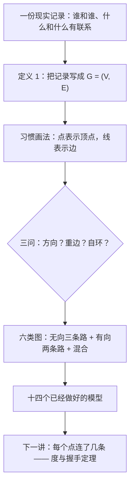

# C10.1 图与图模型 Graphs and Graph Models

> [!abstract] 这一讲的任务
> 第 9 章已经熟练地把"关系"画成一堆带箭头的点线，但那时没有人问过：这些点和线到底代表现实里的什么？同一批对象，换一个问题，还能不能画成同一张图？
> 这一讲只做一件事：**拿到一份现实记录，回答三个是非问，据此从六类图里挑一个**——方向有没有意义？同一对端点之间允不允许多条边？允不允许自己连自己？
> 讲完你会拿到十四个已经做好的模型（电话、网页、引用、模块、先序、生态、蛋白质、赛程……），它们全都是这三个问题的不同答案。

> [!info] 怎么读这份讲义
> 阅读顺序：§1 把"点 + 线"写成一句可以查的话；§2–§4 让六类图逐个在墙前出场；§5 把三问压成一条可以照着走的路线；§6–§11 十四个模型按领域排队过一遍；§12 是一张总表，§13 收习题里冒出来的新概念。
> 用到的旧知识只有两条：**集合**（第 2.1 节：无序对 $\{u,v\}$ 与有序对 $(u,v)$）和**关系**（第 9.1、9.3 节：关系图就是本讲有向图的直系前辈）。
> 路线图里出现的六个名字（简单图、多重图、伪图、有向图、有向多重图、混合图）是本讲的结论，现在不用记，它们分别在 §2、§3、§4 出场。
> 一处提请注意：本讲的图里确实有几条边被画成从第三个顶点身上穿过去（图 11 最明显），照着画读邻接会读错，§10 有专门一段说明。



---

## 0. 开场：凌晨两点的一张链路清单（p.641）

机房运维手上有一张清单，是上个月布线时留下的。七个机房，九条链路，长这样：

| # | 端点 A | 端点 B | 带宽 | 备注 |
|---|---|---|---|---|
| 1 | 旧金山 | 洛杉矶 | 10G | 主链路 |
| 2 | 旧金山 | 丹佛 | 10G | |
| 3 | 洛杉矶 | 丹佛 | 10G | 备用链路 |
| 4 | 丹佛 | 芝加哥 | 40G | |
| 5 | 芝加哥 | 底特律 | 10G | |
| 6 | 底特律 | 纽约 | 10G | |
| 7 | 芝加哥 | 纽约 | 10G | |
| 8 | 芝加哥 | 华盛顿 | 10G | |
| 9 | 华盛顿 | 纽约 | 10G | |

总监打电话来问的不是带宽，是两句更朴素的话：

1. 「旧金山和纽约之间还通不通？」
2. 「如果芝加哥整个机房掉电，纽约还剩下几条路？」

你大概会拿张纸，先点七个圈，再把九条链路画成九条线。然后你盯着这张纸，用铅笔从旧金山的圈开始往外走：旧金山—丹佛—芝加哥—纽约，走得通。第一问答完了。

**这张纸就是一次完整的图建模。** 圈是顶点，线是边，七个圈、九条线，一张图。

但清单还没用完。翻到背面，备注栏写着三件让这张纸立刻不够用的事情：

- 第 4 行写着「**仅下行**」——这条链路只允许丹佛往芝加哥方向的流量。
- 第 3 行写着「备用链路，与第 1 行同端点」——实际上洛杉矶和丹佛之间铺了**两条**线。
- 底特律机房里有一根**自测回环**，一头出去一头回来，两端都是底特律。

拿第一版那张纸去套这三件事，会接连撞墙：

- 画第二条洛杉矶—丹佛的线时，它和第一条**完全重合**，纸上看不出是两条。
- 自测回环的两端是同一个点，画出来的线成了一个圈，和"两个点之间的一条线"根本不是一个东西。
- 「仅下行」这件事在任何一条光秃秃的线上都看不出来：线没有头。

于是你发现：**同一份清单，为了回答不同的问题，得画成不同的图。** 想知道"通不通"，第一版那张纸就够了；想知道"这条链路能不能把命令推过去"，线必须带箭头；想知道"两个机房之间到底铺了几条"，同一对端点之间必须允许出现多条线；想知道"自环这条诊断链路有没有生效"，必须允许一个点连自己。

这一讲就是把"不同"这件事讲清楚：图有哪些种类，每一类能记什么、丢了什么，最后把选择压成三个是非问题。

（顺带说清第二问的难度：它问的不是"能不能走通"，而是"至少要毁掉几个机房才走不通"——那是 10.4 连通性的主题。这一讲先把第一问吃干净。）

> [!question] 停一下，先自己想想
> 上面那张清单里，第 1 行和第 3 行在问"通不通"时是可以合并的吗？在问"还剩几条路"时可以合并吗？
> 答案在 §2 结尾——那时你手上才有"重数"这个词。这里先记住：**能不能合并，取决于你要回答哪个问题**，而不取决于清单长什么样。

---

## 1. 图、顶点、边：把"点 + 线"写成一句可以查的话（p.641）

「画几个圈连几条线」在纸上够用，但要拿它做推理（比如"要不要把芝加哥那条链路挪走"），得有一个人人同意、可以逐条核对的写法。更要紧的是，后面十四个模型全都要回来对照同一句话——如果每个人心里的"图"不一样，十四个模型就没法互相比较。

> [!important] 定义 1 图 graph、顶点 vertex、边 edge
> 一个图 $G=(V,E)$ 由两部分组成：
> - $V$：一个**非空**的顶点集合（顶点也叫结点 node）；
> - $E$：一个边的集合。每条边都与**一个或两个**顶点关联，这些顶点叫这条边的**端点 endpoint**；这时也说这条边**连接 connect** 它的端点。

逐字读这句话，有三处值得停一下：

**第一处：$V$ 非空。** 不允许"一个点都没有的图"。这不是数学上的洁癖，而是因为本讲后面要问的所有问题（通不通、有几条路、谁在谁前面）在空图上都退化成空话，留一个空壳没有意义。

**第二处："一个或两个"。** 这四个字是全篇的伏笔。定义 1 并没有说"每条边两个端点"，它允许**一个端点**的边——也就是自己连自己的边。换句话说：**自环不是对定义的违反，它一开始就在定义里合法**；把它排除出去的是后面那句额外的要求（"简单图不允许自环"）。§2 会看到这个区别有多要紧。

**第三处：$E$ 是集合。** 集合里同一个元素不重复，所以严格说，一个"点 + 边"的记录里，同一对端点之间最多只能有一条边。想要两条？那这两条边就必须是**两个不同的对象**（想象成贴了不同编号的两根线），而不是同一个对象写两遍。这就是 §2 里"重数 multiplicity"要处理的事。

顺手把三个名词说完（后面会反复用）：

- **顶点**是记录里的"东西"：机房、人、网页、比赛、蛋白质。
- **边**是记录里的"联系"：链路、认识、链接、谁赢谁、谁和谁结合。
- **端点**是一条边的两头。一条边"连接"它的两个端点；反过来也可以说这条边与它的端点"关联"。

> [!note] 画法是记法，不是图
> 用点表示顶点、用线段（可以弯）表示边，这只是一套**记法**。上面那张链路清单画成一张纸，把旧金山挪到右下角、把线画成弯的、让两条线交叉，图本身一个字都没变——变的只是你看着舒不舒服。
> 唯一要守的规矩是：线的两个头必须落在它那两个端点上。除此之外，摆放位置、线的曲直、交叉与否，全部随便。真正不能随便的是"谁连着谁"。这条"画法自由"的原则会一直用到本章最后一节；而"能不能画得一条线都不交叉"是另一回事，那是 10.7 平面图的主题。

> [!important] Remark 有限图 finite graph、无限图 infinite graph
> $V$ 可以是无限集。顶点集无限或边数无限的图叫**无限图**；顶点集与边集都有限的图叫**有限图**。
> 本课程（以及绝大多数算法问题）只讨论**有限图**——因为有限才能把点编号、把边列表、把算法跑完。

先把开场那张纸按定义 1 点一遍，顺便数三个数（这三个数后面每一个模型都会用到）：

- 顶点：旧金山、洛杉矶、丹佛、芝加哥、底特律、纽约、华盛顿，共 $|V|=7$ 个。
- 边：清单上的九条链路，$|E|=9$。
- 每个顶点连了几条边（这个数下一讲会正式命名为**度 degree**，这里先用"连了几条"）：芝加哥 4，丹佛 3，纽约 3，旧金山 2，洛杉矶 2，底特律 2，华盛顿 2。

把七个数加起来：$4+3+3+2+2+2+2=18$，正好是 $2\times 9$。这不是巧合——每一条边都有两个端点，数"每个点连了几条"时，一条边被它的两个端点各数了一次。下一讲会把这句话升级成一个定理；现在只需要记住这个计数的手感：**边数一遍，度数两遍。**

---

## 2. 同一份清单，三次建模：简单图、多重图、伪图（p.642）

### 2.1 最省事的那一类：简单图

先假设清单最干净：没有重复链路，没有自测回环。开场那张纸就属于这种情况，它有一个名字。

> [!important] 术语：简单图 simple graph、多重图 multigraph、伪图 pseudograph
> - **简单图**：每条边连接两个**不同**的顶点，且同一对顶点之间**最多一条**边。
> - **多重边 multiple edge**：同一对顶点之间的若干条边；一对顶点之间有 $m$ 条边时，说这对顶点之间的边**重数为 $m$**（multiplicity $m$）。
> - **多重图**：允许重边、但不允许自环的图。
> - **自环 loop**：两个端点是同一个顶点的边。
> - **伪图**：允许自环，也允许重边的图。（"伪"字是在说：它已经不太像我们心里"两点一线"的那张图了。）

简单图有一个别人没有的待遇，值得单独说：**只有在简单图里，才能放心地说"$\{u,v\}$ 是一条边"。**

理由是集合的记法不带编号。简单图里一对顶点之间最多一条边，所以"这对顶点"和"这条边"是一一对应的，说 $\{u,v\}$ 是边不会指错。换成多重图就立刻出问题：洛杉矶和丹佛之间两条边，说"$\{洛杉矶,丹佛\}$ 是一条边"——是哪一条？所以多重图里必须回到定义 1 的原话：**边是集合的元素，每条边自己是一个对象**，$\{u,v\}$ 只是它的两个端点。

### 2.2 撞墙一：两条同端点的链路

清单背面第 3 行说洛杉矶—丹佛之间铺了两条。要在一张图里记住这件事，只能让同一对端点之间出现两条边。

这就是**多重图**：允许重边，但仍不允许自环。开场的清单改画成多重图之后，顶点还是那 7 个，**端点对**还是那 9 对，但边变成了 $9+5=14$ 条：

| 端点对 | 重数 |
|---|---|
| 丹佛—芝加哥 | 3 |
| 洛杉矶—丹佛 | 2 |
| 芝加哥—纽约 | 2 |
| 华盛顿—纽约 | 2 |
| 其余 5 对 | 1 |

$3+2+2+2+1\times5=14$。注意这里发生了什么：**顶点数没变，边数变了**。"通不通"的答案一个字都不用改（还连着就是还连着），但"还剩几条路"的答案变了——洛杉矶和丹佛之间现在有三条独立链路可挑。这就是模型选择的代价与收益：多记一点，能多回答一点。

### 2.3 撞墙二：自测回环

清单背面还有一条：底特律有一根自测回环，出去又回来，两个端点都是底特律。这条记录在任何"两点一线"的画法里都画不出来——硬画就是一个圈，而圈和线不是一回事。

允许自环之后，图又多了一类，叫**伪图**。填充这份清单的话：在上一版的 14 条边之外，再给每个机房都补一根自测回环（这七个机房确实各有一根），边数变成 $14+7=21$。

这也是自环最容易骗人的地方：它**不连接两个不同的顶点**，所以它不改变"哪些机房彼此相通"这件事，却照样算一条边、照样占一份带宽。想知道诊断回环是不是都装上了，就必须用伪图；只想回答"通不通"，用简单图就够了，多出来的 7 个圈纯属干扰。

### 2.4 三次建模摆在一起看

下面前三张图是同一批机房的三次建模。三张图的顶点完全一样（旧金山、洛杉矶、丹佛、芝加哥、底特律、纽约、华盛顿），区别只在"允不允许重边"和"允不允许自环"这两条上。

![[C10.1-原图-同一批机房的三种建模.png]]

从上往下读：

- **第一张（简单图）**：7 个顶点、9 条边，每个顶点的"连了几条"是 $4,3,3,2,2,2,2$。这就是开场那张纸。
- **第二张（多重图）**：顶点一个没变，但洛杉矶—丹佛、芝加哥—纽约、华盛顿—纽约之间的线画成了两条，丹佛—芝加哥画成了三条，共 $14$ 条边。看图上那些成对的弧线——**它们画弯不是为了好看，是因为两条线叠在一起就看不出是两条了**。这是"画法自由"的第一次实用：为了让重数可见，只好把边画弯。
- **第三张（伪图）**：在第二张的基础上，每个顶点上多了一个小圈，共 7 个自环，边数 $21$。

一张表把这三次建模的得失记下来：

| 建模方式 | 顶点 | 边 | 记住了什么 | 丢掉了什么 |
|---|---|---|---|---|
| 简单图 | 7 | 9 | 哪两个机房之间有链路 | 有几条、有没有回环 |
| 多重图 | 7 | 14 | 每条端点对上铺了几条 | 有没有回环 |
| 伪图 | 7 | 21 | 上面全部 + 每个机房的回环 | ——（代价是图变复杂） |

> [!warning] 易错点：别把"允许"读成"一定有"
> 伪图是"**允许**自环"的图，不是"**必须有**自环"的图。一个没有自环、也没有重边的伪图依然是伪图——只是它恰好长得很像简单图。
> 反过来不成立：一个有自环的图**绝不能**叫简单图。类别是按"允许什么"定义的，所以只要越过线，就只能往宽的那一类里放。

顺便把反方向的操作也算一遍，它比"升级"更容易出错。手上有那张伪图：7 个顶点、21 条边（14 条普通边 + 7 个自环）。要把它**退回成简单图**，得删掉几条边？

- 7 个自环必须全删；
- 剩下的 14 条边里，每一对端点只能留一条：丹佛—芝加哥那一对留着 1 条、删 2 条，另外三对重数 2 的各删 1 条，共删 $2+1+1+1=5$ 条；
- 合计删 $7+5=12$ 条，剩 $21-12=9$ 条——正好是开场那张简单图的 9 条边。

这个对得上不是巧合：$14$ 是"9 对端点 + 5 条多余的副本"，$21$ 是"$14$ 加 7 个环"，所以退回去就是把"多余的 5 条"和"7 个环"一起剪掉。**往上走丢问题，往下走丢信息**——建模的每一次选择都是这个交换。

---

## 3. 方向丢了会怎样：有向图与有向多重图（p.643）

清单上还有一条，是最容易吃亏的一条：**「仅下行」**。

在光秃秃的线上，这条信息无处安放。后果很实际：你检查"丹佛到芝加哥通不通"，画出来是通的；可实际业务是"芝加哥要往丹佛推一份配置"，一推就失败——因为那条链路的流量只允许反方向。**方向丢了，两个不同的问题会被同一个答案糊弄过去。**

于是边必须能带箭头。带箭头的边叫**弧 arc**，整张图叫**有向图**。

> [!important] 定义 2 有向图 directed graph（digraph）、弧 arc
> 一个有向图 $(V,E)$ 由一个非空顶点集 $V$ 和一个有向边集 $E$ 组成。每条有向边与一个**有序对**顶点 $(u,v)$ 关联；与 $(u,v)$ 关联的这条有向边说成"**从 $u$ 出发（start at $u$）、到 $v$ 结束（end at $v$）**"。

和定义 1 对比，唯一的变化是"一个或两个顶点"换成了"一个有序对"。两个字换了位置，事情全变了：

- 无序对 $\{u,v\}$ 和 $\{v,u\}$ 是同一个东西，所以一条无向边没有"正反"；
- 有序对 $(u,v)$ 和 $(v,u)$ 是两个东西，所以 $(u,v)$ 与 $(v,u)$ 是**两条不同的弧**。

由此带出三个必须分清的情况，它们经常被混为一谈：

1. **一条弧 + 它的反方向**：丹佛 $\to$ 芝加哥和芝加哥 $\to$ 丹佛同时存在。这是**两条不同的弧**，不是重边。有向图完全允许这种"双向各一条"。
2. **重弧**：丹佛 $\to$ 芝加哥之间有两条同方向的弧。这才叫重数 2。
3. **自环**：一条从 $u$ 出发又回到 $u$ 的弧，同样合法。

照定义再筛一遍，就得到有向世界里的两个标准名字：

- **简单有向图 simple directed graph**：没有自环、也没有重弧。此时每一对有序对 $(u,v)$ 上至多一条弧，所以可以放心地说"$(u,v)$ 是一条边"——和简单图里说 $\{u,v\}$ 是边一个道理。
- **有向多重图 directed multigraph**：允许重弧（也允许自环），一对有序对 $(u,v)$ 上有 $m$ 条弧时，说 $(u,v)$ 的重数是 $m$。

> [!note] 和上一章的关系：关系图是本讲有向图的特例
> 第 9 章用有向图表示关系时，画法是"$a$ 到 $b$ 有一条弧 $\iff$ $a\,R\,b$"，那里隐含了两个限制：不许自己连自己（反自反）、同一对有序对之间至多一条弧（关系是集合）。
> 本讲的定义 2 把这两条限制都撤掉了，所以**范围更大**。反过来说：凡是用关系图能做的事，用本讲的有向图都能做；本讲能记的东西（重弧、自环）关系图记不了。§13 会把这条联系补成一张对照表。

回到机房：把开场那 9 条链路逐条定方向，就得到一张**有 7 个顶点、9 条弧的简单有向图**（p.643 的图 4）；再把"同一天同一对机房之间多加几条单向链路"记进去，边会重复，就升级成**有向多重图**（p.643 的图 5）。两张图用的是同一批机房、同一批端点对——这正是本讲反复要说的那句话：**换模型不是为了换对象，是为了换问题。**

> [!warning] 易错点：三个"看起来一样"的东西
> - 一对顶点之间**两条反向的弧** $\ne$ 重边；
> - 一对顶点之间**两条同向的弧** $=$ 重弧（重数 2）；
> - 一条**自己回到自己**的弧 $=$ 自环。
> 前者换了方向，后两者没换方向。数重数时数的是"同方向、同端点对"的弧。

---

## 4. 混合图与六类图的对照表（p.644）

还有一张记录，一张图装不下：机房里有些链路是双向的（两端都能推），有些是单向的（只允许下行）。如果非要用有向图，双向链路就得拆成两条反向的弧——信息没错，但"这两条其实是同一条物理链路"这件事丢了；如果非要用无向图，单向那条的信息又丢了。

于是有第六个名字。**混合图 mixed graph**：一张图里同时有有向边和无向边。

它的用处只有一个，但很硬：**当一份记录里两种链路真的同时存在时，它是唯一不丢信息的画法。** 上一章讲关系时不存在这个问题（关系全是单向的），所以这个概念是新东西。

六类图排成一张表（这就是 p.644 那张表的内容，我按"三问"的顺序重排了一遍，方便你对照）：

| 类型 | 边 | 允许多重边？ | 允许自环？ | 典型场景 |
|---|---|---|---|---|
| 简单图 simple graph | 无向 | 否 | 否 | 机房连通性、相识图、生态位重叠 |
| 多重图 multigraph | 无向 | 是 | 否 | 同端点铺了多条链路 |
| 伪图 pseudograph | 无向 | 是 | 是 | 带自测回环的链路清单 |
| 简单有向图 simple directed graph | 有向 | 否 | 否 | 影响图、胜者指向败者的赛程 |
| 有向多重图 directed multigraph | 有向 | 是 | 是 | 电话记录、一天的航班表 |
| 混合图 mixed graph | 有向 + 无向 | 是 | 是 | 双向路与单向路并存的道路网 |

> [!note] 为什么"术语"不值得死记，"三问"值得
> 图论是现代产物，又被几乎每个学科借用，同一个东西在不同领域有四五个名字，同一个名字在不同领域又指不同东西。所以这套材料的立场很明确：**名字可以记不准，三个问题必须问全**。问全了，名字自己会落位；漏问一个，模型就悄悄丢了一类信息——而且丢的时候不会报错。

（顺带一提，p.644 的页边印着一句反问："你能找到一个图论还没被用过的学科吗？"这一章剩下的部分基本就是在回答它，所以这句反问可以当玩笑看。）

---

## 5. 三问选图：一条可以照着走的路线（p.644）

把 §2–§4 撞的墙收拾一下，其实只有三个问题，而且是三个**是非**问题：

1. **方向有没有意义？** 也就是：记录里的"联系"是不是分先后、分进出？（无向 / 有向 / 两种都有）
2. **同一对端点之间允不允许多条边？** 也就是：这份记录会不会出现"同一件事发生了好几次"？（重边 / 重弧）
3. **允不允许自己连自己？** 也就是：记录里有没有"自己和自己"这种联系？（自环）

三个问题不能随便换顺序，得**先问方向，再问自环，最后问重边**。原因很实际：一旦有自环，名字就已经定到"伪图"（或"有向多重图"）那一格了，这时候再问"有没有重边"是白问——它反正也回不到简单图去。反过来先问重边就会漏：一个没有重边、但有自环的图，按"没有重边"会被错判成简单图。

问题问完，答案直接指向一个名字。下面这张判据图就是这条路线的操作版：每个方框只问一件事，方框之间只有"是/否"两条路，走到最下面一排就是结论。

![[C10.1-三问选图判据.png]]

拿三份真实记录走一遍这条路线，你会发现"同一个东西可以有不止一个正确答案"：

- **机房链路清单**（只问通不通）：方向不作要求 → 无向；重边不记 → 多重图里也不要；自环不记 → **简单图**。
- **同一份清单**（要查链路带宽和诊断回路）：方向有要求（仅下行）→ 有向；同端点多条 → 允许多重弧；自环要记 → **有向多重图**。
- **一份电话详单**：方向有意义（谁打给谁）→ 有向；同一个人可以打好几次 → 重弧；自己打给自己几乎不发生但可以 → **有向多重图**。

> [!warning] 易错点：三个是非题有 8 种组合，纯无向/纯有向的名字却只有 5 个
> $2^3=8$ 种组合，落在无向世界与有向世界里的名字合计只有 5 个（简单图、多重图、伪图、简单有向图、有向多重图）。第六个名字"混合图"根本不属于这 8 种：它是**方向那一问的第三个答案**（有的边有向、有的无向）。
> 8 落到 5 不矛盾：**类别是按"允许什么"定义的**，所以好几组答案会落到同一个名字上——比如"没有重边、有自环"的无向图，仍然叫伪图。
> 反过来的方向绝不能错：**只要有一个"允许"越了线，就不能叫简单图**。三问的功能是"往上找最宽的那一类"，不是"往下找最窄的那一类"。

一个更重要的顺序问题：**先问"我要回答什么问题"，再问这三问。**

三问的答案不是记录自带的属性，而是你**打算用它做什么**决定的。同一批机房，问"通不通"是简单图，问"还剩几条独立链路"是多重图，问"回环有没有生效"是伪图。开场那张清单从头到尾没有变过一个字，变的只是问题。

### 5.1 三问之前还有一问：顶点代表什么

三问只决定"边的性质"，它们管不到一件更早的事：**这一轮建模，点代表什么。** 这一问没有选项可勾，只能自己定，而定错了后面全错。

最干净的反例是 §11 的两个赛程模型。同一场锦标赛：

- 点代表**队**：得到 6 个点、15 条弧（每两队一场）；
- 点代表**比赛**：得到 15 个点、14 条弧（胜者进入下一场）。

两张图都在回答"谁赢谁"，但一张回答"这支队赢了哪些队"，另一张回答"这场比赛的胜者下一场打谁"。**点换了，问题就换了。**

所以建模的实际顺序是三步，不是一步：

1. **我要回答什么问题？**
2. **点代表什么？**（队、比赛、机房、人、网页、模块……）
3. **边代表什么，三问的答案是什么？**

第 3 步最容易被当成"定义题"背下来，但它其实是第 1、2 步的**推论**。反过来背定义去套模型，就会出现在赛程里把点设成队、然后发现"下一场"没地方放的情况。

---

## 6. 社交网络：相识、影响、合作（p.644–645）

从这一节起，十四个模型排队上场。每个模型我只讲三件事：顶点是什么、边是什么、三问的答案是什么——因为**模型的全部内容就在这三句话里**，剩下的都是这套记法的推论。

先说一个大类。把"人"当顶点、把"人与人的某种关系"当边的图，统称**社交网络 social network**（这个词既指现实里的那张网，也指画出来的那张图）。

> [!example] 例 1 相识图与友谊图 Acquaintanceship and Friendship Graphs
> **顶点** = 一群人里的每一个人；**边** = 两个人认识（或互为好友）。无向边，不设重边，通常不设自环。
> 三问的答案：方向无意义（"认识"是相互的）；同一对人不重复记（认识了就是认识了，记两次没有新信息）；自环通常不画——除非你要把"自知"也当成一种关系记进去（p.645 括号里就是这么说的：想表达"认识自己"就加自环）。
> p.645 的图 6 画了 16 个人：Jan、Todd、Eduardo、Kamlesh、Lila、Liz、Kari、Shaquira、Joel、Koko、Ching、Kamini、Amy、Gail、Steve、Paula，共 16 个顶点。
> 规模感：全世界所有人的相识图有**六十多亿个顶点**、大概**一万亿条边**（这是成书时的数字）。拿它算一下平均每人认识多少人：$2\times 10^{12}/6\times 10^{9}\approx 333$。而 60 亿人两两配对的可能是 $\binom{6\times10^9}{2}\approx1.8\times10^{19}$ 对，一万亿条只占了其中约 $10^{-7}$——**这张图极稀**。这个"稀"后面有用：它决定了这张图在计算机里该用哪种存法。

> [!example] 例 2 影响图 Influence Graphs
> **顶点** = 一个群体里的每个人；**弧从 $a$ 指向 $b$** = $a$ 能影响 $b$。这就是有向图，它把"影响"的单向性写在箭头上。
> 三问的答案：方向有意义（影响通常不是相互的，但可以相互）；不设重弧（"能影响"是一件有或没有的事，不是次数）；不设自环。
> p.645 的图 7 有 5 个人：Linda、Brian、Deborah、Fred、Yvonne，一共 8 条弧。数一数每个人"发出的箭头"和"收到的箭头"：Deborah 发出 3 条、收到 0 条；Brian 发出 2 条、收到 3 条；Fred 发出 2 条、收到 1 条；Yvonne 发出 1 条、收到 2 条；Linda 发出 0 条、收到 2 条。
> 于是正文那两句话可以直接在图上念出来：**Deborah 谁也影响不了她（收到 0 条箭头），但她能影响 Brian、Fred、Linda（发出 3 条）；Yvonne 和 Brian 之间有来回两条箭头，所以他们互相影响。**
> 这里已经能看出下一讲要干的事：一个顶点上"发出几条""收到几条"，就是它的出度与入度。这五个数加起来正好都是 8（每条弧贡献一个发出、一个收到）。

> [!example] 例 3 合作图 Collaboration Graphs
> **顶点** = 人；**边** = 两人合作过（合演过一部片子、合写过一篇论文、在同一个队打过球）。简单图：无向、无重边、无自环。
> 三个具体的合作图：
> - **好莱坞图**：演员是顶点，同片（或同节目）合作就相连。成书时（2011 年初）有 **超过 150 万个顶点**。
> - **数学合作图**：顶点是发表过数学论文的人，合写一篇论文就连一条边。2004 年的统计是 **40 多万个顶点、67.5 万条边**。算平均：$2\times675000/400000=3.375$，也就是一个数学工作者平均有三四个合作者——同样很稀。
> - **体育合作图**：同一个赛季同队打过球就算合作。

三个模型放在一起看，能看出一件重要的事：**它们都是社交网络，三问答案却各不相同。** 相识图是无向简单图，影响图是有向简单图，合作图又是无向简单图。领域相同不等于图相同；决定图的是你要回答的问题和记录本身的形状。

---

## 7. 通信与信息网络：呼叫图、网页图、引用图（p.646–647）

> [!example] 例 4 呼叫图 Call Graphs
> **顶点** = 一个电话号码；**弧从 $a$ 指向 $b$** = 有一次电话从 $a$ 打给 $b$。**每次通话单独记一条弧**，所以这是**有向多重图**。
> 三问的答案，逐条都有明确理由：方向有意义（谁打给谁是这份记录的全部价值）；重弧必须允许（同一个号码可以给同一个号码打很多次，每次都是独立事件）；自环允许但几乎不出现。
> p.646 的图 8(a) 画了 7 个号码：732-555-1234、732-555-1001、732-555-6666、732-555-0011、732-555-4444、732-555-9876、732-555-0069。图上能直接读出的事情：**1234 打给 9876 三次、9876 打给 1234 两次**（所以这一对之间既有重弧，又两个方向都有）；而 **4444 除了打给 0011 之外，没有打给其他六个号码**。
> 图 8(b) 是同一批通话的另一个版本：只问"这两个号码之间有没有通过话"，于是把方向抹掉、把多条弧压成一条边——**变成一张无向图**。代价很明确：从这个版本里再也读不出"谁打给谁"，也读不出"打了几次"；得到的好处是"这两个人认识吗"这类问题变得一目了然。同一份详单，两个模型，各自答各自的问题。
> 规模感：AT&T 统计过一张覆盖 **20 天**的呼叫图，约 **2.9 亿个顶点、40 亿条边**。除一下：$4\times10^9/20=2\times10^8$ 次/天，再除以 2.9 亿个号码，平均每个号码每天只打约 **0.7 通**——一张 40 亿条边的大图，平均下来却稀疏得厉害。这也是为什么真实的图数据几乎从不存成稠密矩阵。

> [!example] 例 5 网页图 The Web Graph
> **顶点** = 一个网页；**弧从 $a$ 指向 $b$** = 页面 $a$ 上有一个超链接指向 $b$。有向图（严格说是很大的有向简单图：一个页面上重复放同一个链接不会多记一条）。
> 三问的答案：方向有意义（链接是有方向的，A 链到 B 不代表 B 链回 A）；同一对页面之间一般不记重弧（"有没有链接"就够了，页面上放几个链接不是要点）；无自环（页面链到自己没有意义，实际上会被过滤掉）。
> 它还有一个别的模型都没有的性质：**这张图每秒都在变**——新页面在生、旧页面在死、链接在改。所以"求一张网页图"这件事本身就只能是近似的快照。
> 搜索引擎的爬虫就是在这张图上走：从一批种子页面出发，顺着弧走，把走过的页面存下来建索引。这件事的具体做法属于第 11 章（树与遍历）的内容，这里只要记住：**爬虫面对的不是文件列表，而是一张有向图**。

> [!example] 例 6 引用图 Citation Graphs
> **顶点** = 一篇文档；**弧从 $a$ 指向 $b$** = $a$ 的参考文献里引了 $b$。有向图，没有自环、没有重边。
> 三类文档都能这么建模：学术论文（参考文献表就是出边列表）、专利（引用的是之前的专利）、法院判决（引用的是之前的判决）。
> 三问的答案：方向有意义（引用是单向的，被引的一方不需要知道）；不记重边（一篇论文不会把同一篇文献列两次）；无自环（一篇论文不会引用自己）。
> 值得注意的是一种"看不见的约束"：引用大体上沿着时间方向流动，所以这类图里回路很罕见——不是因为定义禁止，而是因为现实中"后来的引用先前的"。**方向常常不是随便标的，它背后有一个物理上的箭头（时间、因果、流向）。**

> [!note] 专业关联
> 网页图是**知识图谱**和 **PageRank** 的原型：把网页换成实体、把超链接换成"这两个实体有关系"，得到的就是知识图谱；而"一个页面有多重要"在 PageRank 里被算成"有多少重要的页面指向它"——这是一个完全定义在**有向图**上的量，方向一旦抹掉就失效。这也是为什么搜索引擎宁可存一张巨大且稀疏的有向图，也不肯把它压成无向图省事。

---

## 8. 软件里的两张图：模块依赖与先序（p.647）

程序是"一堆东西按某种顺序互相需要"，这正好是图的形状。这一节的两张图长得像，语义的方向却相反，是本节最值得记住的一处对照。

> [!example] 例 7 模块依赖图 Module Dependency Graphs
> **顶点** = 一个模块（源文件、库、包）；**弧从 $u$ 指向 $v$** = **$v$ 依赖 $u$**。
> 注意箭头的方向约定：**从"被依赖的一方"指向"依赖它的一方"**。也就是说，箭头顺着"东西被用得越来越多"的方向走，$u$ 是供货方，$v$ 是用户。这和很多 IDE 里"依赖箭头指向被依赖者"的习惯正好相反——**读任何一张依赖图之前，先确认箭头是哪一头**。
> 三问的答案：方向有意义（依赖是单向的）；同一对模块之间不记重弧（"依赖"是要么有要么没有，一个模块里 import 两次不算两条）；无自环（模块不会依赖自己）。
> p.647 的图 9 是一个**网页浏览器**的模块依赖图，7 个模块、9 条弧：
> - 顶点：main、display、parser、protocol、abstract syntax tree、page、network；
> - main 是唯一的源头（没有任何箭头指向它，说明它谁也不依赖）；
> - ast（抽象语法树）、page、network 是三个终点（它们不再依赖别人）；
> - 9 条弧分别是 main→display、main→parser、main→protocol、main→ast、display→ast、parser→ast、parser→page、protocol→page、protocol→network。
> 顺手验一遍：数"入边"——ast 有 3 条（main、display、parser 都指向它），page 有 2 条（parser、protocol），display/parser/protocol/network 各 1 条，加起来 $3+2+1+1+1+1=9$，和弧数对上了。

> [!example] 例 8 先序图与并发处理 Precedence Graphs and Concurrent Processing
> 一段程序里的语句并不是都得按书写顺序执行——互不依赖的可以同时跑。麻烦在于："不能抢在别人前面跑"这条约束必须显式写下来，否则并发就会读到还没算出来的值。
> **顶点** = 一条语句；**弧从 $S_i$ 指向 $S_j$** = **$S_j$ 不能在 $S_i$ 之前执行**（也就是 $S_i$ 必须先算）。这张图叫**先序图 precedence graph**。
> 三问的答案：方向有意义（"谁先谁后"就是全部内容）；不记重弧；无自环（一条语句不会要求自己先于自己）。
> p.647 的图 10 是六条语句：
>
> ```text
> S1:  a := 0
> S2:  b := 1
> S3:  c := a + 1
> S4:  d := b + a
> S5:  e := d + 1
> S6:  e := c + d
> ```
>
> 六条语句里，**能直接读出依赖的只有 6 对**：S3 用到 $a$（来自 S1），所以 S1 先于 S3；S4 用到 $b$（S2）和 $a$（S1）；S5 用到 $d$（S4）；S6 用到 $c$（S3）和 $d$（S4）。写成对：S1→S3、S1→S4、S2→S4、S4→S5、S3→S6、S4→S6。
> **但图 10 上画了 10 条弧，不是 6 条。** 多出来的 4 条是"间接"的：S1 在 S3 之前、S3 在 S6 之前 $\Rightarrow$ S6 当然也不能在 S1 之前，于是 S1→S6 也被画上了。同理 S1→S5（S1→S4→S5）、S2→S6（S2→S4→S6）、S2→S5（S2→S4→S5）。
> 这不是画蛇添足，而是"先序"这个词的定义使然：**"$S_j$ 不能在 $S_i$ 之前执行"这句话对间接关系同样成立**，所以先序关系天生是**传递**的，画出来的图是直接依赖的**传递闭包**——所谓闭包，就是把"顺着箭头能推出来的那些先后关系"全部补成边。$6+4=10$，正好是图上的弧数。
> 于是正文那句话有了着落：**S5 不能在 S1、S2、S4 执行完之前执行**——把指向 S5 的三条弧的起点念出来就是这三个。

下面这张图同时是例 7 和例 8 的两张图：左边是网页浏览器的模块依赖图，右边是先序图（左边还列了六条语句的代码）。

![[C10.1-原图-模块依赖与程序先序.png]]

读右边那张图时有个小技巧：先找"没有任何箭头指向它"的顶点，那就是必须最先跑的（这里 S1、S2 都可以最先跑）；再找"它不指向任何顶点"的，那是最后跑的（S6）。中间的顺序并不唯一——$S_1$ 和 $S_2$ 谁先谁后都行，$S_3$ 和 $S_5$ 谁先谁后也都不违反约束。把六条语句的所有合法执行顺序数一遍，一共 **12 种**。（"把一张先序图排成一个合法顺序"这个动作，第 11 章会给它一个名字：拓扑排序。）

那么，为什么调度器非要把"间接"也画进图里？因为**查图只是一次查找**：想知道 $S_j$ 现在能不能跑，只需看"有没有一条还没满足的弧指向它"，不必现场跑一趟路径搜索。代价是图会变胖：直接依赖 6 条，闭包 10 条；一般情况下，$n$ 条语句的先序图最多能有 $\binom{n}{2}$ 条弧（$n=6$ 时最多 15 条），也就是从"线性条数"涨到"平方条数"。**这是拿空间换一次常数时间查询**，和 §2 里"多重图多记 5 条边、换来能回答'剩几条路'"是同一种交易。

> [!note] 专业关联
> 这两张图在今天的机器学习框架里天天出现。一次前向计算被记成一张**计算图**：张量是顶点，算子是边，箭头从输入指向输出——和例 7 的"供货方 → 用户"是同一种方向约定。反向传播则在这张图上**反着走**，所以框架必须先建图、再遍历图，不能边算边扔中间结果。至于"哪些算子可以并行调度"——那是例 8 的先序图，用同一套判据：有弧就必须排队，没弧就能并发。

---

## 9. 交通网络：航线与道路（p.647–648）

> [!example] 例 9 航线 Airline Routes
> **顶点** = 一个机场；**弧** = 一个航班，从起飞机场指向降落机场。
> 一天之内，同一条航线上常常有好几个航班，所以每个航班单独记一条弧 ⇒ **有向多重图**。
> 三问的答案：方向有意义（起飞和降落不能互换）；同一天同一条航线多班 ⇒ 重弧必须允许；自环不出现（航班不会从某机场起飞又落回原机场——真要表示"观光飞行"，才需要一个自环，那正是习题 1(c) 的情况）。
> 这里能看出"按天"这个条件的份量：只问"这两个机场之间有没有直飞航线"，那是无向简单图；问"今天有哪些航班可以坐"，就必须是有向多重图。**同一条航空网络，两个问题，两张图。**

> [!example] 例 10 道路网络 Road Networks
> **顶点** = 路口；**边** = 一段路。这个模型的特别之处是：它把前面所有的"允不允许"一次性全用上了，而且每一项都对应现实里的一种路。
> - 双向路 ⇒ **无向边**；
> - 单行道 ⇒ **有向边**（一条单向路就是一条弧）；
> - 两个路口之间有好几条双向路 ⇒ **多条无向边**（重数等于路的条数）；
> - 两个路口之间有好几条同方向的单行道 ⇒ **多条同向的弧**（重弧）；
> - 环路（绕着某地转一圈回到原处）⇒ **自环**；
> - 一段路上既有双向路又有单行道 ⇒ 只能用**混合图**。
> 三问的答案：方向"部分有"⇒ 混合；重边允许；自环允许。
> **这是本节十四个模型里唯一必须动用混合图的一个。** 其余的要么纯无向（相识、合作、生态、蛋白质），要么纯有向（影响、呼叫、网页、引用、依赖、先序、航线、赛程）。所以"混合图"不是为了凑齐六类而存在的概念：只有当真有两种链路同处一份记录时，它才不可替代。

---

## 10. 生物网络：生态位重叠与蛋白质相互作用（p.648）

> [!example] 例 11 生态位重叠图 Niche Overlap Graphs in Ecology
> **顶点** = 一个物种；**边** = 两个物种**竞争**（它们吃的食物资源有一部分重合）。
> 三问的答案：方向无意义（竞争是相互的）；同一对物种只记一条边（"竞争"是有或没有，不是次数）；无自环（一个物种不和它自己竞争）。
> p.648 的图 11 是一个森林生态系统的模型，9 个顶点：Hawk（鹰）、Owl（猫头鹰）、Raccoon（浣熊）、Crow（乌鸦）、Opossum（负鼠）、Squirrel（松鼠）、Woodpecker（啄木鸟）、Shrew（鼩鼱）、Mouse（老鼠）。
> 逐个数"连了几条"，得到：松鼠 4 条（最多，它和浣熊、负鼠、乌鸦、啄木鸟都争），鹰、猫头鹰、浣熊、负鼠、乌鸦、鼩鼱、啄木鸟各 3 条，**老鼠只有 1 条**（只和鼩鼱争）。加起来 $4+3\times7+1=26=2\times13$，所以一共 **13 条边**。
> 图能直接回答的问题：松鼠和浣熊竞争吗？连着呢，竞争。乌鸦和鼩鼱竞争吗？没有边，不竞争。
> 反过来，**模型里"少一条边"也是有信息量的**：如果一个物种的食物资源独一无二，它的顶点就该是一个**孤立点**（一条边都不连）——它在图上一声不响，却准确地说明了"这个物种没有竞争对手"。老鼠的 1 条边则是另一个极端，叫做**悬挂点 pendant vertex**（只连一条边的顶点）：它只跟一个物种有交集，因此最脆弱——它的食物资源一旦被动，没有第二条退路。**这两种"少边"的顶点，在生态学上正是最需要注意的对象。**
> 还有一处值得停一下：这里的"竞争"被**当成了对称的**。现实里的竞争常常不对称——体型大的把小的挤走，而反过来不成立。这一版模型只记一件事：两种动物的食物资源有没有重合。**重合是对称的，谁挤谁不是。** 所以如果问题换成"哪种动物在竞争里占上风"，三问的第一个答案立刻变：要方向，要变成有向图。

> [!warning] 易错点：这张图不能照着画读邻接
> 图 11 有两处画法陷阱：从浣熊到猫头鹰的那条横线，正好从鹰的圆点上穿过去；从浣熊到啄木鸟的那条斜线，又正好从松鼠的圆点上穿过去。也就是说，光看这张图，你没法判断"浣熊—猫头鹰"是不是被鹰劈成了两条边，也没法判断浣熊和松鼠之间到底有没有边。
> 而正文明确说了一句：**松鼠和浣熊是竞争的**——这条边在画上恰恰看不出来（它和浣熊—啄木鸟那条斜线重合）。
> 这不是图的问题，是**画法的问题**：一条边从第三个顶点身上穿过时，记法就有歧义了。正确的做法是回到记录（谁和谁争），而不是盯着画。本节还有几处同类画法（一条直线正好压在第三个点上），读到那些图时记得这一条：**图是记录，画法只是记法；记法有歧义时，回去看记录。**

> [!example] 例 12 蛋白质相互作用图 Protein Interaction Graphs
> **顶点** = 一种蛋白质；**边** = 这两种蛋白质会结合（一起完成某个生物功能）。无向图，也叫蛋白质—蛋白质相互作用网络。
> 三问的答案：方向无意义（结合是相互的）；同一对蛋白质只记一条（还没见过"结合两次"这种说法）；无自环。
> 这个模型有一个别的模型都没有的麻烦：**边可能是假的**。实验会报"假阳性"——测出来两个蛋白质结合，其实并没有。也就是说这张图里的边不是"记录下来的事实"，而是"测出来的结论"，随时可能被推翻。所以这类图通常是**不断长出来**的：新蛋白质、新相互作用一被发现就补顶点、补边。
> 规模感（成书时）：酵母细胞有**6000 多种蛋白质**、已知**8 万多个相互作用**，平均每种蛋白质和 $2\times80000/6000\approx27$ 种打交道；人体细胞有**10 万多种蛋白质**、大约**100 万个相互作用**，平均每种约 20 个。
> 因为整张图太大太密，实践中会把它切成小块，每一块叫一个**模块 module**——负责同一个细胞功能的一群蛋白质。p.648 的图 12 就是这样一个模块：降解 RNA 的蛋白质复合体，顶点是 Q9Y3A5、RRP40–RRP46、PM/Sci2 这些蛋白质。

---

## 11. 两种赛制，两种图（p.649）

这一节的最后两个模型都是"比赛"，但图的**顶点根本不同**——这也是全篇最值得对比的一处。

> [!example] 例 13 循环赛 Round-Robin Tournaments
> **循环赛**：每两队之间恰好打一场，不许平局。
> **顶点** = 一支队；**弧从 $a$ 指向 $b$** = $a$ 赢了 $b$。
> 三问的答案：方向有意义（胜负是单向的）；**不允许重弧**（每两队只打一场，所以每对顶点之间恰好一条弧）；无自环（队不会和自己打）。
> 于是这张图有一个很硬的性质：**每一对顶点之间恰好有一条弧**，而且**任意两点之间都有边**——这就是**有向完全图**（下一讲会给它正式的名字和记法）。
> 手算一下 $n=6$ 的情况（p.649 的图 13 正是 6 支队）：总场数 $\binom{6}{2}=15$，每队打 $5$ 场，$5\times6/2=15$ 对上了。图上每支队"发出几条箭头"就是它赢了几场，所以六支队的胜场加起来必须等于 15。
> 把图 13 的箭头逐条读出来（每对顶点之间恰好一条弧，所以数每队"发出几条箭头"就行），六支队的胜场是：**Team 1 五胜零负、Team 2 两胜、Team 3 零胜五负、Team 4 一胜、Team 5 四胜、Team 6 三胜**，和 $5+2+0+1+4+3=15$ 对得上。正文那两句话因此可以在图上直接验：**Team 1 全胜（没有一条箭头指向它），Team 3 全败（它发出的箭头一条也没有）。**
> 注意"循环赛"这个词里没有"图"字，但只要三问的答案定了，图就唯一确定了：**一种赛制对应一类图**。

> [!warning] 易错点：弧的方向是"胜者指向败者"
> 这条约定是可以反过来定的（"败者指向胜者"照样是一张有向完全图），但**一旦换了约定，出度的含义就从"胜场"变成"败场"**，Team 1 那句"全胜"立刻会被读成"全败"。所以读任何一张胜负图，先确认箭头这一头是赢的还是输的。这里统一用：**箭头从赢家出发，指向被赢的那一方。**

> [!example] 例 14 单淘汰赛 Single-Elimination Tournaments
> **单淘汰**：输一场就出局。
> 这里千万不要把顶点设成"队"。设成队的话，"下一场谁上场"这件事得靠"谁赢了上一场"现算，图上没有地方放它。
> 正确的建模是：**顶点 = 一场比赛**；**弧从"这场比赛"指向"胜者参加的那下一场比赛"**。
> 三问的答案：方向有意义（比赛有先后：先打完这场，才可能打下一场）；不记重弧（一场比赛的胜者只通往一个下一场）；无自环（比赛不会指向自己）。
> p.649 的图 14 是 **2010 年 NCAA 女子篮球锦标赛最后 16 支队**的赛程。算一下顶点数：16 支队单淘汰，第一轮 8 场，然后 4 场、2 场、1 场，$8+4+2+1=15$ 场——所以这张图有 **15 个顶点**；每场（除决赛）的胜者都要去打下一场，所以有 **15-1=14 条弧**。
> 图上的蓝色字是胜者（图注写了"Game winners shown in blue"）。顺着蓝色读下去，冠军是 **Connecticut**——决赛那场是 Connecticut 对 Stanford，Connecticut 赢。沿途那些名字（Stanford、Xavier、Oklahoma、Kentucky、Connecticut、Florida State、Baylor、Duke……）都是各场胜者，它们是弧上的标签，不是顶点。

![[C10.1-原图-两种赛制的图模型.png]]

两种赛制并排放在一起，差别一眼可见：

| | 循环赛（例 13） | 单淘汰赛（例 14） |
|---|---|---|
| 顶点是什么 | 一支**队** | 一场**比赛** |
| 边是什么 | "赢"（队 → 队） | "进入下一场"（比赛 → 比赛） |
| 顶点数（$n$ 支队） | $n$ | $n-1$ |
| 边数（$n$ 支队） | $\binom{n}{2}$ | $n-2$ |
| 每点发出几条 | 胜场（0 到 $n-1$ 都有可能） | 除决赛外恰好 1 条，决赛 0 条 |
| 图的名字 | 有向完全图 | 一棵（有根的）树 |

最后一行是这一讲的伏笔，也是这一讲最"值钱"的一句话：**单淘汰赛的图，每个顶点至多一个"下一场"，而且从任意一场出发沿着箭头走，最后一定汇到唯一的那场决赛——这样一个"每点最多一条出边、终点唯一"的形状，下一章会给它一个正式的名字：树（tree）。** 换句话说，例 14 已经在用第 11 章的对象了，只是还没给它命名。

还有一件顺带值得记住的事：**顶点数相同，边数可以差一个数量级。** 同样是 6 个顶点，循环赛那张有向完全图有 $\binom{6}{2}=15$ 条弧，而 6 个顶点的树只有 $6-1=5$ 条边。所以"边多"和"边少"本身都不说明模型的好坏——完全图信息最全但也最贵（存下来是平方级），树最省（线性级）但也最脆（少一条边就散架）。这张"边数的光谱"（从 $n-1$ 到 $\binom{n}{2}$）后面几讲会反复用到。

> [!note] 为什么这两个例子要放在最后
> 它们把"顶点代表什么"这件事的弹性摆到了极点：同一件现实里的事（一场锦标赛），把顶点设成"队"得到一张完全图，设成"比赛"得到一棵树。**选错顶点，后面的所有问题都会问错方向。** 这也是本讲反复出现的那个教训的最后一次出场：建模的第一步不是画线，而是决定"点代表什么"。

---

## 12. 十四个模型排成一张表（p.644–649）

把十四个模型按"顶点 / 边 / 三问答案"压缩成一张表，做题和复习时先查这里：

| 例 | 模型 | 顶点 | 边 | 方向 | 重边 | 自环 | 图的类型 |
|---|---|---|---|---|---|---|---|
| 1 | 相识图 | 人 | 认识 | 无 | 否 | 否 | 简单图 |
| 2 | 影响图 | 人 | 能影响 | 有 | 否 | 否 | 简单有向图 |
| 3 | 合作图 | 人 | 合作过 | 无 | 否 | 否 | 简单图 |
| 4 | 呼叫图 | 电话号码 | 一次通话 | 有 | 是 | 是 | 有向多重图 |
| 5 | 网页图 | 网页 | 超链接 | 有 | 否 | 否 | 简单有向图 |
| 6 | 引用图 | 文档 | 引用 | 有 | 否 | 否 | 简单有向图 |
| 7 | 模块依赖图 | 模块 | "被依赖" | 有 | 否 | 否 | 简单有向图 |
| 8 | 先序图 | 语句 | "必须先执行" | 有 | 否 | 否 | 简单有向图 |
| 9 | 航线 | 机场 | 一个航班 | 有 | 是 | 否 | 有向多重图 |
| 10 | 道路网络 | 路口 | 一段路 | 混合 | 是 | 是 | 混合图 |
| 11 | 生态位重叠图 | 物种 | 竞争 | 无 | 否 | 否 | 简单图 |
| 12 | 蛋白质相互作用图 | 蛋白质 | 结合 | 无 | 否 | 否 | 简单图 |
| 13 | 循环赛 | 队 | 赢 | 有 | 否 | 否 | 有向完全图 |
| 14 | 单淘汰赛 | 比赛 | 进入下一场 | 有 | 否 | 否 | 树（有根） |

两处说明：

- 第 5–8 行在正文里一律只叫"有向图"，这不算错，但既然它们都不含自环、不含重弧，按 §4 的命名就该落到"**简单有向图**"这一格。**分类要落到最精确的那一格**，模糊的叫法迟早会在后面（同构、连通性、路径）出问题。
- 第 13、14 行是"在基本要求之上还有额外结构"的两个特例：循环赛是"每对顶点之间恰好一条弧"的有向图（有向完全图），单淘汰赛是"每点最多一条出边、终点唯一"的有向图（树）。这两类以后会被当作**标准对象**反复提起，所以单独标出来。

再加一张"数字速查"，这些数我都独立算过一遍（复算脚本见 `/tmp/c10/verify-w1.py`）：

| 对象 | 数 | 怎么来的 |
|---|---|---|
| 机房三连（简单图/多重图/伪图） | 7 点，9 / 14 / 21 条边 | 9 条链路；4 对端点重复（其中一对重数 3）⇒ 14；再加 7 个自环 ⇒ 21 |
| 图 1 各点的"连了几条" | $4,3,3,2,2,2,2$ | 和为 18 = $2\times9$ |
| 影响图 | 5 点 8 弧 | Deborah 出 3 入 0；Brian 出 2 入 3 |
| 模块依赖图 | 7 点 9 弧 | 入度和 = 9 |
| 先序图 | 6 条语句，10 条弧 | 直接依赖 6 条 + 传递闭包补 4 条；合法执行顺序 12 种 |
| 生态位重叠图 | 9 点 13 边 | 度和 26；松鼠 4、老鼠 1（悬挂点） |
| 循环赛（6 队） | 15 场 | $\binom{6}{2}=15$；胜场 $5,2,0,1,4,3$ |
| 单淘汰（16 队） | 15 场 14 弧 | 队数 $-1$；$8+4+2+1=15$ |
| 全世界相识图 | 约 $6\times10^9$ 点、$10^{12}$ 边 | 平均每人约 333 个熟人；只占可能配对的约 $10^{-7}$ |
| 数学合作图（2004） | $4\times10^5$ 点、$6.75\times10^5$ 边 | 平均每人约 3.4 个合作者 |
| AT&T 呼叫图（20 天） | $2.9\times10^8$ 点、$4\times10^9$ 边 | 平均每个号码每天约 0.7 通 |
| 蛋白质（酵母 / 人） | 6000 种 / $8\times10^4$ 个相互作用；$10^5$ 种 / $10^6$ 个 | 平均约 27 / 20 个伙伴 |

> [!note] 关于这些规模数字
> 机场数、网页数、通话数、蛋白质数这类数字**是成书时（大约 2011 年前后）的统计**，只说明"这张图很大、而且很稀"，不要当成今天的现状去引用。真正不会过时的是下面两件事：一是**稀疏**（边数远小于 $\binom{n}{2}$，所以真实的图几乎从不存成稠密矩阵）；二是**量的方向**（顶点数以百万千万计，边数往往只比顶点数大一个量级）。

---

## 13. 延伸：图就是关系（p.649–650 习题）

习题里冒出几个新概念，它们不属于正文主干，但都是很好的落点，尤其是第一个——它把这一讲和上一章缝在了一起。

### 13.1 延伸：同一张图，两种读法（第 9 章与本章）

设 $G$ 是一张图，在顶点集上定义一个关系 $R$：$u\,R\,v$ 当且仅当有一条边以 $\{u,v\}$ 为端点。习题 11、12 让你证明两件事：

- 如果 $G$ 是**简单图**，那么 $R$ 是**对称的、反自反的**（有边就连双向，且没有一条边从 $u$ 到 $u$）；
- 如果 $G$ 是**每个顶点都带一个自环**的图，那么 $R$ 是**对称的、自反的**。

反过来也成立，而且这才是重点：**任何对称关系都能画成一张无向图；反自反的那一条对应"没有自环"。** 于是第 9 章的关系图与本章的无向图，是同一种东西的两种语言——只不过本章的有向世界更宽：允许重弧（同一个有序对上多条边）就跳出了"关系是集合"的框。

### 13.2 延伸：交集图 intersection graph（习题 13）

另一种常见的建模角度：**顶点是集合，边表示两个集合有公共元素。**

给定 $A_1=\{0,2,4,6,8\}$，$A_2=\{0,1,2,3,4\}$，$A_3=\{1,3,5,7,9\}$，$A_4=\{5,6,7,8,9\}$，$A_5=\{0,1,8,9\}$，就得到一张 5 个顶点的图：

- $A_1\cap A_2=\{0,2,4\}\ne\varnothing$ ⇒ 边 $A_1A_2$；
- $A_1\cap A_3=\varnothing$ ⇒ 无边；
- $A_1\cap A_4=\{6,8\}\ne\varnothing$ ⇒ 边 $A_1A_4$；
- $A_1\cap A_5=\{0,8\}\ne\varnothing$ ⇒ 边 $A_1A_5$；
- $A_2\cap A_3=\{1,3\}$ ⇒ 边 $A_2A_3$；$A_2\cap A_4=\varnothing$ ⇒ 无边；$A_2\cap A_5=\{0,1\}$ ⇒ 边 $A_2A_5$；
- $A_3\cap A_4=\{5,7,9\}$ ⇒ 边 $A_3A_4$；$A_3\cap A_5=\{1,9\}$ ⇒ 边 $A_3A_5$；
- $A_4\cap A_5=\{8,9\}$ ⇒ 边 $A_4A_5$。

十对里只有两对不相交（$A_1$ 与 $A_3$、$A_2$ 与 $A_4$），所以一共 **8 条边**：$A_1A_2,A_1A_4,A_1A_5,A_2A_3,A_2A_5,A_3A_4,A_3A_5,A_4A_5$。这两对"没有边"也是有信息的：$A_2$ 的数全在 0–4，$A_4$ 的数全在 5–9，$A_1$ 只有偶数、$A_3$ 只有奇数——**边在告诉你哪些集合还可能有共同成员，没有边在告诉你哪些集合永远碰不到一起。**

这张图的用处很直接：**"一堆集合里哪些两两相交"这个问题，被翻译成了图上的一句话。** 第 10.8 节的图着色会再用一次这个技巧（把"冲突"变成边）。

### 13.3 延伸：同代图 contemporaneous graph（习题 17）

**顶点** = 一个人；**边** = 两个人曾经活在同一个年份里。这又是一个无向简单图（同年是相互的，一对人只记一条边，没有人和自己"同代"）。它说明"关系"这个词可以非常宽：认识、竞争、合作、同处一个时代，都可以成为边。

---

## 这一讲的三句话

> [!important] 这一讲的三句话
> 1. **图是一份记录。** $G=(V,E)$ 里 $V$ 记"有些什么"、$E$ 记"谁和谁有联系"，每条边带一个或两个端点——所以自环从定义 1 起就是合法的，把它排除出去的是"简单图"这个额外的要求。
> 2. **同一份记录可以画成不同的图，选哪个由三个是非问决定**：方向有没有意义？同一对端点之间允不允许多条边？允不允许自己连自己？答案拼出简单图、多重图、伪图、有向图（简单有向图）、有向多重图、混合图这六个名字。
> 3. **先问"我要回答什么问题"，再问这三问。** 点怎么摆、线弯不弯、交不交叉都只是记法；决定模型的是问题，不是纸面。

> [!tip] 下一讲预告
> 这一讲只说了"某个点连了谁"，一个字都没说"连了几个"。下一讲给每个顶点装一个计数器——**连了几条边，就叫它的度 degree**——然后证明一件很漂亮的事：把一张图所有顶点的度加起来，一定等于边数的两倍，所以"连了奇数条边的点"必须成对出现。开场那张清单里 $4+3+3+2+2+2+2=18=2\times9$，就是这件事的第一次露面。

## 相关笔记 Related Notes

- 上一讲：[[C9 关系 Relations MOC]]
- 下一讲：[[C10.2 图的术语与特殊类型 Graph Terminology and Special Types of Graphs]]
- 返回：[[C10 图 Graphs MOC]]
- 前置：[[C2.1 集合 Sets]]（边是带一个或两个端点的对象；无序对 $\{u,v\}$ 与有序对 $(u,v)$ 的区别是本讲全部分类的来源）
- 前置：[[C9.1 关系及其性质 Relations and Their Properties]]（对称、自反、反自反——§13.1 用它把图与关系对起来）
- 前置：[[C9.3 关系的表示 Representing Relations]]（关系图就是本讲"有向图"的直系前辈，本章只是把限制放开了）
