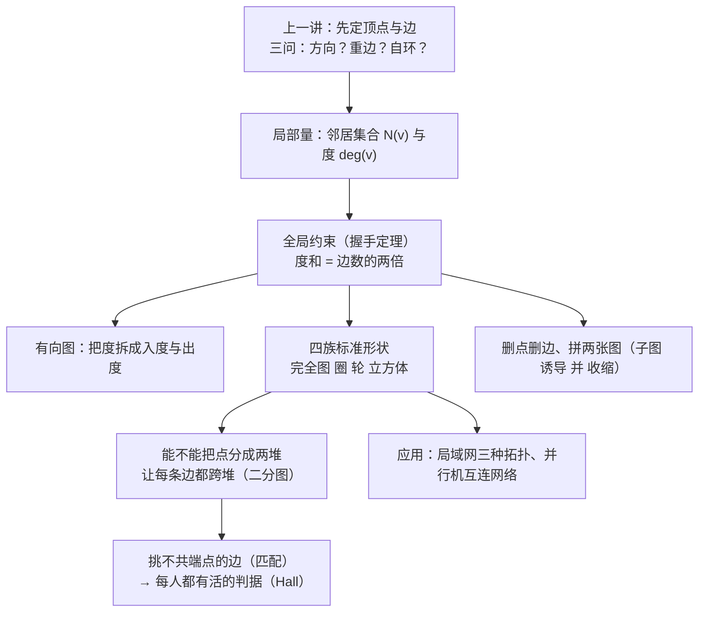

# C10.2 图的术语与特殊类型 Graph Terminology and Special Types of Graphs

> [!abstract] 这一讲的任务
> 上一讲把现实里的"联系"画成了图，也定下了方向、重边、自环三问。但图一旦画出来，最要紧的问题是：**一个点"忙不忙"怎么量？一张图"有多少条边"能不能从局部信息反推？** 这一讲先把"邻接、邻域、度"这三个局部量定义清楚，用一条会计恒等式——度和等于边数的两倍——把它们和全局的边数锁在一起；再认识五族反复出现的标准形状（$K_n,C_n,W_n,Q_n,K_{m,n}$）；最后用二分图回答一个完全不同的问题：**手里只有"谁配得上谁"的表，怎么在动手排之前就断定"排得开还是排不开"**。答案就是 Hall 婚姻定理，而它是本章唯一一个"必要条件恰好也充分"的漂亮结果。

> [!info] 怎么读这份讲义
> 主线是 §1 → §2 → §4 → §5 → §6 → §7，一条线读完就能应付本章后续所有"点数边数度"的计算。§3（有向图）可以独立先读，它是 10.4 讲强连通、10.6 讲有向最短路的前置；§8 是应用，§9 的四种子图运算（定义 7–9）是 10.3（邻接矩阵怎么删行列）和 10.4（删点看连通性）的操作基础，不能跳。§10 是延伸（补图、自补图、度序列），考试不直接考但能救计算题。
> 用到的旧知识：集合与子集、并集与计数（第 2 章）、函数是单射还是满射（第 2.3 节）、数学归纳法与强归纳（第 1.7–1.8 节）、关系可以画成有向图（第 9.1、9.3 节）。
> 正文有四处印刷问题（定义编号、二着色方向、收缩的变量、Hall 必要性叙述），都在出现的地方用「勘误」标了出来，末尾 §11 有汇总表——**不影响你读懂，但考试前值得看一眼，免得记成错的那版**。

---

## 0. 开场：一张连接表和三个追问

周五下午，计算中心的王工拿到一张表：20 台设备（交换机、服务器、几台打印机），31 根网线，每根线的两端各写了设备编号。他要在下班前回答三个问题。

**问题一：这张表有没有记错？** 一根一根核对太慢。他想了个办法：把每台设备看成一个点、每根网线看成一条边，先数每台设备上插了几根线（这个数就是接下来要定义的**度**），再把这 20 个数加起来。如果表没记错，这个和必须是 $2\times 31=62$。要是算出来 61，那就一定有一根线只记了一端——因为每根线有两个插头，两个插头各让一台设备的计数加 1，一根线给总和贡献的永远是 2。

**问题二：错在哪台设备上？** 只看总和够不够？不够，但有个更细的判据：**度为奇数的设备，台数必须是偶数**。所以他把 20 台机器按"连线条数是奇是偶"分成两堆，如果数出 5 台奇度设备，那就知道至少有一处记录错了——而且错处一定牵涉两台奇度设备（漏记一根线会让两端的度各少 1，恰好成对地翻转奇偶性）。

**问题三：下个月加 3 台打印机，星形接法要加几根线？** 星形就是一端连中心、另一端连每台设备：$n$ 台设备加一个中心，一共 $n$ 根线，这个形状正好是后面要认识的完全二分图 $K_{1,n}$。换成环、换成"环 + 中心"的混合接法，线数、每个点的度、断一根线之后还连不连通，全都不同。

但真正让王工头疼的是第四件事，它不在网线里，而在排班表里：**4 个人、4 件活**，每人会做其中某几件，要求每件活都有人做、每人至多做一件。他在纸上排了半小时，发现结局只有两种：有时候随手一试就排开了；有时候怎么试都差一个人。而"差一个人"到底是因为今天运气不好，还是这个结构上根本不可能？

这四个问题就是这一讲的路：先学会量一个点（§1），再拿到一条所有图都必须服从的会计恒等式（§2），然后认识几族反复出现的标准形状（§4、§5），最后用二分图把第四问彻底判掉（§6、§7）。第二、三问的答案你在上面已经看过了——**数度、看奇偶**。

你刚才做的，就是一次完整的图的度量。

---

## 1. 邻接、邻域与度（p.651–653）

### 1.1 两个点之间有一根线，怎么称呼

把表和线搬进图里，最先要能说清的是"这两个点是直接相连的"。日常说法含糊，定义要精确。

> [!important] 定义 1 邻接与关联 Adjacent and Incident
> 设 $G$ 是无向图。若 $u,v$ 是 $G$ 中某条边 $e$ 的两个端点，则称 $u$ 与 $v$ **邻接 adjacent**（互为**邻居 neighbors**），并称边 $e$ 与点 $u$、$v$ **关联 incident**，也说 $e$ **连接 connect** $u$ 与 $v$。

两个词指向的东西不同，别混：

- **邻接**是点与点的关系（"他俩认识"）；
- **关联**是边与点的关系（"这根线插在这台机器上"）。

所以"与 $v$ 邻接的点有几个"和"与 $v$ 关联的边有几条"是两个问题。下面会看到，在有自环或重边时，这两个问题的答案可以不一样——这是本章第一个高频易错点。

### 1.2 把邻居收成一个集合

> [!important] 定义 2 邻域 Neighborhood
> 图 $G=(V,E)$ 中点 $v$ 的全部邻居构成的集合记作 $N(v)$，称为 $v$ 的**邻域 neighborhood**。若 $A\subseteq V$，则 $N(A)$ 表示 $G$ 中与 $A$ 里**至少一个**点邻接的全部点，即 $N(A)=\bigcup_{v\in A}N(v)$。

一句人话：**把 $v$ 的"直接认识的人"装进一个袋子，袋子就是 $N(v)$；把一个点集 $A$ 里所有人的熟人合起来，就是 $N(A)$。**

三处要留意：

1. $N(A)$ 是"至少邻接 $A$ 中一个点"的点，**不是**"与 $A$ 中每个点都邻接"的点。§7 那个"三件活只有两个人会做"的反例，用的正是"至少一个"这个宽松版本。
2. $v$ **可以**属于 $N(v)$：只要 $v$ 上挂着一个自环，按定义 1，$v$ 就是自己的邻居。例 1 的图 $H$ 中 $N(b)=\{a,b,c,d,e\}$ 里就有 $b$ 自己。
3. $A$ 取空集时 $N(\varnothing)=\varnothing$，所以 Hall 条件在 $A=\varnothing$ 上退化成 $0\ge0$，自动成立——实际检查时只需看非空子集。

### 1.3 度：数边，不数点

> [!important] 定义 3 度 Degree
> 无向图中点 $v$ 的**度 degree** 是与 $v$ 关联的边数，但**自环给这个点的度贡献 2**。记作 $\deg(v)$。

一句人话：**一根边有两个端点；把"以 $v$ 为端点"的边数一遍，一边算 1，自环因为两头都在 $v$ 身上，所以算 2。**

为什么自环非算两次？看下一节就明白：握手定理的证明只用到一句话——"每条边恰好有两个端点"。自环的两个端点都是 $v$，若只记 1，那句话就不成立，整条定理对伪图就要失效。定义 3 的"算两次"不是拍脑袋，是为了让后面所有等式继续成立。

> [!question] 为什么自环要算 2，而重边只算 1 条？
> 因为**度算的对象是边的端点，不是边的条数**。$u$ 与 $v$ 之间有两条边时，它们是两条不同的边，各自有一个 $u$ 端和一个 $v$ 端，所以 $u$、$v$ 的度各加 2，而"邻接"只加 1 次（$N(u)$ 里只有一个 $v$）。自环是一条边、但两个端点都落在同一个点上，所以度加 2。记住这句：**度按端点重数计，邻域按点的集合计。**

### 1.4 例 1：把度与邻域都数出来

> [!example] 例 1 图 $G$ 与 $H$ 的度、邻域
> 求下面两张无向图里每个点的度与邻域。

![[C10.2-原图-邻域与度两例.png]]

左边 $G$ 是简单图（7 个点 9 条边），右边 $H$ 带自环和重边（6 个点 11 条边）。

**图 $G$。** $\deg(a)=2$，$\deg(b)=\deg(c)=\deg(f)=4$，$\deg(d)=1$，$\deg(e)=3$，$\deg(g)=0$。邻域：

$$N(a)=\{b,f\},\ N(b)=\{a,c,e,f\},\ N(c)=\{b,d,e,f\},\ N(d)=\{c\},\ N(e)=\{b,c,f\},\ N(f)=\{a,b,c,e\},\ N(g)=\varnothing .$$

**图 $H$。** $\deg(a)=4$，$\deg(b)=\deg(e)=6$，$\deg(c)=1$，$\deg(d)=5$。邻域：

$$N(a)=\{b,d,e\},\ N(b)=\{a,b,c,d,e\},\ N(c)=\{b\},\ N(d)=\{a,b,e\},\ N(e)=\{a,b,d\}.$$

逐条对一下 $H$ 就把上面两个"陷阱"都撞上了：

- $a$ 与 $e$ 之间**有两条边**：这两条边各给 $a$ 的度加 1、各给 $e$ 的度加 1；可 $N(a)$ 里只有一个 $e$。所以 $|N(a)|=3$ 而 $\deg(a)=4$。
- $b$ 上有一个**自环**，它给 $\deg(b)$ 贡献 2；同时按定义 1，$b$ 是 $b$ 的邻居，所以 $N(b)$ 里含 $b$：$|N(b)|=5$ 而 $\deg(b)=6$。

两图的对照：

| 图 | 点数 | 边数 | 各点度（降序） | 度和 |
|---|---|---|---|---|
| $G$ | 7 | 9 | $4,4,4,3,2,1,0$ | $18$ |
| $H$ | 6 | 11 | $6,5,4,4,1$ | $22$ |

先把这两个和（18 与 22）记住，§2 会说明它们为什么必然都是偶数。

### 1.5 孤立点与悬挂点

两个极端的度值得单独起名字，因为它们在建模时都有含义。

- **孤立点 isolated**：度为 0 的点。它一根线也没有，谁也不认识。
- **悬挂点 pendant**：度为 1 的点。它只挂在一根线上，只认识一个点。

例 1 里 $G$ 的 $d$ 是悬挂点（只连 $c$），$g$ 是孤立点；$H$ 里 $c$ 是悬挂点（只连 $b$），没有孤立点。注意"度为 1"在有自环时意味着"恰好一条非自环的边且没有自环"——自环会让度至少变成 2。

> [!warning] 易错点：度与邻域大小不是一回事
> 简单图里 $\deg(v)=|N(v)|$ 恒成立，所以很多人记成"度就是邻居个数"。一旦出现**重边**或**自环**，这条就不成立：例 1 的 $H$ 中 $\deg(b)=6$ 而 $|N(b)|=5$，$\deg(a)=4$ 而 $|N(a)|=3$。教材 10.3 讲邻接矩阵时"自环只记 1"的规定，也是同一个坑的另一种表现。

### 1.6 例 2：度在生态模型里是什么意思

> [!example] 例 2 生态位重叠图里的度
> 在生态位重叠图（10.1 例 10 引入）中，两个物种有边当且仅当它们竞争。问：一个点的度代表什么？哪些点是悬挂点、哪些是孤立点？用那张图解释。

解：有边等价于竞争，所以 **$v$ 的度 = 与 $v$ 所代表的物种竞争的物种数**。度为 1 的点代表"只与一个物种竞争"的物种；孤立点代表"在本生态系统中不与任何其他物种竞争"的物种。

对照那张图：松鼠对应的点度为 4，因为它与乌鸦、负鼠、浣熊、啄木鸟四者竞争；**老鼠是唯一被悬挂点代表的物种**（它只与鼩鼱竞争，其余物种都至少与两个物种竞争）；图中**没有孤立点**，因为这个生态系统里每个物种都至少与另一个物种竞争。

这就是"度"的用处：它把一个定性描述（"这个物种竞争压力大"）变成了一个可计算的整数，而且这个整数一算出来就能直接读出结构信息（压力大 = 度高；只缠着一个对手 = 悬挂点；谁也不惹 = 孤立点）。

---

## 2. 握手定理：度和等于边数的两倍（p.653）

### 2.1 先撞一次墙

问题：**只知道每个点连着几条边，能不能反推出总边数？**

最朴素的想法是把度全加起来，然后认为"度和 = 边数"。试一个小例子：一条边、两个端点，两个点的度都是 1，度和是 2，边数是 1——已经对不上了。再看例 1 的 $G$：度和 18，边数 9；$H$：度和 22，边数 11。两次都是恰好 2 倍。

**为什么必然差 2 倍？** 因为数度的时候，一根线被它的两个端点各数了一次。端点 $u$ 数它时它是"$u$ 的一条边"，端点 $v$ 数它时它又成了"$v$ 的一条边"——同一条边在总和里出现了两次。这就是全部原因。

> [!important] 定理 1 握手定理 the Handshaking Theorem
> 设 $G=(V,E)$ 是无向图，$|E|=m$，则
> $$2m=\sum_{v\in V}\deg(v).$$
> 重边与自环存在时结论不变。

名字的来历：一次**握手**涉及两只手，一条**边**涉及两个端点，一一对应——所以"度之和 = 握手总次数 × 2"。（这不是某个人的名字，它是一个比喻。）

### 2.2 证明：同一次计数，两种数法

设 $V=\{v_1,\dots,v_n\}$，$E=\{e_1,\dots,e_m\}$。构造一个**可重集**

$$\mathcal{I}=\{(v,e): v\in V,\ e\in E,\ v \text{ 是 } e \text{ 的一个端点}\},$$

其中每条边的两个端点各登记一次（自环 $e=\{u,u\}$ 就把 $(u,e)$ 登记两次，这正是定义 3 的"算两次"）。

- **按点来数。** 固定 $v$，满足条件的 $e$ 恰好有 $\deg(v)$ 条，所以 $|\mathcal I|=\sum_{v\in V}\deg(v)$。
- **按边来数。** 固定 $e=\{u,w\}$，它恰好登记两个配对 $(u,e)$ 与 $(w,e)$（自环时这两个配对相同，但仍登记两次），所以 $|\mathcal I|=2m$。

同一个集合数出两个结果，故 $\sum_v\deg(v)=2m$。$\blacksquare$

这个证明里唯一"用到的性质"就是：**每条边恰好有两个端点（按重数）**。所以它对简单图、多重图、伪图一视同仁——后面算 $K_n$、$W_n$、$Q_n$ 的边数，全靠这一点。

![[C10.2-握手定理计数示意.png]]

图上每条边的两端各留一个 $+1$，5 条边留下 10 个记号；按点收拢就是 $3+2+3+2=10$，恰好是 $2\times5$。

### 2.3 例 3：只知道度，求边数

> [!example] 例 3 每个点度都是 6 的 10 点图有几条边
> 一个图有 10 个点，每个点的度都是 6，它有多少条边？

解：度和 $=6\times10=60$，由定理 1，$2m=60$，所以 $m=30$。

（顺带一个存在性问题：10 个点、每点度 6，这个图存在吗？$6\le 10-1=9$，度不超上限，而且可以真的造出来：$K_{10}$ 是 9-正则的，从它里面删掉一个 3-正则的生成子图（例如 Petersen 图）就得到 6-正则。这类"度 + 度和"的双重检查，在后面判断"度序列是否可实现"时是第一步。）

### 2.4 定理 2：奇度点的个数是偶数

定理 1 有一个几乎免费的推论，但它比定理 1 本身更常用。

> [!important] 定理 2 奇度顶点的个数为偶数
> 任意无向图中，度为奇数的顶点个数是偶数。

**证明.** 设 $V_1$ 是偶度点集，$V_2$ 是奇度点集，边数 $m$。由定理 1，

$$2m=\sum_{v\in V}\deg(v)=\sum_{v\in V_1}\deg(v)+\sum_{v\in V_2}\deg(v).$$

左边 $2m$ 是偶数。右边第一项是若干个偶数相加，也是偶数。偶数减偶数还是偶数，所以右边第二项 $\sum_{v\in V_2}\deg(v)$ 必须是偶数。

而第二项是"一堆奇数相加"。奇数个奇数相加得奇数，偶数个奇数相加才得偶数；现在它必须是偶数，所以 $V_2$ 里的点数（也就是相加的项数）是偶数。$\blacksquare$

这个证明只用"每项是奇是偶"，完全不需要知道度具体是多少——所以它给出的是一个**不依赖具体图形的结构约束**。

回到开场的问题二：王工把设备按度的奇偶分成两堆，数出奇度设备 5 台，就能断定记录有错。更准确地说，漏记一根线会让两端的度各少 1，恰好把两台设备的奇偶性同时翻转，所以"奇度设备数"只能以 2 为单位变化——它永远不可能从偶数变成奇数。

> [!warning] 易错点：度和为偶 ≠ 每个度都是偶
> 定理 1 说的是**总和**为偶数，单个点的度完全可以是奇数（例 1 的 $G$ 里 $d$ 的度是 1，$e$ 的度是 3）。定理 2 说的也不是"每个奇度点的度是偶数"（这是废话），而是**奇度点的个数**是偶数。三个"偶"字，位置不同，含义完全不同：
> - 度和是偶数；
> - 每个偶度点的度是偶数；
> - 奇度点的**个数**是偶数。

### 2.5 定理 1 的两条实用推论

**（1）平均度。** $2m/n$ 是平均度。它把"边数"和"点数"连起来：$m$ 大，平均度就大；反之，如果一个图的平均度是 1000（有人在熟人网络里估过这个数），那么每个人平均认识 1000 个人。平均度一定夹在最小度和最大度之间（因为总和是 $n$ 个数的和），所以"存在一个点度不低于平均度"这类说法不用看具体图形就成立。

**（2）快速否证。** 定理 1 是**必要**条件，所以只要度和是奇数，就能立刻断言"这样的图不存在"。例如"15 个点、每点度 5"：$15\times5=75$ 是奇数，$2m$ 不可能等于 75，所以不存在——尽管 $5\le 14$ 这个上界毫无问题。考试里这类"能不能存在"的题，先算度和的奇偶，往往一步就结束。

> [!note] 专业关联
> 图神经网络（GNN）的一层聚合写作 $H'=\sigma(\hat D^{-1}\hat A H W)$，其中的 $\hat D$ 就是（加了自环的）度矩阵：**每个点把自己邻居的特征平均一下，分母正是它的度**。度大的点（社交网络里的"大 V"）如果不做归一化，聚合结果的量级会失控；而"度分布"本身（幂律、重尾）也是社交网络分析与图采样的核心统计量。定理 1 在这里的角色是记账：$\sum_v\deg(v)=2m$ 说明平均度 $=2m/n$，图的稀疏密稠可以只看这两个数。

---

## 3. 有向图：入度与出度（p.653–654）

无向图的"相连"没有方向。一旦边变成箭头（谁打给谁、谁引用了谁、谁赢了谁），"从 $v$ 出发的边"和"指向 $v$ 的边"就必须分开数——一个点的"忙"有两种忙法。

> [!important] 定义 4 有向边的邻接与端点
> 设 $(u,v)$ 是有向图 $G$ 的一条边。称 $u$ **邻接到** $v$（$u$ is adjacent to $v$），$v$ **邻接自** $u$（$v$ is adjacent from $u$）。$u$ 称为 $(u,v)$ 的**起点 initial vertex**，$v$ 称为**终点 terminal（end）vertex**。自环的起点与终点相同。

> [!important] 定义 5 入度与出度 In-degree and Out-degree
> 有向图中点 $v$ 的**入度** $\deg^-(v)$ 是以 $v$ 为终点的边数；**出度** $\deg^+(v)$ 是以 $v$ 为起点的边数。自环同时给这个点贡献 1 个入度和 1 个出度。

注意自环在这里的表现与无向图相反：无向图里自环算 **2** 个度，有向图里自环算 **1 入 1 出**。两边其实是同一件事——自环的两个"端点角色"（起点、终点）各记一次。

> [!important] 定理 3 有向握手定理
> 设有向图 $G=(V,E)$，则
> $$\sum_{v\in V}\deg^-(v)=\sum_{v\in V}\deg^+(v)=|E|.$$

**证明一句话.** 每条边恰有一个起点、一个终点：它在"出度总和"里被数一次（记在起点名下），在"入度总和"里也被数一次（记在终点名下）。两个总和都是"每条边记一次"，都等于 $|E|$。$\blacksquare$

和无向图的定理 1 对比：无向图是"每条边记两次，两个总和相等"，有向图是"每条边记一次，两个总和分别等于 $|E|$"。

### 3.1 例 4：逐个点算入度出度

> [!example] 例 4 求有向图每个点的入度与出度
> 求下图 $G$ 中每个点的入度与出度。

![[C10.2-原图-有向图入度出度.png]]

这张图 6 个点 12 条边，其中 $a,c,e$ 各有一个自环，$a$ 与 $e$ 之间有一对方向相反的边，$f$ 是孤立点。

解：按定义 5 逐个数（自环两边各记 1）：

| 点 | 入度 $\deg^-$ | 出度 $\deg^+$ | 说明 |
|---|---|---|---|
| $a$ | 2 | 4 | 自环 1 入 1 出；另有 $e\to a$ 入；$a\to b$、$a\to c$、$a\to e$ 出 |
| $b$ | 2 | 1 | $a\to b$、$c\to b$ 入；$b\to d$ 出 |
| $c$ | 3 | 2 | $a\to c$、$d\to c$、自环 入；$c\to b$、自环 出 |
| $d$ | 2 | 2 | $b\to d$、$e\to d$ 入；$d\to e$、$d\to c$ 出 |
| $e$ | 3 | 3 | $a\to e$、$d\to e$、自环 入；$e\to a$、$e\to d$、自环 出 |
| $f$ | 0 | 0 | 孤立点 |
| 合计 | 12 | 12 | $=|E|$ |

两个总和都是 12，与边数一致，定理 3 得到验证。注意 $f$：入出皆 0，在有向图里也是孤立点。

### 3.2 底层无向图

把每条边的箭头抹掉，得到的有向图的**底层无向图 underlying undirected graph**。两者边数相同（$a\to e$ 与 $e\to a$ 抹掉方向后成为两条重边，仍算两条）。

这个操作在 10.4 讲"强连通 vs 弱连通"时是关键词：弱连通就是"底层无向图连通"；10.6 讲有向最短路时也要先把无向的算法搬到有向边上。一条提醒：底层无向图未必是简单图，抹掉方向可能造出重边，做同构判定（10.3）时不能直接拿它当简单图用。

---

## 4. 四族标准形状：完全图、圈、轮、$n$ 立方体（p.655–656）

数学里有一批图形会反复出现，就像化学里的苯环。把它们的点数、边数、每个点的度背下来，后面几乎所有构造题都能直接套。**这四族都是简单图**（无重边、无自环）。

### 4.1 完全图 $K_n$：每对点之间恰有一条边

> [!example] 例 5 完全图 Complete Graph $K_n$
> $n$ 个点的**完全图** $K_n$ 是这样一个简单图：每对不同的点之间恰好有一条边。$K_1,\dots,K_6$ 如下。若一个简单图至少有一对不同的点之间没有边，就称它是**非完全的 noncomplete**。

![[C10.2-原图-完全图Kn.png]]

$K_n$ 的边数是 $\binom n2=\dfrac{n(n-1)}{2}$。**为什么不是 $n(n-1)$？**

先数**有序**点对：每个点可以向其余 $n-1$ 个点各连一条边，共 $n(n-1)$ 个"（起点，终点）"。但在这张无向图里，$(u,v)$ 与 $(v,u)$ 指的是**同一条边**（定义 1 只说"$u,v$ 是某条边的两个端点"，没有先后）。每条边被这样数了两次，所以除以 2。

这和握手定理是同一件事的两种说法：$K_n$ 中每个点的度是 $n-1$，度和 $=n(n-1)$，由 $2m=n(n-1)$ 得 $m=\binom n2$。**除以 2 的理由永远是同一个：每条边有两个端点。**

对照表（自己手算一遍再对）：

| $n$ | 1 | 2 | 3 | 4 | 5 | 6 | 7 | 8 |
|---|---|---|---|---|---|---|---|---|
| $K_n$ 边数 | 0 | 1 | 3 | 6 | 10 | 15 | 21 | 28 |

$K_1$ 只有一个点、零条边；$K_2$ 就是一条边；$K_3$ 是一个三角形。$K_n$ 是 $(n-1)$-正则图（每个点度相同，见 §4.5）。

### 4.2 圈 $C_n$：首尾相接走一圈

> [!example] 例 6 圈 Cycle $C_n$
> $n\ge3$ 时，**圈** $C_n$ 由 $n$ 个点 $v_1,\dots,v_n$ 和 $n$ 条边 $\{v_1,v_2\},\{v_2,v_3\},\dots,\{v_{n-1},v_n\},\{v_n,v_1\}$ 组成。$C_3,C_4,C_5,C_6$ 如下。

![[C10.2-原图-圈Cn.png]]

$C_n$ 有 $n$ 个点、$n$ 条边，每个点的度都是 2（每个点只和左右两个邻居相连），所以 $C_n$ 是 2-正则图。

**为什么要求 $n\ge3$？** 因为 $C_1$ 需要一条从 $v_1$ 回到 $v_1$ 的边，那是自环；$C_2$ 需要两条都连接 $v_1,v_2$ 的边，那是重边。两者都不是简单图，而这一族的标准定义就活在简单图里。$C_3=K_3$（三个点两两边相连，正是三角形）。

### 4.3 轮 $W_n$：圈加一个中心

> [!example] 例 7 轮 Wheel $W_n$
> 在圈 $C_n$（$n\ge3$）之外再加一个点，并把这个新点与 $C_n$ 上全部 $n$ 个点各连一条新边，得到的图叫**轮** $W_n$。$W_3,W_4,W_5,W_6$ 如下。

![[C10.2-原图-轮Wn.png]]

数一数：

- **点数** $n+1$（圈上的 $n$ 个 + 中心 1 个）；
- **边数** $n+n=2n$（圈上原有的 $n$ 条 + $n$ 条辐条）；
- **度**：中心 $n$（与圈上每个点都连），圈上每个点 3（左右各 1，加中心 1）。

用握手定理反过来验：度和 $=n+3n=4n$，而 $2m=2\cdot 2n=4n$，对上了。这条验算值得养成习惯：**任何图族的"点数、边数、度"三组数，都要能用 $\sum\deg=2m$ 自查一遍**，写错一个立刻暴露。

两处小陷阱：

1. $W_3$ 就是 $K_4$。$W_3$ 有 4 个点，中心度 3、圈上每点度 3，四个点两两相连——这正是 $K_4$。所以"轮"这一族在 $n=3$ 时和最前面的完全图撞车，不奇怪。
2. **记号陷阱**：有的书把 $W_n$ 定义为"$n$ 个点的轮"（即 $C_{n-1}$ 加中心）。本书一律是"$n$ 个点的圈 + 1 个中心 = $n+1$ 个点"，写作 $W_n$。做题看到 $W_n$ 先数点。

### 4.4 $n$ 立方体 $Q_n$：位串只差一位就连边

> [!example] 例 8 $n$ 立方体 $n$-Cube $Q_n$
> $n$ 维**超立方体**（$n$ 立方体）$Q_n$ 的点是全部 $2^n$ 个长度为 $n$ 的比特串；两个点相邻当且仅当它们代表的比特串**恰好有一位不同**。$Q_1,Q_2,Q_3$ 如下。

![[C10.2-原图-超立方体Qn.png]]

先数点：长度 $n$ 的比特串每位有两种取法，共 $2^n$ 个点。

再数边：取任意一个点，把它的 $n$ 位中的**任意一位**翻转，得到的仍是长度 $n$ 的串、且与原串恰差一位，所以每个点恰有 $n$ 个邻居，度是 $n$。度和 $=n\cdot2^n$，由 $2m=n2^n$ 得

$$|E(Q_n)|=n\cdot2^{n-1}.$$

千万别记成 $n2^n$——那里已经除过 2 了。列表核对：

| $n$ | 1 | 2 | 3 | 4 | 5 |
|---|---|---|---|---|---|
| 点数 $2^n$ | 2 | 4 | 8 | 16 | 32 |
| 边数 $n2^{n-1}$ | 1 | 4 | 12 | 32 | 80 |

几个值得记住的巧合：$Q_1=K_2$，$Q_2=C_4$（四个点围成正方形），$Q_3$ 就是通常说的立方体（8 个顶点、12 条棱、每点 3 条棱）。$Q_n$ 还有一条递归构造法，教材特意讲了：把两份 $Q_n$ 摆成一上一下，一份的每个标号前面加 0、另一份加 1，再把"只差首位"的对应点连起来，就得到 $Q_{n+1}$。图里 $Q_3$ 就是这么由上下两个 $Q_2$ 拼出来的。

**$Q_n$ 是二分图**——按"比特串中 1 的个数的奇偶"分成两堆，翻转一位必然改变奇偶性，所以每条边都跨堆。这句话现在先记着，§5 会把它变成一条可用的判据。

### 4.5 四族对照与"正则"

一个图若所有点的度都相同，就叫**正则图 regular**；度为 $k$ 时叫 **$k$-正则**。

| 图族 | 点数 | 边数 | 每个点的度 | 正则性 | 备注 |
|---|---|---|---|---|---|
| $K_n$ | $n$ | $\binom n2$ | $n-1$ | $(n-1)$-正则 | $K_1$ 无边；非完全 = 缺至少一条边 |
| $C_n$ | $n$ | $n$ | 2 | 2-正则 | $n\ge3$；$C_3=K_3$ |
| $W_n$ | $n+1$ | $2n$ | 中心 $n$，圈上 3 | 仅 $n=3$ 时正则 | $W_3=K_4$ |
| $Q_n$ | $2^n$ | $n2^{n-1}$ | $n$ | $n$-正则 | $Q_1=K_2$，$Q_2=C_4$ |

关于正则性，三条练习题式的结论可以直接用：

- $K_n$ 与 $C_n$ 与 $Q_n$ 对一切合法 $n$ 都正则；$W_n$ 只有在 $n=3$ 时正则（因为那时中心度 $n=3$ 与圈上的 3 相等）。
- 完全二分图 $K_{m,n}$（§5.5）正则当且仅当 $m=n$：两侧点的度分别是 $n$ 与 $m$。
- $k$-正则图有 $kn=2m$，所以 $kn$ 必须是偶数。这条能一步否掉"3 个点、每点度 3"这类题目（$3\times3=9$ 为奇）。
- 反过来，知道 $k$ 与 $m$ 就能求 $n$：4-正则图若有 10 条边，则 $4n=20$，$n=5$。

---

## 5. 二分图：把点分成两堆，让每条边都跨堆（p.656–658）

### 5.1 从"所有关系都发生在两类东西之间"说起

有些图天生就分两伙：村里的婚姻图（点是男女，边是婚姻），每根边一定连着"一个男的"和"一个女的"；岗位技能图（点是人和岗位，边是"这个人会做这个岗位"），每根边一定连着"一个人"和"一个岗位"；物种–资源图、学生–课程图、球员–球队图，都是这个形状。

问题：**给定一张图，能不能把它的点分成两堆，使得每条边都恰好跨两堆**（不许有一堆内部自己连边）？

> [!question] 停一下，先自己想想
> 一张只有一条边的图（$K_2$）能不能这样分？能：两个点各放一堆。一个三角形（$K_3$）呢？试试就知道不行——你总得把其中两个点放进同一堆（3 个点分 2 堆，必然有一堆含 2 个点），而这两个点在 $K_3$ 里恰好有边，违反"边必须跨堆"。这个"必然有一堆含 2 个点"的推理，就是例 10 的全部内容。

> [!important] 定义 6 二分图 Bipartite Graph
> 简单图 $G$ 称为**二分图 bipartite**，若它的点集 $V$ 可以分成两个不相交的集合 $V_1,V_2$，使得每条边都连接 $V_1$ 中的一个点与 $V_2$ 中的一个点（即：没有一条边的两个端点同属 $V_1$ 或同属 $V_2$）。满足条件时，称 $(V_1,V_2)$ 是 $V$ 的一个**二分划分 bipartition**。

一句人话：**把点涂成两种颜色，要求每条边的两端颜色不同；涂得出来就是二分图，涂不出来就不是。**

> [!warning] 勘误：p.656 的定义编号
> 正文在引出这个定义时写的是 "This leads us to **Definition 5**"，但紧接着的定义框印的编号是 **DEFINITION 6**。按全书编号，定义 5 是上一节的有向图入度/出度，这里确实是**定义 6**。教材这句话应读作 "leads us to Definition 6"。

两点补充：

1. **划分不唯一，但不自由。** $C_6$ 可以分成 $\{v_1,v_3,v_5\}$ 与 $\{v_2,v_4,v_6\}$，也可以把两堆整体对调。但对**连通**二分图，一旦某个点定了颜色，其余点的颜色就被"每条边异色"一路逼死，所以划分只在"整体交换"这个意义下唯一（这也是 §5.4 那个二着色判据的底气）。
2. **孤立点放哪边都行**，所以带孤立点的二分图，划分会更多。

### 5.2 三个小例子：$C_6$ 是、$K_3$ 不是、图 8 一是一非

> [!example] 例 9 $C_6$ 是二分图
> 把 $C_6$ 的点集分成 $V_1=\{v_1,v_3,v_5\}$ 与 $V_2=\{v_2,v_4,v_6\}$，每条边都从一个 $V_1$ 点连到一个 $V_2$ 点，所以 $C_6$ 二分。

> [!example] 例 10 $K_3$ 不是二分图
> 把 $K_3$ 的点任意分成两堆，由抽屉原理，必有一堆含至少 2 个点。这两个点在 $K_3$ 中有边相连，与"边必须跨堆"矛盾，所以 $K_3$ 不是二分图。

> [!example] 例 11 图 8 的两张图哪个是二分图
> 判断下图 $G$ 与 $H$ 是否二分。

![[C10.2-原图-二分图两例.png]]

解：$G$ **是**二分图，划分可以取 $\{a,b,d\}$ 与 $\{c,e,f,g\}$——把 7 条边全列出来（$a$–$e$、$a$–$g$、$g$–$d$、$d$–$f$、$a$–$f$、$a$–$c$、$f$–$b$），每条都跨这两堆。注意：二分**不要求**左边的每个点都与右边所有点相连，例如 $b$ 与 $g$ 就没有边（$b$ 的度是 1，只连 $f$）。

$H$ **不是**二分图。挑三个点看：$a,b,f$ 两两相邻（$a$-$b$、$b$-$f$、$f$-$a$ 都在），构成一个三角形，无论怎么分堆，这三点里必有两个同堆，而它们之间偏偏有边。同样地 $a,b,e$ 也构成一个三角形（图里有两处，任选一处即可否定）。

顺便核一下两图的度（后面 §5.3 判断要用）：$G$ 有 7 点 7 边，度依次为 $4,3,2,2,1,1,1$；$H$ 有 6 点 12 边，度为 $5,5,4,4,3,3$。

### 5.3 定理 4：二分 ⟺ 可二着色

> [!important] 定理 4 二分图与二着色
> 简单图是二分图，当且仅当可以给每个点涂两种颜色之一，使得任意两个相邻的点颜色不同。

**证明（两个方向各三行，一步不省）.**

$(\Rightarrow)$ 设 $G=(V,E)$ 二分，划分 $(V_1,V_2)$。把 $V_1$ 的点全涂红、$V_2$ 的点全涂蓝。任取一条边 $\{u,v\}$：由二分定义，$u,v$ 分属 $V_1,V_2$，所以一红一蓝，颜色不同。

$(\Leftarrow)$ 设存在合法二着色。令 $V_1$ 为红色点集，$V_2$ 为蓝色点集。则 $V_1\cap V_2=\varnothing$ 且 $V_1\cup V_2=V$（每个点恰好一色），并且任取一条边 $\{u,v\}$：由于相邻点不同色，$u,v$ 不可能都在 $V_1$、也不可能都在 $V_2$，所以一在 $V_1$ 一在 $V_2$。按定义 6，$G$ 二分。$\blacksquare$

定理 4 把一个"存在某种划分"的问题，换成了"能不能染色"的问题。别小看这个换法：**划分是在 $2^n$ 个可能里找，染色是一个点一个点逼出来的**，后者可以真的动手做。

### 5.4 例 12：动手染一遍

> [!example] 例 12 用定理 4 判断例 11 的两张图
> 一个染得成、一个染不成，两种过程各走一遍：判断例 11 的 $G$ 与 $H$。

解 **$G$**：先随手把 $a$ 染红（不失去一般性，颜色名字可以互换）。与 $a$ 相邻的是 $c,e,f,g$，四个全部必须染蓝。接着看与这四个蓝点相邻的点：$c$ 与 $d$ 相邻（还有 $a$）；$f$ 与 $b$、$d$ 相邻（还有 $a$）；$g$ 与 $d$ 相邻（还有 $a$）；$e$ 只与 $a$ 相邻，逼不出新东西。为了不出现"蓝–蓝"边，$b$ 与 $d$ 必须染红（$a$ 本来就是红，自洽）。此时全部点都染完：红 = $\{a,b,d\}$，蓝 = $\{c,e,f,g\}$。逐条边检查，每条都是一红一蓝，所以 $G$ 二分。

解 **$H$**：把 $a$ 染红。与 $a$ 相邻的是 $b,e,f$，三者必须染蓝。可是 $e$ 与 $f$ 之间有边——两个蓝点相邻，矛盾。于是无法完成二着色，由定理 4，$H$ 不是二分图。

> [!warning] 勘误：p.657 例 12 的着色条件写反了
> 教材在这段开头写的是 "assign ... one of two colors ... so that **no edge in G connects a red vertex and a blue vertex**"（要求"不存在连接红点与蓝点的边"），并在 $H$ 的段落里重复了一次。这与二着色的要求**方向正好相反**：二着色要的是"相邻点异色"，即**每条边都连接一红一蓝**，禁止的是"连接红点与红点、或蓝点与蓝点"的边。
> 正确的表述是：**给每个点涂红或蓝，使得不存在两端同色的边**（等价地：每条边的一端是红、另一端是蓝）。教材这段的结论句 "every edge connects a red vertex and a blue vertex" 恰恰是对的，与前面的条件句自相矛盾——照条件句读，$G$ 那种染色反而是"不合格"的。读的时候把条件句改过来即可。

### 5.5 二分图的等价判据：没有奇圈

定理 4 是"换语言"，真正好用的判据是另一条：**看有没有奇数条边组成的圈**。这条判据教材在正文末尾用一句话带过（"不可能从某点出发，走奇数条不同的边再回到该点"），证明留给 10.4 的习题（那一节的第 63 题）——这里把它补全，因为它比"试着染色"更适合手算和证明。

先把三个词备好（10.4 会正式定义，这里只用最朴素的意思）：

- **路径 path**：一串首尾相接的边；**长度**是路径上边的条数。
- **距离** $d(u,v)$：连接 $u$ 与 $v$ 的最短路径的长度。
- **圈 cycle**：起点与终点相同的路径，除起点外不重复经过任何点；长度为奇数的圈叫**奇圈 odd cycle**。

> [!important] 定理 4 的等价判据：二分 ⟺ 不含奇圈
> 一个简单图是二分图，当且仅当它不含长度为奇数的圈。

**必要性（二分 ⇒ 无奇圈）.** 设 $(V_1,V_2)$ 是二分划分，$C=v_0v_1\cdots v_{k-1}v_0$ 是一个长度为 $k$ 的圈。$v_0\in V_1$；因为 $v_0v_1$ 是边，$v_1$ 不能在 $V_1$，故 $v_1\in V_2$；同理 $v_2\in V_1$，$v_3\in V_2$……归纳得：$v_i\in V_1$ 当且仅当 $i$ 为偶数。回到起点要求 $v_k=v_0\in V_1$，所以 $k$ 是偶数。故任何圈都是偶圈。

（换个说法：沿圈走一步换一次颜色，走 $k$ 步回到原色，$k$ 必须为偶。）

**充分性（无奇圈 ⇒ 二分）.** 设 $G$ 不含奇圈。对每个连通分量分别处理（分量之间没有边，可以各自染色后拼起来），不妨设 $G$ 连通。任取一点 $r$，按到 $r$ 的距离分层：

$$L_i=\{v: d(r,v)=i\},\qquad i=0,1,2,\dots$$

两个断言。

**断言一：每条边的两个端点所在层数相差不超过 1。** 设 $uv$ 是边、$d(r,u)=i$。走"$r$ 到 $u$ 的最短路 + 边 $uv$"就到 $v$，所以 $d(r,v)\le i+1$；同理 $d(r,u)\le d(r,v)+1$。故 $|d(r,u)-d(r,v)|\le1$。

**断言二：同一层内没有边。** 反设 $u,v\in L_i$ 且 $uv$ 是边。取 $r$ 到 $u$ 的一条最短路 $P$、到 $v$ 的一条最短路 $Q$，两者长度都是 $i$。设 $x$ 是 $P$ 与 $Q$ 的**最后**一个公共点，记 $t=d(r,x)$。最短路的前缀仍是最短路，所以 $x$ 在 $P$ 上的位置等于 $t$，在 $Q$ 上的位置也等于 $t$——从 $x$ 到两个终点的剩余长度相同。于是：

- $P$ 从 $x$ 到 $u$ 有 $i-t$ 条边；
- $Q$ 从 $x$ 到 $v$ 也有 $i-t$ 条边；
- 这两段除 $x$ 外没有公共点（$x$ 是最后一个公共点），所以"$x\to u$、边 $uv$、$v\to x$"拼成一个**简单圈**，长度为

$$(i-t)+1+(i-t)=2(i-t)+1,$$

是奇数，与"不含奇圈"矛盾。

于是每条边都只连接 $L_i$ 与 $L_{i\pm1}$，也就是**跨层**。按层数的奇偶染色：$i$ 为偶染红，$i$ 为奇染蓝。由断言一、二，每条边的两端必在相邻层，一红一蓝。这是合法二着色，由定理 4，$G$ 是二分图。$\blacksquare$

这个证明的心脏是**断言二**：同层若有一条边，两条最短路加上这条边就凑出一个奇圈。反过来说，"没有奇圈"就保证了层内干净，于是一层红一层蓝就够了。请把这句话记住，它比结论本身有用——**二分性是一个"局部可检查"的性质：从一个点出发分层，看有没有同层边。**

回到例 11、例 12：$H$ 里的三角形 $a,b,f$ 就是长度 3 的奇圈，一眼否定；$G$ 里从 $a$ 出发分层是 $\{a\},\{c,e,f,g\},\{b,d\}$，层内都无边。

### 5.6 例 13：完全二分图 $K_{m,n}$

> [!example] 例 13 完全二分图 Complete Bipartite Graph $K_{m,n}$
> **完全二分图** $K_{m,n}$ 是把点集分成 $m$ 个点与 $n$ 个点两堆，并且**第一堆的每个点都与第二堆的每个点相连**、此外没有别的边。$K_{2,3},K_{3,3},K_{3,5},K_{2,6}$ 如下。

![[C10.2-原图-完全二分图Kmn.png]]

数一数：

- **点数** $m+n$；
- **边数** $mn$（第一堆每个点伸出 $n$ 条边，共 $m$ 个点，每条边都被这样数了恰好一次）；
- **度**：第一堆每点度 $n$，第二堆每点度 $m$；度和 $=mn+mn=2mn$，与 $2|E|$ 一致。

$K_{1,n}$ 就是**星 star**（一个中心连 $n$ 个叶子），它是局域网星形拓扑的模型（§8）。$K_{n,n}$ 是 $n$-正则二分图；$K_{2,2}=C_4$。完全二分图一定是二分图（划分就是那两堆），但它**不是**完全图（堆内部没有边）。

### 5.7 延伸：几条一推就得的结论

- **二分图的边数上界。** 若二分图有 $v$ 个点、$e$ 条边，划分是 $(m,n)$，$m+n=v$，则 $e=mn\le\left(\frac{m+n}{2}\right)^2=\frac{v^2}{4}$（均值不等式），等号在 $m=n$ 时取到。这是"二分图边数最多"的标准结论，也是"二分图稀疏"的定量版本。
- **$n$-正则二分图两侧点数相等。** 设划分为 $(V_1,V_2)$，每点度 $n$。一边数边：$|E|=n|V_1|$（只在 $V_1$ 一侧数度和，每条边恰好贡献一个 $V_1$ 端点），同时 $|E|=n|V_2|$，故 $|V_1|=|V_2|$。这是定理 1 的又一个用法。
- **$K_{m,n}$ 的补图。** 补图（§10.1）把 $K_{m,n}$ 缺的边全补上：两堆内部全连、两堆之间一条不剩，所以 $\overline{K_{m,n}}=K_m\cup K_n$。

顺带把四族的二分性一次查完（考试常问"哪些 $n$ 使 $X_n$ 二分"）：

| 图族 | 何时是二分图 | 理由 |
|---|---|---|
| $K_n$ | $n\le2$ | $n\ge3$ 含三角形 |
| $C_n$ | $n$ 为偶数 | $n$ 为奇时本身就是一个奇圈 |
| $W_n$ | 永远不是 | 中心与圈上相邻两点构成三角形 |
| $Q_n$ | 对一切 $n$ | 按"1 的个数"的奇偶分堆 |
| $K_{m,n}$ | 对一切 $m,n$ | 划分就是那两堆 |

---

## 6. 匹配：从"排不开"到"分得开"（p.658–659）

### 6.1 把排班表变成二分图

回到开场第四问。4 个人、4 件活，每人会做其中几件，要求：**每件活都有人做，每人至多做一件**。

建模：人放一边、活放一边；某人会做某活就连一条边。因为边只在"人"与"活"之间，这张图天然是二分图，划分就是（员工，岗位）。

先把它排一排——手工排班的过程，其实是在挑一组"互不共用端点"的边：一个人只能出现在一条边上（不能一个人干两件活），一件活也只能出现在一条边上。

### 6.2 例 14：两个项目，一个排得开一个排不开

> [!example] 例 14 岗位分配 Job Assignments
> 有 $m$ 个员工、$n$ 件活（$m\ge n$），每人会做其中若干件。用二分图建模后，考虑两个项目。

![[C10.2-原图-员工与任务匹配.png]]

**项目 1。** 四名员工 Alvarez、Berkowitz、Chen、Davis；四件活：requirements、architecture、implementation、testing。受训情况：Alvarez 会 requirements 与 testing；Berkowitz 会 architecture、implementation、testing；Chen 会 requirements、architecture、implementation；Davis 只会 requirements。

排一下：Davis 只会 requirements，那就让 Davis 做 requirements；于是 requirements 占掉，剩下三件活由 Alvarez、Berkowitz、Chen 分——Chen 做 architecture，Berkowitz 做 implementation，Alvarez 做 testing。四件活全有人，四人也各做一件。**排开了。**

**项目 2。** 四名员工 Washington、Xuan、Ybarra、Ziegler；同样四件活。受训情况：Washington 只会 architecture；Xuan 会 requirements、implementation、testing；Ybarra 只会 architecture；Ziegler 会 requirements、architecture、testing。

> [!question] 课堂追问：这次问题出在谁身上？
> 先别看答案，自己试着排两分钟。如果怎么排都差一件，问题到底出在"某个人太挑"还是"某几件活没人会"？

答案是后者，而且是结构性的：**requirements、implementation、testing 这三件活，只有 Xuan 和 Ziegler 两个人会做**（Washington 与 Ybarra 只会 architecture）。三件活要三个人，可会做这三件活的只有两个人——**人不够**。这不是运气问题，换一万种排法都不行。

这个"人不够"就是 §7 的 Hall 定理要抓的东西。先把它的语言备好。

### 6.3 匹配、最大匹配、完全匹配

> [!important] 匹配、最大匹配与完全匹配（教材正文给出，未编号）
> 简单图 $G=(V,E)$ 的**匹配 matching** $M$ 是 $E$ 的一个子集，其中任意两条边都不共端点；等价地，若 $\{s,t\},\{u,v\}\in M$ 且是不同两条边，则 $s,t,u,v$ 四个点互不相同。匹配 $M$ 中边的端点称为**已匹配的 matched**，其余点称为**未匹配的 unmatched**。边数最多的匹配叫**最大匹配 maximum matching**。设二分图 $G$ 的划分为 $(V_1,V_2)$，若匹配 $M$ 使得 $V_1$ 中**每个点**都是 $M$ 中某条边的端点，则称 $M$ 是从 $V_1$ 到 $V_2$ 的**完全匹配 complete matching**；等价地，$|M|=|V_1|$。

三句话拆开：

1. **匹配**就是"挑一组边，谁也不许抢点"。选中的边可以不相邻，但端点必须两两不同。
2. **最大匹配**是"能挑出的最多条的匹配"。它不一定唯一，条数才是指标。
3. **完全匹配 from $V_1$ to $V_2$** 是"把 $V_1$ 一个不剩地配出去"。注意方向：它只保证 $V_1$ 全配到，$V_2$ 里可以有剩的（这正是"$m$ 个男人、$n$ 个女人，每个男人都娶到、可能剩女人"的情形）。

> [!warning] 易错点：完全匹配与"完美匹配"
> 完全匹配有方向。$|V_1|\le|V_2|$ 时才可能从 $V_1$ 完全匹配；若 $|V_1|>|V_2|$，从 $V_1$ 出发的完全匹配**必不存在**（匹配条数不能超过 $V_2$ 的点数），但反过来从 $V_2$ 到 $V_1$ 的完全匹配可能存在。两侧都满的匹配通常叫**完美匹配 perfect matching**，它要求 $|V_1|=|V_2|$ 且 $|M|=|V_1|$。

用这三个词重述例 14：

- 项目 1：存在从"活"到"人"的完全匹配（4 件活 4 个人，所以它同时也是完美匹配）；这组 $M=\{$requirements–Davis, architecture–Chen, implementation–Berkowitz, testing–Alvarez$\}$ 是最大匹配。
- 项目 2：不存在从"活"到"人"的完全匹配；但它仍有最大匹配，条数是 **3**（三个活配出去），例如 requirements–Ziegler、architecture–Washington、implementation–Xuan 就是一组。所以"排不开"≠"一件也排不上"。

### 6.4 例 15：岛上的婚姻

> [!example] 例 15 岛上的婚姻 Marriages on an Island
> 岛上有 $m$ 个男人、$n$ 个女人，每人列出自己愿意接受的对象。建二分图：左边男人、右边女人，双方都愿意就连一条边。

在这个图里：

- 一条**匹配** = 一组互不冲突的夫妻（没有人重婚）；
- 一条**最大匹配** = 最多能凑成几对；
- 从男人一侧的**完全匹配** = 每个男人都娶到（可能剩女人）。

于是"能不能让所有男人都娶到"就是"从男人一侧有没有完全匹配"，而这正是下一节定理 5 要判的问题。婚姻这个比喻只为一件事服务：**"每一边的每个点都要配到"和"尽量多配几对"是两个不同的问题。**

---

## 7. Hall 婚姻定理：必要即充分（p.659–661）

这一节单独讲一条定理。它是本章最难、也最值钱的一条：**找一个明显必要的条件，然后证明它竟然充分。**

### 7.1 把"人不够"写成不等式

再看一遍项目 2 的失败：$A=\{$requirements, implementation, testing$\}$ 这三件活，能做的只有 $N(A)=\{$Xuan, Ziegler$\}$ 两个人。

为什么这就完了？因为如果存在从"活"到"人"的完全匹配，那么 $A$ 中每件活 $v$ 都被配给某个人 $w_v\in N(v)\subseteq N(A)$；匹配要求不同活的搭档互不相同（一个人不能干两件活），所以 $A$ 里的 3 件活需要 $N(A)$ 里的 3 个不同的人。可 $|N(A)|=2<3$。矛盾。

写成不等式：

$$\text{若存在完全匹配，则对一切 } A\subseteq V_1 \text{ 都有 } |N(A)|\ge|A|. \tag{*}$$

这就是那个"明显必要"的条件。它的意思是：**$V_1$ 的任何一个子集，它的邻居都必须够多**——一个都不能少。

### 7.2 明显的必要条件，够不够？

一般情况里，"必要"离"充分"往往还差很远。但 Hall 定理说：在这个问题上，不差了。

> [!important] 定理 5 Hall 婚姻定理 Hall's Marriage Theorem
> 设二分图 $G=(V,E)$ 的划分为 $(V_1,V_2)$。则 $G$ 存在从 $V_1$ 到 $V_2$ 的完全匹配，**当且仅当**对一切 $A\subseteq V_1$ 都有
> $$|N(A)|\ge|A|.$$

$V_1$ 常被想成"男嘉宾"、$V_2$ 想成"女嘉宾"，条件读作"任意 $k$ 个男人合起来至少认识 $k$ 个不同的女人"，所以叫**婚姻定理**。**Hall 是人名**——英国数学家 Philip Hall（1904–1982），1935 年证明，主要工作在群论（"Hall 定理"在群论里另有一族），二战期间在布莱切利园破译密码。教材页边有一句评价，说得非常到位：Hall 定理是"**看起来明显的必要条件也恰好充分**"的那类定理——这类定理很少，所以每出现一条都值得记住。

### 7.3 必要性：一句话

设 $M$ 是从 $V_1$ 到 $V_2$ 的完全匹配，任取 $A\subseteq V_1$。对每个 $v\in A$，$M$ 中恰有一条边 $vw_v$，其中 $w_v\in N(v)\subseteq N(A)$。因为 $M$ 中不同边不共端点，$v$ 不同则 $w_v$ 不同，于是 $v\mapsto w_v$ 是 $A$ 到 $N(A)$ 的单射，$|N(A)|\ge|A|$。$\blacksquare$

> [!warning] 勘误：p.660 必要性的中间一句
> 教材这段的中间一句写成 "there are at least as many vertices in $V_2$ that are neighbors of vertices in $V_1$ as there are vertices in $V_1$"，把 $A$ 写成了 $V_1$。按上下文和最后的结论 $|N(A)|\ge|A|$，应为"A 的邻居至少与 A 一样多"。照印出来的字面读，只能得到 $|N(V_1)|\ge|V_1|$（只检查了 $A=V_1$ 这一个子集），不足以推出结论。读的时候把 $V_1$ 改成 $A$ 即可。

### 7.4 充分性：强归纳

这是全章最需要耐心的一段。目标是：假设 $(*)$ 对一切子集成立，证明完全匹配存在。

**为什么用强归纳而不是普通归纳？** 因为下面的第二种情形会把问题拆成两块，两块的大小都可能远小于原问题，普通归纳"只保证 $k$ 成立"不够用，需要"所有 $j\le k$ 都成立"。

**归纳的对象是 $|V_1|$。**

**基始 $|V_1|=1$。** 设 $V_1=\{v_0\}$。由 $(*)$，$|N(\{v_0\})|\ge1$，故存在 $w_0\in N(\{v_0\})$，边 $v_0w_0$ 就是一个完全匹配。

**归纳假设。** 设 $k\ge1$，并假设：对一切 $j\le k$，若二分图 $(S_1,S_2)$ 满足 $(*)$ 且 $|S_1|=j$，则存在从 $S_1$ 到 $S_2$ 的完全匹配。

**待证。** 设 $H=(W,F)$ 是二分图，划分 $(W_1,W_2)$，$|W_1|=k+1$，且 $H$ 满足 $(*)$。要证存在从 $W_1$ 到 $W_2$ 的完全匹配。

**先看清楚有几种可能。** 看 $W_1$ 的**真子集**（大小 $j$，$1\le j\le k$）。由 $(*)$，每个这样的子集至少有 $j$ 个邻居，于是只有两种可能：

- **(i) 处处有富余**：每个 $j$ 元真子集都至少有 $j+1$ 个邻居；
- **(ii) 存在卡满的子集**：某个 $j$ 元真子集恰好只有 $j$ 个邻居。

这两种情形**穷尽且互斥**（对每个子集，"$\ge j$"只能是"$=j$"或"$\ge j+1$"）。注意 $A=W_1$ 本身不参与分类：它是 $k+1$ 元集，$(*)$ 只保证 $|N(W_1)|\ge k+1$，而"真子集"的大小最多 $k$。

> [!question] 为什么偏偏按这两种情形分？
> 因为这两种情形对应两种**完全不同的解法**：
> - 情形 (i) 里"处处有富余"，那就可以**随便**挑一个人配掉——配掉之后，剩下的图仍然满足条件（下面会验证），规模减一，归纳下去。
> - 情形 (ii) 里存在一小块"刚好卡满"的人，他们认识的人恰好只有这么多，那他们**跟外面的人没关系**（邻居已经用完了）：可以先把这一小块单独配掉，再把剩下的人当独立问题处理。
> 换句话说：**要么可以任意削减，要么可以拆开。** 没有第三种情况，所以归纳能收口。

#### 情形 (i)：处处有富余

设对一切 $1\le j\le k$，$W_1$ 的每个 $j$ 元子集都至少有 $j+1$ 个邻居。

取任意 $v\in W_1$，任取 $w\in N(v)$（存在：$|N(\{v\})|\ge1$）。从 $H$ 中删掉 $v,w$ 及所有与它们关联的边，得到 $H'$，划分是 $(W_1-\{v\},\,W_2-\{w\})$，左边恰有 $k$ 个点。

**要能用归纳假设，必须先验证 $H'$ 仍满足 $(*)$。这一步教材略过了，补在这里：** 任取 $A\subseteq W_1-\{v\}$，设 $|A|=t\le k$。按本情形的假设，$A$ 在 $H$ 中至少有 $t+1$ 个邻居。删掉一个点 $w$ 最多让 $N(A)$ 少一个元素；$v\notin A$，删 $v$ 不影响 $N(A)$。所以

$$|N_{H'}(A)|\ \ge\ |N_H(A)|-1\ \ge\ (t+1)-1=t=|A|.$$

条件成立，归纳假设给出从 $W_1-\{v\}$ 到 $W_2-\{w\}$ 的完全匹配；再把边 $vw$ 添进去，就得到 $W_1$ 到 $W_2$ 的完全匹配。

注意这里"随便挑"是真的随便：**任何** $v$ 和**任何** $w\in N(v)$ 都行，因为"处处有富余"保证了削减之后条件还在。

#### 情形 (ii)：存在卡满的真子集

设存在 $W_1'\subsetneq W_1$，$|W_1'|=j\le k$，且 $|N(W_1')|=j$。记 $W_2'=N(W_1')$。分三步。

**第一步：小块自己配。** 对 $W_1'$ 的任意子集 $A$，它在 $H$ 中满足 $|N_H(A)|\ge|A|$；又 $N_H(A)\subseteq N_H(W_1')=W_2'$，所以把 $A$ 放到二分图 $(W_1',W_2')$ 里看，邻居一个不少，条件仍成立。而 $j\le k$，由归纳假设，存在从 $W_1'$ 到 $W_2'$ 的完全匹配 $M'$。

**第二步：大块自己配。** 从 $H$ 中删掉 $W_1'\cup W_2'$ 这 $2j$ 个点及所有关联边，得到 $K$，划分是 $(W_1-W_1',\,W_2-W_2')$。左边有 $k+1-j\le k$ 个点（因为 $j\ge1$），所以对 $K$ 用归纳假设是合法的——只要 $K$ 满足 $(*)$。

**验证 $K$ 满足 $(*)$（反证）。** 若不然，存在 $A\subseteq W_1-W_1'$，$|A|=t$（$1\le t\le k+1-j$），使 $|N_K(A)|\le t-1$。回到 $H$ 里考察 $A\cup W_1'$——这是 $W_1$ 的一个 $j+t$ 元子集。它的邻居满足

$$N_H(A\cup W_1')=N_H(A)\cup N_H(W_1'),\qquad N_H(A)\subseteq N_K(A)\cup W_2',$$

于是

$$|N_H(A\cup W_1')|\ \le\ |N_K(A)|+|W_2'|\ \le\ (t-1)+j\ =\ (j+t)-1\ <\ |A\cup W_1'|,$$

与 $H$ 满足 $(*)$ 矛盾。所以 $K$ 满足 $(*)$，由归纳假设存在从 $W_1-W_1'$ 到 $W_2-W_2'$ 的完全匹配 $M''$。

**第三步：拼起来。** $M'$ 只用 $W_1'\cup W_2'$ 内部的边，$M''$ 只用外面的边，两个边集没有公共边，也没有公共端点。合并即得 $W_1$ 到 $W_2$ 的完全匹配。

两种情形都成功，归纳步骤完成，定理证毕。$\blacksquare$

**回头看这段证明做了什么。** 它没有构造任何算法，只是说"要么这样砍一刀，要么那样切两半"，而两种做法的规模都严格变小。这正是强归纳的典型形态：**分情形不是为了分类，是为了保证每一条分支都能变小。**

### 7.5 这个证明为什么不能直接变成算法

教材在证完后特意加了一段自省：这个证明虽然漂亮，但**不能据此写出求完全匹配的算法**。原因就在上面：证明里"是否落入情形 (ii)"、"若落入，那个卡满的 $W_1'$ 是哪一个"都是靠"存在"来用的——要判定它，得把 $W_1$ 的所有子集翻一遍，指数级。教材给的替代是 [Gi85] 里的构造性证明。

真正能跑的做法是另一条思路：从一个空匹配开始，反复找**增广路**——一条从未匹配点出发、交替经过"非匹配边、匹配边、非匹配边……"、最后停在另一个未匹配点的路径；找到就把这条路上匹配与非匹配的角色全部翻转，匹配条数就 +1；找不到时，当前匹配就是最大匹配（这个"找不到即最优"正是 Hall 条件的算法版）。二分图上这样做的复杂度可以做到 $O(|V||E|)$，就是常说的匈牙利算法。

记住这个分工：**Hall 定理给你"有没有"的判据，增广路给你"怎么找"的算法。** 考试里"判断能否分配"用 Hall（找那个卡住的子集），"求一个分配"才动手排。

### 7.6 把定理 5 用回两个项目

用 Hall 检验，要检查**所有** $A\subseteq V_1$（这里 $V_1$ 是活）。但不必真枚举 $2^4=16$ 个子集：按 $|A|=k$ 分层，只看每层的**最坏**子集就够了——只要每层的最小 $|N(A)|$ 都 $\ge k$，条件就成立。

| $k=|A|$ | 项目 1 的 $\min|N(A)|$ | 项目 2 的 $\min|N(A)|$ |
|---|---|---|
| 1 | 2 | 1 |
| 2 | 2 | 2 |
| 3 | 3 | **2**（违反 $2\ge3$） |
| 4 | 4 | 4 |

项目 1：每层都达标（$k=2,3$ 时恰好取等号，说明它"紧但没破"），由定理 5，完全匹配存在——例 14 给出的那一组就是。

项目 2：$k=3$ 这一层被卡，卡住的正是 $A=\{$requirements, implementation, testing$\}$，$N(A)=\{$Xuan, Ziegler$\}$，$2<3$。由定理 5，完全匹配不存在。

再补一个方向上的检查：项目 2 里若反过来要求"每个员工都有活干"（从员工到活的完全匹配），也失败——$\{$Washington, Ybarra$\}$ 的邻居只有 $\{$architecture$\}$，$1<2$。所以项目 2 两个方向都不行。**同一个不等式，$V_1$ 取不同的一侧，检查的是完全不同的问题。**

### 7.7 延伸：相异代表系与缺额版

**相异代表系（SDR）。** 设 $S_1,\dots,S_n$ 是有限集合。从每个 $S_i$ 里挑一个元素 $x_i$，要求 $x_1,\dots,x_n$ **互不相同**，这组 $(x_1,\dots,x_n)$ 就叫 $S_1,\dots,S_n$ 的一个**相异代表系 system of distinct representatives**。例如 $S_1=\{1,2\},S_2=\{2,3\},S_3=\{3,4\}$，取 $x_1=1,x_2=2,x_3=3$ 就是一组。

建二分图：左边是"集合"，右边是"元素"，$S_i$ 与它含的元素连边。于是"SDR 存在" $\iff$"从左边到右边存在完全匹配"。把定理 5 翻译成集合语言：

> [!important] 定理 5 的集合版（SDR 判据）
> 集合族 $S_1,\dots,S_n$ 有相异代表系，当且仅当对任意 $k$（$1\le k\le n$）以及任意 $k$ 个集合，它们的并至少含 $k$ 个元素。

**缺额（deficiency）。** 条件不满足时，"最大能配多少"也有公式。对 $A\subseteq V_1$ 定义

$$\mathrm{def}(A)=|A|-|N(A)|$$

（可为负；它衡量 $A$ "缺多少人"）。教材习题里给出的 **Ore 定理**说：最大匹配的边数等于

$$|V_1|-\max_{A\subseteq V_1}\mathrm{def}(A).$$

验证项目 2：把所有 $A$ 的缺额算一遍，只有 $A=\{$requirements, implementation, testing$\}$ 的缺额是 $3-2=1$，其余 $\le0$。代入公式，最大匹配 $=4-1=3$，与 §6.3 手排的结果一致。当且仅当最大缺额为 0 时，才能配满——这正是 Hall 条件。

> [!note] 专业关联
> 二分图匹配是"两个池子互相分配"的标准模型：推荐系统的用户–物品、广告位的广告主–曝光、众包的工人–任务、课程–教室，全是二分图。工业界常用最大权匹配（每条边带一个收益，求总收益最大的匹配，Kuhn–Munkres / 匈牙利算法的加权版），而 Hall 条件在工程上扮演"可行性预检"的角色：**上线前先算一遍"有没有卡住的子集"，比上线后发现 30% 的请求分不出去便宜得多。** 另外，二分图匹配也是"匹配多面体是整多面体"（关联矩阵全幺模）的最经典例子——这是网络流整套算法的起点。

---

## 8. 两个应用：局域网拓扑与并行互连网络（p.661–663）

§4 认识的四族图不是玩具，它们是两种工程的现成模型。

### 8.1 例 16：局域网的三种拓扑

> [!example] 例 16 局域网 Local Area Networks
> 一栋楼里的计算机与外设（打印机、绘图仪）可以用局域网连起来，三种常见的拓扑正好对应三族图。

![[C10.2-原图-局域网三拓扑.png]]

**(a) 星形 star。** 所有设备都连到一个中心控制设备。这就是**完全二分图 $K_{1,n}$**：中心在一边，$n$ 台设备在另一边，每个设备只与中心相连。$n$ 台设备 → $n$ 条线；中心的度是 $n$，每台设备度 1。消息一律经中心转发。

**(b) 环形 ring。** 每台设备恰好连到另外两台，构成一个**圈 $C_n$**。$n$ 台设备 → $n$ 条线，每台度 2。消息沿环一站一站传，直到到达收件人。

**(c) 混合 hybrid。** 既有环，又有中心。这就是**轮 $W_n$**：$n+1$ 个点（中心 + 环上 $n$ 台），$2n$ 条线（$n$ 条环边 + $n$ 条辐条）；中心度 $n$，环上每台度 3。

三种拓扑的代价与可靠性，用度与边数就能读出大半：

| 拓扑 | 图 | 点数 | 边数 | 每点度 | 坏一根线会怎样 |
|---|---|---|---|---|---|
| 星形 | $K_{1,n}$ | $n+1$ | $n$ | 中心 $n$，其余 1 | 中心一坏全网散（中心是瓶颈） |
| 环形 | $C_n$ | $n$ | $n$ | 2 | 断一根变一条链，仍连通；断两根就分区 |
| 混合 | $W_n$ | $n+1$ | $2n$ | 中心 $n$，圈上 3 | 断一根辐条，那台还能绕环走；中心坏，环还完整 |

"中心一坏全网散"这句话在 10.4 会被正式叫做**割点**；"断一根不断网"对应**边连通度**。这里的结论是：**冗余是用边数买的**——环比星多花不了线（都是 $n$ 条），但混合要多花一倍（$2n$ 条）。

### 8.2 例 17：并行计算的互连网络

> [!example] 例 17 并行计算的互连网络 Interconnection Networks
> 多处理器机器里，处理器之间要交换数据，互连拓扑决定"每台处理器有几条直连"和"最远要跳几次"。四个标准拓扑对应 §4 的四族图。

先明确两个指标：**度**（每台处理器最多几条直连线，受硬件限制）和**直径**（任意两台之间最少的转发次数，"跳数" hops）。

**(1) 全连接：$K_n$。** 每两台处理器之间都有一条双向链路，对应完全图 $K_n$。$n$ 台需要 $\binom n2$ 条链路，每台度 $n-1$，跳数永远是 1——最理想，也最贵。教材给的数字：**64 台处理器需要 $\binom{64}{2}=2016$ 条链路，每台要直连 63 台**。硬件上不可行。

**(2) 线性阵列 linear array。** $P_i$ 只连 $P_{i-1}$ 与 $P_{i+1}$（两端只连一个邻居）。这就是一条**路径** $P_n$：$n$ 个点、$n-1$ 条边、每点度 $\le2$、最远 $n-1$ 跳。便宜，但数据要跳很多次。

**(3) 网格 mesh（二维阵列）。** 处理器数 $n=m^2$，编号 $P(i,j)$（$0\le i,j\le m-1$），每个 $P(i,j)$ 连它的上下左右四个邻居（在网格内的才连）。用图的语言：这是两个 $P_m$ 的**笛卡尔积**，点数 $m^2$，边数 $2m(m-1)$，度：四个角 2、边界非角 3、内部 4；最远跳数是曼哈顿距离的最大值 $2(m-1)$。以 $m=4$（16 台）为例：$16$ 个点、$2\cdot4\cdot3=24$ 条边，最远 $6$ 跳。所以通信延迟是 $O(\sqrt n)$ 而不是 $O(n)$。

**(4) 超立方体 hypercube。** 处理器数 $n=2^m$，编号 $P_0,\dots,P_{n-1}$，两台相连当且仅当编号的二进制表示只差一位——这就是 **$Q_m$**。点数 $2^m$，边数 $m2^{m-1}$，度恰好 $m$（每台不多不少 $m$ 条），最远跳数也是 $m$（每次翻转一位不同的位，最多 $m$ 步到位）。$8$ 台就是 $Q_3$：12 条边、每台 3 条、最远 3 跳。

| 拓扑 | 图 | 点数 | 边数 | 度 | 直径（跳） |
|---|---|---|---|---|---|
| 全连接 | $K_n$ | $n$ | $\binom n2$ | $n-1$ | 1 |
| 线性阵列 | 路径 | $n$ | $n-1$ | $\le2$ | $n-1$ |
| 网格 | 积 $P_m\times P_m$ | $m^2$ | $2m(m-1)$ | 2/3/4 | $2(m-1)$ |
| 超立方体 | $Q_m$ | $2^m$ | $m2^{m-1}$ | $m$ | $m$ |

这张表就是工程上的取舍：**边数（成本）与直径（延迟）此消彼长**。全连接用 $O(n^2)$ 条边换 1 跳；线性阵列省到 $O(n)$ 条边但要 $O(n)$ 跳；网格 $O(n)$ 条边、$O(\sqrt n)$ 跳；超立方体 $O(n\log n)$ 条边、$O(\log n)$ 跳。没有免费的午餐，只有按负载挑拓扑。

> [!note] 专业关联
> 今天训练大模型时，GPU/TPU 之间的互连拓扑直接决定 AllReduce 的通信时间：全连接（NVLink 交换机）最快最贵，等价于把 $K_n$ 的一小部分做出来；机架内常用 torus/网格的变体（把边界"绕回去"，对应习题里那个 wrap-around 变体），机架间用胖树或多级交换；早期并行机（iPSC、nCUBE）真用过超立方体。选拓扑时看的两个量就是本节的**度**（每张网卡几条链路）和**直径**（最坏情况要转几次），再乘上每条链路的带宽——和上面那张表是同一套账。

---

## 9. 由旧图造新图：删一部分、粘一个点（子图、诱导子图、并图、收缩）（p.663–665）

### 9.1 只看想要的那部分

场景：一张全国机房的大网，王工现在只关心北京、上海、广州、成都四个机房之间的链路。其余机房和所有"不连接这四个机房中的两个"的线，都可以先不管。

做法是：删掉不要的点，并把与这些点关联的边一起删掉（不能留下"悬空的半边"）。得到的更小的图叫**子图**。

> [!important] 定义 7 子图与真子图 Subgraph
> 图 $G=(V,E)$ 的**子图 subgraph** 是图 $H=(W,F)$，其中 $W\subseteq V$，$F\subseteq E$。若 $H\ne G$，称 $H$ 是 $G$ 的**真子图 proper subgraph**。

一句人话：**从大图里挑一部分点、挑一部分边，得到的小图就是子图。**

> [!warning] 易错点：定义 7 的字面读法漏了一条
> 定义 7 只写了 $W\subseteq V$、$F\subseteq E$，没写"$F$ 中每条边的两个端点都必须在 $W$ 中"。照字面读，会出现"边在、端点的点被删了"的悬空边，那不是图。教材前一段文字其实已经补了这条（"without removing endpoints of any remaining edges"）。做题时按完整版理解：**子图里不许有端点在 $W$ 之外的边。** 这也是它与"随便抽一些边"的区别。

### 9.2 诱导子图：点定下来，边就全要

> [!important] 定义 8 诱导子图 Subgraph Induced by a Subset
> 设 $G=(V,E)$ 是简单图，$W\subseteq V$。由 $W$ **诱导的子图**是 $(W,F)$，其中 $F$ 由 $E$ 中**两个端点都在 $W$ 里**的全部边组成。

一句人话：**你只指定"留下哪些点"，边不用挑——凡两端都还在的边，一条都不能少。** 所以诱导子图是"给定点集时边最多的那个子图"。

两种子图的关系值得说清：

- 一般子图：点挑一部分、边也挑一部分（可以比诱导少）。
- 诱导子图：点和边都被同一句话决定（边"应留尽留"）。

> [!example] 例 18 $K_5$ 的一个子图与一个诱导子图
> 取 $K_5$（点 $a,b,c,d,e$），删掉点 $d$ 以及边 $c$-$e$ 得到的 4 点 5 边图 $G$，就是 $K_5$ 的子图。若把边 $c$-$e$ 添回去，就得到由 $W=\{a,b,c,e\}$ 诱导的子图。

核对一下：$K_5$ 有 5 个点、10 条边。$G$ 保留了 4 个点（$a,b,c,e$）、5 条边（$a$-$b$、$a$-$e$、$b$-$c$、$b$-$e$、$a$-$c$），是 $K_5$ 的真子图。把这 4 个点之间的边补齐（只差 $c$-$e$ 一条），就得到 $K_4$：4 个点、6 条边。**诱导子图一定包含"两端都在 $W$ 里的全部边"，所以 $K_5$ 去掉一个点后诱导出的是 $K_4$，不可能是别的。**

### 9.3 删边、加边、删点：三种常用记法

教材给了一套记号，后面章节会反复用：

- **$G-e$**：从 $G$ 删掉一条边 $e$，点集不变：$G-e=(V,E-\{e\})$。一般地删掉边集 $E'$ 记作 $(V,E-E')$。
- **$G+e$**：在 $G$ 上加一条连接两个**原本不相邻**的点的边：$G+e=(V,E\cup\{e\})$。点集仍然不变。
- **$G-v$**：删掉点 $v$ 及所有与 $v$ 关联的边：$G-v=(V-\{v\},E')$，其中 $E'$ 是不与 $v$ 关联的边。删点集 $V'$ 记作 $G-V'$。

注意 $G-e$ 与 $G-v$ 都是子图（点集不变或变小，边只减不增）；$G+e$ 不是子图（边多了），它是"更大的图"。

由 $G-e$ 引出另一个名字：**点集与原图完全相同**的子图叫**生成子图 spanning subgraph**。$G-e$ 是生成子图（点一个没少）；$G-v$、$G-V'$ 不是（点被删掉了）。

### 9.4 收缩：把一条边压成一个点

有些操作不是"删"，而是"把两个点捏成一个"。

> [!important] 边收缩 Edge Contraction（教材正文给出，未编号）
> 收缩边 $e=\{u,v\}$：删掉 $u,v$，换成一个新点 $w$；对每一条原来以 $u$ 或 $v$ 为端点的边，把它改成以 $w$ 为端点（另一端不变）。得到的新图 $G'$ 满足 $V'=(V-\{u,v\})\cup\{w\}$，边集包含 $E$ 中不以 $u,v$ 为端点的边，再加上 $w$ 与"$u$ 或 $v$ 的每个邻居"之间的边。**$G'$ 一般不是 $G$ 的子图**（点数少了，可边可能变多或合并）。

一句人话：**把一条边捏扁——两个端点合成一个新点，原来接在这两个点上的所有线全部改接到新点上。**

> [!warning] 勘误：p.664 收缩段的变量
> 教材这段写 "removes an edge $e$ with endpoints $u$ and $v$ and **merges $u$ and $w$** into a new single vertex $w$"。按定义（以及同一段的公式 $V'=V-\{u,v\}\cup\{w\}$），被合并的应是 **$u$ 与 $v$**，不是 $u$ 与 $w$——$w$ 正是合并后**才产生**的新点，它还不存在，谈不上被合并。把 "merges $u$ and $w$" 读作 "merges $u$ and $v$" 即可。

**例：收缩 $G_1$ 的边 $c$-$e$（$G_1$ 见下一小节例 19 的图，左边那张）。** $G_1$ 的点是 $a,b,c,d,e$，边是 $a$-$b$、$b$-$e$、$e$-$d$、$d$-$a$、$b$-$c$、$c$-$e$。把 $c,e$ 合并成新点 $w$：

- 不以 $c,e$ 为端点的边原样保留：$a$-$b$、$a$-$d$；
- $b$-$e$ 与 $b$-$c$ 都变成 $b$-$w$（若要求结果是简单图，这两条重边合并成一条）；
- $d$-$e$ 变成 $d$-$w$；
- $c$-$e$ 这条被收缩的边本身消失。

结果：4 个点 $a,b,d,w$，4 条边 $a$-$b$、$a$-$d$、$b$-$w$、$d$-$w$——正好是一个四圈 $C_4$。**收缩一条边，等于把这条边"抹掉"的同时把它的两个端点粘在一起**；它和"删掉一条边"的区别就在这里：删边会留下两个点，收缩会少一个点。

### 9.5 并图：两张图拼成一张

> [!important] 定义 9 并图 Union
> 两个简单图 $G_1=(V_1,E_1)$ 与 $G_2=(V_2,E_2)$ 的**并 union** 是简单图，点集 $V_1\cup V_2$，边集 $E_1\cup E_2$，记作 $G_1\cup G_2$。

一句人话：**两张图叠在一起，点取并集、边取并集，同名的点视为同一个点，同端点的边只留一条**（因为是简单图）。

> [!example] 例 19 求 $G_1$ 与 $G_2$ 的并
> 求下图中两张简单图的并。

![[C10.2-原图-并图与G1G2.png]]

解：$G_1$ 的点是 $\{a,b,c,d,e\}$，边是 $a$-$b$、$b$-$e$、$e$-$d$、$d$-$a$、$b$-$c$、$c$-$e$（5 点 6 边）；$G_2$ 的点是 $\{a,b,c,d,f\}$，边是 $a$-$b$、$b$-$d$、$c$-$f$、$c$-$b$、$b$-$f$（5 点 5 边）。

并的点集 $=\{a,b,c,d,e,f\}$，6 个点。边集取并：$a$-$b$（两张都有，只算一条）、$b$-$e$、$e$-$d$、$d$-$a$、$b$-$c$、$c$-$e$、$b$-$d$、$c$-$f$、$b$-$f$，共 9 条。

核对度：$b$ 的度在并里是 5（$a,c,d,e,f$），$c$ 是 3，$d$ 是 3，$e$ 是 3，$a$ 是 2，$f$ 是 2；度和 $=5+3+3+3+2+2=18=2\times9$，与 9 条边一致。

一个容易忽略的点：**"并"是按点名对齐的**。$G_1$ 与 $G_2$ 都叫 $b$ 的那个点，在并图里是同一个点；如果两张图的点名毫不相干，那并出来就是两个互不相连的部分拼在一起（点数相加、边数相加）。**点名的对齐不是形式，它决定了并图长什么样。**

### 9.6 延伸：子图有多少个

设图有 $v$ 个点、$e$ 条边。挑 $r$ 个点有 $\binom vr$ 种，这 $r$ 个点内部的边有 $s$ 条，边可以任选子集（$2^s$ 种），所以"至少含一个点的子图"个数是

$$\sum_{r=1}^{v}\binom vr 2^{s(r)},$$

其中 $s(r)$ 随所选点集而变，所以一般没有闭式。两个小例子可以手算：$K_2$ 有 4 个子图（两个单点图、两个点但一条边都没有、以及那条边本身）；$K_3$ 有 $3\cdot1+3\cdot2+1\cdot8=17$ 个。数字涨得很快——这也是"枚举子图"类算法不能蛮干的原因。

---

## 10. 延伸：补图、自补图与度序列（p.667–668）

这一节的内容来自 10.2 习题里出现的概念（补图、度序列、图形序列），考试里常作为小问出现。

### 10.1 补图：把邻接关系反过来

> [!important] 补图 Complement（10.2 习题里的概念，此处补入）
> 简单图 $G=(V,E)$ 的**补图** $\overline G$ 与 $G$ 有相同的点集，且 $\overline G$ 中两个点相邻当且仅当它们在 $G$ 中**不**相邻。

一句人话：**原来连着的断开，原来空着的连上。**

直接推论（都用"总边数 $\binom v2$"来算）：

- $\overline{K_n}$ 是 $n$ 个点的**空图**（没有边）；反过来，空图的补是完全图。
- $\overline{K_{m,n}}=K_m\cup K_n$（两堆内部补满、两堆之间清空）。
- $\overline{C_4}$ 是两条不相邻的边（$2K_2$）；$\overline{C_5}$ 还是 $C_5$。
- $Q_n$ 是 $n$-正则、$2^n$ 个点，所以 $\overline{Q_n}$ 是 $(2^n-1-n)$-正则，边数 $\binom{2^n}{2}-n2^{n-1}$。$Q_3$：$\binom82-12=28-12=16$ 条边、4-正则。
- 任何 $v$ 点图的补图边数 $=\binom v2-|E|$。所以"$G$ 有 15 条边、$\overline G$ 有 13 条边"能反解点数：$\binom v2=28$，$v=8$。
- **度序列也一起翻。** 若 $G$ 的度序列是 $d_1,\dots,d_v$，则 $\overline G$ 的度序列是 $v-1-d_1,\dots,v-1-d_v$ 再降序排（每点缺的边数就是补图里的度）。例如 5 个点上度序列 $4,3,3,2,2$ 的图，补图度序列是 $2,2,1,1,0$（逐项 $4-d$ 再排序），总数 $6=2\times3$ 与 $\binom52-7=3$ 条边一致。
- **$G\cup\overline G=K_n$。** 每条点对要么在 $G$ 里、要么在 $\overline G$ 里，恰好出现一次，所以两者并起来一定是完全图。

### 10.2 自补图

若 $G\cong\overline G$（同构，见 10.3），称 $G$ 是**自补图 self-complementary**。最小的非平凡例子是 4 个点的一条路径 $P_4$（补图还是一条 $P_4$）；再往上是 $C_5$（5 个点、5 条边，补图也是 5 个点、5 条边、每点度 2，恰好又是一个 $C_5$）。

必要条件很好推：自补图的边数必须等于补图的边数，所以

$$|E|=\frac12\binom v2=\frac{v(v-1)}{4}$$

必须是整数，即 $v(v-1)$ 被 4 整除，故 **$v\equiv0$ 或 $1\pmod 4$**（$v=4,5,8,9,\dots$）。$v=4$ 确实有自补图（一条路径 $P_4$，补图还是一条 $P_4$），$v=2,3,6,7$ 则一定没有。

### 10.3 度序列

把图中各点的度按**降序**排成一列，叫这个图的**度序列 degree sequence**。

| 图 | 度序列 |
|---|---|
| 例 1 的 $G$ | $4,4,4,3,2,1,0$ |
| $K_n$ | $n-1$ 重复 $n$ 次 |
| $C_n$ | 2 重复 $n$ 次 |
| $W_n$ | $n,3,3,\dots,3$（3 共 $n$ 个） |
| $K_{m,n}$ | $n$ 重复 $m$ 次，再接 $m$ 重复 $n$ 次 |
| $Q_n$ | $n$ 重复 $2^n$ 次 |

度序列有两个立刻可用的约束：**总和必须为偶数**（定理 1），**最大项不超过 $v-1$**（简单图里一个点最多连其余所有点）。

还有一条用鸽巢原理一推就得的结论，考试很爱考：**至少两个点的简单图里，必有两个点的度相同**。理由：$n$ 个点的度只能取 $0,1,\dots,n-1$ 这 $n$ 个值，看着正好够用；但度 0 与度 $n-1$ 不可能同时出现（一个点若与所有其他点相连，就不存在跟谁都不连的点）。所以 $n$ 个点的度实际只落在 $n-1$ 个可能值里，$n$ 个点必有重复。这条对"一群人里必有两个人在群里认识的人数相同"这类应用题就是直接套用。

### 10.4 图形序列：什么样的度序列真能实现

一个非增的非负整数序列若正好是某个**简单图**的度序列，就叫**图形序列 graphic sequence**。三个层次：

1. **必要条件**：总和为偶；最大项 $\le v-1$。用它就能否掉一大半：$5,4,3,2,1,0$ 总和 15（奇），不行；$6,5,4,3,2,1$ 总和 21（奇），不行；$3,3,3,2,2,2$ 总和 15（奇），不行。
2. **Erdős–Gallai 定理**（充要条件，不用背证明）：降序排列后，对每个 $k=1,\dots,n$ 都要有
$$\sum_{i=1}^{k}d_i\ \le\ k(k-1)+\sum_{i=k+1}^{n}\min(d_i,k).$$
这条比"总和偶"强得多：$5,5,4,3,2,1$ 总和 20 是偶数，但 $k=1$ 时左边 5、右边 $0+\min(5,1)+\min(4,1)+\min(3,1)+\min(2,1)+\min(1,1)=5$，勉强过；$k=2$ 时左边 10，右边 $2+\min(4,2)+\min(3,2)+\min(2,2)+\min(1,2)=2+2+2+2+1=9$，左边大于右边，**所以它不是图形序列**。光看奇偶会误判。
3. **Havel–Hakimi 构造**：把最大项 $d_1$ 减 1 后从序列里去掉，再把剩下的前 $d_1$ 项各减 1，重排；反复做，直到全 0（可图）或出现负数（不可图）。它是 Erdős–Gallai 的算法版，也是"构造出具体图"的办法。

如果放宽到**允许自环**（伪图），条件就只剩"总和为偶数"：任意非增的非负整数序列，只要和为偶，都能实现——做法是先在每个点上尽量加自环把奇偶性补齐，再用普通边配掉剩下的奇数度点。可见"图形序列"的难点全在"不许自环、不许重边"这两条限制上。

举一个能过的：$4,3,3,2,2$。总和 14，边数 7。Erdős–Gallai 逐项检查：$k=1$ 时 $4\le0+1+1+1+1=4$（取等），$k=2$ 时 $7\le2+2+2+2=8$，$k=3$ 时 $10\le6+2+2=10$（取等），后面都宽裕——所以它是图形序列。构造的做法就是 Havel–Hakimi：让度 4 的点连向另外四个点，序列变成 $2,2,1,1$；再让一个度 2 的点连向另两个，变成 $1,1,0$；再连一次，全 0，构造完成。

---

## 11. 勘误：这一段里印错的四处

| 位置 | 原印作 | 应为 | 性质 |
|---|---|---|---|
| p.656 正文 | "This leads us to Definition 5" | Definition 6（定义 6 二分图） | 编号错，见 §5.1 |
| p.657 例 12 | "so that no edge in G connects a red vertex and a blue vertex"（两处） | "so that no edge connects two vertices of the same color"（相邻点异色） | 条件方向写反，见 §5.4 |
| p.660 定理 5 必要性证明 | "neighbors of vertices in $V_1$ … as there are vertices in $V_1$" | 应为"$A$ 的邻居至少与 $A$ 一样多"（把 $V_1$ 改成 $A$） | 叙述漏了子集 $A$，见 §7.3 |
| p.664 收缩段 | "merges $u$ and $w$ into a new single vertex $w$" | "merges $u$ and $v$"（$w$ 是合并后新生成的点） | 变量写错，见 §9.4 |

另有一处纯拼写：p.659 倒数第二段 "this matching is a **maximun** matching" 应为 **maximum**，不影响理解。

---

## 这一讲的三句话

> [!important] 这一讲的三句话
> 1. **度是局部量，握手定理是全局账**：每条边给两个端点各贡献 1，所以度和 $=2m$；由此立刻得到"奇度点有偶数个"，也由此可以一步否掉"度和为奇"的度序列——所有点数、边数的计算都要拿它自查。
> 2. **二分图是把点分两堆、让边全跨堆**，它等价于"可二着色"，也等价于"不含奇圈"；后者可以用从任一点分层（BFS）来判：同层若有边，两条最短路加这条边就凑出奇圈。
> 3. **完全匹配的存在性被 Hall 条件 $|N(A)|\ge|A|$ 完全刻画**：必要性一句话（匹配是单射），充分性靠对 $|V_1|$ 的强归纳，分"处处有富余就随便配一个"与"存在卡满小块就把它拆出去"两种情形；但这个证明不构造算法，真要求匹配得走增广路。

> [!tip] 下一讲预告
> 图能画出来，但计算机要存它。下一讲把同一张图写成**邻接表、邻接矩阵、关联矩阵**三种数据结构，并回答一个更难的问题：两张点边数都一样、度序列也一样的图，什么时候算"同一个图"？——图同构。本篇的度序列只是它的一个"不变量"，能用来否定，不能用来肯定。

---

## 相关笔记 Related Notes

- 上一讲：[[C10.1 图与图模型 Graphs and Graph Models]]
- 下一讲：[[C10.3 图的表示与图同构 Representing Graphs and Graph Isomorphism]]
- 返回：[[C10 图 Graphs MOC]]
- 前置：[[C2.1 集合 Sets]]（子集、并集、$N(A)$ 的写法）、[[C2.3 函数 Functions]]（单射，Hall 必要性用的就是它）、[[C1.8 证明方法与策略 Proof Methods and Strategy]]（强归纳与分情形）、[[C9.1 关系及其性质 Relations and Their Properties]]（有向图作为关系的图像）
