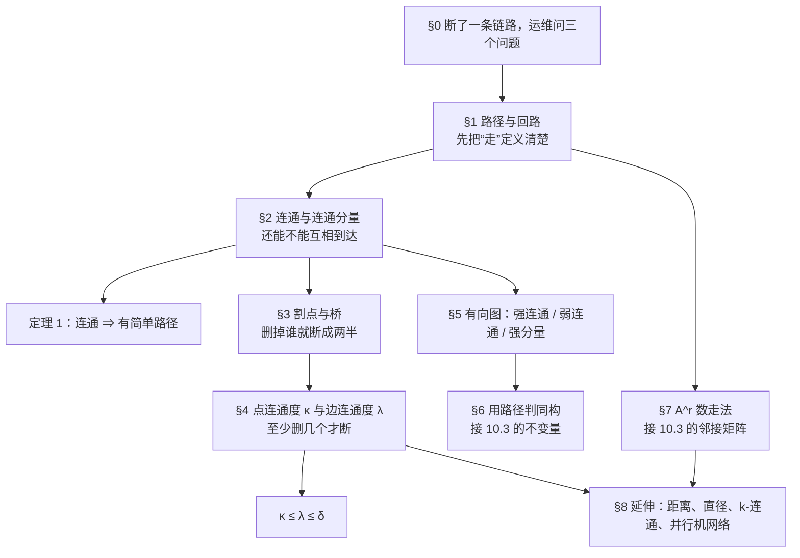
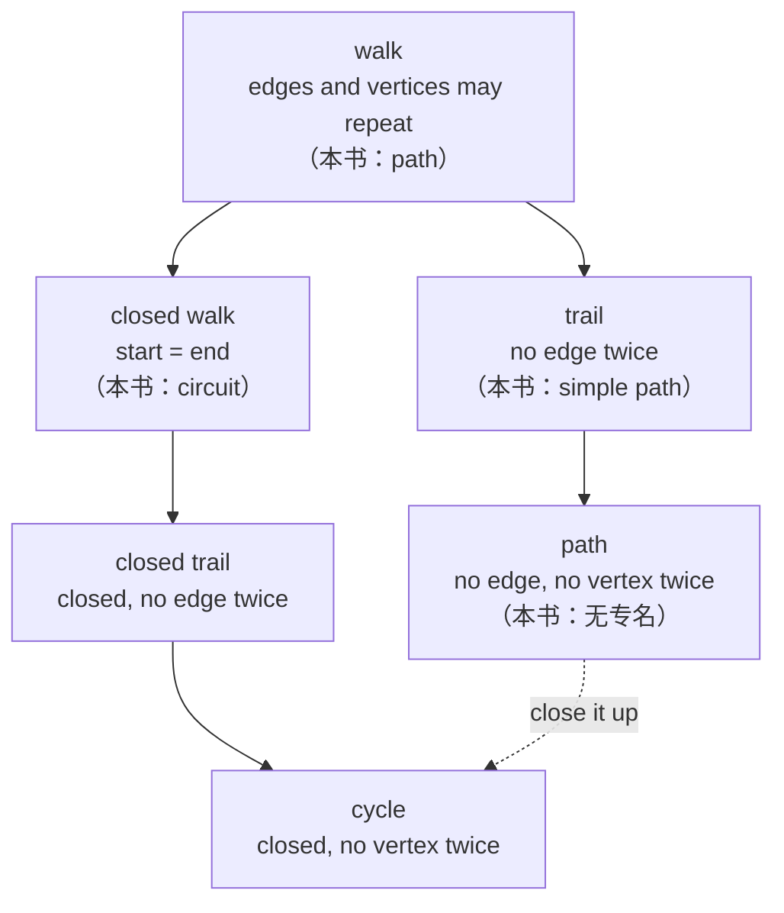

# C10.4 连通性 Connectivity

> [!abstract] 这一讲的任务
> 上一讲把图存进了计算机：邻接表、邻接矩阵、关联矩阵，还定义了"两个图算不算同一个"。可矩阵只记录**谁挨着谁**，一句话都没说"从 $a$ 能不能走到 $b$"。这一讲补上这件事。先定义"怎么走"（路径、回路），再把"能互相走到"变成一个性质（连通），然后回答运维真正关心的问题：**这个网络结不结实**——删掉哪个点就裂（割点）、删掉哪条边就断（桥）、至少要删掉几个点或几条边才真的分区（点连通度 $\kappa$、边连通度 $\lambda$）。最后再回到矩阵：邻接矩阵的 $r$ 次幂 $(A^r)_{ij}$ 数的是**长度 $r$ 的走法条数**——注意是"走法"不是"简单路径"，这个区别是本篇最大的坑，§1 就把它挑明。

> [!info] 怎么读这份讲义
> 顺着读。§1–§4 是主干（路径 → 连通 → 割点 → 连通度），§5 换成有向图，§6 回到上一讲的同构，§7 是矩阵数走法，§8 是习题区延伸，赶时间可以跳 §8。
> 用到的旧知识只有三处：**第 2.6 节的矩阵乘法**（$\sum_k b_{ik}a_{kj}$ 这种求和）、**第 9.4 节关系的闭包**（"走若干步能不能到"就是传递闭包换了个说法）、**上一讲的邻接矩阵**。看到 $A^r$ 别慌，它就是"把邻接矩阵连乘 $r$ 次"。
> 两处要先打招呼的限定：$\kappa\le\lambda\le\delta$ 里的上界 $n-1$、以及"$\lambda=n-1$ 当且仅当完全图"，都只在**有限简单图**下成立（平行边能顶破它，见 §4 的易错点）；p.685 页边那条"40 TB"的数量级也对不上，见 §8.7。

---

## 0. 开场：断了一条链路，运维问三个问题

凌晨两点，一条骨干链路抖动，断了。两个机房之间一共 8 台核心路由器，监控页面上只剩下一张拓扑图和几个红点。值班的人要在十分钟内回答三件事：

1. **现在还有哪些机器能互相通信？** —— 换句话说，这张图是不是被切成了几块？哪几台还连在一起？
2. **哪台路由器是"单点故障"？** —— 也就是说，现在还全通，但只要这一台宕机，网络立刻裂成两半。
3. **要同时坏几台路由、或者同时断几条链路，才会真的分区？** —— 一台是"能扛一次故障"，两台是"能扛两次故障"，这是两个完全不同的采购预算。

这三个问题看起来是三个层次的经验判断，其实各有各的数学名字，而且名字都是**同一件事的三个精度**：

- 第 1 问 → **连通**（connected）与**连通分量**（connected component）：能不能到达，分成了几坨；
- 第 2 问 → **割点**（cut vertex）与**桥**（bridge）：删掉这一个就断；
- 第 3 问 → **点连通度** $\kappa(G)$ 与**边连通度** $\lambda(G)$：最少要删几个才断。

你刚才在监控页面上做的判断，就是把一张图切成几块、再盯着某几个点看它是不是命门——这一讲就是把这三件事各造一个词、各给一个数。最后我们还会回到矩阵，回答一个写代码的人一定会问的问题：**"两点之间有几条路"能不能用矩阵乘法直接数出来？** 答案是能，但数出来的东西和你以为的不完全一样。

---

## 1. 路径与回路：先定义"怎么走"（p.679–681）

先说清"走"这个词。你脑子里已经有一个模糊的图景：沿着边一条一条挪过去。但要让计算机和证明都用得上，得把它写成可以核对的东西。

**朴素尝试**：把经过的顶点按顺序记下来——"$a$、$d$、$c$、$f$、$e$"。这串字母确实描述了"从 $a$ 走到 $e$"这件事，而且简单图里够用：两点之间最多一条边，顶点序列一定对应唯一的走法。

**撞墙**：换一张带重边的图（比如两个机房之间拉了两根光纤），顶点序列 "$a$、$b$" 就说不清走的是哪一根；如果一根是主用、一根是备用，这个区别很重要。另外，如果允许原路折返，"$a$、$b$、$a$" 里 $a$ 出现了两次，用"点集"或"顶点序列"记录会丢信息。所以正式定义必须落在**边序列**上，顶点序列只是简单图里的简写。

> [!important] 定义 1 路径与回路（无向图）
> 设 $n$ 是非负整数，$G$ 是无向图。$G$ 中从 $u$ 到 $v$ 的**路径 path** 是 $G$ 的 $n$ 条边 $e_1,e_2,\dots,e_n$ 组成的序列，并且存在顶点序列
> $$x_0=u,\ x_1,\ \dots,\ x_{n-1},\ x_n=v,$$
> 使得对每个 $i=1,\dots,n$，$e_i$ 的两个端点是 $x_{i-1}$ 与 $x_i$。$n$ 称为这条路径的**长度 length**（就是边的条数，不是点的个数）。
>
> - 图是简单图时，这条路径直接记成顶点序列 $x_0,x_1,\dots,x_n$——因为列出顶点就唯一确定边。
> - 路径若**起点终点相同**（$u=v$）且**长度大于零**，称为**回路 circuit**。
> - 路径或回路**经过 pass through** 顶点 $x_1,\dots,x_{n-1}$，**走过 traverse** 边 $e_1,\dots,e_n$。
> - 路径或回路是**简单 simple** 的，当且仅当它**不含重复的边**。
> - 长度为零的路径就是**单独一个顶点**（这是后面证明里要用的边界情形）。

这里有三处细节，读第一遍最容易滑过去：

**(i) 长度是边数。** 顶点序列 $x_0,\dots,x_n$ 有 $n+1$ 个点，长度却是 $n$。写路径时数一数下标就够，不用数点。

**(ii) 回路要求长度大于零。** 只站着不动（长度 0 的路径，起点终点同一个点）不算回路。这条约定是为了让"回路"真的意味着"绕了一圈"，而不是"原地不动"。

**(iii) 有重边时，顶点序列会丢信息。** 顶点序列 $x_0,\dots,x_n$ 只能说明"经过了哪些点"；如果相邻两个点之间有多条边，同一串顶点可以对应好几条不同的路径。所以严格地说，路径是**边**的序列，顶点序列是它的"投影"。

现在到了本篇最需要停下来的一件事。同一批概念，不同书用了互相冲突的名字，而**这本教材的用法恰好和很多别的书相反**。不先把这件事钉死，后面 §7 一定会出事。

> [!warning] 术语陷阱：这里的 `path` 允许重复边
> 这本教材的 **`path`（路径）允许边重复**，也允许顶点重复；要"边不重复"时它另外写 **`simple path`（简单路径）**。也就是说，$a,b,a,b$ 在它是合法走法的前提下，是一条**路径**，只是**不简单**。
>
> 通行（图论、算法、竞赛）的命名是四层，从松到紧：
>
> | 通行叫法 | 通行含义 | 这本教材叫什么 |
> |---|---|---|
> | **walk**（走、途径） | 边可重复、点可重复 | `path`（路径） |
> | **closed walk**（闭走） | walk 且起点 = 终点 | `circuit`（回路） |
> | **trail**（迹） | 边不重复，点可重复 | `simple path`（简单路径） |
> | **path**（路径） | 边、点都不重复 | 没有专门名字（只能说"顶点不重复的简单路径"） |
> | **cycle / simple circuit**（圈） | 闭合且点不重复 | 没有专门名字（在 10.2 里就直接写"长度为 $k$ 的简单回路"） |
>
> 两个直接后果，记住了能省很多冤枉路：
>
> 1. 这本教材说"两点之间存在**简单路径**"时，含义只是"存在一条**边不重复**的路径"（比通行意义的 path 弱）。定理 1 会证明：连通图里其实存在连**顶点**都不重复的那条，但那是证明出来的结论，不是定义自带的。
> 2. **$A^r$ 数出来的是 walk 的条数，也就是这本教材的 `path` 的条数**，允许边重复、允许点重复。它**不是**简单路径的条数，更不是顶点不重复的路径数。§7 会用一张三点的图把这件事算给你看：那里从 $v_1$ 到 $v_2$ 长度 3 的"路"有 2 条，而**一条简单路径都不是**。
>
> 为什么这件事值得一句警告：算法题里"求两点间路径条数"，如果题目说的是"简单路径"，那是 NP-难的（哈密顿路径就是它的极端情形，第 10.5 节会讲）；如果题目说的是"走法条数"，一个矩阵幂就完事。同一个中文词，两种难度，天差地别。读任何一篇讲"路径"的文章，第一件事都是回去确认它用哪一套定义。

上图是两条包含链，箭头方向是"越来越严"：任何一条 path 都是 trail，任何一条 trail 都是 walk；闭合的那条链同理。虚线表示"顶点不重复的路径只要首尾相接，就升级成圈"。这本教材用的词是表里"本书"那一列，和上图的通行名对不上——图里写的是通行名，括号里才是这本教材的叫法。

有了定义，先判读一张具体的图。

> [!example] 例 1 一张六点图上的四次判读
> 看下面这张简单图（6 个顶点、10 条边，度数分别是 $\deg(a)=3,\deg(b)=4,\deg(c)=3,\deg(d)=3,\deg(e)=4,\deg(f)=3$）。
>
> ![[C10.4-原图-路径判读一例.png]]
>
> - $a,d,c,f,e$ 是一条**长度 4 的简单路径**：因为 $\{a,d\},\{d,c\},\{c,f\},\{f,e\}$ 都是边，且四条边互不相同。
> - $d,e,c,a$ **不是路径**：$\{e,c\}$ 不是边。注意这一步用的是"边存在"这个硬条件，不是"看起来顺不顺"。
> - $b,c,f,e,b$ 是一条**长度 4 的回路**：$\{b,c\},\{c,f\},\{f,e\},\{e,b\}$ 都是边，起点终点都是 $b$，长度大于零。它还是简单的（四条边没有重复）。
> - $a,b,e,d,a,b$ 是**长度 5 的路径，但不简单**：它的边序列是 $\{a,b\},\{b,e\},\{e,d\},\{d,a\},\{a,b\}$，$\{a,b\}$ 出现了两次。它也**不是回路**——起点 $a$、终点 $b$ 不同。

例 1 的四个小判断刚好把定义里的四个旋钮各拧了一次：边存在吗（第二个）、闭合吗（第三个）、有重复边吗（第四个）、长度是多少（四个都要数）。考试里这类"这串顶点是不是路径、简单吗、是回路吗、长度多少"的题，按这四个旋钮逐个过就不会错。

**反过来记一遍**，比正面记有用：要在例 1 那张图里**制造**一条"不是简单路径"的路径，最简单的办法是找一条边来回走——$a,b,a,b$ 就行；要制造一条"不是路径"的序列，只要让相邻两个字母之间没有边——$d,e,c,a$ 就卡在 $\{e,c\}$ 上。这两个"反例生成器"比背定义好用。

无向图说完了，有向图只需要把"边的端点"换成"边的方向"。

> [!important] 定义 2 路径与回路（有向图）
> 设 $n$ 是非负整数，$G$ 是有向图。$G$ 中从 $u$ 到 $v$ 的**长度 $n$ 的路径**是 $G$ 的边序列 $e_1,e_2,\dots,e_n$，使得 $e_1$ 关联 $(x_0,x_1)$，$e_2$ 关联 $(x_1,x_2)$，……，$e_n$ 关联 $(x_{n-1},x_n)$，其中 $x_0=u$、$x_n=v$。没有重边时记作顶点序列 $x_0,x_1,\dots,x_n$。
>
> 长度大于零、起点终点相同的路径称为**回路 circuit**（也叫**圈 cycle**）。路径或回路**简单 simple**，当且仅当不含重复的边。

有向图这里多了一句无向图不需要强调的话：**前一条边的终点必须是后一条边的起点**。在无向图里这是自动的（边没有方向），在有向图里这是最容易错的地方——$a\to b$ 和 $b\to a$ 是两条方向相反的边，接不上就是接不上。第 9 章讲关系时其实已经用过这个约定（关系的传递闭包就是在数这种"能接上的链"），这里只是给它一个正式名字。

路径这东西之所以值得定义，是因为它在模型里就是"间接联系"。两个例子。

> [!example] 例 2 相识图里的路径：六度分隔
> 相识图（acquaintanceship graph）里，两个人之间有路径，就意味着存在一串人，链上相邻的两个人互相认识。举例说，在 10.1 那张相识图里，Kamini 和 Ching 之间有一串**六个人**的链——六个人、五段认识关系，用本篇的话说，是一条**长度 5 的路径**。
>
> 很多社会科学家猜：世界上几乎任意两个人之间都能被一串不太长的人连起来，也许只要五个人或更少。翻译成图的语言就是：在"全世界所有人"那张相识图里，**几乎任意两个顶点之间都有一条长度不超过 4 的路径**。John Guare 的话剧《六度分隔》（*Six Degrees of Separation*）就是这个说法的通俗版。
>
> 注意"长度不超过 4"和"六个人"不矛盾：六个人的链长 5，那是**一对特定的** Kamini 与 Ching；而"不超过 4"说的是**几乎任意一对**。这两个数一个是上界、一个是抽样，别混。

> [!example] 例 3 合作图里的路径：Erdős 数与 Bacon 数
> 合作图（collaboration graph）里，两个人 $a$ 与 $b$ 之间有路径，意味着存在一串人，从 $a$ 开始、到 $b$ 结束，链上每一对相邻的人都合作过（合写过论文、或同演过一部电影）。
>
> **数学家合作图**：一个人 $m$ 的 **Erdős 数**，就是 $m$ 与匈牙利数学家 Paul Erdős（1996 年去世）之间**最短路径的长度**。所以 Erdős 本人的 Erdős 数是 0，和他直接合写过论文的人是 1，依次类推——这是一个**距离**，不是"合作次数"。按 Erdős Number Project 在 2006 年初的统计：
>
> | Erdős 数 | 人数 | | Erdős 数 | 人数 |
> |---|---|---|---|---|
> | 0 | 1 | | 7 | 11,591 |
> | 1 | 504 | | 8 | 3,146 |
> | 2 | 6,593 | | 9 | 819 |
> | 3 | 33,605 | | 10 | 244 |
> | 4 | 83,642 | | 11 | 68 |
> | 5 | 87,760 | | 12 | 23 |
> | 6 | 40,014 | | 13 | 5 |
>
> 把这一列加总：**268,015 人**有不超过 13 的有限 Erdős 数（这是我按表里 14 行逐个加的）。剩下的人（没和这个连通块里的人合作过）在这张图里**根本不在 Erdős 所在的那个连通分量**里——他们的 Erdős 数不是"很大"，而是**没有定义**。这一点 §2 讲连通分量时会再回来。
>
> **好莱坞图（Hollywood graph）**：演员 $c$ 的 **Bacon 数**是 $c$ 与演员 Kevin Bacon 之间最短路径的长度。这个玩法源于 1990 年代初 Kevin Bacon 的一句自嘲：他和好莱坞所有人都合作过，或者和"和他们合作过的人"合作过。表里是 2011 年初的统计：
>
> | Bacon 数 | 人数 | | Bacon 数 | 人数 |
> |---|---|---|---|---|
> | 0 | 1 | | 5 | 14,048 |
> | 1 | 2,367 | | 6 | 1,277 |
> | 2 | 242,407 | | 7 | 114 |
> | 3 | 785,389 | | 8 | 16 |
> | 4 | 200,602 | | | |
>
> 加总是 **1,246,221 人**有不超过 8 的有限 Bacon 数。
>
> 这里有一个值得盯一眼的形状：Erdős 数的分布在 5 处才见顶（87,760），Bacon 数在 3 处就见顶（785,389）。这不是巧合——好莱坞图的边密度高得多，一步能跨出去的人多，所以绝大多数人离 Kevin Bacon 只有两三步。**同一个"最短路径长度"，在不同的图里分布形状完全不同**，这也是"图能刻画现实"的一个具体证据。
>
> 表格里的数字是教材出书时（2006、2011）的统计，别外推成今天。还有一个好玩的副产品：把 Kevin Bacon 换成你喜欢的任何演员，都能造出一个新的派对游戏——"以某人为中心的演艺宇宙"。

---

## 2. 连通与连通分量（p.681–682）

现在把"两点之间有没有路"这句话升级成整张图的性质。

问题还是从机房来：一个计算机网络，什么时候能做到"任两台计算机都能交换信息"（消息可以经过一台或多台中间机器转发）？把网络画成图（顶点是计算机、边是通信链路），这个问题就变成：**什么时候任意两个顶点之间都有路径？**

> [!important] 定义 3 连通 connected
> 无向图称为**连通的 connected**，如果对图中**每一对不同的顶点**，它们之间都有一条路径。图若不是连通的，称为**不连通 disconnected**。我们说**断开 disconnect** 一张图，指的是删去一些顶点或一些边（或两者），得到一个不连通的子图。

定义里有两个字要盯住："**不同**"和"**每一对**"。

- "不同"是因为顶点到它自己永远有长度 0 的路径（定义 1 的最后一句），如果要求"包含自己"，那这句话就白说了。
- "每一对"意味着连通是一个**全局**性质：它不允许任何一个角落掉队。一张有一百个点的图，只要有一个孤立点，它就不连通。

于是"任两台计算机能通信"与"网络图连通"是**同一句话的两种说法**。这是本篇第一次出现"图的性质 = 现实的性质"这种一一对应，后面每一节都会再来一次。

> [!example] 例 4 一张连通、一张不连通
> 看下面左边这张图 $G_1$（7 个顶点、8 条边）。
>
> ![[C10.4-原图-连通与分量.png]]
>
> $G_1$ 是**连通的**：随便挑两个点，都能沿着边走通。比如 $a$ 与 $g$：$a\to c\to f\to g$。$b$ 与 $e$：$b\to c\to d\to e$。$e$ 与 $a$：$e\to d\to c\to a$。要确认它连通得把 $\binom{7}{2}=21$ 对都过一遍，但实际不需要——只要说明"从某一点出发能走到所有点"，连通性就成立（因为任意两点都能经由这个点中转）。从 $c$ 出发：$c$ 到 $a,b,d,f$ 一步；到 $e$ 经 $d$；到 $g$ 经 $f$。全通。
>
> 右边这张 $G_2$（6 个顶点、5 条边）**不连通**，最直接的证据是：$a$ 到 $d$ 之间**没有路径**。$G_2$ 分成两块——$\{a,b,c\}$ 和 $\{d,e,f\}$，两块之间一条边都没有。

例 4 的第二个图值得多看一秒：它每个点的度都不小（$c$ 的度是 4），看上去"挺密"，但它就是不连通。**"密"和"连通"是两件事**：连通看的是有没有跨块的边，密不密看的是每一块内部有几条边。这个区别在 §4 会变成 $\kappa$ 与最小度的区别。

紧接着是一个技术上很重要、直觉上"废话"的定理。

> [!important] 定理 1 连通图里必有简单路径
> 若 $G$ 是连通无向图，则对 $G$ 中任意两个不同顶点 $u$ 与 $v$，都存在一条从 $u$ 到 $v$ 的**简单路径**。

这个定理的陈述看起来像在重复定义（连通就是"有路径"，简单路径不就是"边不重复的路径"），其实它在做一件实质的事：**把"有路"加强成"有干净的路"**。为什么这件事需要一句证明？因为定义 3 只说"存在路径"，而定义 1 的路径允许边重复——一条路径完全可以绕来绕去、把某条边走上五遍。定理 1 说：绕圈是**不必要的**，总能找到一条不绕的。

证明：

> [!important] 定理 1 的证明（"删掉绕圈"）
> 设 $u\ne v$，$G=(V,E)$ 连通。由连通的定义，$u$ 与 $v$ 之间至少有一条路径，于是"所有从 $u$ 到 $v$ 的路径"这个集合非空。路径的长度都是非负整数，非空的非负整数集合必有最小元（整数是良序的），所以可以取一条**长度最小**的路径，记它的顶点序列为
> $$x_0,x_1,\dots,x_n,\qquad x_0=u,\ \ x_n=v.$$
>
> 断言：这条最短路是简单的。反设它不是，即存在下标 $0\le i<j$ 使 $x_i=x_j$。
>
> 那么把中间那一段整个抹掉：保留
> $$x_0,\ x_1,\ \dots,\ x_{i-1},\ x_j,\ x_{j+1},\ \dots,\ x_n,$$
> 也就是把边 $e_{i+1},\dots,e_j$（对应顶点 $x_i,\dots,x_{j-1}$ 的那几段）删掉。
>
> 抹掉之后还是不是一条路径？是。因为原来 $x_{i-1}$ 通过 $e_i$ 接到 $x_i$，而 $x_i=x_j$，所以 $x_{i-1}$ 直接与 $x_j$ 之间有边 $e_i$——$x_i$ 和 $x_j$ 是**同一个点**，$e_i$ 的终点本来就是 $x_j$。接得上，所以删完仍是路径。
>
> 长度变了吗？新路径的边数是 $n-(j-i)$，而 $j>i$，所以 $n-(j-i)<n$——**严格更短**。这与"$n$ 是路径长度的最小值"矛盾。因此最短路不可能含有 $x_i=x_j$（$i<j$），即它的顶点互不相同。
>
> 顶点互不相同 ⇒ 每一段 $x_{k-1}x_k$ 都是不同的点对（不同的点对确定不同的边）⇒ 不可能有同一条边走两次 ⇒ 按定义 1 这条路径是简单的。$\blacksquare$

这个证明只有五行，但三个地方值得停：

**(1) 为什么可以"取最短的那条"？** 因为长度是**非负整数**，而"从 $u$ 到 $v$ 的路径"这个集合非空。整数有个别的数学对象没有的性质：任何非空子集都有最小元。如果长度允许是实数，或者这个集合可能是空的，这一步就垮了。很多证明里"取最短的一条"都是同一个理由，值得记住这个套路。

**(2) 为什么"抹掉一段"还是路径？** 关键在 $x_i=x_j$ 是**同一个顶点**，不是"同一个名字"或"同一个位置"。同一个顶点意味着前一段的终点和后一段的起点是同一个点，接缝处不需要边。如果换成"抹掉任意一段"，接缝处可能根本没有边，那就不是路径了。**能抹，是因为绕回来了。**

**(3) 结论其实比定理强。** 证明给出的是"顶点互不相同"，而"顶点互不相同"⇒"边互不相同"⇒按定义 1 是简单路径。所以定理 1 的证明顺便说明了：连通图里任意两点之间都有一条**顶点不重复**的路径（通行的 path）。以后看到"简单路径"这四个字，在这本教材里按"不重边"理解，但实际拿到的那条往往更强——这条经验在 §6 判定同构时正好用得上。

顺带一个计数器视角的观察：一条长度为 $n$ 的路径有 $n+1$ 个顶点位置；若这条路径的顶点互不重复，就要求 $n+1\le|V|$，即 $n\le|V|-1$。于是"连通图上任意两点间最短路径的长度不超过 $|V|-1$"这个常用结论，其实是定理 1 的免费赠品。

接下来是"整张图分成几块"的正式说法。人话先说：**一张图的连通分量，就是它能切出来的、各自连通的最大块。**

> [!important] 连通分量 connected component
> 图 $G$ 的**连通分量**是 $G$ 的一个连通子图，且它不是 $G$ 的任何更大的连通子图的真子图。换句话说，连通分量就是 $G$ 的**极大连通子图**（maximal connected subgraph）。不连通的图有两个或更多连通分量，它们互不相交，并起来正好是整张图 $G$。

"极大"两个字是这段定义的全部技术含量，用人话说：**往块里加任何一个剩下的点，块就不再连通了**。所以连通分量是"能塞的都塞满了"的那种块，不是随便切出来的连通子图——一个三角形里截一条边出来也是连通子图，但它不是分量，因为还能往里塞点。

> [!example] 例 5 一张图分三块
> 还是上面那张图，看它的右半：图 $H$ 有 8 个顶点、6 条边，被三个青色框圈成三块。
>
> $H$ 是三个互不相交的连通子图的并：
> - $H_1$：顶点 $a,b,c$，三条边 $\{a,b\},\{b,c\},\{a,c\}$——一个三角形；
> - $H_2$：顶点 $d,e$，一条边 $\{d,e\}$；
> - $H_3$：顶点 $f,g,h$，两条边 $\{f,h\},\{h,g\}$——一条长 2 的路径。
>
> 这三块就是 $H$ 的三个连通分量。核对一下"极大"：往 $H_2$ 里加任何一个别的点，比如 $a$，$\{a,d,e\}$ 就连不通了（$a$ 与 $d,e$ 之间没边）；所以 $H_2$ 已经塞满了。
>
> 顺便验一个计数：三个分量的点数 $3+2+3=8$ ✓，边数 $3+1+2=6$ ✓。

于是"连通分量数"就是运维监控页面上那个最直观的数字：**网络被切成了几块**。1 表示全通，大于 1 表示已经分区。

> [!example] 例 6 呼叫图的连通分量：3.7 百万块
> 电话呼叫图（telephone call graph，见 10.1 的例 4）里，顶点是电话号码，边是"这两个号码之间通过话"。两个顶点 $x$ 与 $y$ 在同一个连通分量里，当且仅当存在一串通话，从 $x$ 开始、到 $y$ 结束——也就是说，$x$ 能通过"打给谁、谁又打给谁"这条链联系到 $y$。
>
> 对 AT&T 网络某一天的通话记录建图，得到：**53,767,087 个顶点**、**超过 1.7 亿条边**、**超过 370 万个连通分量**。
>
> 数字里藏着故事：
> - 大多数分量很小，大约**四分之三**的分量只有两个顶点——就是两个号码**只互相打过**，没和任何别人通过话。这类分量在图论上就是一个 $K_2$。
> - 有一个**巨型分量**，含 **44,989,297 个顶点**，占总点数的 $\dfrac{44{,}989{,}297}{53{,}767{,}087}\approx 83.67\%$（我按教材给的数算的）。
> - 这个巨型分量内部，任意两个顶点都可以通过**不超过 20 通**电话的链连起来。用本篇的语言：分量内任意两点的距离不超过 20。
>
> 这张图的形状是很多真实网络的通例：**大量碎片 + 一个吞掉八成以上顶点的巨块**。例 12 的网页图会把同一件事再演一遍（那里的巨块是"强连通"版本的）。

---

## 3. 割点与桥：单点故障有了名字（p.683）

连通只回答"通不通"，不回答"结不结实"。一张连通图可能有一个致命点：删掉它，图就裂了。

先把"致命"这个词变成可检验的东西。**朴素想法**：找出"看起来很重要"的点，比如度最大的点。**撞墙**：度大不等于致命——一个度 5 的点可能是五条通往同一块的冗余链路，删掉它照样全通；反过来，一个度 2 的点可能卡在两个大块中间，删掉它就分区。所以"重要"不能用局部信息（度数）判断，得用**删掉之后整张图变成什么样**来判断。

> [!important] 割点 cut vertex 与桥 bridge
> 删去某个顶点及其所有关联边之后，若得到的子图**连通分量数变多**，这个顶点称为**割点 cut vertex**（也叫 **articulation point**，中文也说"关节点"）。删去一条边之后若连通分量数变多，这条边称为**割边 cut edge**，也叫**桥 bridge**。
>
> 在连通图里，这两句话可以简化成：删掉割点（或桥）之后剩下的图**不连通**。

名字的隐喻都值得拆一下，因为拆开就记住了：

- **割点**是"割"——一刀下去把图割成两半，刀口就是那个点。
- **桥**是"桥"——两岸之间只有这一座桥，桥断了，两岸就不通了。所有经过这条边的路径都得走它，所以它是**唯一通道**。

注意两个定义的措辞都用了"分量数变多"，而不是"变成不连通"。为什么要这么写？因为这样它对**本来就不连通**的图也成立：一张已经分成三块的图，删掉某条边让三块变四块，那条边照样是桥。定义 3 里的"断开"也是同一套措辞，前后一致。

> [!example] 例 7 图 $G_1$ 里的割点与桥
> 图 $G_1$ 有 8 个顶点、10 条边：$\{a,b\},\{b,c\},\{b,d\},\{c,d\},\{c,e\},\{e,f\},\{f,g\},\{e,g\},\{e,h\},\{g,h\}$。左边四个点 $a,b,c,d$ 与右边四个点 $e,f,g,h$ 靠**唯一**一条边 $\{c,e\}$ 相连。
>
> ![[C10.4-原图-割点与割边.png]]
>
> **割点是 $b,c,e$。** 逐个核：
> - 删 $b$：$a$ 变成孤立点（$a$ 只有 $\{a,b\}$ 这一条边），原来的 1 块变 2 块 ✅
> - 删 $c$：左边 $\{a,b,d\}$ 与右边 $\{e,f,g,h\}$ 之间再无连接（唯一通道 $\{c,e\}$ 的两个端点没了一个）✅
> - 删 $e$：左边 $\{a,b,c,d\}$ 与右边 $\{f,g,h\}$ 分开 ✅
> - 删 $d$：$a\to b\to c\to e\to\cdots$ 仍然全通 ❌ 不是割点
> - 删 $a$ 或 $f$ 或 $g$ 或 $h$：剩下 7 个点全通 ❌
>
> **桥是 $\{a,b\}$ 与 $\{c,e\}$。** 前者的理由同上（删了 $a$ 就孤立）；后者是因为它是左右两半之间**唯一**的边。其余的边都不是桥：$\{b,d\}$ 删了还有路 $b\to c\to d$；$\{b,c\}$ 删了还有 $b\to d\to c$；$\{e,f\}$ 删了还有 $e\to g\to f$；$\{e,g\}$ 删了还有 $e\to f\to g$；$\{f,g\}$ 删了还有 $f\to e\to g$；$\{e,h\}$ 删了还有 $e\to g\to h$；$\{g,h\}$ 删了还有 $g\to e\to h$。每一条被删时都有一条"替代路线"，这就是"不是桥"的判据。

例 7 说明了一件很实用的事：**割点和桥是两个概念，不能互相替代**。$d$ 不是割点，但边 $\{b,d\}$ 看起来很像桥——核对下来 $b\to c\to d$ 这条路还在，所以不是。反过来，桥的两个端点未必都是割点（$\{c,e\}$ 的端点 $c$ 和 $e$ 都是，这是巧合；看一个悬挂点连到三角形上：那条边是桥，悬挂点是端点，但悬挂点本身不是割点——删掉它只是少一个点，剩下的三角形还连通）。这条"一端是悬挂点"的细节，习题 35 专门问过。

继续往上走一层：完全没有割点的连通图，说明它"处处有余量"。

> [!important] 不可分图 nonseparable graph
> 没有割点的连通图称为**不可分图 nonseparable graph**。完全图 $K_n$（$n\ge3$）是最典型的例子：从 $K_n$ 里删掉任何一个顶点，剩下的是 $K_{n-1}$，仍然连通。
>
> 不可分图可以理解为"比有割点的图更结实"。把"不可分"再推到极大，就得到**块 block**：图的极大不可分子图（常要求至少 3 个点或是一条桥）。任何一张图都可以唯一地拆成若干个块，块与块之间靠割点相接——这正是"点双连通分量"这套结构的通俗版本。

**为什么割点就是"单点故障"？** 这句话有一个精确的等价刻画，值得单独写出来（教材把它放在习题 36）：设 $G$ 是连通简单图，顶点 $c$ 是割点，**当且仅当**存在两个都异于 $c$ 的顶点 $u,v$，使得 $u$ 到 $v$ 的**每一条**路径都经过 $c$。

这个刻画比"删掉它不连通"更贴近运维的语言：

- 前半句（是割点 ⇒ 有绕不过去的点对）：删掉 $c$ 后图分成至少两块，从不同的块里各取一点 $u,v$，那么任何 $u$–$v$ 路径都不可能躲开 $c$——躲开了就说明删 $c$ 之后 $u,v$ 还连着，矛盾。
- 后半句（有绕不过去的点对 ⇒ 是割点）：若每一条 $u$–$v$ 路径都过 $c$，那删掉 $c$ 之后 $u,v$ 必然不连通，于是分量数变多。

所以"单点故障"的准确含义不是"这台机器很关键"，而是**"存在一对业务，全部流量都必须穿过它"**。这句话能直接翻译成一句运维动作：想在监控上找出单点故障，就去找"哪一对端点之间的所有路径都经过同一个点"。这也是 §4 中"删最少几个点才断开"的动机——单点故障就是"删 1 个点就断开"。

还有两条反直觉的小结论，顺手记：

- **桥的端点不一定是割点。** 悬挂点连到三角形上的那条边是桥，但悬挂点本身删掉只是少一个点，剩下的三角形还连通。习题 35 把这件事说准了：设 $v$ 是桥的端点，则 $v$ 是割点**当且仅当 $v$ 不是悬挂点**。
- **一条边是桥，当且仅当它不属于任何简单回路**（习题 38）。道理：若它落在某个简单回路里，删掉它还能沿回路绕过去；反之若删掉它就断，任何回路都不可能有它。这条判据比"试着删一次看断不断"好用，也是第 11 章"树里每条边都是桥"的来源（树没有任何回路）。

---

## 4. 点连通度与边连通度：把"结实"量成一个数（p.683–685）

割点只告诉你"有没有命门"，不告诉你"有几层保险"。两台网络都无割点，一台删两个点就断、另一台删五个点才断，可靠性差得远。所以要把"结实"**量化**。

**朴素尝试**：数一数"删掉之后能断开图"的点集，取其中最小的那个的大小。这个想法直接就能用，只是有个技术缺口：如果图是**完全图**，删任何点都断不了（删完还是完全图），"最小的能断开的点集"根本不存在。缺口得靠约定补。

> [!important] 点割 vertex cut 与点连通度 $\kappa(G)$
> 顶点集 $V$ 的子集 $V'$ 称为**点割 vertex cut**（也叫**分离集 separating set**），如果 $G-V'$ 不连通。
>
> **点连通度 vertex connectivity** $\kappa(G)$ 定义为：非完全图 $G$ 的**最小点割的大小**。$\kappa$ 是希腊小写字母 kappa。
>
> 完全图没有点割（删任意子集剩下的还是完全图），所以不能按上面的定义算，**约定** $\kappa(K_n)=n-1$ ——这个数的意思是"至少要删掉 $n-1$ 个点，才只剩一个顶点"。
>
> 于是对所有图统一成一句：**$\kappa(G)$ 是"删掉之后要么让图不连通、要么让图只剩一个顶点"所需删去的最少顶点数。** 由此
> $$0\le\kappa(G)\le n-1\quad(n=|V|),$$
> 且 $\kappa(G)=0$ 当且仅当 $G$ 不连通或 $G=K_1$；$\kappa(G)=n-1$ 当且仅当 $G$ 是完全图。

这三行里藏了三个约定，每个都要能自己复述：

1. **"只剩一个顶点"也算断开。** 为什么要这么算？因为 $K_2$（两个点一条边）实在没有"能断开"的点集：删一个点就只剩一个点，而单点图按定义是连通的。如果不把"剩单点"算进去，$K_2$ 的 $\kappa$ 就没法定义。把它算进去，$\kappa(K_2)=1$，与"$K_2$ 是连通图里最脆的之一"这个直觉一致。
2. **不连通图 $\kappa=0$。** 因为它本来就不连通，不需要删任何点就"断开"了。$K_1$ 也取 0（没有点对需要连通）。
3. **完全图 $\kappa=n-1$。** 这是唯一一个"按定义算不出来、只能约定"的情形。$n-1$ 这个值同时满足"最结实"的直觉和上面那条不等式的右端，是唯一合理的选择。

$\kappa$ 越大越结实。几个档位对照：

| $\kappa(G)$ | 图长什么样 |
|---|---|
| $0$ | 不连通，或只有一个点 |
| $1$ | 连通且有割点（或就是 $K_2$） |
| $2$ | 无割点，但删两个点能断开（或就是 $K_3$） |
| $\vdots$ | …… |
| $n-1$ | 完全图 $K_n$ |

于是有了"$k$ 连通"这个说法：

> [!important] $k$-连通 $k$-connected
> 若 $\kappa(G)\ge k$，称 $G$ 是 **$k$-连通的**（或 **$k$-点连通的**）。特别地：$G$ 是 1-连通的，如果它连通且不是单点图；$G$ 是 **2-连通的**（也叫**双连通的 biconnected**），如果它不可分且至少三个顶点。
>
> 注意单调性：若 $G$ 是 $k$-连通的，则对一切 $0\le j\le k$，$G$ 也是 $j$-连通的。

"$k$ 连通"的实际含义是**能扛住 $k-1$ 个点同时故障**：因为 $\kappa\ge k$ 意味着删掉任意 $k-1$ 个点都断不了。这句话直接对应采购指标——"双连通网络"就是"任意一台路由宕机，全网仍然连通"。

点割与边割合起来统称**割集 cut set**——"删掉它图就散架"的那一族集合。下面先手算点连通度。

**先手算，再总结。** 五个图，逐个找最小点割：

> [!example] 例 8 五个图的点连通度
> 五个图 $G_1$–$G_5$ 都在下面这张图里，它们都连通、都多于一个点，所以 $\kappa>0$，只需要比"1、2、3"这几档。
>
> ![[C10.4-原图-连通度五例.png]]
>
> - $G_1$（8 点 10 边）：例 7 已经算过它有割点 $b,c,e$，所以删一个点就能断开 ⇒ $\kappa(G_1)=1$。
> - $G_2$（6 点 7 边）：$c$ 是割点（删 $c$ 后 $\{a,b\}$ 与 $\{d,e,f\}$ 分开、$a,b$ 之间还有边 $\{a,b\}$）⇒ $\kappa(G_2)=1$。
> - $G_3$（7 点 9 边）：**没有割点**（删任何一个点，剩下的 6 个点仍全通），但 $\{b,g\}$ 是点割——删掉 $b$ 和 $g$，$a$ 的邻居 $\{b,g\}$ 全没了，$a$ 孤立。所以 $\kappa(G_3)=2$。
> - $G_4$（7 点 12 边）：也没有割点；$\{c,f\}$ 是点割——删掉 $c,f$ 后，左边 $\{a,b,g\}$ 与右边 $\{d,e\}$ 之间没有边了（跨两侧的边一共三条：$\{b,c\},\{a,f\},\{g,f\}$，它们全都因为端点被删而死）。所以 $\kappa(G_4)=2$。
> - $G_5$（8 点 17 边）：**没有大小为 2 的点割**（可以逐对检查，任意删两个点剩下的 6 个点仍然连通），但 $\{b,c,f\}$ 是点割：删掉这三个点后，剩下的边只有 $\{a,h\},\{a,g\},\{h,g\},\{d,e\}$，于是图分成 $\{a,h,g\}$ 与 $\{d,e\}$ 两块。所以 $\kappa(G_5)=3$。
>
> 五个数连起来：$1,1,2,2,3$。把 $G_3$ 与 $G_4$ 放一起看：两个图的 $\kappa$ 都是 2，但 $G_4$ 的边多得多（12 对 9）——**$\kappa$ 量的不是边多不多，而是"最少要拆掉几个点"**。

边版本的定义完全平行，只把"点"换成"边"。

> [!important] 边割 edge cut 与边连通度 $\lambda(G)$
> 边集 $E$ 的子集 $E'$ 称为**边割 edge cut**，如果 $G-E'$ 不连通。
>
> **边连通度 edge connectivity** $\lambda(G)$ 定义为 $G$ 的最小边割的大小。$\lambda$ 是希腊小写字母 lambda。
>
> 对连通且多于一个顶点的图，这个定义总是有效的——因为"删掉某个顶点的所有关联边"一定能把图断开（那个点被孤立），所以边割一定存在。**约定**：$G$ 不连通时 $\lambda(G)=0$；$G$ 只有一个顶点时 $\lambda(G)=0$。于是若 $|V|=n$，
> $$0\le\lambda(G)\le n-1,$$
> 且 $\lambda(G)=n-1$ 当且仅当 $G=K_n$；等价地，非完全图的 $\lambda(G)\le n-2$。

"删掉一个顶点的所有关联边"这个构造很重要，它同时是**边割一定存在**的证明和**$\lambda\le\delta$ 的上界**（下一段就用）。

> [!example] 例 9 五个图的边连通度
> - $G_1$：例 7 已算出桥 $\{a,b\}$、$\{c,e\}$ ⇒ 删一条边就断 ⇒ $\lambda(G_1)=1$。
> - $G_2$：**没有桥**（删任何一条边都还连通），但删两条边 $\{a,b\}$ 与 $\{a,c\}$ 之后 $a$ 被孤立 ⇒ $\lambda(G_2)=2$。核一下"没有桥"：$a$ 靠 $\{a,b\}$ 与 $\{a,c\}$ 两条路出去，删一条还有另一条。这正是"$\lambda=2$ 但 $\kappa=1$"的典型形状。
> - $G_3$：没有桥；删 $\{b,c\}$ 与 $\{f,g\}$ 之后分成 $\{a,b,g\}$ 与 $\{c,d,e,f\}$ 两块 ⇒ $\lambda(G_3)=2$。
> - $G_4$：删任意两条边都断不了；删三条边 $\{b,c\},\{a,f\},\{f,g\}$ 之后分成 $\{a,b,g\}$ 与 $\{c,d,e,f\}$ ⇒ $\lambda(G_4)=3$。
> - $G_5$：删任意两条边都断不了；删 $\{a,b\},\{a,g\},\{a,h\}$（$a$ 的全部三条关联边）之后 $a$ 孤立 ⇒ $\lambda(G_5)=3$。
>
> 五个数：$1,2,2,3,3$。

把两个例子和"最小度"放一起，就得到这一节最重要的一张表：

| 图 | 点数 $n$ | 边数 | 最小度 $\delta$ | $\kappa$ | $\lambda$ | 哪一处严格 |
|---|---|---|---|---|---|---|
| $G_1$ | 8 | 10 | 1 | 1 | 1 | 全相等 |
| $G_2$ | 6 | 7 | 2 | 1 | 2 | $\kappa<\lambda=\delta$ |
| $G_3$ | 7 | 9 | 2 | 2 | 2 | 全相等 |
| $G_4$ | 7 | 12 | 3 | 2 | 3 | $\kappa<\lambda=\delta$ |
| $G_5$ | 8 | 17 | 3 | 3 | 3 | 全相等 |

表里每一格我都用程序穷举过（点割、边割按大小从小到大试），与教材的结果一致。这张表的读法是：**$\kappa$ 与 $\lambda$ 之间可以差一截，而 $\lambda$ 与 $\delta$ 之间也是**。三者的关系其实是一条链，这就是下一段。

### 4.1 三条连通度不等式

> [!important] 三条连通度不等式（教材里没有编号，是正文论断）
> 对任意图 $G$：
> $$\kappa(G)\ \le\ \lambda(G)\ \le\ \min_{v\in V}\deg(v)\ =\ \delta(G).$$

左边一条链，右边一条链，分别来自两种完全不同的理由。

**右半 $\lambda\le\delta$：一眼可见。** 取一个度数最小的顶点 $v$（$\deg(v)=\delta$）。把它那 $\delta$ 条关联边全部删掉，$v$ 变成孤立点，图必然断开（除非只剩它一个点，那也按约定算"断开"）。既然存在一个大小为 $\delta$ 的边割，最小的边割不会更大，所以 $\lambda\le\delta$。

**同一句话再给点版本，就得到 $\kappa\le\delta$：** 把 $v$ 的**全部邻居**删掉。删完之后 $v$ 与任何点都不相邻（它的邻居都死了），于是 $v$ 孤立、图断开（若只剩 $v$ 一个点，同样按约定算）。邻居个数正是 $\deg(v)=\delta$，所以 $\kappa\le\delta$。

这两个论证短得可疑，但都是对的，而且它们解释了**为什么最小度是连通度的天然上限**：一个点只有 3 条出路，你最多只能指望它扛 2 次故障；想扛更多，先把它的度提上去。

**左半 $\kappa\le\lambda$：需要点真功夫。** 直觉是这样的：删掉一个顶点会连带删掉它所有的边，所以"删点"看起来比"删边"更划算；既然删点更划算，最少删点数就**不该超过**最少删边数。这个直觉是对的，但要写成证明得小心——"删一个点"和"删一条边"之间并没有包含关系，不能一句"删点更强"带过。教材把这条留成了习题 55，所以下面这个证明是**补出来的**，不是教材正文。

> [!note] $\kappa\le\lambda$ 的证明（习题 55 的解答，这里补出）
> 边界情形先处理掉：$G$ 不连通或 $G=K_1$ 时 $\kappa=\lambda=0$；$G=K_n$ 时 $\kappa=\lambda=n-1$。所以只需考虑 $G$ **连通、非完全、$n\ge3$**。
>
> 此时有一个好用的上界：取一对**不相邻**的顶点 $u,v$（非完全图必有这样一对），则 $u$ 的度 $\deg(u)\le n-2$（它至少看不见 $v$），而"$u$ 的全部关联边"是一个边割，所以
> $$\lambda\ \le\ \deg(u)\ \le\ n-2.\qquad (\ast)$$
>
> 现在取一个**最小边割** $F$，$|F|=\lambda$。删掉 $F$ 后图分裂成若干块，把其中一块记为 $A$，其余的点集记为 $B$（$A,B$ 都非空，且 $F$ 恰好是 $A$ 与 $B$ 之间的全部边）。
>
> **情形 1：$A$ 里有点不跨边。** 也就是某个 $a\in A$ 在 $B$ 里没有邻居。令 $X$ 是 $A$ 里所有**在 $B$ 中有邻居**的点组成的集合（也就是 $A$ 里所有"跨出去"的点）。因为 $F$ 的每条边在 $A$ 里只有一个端点（它跨 $A$–$B$），所以 $|X|\le|F|=\lambda$。删掉 $X$：跨 $A$–$B$ 的边全部消失（每条这样的边都有一个端点在 $X$ 里），于是 $a$（$a\notin X$）与 $B$ 彻底断开，而两边都还有点 ⇒ 图断开。于是 $\kappa\le|X|\le\lambda$。
>
> **情形 2：$A$ 的每个点都跨边。** 那么"给每个 $a\in A$ 配一条从它出发的 $F$ 中的边"是一个从 $A$ 到 $F$ 的单射（同一条 $F$ 的边只跨一次、只能配给一个 $A$ 中的点），所以 $|A|\le|F|=\lambda$。对 $B$ 重复同样的推理：若 $B$ 里有点不跨边，回到情形 1（对称）；否则 $|B|\le\lambda$。
>
> 现在两侧都饱和：$|A|\le\lambda$，$|B|\le\lambda$。下面按两侧的大小分三种情形，三种穷尽了所有可能。
>
> **情形 2a：$|A|=1$ 或 $|B|=1$。** 设唯一那一侧是 $\{w\}$，那么 $F$ 恰好是 $w$ 的全部关联边（$w$ 的邻居都在对面），于是 $\lambda=|F|=\deg(w)$。用右半那条不等式：$\kappa\le\delta\le\deg(w)=\lambda$。
>
> **情形 2b：$|A|,|B|\ge2$，且 $A$ 里有点 $a$ 在 $B$ 中只有一个邻居 $b$。** 删掉 $a$ 的全部邻居：它们都落在 $(A\setminus\{a\})\cup\{b\}$ 里，所以个数不超过 $(|A|-1)+1=|A|\le\lambda$。删完之后 $a$ 成了孤立点，而 $B\setminus\{b\}\ne\varnothing$（因为 $|B|\ge2$），图确实断开 ⇒ $\kappa\le\lambda$。（若换成 $B$ 里出现对称情形——某点在 $A$ 中只有一个邻居——把 $A,B$ 互换即可。）
>
> **情形 2c：$|A|,|B|\ge2$，且两侧每个点在对面都至少有 2 个邻居。** 这时
> $$\lambda=\sum_{a\in A}d_B(a)\ \ge\ 2|A|,\qquad \lambda=\sum_{b\in B}d_A(b)\ \ge\ 2|B|,$$
> 其中 $d_B(a)$ 是 $a$ 在 $B$ 中的邻居数，$d_A(b)$ 同理。
> 两式相加得 $2\lambda\ge 2(|A|+|B|)=2n$，即 $\lambda\ge n$。但 $(\ast)$ 已经给出 $\lambda\le n-2$，矛盾——**这种情形根本不会出现**。
>
> 情形 2c 被排除，所以情形 2 下必然落到 2a 或 2b，两者都给出 $\kappa\le\lambda$；再加上情形 1，所有可能都被覆盖。$\blacksquare$

这个证明比 $\lambda\le\delta$ 长得多，但结构很清楚：**先按"能不能找到一个不跨边的点"分家**。能找到，就把"跨界点集"当点割——删掉它等于掐断所有跨界边，而那个不跨边的点还在里面，于是它和对面彻底失联。找不到，就用"每条割边只跨一次、只能服务一个点"这个单射把两侧的点数压到 $\lambda$ 以下；然后在"对面只有一个邻居"这种最脆弱的地方下手；最后用 $\lambda\le n-2$ 排掉剩下那种"人人都有两个对面邻居"的密集情形——那种情形会让 $\lambda$ 大到和上界冲突。这个案例值得记住的地方是：**一条看起来不必证明的不等式，边界情形要分三层才盖得住**。

顺手把三种图的约定对齐（这三条合起来就是那条不等式的边界）：

- **$G=K_n$**：$\kappa=\lambda=\delta=n-1$，三处全取等号。
- **$G$ 不连通**：$\kappa=\lambda=0$，而 $\delta$ 可能很大（比如两个 $K_5$ 拼在一起，$\delta=4$）——这时 $\kappa=\lambda=0<\delta$，链的两端是 0，中间被 0 卡住。
- **$G=K_1$**：全取 0（$\delta=0$）。

> [!warning] 上界 $n-1$ 与"当且仅当完全图"都只在**有限简单图**下成立
> 教材在 p.684–685 写了 $0\le\kappa(G)\le n-1$、$0\le\lambda(G)\le n-1$，以及"$\lambda(G)=n-1$ 当且仅当 $G=K_n$"。这几句都默认了**简单图**（两点之间最多一条边）。一旦允许平行边，右端就会被顶破。
>
> 反例：两个顶点之间拉**五条平行边**。$n=2$，所以 $n-1=1$。但删掉四条之后两点还连着，必须五条全删才断开，所以 $\lambda=5>n-1=1$。（这条我用程序按"逐条枚举边割"验过：$\lambda=5$。若只拉两条平行边，$\lambda=2>1$。）
>
> 为什么平行边能顶破：$n-1$ 这个上界的来源是"取一个顶点，删掉它全部 $\deg$ 条关联边"——在简单图里 $\deg(v)\le n-1$，所以 $\lambda\le n-1$。有平行边时 $\deg(v)$ 可以远大于 $n-1$（五条平行边让两个点的度都变成 5），上界自然失效。$\kappa\le\lambda\le\delta$ 这条链**仍然成立**（上例 $\kappa=1\le\lambda=5=\delta$），倒掉的是"$\lambda\le n-1$"这一句。
>
> 所以引用这几条时，要么确认图是简单图，要么把它们换成不含 $n$ 的版本 $\kappa\le\lambda\le\delta$。后者对多重图、带环图（环让度更虚）都更安全。

### 4.2 这两个数怎么用

连通度不是为了考试存在的，它直接就是一个运维指标。

**数据网络**：顶点是路由器，边是链路。$\kappa(G)$ 等于"最少关掉几台路由器，网络就分区"；$\lambda(G)$ 等于"最少断几条光纤，网络就分区"。**只要同时坏掉的少于这个数，任意两台路由之间就仍然能传数据。** 这两个数就是"这套网络能扛几次故障"的准确说法，也是 §0 里第三个问题的答案。

**公路网**：顶点是路口，边是路段。$\kappa$ 是最少关闭几个路口会让"任意两个路口之间都还能开车"变成"不再成立"；$\lambda$ 是最少封闭几条路。路政部门排维修计划时，这个数决定了"能不能同时开两个工"。

两个指标要分开看，因为它们对应两种不同的故障：

- **$\kappa<\lambda$ 的网络**（例 8 的 $G_2$、$G_4$）：怕"设备故障"多过怕"线路故障"。一台核心路由宕机就能分区，但单条链路断了总有替代路径。**该做的是设备冗余**（双机热备），不是铺更多光纤。
- **$\kappa=\lambda<\delta$ 的网络**：既怕设备也怕线路，但至少还有某个点/某条线的余量比最小度小，说明"某些地方先天不足"。

> [!note] 专业关联
> $\kappa$、$\lambda$ 是**网络鲁棒性**（robustness）最基础的两个指标，也是"图神经网络对拓扑扰动的稳定性"这类研究的起点：删点/删边对应节点故障与链路故障，$\kappa$ 与 $\lambda$ 给出"至少删多少个才能破坏连通"的量化下界。工程上常用的"双归上行""双核心"就是把 $\kappa$ 从 1 抬到 2；而 §8 会看到，网格与超立方体网络的 $\kappa$ 分别是 2 和 $n$，这不是随便设计的——它们是把 $\kappa$ 抬高的同时把线缆数压住的经典折中。

---

## 5. 有向图的连通：强、弱与强分量（p.685–687）

前面全是无向图。有向图里"连通"要分成两个概念，因为方向可以让"能去"和"能回"分开。

**场景**：单向链路、单行道、网页超链接（$A$ 链到 $B$ 不代表 $B$ 链回 $A$）。在这些结构里，"有路"可能是单向的：从 $a$ 能到 $b$，但从 $b$ 回不到 $a$。

> [!important] 定义 4 强连通 strongly connected
> 有向图称为**强连通的 strongly connected**，如果对图中任意顶点 $a$ 与 $b$，都存在从 $a$ 到 $b$ 的路径，**并且**存在从 $b$ 到 $a$ 的路径。

也就是说：**来回都通**。这个"并且"是有向图独有的——无向图里路径没有方向，$a\to b$ 与 $b\to a$ 是同一件事，所以不需要这个条件。

强连通太严了：一个只有单向边的图永远不满足。但这样的图可能仍然"是一整块"。于是有第二个概念。

> [!important] 定义 5 弱连通 weakly connected
> 有向图称为**弱连通的 weakly connected**，如果它的**底图**（把每条有向边换成无向边得到的无向图）中，任意两个顶点之间都有路径。

一句话：**把箭头全擦掉之后还连通**。

两个定义的关系是包含：**强连通 ⇒ 弱连通**（能来回走当然擦掉箭头也能走），反之不然。所以有向图的连通性分三档：强连通 > 弱连通 > 都不满足。

> [!example] 例 10 一张强连通、一张只是弱连通
> 下面两张有向图只差几个箭头的方向，判读结果却完全不同。
>
> ![[C10.4-原图-强弱连通两例.png]]
>
> **左图 $G$ 是强连通的**：它的有向边构成一个环 $a\to b\to c\to d\to e\to a$（另有 $b\to d$ 一条弦）。从任意点出发，沿着环转一圈就能到达任意点，所以来回都通。既然强连通，它当然也弱连通。
>
> **右图 $H$ 不是强连通的**：$a$ 没有任何出边（$b\to a$ 与 $e\to a$ 都是指进来的），所以从 $a$ 出发连一步都走不了，$a\to b$ 这条路不存在。
>
> 但 $H$ 是**弱连通的**：把箭头擦掉之后，$a-b$、$a-e$、$b-c$、$b-d$、$c-d$、$d-e$ 把 5 个点连成一整块。
>
> 这两个图只差几个箭头的方向，性质就从"强"掉到"弱"——有向图对方向极其敏感，这也是为什么网络协议里的"可达性"必须区分方向。

强连通掉到"一块一块"之后，每一块自己可以是强连通的。这就是强分量。

> [!important] 强连通分量 strong component
> 有向图 $G$ 的**强连通分量**（简称**强分量**）是 $G$ 的极大强连通子图——也就是"强连通、且不被任何更大的强连通子图包含"的子图。
>
> 一条基本事实：若 $a$ 与 $b$ 是有向图的两个顶点，则它们的强分量**要么是同一个、要么不相交**。（理由：若 $a,b$ 同在一个强分量、$b,c$ 同在一个强分量，则 $a$ 能到 $b$、$b$ 能到 $c$，且 $c$ 能到 $b$、$b$ 能到 $a$，所以 $a$ 与 $c$ 互相可达，三者必在同一个强分量里——这正是"互相可达"作为等价关系的传递性。）

"极大"和连通分量里的"极大"是同一个意思：**能塞的都塞满了**。所以强分量是把有向图切成"互相都能来回走"的最大块，块与块之间有单向的通道。

> [!example] 例 11 图 $H$ 的三个强分量
> 还是例 10 的右图 $H$。它的强分量是：
> - 单点 $\{a\}$：$a$ 出不去，任何含 $a$ 的强连通子图都只能有 $a$ 自己；
> - 单点 $\{e\}$：$e$ 能到 $a$，但 $a$ 回不来，所以 $e$ 与 $a$ 不在同一个强分量；而 $e$ 的出边只有 $e\to a$，进来的是 $d\to e$，$e$ 回不到 $d$，所以 $e$ 也只能单独一块；
> - 三点块 $\{b,c,d\}$，连同边 $(b,c),(c,d),(d,b)$：$b\to c\to d\to b$ 是一个环，来回都通。
>
> 三块核对：$1+1+3=5$ 个点 ✓。$H$ 弱连通，但被切成 3 个强分量——**"一整块"和"能来回走"确实是两件事**。
>
> 顺带看一眼块之间的单向关系：$b\to a$、$e\to a$、$d\to e$、$b\to d$。把所有强分量缩成一个点，得到的图一定**没有有向环**（否则那些块会合成一个更大的强分量），所以它是一张 DAG（有向无环图）。这个"缩点成 DAG"的技巧在编译器（控制流图）、依赖分析里天天用。

> [!example] 例 12 网页图的强分量：GSCC 与四类页面
> 网页图（Web graph，见 10.1 的例 5）里，顶点是网页、有向边是超链接。1999 年的一份快照有 **2 亿多个顶点、15 亿多条边**（这些数字今天早已翻了很多倍）。
>
> 这张图的**底图不连通**，但其中有一个连通分量含约 **90%** 的顶点。把原图中对应的那块（同样的顶点、保留它们之间的全部有向边）单独拿出来看：
> - 它有一个**巨大的强分量**，约 **5300 万个顶点**，称为**巨型强连通分量 giant strongly connected component（GSCC）**。在这个分量里，从任何一页出发顺着链接都能到达任何另一页——这是"网页之间互相可达"的最大核心。
> - 剩下的顶点按"能不能到达 GSCC / 能不能从 GSCC 到达"分成三类：**只出不进**（从 GSCC 能到达，但它回不去）、**只进不出**（能回到 GSCC，但从 GSCC 到不了）、**两边都不通**。这份研究里，三类各约 **4400 万**个顶点。
>
> 这个"1 + 3"的形状（核心 + 三类外围）后来被称为**蝴蝶结结构**（bow-tie），是网络科学里最常被引用的图结构之一。它说明：**"整个图连通"完全不等于"网页之间互相能到"**——底图连通只保证"擦掉箭头之后连着"，而真实的上网体验（能不能从这一页顺着链接翻到那一页）问的是**强连通**。
>
> 顺带一个数字：教材页边说 2010 年的网页图估计有 550 亿顶点、1 万亿条边，若用它建邻接矩阵需要 "40 TB 以上"内存。这个量级对不上，我在 §8.7 里重算了一遍。

**强分量怎么找？** 一句带过（不展开）：Kosaraju 算法做两遍 DFS（第一遍在原图上 DFS 记下每个点的完成时间，第二遍按完成时间**逆序**在反图上 DFS），Tarjan 算法只做一遍 DFS 并用栈 + low-link 值，两者都是 $O(n+m)$。它们的共同思想是"沿着一个方向搜出'回不去'的边界"，也就是把"互相可达"的等价类一层层剥出来。真要写代码时用现成库；这一讲只需要知道**强分量一定能在 $O(n+m)$ 内算出来**，不是 NP-难的东西。

---

## 6. 用路径判定同构：两个经典例子（p.687–688）

上一讲（[[C10.3 图的表示与图同构 Representing Graphs and Graph Isomorphism]]）讲了同构：两个图"只换了顶点名字"，就是同一个图；判定难在要试 $n!$ 个改名方案，所以实战里靠**不变量**——同构的图必须共享的那些量（点数、边数、度序列、二分性……）。不变量只能用来**否定**同构：两个图某个不变量对不上，必然不同构；全部对上，也可能仍然不同构。

这一节补一个格外好用的不变量：**长度为 $k$ 的简单回路存在不存在**。理由很短：同构是保持邻接的双射，它把回路映成回路、长度还不变；所以"有没有长 3 的简单回路"这种问题的答案在同构下不变。教材把证明留作习题 60，结论可以直接用。

> [!example] 例 13 三个不变量全对上，仍然不同构
> 下面这张图里有两对图：左半是 6 个点的一对 $G$ 与 $H$，右半是 5 个点的一对（例 14 用）。先看左半。
>
> ![[C10.4-原图-圈与同构两例.png]]
>
> 左边两个图 $G$ 与 $H$（各 6 个顶点、8 条边）：
> - 点数都是 6 ✓，边数都是 8 ✓；
> - 度序列都是 $3,3,3,3,2,2$（四个三度点、两个二度点）✓；
> - 但 $H$ 有**长度为 3 的简单回路**：$v_1,v_2,v_6,v_1$（$\{v_1,v_2\},\{v_2,v_6\},\{v_6,v_1\}$ 都是边）；
> - 而 $G$ **没有任何三角形**：所有简单回路的长度都至少是 4。
>
> 我把两个图的三角形都穷举了一遍：$H$ 有两个（$v_1v_2v_6$ 与 $v_3v_4v_5$），$G$ 一个都没有。所以"存在长度 3 的简单回路"这个不变量把两者分开了，$G$ 与 $H$ **不同构**。
>
> 这个例子的价值不在于答案，而在于它**打掉了"三个不变量对上就同构"的幻想**。$G$ 与 $H$ 的差别藏在"边怎么摆"里：$H$ 的两条弦（$v_6v_2$、$v_5v_3$）把两端各封成了一个三角形，$G$ 的两条弦（$u_6u_3$、$u_5u_2$）是"长"的、绕过去的。同样 8 条边、同样度序列，一个有小圈一个没有。

> [!example] 例 14 所有不变量都对上，这次真的同构
> 还是上面那张图的右半（$G$ 与 $H$，各 5 个顶点、6 条边）：
> - 点数 5 ✓，边数 6 ✓；
> - 度序列都是 $3,3,2,2,2$ ✓；
> - 长度 3、4、5 的简单回路**都有** ✓（我逐个核过：长度 3 的是 $u_1u_3u_4$ 与 $v_1v_2v_3$；长度 4 的是 $u_1u_5u_2u_3$ 与 $v_1v_3v_4v_5$；长度 5 的是绕一圈的 $u_1u_4u_3u_2u_5$ 与 $v_1v_2v_3v_4v_5$）。
>
> 所有能想到的不变量都一致，于是**有可能**同构，接下来要**造**一个映射来证明它。
>
> 造法：找一条"走遍所有顶点、且两端与经过各点的度都对应"的路径。在 $G$ 里走 $u_1,u_4,u_3,u_2,u_5$，在 $H$ 里走 $v_3,v_2,v_1,v_5,v_4$——两条路径都经过全部 5 个点，都从三度点出发，中间依次经过度为 $2,3,2$ 的点，最后落在二度点。把对应位置对上，就定义出
> $$f(u_1)=v_3,\quad f(u_4)=v_2,\quad f(u_3)=v_1,\quad f(u_2)=v_5,\quad f(u_5)=v_4.$$
>
> 验证 $f$ 保边（我把 $G$ 的 6 条边逐条映过去，结果正好是 $H$ 的 6 条边）：
>
> | $G$ 的边 | 在 $f$ 下的像 | 是 $H$ 的边吗 |
> |---|---|---|
> | $\{u_1,u_3\}$ | $\{v_3,v_1\}$ | ✓ |
> | $\{u_1,u_4\}$ | $\{v_3,v_2\}$ | ✓ |
> | $\{u_1,u_5\}$ | $\{v_3,v_4\}$ | ✓ |
> | $\{u_3,u_4\}$ | $\{v_1,v_2\}$ | ✓ |
> | $\{u_3,u_2\}$ | $\{v_1,v_5\}$ | ✓ |
> | $\{u_2,u_5\}$ | $\{v_5,v_4\}$ | ✓ |
>
> 六个像两两不同、正好覆盖 $H$ 的 6 条边，所以 $f$ 是双射且保邻接，$G$ 与 $H$ **同构**。
>
> 另一条验证路子（上一讲讲过）：按 $f$ 的顺序重排两个邻接矩阵的行列，它们应当完全相同。两条路子等价，选顺手的。

例 13 与例 14 合起来给出的方法论，值得抄下来：

> [!tip] 路径类不变量的用法
> 1. **先否定**：数一数"长度为 $k$ 的简单回路"有没有、有几个、长度为 $k$ 的简单路径有没有。差一个就不同构，最省事。
> 2. **再构造**：所有不变量都一样时，按"一条走遍所有顶点的路径 + 各点度数对应"去摆映射，然后逐条验边（或者重排邻接矩阵）。
> 3. 永远记住：不变量一致**不是**同构的证明；它只说明"还没找到反例"。

---

## 7. 走法计数：$A^r$ 里数的是什么（p.688–689）

现在回到矩阵。上一讲（[[C10.3 图的表示与图同构 Representing Graphs and Graph Isomorphism]]）定义了邻接矩阵 $A$：$a_{ij}=1$ 表示 $v_i$ 与 $v_j$ 之间有边（有重边时记重数，有环时对角线上记数）。它记录的是"一步之内能不能到"。

那么"两步能不能到"呢？**朴素尝试**：$A$ 里 $a_{ij}=0$ 的点对，看看有没有中间点 $k$ 使 $a_{ik}=a_{kj}=1$——也就是 $A^2$ 的 $(i,j)$ 元。这个想法对，而且能一路推下去：

先在最简单的图上手算一遍。取三点路径 $P_3$：$v_1-v_2-v_3$，邻接矩阵是

$$A=\begin{bmatrix}0&1&0\\1&0&1\\0&1&0\end{bmatrix}.$$

$A^2$（按第 2.6 节的矩阵乘法算）：

$$A^2=\begin{bmatrix}1&0&1\\0&2&0\\1&0&1\end{bmatrix},\qquad
A^3=\begin{bmatrix}0&2&0\\2&0&2\\0&2&0\end{bmatrix}.$$

$(A^3)_{12}=2$。这两个"2"是什么？逐条列出来：从 $v_1$ 到 $v_2$、长度 3 的走法只有两条——

$$v_1\to v_2\to v_1\to v_2\quad\text{and}\quad v_1\to v_2\to v_3\to v_2.$$

第一条把边 $v_1v_2$ 走了两次，第二条把顶点 $v_2$ 访问了两次。

而 $P_3$ 上从 $v_1$ 到 $v_2$ 的**简单路径**只有一条（长度 1 的那条），长度 3 的简单路径**一条都没有**（$P_3$ 只有 2 条边，最长的简单路径长度就是 2）。所以 $(A^3)_{12}=2$ 数的是**走法**，不是简单路径。

![[C10.4-矩阵幂数走法.png]]

这张图就是上面那次手算的完整版：左边是图，中间是 $A$ 与 $A^2$（注意 $(A^2)_{22}=2$，对应"$v_2\to v_1\to v_2$"与"$v_2\to v_3\to v_2$"两条来回走），右边是 $A^3$ 里标红的那个 2 和它对应的两条走法。**这就是 §1 那个警告的实锤**：矩阵幂数的是 walk（本书的 path），允许重复边、允许重复点。

> [!important] 定理 2 邻接矩阵的幂数走法
> 设 $G$ 的邻接矩阵为 $A$，顶点排序为 $v_1,v_2,\dots,v_n$（有向边、无向边、重边、环都不限）。对任意正整数 $r$，$G$ 中从 $v_i$ 到 $v_j$ 的、**长度 $r$ 的路径（走法）的条数**等于 $A^r$ 的 $(i,j)$ 元。

**证明**（对 $r$ 归纳，讲清"矩阵乘法的求和为什么恰好是分类计数"）：

> [!important] 定理 2 的证明
> **基例 $r=1$。** $A$ 的 $(i,j)$ 元按定义就是"$v_i$ 到 $v_j$ 的边数"，而长度 1 的走法就是一条边。成立。
>
> **归纳假设。** 设 $(A^r)_{ij}$ = 从 $v_i$ 到 $v_j$ 长度 $r$ 的走法条数，记 $b_{ik}=(A^r)_{ik}$。
>
> **递推。** 因为 $A^{r+1}=A^r A$，按矩阵乘法的定义
> $$(A^{r+1})_{ij}=\sum_{k=1}^{n} b_{ik}\,a_{kj}
> = b_{i1}a_{1j}+b_{i2}a_{2j}+\cdots+b_{in}a_{nj}.$$
> 逐项看 $b_{ik}a_{kj}$ 是什么：按归纳假设，$b_{ik}$ 是从 $v_i$ 到 $v_k$ 长度 $r$ 的走法条数；$a_{kj}$ 是从 $v_k$ 到 $v_j$ 的边数。**一条长度 $r+1$ 的走法，唯一地分解成"前 $r$ 步走到某个中间点 $v_k$"＋"最后一步从 $v_k$ 到 $v_j$"**，而且反过来，任取一条到 $v_k$ 的长 $r$ 走法和一条 $v_k\to v_j$ 的边，拼起来就是一条到 $v_j$ 的长 $r+1$ 走法。两边一一对应，所以按**乘法原理**，经过中间点 $v_k$ 的长 $r+1$ 走法有 $b_{ik}a_{kj}$ 条。
>
> **分类求和。** 任何一条长度 $r+1$ 的走法都有唯一的"第 $r$ 步落点" $v_k$，所以按 $k=1,\dots,n$ 分类是**不重不漏**的划分。按**加法原理**，总条数就是 $\sum_k b_{ik}a_{kj}$，正是 $(A^{r+1})_{ij}$。
>
> 由归纳原理，对一切正整数 $r$ 成立。$\blacksquare$

这个证明的骨架就是两个计数原理：**乘法原理管"分段"**（前 $r$ 步 × 最后一步），**加法原理管"按中间点分类"**（不重不漏）。而矩阵乘法的那个 $\sum_k$ 恰好就是"按 $k$ 分类再求和"——**所以矩阵乘法天生就是用来数路径的**，不是巧合，是定义撞上了需求。

顺带三条推论，都是这个定理直接喂出来的：

- **对角元** $(A^r)_{ii}$ 数的是"从 $v_i$ 出发回到 $v_i$ 的长度 $r$ 的闭走法"（$r=2$ 时就是"来回走"、$r=3$ 时就是"经过三角形的三条边"）。
- **二部图**（10.2 讲过）：若 $G$ 是二分图，则偶数长度的走法只在同侧点之间、奇数长度只在异侧点之间，于是 $A^r$ 会呈现"棋盘状"的零。前面没讲这个，但它是检查"图是不是二分"的一个矩阵判据。
- **连通性**：$G$ 连通当且仅当存在某个 $r$ 使 $A+A^2+\cdots+A^r$ 里除对角元外全为正。这就是习题 61–62 的思路，也是第 9.4 节"传递闭包"的矩阵版本（连通 $\leftrightarrow$ 关系的连通闭包）。

> [!example] 例 15 从 $a$ 到 $d$ 长度 4 的走法有几条
> 图 $G$ 是四个点的圈：顶点按 $a,b,c,d$ 排序，边是 $\{a,b\},\{a,c\},\{b,d\},\{c,d\}$（画出来是一个"X"形的四边形）。
>
> $$A=\begin{bmatrix}0&1&1&0\\1&0&0&1\\1&0&0&1\\0&1&1&0\end{bmatrix},\qquad
> A^4=\begin{bmatrix}8&0&0&8\\0&8&8&0\\0&8&8&0\\8&0&0&8\end{bmatrix}.$$
>
> 所以从 $a$ 到 $d$ 长度 4 的走法有 **8** 条。逐条列出来（每条都自己走一遍核对）：
>
> $$a,b,a,b,d;\quad a,b,a,c,d;\quad a,b,d,b,d;\quad a,b,d,c,d;$$
> $$a,c,a,b,d;\quad a,c,a,c,d;\quad a,c,d,b,d;\quad a,c,d,c,d.$$
>
> 一眼能看出的结构：第一步只能走 $a\to b$ 或 $a\to c$（2 种），最后一步只能走 $b\to d$ 或 $c\to d$（2 种），中间两步各 2 种，$2\times2\times2=2^3=8$ ✓。这也解释了为什么 $A^4$ 的非零元全是 8。
>
> **一个必须自己算一遍的观察**：这 8 条走法里，**没有一条是简单路径**（我程序枚举后核对：8 条全部含重复边）。原因很朴素：这个图只有 4 个点，长度 4 的简单路径要求 5 个互不相同的顶点——不可能。所以这道题问的"路"只能是走法；如果按通行的"path"（顶点不重复）理解，答案就是 **0**。同一个题面、两种定义、两个答案（8 与 0），这就是 §1 那个警告的代价。
>
> 再给一个数字做对照：$A^2$ 的 $(1,4)$ 元是 $2$，对应两条长度 2 的走法 $a\to b\to d$ 与 $a\to c\to d$——这两条**是**简单路径（长度 2 < 4）。长度一超过 $n-1=3$，就必然出现重复。

> [!warning] $A^r$ 不能拿来数简单路径
> 三条界线，记清楚：
>
> 1. **$A^r$ 数的是 walk**（本书的 path）：允许边重复、允许点重复。这是定理 2 的内容，没有争议。
> 2. **$A^r$ 不对称地数简单路径**：$r\le n-1$ 时，长度 $r$ 的走法可能碰巧都不重复（例 15 的 $A^2$），但这只是"小的 $r$ 没机会重复"，不是定理保证。$r\ge n$ 时，长度 $r$ 的走法**必然**含重复点（抽屉原理：$r+1>n$ 个点位置塞进 $n$ 个点），于是简单路径条数是 0，而 $A^r$ 可能很大。
> 3. **数简单路径是困难问题**：判定"有没有哈密顿路径"（走遍每个点恰好一次的简单路径）是 NP-完全的，第 10.5 节会讲。想要"数简单路径"，就得放弃矩阵幂这条捷径。
>
> 所以看到"用邻接矩阵数路径"这种说法，先问一句：**它数的是哪一种"路径"？** 如果是 walk，矩阵幂一句话搞定；如果是简单路径，那是一个完全不同难度的问题。

$A^r$ 的实用价值不在"数路径"本身，而在这几个派生用途：

- **求最短距离**：从 $v_i$ 到 $v_j$ 的最短路径长度，就是使 $(A^r)_{ij}>0$ 成立的**最小** $r$（习题 56 的思路）。从小到大算幂、盯着那个位置何时变正，就得到距离。这当然不如 BFS 快（BFS 是 $O(n+m)$，反复矩阵乘是 $O(n^3\log n)$），但它说明"距离"这件事完全编码在矩阵的幂里。
- **判连通**：连通 ⟺ 存在 $r\le n-1$ 使 $A+A^2+\cdots+A^r$ 除对角外全正（习题 61–62）。与 10.3 讲的"重排行列看是否同构"是同一类思想：**把图的性质翻译成矩阵的性质**。
- **多跳聚合**：$(A^r)_{ij}$ 是"从 $i$ 出发、走 $r$ 步、落到 $j$ 的走法数"。如果每条边再带一个权重（比如"信息传递的强度"），那么"$r$ 跳之后的聚合量"就是 $A^r$ 乘上初始向量。

> [!note] 专业关联
> $A^r$ 就是**多跳传播**的代数形式，也是图神经网络（GNN）里"$k$ 层意味着感受野 $k$ 跳"这句话的出处：$k$ 层消息传递之后，一个节点的表示里混进了与它距离 $\le k$ 的所有节点的信息，其"混入方式"正是由 $A$ 的幂（或归一化后的 $\hat A^k$）刻画的。另一方面，$A+A^2+\cdots$ 与传递闭包的关系，直接对应第 9.4 节（[[C9.4 关系的闭包 Closures of Relations]]）里"$R^*=\bigcup_k R^k$"的写法——那里的 $R^k$ 就是这里的 $A^k$，同一个东西，一个用关系说、一个用矩阵说。至于"数简单路径"，它是 #P-难的方向，也是为什么 GNN 的"数环""数子图"能力一直是个被反复讨论的局限。

---

## 8. 习题区带出来的几件事（p.689–692）

这一节的习题区（p.689–692）里有几个概念值得单独讲，另外还有两处数字要复核。

### 8.1 距离、离心率、直径与半径

前面反复用"距离"这个词（Erdős 数、Bacon 数、"20 通电话"），现在给它正式名字。

在**连通**图 $G$ 中，两点 $u,v$ 的**距离** $d(u,v)$ 是它们之间最短路径的长度（由定理 1，这个最小值取得到）。对顶点 $v$：

- **离心率** $e(v)=\max_{u} d(v,u)$：从 $v$ 出发，最远要跑多远；
- **直径** $\operatorname{diam}(G)=\max_v e(v)$：全网最远的两个点之间的距离——也叫"网络直径"；
- **半径** $\operatorname{rad}(G)=\min_v e(v)$：选一个"中心点"能有多好；
- 恒有 $\operatorname{rad}(G)\le \operatorname{diam}(G)\le 2\operatorname{rad}(G)$（右边这个 2 倍界是标准的，证明用三角不等式，这里只当结论用）。

直径是并行计算里最实在的指标：**它就是从最远的一对处理器之间传一次消息需要的跳数**。例 6 里那个"任意两台机器不超过 20 跳"的说法，就是在说巨型分量的直径 $\le20$。

### 8.2 并行机网络的连通度与直径

把并行机（多处理器）之间的互联结构画成图，就得到一张"网络"。设计这种网络时，两个指标互相拉扯：

- **连通度 $\kappa$（与 $\lambda$）**要大：坏几台机器／断几根线不能把网络切开，这叫**容错**；
- **直径**要小：任意两台机器通信的跳数少，延迟低；
- **度数**要小：每台机器接的线少，成本低、布线简单。

而 $\kappa\le\lambda\le\delta$ 告诉你一个硬约束：**度数 $\delta$ 小的网络，容错能力的天花板就是 $\delta$**。想容错 3 次，每台机器至少得接 4 根线。

三种最经典的拓扑，我把它们的 $n$、$\kappa$、$\lambda$、$\delta$、直径全部算了一遍：

| 网络 | 记号 | 顶点数 | 每个点的度 | $\kappa$ | $\lambda$ | 直径 |
|---|---|---|---|---|---|---|
| 线性阵列 | $P_n$（$n$ 个点的路径） | $n$ | 端点 1、其余 2 | $1$ | $1$ | $n-1$ |
| 二维网格 | $P_m\times P_n$（$m\times n$ 的格点，$m,n\ge2$） | $mn$ | 角 2、边 3、内部 4 | $2$ | $2$ | $(m-1)+(n-1)$ |
| $n$ 维超立方体 | $Q_n$（$2^n$ 个 0-1 串，差一位则相邻） | $2^n$ | $n$ | $n$ | $n$ | $n$ |
| 完全图 | $K_n$ | $n$ | $n-1$ | $n-1$ | $n-1$ | $1$ |

逐个说清这几个数怎么来的，别只记表：

- **$P_n$**：它是"一条线"，中间任何一个点都是割点，所以 $\kappa=\lambda=1$；从一端到另一端要走 $n-1$ 条边，直径 $n-1$。**最省线、最脆**。
- **$P_m\times P_n$**：删掉一个点断不了（每个点都有"绕过去"的路），但删掉两个点能断（比如把某个内部点周围的两个邻点摘掉），所以 $\kappa=2$；同理 $\lambda=2$（切断一行要删 $n$ 条边，而删掉某个角点的两条边就断，所以是 2）。直径是横着走 $m-1$ 步、竖着走 $n-1$ 步，共 $(m-1)+(n-1)$（我按 $2\times2$、$3\times3$、$4\times4$、$2\times4$、$4\times6$ 五种尺寸程序验算，都与公式一致）。
- **$Q_n$**：$Q_n$ 的每个点度都是 $n$（$n$ 个方向各一位可以翻转），所以 $\delta=n$，配上 $\kappa=\lambda=n$ 就是"最优连通"（下面 8.3）。直径是 $n$：两个 0-1 串最多差 $n$ 位，从全 0 走到全 1 要翻 $n$ 次、每次一步。**点数指数增长、直径线性增长、度线性增长**，这就是超立方体在并行计算里受欢迎的原因；代价是点数必须是 2 的幂，而且每个点的度数随维度涨。
- **$K_n$**：全连，直径 1，$\kappa=\lambda=\delta=n-1$。**最快最贵**（边数 $\binom n2$ 是平方级）。

这张表还解释了一件工程上的事：**为什么大型数据中心更偏爱"网格/胖树"而不是超立方体**——超立方体每个点要 $n$ 根线，$n$ 一涨布线就崩；网格每点最多 4 根线、可以无限摊大饼，代价是直径变大（$O(\sqrt{N})$ 对 $O(\log N)$）。

### 8.3 $k$-连通与"最优连通"

$\kappa\le\lambda\le\delta$ 这条链给了"理想网络"一个标准定义：**若 $\kappa=\lambda=\delta$，称 $G$ 是（关于连通性）最优连通的**。意思是"以它每个点的度数为上限，它的容错能力已经拉满了"，没有改进空间。

按这个标准：$K_n$ 最优、$Q_n$ 最优、$P_m\times P_n$ 最优（$\kappa=\lambda=2$，且角点的度也正好是 2，$\delta=2$）、$P_n$ 最优（都是 1）。反过来，例 8 里的 $G_2$（$\kappa=1,\lambda=2,\delta=2$）和 $G_4$（$\kappa=2,\lambda=3,\delta=3$）都**不是**最优连通的：它们有某个点/某条边的余量比理论值少一截，工程上就该去补那一个缺口（通常是最小度那个点，或者 $\kappa$ 与 $\lambda$ 之差对应的设备冗余）。

### 8.4 Menger 定理：一句话

$\kappa$ 与 $\lambda$ 的定义都是"删掉多少才断"，而 Menger 定理给出了另一个角度：**不断**。

> [!note] Menger 定理（只当工具用，不证明）
> 对图 $G$ 中任意两个不相邻的顶点 $u,v$：
> - $u$ 与 $v$ 之间**内部不交的路径**（除端点外不共用顶点）的最大条数 $=\kappa$ 意义下的"$u$–$v$ 最小点割"大小；
> - $u$ 与 $v$ 之间**边不交的路径**的最大条数 $=\lambda$ 意义下的"$u$–$v$ 最小边割"大小。
>
> 把 $u,v$ 跑遍所有点对取最小，就得到 $\kappa(G)$ 与 $\lambda(G)$。这是 Menger（Karl Menger，1927）的定理，也是网络流最大流最小割定理的离散祖先。

它为什么重要：**它把"鲁棒"翻译成了"冗余"**。"这个网络能扛 2 台路由故障" ⟺ "任意两台路由之间都有 3 条内部不交的路径"。前者是运维指标，后者是设计指标，Menger 说它们是一回事。

### 8.5 强连通定向：一句话

> [!note] Robbins 定理（只当结论用）
> 一个连通无向图存在**强连通定向**（把每条边定向成有向边，使得到的有向图强连通）**当且仅当**它没有桥。

直觉：桥是"唯一通道"，定向之后就必然是单向的，回不来；没有桥的图，可以沿着环一圈一圈地把方向定成闭合的。这条定理是"单向链路网络能不能做到全网互达"的判据。

### 8.6 习题区里顺手能答的几条

**（a）顶点基 vertex basis**（习题 40–41）。有向图 $G$ 的顶点基是满足下面条件的最小顶点集 $B$：每个不在 $B$ 里的顶点 $v$，都存在从某个 $B$ 中顶点到 $v$ 的路径。在影响力图里，顶点基就是"最少选哪几个人做种子，就能把影响扩散到全网"。做法：先把图缩成 DAG（强分量缩点），然后取所有入度为 0 的强分量，各挑一个点。

**（b）连通分量与分块矩阵**（习题 46）。如果把顶点按连通分量**连续**排列，邻接矩阵会变成**分块对角**形状：每块对应一个分量，块外全是 0。反过来，看到分块对角就知道图不连通。这也是"稀疏矩阵为什么要先做重排序"的一个小例子。

**（c）边数与连通**（习题 28、43–45）。
- $n$ 个点的连通图至少有 $n-1$ 条边（习题 28）。思路：连通意味着存在生成树，树有 $n-1$ 条边（第 11 章）。
- 反过来，简单图若有**超过** $\dfrac{(n-1)(n-2)}{2}$ 条边，则一定连通（习题 45）。为什么：反设它不连通，设分量为 $C_1,\dots,C_k$（$k\ge2$），大小 $n_1,\dots,n_k$。每条边都夹在某个分量内部，所以总边数不超过 $\sum_i\binom{n_i}{2}$。而这个和在"点尽量堆进同一个分量"时最大——把一个点从大小为 $s$ 的分量里拆出来单独成块，$\binom{s}{2}$ 会变成 $\binom{s-1}{2}$，少了 $s-1>0$；所以一路拆到只剩一个非平凡分量，和最大为 $\binom{n-k+1}{2}\le\binom{n-1}{2}=\dfrac{(n-1)(n-2)}{2}$。于是连通图若边数超过这个界，就与"不连通"矛盾。
- 有 $k$ 个分量的简单图，边数不超过 $\sum_i\binom{n_i}{2}$（习题 43），进一步不超过 $\frac{(n-k)(n-k+1)}{2}$（习题 44）。这两个界的含义：**把点尽量堆在一个分量里，边最多**。它们会被 10.7 的平面图不等式再借去用一次。

**（d）$K_n$ 与 $K_{m,n}$ 的连通度**（习题 50、53）。
- $\kappa(K_n)=\lambda(K_n)=n-1$（完全图，见 §4 的约定）。
- $\kappa(K_{m,n})=\lambda(K_{m,n})=\min(m,n)$：把较小那一侧的**全部**点删掉，另一侧就成了孤立点集（边全没了），所以 $\kappa\le\min(m,n)$；而任何少于 $\min(m,n)$ 个点的删除，两侧都还剩点、且剩下的点之间还有边（完全二分），所以断不了。上界可行 ⇒ 取等。$\lambda$ 同理：**较大**那一侧每个点的度正好是 $m=\min(m,n)$，删掉某个这样的点的全部关联边就把它孤立了，所以 $\lambda\le m$；少于 $m$ 条边又断不了，故 $\lambda=m$。

**（e）用 $A^r$ 数走法的练习题**（习题 19、24、25）。我算了几组，可以拿来对答案：

| 图 | 起点—终点 | 长度 2 | 长度 3 | 长度 4 | 长度 5 |
|---|---|---|---|---|---|
| $K_4$ | 两个**相邻**点 | 2 | 7 | 20 | 61 |
| $K_{3,3}$ | 两个**相邻**点（异侧） | 0 | 9 | 0 | 81 |
| $K_{3,3}$ | 两个**不相邻**点（同侧） | 3 | 0 | 27 | 0 |

$K_{3,3}$ 那几行全是 0 与"交替"——这正是二分图的特征（§7 提过：偶数长度只在同侧、奇数长度只在异侧）。看到这种"一半位置恒为 0"的矩阵幂，第一反应就该是"二分图"。

**（f）Alcuin 过河问题**（习题 64）。农夫要带狼、羊、白菜过河，船只能载农夫和一样东西。做法是把"两岸各有什么"编成一个状态（顶点），"一次摆渡能到达的两个状态"连一条边，然后在这张**状态图**上找一条从初始状态到目标状态的路径——于是过河问题变成"图上的可达性问题"。这类"把状态当点、把动作当边"的建模手法，是搜索算法（BFS/DFS）背后的标准套路，也是为什么"连通性"这一节值得花一整篇讲。允许的状态一共 10 个（"农夫在哪岸 × 狼、羊、白菜各在哪岸"共 $2^4=16$ 种，去掉 6 种会让狼吃羊或羊吃白菜的），最短解要 7 次摆渡。

### 8.7 勘误与两处限定

> [!warning] 两处需要限定／复核的地方
> **（1）p.685 的"$\lambda\le n-1$、$\lambda=n-1$ 当且仅当完全图"只对简单图成立。** 两点之间拉五条平行边时 $n=2$ 而 $\lambda=5$，上界被顶破（详见 §4 的易错点）。引用这几句时要么确认是简单图，要么改用 $\kappa\le\lambda\le\delta$。
>
> **（2）p.685 页边那条内存估算的数量级对不上。** 原文说：2010 年的网页图估计有 550 亿个顶点、1 万亿条边，"这意味着表示它的邻接矩阵需要 40 TB 以上的内存"。按邻接矩阵的标准存法（每个元素 1 bit）复算：$550\times10^8$ 个顶点就有 $(5.5\times10^{10})^2=3.025\times10^{21}$ 个元素，即 $3.025\times10^{21}$ bit $=3.78\times10^{20}$ 字节 $\approx 3.78\times10^8$ TB（约 3.8 亿 TB，也就是 378 EB）。若按每元素 1 字节算还要再乘 8。**"40 TB"这个数无论按位还是按字节都对不上，差了六七个数量级**——大概是从某个规模小得多的图（或某种稀疏表示）估出来的。读这句话时取它的定性结论（邻接矩阵这种稠密表示根本存不下、必须用邻接表/稀疏结构）即可，具体数字别引用。
>
> 除这两处外，§10.4 的例题数字我都独立复算过，与教材一致：五个图的 $\kappa,\lambda,\delta$（$1/1/1$、$1/2/2$、$2/2/2$、$2/3/3$、$3/3/3$）、例 15 的 $A^4$ 与 8 条走法、例 13/14 的度序列与回路长度、例 6 的 $83.67\%$。详细复算脚本见交付说明。

---

## 这一讲的三句话

> [!important] 这一讲的三句话
> 1. **"能不能到"分三个精度**：连通（能不能到）→ 割点/桥（删一个就断）→ 点连通度 $\kappa$ 与边连通度 $\lambda$（至少要删几个才断），并且 $\kappa\le\lambda\le\delta$——一个点的度数就是它容错能力的天花板。
> 2. **术语必须先对齐**：这本教材的 `path` 允许重复边（等于通行的 walk），`simple path` 才禁重边（等于通行的 trail）；所以 $A^r$ 数的是**走法**条数，不是简单路径条数——长度一超过 $n-1$，走法必然重复，答案可能和"简单路径"差到 0。
> 3. **$A^r$ 的那个求和就是分类计数**：$(A^r)_{ij}=\sum_k (A^{r-1})_{ik}a_{kj}$，恰好是"按第 $r$ 步落在哪个点"分类再相加；乘法原理管分段、加法原理管分类——**矩阵乘法天生就会数走法**。

> [!tip] 下一讲预告
> 这一讲问的是"能不能走到"。下一讲换一个更贪心的问题：**能不能一笔画完所有的边**（欧拉回路），或者**恰好把每个点走一遍**（哈密顿回路）。前者有一个干净的充要条件（奇度点的个数），后者至今**没有已知的充要判据**（判定它是 NP-完全的）——同一个"走"字，一个是漂亮的定理，另一个是计算复杂性的硬骨头。

## 相关笔记 Related Notes

- 上一讲：[[C10.3 图的表示与图同构 Representing Graphs and Graph Isomorphism]]
- 下一讲：[[C10.5 欧拉路径与哈密顿路径 Euler and Hamilton Paths]]
- 返回：[[C10 图 Graphs MOC]]
- 前置：[[C2.6 矩阵 Matrices]]（矩阵乘法与幂，§7 的定理 2 全靠它）、[[C9.4 关系的闭包 Closures of Relations]]（$R^*$ 与 $A+A^2+\cdots$ 是同一件事）
- 相邻：[[C10.1 图与图模型 Graphs and Graph Models]]（本篇引用的机房、电话、网页、合作图都出自那里）、[[C10.2 图的术语与特殊类型 Graph Terminology and Special Types of Graphs]]（度、$Q_n$、二分图，§8.2 直接用到）
