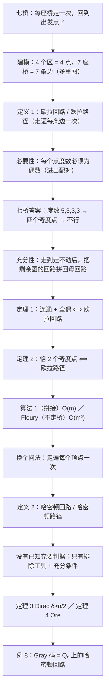

# C10.5 欧拉路径与哈密顿路径 Euler and Hamilton Paths

> [!abstract] 这一讲的任务
> 上一讲（[[C10.4 连通性 Connectivity]]）解决了"能不能从这点走到那点"。
> 这一讲问两个长得很像、难度却差一个数量级的问题：**能不能一笔画完，把每条边恰好走一次？**（欧拉）
> 和**能不能恰好把每个点走一次？**（哈密顿）。前者只要数一数度数就能当场判定，
> 后者至今没有已知的充要判据，判定问题是 NP-完全的。这一讲的收获是：
> 一条"数度数"的判据、一个"把回路拼起来"的构造、两个只够用不够判的充分条件，
> 以及一个必须拎清的名字陷阱——欧拉走的是**边**，哈密顿走的是**点**。

> [!info] 怎么读这份讲义
> 顺序读，不用回头查。§0–§2 是同一个问题被逼出来的全过程（七桥 → 定义 → 必要性），
> §3–§4 是"条件够用"的构造（这一段是本篇的核心证明，值得慢读），§5 是另一条算法路子（Fleury），
> §6–§7 收尾欧拉，§8–§11 换到哈密顿，§12 把三个"欧拉"摆在一张表里，§13 是习题里冒出来的延伸。
> 用到的旧工具只有三样：**握手定理**（[[C10.2 图的术语与特殊类型 Graph Terminology and Special Types of Graphs]]，$\sum_v \deg(v)=2m$）、
> **桥 / 割点**（[[C10.4 连通性 Connectivity]]）、**简单路径与简单回路**（C10.4 定义 1）。
> 一句话勘误：p.697 把 "preamble" 印成了 "premble"；正文口径以本讲义为准。



---

## 0. 开场：1736 年，柯尼斯堡的星期天（p.693）

普鲁士的柯尼斯堡（Königsberg，今天叫加里宁格勒，属俄罗斯）被普雷格尔河的两条支汊切成了四块地。
两块是河的两岸，一块是河中央的克奈普霍夫岛（Kneiphof），还有一块夹在两条支汊之间。
十八世纪，这四块地之间一共架了**七座桥**，把它们连成一片。

星期天，市民喜欢沿着河散步。有人提出一个听上去很小、很具体的问题：

> 能不能从城里某处出发，把七座桥**每座恰好走一次**，最后**回到出发点**？

人人都觉得试一试就知道了。于是试。

从岛 $A$ 出发。先过桥到南岸 $C$，再换另一座桥回岛 $A$——这两座桥之间本来就架了两座，正好各走一次。
从 $A$ 过桥到北岸 $B$，从 $B$ 过桥到东边那块地 $D$，再从 $D$ 过桥到 $C$。
站在 $C$ 上回头一数：**$C$ 的三座桥全都走过了**。可是还剩两座桥没走，一座在 $A$ 与 $D$ 之间，
一座在 $A$ 与 $B$ 之间——它们都在河对面，而你人在 $C$，**再也过不去了**。
走了五座，剩两座，卡死。

换起点。从 $B$ 起步：$B \to A \to D \to C \to A \to B$，五座桥下去人回到 $B$，
可 $B$ 的三座桥已经全用光了，而 $A$ 与 $C$ 之间还架着一座桥，人过不去。又卡。

试了十几次，每次都在同一个地方收场：**某个区的桥先被走完了，人被困在别处，剩下的桥永远走不到。**
这时候该停一下，问一个比"怎么走"更高一层的问题：

> 卡住，是因为我笨，还是因为**根本不可能**？

1736 年，瑞士数学家**莱昂哈德·欧拉（Leonhard Euler，1707–1783）**回答了这个问题：不可能。
他用的办法是把地图换成一幅图——这是图论这门学科第一次被使用。

**建模**：把四块地变成四个顶点 $A,B,C,D$，把七座桥变成七条边。
两块地之间可以架好几座桥（$A$ 与 $C$ 之间两座，$A$ 与 $B$ 之间两座），
所以这不是简单图，而是 **多重图**（[[C10.1 图与图模型 Graphs and Graph Models]] 里"允许重边"的那一类）。

![[C10.5-原图-七桥与多重图.png]]

于是"每座桥恰好走一次并回到出发点"这句话，翻译成图上的语言就是：

> 在这个多重图里，有没有一条**从某点出发、沿着边走、每条边恰好用一次、最后回到出发点**的走法？

一句话点破：**你刚才做的，就是一次完整的图建模**——把"桥"抽象成"边"，把"走到走不动"抽象成一个
关于图的判定问题。而欧拉的答案之所以有力，是因为它不说"我试不出来"，它说"这种走法不存在，理由如下"。

> [!note] 页边一条小注
> 今天的加里宁格勒只剩**五座桥**，其中只有**两座**是欧拉那个时代的。所以那道题在今天的地图上已经变了样；
> 我们讨论的始终是 1736 年的那幅图。

---

## 1. 把"一笔画完"写成定义：欧拉回路与欧拉路径（p.694）

上面那句话还不够精确："回到出发点"和"不回到出发点"是两件事，"沿着边走"到底允许不允许重复经过同一个地方？
要证明一个东西**不存在**，先得把它说得一字不差。

> [!important] 定义 1 欧拉回路与欧拉路径 Euler Circuit and Euler Path
> 图 $G$ 的一条**欧拉回路（Euler circuit）**是包含 $G$ 的**每一条边**的简单回路；
> $G$ 的一条**欧拉路径（Euler path）**是包含 $G$ 的**每一条边**的简单路径。

逐字拆开看：

- **"包含每一条边"**——管的是**边**，不管点。点可以反复经过（这一点和哈密顿回路正好相反，见 §12 的对照表）。
- **"简单回路 / 简单路径"**——这里的"简单"是 C10.4 的用法：**不重复边**。
  C10.4 已经交代过：本课程的 `path` 允许重复边、`simple path` 才不许，所以定义 1 里必须写 "simple"。
  注意它**没有**禁止重复顶点：欧拉回路走一圈回来，路上经过同一个点好几次是完全正常的。
- **回路 vs 路径**：回路要求回到出发点；路径不要求，只要求一路走完所有边。
  （回头看一眼 §4 的弯刀：那条欧拉回路里 $b$、$e$ 各被经过两次——**重复顶点是允许的**。）

为什么叫"欧拉"？因为这是人名，不是方法名——**莱昂哈德·欧拉**，瑞士巴塞尔人，13 岁进大学，
16 岁拿到哲学硕士学位，后来在圣彼得堡科学院和柏林科学院工作。他一辈子写了 1100 多篇（部）论著，
圣彼得堡科学院一度按"压在稿堆最上面先发"的顺序出版他的论文，于是后写的结果常常比它所依赖的结果先问世；
他生命最后 17 年双目失明，靠惊人的记忆力和心算继续产出。1736 年那篇关于七桥的论文，
就是"图论"这个学科的起点。

现在看两个判读的例子。**先别用任何判据**——判据还没证，先用手试，你会亲身体会到"试"有多不可靠。

> [!example] 例 1 三个无向图的欧拉回路与欧拉路径（FIGURE 3）
> 下面三个无向图中，哪些有欧拉回路？没有欧拉回路的，哪些有欧拉路径？

![[C10.5-原图-欧拉有向无向六例.png]]

**$G_1$**（五个点、六条边：$a,b,c,d$ 各连到中心的 $e$，另有 $ab$、$cd$ 两条边）。
试着走：$a \to e \to c \to d \to e \to b \to a$。六条边各用一次，回到 $a$。
**有欧拉回路。**（度数：$a=b=c=d=2$，$e=4$，一个奇数都没有。）

**$G_2$**（把 $G_1$ 的四条辐条换成正方形的边：正方形 $a,b,c,d$ 四条边，加两条对角线 $ac$、$bd$，
交点处放上顶点 $e$，共八条边）。这个图里 $a,b,c,d$ 四个点的度数都变成了 **3**。
$G_2$ **没有欧拉回路**。它有没有欧拉路径？也没有——四个奇度点，一条路径装不下（§6 会一句话说死）。

**$G_3$**（七个边：$ab,bd,dc,ca,ad,de,eb$）。它**没有**欧拉回路（$a$ 和 $b$ 的度数是 3）。
但有一条欧拉路径：$a \to c \to d \to e \to b \to d \to a \to b$。注意 $d$ 被走了两次——
欧拉路径允许重复**点**，只禁止重复**边**。

> [!example] 例 2 三个有向图的欧拉回路与欧拉路径（FIGURE 4）
> 把同样的问法搬到有向图上：下面的有向图中，哪些有欧拉回路？没有的，哪些有欧拉路径？

**$H_2$**（七点八边）：$a \to g \to c \to b \to g \to e \to d \to f \to a$，八条边各一次，回到 $a$。有欧拉回路。

**$H_1$**（四点四边：$a\to b$，$a\to d$，$d\to c$，$c\to b$）：
它其实是从 $a$ 到 $b$ 的两条不同的有向路拼在一起（$a\to b$ 直走，或 $a\to d\to c\to b$）。
$a$ 处有两条边出去、**零条**边进来；$b$ 处相反。这种不平衡就是它既没有欧拉回路、
也没有欧拉路径的原因——下一节会讲清有向图版本。

**$H_3$**（四点五边：$c\to d$，$d\to b$，$c\to a$，$a\to b$，$b\to c$）：
没有欧拉回路，但有欧拉路径 $c \to a \to b \to c \to d \to b$。
注意 $c$ 出度 2、入度 1，$b$ 入度 2、出度 1，其余两点进出相等——差恰好一个，正好容下"起点多出一次、终点多进一次"。

试完这六个图，回头看：**六个图的成败，全部由"每个点连了几条边（有向时是进几条出几条）"决定**，
跟你怎么试、从哪儿起步毫无关系。这不是巧合，这就是下一节的定理。

---

## 2. 必要性：每个路口都得有偶数条路（p.694）

先只问一半：**如果**真有一条欧拉回路，它能逼出什么结论？

盯着起点 $a$ 看，把那条回路从头到尾数一遍：

- 回路的第一步是一条与 $a$ 关联的边（比如 $\{a,b\}$）。它为 $\deg(a)$ 贡献 **1**。
- 之后每次回路**路过** $a$（进来一次、出去一次），用的是一进一出两条不同的边，为 $\deg(a)$ 贡献 **2**。
- 最后一步回到 $a$，又贡献 **1**。

于是 $\deg(a) = 1 + 2k + 1$ 对某个 $k \ge 0$ 成立，**一定是偶数**。

换一个不是起点的点 $x$：回路每次经过它都是"进一条、出一条"，贡献 2；它不可能是路的头或尾。
所以 $\deg(x)$ 也是偶数。

两条合起来：**如果 $G$ 有欧拉回路，那么 $G$ 的每一个顶点度数都是偶数。**

这个论证很短，但它干了一件大事：它把一个"关于无穷多种走法"的问题变成了"关于 $n$ 个数字"的问题。
你可以立刻拿它去回答七桥：四个区的度数是

$$A:5,\quad B:3,\quad C:3,\quad D:3$$

**四个都是奇数**，所以那张图**没有**欧拉回路。
"从某处出发、七座桥各走一次、回到出发点"这件事，无论谁、试多少次、试多久，都做不到。
这不是"还没找到"，是"不存在"。

> [!warning] 易错点：必要 ≠ 充分
> "每个点度数是偶数"只是**必要条件**。它没告诉你"度数全偶就一定能走通"。
> 反例就在手边：两个**互不相连**的三角形（$K_3$ 与 $K_3$ 的并）。每个点的度数都是 2，全是偶数，
> 可是一个回路怎么可能同时走完两个孤立的圈？**连通性**漏掉了。
> 所以正确的猜测应该是：**连通 + 每个点全偶 ⟺ 有欧拉回路**。下一节把"⟸"补上。

> [!question] 停一下，先自己想想
> 两个不相交的三角形告诉你"连通性"这个条件躲不掉。那为什么欧拉的判据里，"连通"这么便宜就能验
> （一遍搜索，$O(m)$），而 §9 你会看到哈密顿的判据里根本找不到这种便宜条件？

顺带记一笔：**度数为奇数的顶点个数不可能是奇数**（这正是握手定理的推论，C10.2 定理 2）。
所以"奇度点的个数"只能取 $0,2,4,\dots$——这是它唯一的取值方式，
下一节的定理 2 就靠这把标尺判定欧拉路径。

---

## 3. 充分性：走到头以后，把剩下的回路拼进来（p.695–696）

现在证反方向：**连通 + 每个点度数都是偶数 ⟹ 一定有欧拉回路。**
注意这是一个"存在性"命题，最靠得住的证法不是讲道理，是**造一条出来**。
（这也正好是算法：证明和算法在这里是同一个东西。）

设 $G$ 连通、至少两个顶点、所有顶点度数为偶数。从任意一个顶点 $a$ 出发，$x_0 = a$。

**第一步：闷头走，走到走不动为止。**

随便挑一条与当前点关联、还没走过的边，走过去；再挑，再走。因为边数有限，总会在某个点 $x$ 停下——
停下的意思是：**$x$ 处所有边都已经走过了**，没有下一步。

**第二步：证明这个 $x$ 只能是 $a$。**

- 如果 $x \ne a$：它一定是我们"走进来"的（除了起点，每个被访问过的点都是被走进来的）。
  走进 $x$ 用掉 1 条边；之后每次路过 $x$（进 + 出）用掉 2 条。所以到此刻，与 $x$ 关联的边已经被用掉
  $1 + 2k$ 条，是**奇数**。可 $\deg(x)$ 是**偶数**，说明还剩至少一条边没用——**那就不叫走不动**，矛盾。
- 所以只能停在 $a$。再看 $a$：出发 1 条、以后每对进出 2 条、最后回来 1 条，用掉的是偶数条，
  正好把 $a$ 的边两两配完。**回路闭合了**。

于是我们手上有一条从 $a$ 出发又回到 $a$ 的**回路** $C$（不重复边，但可能重复点）。

**第三步：如果还有没走的边，就在"交叠点"处再走一个小回路，然后拼进去。**

如果 $C$ 已经把 $G$ 的边用完了，收工，$C$ 就是欧拉回路。

否则，把 $C$ 用过的边从 $G$ 里删掉，再删掉因此变成孤立的点，得到子图 $H$（$H$ 可能不连通）。
关于 $H$ 有两件事必须交代：

1. **$H$ 里每个点的度还是偶数。** 因为从每个点删掉的边数是偶数——回路在任意一点都是"进一条出一条"地成对消耗，
   起点 $a$ 也是"出发一次、回来一次"凑成一对。
2. **$H$ 里至少有一个点，同时也在 $C$ 上。** 这一步用到**连通**：$H$ 的边在 $G$ 里，
   而 $G$ 连通，所以从 $H$ 的任何一个点出发，能沿 $G$ 的边走回 $C$；这条路上的第一段属于 $H$、
   终点落在 $C$ 上，那个交界点就是我们要的。叫它 $w$。

在 $H$ 里，从 $w$ 出发，照第一步那样闷头走。完全同样的奇偶论证说明：**它会停在 $w$**，得到一个小回路 $C'$。

**拼接**：母回路 $C$ 走过 $w$；把它在 $w$ 处"剪开"，插入 $C'$ 绕一圈，再接着走 $C$ 剩下的部分。
得到一条更长的回路。合法性在于：$C'$ 的边全部来自 $H$，与 $C$ 的边**不重叠**，所以拼起来仍然每边只用一次；
又因为 $w$ 是两者的公共点，拼出来的东西仍然是一条回路。

![[C10.5-原图-拼接子回路.png]]

（原书 FIGURE 5：$G$ 上那四个蓝色箭头就是第一圈 $a\to f\to c\to b\to a$ 的走向；
右边 $H$ 是把这一圈的边删掉后剩下的三角形。）

在图上走一遍这个例子（七个边、六个点，度数 $2,2,4,2,2,2$ 全为偶数）：

- 从 $a$ 贪心地绕外圈：$a \to f \to c \to b \to a$（四个边），回到 $a$。
- 此刻 $a$ 已经没有边了，但三角形 $c,d,e$ 的三条边一条没动，而且 $c$ 就在母回路上。
- 在三角形里从 $c$ 出发：$c \to d \to e \to c$。
- 拼起来：$a \to f \to c \to d \to e \to c \to b \to a$。七个边各一次，回到 $a$。**欧拉回路。**

**第四步：这一步一定会停。** 每拼一次，回路至少多包含一条新边；边数有限，所以最多 $m$ 轮就全部走完。
这就得到了一条欧拉回路。

> [!important] 定理 1 欧拉回路的充要条件
> 一个至少有两个顶点的**连通多重图**有欧拉回路，**当且仅当**它的每一个顶点度数都是偶数。

定理 1 的每一个字都要读进去：

- **连通**不能省（两个不相交的三角形）；
- **至少两个顶点**是技术条件（单点、无边的情形要单独说）；
- **多重图**：允许重边。七桥本身就是多重图，判据对重边毫无影响——度数只数个数，不管连到哪儿。

现在七桥问题有了完整答案：图中四个顶点的度数是 $5,3,3,3$，四个奇数，
所以**不存在**"每座桥恰好走一次、回到出发点"的散步。

---

## 4. 算法 1：把上面的构造写成过程（p.696）

§3 的四步就是算法。教材把它写成了伪代码：

> [!important] 算法 1 构造欧拉回路 Constructing Euler Circuits
> ```
> procedure Euler(G: 连通、所有顶点为偶度的多重图)
>   circuit := 从任意顶点出发、一路加边、回到该顶点得到的一条回路
>   H := G 删掉 circuit 的所有边
>   while H 还有边
>       subcircuit := H 中一条回路，起点取 H 里
>                     同时也在 circuit 上（是 circuit 某条边的端点）的顶点
>       H := H 删掉 subcircuit 的边，并删掉所有变成孤立的顶点
>       circuit := 把 subcircuit 插到 circuit 上对应的那个顶点处
>   return circuit   {此时 circuit 是欧拉回路}
> ```

为什么这是 $O(m)$（$m$ 是边数）：每条边被"走一次、删一次"，每一步操作的摊还代价是常数；
回路拼接用表接一下就行，不需要真的复制整条回路。教材把这条留给习题 66，结论就是 $O(m)$。

顺手强调一件容易被忽略的事：**算法 1 的构造和 §3 的证明是同一段话**。
数学上"造得出来"和"证明存在"在这里是一回事——这是欧拉问题之所以"容易"的技术根源，
§9 你会看到哈密顿那边**没有**对应的东西。

> [!example] 例 3 穆罕默德弯刀：一笔画完（FIGURE 6）
> 很多谜题要求"笔不离开纸、线条不许重描"地把一个图形画完。用欧拉回路/路径就能回答。
> 例如下图这把"弯刀"，能不能从某点起笔、回到同一点、把每段线恰好画一次？

![[C10.5-原图-弯刀欧拉回路.png]]

图上十一个点 $a,b,\dots,k$、十八条边。先数度数：
$a=2,\ b=4,\ c=2,\ d=4,\ e=4,\ f=4,\ g=4,\ h=4,\ i=4,\ j=2,\ k=2$——
**全是偶数**，图也连通，所以由定理 1，它**有欧拉回路**，这把弯刀可以一笔画完。

按算法 1 走一遍：

1. 第一圈：$a \to b \to d \to c \to b \to e \to i \to f \to e \to a$（九条边）。
   注意 $b$ 和 $e$ 都被经过了两次——**欧拉回路允许重复点**。
2. 剩下的子图 $H$ 还有九条边：$d,f,g,h,i,j,k$ 之间，度数分别是 $d=2,f=2,g=4,h=4,i=2,j=2,k=2$，仍然全偶。
   从交叠点 $d$ 出发：$d \to g \to h \to j \to i \to h \to k \to g \to f \to d$。
3. 在 $d$ 处拼接：$a \to b \to d \to g \to h \to j \to i \to h \to k \to g \to f \to d \to c \to b \to e \to i \to f \to e \to a$。

这条回路写了 $19$ 个点（首尾都是 $a$）、走了 $18$ 条边，每条恰好一次。这就是那支笔的走法。

> [!warning] 易错点：欧拉回路会重复点
> 上面那条回路里 $b,d,g,h,i,f,e$ 都各经过两次。这不违反定义 1，因为定义 1 约束的是**边**。
> 一条"既走遍每条边、又不重复任何点"的回路，那叫**哈密顿**回路，是另一件事（§8）。
> 两个概念的名字长得很像，条件却是两套，混起来考试必错。

---

## 5. Fleury：不走桥，除非没有别的路（p.697 / p.706 习题 50 前言）

算法 1 的思路是"先乱走一圈，再回来补"。还有一条更符合直觉的路子：**一路走一路删边，只是挑选下一步时守一条纪律。**

先补一句人话。一条边如果**删掉它，图就断成两半**，这条边叫**桥（bridge）**，也叫割边
（[[C10.4 连通性 Connectivity]] 里就是这么定义的；和柯尼斯堡那七座"桥"只是同名，
一个是图论术语，一个是建筑）。

**Fleury 算法的规则，一句话：**

> 站在当前的点上，从还没走的边里挑一条走；**凡是"桥"就不走，除非没别的路可走**。走完把边删掉。

为什么这条纪律能把图走完？直觉一句话：**过了桥，就回不来了；而桥那边还有没走的边。**
说得再准一点，需要三个小块：

记当前**还没走**的边构成的图为 $R$，人站在 $v$。

1. **不变式**：任何时刻，$R$ 的所有边都在"当前所在的点 $v$"的连通块里。
   出发时 $R=G$、$G$ 连通，成立。走一条非桥边 $e=\{v,u\}$：删掉它不会把当前块切开，
   所以剩下的边仍然全在含 $u$ 的块里，不变式保持。
2. **所以，只要当前位置还有非桥边，走它永远不会把自己关在门外。** 这就是"不走桥"的全部理由。
3. **万一当前位置的边全是桥呢？** 那么它其实**只剩一条边**。证明值得看一眼。
   设 $v$ 处有 $d$ 条未走的桥。每条桥必然通向 $R-\{v\}$ 的一个**不同的**连通块——两条桥若通向同一块，
   它们连同块内的一条路就围成一个圈，那两条谁都不是桥。把其中一块记作 $P$：块内的边每条贡献 2，
   再加上那座通往 $v$ 的桥贡献 1，所以 $P$ 里所有点在 $R$ 中的度数和是**奇数**，
   于是 $P$ 里必有一个"在 $R$ 中度数为奇数"的点。
   而在 $R$ 里度数为奇数的点只有**两个**：起点和当前位置 $v$（走过的边在每个点成对消耗，
   只有起点和当前点各多出一条）。$v$ 不在 $P$ 里，那就只能让**起点**一个点去顶住所有的块 $P$——
   于是最多只有一块，$d=1$。**钱只够付一条桥。** 走掉这唯一的一条，剩下的边全在对岸，正好接着走。
   （若 $v$ 恰好就是起点，$R$ 全为偶度，块 $P$ 里根本找不出奇度点，只能 $d=0$——也就是已经全部走完。）

在 §3 那张图上实操一遍（七个边）：

$a \to b$（$ab$ 不是桥），再 $b \to c$（$bc$ 也不是桥）；到 $c$ 时，三条未走的边里 $c\to f$ 是桥（删掉它 $a,f$ 就成孤岛），
$c\to d$、$c\to e$ 不是（它们和 $d\to e$ 构成三角形）→ **纪律要求走非桥**，取 $c \to d$；
$d$ 处只剩 $d\to e$，被迫走；$e$ 处只剩 $e\to c$；回到 $c$，此刻只剩 $c\to f$（真没别的路了），走；
$f$ 处只剩 $f\to a$，走。回到 $a$，七条边全部用完。

> [!warning] 若在第 3 步贪心走了桥
> 若在 $c$ 处顺手走 $c\to f \to a$，人立刻停在 $a$——$a$ 没边了，三角形 $c,d,e$ 还在那里，
> 而你再也回不到 $c$。这**正是** §3 那张拼接图里"剩下的子图 $H$"的来历：
> 走错一步，剩下的就是一个孤立的块。Fleury 的纪律就是不许犯这个错。

**代价**：每一步都要判断"这条边是不是桥"，朴素做法是 $O(m)$（删一条边看连通性）；
一共要走 $m$ 步，所以 $O(m^2)$。它比算法 1 慢了一个量级。

> [!note] 现代做法：Hierholzer
> 现在的教科书通常讲 **Hierholzer 算法**（1873）：一路闷头走，走过的边当场删掉；
> 走不动了就**回溯**到最近一个还有剩余边的点，接着走，把每段回路用栈接起来。整个过程每个点、每条边
> 只处理常数次，$O(m)$。它的核心就是 §3 的"拼接"，只是把"回头找交叠点"改成了"用栈记下岔路口"。
> 三个名字对应三条路子：**欧拉**（1736，提出并判定）、**Hierholzer**（1873，线性构造）、
> **Fleury**（1883，纪律式构造）。教材把 Fleury 放在 p.706 习题 50 的前言里介绍
> （那一页把 "preamble" 印成了 "premble"）。

---

## 6. 定理 2：欧拉路径只差"两个奇度点"（p.697）

回路要求回到出发点。把这条放松：**不要求回来，只要求走完每条边**。判据立刻变简单了。

> [!important] 定理 2 欧拉路径的充要条件
> 一个连通多重图有欧拉路径但**没有**欧拉回路，**当且仅当**它恰好有**两个**度数为奇数的顶点。

**必要性**（若有一条从 $a$ 到 $b$ 的欧拉路径，且它不是回路）：

- 起点 $a$：走了 1 条边出发，此后每经过一次加 2 → 奇数。
- 终点 $b$：最后走 1 条边到达，此前每经过一次加 2 → 奇数。
- 其他点 $x$：每次经过都是进一条出一条 → 偶数。

于是恰好 $a,b$ 两个奇度点。**奇度点的个数只能是 $0$ 或 $2$**——这正好接上 §2 末尾那条：奇度点的个数必须成偶数。

**充分性**（恰有 $a,b$ 两个奇度点 ⟹ 有从 $a$ 到 $b$ 的欧拉路径）：这是个漂亮的小技巧。**加一条边。**

在原图上添一条新边 $\{a,b\}$。加了以后，$\deg(a)$ 和 $\deg(b)$ 各变一次奇偶，双双变成偶数；
其他点不动。新图仍然连通、所有点皆偶 → 由定理 1，新图有欧拉回路。
把这条新边从回路里摘掉，回路断成一条从 $a$ 到 $b$ 的路径，而且它经过原图的每一条边恰好一次。
这就是原图的一条欧拉路径。

> [!note] 为什么定理 2 说的是"多重图"而不是"简单图"
> 上面那一步"添一条边 $\{a,b\}$"如果 $a,b$ 本来就相邻，在简单图里就加不了。
> 多重图允许重边，所以随时能加。要在简单图上用这个判据，得先说明"允许临时添重边"，
> 或者改用"在超图上讨论"的说法。这不是吹毛求疵：$a,b$ 相邻的情形非常常见（例 4 的 $G_1$ 就是）。

> [!example] 例 4 三个图的欧拉路径判读（FIGURE 7）
> 下面三个图中，哪些有欧拉路径？

![[C10.5-原图-欧拉路径三例.png]]

**$G_1$**（四点五边：一个四边形 $a,b,c,d$ 加对角线 $bd$）：度数 $a=2,\ b=3,\ c=2,\ d=3$，
恰好两个奇度点 $b,d$。所以有欧拉路径，而且路径的**两个端点必须是 $b$ 和 $d$**。
一条是：$d \to a \to b \to c \to d \to b$。

**$G_2$**（七点十一边）：度数 $a=2,\ b=3,\ c=4,\ d=3,\ e=2,\ f=4,\ g=4$，同样恰好两个奇度点 $b,d$。
一条欧拉路径是：$b \to a \to g \to f \to e \to d \to c \to g \to b \to c \to f \to d$（十一条边各一次）。

**$G_3$**（这就是 $W_6$：一个六边形加中心点 $g$ 连到六个顶点，七点十二边）：
外圈六个点度数都是 3，中心点度数 6，**六个奇度点**。$6 \ne 0$ 也不是 2，所以**既没有欧拉回路也没有欧拉路径**。
（定理 2 直接说死：手工是试不出结论的，数一下就完了。）

回到 1736 年，换个问法：**能不能从城里某处出发，走完七座桥，停在另一处**（不要求回来）？
答案还是不行：那张图有四个奇度点，既不是 0 也不是 2。所以"不回头的一次走完"同样不存在。

> [!note] 有向图的版本（教材放在习题 16、17）
> 把"度数"换成"入度与出度"，定理 1、2 逐字搬家：
> - **欧拉回路** ⟺ 图**弱连通**，且每个顶点 $\deg^-=\deg^+$（进出平衡）；
> - **欧拉路径（非回路）** ⟺ 图弱连通，且除两个点以外进出都平衡，
>   其中一个点**出度比入度多 1**（它是起点），另一个点**入度比出度多 1**（它是终点）。
>
> 拿例 2 的三个图验一下：$H_2$ 每点进出相等（$g$ 是 $2$ 进 $2$ 出），弱连通 → 有欧拉回路 ✓；
> $H_1$ 的 $a$ 出 2 入 0、$b$ 入 2 出 0，差值不是 1 而是 2 → 既无回路也无路径 ✓；
> $H_3$ 的 $c$ 出 2 入 1、$b$ 入 2 出 1、其余平衡 → 恰好差 1，于是有从 $c$ 到 $b$ 的欧拉路径 ✓。
> **注意"弱连通"这个词不能换成"强连通"**：欧拉回路自己就是一条走遍所有边的闭合走法，
> 它保证的只是"忽略方向后连成一片"。

---

## 7. 欧拉回路能干什么：扫街、邮递员、DNA（p.698）

判据好用，所以用得多。凡是"**把一批连接恰好走一遍**"的活儿，都是欧拉问题：

- **扫街 / 洒水 / 除雪**：把街道当边，交叉口当点，扫一遍所有街道就是欧拉回路。
  扫街车不必回到车库，那就只要欧拉路径。
- **邮递员送信**：他负责的每条街都得走一遍。有欧拉回路就能一条路线走完，一步不多走。
- **电路板布线、网络多播**：每条连线都要测/要送到，等价于走遍每条边。
- **DNA 测序**：把读出的短片段当**边**，片段之间的重叠当**顶点**，拼装整条序列就是找欧拉路径。

如果没有欧拉路径（有 4 个以上奇度点），就必然有街道要重复走。于是自然的问题是：
**怎样重复最少的边，把每条边至少走一遍？** 这个问题叫**中国邮路问题（Chinese postman problem）**，
1962 年由管梅谷提出，故以"中国"命名。它的解法（把奇度点两两配对、用最短路补边）要用到下一讲的
最短路算法——所以欧拉和最短路径其实是连着的。

> [!note] 专业关联
> **DNA 拼装 ↔ de Bruijn 图上的欧拉路径**。把测序读出的每条长度 $k$ 的片段 $s$ 看成一个**顶点**是行不通的
> （那是哈密顿问题，见 §10 的 NP-完全），现代做法反过来：**把 $k-1$ 长的片段当顶点、把 $k$ 长的片段当边**。
> 这样"每个读段用一次"就变成了"走遍每条边一次"——正是欧拉路径，线性时间可解。
> 同一个拼装任务，选错了"谁是点、谁是边"，难度就从多项式变成 NP-完全。
> 这是"建模决定复杂度"最干净的一个例子。

---

## 8. 换一个问法：走遍每个**点**一次（p.698–699）

欧拉问的是边。把"边"换成"点"：

> 能不能沿着边走，把**每个顶点恰好经过一次**？

这个问题的直觉版本比七桥更古老，也更好玩。1857 年，爱尔兰数学家
**威廉·罗恩·汉密尔顿（William Rowan Hamilton，1805–1865）**发明了一个叫**二十面体游戏（Icosian puzzle）**的玩具：
一个木制的**正十二面体**（十二个正五边形面围成的多面体），每个顶点上钉一根钉子，
二十个顶点分别标上一座世界名城，再配一根绳子。玩法是：从某座城出发，沿棱走，
把其余十九座城**各走一次**，最后回到出发的那座城，用绳子把走过的路标出来。
这个游戏有个很浪漫的名字：**"环游世界"（A Voyage Round the World）**。

![[C10.5-原图-十二面体环游.png]]

十二面体有 **20 个顶点、30 条棱**，每个顶点接 **3 条棱**。
上面那张图里，左边的 (a) 是那个木制实体（虚线是被遮住的棱），中间的 (b) 是它的**图**：
二十个顶点、三十条边，每个顶点三条。
最右边那张图用蓝线画出了一条"每个点都走一次"的回路——它把 20 个顶点全部串了起来、首尾相接。
所以汉密尔顿的谜题有解。

把这个问法写成定义：

> [!important] 定义 2 哈密顿路径与哈密顿回路 Hamilton Path and Hamilton Circuit
> 图 $G$ 中**恰好经过每个顶点一次**的简单路径叫**哈密顿路径（Hamilton path）**；
> 图 $G$ 中**恰好经过每个顶点一次**的简单回路叫**哈密顿回路（Hamilton circuit）**。
> 形式化地说：$G=(V,E)$ 中的简单路径 $x_0,x_1,\dots,x_{n-1},x_n$ 是哈密顿路径，若
> $V=\{x_0,\dots,x_n\}$ 且 $x_i \ne x_j\ (0\le i<j\le n)$；
> 简单回路 $x_0,\dots,x_n,x_0\ (n>0)$ 是哈密顿回路，若 $x_0,\dots,x_n$ 是哈密顿路径。

逐字对比定义 1 和定义 2，差别只有一处：

| | 覆盖对象 | 允许重复什么 | 禁止重复什么 |
|---|---|---|---|
| 欧拉回路/路径 | 每条**边**一次 | **顶点**（可以反复经过） | 边 |
| 哈密顿回路/路径 | 每个**点**一次 | 无 | 点（因而也禁止边） |

名字同样是**人名**：欧拉、汉密尔顿，两个人，两套问题，相隔一百多年。
「环游世界」这个名字容易让人以为它是"最短路线"问题——**不是**，它只要求"每城一次"，
不问路程长短；问路程长短的是 §11 的 TSP。

> [!example] 例 5 三个简单图的哈密顿判读（FIGURE 10）
> 下面三个简单图中，哪些有哈密顿回路？没有的，哪些有哈密顿路径？

![[C10.5-原图-哈密顿路径三例.png]]

**$G_1$**（五点八边：$ab, bc, cd, de, ea$ 五边成圈，再加 $ac, be, ec$）。**有哈密顿回路**：
$a \to b \to c \to d \to e \to a$。顺着圈走一遍就行。

**$G_2$**（四点四边：$a$ 只连着 $b$，另有 $bc, cd, bd$）。**没有哈密顿回路**。
理由很短：$a$ 的度数是 1，而任何回路进一个点必须再出来，度 1 的点连"进"和"出"都凑不齐。
（换个说法：回路含每个顶点，就必须含 $a$，于是必须含边 $\{a,b\}$ 两次——而简单回路不许重边。）
但它**有哈密顿路径**：$a \to b \to c \to d$。

**$G_3$**（七点七边，像两节竖着的梯子：$ab, bg, bc, ge, dc, ce, ef$）。**既没有哈密顿回路，也没有哈密顿路径**。
看三个"叶子"：$a$ 只连 $b$，$d$ 只连 $c$，$f$ 只连 $e$。
任何经过 $a$ 的路径都必须用边 $\{a,b\}$，而 $a$ 只能当**端点**（它没有第二条边走）；
同理 $d$ 要占一个端点、$f$ 要占一个端点——可一条路径只有**两个**端点，三个叶子放不下。
所以连哈密顿路径都没有。

---

## 9. 哈密顿比欧拉难在哪：一个"没有判据"的问题（p.699–700, p.702）

到这里，欧拉那边是"数度数、完事"，你会自然期待哈密顿也有个类似的一行判据。**没有。**

教材说得很直白：**目前没有已知的、简单的哈密顿回路充要判据。**
而"找一条哈密顿回路"或"证明不存在"的**已知最好算法都是指数最坏时间的**；
要想有最坏多项式时间的算法，那将是重大突破——因为**判定哈密顿回路是 NP-完全的**
（第 3.3 节），一个多项式算法会让一大堆"看起来解不动"的问题一起变得可解。
所以今天能用的只有两类工具：**充分条件**（条件成立 ⇒ 一定有）和**排除工具**（条件成立 ⇒ 一定没有）。
两类都只是"够用"，不是"判据"。

**为什么欧拉容易、哈密顿难？** 值得说透，因为这是整章最有信息量的一句"为什么"。

1. **欧拉的性质是"逐点的局部账"，而且局部账自动拼成全局。**
   度数只记录"这个点来了几条边"。可它恰好够用：每个点的边都能两两配对（偶数），
   而"配对"这件事在每个点上是**独立**的——你在 $a$ 处配好对，不会妨碍在 $b$ 处配对。
   唯一剩下的全局问题是"连不连通"，而连通性是 $O(m)$ 一遍搜索就能验的。
   更关键的是 **§3 的拼接**：两个回路只要**共享一个点**就能接起来，所以局部的小回路总能长成大回路。
2. **哈密顿的性质是"全局的顺序"。** 度数只告诉你"每个点要选两条边"，可它完全管不了"这些选择能不能
   首尾接成**一个**大圈"。看**蝴蝶结**：两个三角形共用一个顶点，一共五个点，度数分别是 $4,2,2,2,2$。
   每个点都选得出两条边（度数都 $\ge 2$），选出来的也确实是一堆圈——两个三角形各自成圈，
   合起来覆盖了所有顶点，可那是**两个**圈，不是一个。哈密顿要的是**一个**圈，而共用那个点是割点，
   一删图就断成两半。这种"每个点都满足、整体却拼不起来"的结构，任何只看度数的局部判据都拦不住。
3. **拼接法在这里彻底失效。** 欧拉的证明靠"两个回路可以共用一个顶点"。而哈密顿回路**恰恰禁止共点**——
   每个点只能用一次，两个子回路一旦共享一个顶点就已经违规。**没有共享点，就没有拼接。**
   这正是"充分性证不出来"的技术根源，也是为什么只能搜遍所有点序（$n!$ 个排列）当保底办法。

**排除工具**（看到这些就不用找了，一定没有哈密顿回路）：

> [!important] 排除哈密顿回路的五条硬理由
> 1. **有度 1 的点**：回路进一个点必须再出来，需要 2 条边。$n\ge3$ 时度 1 的点直接判死。
> 2. **度 2 的点会把两条边钉死**：它的两条边都**必须**在回路里。连着推几次，常常推出矛盾——
>    要么某个点被迫接上 3 条边，要么某个点被隔在圈外。
> 3. **有割点（articulation point）**：删掉 $v$ 图就不连通了，那么不存在哈密顿回路。
>    理由：任何哈密顿回路删掉一个顶点后剩下一条经过其余所有点的路径，它必然是**连通**的；
>    所以"删掉某个点后图不连通"与"有哈密顿回路"不能共存。
> 4. **二分图两侧点数不等**：哈密顿回路在二分图里必须左右交替地走，走过的点必然是两边各一半。
>    所以顶点数是奇数的二分图（两侧不可能相等）**没有**哈密顿回路；$K_{2,3}$、$K_{3,4}$ 都因此出局。
> 5. **回路里不能套小圈**：哈密顿回路一旦经过某个点，这个点其余的边全部作废；
>    也不能在走到某点后绕回已经走过的点形成小环——那小环会把剩下的点关在外面。

> [!example] 例 6 两个没有哈密顿回路的图（FIGURE 11）
> 证明下面两个图都没有哈密顿回路。

![[C10.5-原图-无哈密顿回路两例.png]]

**左图 $G$**（五点五边：$ab, ad, dc, cb$ 成四边形，再从 $d$ 伸出一条边到 $e$）：
$e$ 的度数是 **1**，用排除工具第 1 条，直接判死。

**右图 $H$**（五点六边：$a,b$ 在左、$d,e$ 在右，中间一个 $c$；边是 $ab, de$ 两竖加 $ac, cd, bc, ce$ 四条斜的）：
它没有度 1 的点，得用第 2 条。四个点的度数都是 **2**：$a,b,d,e$。于是
$\{a,c\},\{a,b\},\{b,c\},\{d,e\},\{c,d\},\{c,e\}$ 里，凡是碰到这四个点的边**全都被钉死在回路里**——
一个度 2 的点没有别的选择。数下来 $c$ 被迫接上四条边：$ca, cb, cd, ce$。
可回路经过一个点只用两条边。**矛盾**，所以 $H$ 也没有哈密顿回路。

> [!example] 例 7 完全图一定有哈密顿回路
> 证明：$n \ge 3$ 时，$K_n$ 一定有哈密顿回路。

$K_n$ 里任意两点之间都有边，所以"按任意顺序把所有点排一排、首尾接上"就行：
$v_1 \to v_2 \to \cdots \to v_n \to v_1$。中间每一步 $v_i \to v_{i+1}$ 用的边存在，
最后一步 $v_n \to v_1$ 的边也存在。$n\ge3$ 保证这条回路至少有三条边、不退化。

这个例子说明了直觉的方向：**边越多，越可能有哈密顿回路**。往一个已有哈密顿回路的图上加边（不加点），
原来那条回路还在，所以"有哈密顿回路"这个性质对加边是**单调**的。
于是很自然地去问：**每个点的度数大到什么程度，就足以保证有哈密顿回路？** ——这就是下一节。

---

## 10. 两个充分条件：Dirac 与 Ore（p.701）

> [!question] 停一下，先自己猜个数字
> 假如只准用"度数"这一种信息（不许看结构），要保证 $n$ 个点的简单图**一定**有哈密顿回路，
> 你会要求每个点的度数至少多大？
> 试试就知道 $2$ 不行——蝴蝶结每点度数都 $\ge 2$，照样没有回路；
> $n-1$ 一定行，但那等于要求它是完全图，太浪费。真正的阈值在哪？

> [!important] 定理 3 Dirac 定理（1952）
> 设 $G$ 是有 $n\ (\ge 3)$ 个顶点的**简单图**，且每个顶点的度数都 $\ge n/2$。则 $G$ 有哈密顿回路。

> [!important] 定理 4 Ore 定理（1960）
> 设 $G$ 是有 $n\ (\ge 3)$ 个顶点的**简单图**，且对**每一对不相邻的顶点** $u,v$ 都有
> $\deg(u)+\deg(v) \ge n$。则 $G$ 有哈密顿回路。

两个人名：**Gabriel A. Dirac**（1925–1984，生于布达佩斯，1952 年给出上面那个度数条件）和
**Øystein Ore**（1899–1968，挪威人，长期在耶鲁，1960 年给出更宽的条件）。
注意 Dirac 的**条件更强**：如果每个点度都 $\ge n/2$，那么任意两个点（不管相邻与否）度数和都 $\ge n$，
Ore 的条件自动成立。所以**定理 3 是定理 4 的推论**——教材原话就是这个意思。

两个条件都只看度数，因此都只可能"够用"，不可能"必要"。反例是最好找的那个：

> [!warning] 充分条件不是判据：$C_5$ 的反例
> $C_5$：五个点连成一个圈，$n=5$，每个点度数 $2$。
> - Dirac：要求 $\deg \ge n/2 = 2.5$，实际是 2，**不满足**。
> - Ore：$C_5$ 里每个点只跟两个邻居相邻，所以随便取一对不相邻的点（比如隔一个的那个），
>   度数和 $= 2+2 = 4 < 5$，**不满足**。
>
> 但 $C_5$ 自己就是一条哈密顿回路。所以两个定理都只是**充分条件**：
> 条件成立一定行，条件不成立**什么也不能说**——既可能有（如 $C_5$），也可能没有。

顺便把这个界"紧"在哪里说清：Dirac 的 $n/2$ 不能再降。
$n$ 为奇数时，取**两个 $K_{(n+1)/2}$ 共用一个顶点**（$n=5$ 时就是两个三角形共用一点，正是上面那个蝴蝶结）。
点数正好是 $n$；除共用点之外的每个点度数都是 $(n+1)/2-1=(n-1)/2$（共用点更高，是 $n-1$）；
而共用那个点是**割点**，所以它**没有**哈密顿回路。
也就是说：把条件放宽成"每个点度 $\ge (n-1)/2$"，定理就假了。
对奇数 $n$，$n/2$ 不是整数，而度数只能是整数，所以 $\deg\ge n/2$ 的实际含义是
$\deg\ge\lceil n/2\rceil=(n+1)/2$。
这就是这个常数一分都不能动的理由。

### Ore 定理的证明（教材留给习题 65，这里补全）

教材在 p.701 只说"证明见习题 65"，没有给正文证明。下面按那份提示把每一步补出来。
核心是一个引理，思想是"**闭包**"：把能加的边都加上，加到再加一条就出哈密顿回路为止。

> [!important] 引理（闭包引理，Bondy–Chvátal）
> 设 $u,v$ 是 $n$ 点简单图 $G$ 中一对**不相邻**的顶点，且 $\deg_G(u)+\deg_G(v)\ge n$。
> 则 "$G$ 有哈密顿回路" $\iff$ "$G+\{u,v\}$ 有哈密顿回路"。

**证明.** 正向"⟹"不用做：多的那条边不会破坏原有的哈密顿回路。
只需证反向"⟸"。设 $G+\{u,v\}$ 有哈密顿回路，而 $G$ 没有。
那么这条回路**必须**用到新边 $\{u,v\}$——不用它的话，它就是 $G$ 里的哈密顿回路了。
把这条新边从回路里删掉，回路断成一条**哈密顿路径**：

$$u = v_0,\ v_1,\ v_2,\ \dots,\ v_{n-1} = v .$$

$n$ 个顶点各上场一次，首是 $u$、尾是 $v$，而 $u,v$ 在 $G$ 里**不相邻**（这是前提）。

现在来数"位置"。对 $i$ 从 $1$ 取到 $n-2$，盯住路径上第 $i$ 个位置 $v_i$ 前后的两个点 $v_{i-1}$ 与 $v_{i+1}$，
定义两个位置集合：

$$A=\{i:\ v_0 \text{ 与 } v_{i+1} \text{ 相邻}\},\qquad B=\{i:\ v_{n-1} \text{ 与 } v_i \text{ 相邻}\},$$

下标都限制在 $1 \le i \le n-2$，所以 $A,B \subseteq \{1,2,\dots,n-2\}$：总共只有 $n-2$ 个可用的位置。

- $|A|=\deg_G(v_0)=\deg_G(u)$。为什么？$u$ 不与 $v$ 相邻，所以 $u$ 的每个邻居必定是路径中间的某个
  $v_j\ (1\le j\le n-2)$；每个这样的 $j$ 恰好对应一个位置 $i=j-1$，一一对应。
- $|B|=\deg_G(v_{n-1})=\deg_G(v)$。同理：$v$ 的每个邻居 $v_j$ 都满足 $1\le j\le n-2$，也一一对应到一个位置。

两个集合都挤在 $n-2$ 个位置上，而两者大小之和 $\ge n$，于是

$$|A\cap B|\ \ge\ |A|+|B|-(n-2)\ \ge\ n-(n-2)\ =\ 2\ >\ 0 .$$

取一个 $i\in A\cap B$。它同时说了两件事：$v_0$ 与 $v_{i+1}$ 相邻，且 $v_{n-1}$ 与 $v_i$ 相邻。于是这条走法

$$v_0 \to v_1 \to \cdots \to v_i \to v_{n-1} \to v_{n-2} \to \cdots \to v_{i+1} \to v_0$$

是一条**落在 $G$ 里**的哈密顿回路。逐段核对：

- $v_0\to v_1\to\cdots\to v_i$：全是路径上原有的边；
- $v_i \to v_{n-1}$：因为 $i\in B$；
- $v_{n-1}\to v_{n-2}\to\cdots\to v_{i+1}$：路径的边倒着走；
- $v_{i+1}\to v_0$：因为 $i\in A$。

顶点不多不少：前半段是 $v_0,\dots,v_i$，后半段是 $v_{i+1},\dots,v_{n-1}$，两段不重叠、合起来正好是全部 $n$ 个点。
这与"$G$ 没有哈密顿回路"矛盾。**引理证完。**

**定理 4 的证明（闭包）.** 设 $G$ 满足 Ore 条件。从 $G$ 出发，反复做：
若有一对不相邻的 $u,v$，就把边 $\{u,v\}$ 添上。每次添边，图变大、某些点的度数变大；
而 Ore 条件对剩下的不相邻对**依然成立**（度数只增不减，而被添上的那一对不再需要考虑）。
所以每添一条边都可以用引理"无损替换"：新图有哈密顿回路 ⟺ 旧图有哈密顿回路。

这个过程一直添到没有"不相邻对"为止，也就是添成了**完全图** $K_n$。
$n\ge3$ 时 $K_n$ 有哈密顿回路（例 7）。沿着刚才每一步的等价关系倒推回去：
$G$ **也**有哈密顿回路。$\blacksquare$

**定理 3 的证明（一行）.** Dirac 条件 $\deg \ge n/2$ 蕴含对任意不相邻的 $u,v$
$\deg u+\deg v \ge n/2+n/2 = n$，即 Ore 条件成立；由定理 4 得证。$\blacksquare$

> [!warning] 用这两个定理时最容易犯的错
> 它们是**充分**条件，不是判据。**条件不满足时既不能断言有、也不能断言没有**——只能"这一招用不上"。
> 习题 47 就是专门练这个的：给四个图，分别问"Dirac 能不能用""Ore 能不能用""它到底有没有"，
> 三个答案可能互不相同（比如 $C_5$ 是"都不能用，但有"）。
> 还有一个方向要小心：定理要求**简单图**。多重图、带自环的图不能直接套。

---

## 11. 哈密顿回路能干什么：TSP 与旋转编码（p.702–703）

> [!note] TSP：哈密顿回路 + 权重
> 很多应用要"每个路口恰好经过一次"：洒水车走遍每个路口、巡检员走遍每处管道接头、
> 网络诊断报文走遍每个节点。找哈密顿路径/回路就能解。
> 最著名的是**旅行商问题（traveling salesperson problem，TSP）**：给一组城市和两两之间的路程，
> 求总路程最短的环游。它正是"在**完全图**上找一条**权重和最小**的哈密顿回路"。
> 下一讲 [[C10.6 最短路径问题 Shortest-Path Problems]] 会专门处理它。
> 值得记住的对照：**判定**有没有哈密顿回路是 NP-完全的，**求最短的那条**只会更难。

下面这个应用表面上看不出和图论有什么关系，但它把一个抽象定理变成了电机里、旋钮里的真实零件。
它要用到一种特殊的编码：**把 $2^n$ 个 $n$ 位 01 串排成一圈，让相邻两个串只差一位**——
这样的排法叫 **Gray 码（Gray code）**，名字来自贝尔实验室的 **Frank Gray**（1940 年代，用来减少数字信号传输出错的影响）。

> [!example] 例 8 Gray 码：把指针位置变成数字（FIGURE 12、13、14）
> 一个转动的指针，位置要变成数字读出来。办法：把圆周等分成 $2^n$ 段弧，每段贴一个 $n$ 位 01 串；
> 再用 $n$ 个触点（每个触点负责读一位）去读指针所在的那段。

![[C10.5-原图-旋转编码两种标法.png]]

**问题出在哪**：指针常常正好停在两段弧的**交界**上，这时读数可能出错。
若用普通的二进制顺序（上图 (a)：从右上开始顺时针 $000,001,010,011,100,101,110,111$），
出一次错可能错得离谱：$011$ 和 $100$ 相邻，
$$011 \oplus 100 = 111 \quad(\text{三位全不同}),$$
**三位全错**。$001$ 与 $010$ 相邻，也差两位。这种编码在交界处完全不可靠。

**要求**：相邻两段弧的编码**只能差一位**。这样一来，读数出错最多错一位，而且错的那一位只影响
"当前在哪段"的判定，不会把一个位置读成离得很远的另一个位置。

上图 (b) 就是这样一个编码（从右上顺时针）：

$$000,\ 001,\ 011,\ 010,\ 110,\ 111,\ 101,\ 100$$

逐对核对（含最后一段回到第一段）：每一对异或都恰好是 $1$ 位。

| 相邻对 | 异或结果 | 差的位数 |
|---|---|---|
| $000\to001$ | $001$ | 1 |
| $001\to011$ | $010$ | 1 |
| $011\to010$ | $001$ | 1 |
| $010\to110$ | $100$ | 1 |
| $110\to111$ | $001$ | 1 |
| $111\to101$ | $010$ | 1 |
| $101\to100$ | $001$ | 1 |
| $100\to000$ | $100$ | 1 |

于是"$011$ 被误读成 $010$"这种错误只错一位（上图 (b) 里那个指针正指着这两个相邻段的交界，画的就是这个场景）。

**这跟哈密顿回路有什么关系？** 把每个 $n$ 位串看成一个顶点，"只差一位"的两个串之间连一条边——
这不就是 **$n$ 立方体 $Q_n$** 吗（[[C10.2 图的术语与特殊类型 Graph Terminology and Special Types of Graphs]] 定义过的 $Q_n$，
$2^n$ 个顶点、每个顶点度 $n$）。
"把 $2^n$ 个串排成一圈、相邻只差一位、最后回到第一个"这句话，翻译过来就是：

> $Q_n$ 里的一条**哈密顿回路**。

![[C10.5-原图-旋转编码与Gray码.png]]

上面那张图的右半边（FIGURE 14）画了 $Q_3$ 的一条：
$000 \to 001 \to 011 \to 010 \to 110 \to 111 \to 101 \to 100 \to 000$，和上面那张表完全一致。
所以**求 Gray 码 = 求 $Q_n$ 的哈密顿回路**。

**一个可以自己复核的推论**：上图中左边那两圈同心"触点"（FIGURE 13），弧的段数是能数的。
- **上圈**对应二进制标法：第三位（最右一位）在 $8$ 段里取 $1$、取 $0$ 交替 $4$ 次，
  所以第三位要**四段**分开的弧；第二位要两段；第一位要一段。合计 $1+2+4=7$ 段
  （图上"Third bit is 1 here"标了 $4$ 处，"Second bit" $2$ 处，"First bit" $1$ 处，正好对上）。
- **下圈**对应 Gray 标法：三个位各自"取 1"的位置都成连续的块——第一位一段、第二位一段、第三位两段。
  合计 $1+1+2=4$ 段，触点做得更省。

所以 Gray 码不只是"相邻差一位"，它还让**读数的触点结构更简单**。

> [!note] 专业关联
> **绝对位置编码器**里用的就是这个。旋转编码器（电机、云台、旋钮）用一圈 Gray 码图案 + 若干光电触点
> 直接读出绝对角度；由于相邻格的码字只差一位，机械抖动导致**跨格**时最坏只错一个 bit，
> 而普通二进制在跨格瞬间可能同时翻转好几位，读出一个完全离谱的角度。
> 同样的结构还出现在 $Q_n$ 上的**并行机编号**与超立方体互连网络的"哈密顿广播"里。

---

## 12. 名称陷阱：三个"欧拉"与一个"哈密顿"（p.693–706，对照 p.719）

这一章里"欧拉"要出现三次，三次指的是完全不同的东西。混淆的代价很高，所以摆成一张表。

![[C10.5-欧拉与哈密顿的区别.png]]

这张对照图的两半用的是**同一张图**（六边形加内接三角形，九个边）：
左边按欧拉的要求把**九个边**各走一次（图上标了 $1$ 到 $9$ 的顺序），回路是
$v_0v_1v_2v_3v_4v_5v_0v_2v_4v_0$——$v_0$ 和 $v_2$ 都被经过了不止一次；
右边按哈密顿的要求把**六个点**各走一次，只用到外边六个边，里面那三条虚线边一次都不走。
**同一条路，两种任务，两种答案。**

| 名字 | 走遍什么 | 判据 | 出现在 |
|---|---|---|---|
| **欧拉回路 / 欧拉路径** | 每条**边**恰好一次 | 连通 + 奇度点 $0$ 个（回路）／$2$ 个（路径），**充要**，数度数即可 | 本篇 p.693–697 |
| **哈密顿回路 / 路径** | 每个**点**恰好一次 | **没有**已知充要判据；只有充分条件（Dirac、Ore）与排除工具 | 本篇 p.698–703 |
| **欧拉公式 $v-e+r=2$** | 不谈"走"，讲连通平面图里点、边、面的**计数** | 对任何连通平面图恒成立 | [[C10.7 平面图 Planar Graphs]] p.719–722 |

三条口诀，抄下来：

1. **欧拉数边，哈密顿数点。**
2. **欧拉看奇度点的个数（0 或 2），哈密顿看"有没有这么一个圈"（没有公式）。**
3. **欧拉公式是第三个"欧拉"，它数的是点、边、面，跟"走路"没有关系。**
   看到 "Euler" 先问一句：是走边、还是 $v-e+r$？

---

## 13. 延伸：习题里冒出来的几样东西（p.702–707）

这一节的习题区（以及 p.707 开头那段前言）还带出几个概念，都值得知道。

### 13.1 骑士周游（knight's tour，习题 56–64）

国际象棋的**马（knight）**走"日"字：从 $(x,y)$ 出发能到 $(x\pm2,y\pm1)$ 或 $(x\pm1,y\pm2)$（若没出界）。
**骑士周游**是让马按规则一路跳，把棋盘上**每个格子恰好访问一次**。
如果最后还能从终点跳回起点，叫**可复返的（reentrant）**。

把每个格子变成顶点，能一跳到达的两格之间连边，就得到一个"马步图"。于是：

- **骑士周游 ⟺ 这个图上的哈密顿路径**；
- **可复返的骑士周游 ⟺ 这个图上的哈密顿回路**。

几条好用好记的事实（都能从前面的一般性结论推出来）：

- **马步图总是二分的**：马每跳一步，落点颜色一定相反（棋盘的黑白染色）。
  所以"把棋盘按黑白染色"就是它的一张二分划分。
- 由 §9 排除工具第 4 条：**顶点数为奇数的二分图没有哈密顿回路**。
  $m,n$ 都是奇数时棋盘有奇数个格子，于是**不存在可复返的骑士周游**——这解释了为什么
  5×5、7×7 这类棋盘只能求普通周游。
- $3\times3$ 棋盘：中心格**跳不上去**——马要想落在中心，出发点得在棋盘外（度为 0）。
  图都不连通，自然既无周游也无回路。$4\times4$ 棋盘也没有周游（这个要动手试，或者查表）。
- 8×8 棋盘**有**周游（习题 64 给了 Warnsdorff 的贪心法：每次跳到"后续可跳格最少"的那一格）。

### 13.2 $Q_n$ 上的哈密顿回路：Gray 码一定存在（习题 49）

**命题**：对每个 $n\ge2$，$Q_n$ 都有哈密顿回路——等价地，$n$ 位 Gray 码总存在。

归纳构造：$n=2$ 时 $Q_2$ 是一个四边形，它自己就是一条哈密顿回路（走一圈）。
（$n=1$ 的 $Q_1$ 只有两个点一条边，凑不出回路——$0\to1\to0$ 会把那条边走两遍。
所以习题 49 的原文写的是 "$Q_n$, $n>1$"：那一条边的情形只有 Gray **码**（两个串 $0,1$），没有回路。）
设 $Q_{n-1}$ 有一条哈密顿回路 $c_1,\dots,c_{2^{n-1}}$。$Q_n$ 由**两份** $Q_{n-1}$ 组成：
一份看第一位为 $0$，一份为 $1$，两份之间靠"第一位翻转"对应相连。于是：
- 在 $0$ 那一份里沿 $c_1\to\cdots\to c_{2^{n-1}}$ 走；
- 跳到 $1$ 那一份的**同一个** $c_{2^{n-1}}$（只翻一位，合法）；
- 在 $1$ 那一份里**倒着**走回 $c_1$；
- 最后从 $c_1$ 翻一位回到起点。

$2^{n-1}+2^{n-1}=2^n$ 个点全部各走一次，首尾相接。∎
这就是 $n$ 位 Gray 码的"反射"构造（reflect = 把后一半倒过来读），
也是"反射二进制码 reflected binary code"这个名字的来历。

### 13.3 Petersen 图：没有哈密顿回路，但删掉任何一个点就有（习题 46）

**Petersen 图**：10 个顶点、15 条边、每个顶点度 3，画成"外五边形 + 五角星 + 五根辐条"。
它**没有**哈密顿回路（这是图论里最有名的小反例之一）。
有趣的是：**删掉任意一个顶点**，剩下的 9 个点就**有**哈密顿回路了。
所以"没有哈密顿回路"不是"整体太稀"，而是"刚好被结构卡住"——这也是为什么它经常被用来反驳各种
"只要度数够就一定有"的猜想（它的度是 3，$n=10$，远达不到 Dirac 要求的 $5$）。

### 13.4 一张速查表：常见图族的欧拉 / 哈密顿性质

（下面每个格子都复算过：$K_n$、$C_n$、$W_n$、$Q_n$、$K_{m,n}$ 逐个验。）

| 图 | 欧拉回路 | 欧拉路径（非回路） | 哈密顿回路 |
|---|---|---|---|
| $K_n$ | $n$ 为**奇数**时（度数 $n-1$ 全偶） | 只有 $n=2$ | $n\ge3$ 总有（例 7） |
| $C_n$ | 总有 | —（已有回路） | 总有（圈本身就是） |
| $W_n$（$n+1$ 个点） | **从不**（外圈每点度 $3$，是奇数） | **从不**（奇数度点至少 3 个） | 总有（外圈那圈就是） |
| $Q_n$ | $n$ 为**偶数**时（$n$-正则） | 只有 $n=1$ | $n\ge2$ 总有（13.2） |
| $K_{m,n}$ | $m,n$ **都偶**时 | $m=2$ 且 $n$ 奇，或 $n=2$ 且 $m$ 奇 | $m=n\ge2$ 时 |

最后一行值得盯一眼：$K_{2,4}$ 有欧拉回路（度数 $4,4$ 和 $2,2,2,2$ 全偶）却**没有**哈密顿回路
（二分两侧 $2 \ne 4$）。这一个格子就把 §12 那条"数边 ≠ 数点"的对照演示完了。

### 13.5 其它小结论

- **最少抬几次笔**（习题 29）：把图分成若干笔。有 $2k$ 个奇度点时，需要 $k$ 笔（$k=0$ 时一笔且闭合）。
  七桥有 4 个奇度点 → 至少要 2 笔才能把七座桥都画到（而且必然有桥要重画）。
- **加两座桥之后能不能？**（习题 9）：在 $B$–$C$ 和 $B$–$D$ 各添一座桥，七桥变九桥。
  度数变成 $A=5$、$B=5$、$C=4$、$D=4$，仍有 $A,B$ 两个奇度点 → 没有欧拉回路，
  但**有**欧拉路径（从 $A$ 到 $B$）。
- **网络诊断**（习题 54）：要测遍所有**链路**，用欧拉路径；要测遍所有**设备**，用哈密顿路径。
  同一张网络图，两种巡检任务，两个不同的判定问题。

---

## 这一讲的三句话

> [!important] 这一讲的三句话
> 1. **欧拉走边、哈密顿走点。** 欧拉回路/路径覆盖每条**边**恰好一次（点可以重复），
>    判据是数奇度点的个数：$0$ 个 ⟺ 连通 + 全偶 ⟺ 欧拉回路；$2$ 个 ⟺ 欧拉路径（有向版换成入出平衡）。
> 2. **欧拉"容易"是因为它的必要条件恰好充分，而充分性的证明就是构造**：闷头走到必须停（停点只能是起点），
>    再把剩余图里的子回路在交叠点拼进母回路（算法 1，$O(m)$）；Fleury 是另一条路——**不走桥除非没别的路**，
>    因为它过了桥就再也回不来，代价是 $O(m^2)$。
> 3. **哈密顿没有已知充要判据**（判定 NP-完全，最好算法是指数时间）：度数只给"每个点选两条边"的局部信息，
>    拼不拼得成一个**全局**的圈是另一回事（蝴蝶结——两三角共用一点——就是证据，而且拼接法在"禁止共点"下彻底失效）。
>    能用的只有排除工具（度 1、度 2 钉死、割点、二分不平衡、不许套小圈）和充分条件：Dirac $\delta\ge n/2$、Ore $\deg u+\deg v\ge n$。

> [!tip] 下一讲预告
> 这一讲只问"能不能走遍"，从不问"哪条更便宜"。给每条边标上价格（距离、时间、票价），
> 问题立刻从"存在性"变成"最优化"：从一点到另一点最省怎么走？这就是最短路问题——
> Dijkstra 的贪心为什么能"钉死"一个标签再不回头，就看下一讲。

## 相关笔记 Related Notes

- 上一讲：[[C10.4 连通性 Connectivity]]
- 下一讲：[[C10.6 最短路径问题 Shortest-Path Problems]]
- 返回：[[C10 图 Graphs MOC]]
- 前置：[[C10.2 图的术语与特殊类型 Graph Terminology and Special Types of Graphs]]（握手定理、度、$Q_n$、二分图）
- 前置：[[C10.1 图与图模型 Graphs and Graph Models]]（多重图；把现实问题建成图）
- 相关：[[C10.7 平面图 Planar Graphs]]（第三个"欧拉"：$v-e+r=2$）
