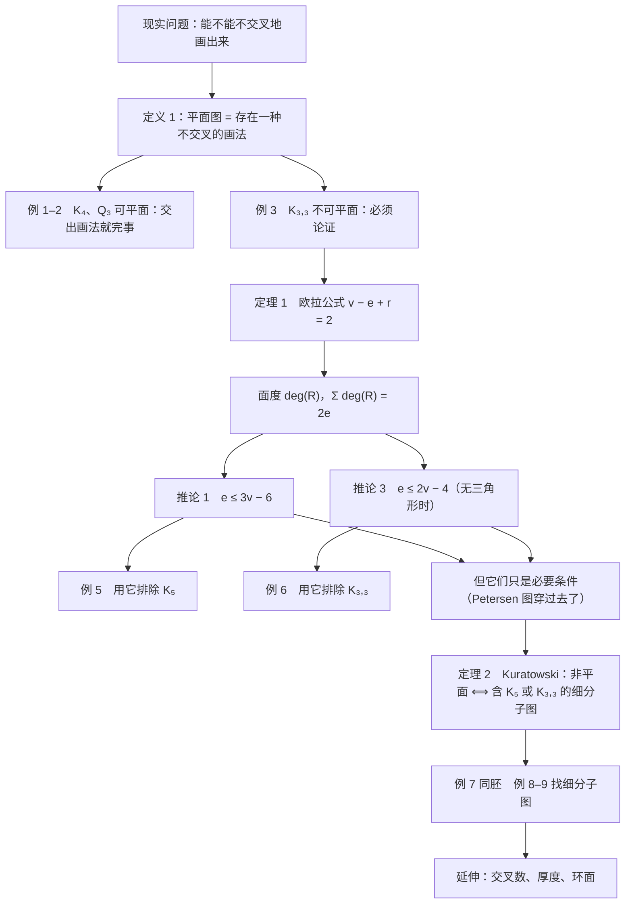

# C10.7 平面图 Planar Graphs

> [!abstract] 这一讲的任务
> 上一讲（10.6）里，边带上了代价，"最省的一条路怎么找"有了 Dijkstra 和 Floyd。这一讲换一个问法：**这张图能不能在平面上画得一条边都不交叉？**
> 先要把这句话问清楚（性质属于图、不属于某张画）；再给一个能算的等式 $v-e+r=2$；再从等式里榨出两条不等式，用来快速排除一部分图；最后给完整的判别定理（Kuratowski）。
> 值得学，是因为它直接对应"单层布线 / 双层板 / 芯片要几层"这种要花钱的工程决定，也是 10.8 四色定理的地基。

> [!info] 怎么读这份讲义
> 路线：§1–§2 建立"平面性是图的性质"，并看清"不可平面"怎么论证（本篇第一个卡点）；§3–§4 是欧拉公式与面度，证明最密，慢读；§5 两条不等式加一张图，把"必要非充分"钉死；§6–§8 细分、同胚、Kuratowski，以及"在一个具体图里怎么找障碍"的操作步骤；§9 延伸（交叉数、厚度）；§10 三张对照表。
> 用到的旧知识只有三件，都会在用到的地方重讲一句：**握手定理**（10.2，$\sum_v \deg(v)=2m$）、**桥与连通分量**（10.4）、**子图**（10.2）。
> 勘误提示：本篇所有印刷数字（$v,e,r$、面度、$3v-6$、$2v-4$）已逐个复算，**没有发现与印刷不一致之处**；唯一需要留心的是 10.5 的"欧拉"和这里的"欧拉"不是一回事，见 §10。

---

## 0. 开场：两次报价差三倍的那块板子（p.719）

一家小公司做了块控制板，板上 8 个模块，模块之间要连 13 根导线。先按"单面板"报价：所有导线都在同一层铜箔上走，**任何两根线不许交叉**——一交叉就短路。工程师画了一版，发现 3 处交叉。

于是有两个完全不同的可能：

1. **这一版画得不好**。换一种走线顺序、把某个模块挪个位置，交叉就没了。这时候仍然用单面板，报价不变。
2. **这张连接关系本身就不可能不交叉**。再怎么挪、怎么重画都没用，必须改成双层板（过孔打下去换层），或者用绝缘跳线飞过去。报价立刻变成三倍。

工程师眼睛看到的只是"这一版有 3 处交叉"，那是第 1 种情况的证据；而老板要付的钱取决于第 2 种情况。**"存在一种不交叉的画法"和"我手里这张画不交叉"是两件不同的事**——这一讲从头到尾都在把这两件事分开。

还有一个更小、更出名的版本。三户人家（记作 $v_1,v_2,v_3$）要各接一条水管、一条电线、一条煤气管（三家记作 $v_4,v_5,v_6$），一共九根管线，要求任何两根不交叉。你可以拿张纸试五分钟：**怎么画都有一根跨不过去**。这个图就是 $K_{3,3}$，例 3 会严格证明它画不出来。

你刚才做的两件事——"试着画"和"怀疑根本画不出来"——合起来就是一次完整的**平面性判定**。这一讲要把它变成能算、能证的东西。

---

## 1. 先把名字拆对：平面图是"存在不交叉画法"的图（p.719）

### 1.1 一个必须先撞的墙

先看 $K_4$：四个顶点，两两相连，六条边。通常画法是正方形加两条对角线，两条对角线在中间交叉。

现在做一次朴素尝试：**我把交叉点擦掉重画不就行了？** 试一下——把其中一条对角线从正方形外面绕过去。可以，真的可以（下面例 1 的右图）。那就是说 $K_4$ 画得出来。

那问题来了：$K_4$ 到底算不算"能画不交叉"？我手上有两张画，一张交叉、一张不交叉，答案取决于我拿哪张——**这个问题本身没问清楚**。

墙就撞在这里：如果把"平面"理解成"这张画在纸上不交叉"，那"$K_4$ 是平面图吗"这句话根本没法回答，因为它对同一张图既真又假。所以**必须把"图本身"和"某一张画"分开**：

- **画法**（drawing）是我可以随便挑的东西，边可以画成直线段，也可以画成弯的弧；
- **平面性**（planarity）是图本身的性质，它的定义必须是"**存在**某种画法"，而不是"我手里这种画法"。

### 1.2 定义

> [!important] 定义 1 平面图、平面表示、面
> **平面图 planar graph**：若一张图**可以**画在平面上而没有任何两条边交叉（交叉指两条边所代表的线或弧在**不是公共端点**的地方相交），就称它是**平面图**。这样的一种画法，称作这张图的一个**平面表示 planar representation**。
>
> 换句话说：一张图可能平时画出来总是带交叉的，但它仍然是平面图——因为换一种画法就可能不交叉了。（正文这一页紧接着就补了这一句，它的分量比定义本身还重。）
>
> **面 region**：一个平面表示把整个平面切成若干块互不连通的区域，每一块叫一个**面**。这些面里**恰有一个是无界的**，叫**无界面 unbounded region**（画在纸上就是"图案外围那一大片"）。
>
> 逻辑形式（这个写法值得记一下）：
> $$G \text{ 是平面图} \iff \exists\ \text{一种画法，使任意两条边只在公共端点相交}.$$

> [!warning] 先把一个名字分开：这里的"欧拉"不是 10.5 那个"欧拉"
> 下面 §3 马上要给一个叫**欧拉公式**的东西：$v-e+r=2$。它和 10.5 学的**欧拉回路**、**欧拉路径**（能不能一笔画走遍所有边）**没有任何关系**，只是都以欧拉命名。一句话区分：欧拉回路/路径数的是"**怎么走**"，欧拉公式数的是"**面有几个**"。§10.1 给三行对照表，现在先记住这个区分，否则后面一看到"欧拉"就会串线。

**为什么叫"平面图"？** `planar` 来自 `plane`（平面），意思是"能躺进平面里的"，不是"看起来很平的"。中文"平面图"最容易被读成"画在纸上的图"——**照这个读法，所有图都是平面图**（谁不是画在纸上的？），这个术语就废了。正确的读法是"**能**画在平面上不交叉的图"。

**这个区分为什么值钱？** 因为它让两边的工作量完全不对称：

- 要证"可平面"：$\exists$ 只需交出一张画。例 1、例 2 就是这样，一句话完事。
- 要证"不可平面"：$\forall$ 要说清"无论怎么画都有交叉"。这是这一讲真正的难点，例 3 会花一整页来干这件事。

> [!question] 课堂追问：把交叉点当成新顶点，不就没有交叉了吗
> 把 $K_4$ 那张画里的交叉点"升级"成一个顶点，交叉就消失了——这算不算给出了 $K_4$ 的平面表示？
>
> 不算。这样做之后你手里的图变了：多了一个顶点，原来两条边被拆成四条边，顶点数和边数都变了，它已经不是 $K_4$。平面性问的是"**这张**图能不能不交叉地画出来"，不是"能不能通过加顶点把它改成一张画得出来的图"。画法里允许把边画弯，但**不许改变谁和谁相连**。这条界线后面每一步都要守住。

### 1.3 例 1：$K_4$ 是可平面的

> [!example] 例 1 $K_4$ 是可平面的
> $K_4$ 是不是平面图？

通常的画法（下面那张图里最左一格）把 $K_4$ 画成正方形加两条对角线，两条对角线在正中交叉。它旁边那一格只改了一个动作：**把其中一条对角线从正方形外面绕过去**。

具体怎么绕：四个顶点记 $a,b,c,d$（左上、右上、右下、左下）。正方形四条边 $ab,bc,cd,da$ 照旧；对角线 $a\!-\!c$ 照旧留在里面；本来该穿过 $a\!-\!c$ 的那条对角线 $b\!-\!d$，改成**从右上角 $b$ 出去、贴着正方形左侧兜一个大弧、再绕回左下角 $d$**。六条边一条不少，交叉没了。

于是 $v=4$，$e=6$，并且：

- 数面：正方形内部被 $a\!-\!c$ 切成 2 个三角形；外面那条弧又把外部切成 2 块，每块由弧加上正方形的两条相邻边围成，也都是三角形。所以 $r=2+2=4$；
- 验算欧拉公式（§3 才正式证，这里先用）：$v-e+r=4-6+4=2$ ✓
- 4 个面每个度都是 3（全是三角形），面度和 $=4\times 3=12=2e=2\times 6$ ✓（§4 才正式讲面度，这里先记下这个数）

> [!tip] 顺便记住一个"满格"现象
> $K_4$ 满足 $3v-6=3\times 4-6=6$，而 $e=6$——**正好取等号**。取等号的意思后面会讲清楚：它意味着"每个面都是三角形，一条边都加不进去了"。$K_4$ 是这种"塞得最满"的平面图里最小的一个。

### 1.4 例 2：$Q_3$ 是可平面的

> [!example] 例 2 $Q_3$ 是可平面的
> $Q_3$ 是不是平面图？

$Q_3$ 是三维立方体的骨架：8 个顶点（三位 0/1 串），两点相邻当且仅当只差一位，所以是 3 正则图，$e = 3\times 8/2 = 12$。

按立方体那样画（下面那张图左起第三格）：前后两个正方形错开叠在一起，四条"纵深"边斜着连。问题在于两个正方形**互相穿插**——前面的边穿过后面的边，那两处就是交叉，所以这张画不是平面表示。要摊平它，只换一副骨架：把其中一个正方形拉成**外圈**，另一个缩成**内圈**，四条纵深边变成**四根斜着连内外圈对应角**的辐条。数一数：外圈 4 条 + 内圈 4 条 + 辐条 4 条 $=12$ 条，一条不多一条不少，而且这回没有哪条边碰到别的边。所以 $Q_3$ 是可平面的。

这时数面：

| 面的位置 | 边界是什么 | 度 |
|---|---|---|
| 内圈里面那 1 块 | 四条内圈边 | 4 |
| 内外圈之间的 4 块 | 1 条外圈边 + 1 条内圈边 + 2 根辐条 | 4 |
| 外面那一大片（无界面） | 四条外圈边 | 4 |

一共 $r=1+4+1=6$ 个面，$6$ 块全是四边形，面度和 $=6\times 4=24=2e=2\times 12$ ✓。欧拉公式也过：$v-e+r=8-12+6=2$ ✓。

![[C10.7-原图-K4与Q3的平面表示.png]]

*（从左到右四格：$K_4$ 的通常画法（中间 1 处交叉）、$K_4$ 的不交叉画法、$Q_3$ 的立方体画法（两个正方形互相穿插，2 处交叉）、$Q_3$ 的不交叉画法。这里数的只是"手里这张画"有几处交叉；至于图的**交叉数**（§9.1），$K_4$ 和 $Q_3$ 都是 0。）*

> [!note] 两条画法，同一张图
> $K_4$ 和 $Q_3$ 这两个例子合起来说明一件事：**平面性不看你习惯怎么画**。习惯画法带交叉，不代表图不可平面；反过来说，某张画不交叉，也只是"这张图是平面图"的一个证据，不是它"本来就长得那样"。图是抽象的连接关系，画法是给眼睛看的翻译。

---

## 2. 例 3：$K_{3,3}$ 为什么一定画不出来（p.719–720）

上面两个例子都是"交一张画"就赢。现在到了难的一边：**要说清无论怎么画都不行**。这一页给了一个很漂亮的"逼迫"论证——先把图的一部分画死，逼出"平面被切成哪几块"，再看剩下的顶点落在哪一块都躲不开。

> [!example] 例 3 $K_{3,3}$ 不是平面图
> $K_{3,3}$ 是不是平面图？（$K_{3,3}$ 就是"三户人家接三家水电煤"：顶点分成两支 $\{v_1,v_2,v_3\}$ 与 $\{v_4,v_5,v_6\}$，两支之间**所有** 9 条边都在，同一支内部没有边。）

**第一步：随便挑四条边，先把它们画死。**
在任何一种平面表示里，$v_1,v_2$ 都必须连到 $v_4,v_5$（这是 $K_{3,3}$ 定义要求的）。这四条边 $v_1v_4,\;v_1v_5,\;v_2v_4,\;v_2v_5$ 首尾相接，围成一条**闭曲线**。闭曲线把平面切成两块：曲线**里面**记作 $R_2$，**外面**（含无界那块）记作 $R_1$。

**第二步：第三个顶点 $v_3$ 只能落在这两块之一。**
先假设 $v_3$ 落在 $R_2$（里面）。它还要连 $v_4$ 和 $v_5$——这两个点都在闭曲线上，而且都在 $R_2$ 的边界上，所以 $v_3v_4$、$v_3v_5$ 可以在 $R_2$ 内部画出来，不碰别人。但这两条边一起把 $R_2$ 又切成了两块：一块记 $R_{21}$、一块记 $R_{22}$。

**第三步：最后一个顶点 $v_6$ 无处可放。** $v_6$ 必须同时连 $v_1,v_2,v_3$。而现在的平面已经被切成三块互不相通的区域：$R_1$（外面）、$R_{21}$、$R_{22}$。$v_6$ 无论落在哪一块，检查它到那三个点的边：

| $v_6$ 落在 | 逃不掉的那条边 | 为什么 |
|---|---|---|
| $R_1$（外面） | $v_6v_3$ | $v_3$ 在闭曲线里面，这条边必须穿过 $v_1v_4,v_1v_5,v_2v_4,v_2v_5$ 中的某一条 |
| $R_{21}$ | $v_6v_2$ | $v_2$ **不在** $R_{21}$ 的边界上（被对角线 $v_4v_5$ 挡在另一侧），这条边必须穿过边界上的某条边：闭曲线的 $v_1v_4$ 或 $v_1v_5$，或对角线的 $v_3v_4$ 或 $v_3v_5$ |
| $R_{22}$ | $v_6v_1$ | 对称：$v_1$ 被挡在另一侧，$v_6v_1$ 必穿过 $R_{22}$ 的边界 |

三块都试完了，每一种都有一根边必须交叉。所以"$v_3$ 在里面"这种画法必败。

**第四步（这一页把这一步留给读者，我们补完）：$v_3$ 落在 $R_1$（外面）时，论证一模一样，只是名字对调。**
$v_3v_4$、$v_3v_5$ 现在从外面插进来，把 $R_1$ 切成两块，记 $R_{11},R_{12}$，而 $R_2$（里面）原封不动。$v_6$ 落在三块之一：

- $v_6$ 落在 $R_2$（里面）：要连 $v_3$（在外面），必穿过那条闭曲线；
- $v_6$ 落在 $R_{11}$ 或 $R_{12}$：这两块都是从**外面**被切出来的，它们的边界只经过闭曲线的一段圆弧，所以**只有 $v_1,v_2$ 中的一个在这块边界上**（一个走上方弧 $v_4\!-\!v_1\!-\!v_5$，一个走下方弧 $v_4\!-\!v_2\!-\!v_5$）。于是 $v_6$ 到另一个点（$v_2$ 或 $v_1$）的边必须穿过闭曲线。

又全部失败。两种情形都穷尽，结论：$K_{3,3}$ 没有不交叉的画法，**它不是平面图**。

![[C10.7-原图-K33不可平面论证.png]]

*（$K_{3,3}$ 不可平面的论证：(a) 四条边围成闭曲线，里面 $R_2$、外面 $R_1$；(b) $v_3$ 落进 $R_2$ 后再切一刀，分成 $R_{21}$、$R_{22}$。）*

图中 (a) 是第一步：$v_1v_4v_2v_5$ 围成闭曲线，里面 $R_2$、外面 $R_1$；(b) 是第二步：$v_3$ 落在 $R_2$ 里，$v_3v_4$、$v_3v_5$ 把 $R_2$ 再切成 $R_{21}$ 与 $R_{22}$。第三步就是在这个格局里放 $v_6$，怎么放都有一根线要跨出去。

> [!warning] 易错点：这个论证没有"一般性证明"的漏洞吗
> 有人会问：你怎么知道 $v_1,v_4,v_2,v_5$ 围出来的闭曲线一定把 $v_3$ 挡在外面？答案是：**不需要知道**——而恰恰是要**分情形**把两种可能都算一遍。第四步就是把另一种可能补完。凡是"某个点落在某块区域"的论证，都必须把区域列全（这里是 $R_1$ 与 $R_2$，然后 $R_{21},R_{22}$，共三块），一块都不能漏。
>
> 还有一处要讲清：从一块区域里连到区域外的点，出路只有两种——**穿过边界上的边**，或者**穿过边界上的顶点**。后者看着像"从点上蹭过去"，但按定义那也是交叉：交点不是这两条边的公共端点。所以"必须出界"就等于"必须有交叉"，一步都不能松。

**这一步的收获，不能只是"$K_{3,3}$ 不平面"。** 它给了一个可复制的套路：

1. 从图里挑出一个**必定存在的封闭结构**（一圈边）；
2. 用它把平面切成有限块；
3. 让剩下的顶点**逐块**去试，每块都给出一根非交叉不可的边；
4. 块数有限，所以"所有画法"确实被穷尽了。

> [!note] 用同样的套路处理 $K_5$
> $K_5$（5 个点两两相连，10 条边）也能这样逼死。取一个三角形 $v_1v_2v_3$，它把平面分成"里面"和"外面"两块。剩下的 $v_4,v_5$ 各要连到 $v_1,v_2,v_3$，分两种情形：
>
> - **$v_4,v_5$ 分居两侧**（一个在里面、一个在外面）：$v_4v_5$ 这条边必须穿过三角形的边界，已经有交叉了。
> - **$v_4,v_5$ 在同一侧**（不妨都在里面）：$v_4$ 的三条边 $v_4v_1,v_4v_2,v_4v_3$ 把三角形内部又切成三块（三角形 $(v_1,v_2,v_4)$、$(v_2,v_3,v_4)$、$(v_3,v_1,v_4)$）。$v_5$ 只能落在其中一块里，而每一块都缺少一个三角形顶点——比如落在 $(v_1,v_2,v_4)$ 里，$v_3$ 就不在这块的边界上，于是 $v_5v_3$ 必须穿过边界。
>
> 两种情形都堵死，$K_5$ 不平面。§5 会给出一个**短得多**的办法（一条不等式一行字），但那种办法要等定理 1 讲完才有。

---

## 3. 定理 1 欧拉公式：$v-e+r=2$（p.720–721）

前面数 $K_4$、$Q_3$ 的时候，我们都是"画出来、数面、然后发现 $v-e+r=2$ 成立"。这不是巧合：这一页说明，**只要图连通且可平面，$v-e+r$ 恒等于 2**，跟你挑哪个平面表示画无关。

> [!important] 定理 1 欧拉公式 Euler's Formula
> 设 $G$ 是**连通**的**平面简单图**，有 $e$ 条边、$v$ 个顶点。设它的某个平面表示把平面分成 $r$ 个面，则
> $$r=e-v+2,\qquad\text{等价地}\qquad v-e+r=2.$$

这一页正文还顺带说了一件重要的事：**所有平面表示给出的 $r$ 都一样**。这句话本身是定理 1 的推论——因为 $r=e-v+2$ 只依赖 $e,v$，与画法无关。所以"$r$ 是多少"是一个可以算的数，不需要数。

### 3.1 证明：对边数归纳，两种情形

证明的骨架是：**一次加一条边**，每加一条边就看三个数 $v,e,r$ 各变多少，证明两边的增量一致。

先把"加边序列"造出来（这一步保证每一步都连通，省掉了连通性的麻烦）：

- 任取 $G$ 的一条边，得到 $G_1$；
- 从 $G_n$ 到 $G_{n+1}$：任取一条**至少有一个端点在 $G_n$ 里**的边，把它加进来；如果另一个端点还不在 $G_n$ 里，就连同那个端点一起加进来；
- 因为 $G$ 连通，这样的边总能找到；加到第 $e$ 条时正好得到 $G_e=G$。

记 $v_n,e_n,r_n$ 为 $G_n$ 的顶点数、边数、面数（$r_n$ 用的是同一个平面表示限制在 $G_n$ 上数出来的面数）。

**奠基**：$G_1$ 只有一条边、两个端点，$e_1=1,\;v_1=2,\;r_1=1$（一条线段不分割平面），于是 $r_1=e_1-v_1+2=1$ ✓（这一页配图专门画了这个起步）。

**归纳步**：设 $r_k=e_k-v_k+2$，看新加的边 $\{a_{k+1},b_{k+1}\}$。两种情形：

> [!important] 情形 A：两个端点都已在 $G_k$ 里
> 这条边加进去**必定把一个面切成两个**。为什么？两个端点都在 $G_k$ 里，它们必须落在**同一个面**的边界上——否则这条边从那个面里出发、跨过别的边才能接上另一个端点，那就交叉了，而 $G_{k+1}$ 是平面图。既然在同一个面的边界上，边一加，这个面就被切成两块。
>
> 于是：$r_{k+1}=r_k+1$，$e_{k+1}=e_k+1$，$v_{k+1}=v_k$。右边 $e-v+2$ 也涨了 1，等式保持。
>
> 换一个说法更直观：这种"两端点都在"的边，正是 $G_{k+1}$ 里**不是桥**的边（它落在一个回路上，删掉它图还连通）。

> [!important] 情形 B：只有一个端点在 $G_k$ 里
> 比如 $a_{k+1}$ 在、$b_{k+1}$ 不在。这条边连同新端点是从某个面的**内部"伸"出来**的，它像一根刺，**不会把任何面切开**——面还是原来那些面。
>
> 于是：$r_{k+1}=r_k$，$e_{k+1}=e_k+1$，$v_{k+1}=v_k+1$。右边同样不变，等式保持。
>
> 换个说法：这种"另一端点是新的"的边，在 $G_{k+1}$ 里正是**桥**（删掉它图就断成两半）。

两边增量一致（情形 A 三数各涨 1、情形 B 右边涨 1 减 1 抵消），归纳完成，$G_e=G$ 满足 $v-e+r=2$。$\square$

> [!note] 反着写：删边的版本（为什么它更好用）
> 上面是"加边"方向。把同一件事**倒过来写**，变成"从 $G$ 里一条条删边"，两种情形就正好是**割边/非割边**：
>
> - 删的边**不是桥**（在某个回路上）：它两侧分属两个不同的面，删掉后这两个面并成一个，$r$ 减 1；$v$ 不变、$e$ 减 1；
> - 删的边**是桥**：它两侧是**同一个面**，删掉只是把这个面的边界上那道"缝"去掉了，面数不变；$v$ 不变、$e$ 减 1。
>
> "删非桥时两侧是两个不同的面"用到的道理是：非桥落在某个回路上，而一个回路把平面分成里、外两部分（这正是**Jordan 曲线定理**的直觉：一个圈把平面分成圈内和圈外），边骑在回路上，两侧自然一边一个。
>
> 删边方向的好处是**顺手把连通分支数的推广也证明了**——见下一小节。

### 3.2 推广：分支数 $c$ 不是 1 的时候

定理 1 要求连通。但平面图常常不连通（比如两块分开画的电路），这时公式右端不是 2。

> [!important] 定理 1 的推广（$c$ 个连通分支）
> 设 $G$ 是平面简单图，有 $v$ 个顶点、$e$ 条边、$c$ 个连通分支，某个平面表示把平面分成 $r$ 个面，则
> $$v-e+r=1+c.$$
> 取 $c=1$ 就是定理 1。

**证明**（对边数 $e$ 归纳，用 §3.1 末尾那个"删边"视角）：

**奠基**：$e=0$。图只有孤立点，$v=c$，而平面没有被切开，$r=1$。于是 $v-e+r=c-0+1=c+1$ ✓。

**归纳步**：设 $e\ge 1$，任取一条边 $e'$，删掉它得 $G'$（$e-1$ 条边，$v$ 个顶点）。两种情形：

- **$e'$ 不是桥**：删掉后仍连通，所以分支数不变（$c$ 不变）；两个面并成一个，$r$ 减 1。对 $G'$ 用归纳假设：$v-(e-1)+(r-1)=1+c$，即 $v-e+r=1+c$ ✓
- **$e'$ 是桥**：删掉后一个分支裂成两个，$c\to c+1$；桥两侧是同一个面，所以面数**不变**。对 $G'$ 用归纳假设：$v-(e-1)+r=1+(c+1)$，即 $v-e+1+r=c+2$，也就是 $v-e+r=1+c$ ✓

两种情形都保持等式。$\square$

**验算两个小例子**（数字都过一遍，防止记错方向）：

| 图 | $v$ | $e$ | $c$ | $r$ | $v-e+r$ | $1+c$ |
|---|---|---|---|---|---|---|
| 两个不相交的三角形 | 6 | 6 | 2 | 3 | $6-6+3=3$ | $1+2=3$ ✓ |
| $Q_3$ 再加一个孤立点 | 9 | 12 | 2 | 6 | $9-12+6=3$ | $1+2=3$ ✓ |

第一行那个 $r$ 要算清楚：两个三角形各自围出"里面"一块（共 2 块），但"外面"只有**一块**，所以 $r=2+1=3$，不是 2。**无界面是全局只有一个的**——不管你画了几个分支。第二行同理：多一个孤立点不改变任何面，$Q_3$ 的 6 个面照旧，$r=6$。

### 3.3 例 4：只知道度数和，也能算出面数

> [!example] 例 4 从 20 个 3 度点算出 12 个面
> 一个连通平面简单图有 20 个顶点，每个顶点的度都是 3。它的平面表示把平面分成多少个面？

思路是"先用握手定理求 $e$，再用欧拉公式求 $r$"：

- 顶点度和 $=3\times 20=60$；由握手定理（10.2）$2e=60$，所以 $e=30$；
- 欧拉公式：$r=e-v+2=30-20+2=12$。

所以是 **12 个面**。两个数都拿别的关系核一遍：面度和 $=2e=60$，而每个面度 $\ge 3$ 要求 $60\ge 3r=36$ ✓（平均每个面度 5，够用，也没超）；另外 $3v-6=3\times 20-6=54\ge 30=e$ ✓（§5 的不等式不违反）。两个检查都过，说明 12 这个答案不荒谬。

> [!question] 停一下，先自己想想：为什么这类题里"每点度都是 3"就够了
> 因为**面数和边数并不独立**：欧拉公式把它们绑在一起，握手定理把边数和度数和绑在一起。给定"所有点的度"和"点数"，边数就定了；边数一定，面数就定死了。这就是欧拉公式最有用的地方——它把"数面"这种几何动作变成了算术。

---

## 4. 面度：为什么每条边恰好被数两次（p.722）

要拿欧拉公式去证不等式，得先能"用边数控制面数"。控制的桥是**面度**。

> [!important] 面度 degree of a region
> 一个面的**度** $\deg(R)$，就是**沿着这个面的边界走一圈所经过的边数**。若某条边在边界上出现了两次（走一圈时被走过两次），它**算两度**。
>
> 一句人话：面度 = 这个面的"周长"（以边数为单位）。

一个直接的观察，也是整节后面所有不等式的地基：

> [!important] 面度和公式
> 对任何平面表示，
> $$\sum_{R\ \text{所有面}} \deg(R) = 2e.$$

**为什么是 $2e$ 而不是 $e$？** 拿一支笔沿着每个面的边界走一圈，边走边数。每条边有两个**侧面**（左面、右面）。走遍所有面的边界，就是把每条边的每个侧面都数一次：

- 如果这条边两侧是**两个不同的面**，那么走其中一个面时数它一次，走另一个面时再数它一次——贡献 2；
- 如果这条边两侧是**同一个面**（这正是**桥**的特征：桥不在任何回路上，绕不过去，所以它左右两侧是同一块地方），那么走这个面时它被**来回走两次**，也贡献 2。

两种情况都贡献 2，一共 $e$ 条边，所以总和是 $2e$。∎

**这里就是本篇最容易滑过去的一步：桥被同一个面数两次。** 它不是"例外"或"小修正"，而是"每条边贡献 2"这个计数能成立的必要组成部分。没有它，桥多一点图就会破坏 $\sum\deg(R)=2e$，后面的 $2e\ge 3r$、$2e\ge 4r$ 全部作废。

### 4.1 一个把桥数清楚的例子（p.722 的图）

![[C10.7-原图-面与面度.png]]

*（三个面的度分别是 3、6、7；其中两个桥各被同一个面数了两次。）*

这张图有 7 个顶点 $a,b,c,d,e,f,g$、8 条边，图里把三个面的度标了出来。我们把它逐面走一遍（"走一圈经过哪些边"）：

| 面 | 边界上依次走过的边 | 度 |
|---|---|---|
| $R_1$（三角形 $a,b,d$） | $ab,\;bd,\;da$ | $3$ |
| $R_2$（四边形 $a,d,e,f$ 的内部，里面挂着一根"刺"$f\!-\!g$） | $af,\;fe,\;ed,\;da$，再加 $fg$ **一去一回** | $4+2=6$ |
| $R_3$（外面那一大片，边上挂着"刺"$b\!-\!c$） | $ab,\;bd,\;de,\;ef,\;fa$，再加 $bc$ **一去一回** | $5+2=7$ |

于是：

$$\deg(R_1)+\deg(R_2)+\deg(R_3)=3+6+7=16=2\times 8=2e\;✓$$

再把欧拉公式核对一遍：$v-e+r=7-8+3=2$ ✓。

两个桥的位置看得很清楚：

- $f\!-\!g$：$g$ 是**悬挂点**（度 1），$fg$ 是桥。它两侧都是 $R_2$，所以在 $R_2$ 的边界上被数了两次。**删掉它，$R_2$ 还是 $R_2$，面数不变**——这就是 §3.2 里"桥不改变面数"的实际样子。
- $b\!-\!c$：$c$ 是悬挂点，$bc$ 是桥。它两侧都是 $R_3$（外面那一大片），在 $R_3$ 的边界上被数两次。所以 $R_3$ 的度是 7 而不是 5。

> [!warning] 易错点：面度不是"这个面里有多少条边"
> 面向读者最容易记错的两种写法：
>
> 1. **把桥只数一次**。$R_3$ 就会算成 5，$R_2$ 算成 4，总面度和变成 $3+4+5=12\ne 16$，公式崩掉。记住：桥是"被同一个面来回走两次"的边，它就该贡献 2。
> 2. **把悬挂点当成顶点所以不算**。悬挂点当然是顶点，它的那条边当然算边。$v=7$ 里包含着 $c$ 和 $g$。
>
> 还有一个方向性的提醒：面度小不代表面小。$R_3$ 是**无界面**（看起来最大），度却是 7——因为它的边界长。面积和面度是两回事。

> [!note] 面度和公式的用处
> 它把"几何上的数面"翻译成"组合上的数边"，于是欧拉公式里的 $r$ 可以被 $2e$ 和"每个面至少几条边"夹住。下一步就是把"每个面至少 3 条边"代进去。

---

## 5. 从欧拉公式榨出两个上界：推论 1、2、3（p.722–723）

这一节是整篇的"计算主干"。三条结论都从 $v-e+r=2$ 和 $\sum\deg(R)=2e$ 出来，推导只要三步，但每一步的**前提**都不能含糊——尤其推论 3，它的前提漏写一条就不成立。

### 5.1 推论 1：$e\le 3v-6$

> [!important] 推论 1
> 设 $G$ 是连通平面简单图，有 $e$ 条边、$v$ 个顶点，且 $v\ge 3$。则
> $$e\le 3v-6.$$

**推导**（三步，每步都说明理由）：

1. **每个面的度至少是 3。** 简单图里没有自环（自环会造出度 1 的面）也没有重边（重边会造出度 2 的面），所以任何面的边界至少经过三条边。$v\ge 3$ 这个条件是用在**无界面**上的：图里至少有三个点，外面那一大片的边界不可能只是"一条边来回走"，至少也是个三角形，度数 $\ge 3$。
2. **面度和给出 $\;2e\ge 3r$。** 由 §4 的公式，$2e=\sum_R \deg(R)$；每一项都 $\ge 3$，共 $r$ 项，所以 $\sum_R\deg(R)\ge 3r$。于是
   $$2e\ \ge\ 3r\quad\Longrightarrow\quad r\ \le\ \frac{2}{3}e.$$
3. **把 $r$ 的界代入欧拉公式。** 从 $r=e-v+2$ 出发：
   $$e-v+2=r\ \le\ \frac{2}{3}e$$
   两边减 $\frac23 e$：$\;\frac13 e-v+2\le 0$，即 $\frac13e\le v-2$，两边乘 3：
   $$e\ \le\ 3v-6.\qquad\square$$

> [!warning] 易错点：这条不等式的三个前提一个都不能省
> **连通**、**简单**、$v\ge 3$。
> - 不连通：右端要改成 $e\le 3v-6c$（每个分支各自有一条 $e_i\le 3v_i-6$，加起来 $e\le 3v-6c$），$c=2$ 时 $e\le3v-12$，界更紧。
> - 有多重边：一个度 2 的面就能出现，第 1 步塌掉。比如"两个顶点之间连 3 条重边的多重图"：$v=2$、$e=3$，而 $3v-6=0$，不等式不成立——这个例子连 $v\ge 3$ 也一起不满足，正说明这几条前提是**配套**的，少一条就会被这种小图反咬。
> - 有自环：度 1 的面出现，同样塌掉。
>
> 记法：**$3v-6$ 是"平面简单图最多能有多少条边"，不是"平面图最多能有多少条边"。**

### 5.2 推论 2：总有一个度不超过 5 的顶点

这条结论长得不像"不等式"，它是关于**存在性**的：任何连通平面简单图里，一定蹲着一个"度数很小"的顶点。它的证明是推论 1 直接反过来用，非常干脆。

> [!important] 推论 2
> 设 $G$ 是连通平面简单图，则 $G$ 中**至少有一个顶点的度不超过 5**，即存在 $u$ 使 $\deg(u)\le 5$。

**证明**：

- 若 $v\le 2$，度最多是 1，结论成立。
- 设 $v\ge 3$。由推论 1，$e\le 3v-6$，两边乘 2：$2e\le 6v-12$。
- 反设**每个**顶点的度都 $\ge 6$。那么由握手定理
  $$2e=\sum_{u\in V}\deg(u)\ \ge\ 6v .$$
- 于是 $6v\le 2e\le 6v-12$，即 $0\le -12$，矛盾。所以必有一个顶点的度 $\le 5$。$\square$

换个更能看出道理的写法（**平均度论证**）：

$$\text{平均度}=\frac{2e}{v}\ \le\ \frac{2(3v-6)}{v}=6-\frac{12}{v}\ <\ 6 .$$

平均值严格小于 6，就一定存在一个"低于平均"的顶点，它的度 $\le 5$。这一句还可以顺手说明：平面图的边**必然稀疏**，平均度被钉在 6 以下，越大的图越接近 6。

> [!note] 推论 2 为什么值得单独记
> 它是下一步（10.8 四色定理）的入场券：证明"平面图 5 色可染"的归纳法，第一步就是"**取一个度 $\le 5$ 的顶点**，删掉它、把剩下的染好、再塞回去"。没有推论 2，那个归纳根本开不了头。所以这条结论现在先记住，下一讲会用它。

### 5.3 推论 3：没有三角形时，界从 $3v-6$ 收紧到 $2v-4$

如果图里根本没有三角形，那么"每个面的度至少 3"就可以升级成"至少 4"——因为一个度 3 的面就是一圈三条边，那就是一个三角形。

> [!important] 推论 3
> 设 $G$ 是连通平面简单图，有 $e$ 条边、$v$ 个顶点，$v\ge 3$，并且 $G$ **没有长度为 3 的回路**（没有三角形）。则
> $$e\le 2v-4.$$

**推导**（与推论 1 同构，只换第 1 步）：

1. **每个面的度至少是 4。** 简单图排除了度 1（自环）和度 2（重边）的面；而度 3 的面意味着有一段三边的闭合边界，那就是三角形，被前提排除。所以度 $\ge 4$。
2. $2e=\sum_R\deg(R)\ge 4r$，即 $r\le \dfrac{e}{2}$。
3. 代入 $r=e-v+2$：
   $$e-v+2\le \frac{e}{2}\ \Longrightarrow\ \frac{e}{2}\le v-2\ \Longrightarrow\ e\le 2v-4.\qquad\square$$

> [!warning] 易错点：推论 3 的前提有四条，不是三条
> **连通**、**简单**、$v\ge3$、**无三角形**。第 4 条最常被漏。特别注意三种"看起来没有三角形"的陷阱：
> - **图里有三角形，只是画出来看不见**（比如 $K_4$ 内部那条对角线把三角形切开了）：前提写的是"**图里**没有长度为 3 的回路"，不是"画出来的面上看不见三角形"。$K_4$ 就是活证据：它的 4 个面全是三角形，$e=6>2v-4=4$，推论 3 对它直接失效。
> - **二分图**天然没有奇圈，所以一定没有三角形——用推论 3 最顺手的场合就是二分图（$K_{3,3}$ 正是）。
> - **无界面**也算一个面，它同样不能是三角形。所以第 1 步对无界面也要成立——无三角形时它确实成立。

### 5.4 例 5、例 6：用不等式排除 $K_5$ 与 $K_{3,3}$

> [!example] 例 5 用推论 1 证明 $K_5$ 不平面
> 用推论 1 说明 $K_5$ 不是平面图。

$K_5$ 有 $v=5$ 个顶点、$e=\binom52=10$ 条边。代入：

$$3v-6=3\times 5-6=9,\qquad e=10>9 .$$

不等式**不成立**，而推论 1 说平面图必须成立。所以 $K_5$ 不是平面图。一行字，比 §2 那个"逼迫"论证短得多。

> [!example] 例 6 用推论 3 证明 $K_{3,3}$ 不平面
> 用推论 3 说明 $K_{3,3}$ 不是平面图。

先看为什么不能用推论 1：$K_{3,3}$ 有 $v=6$、$e=9$，而 $3v-6=3\times6-6=12$，$9\le 12$ **成立**。推论 1 没法排除它——这正是它"穿过去"的地方。

再看推论 3 的前提：$K_{3,3}$ 是二分图（两支内部没有边），而二分图没有奇圈，所以**没有三角形** ✓。于是可以用推论 3：

$$2v-4=2\times 6-4=8,\qquad e=9>8 .$$

不成立，所以 $K_{3,3}$ 不平面。

**换个角度验算同一个事实**：如果 $K_{3,3}$ 真的可平面，那么由欧拉公式它应该有 $r=9-6+2=5$ 个面；而它没有三角形，每个面度 $\ge 4$，所以 $2e=18\ge 4r=20$——矛盾。这条路和推论 3 是同一条路，只是没把 $r$ 消掉而已。

### 5.5 必要非充分：不等式过得了，图照样可以不平面

上面两个例子很容易让人误以为"查不等式就能判平面性"。**不能。** 这两条都是**必要条件**：

$$\text{可平面}\ \Longrightarrow\ e\le 3v-6,\qquad \text{可平面且无三角形}\ \Longrightarrow\ e\le 2v-4 .$$

箭头反不过来。$K_{3,3}$ 就是现成的反例（$9\le 12$ 过，却不平面）。还有更狠的：**Petersen 图两条都过**，仍然不平面（例 9 会证）。

![[C10.7-不等式可行区域.png]]

读图说明（这张图值得盯着看两分钟）：

| 图 | $v$ | $e$ | $3v-6$ | $2v-4$ | 位置 | 判定依据 |
|---|---|---|---|---|---|---|
| $K_4$ | 4 | 6 | 6 | 4（不适用，有三角形） | 在实线上（等号） | 可平面 |
| $K_5$ | 5 | 10 | 9 | 6 | 在实线**上方** | 被推论 1 排除 |
| $K_{3,3}$ | 6 | 9 | 12 | 8 | 在两条线**之间** | 推论 1 过、推论 3 排除 |
| $Q_3$ | 8 | 12 | 18 | 12（等号） | 落在虚线上 | 可平面 |
| Petersen | 10 | 15 | 24 | 16 | 在虚线**下方**（两条都过） | **两条都过，仍不平面** |

三个落点合起来说明一件事：**两条上界线划出的是"嫌疑区"，不是"安全区"。**

- 落在实线上方：一定不平面，**一句不等式就结案**；
- 落在实线与虚线之间：若图无三角形，一定不平面（推论 3 结案）；若有三角形，两条都用不上，得另想办法；
- 落在虚线下方：**什么都说明不了**。可能是平面图（$Q_3$、$K_4$ 都在里面），也可能不平面（Petersen）。这时唯一可用的通用工具是 §7 的 Kuratowski 定理。

> [!note] 等号处藏着结构信息
> 两条线上各坐着一个图，而且都不是偶然：
> - $K_4$：$e=3v-6$ 取等号 ⇒ 每个面的度都恰好 3，即"每个面都是三角形"。这类图叫**极大平面图 maximal planar**（也叫三角剖分 triangulation）：在同样的 $v$ 个点上，它已经加不进任何一条边了——再想加边就只能产生重边，或者破坏平面性。$K_4$ 是这种图里最小的一个。
> - $Q_3$：$e=2v-4$ 取等号 ⇒ 每个面的度都恰好 4，即"每个面都是四边形"。$Q_3$ 的 6 个面确实全是四边形（§1.4 数过）。而且 $Q_3$ 同一部（二划分的同一侧）里任意两点的距离都是 2——二分图里同侧两点的距离必是偶数，而 $Q_3$ 的直径只有 3——所以往 $Q_3$ 里加任何一条边（只能连同一侧的两个点），这条边就会和它们共同的那个邻居一起凑出一个三角形——"无三角形"这个前提立刻失效。它把推论 3 用到了极限。
>
> 这就是"取等号"的实际含义：不是数字巧合，是**那个面的形状限制被用满了**。

---

## 6. 细分与同胚：把"插一个点"当成一种操作（p.723–724）

到 §5 为止，我们能排除 $K_5$ 和 $K_{3,3}$。但现实里的图往往不是这两个"骨架"本身，而是它们的**变粗版本**：边上多插了几个度 2 的点。所以需要一种操作，把"插点"变成可以写下来的东西。

### 6.1 细分

> [!important] 细分 subdivision
> 拿一条边 $\{u,v\}$，把它**删掉**，再加一个**新顶点** $w$，加上两条边 $\{u,w\}$ 和 $\{w,v\}$——这个操作叫一次**基本细分 elementary subdivision**。
>
> 一句人话：**在一条边上插一个点，把一条边掰成两条**。图里其他东西一律不动。

**为什么叫"细分"？** 就是"把一段线切细成两段"。名字不重要，重要的是它**什么没变**：

- 点数加 1、边数加 1；
- 哪个点和哪个点是"一路通到底"的，没有变——只是中间多了一个停靠站；
- 因此**可平面性没有变**。若原图可平面，在原来那条边的画法上找个点插进去就行；反过来，若细分后的图可平面，把插入的点抹掉、两条边并回一条，也不会冒出交叉来。
- 树的叶子、路的中段，都是这种结构。**任何度 2 的顶点，都可以看成"某条边被细分了一次"留下的痕迹。**

### 6.2 同胚

> [!important] 同胚 homeomorphic
> 若两个图 $G_1=(V_1,E_1)$ 与 $G_2=(V_2,E_2)$ 都可以由**同一个图**经过若干次基本细分得到，就称它们**同胚 homeomorphic**。

**为什么叫"同胚"？** 这个名字是从拓扑学借来的。拓扑里的"同胚"（homeomorphic）指两个空间可以通过连续变形互相变成对方——捏来捏去、拉长缩短都可以，但不能撕开、不能粘合。**细分正是在做"拉长"**：一条边被拉长成两段，中间那个新点只是路上多了一个标记，没有撕开也没有粘上。所以"同胚"在这里的准确意思是：**把度 2 的插入点全部抹掉之后，剩下的骨架一模一样**。

> [!warning] 易错点：同胚不是同构
> 同构（10.3）要求点数、边数都一样，是"只换了名字"。同胚允许点数边数都变（每细分一次都加 1 加 1），所以 $K_4$（4 点 6 边）和"在 $K_4$ 的一条边上插一个点"（5 点 7 边）**同构吗？不同构；同胚吗？同胚**。判定同胚的办法就是：两边都把度 2 的点抑制掉，看剩下的图是否同构。

### 6.3 例 7：三个图同胚

> [!example] 例 7 三个图彼此同胚
> 说明下面三个图 $G_1,G_2,G_3$ 两两同胚。

![[C10.7-原图-同胚细分三例.png]]

*（三个同胚的图：$G_1$ 是骨架，$G_2$ 插了三个点，$G_3$ 插了四个点。）*

先看清 $G_1$ 是什么：顶点 $a,b,c,d,e$，五条边 $ac,\;ad,\;bc,\;bd,\;be$。它有一个四边形 $a\!-\!c\!-\!b\!-\!d\!-\!a$，再加一根尾巴 $b\!-\!e$。$v=5,e=5$。

**$G_1\to G_2$（这一页正文给了三步）**：

1. 删边 $\{a,c\}$，加新点 $f$，加边 $\{a,f\},\{f,c\}$ —— 在 $ac$ 上插 $f$；
2. 删边 $\{b,c\}$，加新点 $g$，加边 $\{b,g\},\{g,c\}$ —— 在 $bc$ 上插 $g$；
3. 删边 $\{b,g\}$，加新点 $h$，加边 $\{g,h\},\{b,h\}$ —— 刚插的 $bg$ 上再插 $h$。

于是 $G_2$ 有 $8$ 个顶点、$8$ 条边，$c\!-\!g\!-\!h\!-\!b$ 是一条三点两段的路。

**$G_1\to G_3$（正文把这一步留给读者，我们补上）**：$G_3$ 有 9 个点 $a,b,c,d,e,g,i,j,k$，共 9 条边，所以是插 **4** 个点：

1. 删边 $\{b,c\}$，加新点 $g$，加 $\{b,g\},\{g,c\}$ —— 在 $bc$ 上插 $g$；
2. 删边 $\{b,g\}$，加新点 $i$，加 $\{b,i\},\{i,g\}$ —— 在 $bg$ 上插 $i$（所以 $c\!-\!g\!-\!i\!-\!b$）；
3. 删边 $\{b,e\}$，加新点 $k$，加 $\{b,k\},\{k,e\}$ —— 在 $be$ 上插 $k$；
4. 删边 $\{k,e\}$，加新点 $j$，加 $\{k,j\},\{j,e\}$ —— 在 $ke$ 上插 $j$（所以 $b\!-\!k\!-\!j\!-\!e$）。

三个图分别是"同一个骨架插 0 / 3 / 4 个点"，所以两两同胚。（注意 $G_2$ 里那个 $h$ 与 $G_3$ 里那个 $i$ 扮演的是同一个角色：$b$ 与"$bc$ 上的第一个点"之间的中点。）

> [!note] 为什么这一节要造"同胚"这个概念
> 因为它能让"障碍"这个词说得更省事：**$K_5$ 的细小变体（边上插满了点）一样不平面**，而它们已经不再是 $K_5$ 了（点数、边数都变了）。用"同胚"就能一句话概括：**同胚保持可平面性**，所以所有与 $K_5$ 同胚的图都不平面。下一节的定理就是在这个基础上写的。

---

## 7. 定理 2 Kuratowski：不可平面的完整刻画（p.724）

到这里，手上有三样东西：$K_5$ 不平面、$K_{3,3}$ 不平面、同胚保持平面性。把它们拼起来，就得到关于"不平面"的完整答案。

> [!important] 定理 2 Kuratowski 定理
> 一张图**不是**平面图，**当且仅当**它含有一个与 $K_{3,3}$ 或 $K_5$ **同胚的子图**。

**名字**：由波兰数学家 **Kazimierz Kuratowski**（1896–1980）在 1930 年证明，这是他名字命名的定理，不是某个方法的名字。

**先说为什么它是"完整刻画"**：它给的不是"必要条件"，也不是"充分条件"，而是**充要**。也就是说，"不平面"这个性质**恰好**由两族图（$K_5$ 家族与 $K_{3,3}$ 家族）负责。整个平面图理论里最惊人的一句结论。

**容易的方向（$\Leftarrow$，含障碍 ⇒ 不平面）**，三步，每步都用现成的结论：

1. $K_5$ 与 $K_{3,3}$ 本身不平面（§2 与 §5 已经证过）；
2. **同胚保持平面性**（§6.1）：所以与它们同胚的图也不平面；
3. **子图保持平面性**：如果一张可平面的图里含着一个不平面的子图，那就把这个子图单独画出来——它明明是可平面的，矛盾。所以含不平面子图 ⇒ 整张图不平面。

三步串起来：含 $K_5$ 或 $K_{3,3}$ 的同胚子图 ⇒ 不平面。

**困难的方向（$\Rightarrow$，不平面 ⇒ 一定含障碍）**：**这是复杂定理，我们只当已知结论使用，不假装证明。** 它的意思是：任何一张画不出来的图，你都一定能从它里面"掏出"一个 $K_5$ 或 $K_{3,3}$ 的变粗版本——不存在第三种"独立的"不可平面原因。这个方向的证明要用到曲面上的曲线分类，篇幅远超本章。（这一页正文也明说了：证明复杂，不在这里给出。）

**用起来是什么样**：判定的动作变成——

> 给我一张图，**去找**一个 $K_5$ 或 $K_{3,3}$ 的同胚子图。找到 ⇒ 不平面，收工。

所以接下来的问题全是操作性的：**怎么找？** 例 8 和例 9 就是两个找法示范。

### 7.1 例 8：一个 11 个点的图

> [!example] 例 8 图 $G$ 是不是平面图
> 判定下图中的图 $G$ 是否可平面。

![[C10.7-原图-K5细分障碍.png]]

*（左：图 $G$；中：删掉 $h,j,k$ 后的子图 $H$；右：$H$ 抑制掉三个 2 度点后得到的 $K_5$。）*

**第一步：算一下数，看不等式能不能帮忙。**
$G$ 有 11 个顶点（$a$ 到 $k$）、16 条边（可以数，也可以由各点度数加起来除以 2：$4+4+4+2+2+2+4+2+4+2+2=32$，$32/2=16$）。于是

$$3v-6=3\times 11-6=27\ \ge\ 16=e .$$

不等式过得很轻松。**推论 1 帮不上忙**（图里当然也有三角形，推论 3 也用不上）。所以必须动 Kuratowski。

**第二步：先扔"装饰"。**
看三个点：$h$（只连 $c,d$）、$j$（只连 $b,c$）、$k$（只连 $i,g$）——它们的度都是 2，是典型的"细分留下的痕迹"。把 $h,j,k$ 连同它们的边全删掉，得到子图 $H$（8 个点 $a,b,c,d,e,f,g,i$，13 条边）。

**第三步：把 $H$ "抑制"成骨架。**
$H$ 里还有三个度 2 的点：$d$（连 $c,e$）、$e$（连 $d,f$）、$f$（连 $e,g$）。它们仨串成一条链 $c\!-\!d\!-\!e\!-\!f\!-\!g$。把这条链**压成一条边** $c\!-\!g$（这就是"抑制"：把 $u\!-\!w\!-\!v$ 换成 $u\!-\!v$）。

压完剩下的 5 个点是 $a,b,c,g,i$，边是：

$$ab,\;ac,\;ag,\;ai,\;bc,\;bg,\;bi,\;cg,\;ci,\;gi\qquad(10\ \text{条})$$

5 个点两两相连、10 条边，这正是 $K_5$！所以 $H$ 是"$K_5$ 把边 $cg$ 细分了三次"得到的图，$G$ 又是在 $H$ 的基础上再细分三次，因此 $G$ **含有与 $K_5$ 同胚的子图**。由定理 2，$G$ 不平面。

> [!question] 停一下：为什么不直接把 $G$ 拿去压
> 因为 $G$ 里 $b,c,d,g,i$ 这几个点的度都超过 2，压不动。**必须先删掉 $h,j,k$，让 $c,d,g$ 的度掉到 2，才有"可压"的余地。** 这就是下一步（例 9）要总结的操作顺序：**先删，再压**。删的时候要小心：删错一个度 3 的点，可能把障碍一起删掉了（§8.1 末尾会说清为什么不能乱删）。

---

## 8. 例 9：Petersen 图，以及"找障碍"的操作步骤（p.725）

> [!example] 例 9 Petersen 图是不是平面图
> Petersen 图是不是可平面的？（丹麦数学家 Julius Petersen 在 1891 年研究这个图，它常被拿来演示各种图论性质。）

先把 Petersen 图本身说清楚：10 个点、15 条边、**每个点度都是 3**（所以 $2e=30=3\times 10$），并且它的**围长是 5**（最短的回路长度是 5），所以**没有三角形**。

**先用不等式试，两条都过**：

$$3v-6=3\times 10-6=24\ \ge\ 15=e\;✓,\qquad 2v-4=2\times 10-4=16\ \ge\ 15=e\;✓ .$$

两条全部满足。这就是 §5.5 那张图里"落在虚线下方"的尴尬位置——**不等式一句话都说不了**。必须回到 Kuratowski。

![[C10.7-原图-Petersen细分障碍.png]]

*（左：Petersen 图；中：删掉 $b$ 后的子图 $H$；右：$H$ 抑制三个 2 度点后得到的 $K_{3,3}$。）*

**第一步：找一个"拆掉之后让别人掉到度 2"的点。**
这一页的解法是**删掉 $b$**（连同它的三条边）。$b$ 的三个邻居是 $a,c,g$，删掉 $b$ 之后它们各自只剩两条边：

| 点 | 原来的邻居 | 删 $b$ 后剩下 | 新度 |
|---|---|---|---|
| $a$ | $b,e,f$ | $e,f$ | 2 |
| $c$ | $b,d,h$ | $d,h$ | 2 |
| $g$ | $b,j,i$ | $j,i$ | 2 |

剩下 9 个点、12 条边，记这个子图为 $H$。$a,c,g$ 现在都是度 2 的"插入点"，可以压了。

**第二步：把三个 2 度点抑制掉，看骨架长什么样。**

$$\begin{aligned}
a \text{ 连着 } e,f &\;\Longrightarrow\; \text{压成边 } ef\\
c \text{ 连着 } d,h &\;\Longrightarrow\; \text{压成边 } dh\\
g \text{ 连着 } i,j &\;\Longrightarrow\; \text{压成边 } ij
\end{aligned}$$

压完之后剩 6 个点：$\{d,f,j\}$ 和 $\{e,i,h\}$ 各三个。数一数它们之间的边：

| | $e$ | $i$ | $h$ |
|---|---|---|---|
| $d$ | $de$ ✓ | $di$ ✓ | $dh$ ✓（经 $c$） |
| $f$ | $fe$ ✓（经 $a$） | $fi$ ✓ | $fh$ ✓ |
| $j$ | $je$ ✓ | $ji$ ✓（经 $g$） | $jh$ ✓ |

九条全在，而且同一支内部没有边（$d\!-\!f$、$f\!-\!j$、$j\!-\!d$、$e\!-\!i$、$i\!-\!h$、$h\!-\!e$ 一条都没有）。这正是 $K_{3,3}$，两支是 $\{d,f,j\}$ 与 $\{e,i,h\}$。

所以 $H$ 是"$K_{3,3}$ 把三条边 $dh,ef,ij$ 各细分一次"的结果，而 $H$ 是 Petersen 图的子图。由定理 2，**Petersen 图不平面**。

（正文原文把这三步写成"删掉 $\{d,h\}$、加 $\{c,h\}$ 与 $\{c,d\}$"这类形式——它是**从 $K_{3,3}$ 出发往 $H$ 走**的方向：在 $K_{3,3}$ 的边 $dh$ 上插入新点并命名为 $c$，在 $ef$ 上插入 $a$，在 $ij$ 上插入 $g$。方向反过来写就是上面"抑制"的三步。）

> [!note] Petersen 图另外值得记的两件事
> 1. 它是"3 正则却**没有哈密顿回路**"的经典例子（删掉任意一个顶点，剩下的图反而有哈密顿回路）。这一点属于 10.5 的话题，这里只留一句：**度数规则不代表走得遍所有点**。
> 2. 它是最常被用来试不等式反例的图：$v=10,e=15$ 落在两条上界线下方，所以任何"靠边数判平面性"的想法都会在它身上失效。§5.5 那张图上那个红点就是它。

### 8.1 操作步骤：在一张具体图里找细分子图

把例 8、例 9 的做法抽成一套固定动作。**注意这是一套启发法（heuristic），不是判定算法**——Kuratowski 保证障碍存在，但"找"它一般需要搜索；真正的工业级做法是直接跑平面性判定算法（§9 末尾会提）。

1. **先算不等式，能排除就先排除。** 算 $3v-6$ 与 $2v-4$（后者只在无三角形时可用）。落在界外，一句话结案，别再往下走。
2. **找候选的"枢纽点"。** 目标骨架只有 5 个点（$K_5$）或 6 个点（$K_{3,3}$），所以先圈出度 $\ge 3$ 的点——度 2 的点永远只能是插入点，度 1 的点根本没用。
3. **删"装饰点"。** 度 1 的点（悬挂点）直接删，它不可能参与障碍。再试着删少量度 3 的点，目标是让它的邻居**掉到度 2**（例 9 删 $b$ 就是这一步）。
4. **抑制所有度 2 的点**：把 $u\!-\!w\!-\!v$ 换成一条边 $u\!-\!v$。重复第 3、4 步，直到没有度 $\le 2$ 的点，得到"核心"。
5. **在核心里认形状**：
   - $K_5$：5 个点，两两相邻，10 条边——认法就是"每个点都连着其余 4 个"；
   - $K_{3,3}$：6 个点，分成两支各 3 个，点之间**只跨支相连**，每个点度 3——认法是"同支内部一条边都没有"。
6. **认出来就收工**（由定理 2 判非平面）；认不出来，就换一种删法重试。同一个图可能有多个障碍，删法不对会把障碍删掉。

> [!warning] 易错点：删点不能乱删
> 第 3 步的"删"是**有损**的：删掉一个点，可能正好删掉了障碍里的关键顶点，于是你在剩下的图里永远找不到 $K_5$ 或 $K_{3,3}$，误判成"平面图"。
> 一个安全的方向反过来做：**不要删，只"找路径"**——先猜 5 个（或 6 个）点当骨架顶点，然后检查它们之间是否两两都有"只经过度 2 中间点"的路径。骨架顶点的度在骨架里是 4（$K_5$）或 3（$K_{3,3}$），所以候选顶点在原图里**度数至少**是 4 或 3。这个方向不会误删东西，代价是要试 $\binom{v}{5}$ 或 $\binom{v}{6}$ 组。

---

## 9. 延伸：交叉数、厚度、环面（p.725–726 习题区）

不等式判不了、又嫌 Kuratowski 找障碍太麻烦时，工程上其实常走另一条路：**承认画不出来，然后问"最少交叉几次"或"最少分几层"**。这一页末尾的习题把这两个量定义了出来。

### 9.1 交叉数 crossing number

> [!important] 交叉数 crossing number（习题区定义）
> 简单图 $G$ 的**交叉数**，是把 $G$ 画在平面上时**可能出现的最少交叉次数**（画的时候不允许三条表示边的弧在同一点交叉）。
>
> 一句人话：**最少要交叉几处才画得出来**。可平面图的交叉数正好是 0。

已有的一些确定值（习题里要求证的、以及标准结果）：

| 图 | 交叉数 | 说明 |
|---|---|---|
| 可平面图 | 0 | 定义直接给出 |
| $K_{3,3}$ | 1 | 习题 26 要求证 |
| $K_5$ | 1 | 同上思路 |
| Petersen 图 | 2 | 习题 28 |
| $K_6$ | 3 | 习题 27 |
| $K_7$ | 9 | 习题 27 |
| $K_{3,4}$ | 2 | 习题 27 |
| $K_{4,4}$ | 4 | 习题 27 |
| $K_{5,5}$ | 16 | 习题 27 |

一般情形并不好算：判定一张图的交叉数是 NP-难的（也就是目前没有已知的多项式时间算法，而且普遍认为不会有）；而**完全二分图 $K_{m,n}$ 的交叉数至今没有完全确定**（Zarankiewicz 猜想，习题 29 只给出了一个上界 $mn(m-2)(n-2)/16$）。所以交叉数这一栏里，"$K_{3,3}$ 是 1"这种小结果都是要一个个单独论证的。

### 9.2 厚度 thickness

> [!important] 厚度 thickness（习题区定义）
> 简单图 $G$ 的**厚度**，是把 $G$ **分解成若干个可平面子图**所需的最少个数（这些子图的并要等于 $G$）。
>
> 一句人话：**这张图最少要几层才画得下**。每层各自可平面，层与层之间靠过孔/换层连接。

直接由推论 1 得到的下界（习题 32）：若 $G$ 连通简单、$v\ge 3$，则

$$\theta(G)\ \ge\ \left\lceil \frac{e}{3v-6}\right\rceil .$$

理由是：一层最多装 $3v-6$ 条边，$e$ 条边至少要 $\lceil e/(3v-6)\rceil$ 层。同理（习题 34）：**无三角形**时一层最多装 $2v-4$ 条边，所以 $\theta(G)\ge\lceil e/(2v-4)\rceil$（习题 35 用它推出 $K_{m,n}$ 的下界 $\lceil mn/(2m+2n-4)\rceil$）。

几个具体值（先算下界，再看是否达到）：

- $K_{3,3}$：$\lceil 9/(3\times 6-6)\rceil=\lceil 9/12\rceil=1$ 太松；换无三角形版：$\lceil 9/(2\times 6-4)\rceil=\lceil 9/8\rceil=2$。而习题 30 要求证明它**恰好是 2**（下界达到）。
- $K_5$：$\lceil 10/9\rceil=2$，恰好是 2。
- $K_n$：已知 $\theta(K_n)=\lfloor (n+7)/6\rfloor$，只有 $n=9,10$ 两个例外（需要 3 层）。
- $K_{m,n}$（$m,n$ 不全为 1）：已知 $\theta(K_{m,n})=\lceil mn/(2m+2n-4)\rceil$，在 $K_{3,3},K_{4,4},K_{5,5}$ 上分别取到 $2,2,2$。

> [!note] 专业关联：这条线在芯片设计里是硬约束
> 平面性判定在 VLSI（超大规模集成电路）里是每天要做的事：给一张网表（顶点=器件，边=连线），先问它可不可平面——可平面就单层（或单布线层）走完，省钱；不可平面就按厚度分层、按交叉数决定要打多少个过孔。开场那块板子的问题——"能不能单层布线 / 芯片要几层金属"——问的就是 $\theta(G)$；"跳线最少打几处"问的是交叉数。
> 一个工程上的细节：**判平面性本身很快**，有线性时间算法（Hopcroft–Tarjan 1974，现代实现如 Boyer–Myrvold 也是 $O(v)$），所以 EDA（电子设计自动化）工具从来不靠"找 $K_5$ 子图"来判定——Kuratowski 是**理论上的完整刻画**（保证障碍一定存在），不是**算法上的推荐做法**。这一点在 AI 方向也适用：很多组合问题的"刻画定理"和"可用算法"是两件不同的事。

### 9.3 环面：把"平面"换掉

习题 36、37 问的是同一件事的另一个版本：**如果允许把图画在环面（甜甜圈表面）上，$K_5$ 和 $K_{3,3}$ 还画不出来吗？**

答案是：**都能画出来，一次交叉都不要**。原因很直观：环面上"绕一圈"回到原处不用穿过任何东西，所以 §2 那个"闭曲线把平面切成两块"的论证在环面上失效——环面上一条闭曲线不一定把曲面切开（它可以绕着"洞"走一圈）。这也说明：**$K_5$、$K_{3,3}$ 的不可平面性不是"图本身的缺陷"，而是"平面这个曲面的缺陷"**。换成亏格更大的曲面（球面=平面，再加 $g$ 个洞），能画下的图就更多——这是拓扑图论（图的亏格 genus）的起点。

### 9.4 顺手解决"五户人家接两家"（习题 1）

习题 1 问：五户人家能接两家水电煤而不交叉吗？也就是 $K_{2,5}$ 可不可平面。

**可以。** 把两家公司 $u_1,u_2$ 画成上、下两个"枢纽"，五户人家排在中间一条线上，每家分别连两个枢纽——像一部梯子，五条"横档"各自独立，一个交叉都没有。数一数：$v=2+5=7$，$e=2\times 5=10$，而

$$2v-4=2\times 7-4=10=e$$

**正好取等号**（它是无三角形图里塞得最满的那种）。

由此可以写出一条完整的判据（由 Kuratowski 直接推出）：

$$K_{m,n}\ \text{可平面}\iff \min(m,n)\le 2 .$$

只要两边都 $\ge 3$，$K_{m,n}$ 里就含着一个 $K_{3,3}$（取两边的各三个点），不平面。这也解释了为什么"三户三家"是经典难题，而"五户两家"根本不难——**卡住的不是有多少户，而是两边都至少要有 3 个**。

---

## 10. 三张表：把这一讲的记号与结论收拢（小结）

### 10.1 三个"欧拉"不是一回事

这一讲最容易混的地方，先摊开说：**"欧拉公式"和"欧拉回路/欧拉路径"都以欧拉命名，但说的完全是两件事。** （欧拉回路、欧拉路径是 10.5 的内容，讲的是"能不能一笔画走遍所有边"。）

| 名字 | 在哪里 | 研究对象 | 结论／判据 | 一句人话 |
|---|---|---|---|---|
| 欧拉回路 Euler circuit | 10.5 | 一张连通图，能不能**一笔画走遍所有边**并回到起点 | 存在 ⟺ 所有顶点度都是偶数 | "每条边走一次，走回原地" |
| 欧拉路径 Euler path | 10.5 | 一笔画走遍所有边，但不要求回到起点 | 存在 ⟺ 恰好 2 个奇度点 | "每条边走一次，起点终点不同" |
| 欧拉公式 Euler's formula | **10.7** | 一张**平面**图的**点数、边数、面数** | $v-e+r=2$（连通时） | "面数 = 边数 − 点数 + 2" |

记法：**欧拉回路/路径数的是"走"，欧拉公式数的是"面"。** 前者是一笔画问题，后者是几何计数问题；唯一的共同点是都叫欧拉。

### 10.2 本篇所有数字的总表

| 图 | $v$ | $e$ | $r$（可平面时的面数） | $3v-6$ | $2v-4$ | $v-e+r$ 检查 |
|---|---|---|---|---|---|---|
| $K_4$ | 4 | 6 | 4 | 6（**等号**） | 4（有三角形，不适用） | $4-6+4=2$ ✓ |
| $Q_3$ | 8 | 12 | 6 | 18 | 12（**等号**） | $8-12+6=2$ ✓ |
| 例 4 的图（20 个 3 度点） | 20 | 30 | 12 | 54 | 36 | $20-30+12=2$ ✓ |
| 面度例图（p.722） | 7 | 8 | 3 | 15 | 10 | $7-8+3=2$ ✓ |
| $K_5$ | 5 | 10 | —（不平面） | 9（**$10>9$，排除**） | 6 | — |
| $K_{3,3}$ | 6 | 9 | —（不平面） | 12（过） | 8（**$9>8$，排除**） | — |
| 例 8 的 $G$ | 11 | 16 | —（不平面） | 27（过） | 18（有三角形，不适用） | — |
| 例 8 的 $H$ | 8 | 13 | —（不平面） | 18（过） | 12（有三角形，不适用） | — |
| Petersen 图 | 10 | 15 | —（不平面） | 24（过） | 16（过，而且无三角形） | — |
| 例 9 的 $H$ | 9 | 12 | —（不平面） | 21（过） | 14（有三角形，不适用） | — |

（表中"过"表示不等式成立、因此**不能**据此判非平面；"等号"表示每个面都用满了最小度数。）

### 10.3 要判一张图，按什么顺序动手

1. **能画就画**：想证可平面，唯一要交的作业就是一张不交叉的图。
2. **算不等式**：$e>3v-6$ ⇒ 直接判不平面（这一条不需要"无三角形"的前提）；图里**没有三角形**且 $e>2v-4$ ⇒ 也直接判不平面。反过来，两条都过就什么也说明不了。
3. **数不出来就找障碍**：按 §8.1 的六步，先删装饰点、再抑制度 2 点，认 $K_5$ 或 $K_{3,3}$。
4. **工程上还想要更细的指标**：算交叉数（最少交叉几处）或厚度（最少几层）。

---

## 这一讲的三句话

> [!important] 这一讲的三句话
> 1. **平面性属于图，不属于画法**：说一张图是平面图，意思是**存在**一种不交叉的画法；说它不平面，意思是**所有**画法都交叉。所以"证明可平面"只要交一张画，"证明不平面"才需要论证。
> 2. **$v-e+r=2$ 是这一讲的总开关**：配上"每条边被两个面各数一次（桥被同一个面数两次）"，就得到 $\sum\deg(R)=2e$，再配上"每个面度 $\ge 3$"（或"无三角形时 $\ge 4$"），就榨出 $e\le3v-6$ 与 $e\le2v-4$——它们**只能排除，不能确认**，$K_{3,3}$ 和 Petersen 图都是"落在界内却不平面"的活证据。
> 3. **Kuratowski 定理把"不平面"的原因收成了两族图**：非平面 ⟺ 含 $K_5$ 或 $K_{3,3}$ 的细分子图。实际用起来就是一套动作——先删装饰点、再抑制度 2 点、然后在核心里认这两个形状。

> [!tip] 下一讲预告
> 平面图有一个惊人的性质：**它的点可以只用 4 种颜色就染好，使得相邻两点不同色**（四色定理）。为什么偏偏是 4？为什么"平面性"这一条限制就够？以及怎么证明只需 5 色——入场券就是这一讲的**推论 2**（平面图必有一个度 $\le 5$ 的顶点）。

---

## 相关笔记 Related Notes

- 上一讲：[[C10.6 最短路径问题 Shortest-Path Problems]]
- 下一讲：[[C10.8 图着色 Graph Coloring]]
- 返回：[[C10 图 Graphs MOC]]
- 前置：[[C10.5 欧拉路径与哈密顿路径 Euler and Hamilton Paths]]（欧拉回路/路径，§10.1 要对照）、[[C10.2 图的术语与特殊类型 Graph Terminology and Special Types of Graphs]]（握手定理、度、特殊图族）、[[C10.4 连通性 Connectivity]]（桥、连通分量）
