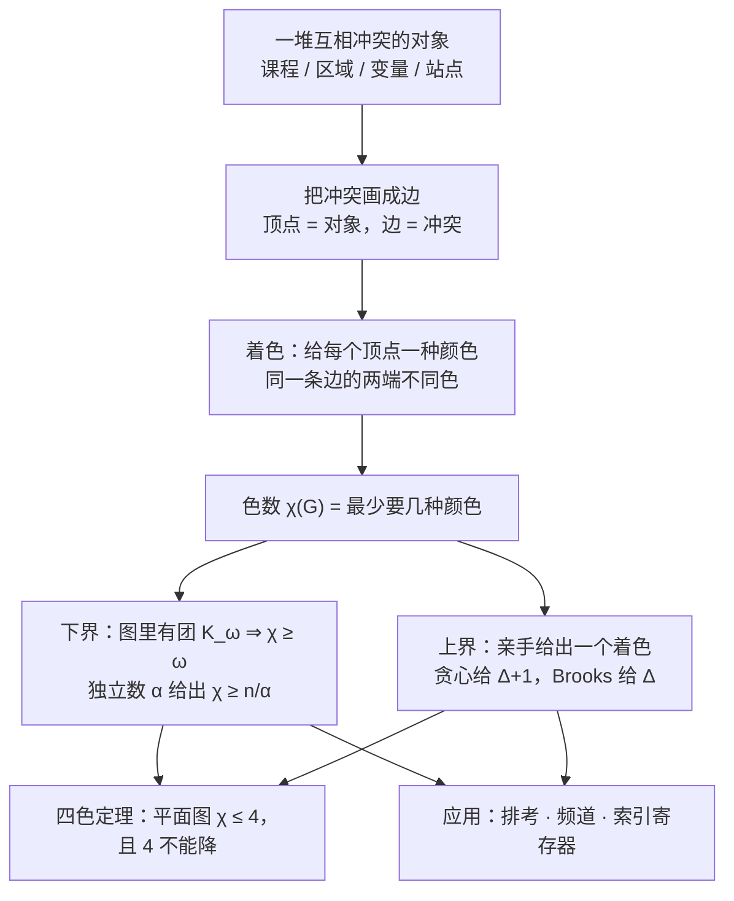

# C10.8 图着色 Graph Coloring

> [!abstract] 这一讲的任务
> 上一讲把"能不能不交叉地画在平面上"变成了 $v-e+r=2$ 这条等式和 $e\le 3v-6$ 这条不等式，判据到手。
> 这一讲换一个问题：手上有一堆**互相冲突**的对象（课、区域、变量、站点），最少要几种"名额"才能把它们一次安排完？
> 做法只有一步：把冲突画成边，"名额"画成颜色，于是问题变成"给顶点上色，同一条边的两端不许同色"，
> 要的那个数叫**色数**。四色定理是这个问题的天花板，排考、频道分配、编译器寄存器分配是它的三个落地场景。

> [!info] 怎么读这份讲义
> 只需要第 10 章前七讲：顶点、边、度（C10.2），二分图与"二分 $\iff$ 无奇圈"（C10.2 定理 4），
> 对偶图与 $e\le 3v-6$（C10.7）。本篇**没有**新算法需要背，只有两个定义、一个定理，
> 但每一个数字都要自己算一遍：色数这种东西，看别人算一百遍也不如自己算三个图。
> 先交代一处地方：p.731 把例 5 的"色数是 4（读者可自行验证）"留给读者，
> 那句"自行验证"里其实藏着一个 $K_4$——"为什么至少要 4"是可以讲干净的，见 §6。

---

## 0. 开场：12 门课、5 个时段，第 6 个时段要不要付钱（p.727）

期末周，教务只有 5 个可用时段（周一到周五各一场）。要排 12 门课：

| 编号 | 课程 | 编号 | 课程 | 编号 | 课程 |
|---|---|---|---|---|---|
| 1 | 微积分 | 5 | 数据结构 | 9 | 计算机网络 |
| 2 | 线性代数 | 6 | 算法设计 | 10 | 编译原理 |
| 3 | 离散数学 | 7 | 数据库 | 11 | 大学物理 |
| 4 | 概率论 | 8 | 操作系统 | 12 | 大学英语 |

有两个硬要求：同一时段不能有两门课**有共同学生**（撞车了学生没法考）；时段越少越好
（多开一个时段要付场地费和监考费）。教务最怕的不是"排不出来"，而是**排了半天不知道还能不能更省**。

先看最笨的两个极端。极端一：一门课一个时段，12 个时段，绝对不撞车，但要多付 7 个时段的钱。
极端二：随手按编号 1–5、6–10、11–12 分三堆塞进前三个时段——一查就撞：比如第 1、2 门课有共同学生，
却被塞进同一个时段。**"随便排"和"排到最少"之间，隔着整整一个理论。**

真正的障碍出现在一份选课名单上：有一批转专业补修的学生，一学期把
**微积分、线性代数、离散数学、概率论、数据结构**五门全选了。这五门课里任取两门都有共同学生，
所以它们**两两不能同时段**——五个时段的名额全被这五门课占满，一门一个。于是：

- 5 个时段是**下界**，一分都不能少；
- 但 5 个是不是**够**，也就是剩下的 7 门课能不能塞进这 5 个时段里、且互不撞车，还要真排一遍才知道。

你刚才做的两件事，正好是这一讲的全部内容：**把"冲突"画成一张图的边**，
然后**问这张图"最少几种颜色"**。等工具齐了，我们在 §6 结尾回到这张表，把它的排法完整写出来
（结论先剧透：5 个时段正好够，第 6 个时段的钱不用付）。

而这个问题最早的版本根本不在教室里，在地图上。

---

## 1. 从地图到冲突图：把"相邻"变成一条边（p.727）

一张地图，每个国家涂一种颜色，**有共同边界的两个国家不许同色**。要求同样朴素：颜色用得越少越好
（颜色多了印刷厂要调更多油墨，人也分不清相近的颜色）。

先看两个小地图（p.727，下面两张图是同一页上的 FIGURE 1 与 FIGURE 2）：

![[C10.8-原图-地图与对偶图.png]]

左图 7 个区域 A–G，右图 5 个区域 A–E。问题是：左图几种颜色够？右图几种够？

肉眼试色的困难在于：你涂到第 6 个区域时，已经记不清它到底跟哪几个区域共边了。
**"谁跟谁相邻"这个信息，用眼睛看地图是低效的，用一张图来记才是高效的。**
这正是 C10.7 的**对偶图 dual graph** 在做的事：**把一个面（区域）缩成一个点**，
两个点连边当且仅当对应的两个区域有共同边界。落规则时要注意一处：**只在一个点上碰一下的两个区域不算相邻**
（地图上"四国交于一点"的情形不产生边），否则美国科罗拉多州那种"角上相接"会被误判成相邻。

![[C10.8-原图-地图对应的对偶图.png]]

于是"给地图上色"和"给这张图的顶点上色，要求同一条边的两端不同色"是**同一件事**，
只是换了个说法。这一步换掉之后，问题就有了精确的提法，也能算了。

这里要补一个名字。地图问题里这张图叫对偶图，但在排考、频率分配、寄存器分配这些问题里，
同一套做法更常叫**冲突图 conflict graph**：

> [!note] 冲突图 conflict graph 是什么
> 把每个"待分配的对象"（一门课、一个区域、一个变量、一座电台）画成一个顶点；
> 两个对象之间**有冲突**（共用学生、共用边界、同时活跃、距离太近）就连一条边。
> 名字来自它的用途：这条边代表"这两个不能拿到同一个名额"。图里没有边，就代表"这两个互不相干，随便同色"。

用冲突图重说三个场景，你会发现它们的差别只在"对象"和"冲突"填什么：

| 场景 | 顶点 | 边（冲突） | 颜色（名额） |
|---|---|---|---|
| 地图着色 | 区域 | 有共同边界 | 一种颜料 |
| 考试排程 | 一门课 | 有共同学生 | 一个时段 |
| 频道分配 | 一座电台 | 距离小于 150 英里 | 一个频道 |
| 索引寄存器分配 | 一个变量 | 在循环里同时活跃 | 一个寄存器 |

下面这张图把"地图 → 冲突图 → 着色"三步接在一起，用的是右图那个 5 区域的小地图
（把中间那块记作 C，外圈四块按上、右、下、左记作 B、E、D、A）：

![[C10.8-地图到冲突图到着色.png]]

三块面板分别是：区域图本身；把每个区域缩成点、共边就连边得到的冲突图；以及给冲突图上的点涂颜色。
中间那张图是**轮**（C10.2 的 $W_4$：一个中心点加一个 4 点圈），它长什么样决定了右图要几种颜色：

- **3 种够**：C 涂 1 号色，外圈 A、B、E、D 交替涂 2、3、2、3 号色，每条边两端都不同色；
- **2 种不够**：只给两种颜色，外圈那一圈必须交替涂（A、B、E、D 相邻，只能 2、3、2、3），
  于是 A、B、E、D 四个把两种颜色**都用掉了**；而 C 跟它们四个都相邻，无颜色可用。

同页的左地图就更贵：它的冲突图有 7 个点 13 条边（度数依次是 A 4、B 3、C 3、D 6、E 4、F 3、G 3，
加起来 26，正好是边数的两倍），而且其中的 **A、B、C、D 四个点两两相邻**（六条边一条不少）。
四个两两相邻的点必须四个不同的颜色，所以**左图至少要 4 色**；而 4 色也确实涂得出来
（例如 A、B、C、D、E、F、G 依次涂 2、3、4、1、3、2、4），所以左图**正好 4 色**。

一张地图的涂色问题，就这样变成了一个纯图论问题：**这张图的顶点，最少要几种颜色？**

---

## 2. 定义 1、定义 2：着色与色数（p.727–728）

上面反复说的"给点上色，同一条边的两端不同色"，就是第一个定义。先把名字掰开：
字面上"给每个点指定一种颜色"只能叫染色，再加上"相邻不许同色"这条约束，才叫**真着色**——
名字里的"真"就是"合格"的意思。本书把合格的那一种直接叫"着色"。

> [!important] 定义 1 着色（真着色）Coloring
> 简单图的一个**着色**是给每个顶点指定一种颜色，使得**没有两个相邻的顶点被指定同一种颜色**。
> （"相邻不同色"这个条件常被强调为**真着色 proper coloring**；本书的"着色"一词就指真着色。）

用词要注意：颜色只是"名额的编号"，它可以是红蓝绿，也可以是时段 I、II、III，或者寄存器 R1、R2。
数字 1、2、3 也行——只要"同色"这件事真的代表"同一个名额"。

那么问题就是：**最少要几种？** 这是一个数，值得给它一个名字和一个符号。

> [!important] 定义 2 色数 Chromatic Number
> 图 $G$ 的**色数**是给 $G$ 着色所需的最少颜色数，记作 $\chi(G)$（$\chi$ 是希腊字母 chi，读"开"）。

$\chi$ 这个符号后面的括号里总是放图的名字，$\chi(G)=3$ 读作"$G$ 的色数是 3"。三个立刻能看出的事实，
后面每一道题都要用到：

1. **$\chi(G)\ge 1$**，等号成立当且仅当 $G$ 一条边都没有（此时所有点同色也合法）；
2. **$\chi(G)\ge 2$**，只要 $G$ 有一条边（那条边的两端不能同色）；
3. **$\chi(G)$ 不会超过顶点数**，一个点一种颜色总是合法的（这就是开场那个"极端一"）。

接下来的全部工作是回答"到底是多少"。而 $\chi(G)=k$ 这件事，永远要**两边各证一半**：

> [!important] 要证 $\chi(G)=k$，必须证两件事
> **上界**（够用）：给出一个具体的 $k$ 着色——把每个点涂什么色老老实实写出来；
> **下界**（不能更少）：证明 $k-1$ 种颜色无论怎么涂都不合法。
>
> 只做一半是最常见的错误：只给排法，说明"$\chi\le k$"；只说"看起来不行"，什么都没说明。

p.728 把这句话特意写在例题之前，因为例 1–例 4 全是"上界构造 + 下界论证"的模板。

---

## 3. 例 1：只多一条边，色数从 3 跳到 4（p.729）

> [!example] 例 1 两张只差一条边的图
> 图中两个简单图 $G$ 与 $H$：$H$ 就是把 $G$ 的两个顶点 $a$ 与 $g$ 之间再加一条边得到的。求 $\chi(G)$ 与 $\chi(H)$。

![[C10.8-原图-加边改变色数.png]]

先把两张图的边数点清楚（这一步不能跳，后面每次论证都要靠它）：$G$ 有 7 个顶点、12 条边，
$H$ 有 7 个顶点、13 条边；$G$ 的度数是 $a\,2,\ b\,4,\ c\,4,\ d\,4,\ e\,4,\ f\,4,\ g\,2$，
加起来 24，正好两倍于 12。$H$ 只把 $a$ 与 $g$ 的度数各加 1。

**先算 $\chi(G)$。** 下界好办：$a,b,c$ 三个点两两相邻（三条边 $ab,bc,ac$ 都在），三个点必须三种颜色，
所以 $\chi(G)\ge 3$。

上界要真涂一遍。不妨设 $a$ 红、$b$ 蓝、$c$ 绿。接着会发现**每一步都被逼死**，没有选择余地：

| 顶点 | 已经涂好的邻居 | 只能涂 | 为什么没有别的选择 |
|---|---|---|---|
| $d$ | $b$ 蓝、$c$ 绿 | 红 | 三种颜色里只剩红，而 $d$ 与蓝、绿都相邻 |
| $e$ | $b$ 蓝、$d$ 红（$f,g$ 还没涂） | 绿 | 同理，已涂的邻居只占蓝、红两色 |
| $f$ | $c$ 绿、$d$ 红 | 蓝 | 同理，只剩蓝 |
| $g$ | $e$ 绿、$f$ 蓝 | 红 | 同理，只剩红 |

四个顶点一路被推着走，最后得到完整的 3 着色：$a$ 红、$b$ 蓝、$c$ 绿、$d$ 红、$e$ 绿、$f$ 蓝、$g$ 红。
上下界一夹，$\chi(G)=3$。

**再算 $\chi(H)$。** 下界还是 3（$H$ 含 $G$ 的全部边，$a,b,c$ 依然两两相邻）。上界这边撞墙了：
$H$ 比 $G$ 多的那条边 $ag$，正好连在"$a$ 红、$g$ 红"这一对上。

这不是"换个涂法再试一次"就能躲开的，因为上表说明**$G$ 的 3 着色本质上只有一种**
（三种颜色在 $a,b,c$ 上怎么排，只是把红蓝绿三个名字换一下，$g$ 永远和 $a$ 同色）。于是：

> 假设 $H$ 有一个 3 着色。限制到 $G$ 上，它就是 $G$ 的一个 3 着色；
> 由上表，$a,b,c$ 必须互异，设 $a$ 红、$b$ 蓝、$c$ 绿，则一路被迫得到 $d$ 红、$e$ 绿、$f$ 蓝、$g$ 红。
> 但 $g$ 与 $a$ 在 $H$ 里相邻，两个都是红——违反定义 1。矛盾。

所以 3 色不够，$\chi(H)\ge 4$。而把 $g$ 改涂第四种颜色（比如棕）就得到 $H$ 的一个 4 着色，
于是 $\chi(H)=4$。

![[C10.8-原图-三色与四色两组着色.png]]

图中左半是 $G$ 的 3 着色，右半是 $H$ 的 4 着色，唯一的差别是 $g$ 从红变成了棕。

**回头看这一步到底教了什么。**

第一，色数不服从"只加一条边、影响很小"的直觉。加一条边只多了一个约束，
却可以让整张图的色数涨 1——因为是**全局唯一的那一个 3 着色**被它否掉了。
色数不是能靠"数一数局部有多少个三角形"定下来的量（这一点在 §10 还会再算一次）。

第二，加边只会更严格，绝不能更宽松，而且最多涨 1：

$$\chi(G)\ \le\ \chi(G+\{u,v\})\ \le\ \chi(G)+1.$$

左边那个不等号：$G$ 是 $H$ 的子图，$H$ 的任何合法着色砍掉那条新边以后仍然是 $G$ 的合法着色。
右边那个不等号：拿 $G$ 的一个 $\chi(G)$ 着色来涂 $H$，唯一可能出问题的是 $u,v$ 撞色，
撞了就把 $v$ 改成第 $\chi(G)+1$ 种颜色，其它点不动。两次使用都不需要知道 $\chi$ 具体是几。

反过来读就是：**删掉一条边，色数最多掉 1**。例 1 的 $H$ 删掉 $ag$ 正好掉到 3，
这是"一条边值一种颜色"的最干净的例子（习题 32 把这个现象抽象成"色数 $k$ 临界"，
即删任何一条边色数都掉到 $k-1$ 的图；奇圈是 3 临界的，奇数 $n$ 的轮是 4 临界的）。

第三，也是最重要的一点：**例 1 里的 $H$ 是一张平面图，而它的色数是 4。**
它 7 个点 13 条边，没有 $K_4$（最大的团只有 3 个点，比如 $e,f,g$），却照样要 4 种颜色。
这个事实在 §5 会变成一句关键的话：**四色定理里的 4 不能再降到 3。**

---

## 4. 例 2–例 4：三个标准答案 $K_n$、$K_{m,n}$、$C_n$（p.730–731）

例 1 是"陌生的图怎么算"。下面三个是"熟的图直接背"，考场上最常出现，而且它们正好各自把
$\chi$ 推到三种不同的极端：推到顶点数、推到 2、在 2 和 3 之间摇摆。

> [!example] 例 2 完全图的色数
> 求 $K_n$ 的色数。

上界：$n$ 个点各给一种颜色，$\chi(K_n)\le n$。下界：$K_n$ 里**任意两个点都相邻**
（这就是"完全"的意思），所以任何两个点都不能同色，$n$ 个点必须 $n$ 种颜色，$\chi(K_n)\ge n$。
两边夹住：

$$\chi(K_n)=n.$$

$n=5$ 时就是 5 种颜色，一个点一种（p.730 的 FIGURE 5 画的就是这个涂法）。

这里有一处必须点明，否则读者会以为它跟四色定理打架：**$K_n$ 在 $n\ge 5$ 时不是平面图**。
用 C10.7 的不等式验一下：$K_n$ 有 $\binom n2=\frac{n(n-1)}{2}$ 条边，而平面简单图要求 $e\le 3v-6=3n-6$，
两者相差 $\frac{n(n-1)}{2}-(3n-6)=\frac{(n-3)(n-4)}{2}$，当 $n\ge 5$ 时为正。
所以 $K_5$ 违反 $e\le 3v-6$，非平面；四色定理对它是**不适用**的，$\chi(K_5)=5$ 一点也不矛盾。

> [!example] 例 3 完全二分图的色数
> 求 $K_{m,n}$ 的色数，其中 $m,n$ 是正整数。

看上去颜色数应该跟 $m,n$ 有关——$m+n$ 个点，凭什么只用两种颜色？但 $K_{m,n}$ 的构造方式本身
就把点分成了两堆（$m$ 个一堆、$n$ 个一堆），**边只连两堆之间，堆内一条边都没有**。

上界：一堆涂 1 号色，另一堆涂 2 号色。每条边的两端分属不同堆，颜色必然不同，所以 2 色够。
下界：$m,n\ge 1$ 保证至少有一条边，1 色不够。所以

$$\chi(K_{m,n})=2.$$

p.730 的 FIGURE 6 就是 $K_{3,4}$ 的两色涂法：$a,b,c$ 三红，$d,e,f,g$ 四蓝，7 个点 12 条边，两条颜色就压住了。

把它说得更一般些（这是 C10.2 定理 4 的直接推论，也是后面贪心着色要用的那句话）：
**任何二分图都只用 2 色；有边的二分图恰好 2 色，没边的二分图 1 色。** 反过来，要看一个图能不能 2 色，
只要检查它有没有奇圈——有奇圈就非 2 色（下一例就是最小的情形）。

> [!example] 例 4 圈的色数
> 求 $C_n$ 的色数，其中 $n\ge 3$。

$n$ 是偶数时（$n\ge 4$）：沿圈顺时针走，交替涂红、蓝、红、蓝……，第 $n$ 个点拿到蓝，
与它相邻的第 $n-1$ 个（红）和第 1 个（红）都不同色，合法。所以 2 色够；有边所以 1 色不够。
$\chi(C_n)=2$。

$n$ 是奇数时（$n\ge 3$）：**2 色不够**。理由必须说准：假设只用两种颜色，从某个点出发沿圈走，
相邻不同色就意味着颜色**必须交替**（只有两种颜色，除了交替没有别的选择）。
走 $n$ 步回到起点，$n$ 是奇数，交替奇数次，颜色就翻了面：起点与终点（其实是同一个点）颜色不同——不可能。
换个等价的说法：交替走一圈以后，第 $n$ 个点与第 1 个点必然同色，而它们在圈上相邻。
3 色够：前 $n-1$ 个点交替涂两种颜色，第 $n$ 个点涂第三种。于是

$$\chi(C_n)=\begin{cases} 2, & n\ \text{为偶数}\ (n\ge 4),\\[2pt] 3, & n\ \text{为奇数}\ (n\ge 3).\end{cases}$$

p.730 的 FIGURE 7 画了 $C_6$ 的两色涂和 $C_5$ 的三色涂：$C_5$ 上第 5 个点被逼着用了黄色。

两处小注。其一，教材把偶数情形写成 "$n$ 是偶正整数且 $n\ge 4$"，把 $n=2$ 排除在外是**对**的：
本书的 $C_n$ 从 $n\ge 3$ 定义，$C_2$ 会变成两条平行边，不是简单图，定义 1 讨论的对象就不在范围里。
其二，奇数圈这个结论是后面反复出现的"钉子"：
**$C_3=K_3$，$\chi=3$；$C_5$ 是最小的"没有三角形却要 3 色"的图；所有奇圈都是 3 色**，
这就是习题 16 要你证的那句话。

顺便把**轮**（C10.2 的 $W_n$：中心点加一个 $n$ 点圈）也算掉，它是习题 15：
中心点一种颜色，外圈是一个 $C_n$，$n$ 偶时外圈两色（加起来 3 色），$n$ 奇时外圈要三色、
但中心点可以复用其中一种（加起来 4 色）：

$$\chi(W_n)=\begin{cases} 3, & n\ \text{偶}\ (n\ge 4),\\[2pt] 4, & n\ \text{奇}\ (n\ge 3).\end{cases}$$

验算：$W_3$ 就是 $K_4$（中心点加三角形，四个点两两相邻），$\chi=4$，与公式吻合；
$W_4$ 正好是 §1 右图那个地图的冲突图，$\chi=3$。

把这一讲的"标准答案"列成一张表（每一格都枚举验算过）：

| 图 | 顶点 | 边 | 最大团 $\omega$ | 最大度 $\Delta$ | 色数 $\chi$ |
|---|---|---|---|---|---|
| $K_n$ | $n$ | $\binom n2$ | $n$ | $n-1$ | $n$ |
| $K_{m,n}$ | $m+n$ | $mn$ | 2 | $\max(m,n)$ | 2 |
| $C_n$，$n$ 偶 | $n$ | $n$ | 2 | 2 | 2 |
| $C_n$，$n$ 奇 | $n$ | $n$ | 2 | 2 | 3 |
| $W_n$，$n$ 偶 | $n+1$ | $2n$ | 3 | $n$ | 3 |
| $W_n$，$n$ 奇 | $n+1$ | $2n$ | 3 | $n$ | 4 |

表里 $\omega$ 一列按 $n$ 足够大来写。两个小例外：$C_3=K_3$ 的 $\omega=3$，
$W_3=K_4$ 的 $\omega=4$；它们的 $\chi$ 一列不受影响（$C_3$ 仍是 3，$W_3$ 仍是 4）。

最后一列值得盯着看：$\chi$ 有时等于顶点数（$K_n$），有时等于 2（二分图、偶圈），
有时卡在 2 和 3 之间（奇圈）——**三种极端**。这张表里还藏着一个问题：
既然 $\chi$ 最多是顶点数，那"最多"这头有没有更好的上界？答案是有的，而且对我们这个星球特别重要。

---

## 5. 定理 1 四色定理：平面图的上界是 4（p.728）

回到地图。地图的冲突图是平面图（C10.7：把面缩成点、共边连边，得到的图能画在平面上不交叉）。
所以"地图要几种颜色"这个问题，问的其实是"**平面图的色数最大是多少**"。

这个问题从 1852 年问到 1976 年，答案是一个常数。

> [!important] 定理 1（四色定理 The Four Color Theorem）
> 平面图的色数不超过 4：对任何平面图 $G$，$\chi(G)\le 4$。

这个 4 已经是最优的（不能改小）：§3 的 $H$ 是 7 个点的平面图、$\chi(H)=4$；更小的例子是 $K_4$
（4 个点、6 条边，平面，$\chi=4$）。定理里的 4 一个字都不能改。

这个定理值得单独讲，原因不在结论难用（结论一句话），而在它的证明史：

- **1852 年**，Augustus De Morgan 的一位学生 Francis Guthrie 在给英格兰各郡上色时发现
  四种颜色好像就够了，于是提出猜想。他告诉弟弟 Frederick，Frederick 转问老师 De Morgan；
  De Morgan 很感兴趣并四处宣传。今天能查到的最早书面记录，是 De Morgan 写给
  William Rowan Hamilton 的一封信——而 Hamilton 似乎毫无兴趣，理由是这个问题跟四元数没关系。
- **1879 年**，伦敦的律师、业余数学家 Alfred Bray Kempe 发表了证明。他的本职是教会法权威，
  数学是剑桥读书时的旧爱好。这个证明被数学界接受了 11 年。
- **1890 年**，Percy Heawood 找出了其中的漏洞，Kempe 的论证不完整。这是数学史上最有名的错误证明之一。
- **1976 年**，美国数学家 Kenneth Appel 与 Wolfgang Haken 给出了完整证明。他们的做法是
  反证 + 分类：如果四色定理不成立，反例一定属于大约 **2000 种**可枚举的构形之一，
  然后逐一（用计算机）证明这 2000 种构形都不存在。这个证明用了**超过 1000 小时**的机时。
- **1996 年**，Robertson、Sanders、Seymour、Thomas 给出更简单的证明，需要检查的构形降到 **633 种**；
  后来还有人用机器证明助手（Coq）把它完整形式化了一遍。

**为什么它名声这么大？** 因为它是第一个**本质上依赖计算机**的著名定理。争议也就出在这：
如果程序里有一个 bug，结论还成立吗？依赖"可能不可靠的计算机输出"的论证，算不算证明？
这些质疑在当时是全新的，现在成了计算数学的日常话题。直到今天，**还没有不依赖大量计算的证明**。

顺带说清楚"为什么不能降到 3"，这是本节最容易被跳过的一步：

- 3 色不够，因为有平面图需要 4 色（$K_4$，或者 §3 的 $H$）。所以 4 是**紧**的；
- 另一方面，**4 色确实够**，这是定理的内容，不是我们推出来的。本篇**不证明**四色定理：
  它是已知定理，我们只把它当工具用（C10.7 的 Kuratowski 定理也是这种待遇）。

四色定理只对平面图说话。一般图没有这个福气：$K_n$ 的色数是 $n$，要多大有多大（例 2）。
"有界"这件事完全是**平面性**带来的，而平面性在 C10.7 里已经变成了一条不等式 $e\le 3v-6$。

> [!note] 延伸：用 $e\le3v-6$ 把 4 放松成 6（习题 40）
> 四色定理难证，但"6 色够"用 C10.7 的工具两行就能证，值得一看——它是四色定理的"穷人版"。
>
> 对顶点数归纳，设 $G$ 是连通平面简单图（不连通就对各连通块分别涂，颜色可以重复使用，不影响结论）。
> $v\le3$ 时最多 3 个点，3 色都用不完，成立。设 $v\ge4$。C10.7 推论 2 说：
> **连通平面简单图必有一个度不超过 5 的顶点** $u$，而它的证法正是这里要用的那一步计数：
> 由推论 1 的 $e\le3v-6$ 得平均度 $\frac{2e}{v}\le\frac{6v-12}{v}<6$，
> 所以不可能每个点都度 $\ge6$（否则度数之和 $\ge6v>2e$）。删掉 $u$ 及与它相连的边，
> 剩下的图若断成几块，就对各块分别涂（块与块之间没有边，颜色互不干扰），总之可以用 6 色涂好；
> 再把 $u$ 放回去，它最多 5 个邻居、最多占用 5 种颜色，6 种颜色里必剩一种给它。归纳完成。
>
> 把 6 改成 5 就没这么便宜了：$u$ 恰好有 5 个邻居且用了 5 种不同颜色时，得靠"Kempe 链"
> 换色来腾出颜色，而换色会牵连到链的另一端，要再分情况处理。这条思路正是 Kempe 1879 年那条
> 思路（也是 1976 年证明的基础），但把最后那一步补严花了 97 年。习题 41 要求证 5 色，标着两颗星。

---

## 6. 例 5 考试排程：把时段表变成着色（p.731–732）

回到开场的场景。模型三件事说清就完：

- **顶点**：一门课；
- **边**：两门课有共同学生（这两门不能同时段）；
- **颜色**：一个考试时段。

于是"排考不撞车"$\iff$"这张图的一个合法着色"，"最少要几个时段"$\iff$"色数"。

> [!example] 例 5 期末考试排程（Scheduling Final Exams）
> 7 门课编号 1–7。有共同学生的课对是：$(1,2),(1,3),(1,4),(1,7),(2,3),(2,4),(2,5),(2,7),(3,4),(3,6),(3,7),$
> $(4,5),(4,6),(5,6),(5,7),(6,7)$——共 16 对。最少要几个时段？

先把这张冲突图的数据核清楚：7 个点、16 条边；度数依次是 $1\!:\!4,\ 2\!:\!5,\ 3\!:\!5,\ 4\!:\!5,\ 5\!:\!4,\ 6\!:\!4,\ 7\!:\!5$，
加起来 32，正好两倍于 16。这说明数据本身是自洽的（C10.2 握手定理的一个实际用途：
数出来的边数和度数之和必须对得上，对不上就是抄错了）。

**下界：4。** 找团。点 $1,2,3,4$ 两两相邻，六条边 $(1,2),(1,3),(1,4),(2,3),(2,4),(3,4)$ 全在名单里，
所以它们构成一个 $K_4$。四个两两冲突的课程必须四个不同时段，于是 $\chi\ge4$，
"三个时段排完"这个念头可以立刻打消。

**上界：4。** 给出一个 4 着色：

| 时段 | 课程 | 检查 |
|---|---|---|
| I | 1, 6 | $16$ 不在冲突名单里，合法 |
| II | 2 | 单独一门，永远合法 |
| III | 3, 5 | $35$ 不在名单里，合法 |
| IV | 4, 7 | $47$ 不在名单里，合法 |

四个时段内部都没有冲突边，16 条边全部跨时段，所以这确实是一个合法着色。
上下界一夹，$\chi=4$：**恰好 4 个时段，不多不少。**

![[C10.8-原图-考试排程的着色与时段表.png]]

图左是 7 个点的冲突图，图右是同一张图上的 4 着色与它对应的时段表
（时段 I = {1,6}，II = {2}，III = {3,5}，IV = {4,7}）。

这里对比一下 §3 的例 1，两件事就清楚了：

- 例 1 的下界只能靠"强制链"一步步推（因为图里没有 $K_4$，团下界只有 3，不够）；
- 例 5 的下界直接看到一个 $K_4$（因为图里就有），一句话完事。

**图里有团时，下界是白送的。**这条经验会在 §10 变成总结里的第一条。

> [!warning] 易错点：排得下不等于排得最少
> 随便给一个合法着色只证明了"$\chi\le$ 用掉的色数"。例 5 里随手用 5 个时段排完也是合法的，
> 但那不能说明"必须 5 个"。**下界必须另外证**，通常靠团、独立数，或者像例 1 那样的强制链。

> [!note] 同类练习（p.733 习题 17、19）
> **习题 17**：8 门课（Math 115、116、185、195，CS 101、102、273、473），除了 7 对"无人同选"的组合，
> 其余两两都有共同学生。8 个点本来有 28 条可能的边，去掉那 7 条，剩 **21** 条，
> 色数是 **5**：需要 5 个时段。
> **习题 19**：6 个委员会，成员名单给出后算冲突边。$C_1$ 与 $C_2$ 都含 Brand，$C_1$ 与 $C_3$ 都含
> Arlinghaus 和 Zaslavsky……逐对查完得到 **14** 条边（$K_6$ 的 15 条里只差 $C_4$ 与 $C_5$ 这一对，
> 因为 $C_4=\{$Lee, Rosen, Zaslavsky$\}$ 与 $C_5=\{$Arlinghaus, Brand$\}$ 没有共同成员），
> 色数是 **5**：需要 5 个不同的开会时间。$K_6$ 少一条边就要 5 色，这个例子说明"几乎完全"的图色数接近顶点数。

**现在回到开场那 12 门课。** 冲突表（就是 C10.3 讲的邻接表，一行写一门课和它冲突的课）：

| 课程 | 冲突的课 | 课程 | 冲突的课 |
|---|---|---|---|
| 1 微积分 | 2, 3, 4, 5, 8, 10 | 7 数据库 | 3, 4, 6, 11 |
| 2 线性代数 | 1, 3, 4, 5, 6, 11, 12 | 8 操作系统 | 1, 9, 12 |
| 3 离散数学 | 1, 2, 4, 5, 7, 9, 12 | 9 计算机网络 | 3, 5, 6, 8, 10 |
| 4 概率论 | 1, 2, 3, 5, 6, 7, 10 | 10 编译原理 | 1, 4, 9, 12 |
| 5 数据结构 | 1, 2, 3, 4, 6, 9, 11 | 11 大学物理 | 2, 5, 6, 7 |
| 6 算法设计 | 2, 4, 5, 7, 9, 11 | 12 大学英语 | 2, 3, 8, 10 |

12 个点、**32** 条边。下界还是那五门核心课：微积分、线性代数、离散数学、概率论、数据结构
两两都有共同学生，是 10 条边组成的 $K_5$，所以至少要 5 个时段。上界给排法：

| 时段 | 课程 | 门数 |
|---|---|---|
| 一 | 微积分、算法设计、大学英语 | 3 |
| 二 | 线性代数、数据库、编译原理 | 3 |
| 三 | 离散数学、操作系统、大学物理 | 3 |
| 四 | 概率论、计算机网络 | 2 |
| 五 | 数据结构 | 1 |

逐条对照上面的冲突表：任取一个时段里的两门课，对方的冲突名单里都没有它（例如时段一的
微积分与算法设计：微积分冲突于 2,3,4,5,8,10，里面没有 6；算法设计冲突于 2,4,5,7,9,11，里面没有 1）。
所以这是一个合法的 5 着色，$\chi\le5$；配合 $K_5$ 的 $\chi\ge5$，得到 $\chi=5$。
**5 个时段正好够，第 6 个时段的钱不用付**——而这句"不用付"，上界（这张表）和下界（那五门课）
各出了一半力气，缺一半都说不出口。

---

## 7. 例 6 频道分配：颜色就是频率（p.732）

第二个应用换了个物理场景，但模型是同一个。

> [!example] 例 6 频率分配（Frequency Assignments）
> 北美给电台分配电视频道 2 到 13 号，要求相距 150 英里以内的两座电台不能使用同一频道。
> 怎样把这件事建模成图着色？

模型三件事：

- **顶点**：一座电台；
- **边**：两座电台相距不到 150 英里（会互相干扰）；
- **颜色**：一个频道。

于是"分配频道"就是一个着色，可用的颜色只有 2 到 13 这 **12** 个频道，问题变成
"这张图的色数是不是不超过 12，以及 12 里面最少要用几个"。注意这里的颜色数是**有上限**的：
如果 $\chi>12$，那就不是"怎么排"的问题，而是要申请新频道——这是图着色问题里常见的一种问法
（"给定 $k$ 种颜色，能不能涂"），比"最少几种"更接近工程现实。

工程上真正要算的不是 12 座电台，而是几万座；这也解释了为什么这一节不给算法：
色数的计算是指数级的（§10 会把这句话说准），实际系统用的是启发式贪心 + 人工微调，
但**模型**是这一个，没有第二个。

> [!note] 同类练习（p.733 习题 18）
> 6 座电台，两两距离给在一张表里。按"小于 150 英里连边"筛出 7 条边：
> $(1,2)=85$、$(1,5)=50$、$(1,6)=100$、$(2,3)=125$、$(2,5)=100$、$(3,4)=100$、$(5,6)=100$ 都小于 150，
> 而 $(2,6)=160$、$(1,3)=175$ 等都大于 150，不连边。这张图有三角形 $1,2,5$，故 $\chi\ge3$。
> 三色涂法：$1$ 与 $4$ 用 1 号，$2$ 与 $6$ 用 2 号，$3$ 与 $5$ 用 3 号——七条边
> $(1,2),(1,5),(1,6),(2,3),(2,5),(3,4),(5,6)$ 逐条都是异色，合法。所以 $\chi=3$。
> **答案：3 个频道。** 六座电台只需要三个频道，比"两两都远"的直觉省得多——
> 这也说明冲突图稀疏的时候，色数会明显小于顶点数。

移动通信把这个模型又推广了一层：每个蜂窝小区不是要**一个**频率，而是要**一组 $k$ 个**频率
（同时支持多路通话），相邻小区之间不能共用任何一个频率。这就是 §9.2 的 **$k$ 重着色**，
色数记作 $\chi_k(G)$；对二分图（频谱规划里常见的理想化模型）它等于 $2k$。

---

## 8. 例 7 索引寄存器：编译器也在做图着色（p.732）

第三个应用最"计算机"：它发生在编译器里，而且不是比喻。

> [!example] 例 7 索引寄存器（Index Registers）
> 高效编译器会把循环里频繁使用的变量临时放进 CPU 的**索引寄存器**，而不是普通内存，
> 这样循环跑得更快。问：给定一个循环，需要几个索引寄存器？

模型的建立方式跟前两例完全一样，只是"对象"换成了变量：

- **顶点**：循环里的一个变量；
- **边**：两个变量在循环执行过程中**必须同时**待在索引寄存器里；
- **颜色**：一个索引寄存器。

同一时刻只能装一个变量的寄存器，当然不能同时装两个"同时活跃"的变量，所以相邻的变量必须用不同的寄存器
——这就是定义 1。于是"最少要几个寄存器"$=\chi(G)$，一句话：**色数就是所需的索引寄存器个数。**

举个能算的例子（p.734 习题 27）。一个循环里有 7 个变量，它们在哪些步骤需要占用寄存器：

| 变量 | 需要占用的步骤 |
|---|---|
| $t$ | 1 到 6 |
| $u$ | 2 |
| $v$ | 2, 3, 4 |
| $w$ | 1, 3, 5 |
| $x$ | 1, 6 |
| $y$ | 3, 4, 5, 6 |
| $z$ | 4, 5 |

两个变量只要有**共同的步骤**就冲突，连边。逐对查完得到 15 条边（7 个点最多 21 条），
其中 $t,v,w,y,z$ 五个两两都有公共步骤（$t$ 覆盖全部，$v,w,y,z$ 在 3、4、5 上交错），构成一个 $K_5$，
所以 $\chi\ge5$；而确实存在 5 色涂法，所以**需要 5 个寄存器**。

这里有一个反直觉的地方，值得停一下：在任何一个步骤上，同时活跃的变量最多只有 **4** 个
（第 3、4、5 步各 4 个），可 5 个寄存器却是必需的。为什么？

因为"同时活跃的变量数"只统计**同一时刻**的重叠，而色数要管的是**整张冲突图**。
如果每个变量的活跃期都是**一段连续区间**，那么冲突图就是"区间图"，这时色数恰好等于最大重叠数——
只要按区间左端点从左往右扫，每碰到一个新变量就给它一个没被占用的寄存器，永远不会超过最大重叠数。
习题 27 里的 $w$（步骤 1、3、5）与 $x$（步骤 1、6）故意给了**不连续**的活跃期，
区间图的好性质就没了，色数也就比最大重叠数大 1。

> [!note] 专业关联：寄存器分配 register allocation
> 编译器里的这一步有正式名字：**寄存器分配**。做法就是例 7 的模型——先算出每个变量的活跃范围
> （liveness analysis），据此建**干涉图 interference graph**（两个变量同时活跃就连边），
> 再用 $k$ 种颜色给它着色，$k$ 是目标机器的寄存器个数；颜色相同的变量共用一个寄存器。
>
> 真正的编译器（GCC、LLVM）还要多做一步：干涉图往往**不能**用 $k$ 色涂好，
> 这时要选一些变量**溢出 spill**到内存（相当于允许它"不占寄存器"），把它们从图里删掉，
> 重新着色，直到成功。所以工程上的循环是"着色—发现涂不下—溢出一些—再着色"。
> 而这里的核心难点和 §10 要说的一样：**判定能否用 $k$ 色涂好是 NP-完全问题**，
> 所以没人指望精确算法，用的都是 Chaitin 那一套启发式（堆栈分配、按度数排序再贪心）。
> 你在这一讲学的两件事——"团给出下界"和"贪心给出上界"——就是这类启发式的全部理论基础。

---

## 9. 延伸：习题区里四件后面会反复用到的事（p.733–735）

p.733 之后是习题。其中四组概念超出了本讲正文，但都是标准内容（后面几章、以及编译器和通信的工程文档里
都会再遇到），各留一节，只讲"是什么、算一个数、有什么用"。

### 9.1 边着色 $\chi'(G)$ 与 Vizing 定理（p.734 习题 21–26）

前面一直在给**顶点**上色。把对象换成**边**，就是另一个数：

> [!important] 边色数 edge chromatic number
> 图的一个**边着色 edge coloring** 是给每条边指定一种颜色，使得**共用一个顶点的两条边不同色**；
> 最少要用的颜色数叫**边色数**，记作 $\chi'(G)$（读"chi 撇"）。

规则长得很像定义 1，但管的是边。为什么共用顶点的两条边要不同色？想想开会：一个点代表一个人，
边代表他要参加的会议，同一个人的会议当然不能同时开——这正是"边着色 = 排赛程"的模型。

下界立刻有：

$$\chi'(G)\ \ge\ \Delta(G).$$

理由一句话：一个度为 $\Delta$ 的顶点，它引出的 $\Delta$ 条边两两共端点，必须 $\Delta$ 种不同颜色。

上界也不难猜，但结论惊人地紧：

> [!important] 定理（Vizing，1964）简单图的边色数只有两种可能
> 对任何简单图 $G$，$\Delta(G)\le\chi'(G)\le\Delta(G)+1$。
> 也就是说，边色数**要么等于最大度，要么比它大 1**，没有第三种可能。

这是"定理"而不是习题，不过本讲只当结论用（证明属进阶内容）。对比一下顶点着色：
顶点的上界 $\Delta+1$ 能松到天上去（$K_{1,n}$ 的 $\Delta=n$ 而 $\chi=2$），边着色的上界只差 1。
这也是为什么边着色在排赛程、布线这类问题里好用。

三个要会算的数（都验算过）：

- $\chi'(C_n)=2$（$n$ 偶）、$3$（$n$ 奇）：偶圈上用两种颜色交替涂边即可；奇圈交替一圈会撞，
  得用第三种。
- $\chi'(K_n)=n-1$（$n$ 偶）、$n$（$n$ 奇）：$K_4$ 的边可以 3 色涂（每个颜色配一对不相邻的边），
  $K_5$ 要 5 色。
- §3 的 $G$ 与 $H$：$\Delta$ 都是 4，而 $\chi'(G)=4$、$\chi'(H)=5$。也就是说，把 $G$ 变成 $H$
  的那条边 $ag$ 同时把顶点色数从 3 抬到 4、把边色数从 4 抬到 5，而 Vizing 允许的两个候选值
  $\Delta$ 与 $\Delta+1$ 各出现了一次。

应用（习题 22）：一块电路板上有 $n$ 个器件，用彩色导线连接，要求同一个器件引出的导线颜色不同，
那么需要多少种颜色的导线？答案就是这张图的边色数 $\chi'(G)$。循环赛的排程是另一个经典例子：
把 $K_n$ 的边着色，一种颜色就是一轮比赛。

### 9.2 $k$ 重着色 $\chi_k(G)$：一次给 $k$ 个名额（p.734 习题 36–39）

例 6、例 7 都是"一个对象拿一个名额"。但手机基站要一次拿**一组**频率，这就是：

> [!important] $k$ 重色数 $k$-tuple chromatic number
> 给每个顶点指定**一个含 $k$ 种颜色的集合**，使得相邻的两个顶点所分到的集合**没有公共颜色**；
> 所需的最少总颜色数记作 $\chi_k(G)$。$k=1$ 时它就是 $\chi(G)$。

注意区别：普通着色里相邻两点是"颜色不同"，$k$ 重着色里是"颜色集合**不相交**"——比不同更严格。

几个必须会的值（枚举验证）：

- $\chi_k(K_n)=kn$：$K_n$ 里任意两个点都相邻，颜色集合两两不相交，$n$ 个点各要 $k$ 种，一共只能 $kn$ 种。
  所以 $\chi_2(K_3)=6$、$\chi_2(K_4)=8$、$\chi_3(K_5)=15$。
- **二分图**（习题 38）：$\chi_k(G)=2k$。点分成两堆，一堆用前 $k$ 种颜色、另一堆用后 $k$ 种即可
  （堆内没有边，随便重复）；少于 $2k$ 不可能，因为一条边的两端各要 $k$ 种且不能重叠。
  所以 $\chi_2(K_{3,4})=4$、$\chi_3(K_{4,5})=6$。
- $\chi_2(C_4)=4$（p.734 举的就是这个例子：$v_1,v_3$ 拿 $\{$红,蓝$\}$，$v_2,v_4$ 拿 $\{$绿,黄$\}$），
  $\chi_2(W_4)=6$，$\chi_2(C_5)=5$、$\chi_3(C_5)=8$。

$C_5$ 的两个数放在一起看很有信息量：$\chi_2(C_5)=5$，而 $2\chi(C_5)=6$。
也就是说 **$k$ 重色数一般不等于 $k$ 乘色数**；"乘出来"的只有两族：完全图（$kn$）和二分图（$2k$）。
一般的图（连 $C_5$ 这种最小的都算）只能一个一个算，精确值属于进阶内容，
本讲的要求只是会算小例子、会背那两个乘法公式。

应用（习题 39）：移动电话的频率按**区**分配，每个区要 $k$ 个频点，可能互相干扰的两个区
不能共用任何频点——这正是 $k$ 重着色，$\chi_k$ 就是"一共需要多少个频点"。

### 9.3 独立集、支配集与画廊问题（p.735 习题 42–46，p.742 习题 61–62）

着色有一个换角度看就立刻有用的性质：**同一种颜色的顶点，两两不相邻。**

这样的集合有个名字：**独立集 independent set**——图里两两不相邻的一堆顶点。把定义 1 换个说法：
**一个 $k$ 着色，就是把顶点集划分成 $k$ 个独立集**（允许有空集）。

由此得到一条新的下界：设 $\alpha(G)$ 是最大独立集的大小（**独立数**），$n$ 是顶点数，
那么 $\chi(G)$ 个独立集合起来要装下 $n$ 个点，每个至多装 $\alpha$ 个，所以 $n\le\alpha(G)\cdot\chi(G)$，即

$$\chi(G)\ \ge\ \frac{n}{\alpha(G)}.$$

这个界在例 1 的 $H$ 上比团下界更狠：$H$ 有 $n=7$、$\alpha=2$（任何三个点里都有一条边），
所以 $\chi\ge\lceil 7/2\rceil=4$，直接得到 4——而团只给出 3。**同一个图，不同的下界工具给出不同的强度**，
这正是 §10 要总结的事。（习题 61 就是这条不等式的证明本身；习题 62 还给了一个上界
$\chi\le n-i+1$，$i$ 是独立数。）

相邻的另一个概念是**支配集 dominating set**：一个顶点子集，使得**每个不在集合里的点**都与集合中某个点相邻。
它跟着色的关系没那么直接（着色关心"互不相邻"，支配关心"每个点都有邻居在集合里"），
习题 22–24 要你找最小支配集，习题 26 问它的应用（想一想基站选址、巡逻点布置：
"每个街区都要在某个站点的一跳之内"）。

**画廊问题 art gallery problem** 则把着色当成了证明工具：一个 $n$ 条边的多边形展厅，
最少要几个守卫才能看到每个角落？答案是 $g(n)=\lfloor n/3\rfloor$（习题 46 要你证明）。
证明路径很漂亮，而且用的正是本讲的东西：把多边形三角剖分成 $n-2$ 个三角形，
给剖分图的顶点做**3 着色**（三角剖分图是外平面图：从外边界上的一个三角形出发，
逐个三角形往里涂，每次新点只与已涂过的两点相邻，所以 3 色永远够），
三种颜色里用得最少的那个颜色至多有 $\lfloor n/3\rfloor$ 个点，把守卫放在这些点上就够了。
着色在这里不是目的，而是"选出足够小的覆盖集"的手段。

### 9.4 贪心着色与 Brooks 定理（p.734 习题 29–31）

所有下界都只能排除小颜色数；要**造**一个着色，最实用的办法是贪心：

> [!important] 贪心着色 greedy coloring
> 把顶点按某个顺序排成一列，依次处理：轮到 $v$ 时，看它**已经涂好**的邻居用了哪些颜色，
> 从 1 号色开始数，挑**第一个没被用过**的给 $v$。全部涂完为止。

上界立刻有了（这就是"$\chi\le\Delta+1$"的证明）：

> [!important] 定理（贪心上界）任何简单图满足 $\chi(G)\le\Delta(G)+1$。

证：轮到 $v$ 时，与 $v$ 相邻的顶点最多 $\Delta$ 个，所以已用的颜色最多 $\Delta$ 种，
而 $1$ 到 $\Delta+1$ 号色里必有空位。每一轮都不会卡住，所以涂得完，用色不超过 $\Delta+1$。

习题 29 给的算法就是这个贪心，只是把顺序规定成"按度数从大到小排"——一个常见的启发式，
希望先生度高（约束最多）的点，免得它最后无颜色可用。习题 31 要求证明它**仍可能多用颜色**，
下面这个小例子就是（6 个点的路径 $P_6$）：

设路径是 $p_1\,p_2\,p_3\,p_4\,p_5\,p_6$，四个内部点度数都是 2、两个端点度数都是 1，
所以"按度数从大到小"允许的排列之一就是 $p_2,p_3,p_5,p_4,p_1,p_6$。按这个顺序贪心：
$p_2$ 得 1 号，$p_3$ 得 2 号，$p_5$ 得 1 号（它的邻居 $p_4,p_6$ 还没涂），
$p_4$ 的两个邻居已经是 2 号和 1 号，于是它被逼用 **3 号**；最后两个端点得 2 号。

结果用了 3 种颜色，而路径是二分图，$\chi(P_6)=2$。**贪心给出的是上界，不是答案**：
换个顺序（$p_1,p_2,p_3,p_4,p_5,p_6$）就只要 2 色。

那么 $\Delta+1$ 能不能改小？能——把那个 $+1$ 去掉，代价是得排除两类图：

> [!important] 定理（Brooks，1941）连通图 $G$，若 $G$ 既不是完全图也不是奇圈，且 $\Delta(G)\ge3$，则 $\chi(G)\le\Delta(G)$。

换句话说，$\chi=\Delta+1$ 只发生在两类图上：**完全图**（$K_n$：$\chi=n=\Delta+1$）和**奇圈**
（$C_{2m+1}$：$\chi=3=\Delta+1$）。这正好是本讲 §4 里"三种极端"中的两种——你最早学的两个族，
就是这套上界唯一取等的两个族。本讲把 Brooks 当结论用，证明不展开（属进阶内容）。

---

## 10. 收束：下界看团，上界看贪心（p.728、p.734）

现在可以把这一讲所有的例子排成一张表，看它们各自是被什么工具"夹"出来的。

| 方向 | 工具 | 结论 | 什么时候取等 |
|---|---|---|---|
| 下界 | 团（clique） | $\chi\ge\omega$ | $K_n$（$\chi=\omega=n$）、例 5 的 $K_4$、§1 左地图的 $K_4$ |
| 下界 | 独立数 $\alpha$ | $\chi\ge\lceil n/\alpha\rceil$ | 例 1 的 $H$（$n=7,\alpha=2$，得 4，恰好） |
| 下界 | 强制链 / 逐个排除 | 无通用形式 | 奇圈、例 1 的 $H$ |
| 上界 | 亲手构造 | $\chi\le$ 用掉的色数 | 每一个例题（排法就是证明） |
| 上界 | 贪心 | $\chi\le\Delta+1$ | $K_n$、奇圈（只有这两族） |
| 上界 | Brooks | $\chi\le\Delta$（非完全图非奇圈） | 大部分图 |
| 上界 | 四色定理 | 平面图 $\chi\le4$ | $K_4$、例 1 的 $H$（平面且 $\chi=4$） |

把这张表竖着读一遍，会看到两个"缺口"：

**缺口一：团下界不紧。** 例 1 的 $H$ 有 $\omega=3$ 而 $\chi=4$；$C_5$ 有 $\omega=2$ 而 $\chi=3$；
奇数 $n\ge5$ 的轮有 $\omega=3$ 而 $\chi=4$。这三个例子说明**图里没有 $K_4$ 也可能需要 4 色**，
所以"数三角形"永远只是下界的下界。

**缺口二：上界 $\Delta+1$ 太松。** $K_{1,n}$（一个中心连 $n$ 个叶子）的 $\Delta=n$ 而 $\chi=2$；
$K_{n,n}$ 的 $\Delta=n$ 而 $\chi=2$。这是因为 $\chi$ 只关心"冲突的**结构**"，而 $\Delta$ 只数了"冲突的**个数**"。
Brooks 把它收到 $\Delta$，但依然是个只数度数的界。

两个缺口合起来说明一件事：**色数没有"看局部就能定"的判据。** 这不是我们没找到，而是这个量本身就难：

- 判定"$\chi(G)\le 3$"是 NP-完全问题（$k\ge3$ 时判 $\chi\le k$ 都难）；
- 连**近似**都难：p.731 的那段话说，如果存在多项式算法能把色数近似到 2 倍以内，
  那就能用多项式算法求出精确色数。已知最好的算法在最坏情况下是指数时间的。

这与 C10.5 的处境一模一样：**哈密顿回路没有充要判据，只有充分条件（Dirac、Ore）**；
**色数没有判据，只有上界与下界**。第 10 章一路走下来，能给出"当且仅当"的问题（欧拉回路、二分图、
平面性）和只能给"条件"的问题（哈密顿、色数）正好分成两半，这一讲是后一半的收尾。

所以遇到一个"最少几种资源"的实际问题，标准动作是这三步：

1. **建模**：顶点、边、颜色三件事各是什么？（§1 的表）
2. **给上界**：亲手排一版，报出用掉的资源数——这一步能立刻交付（§6 的 5 时段表就是这样）；
3. **给下界**：找团、算独立数、或者像例 1 那样推强制链——这一步决定"还能不能更省"。

上界与下界撞在一起的那个数，才是可以写进合同的答案。

---

## 这一讲的三句话

> [!important] 这一讲的三句话
> 1. **冲突变边、名额变颜色**：把待分配的对象画成顶点、把"不能同时"画成边，
>    于是"最少要几种资源"就是这张图的色数 $\chi(G)$——排考、频道、寄存器全是同一个模型。
> 2. **算 $\chi$ 必须两边夹**：下界靠团 $\chi\ge\omega$ 或独立数 $\chi\ge\lceil n/\alpha\rceil$，
>    上界靠亲手给出一个着色（贪心给 $\Delta+1$，Brooks 给 $\Delta$），两半各出一半力气。
> 3. **四色定理把平面图钉在 4**，而且 4 不能降到 3：7 个点 13 条边的平面图（例 1 的 $H$）就需要 4 色；
>    它也是第一个本质上依赖计算机的著名定理，至今没有不用大量计算的证明。

> [!tip] 下一讲预告
> 第 11 章 树 Trees。先把一个悬念解掉：**树都是二分图，所以有边的树色数都是 2**（单点树是 1）——
> 前面讲过的红蓝交替在树上永远走得通，因为树上没有圈，也就没有奇圈来捣乱。
> 树还是"边数最少的连通图"，这个极端性质会让第 10 章学过的那批结论（连通、欧拉路径、色数）一下子变简单。

## 相关笔记 Related Notes

- 上一讲：[[C10.7 平面图 Planar Graphs]]
- 下一讲：第 11 章 树 Trees（尚无讲义）
- 返回：[[C10 图 Graphs MOC]]
- 前置：[[C10.2 图的术语与特殊类型 Graph Terminology and Special Types of Graphs]]
