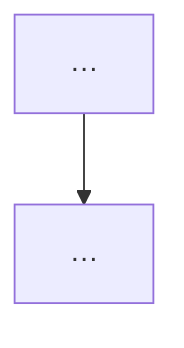

# 第十章《图 Graphs》重写 · 写作须知（每位写手必读）

你要写的是一篇**能替代听课的讲义**，不是对教材的整理转述。
目标读者：学过第 1、2、6、9 章（逻辑与证明、集合与函数、计数、关系），
**没学过第 10 章，也没有任何图论基础**。判据只有一条：**他顺着读一遍就能懂，中途不用回头查。**

---

## 1. 素材在哪（都在本机，直接读，不要凭记忆写）

| 用途 | 路径 |
|---|---|
| 原件 PDF | `离散数学/pdfs/第十章.pdf` |
| 逐页文本层（干净、可直接 grep） | `/tmp/c10/text/pNNN.txt`（NNN 三位，物理页号） |
| 逐页渲染图（130 dpi，供 `read_image`） | `/tmp/c10/pages/page-NNN.png` |
| 按比例裁图工具 | `课件笔记-staging/离散数学第十章-重写/tools/crop_frac.py` |
| 交付目录 | `课件笔记-staging/离散数学第十章-重写/`（`C10.x …md` + `attachments/*.png`） |

**页码换算：印刷页 = 物理页 + 640。** 正文里一律用**印刷页**（与教材一致），
写成 `## 3. 图的同构（p.671–673）`；`source` 里写物理页与印刷页两套。

**必读**：先 `read` 本目录下 `_章节地图.md`（全章主线、篇间依赖、术语统一口径），再读你自己的文本与图。

**禁止**：`离散数学/C10*.md` 里那一版是**被废弃的旧稿**，不要读、不要参考、不要抄它的结构。
（用户明确要求忽略并覆盖现有版本。）

### 读页的方法（按此顺序，别跳）

1. **先读文本层**（`/tmp/c10/text/pNNN.txt`）把你负责的页从头到尾读一遍。证明、数字、例题人名都在里面，比图准。
2. **再逐页读渲染图**（`/tmp/c10/pages/page-NNN.png`）。公式排版、表格、图、图注、边上的旁注（"Hall's marriage theorem is an example of …"这类页边小字）只有看图才拿得到。
3. **两侧资料对不上时**，以图为准判断印刷内容，以文本层为准抄公式——两者不一致要当场记录（见 §9 勘误）。

> 本 PDF 已体检：104 页**全部有文本层**、**0 处 Ink 注释**、**0 个整页空白**、不是扫描件
> ⇒ **本章没有任何课堂手写笔迹**。所以你不要找板书，也不要写"板书"字样。

---

## 2. 体例硬约束（违反即返工）

### 2.1 骨架

```
---
title: "C10.2 图的术语与特殊类型 Graph Terminology and Special Types of Graphs"
course: "离散数学 Discrete Mathematics"
chapter: "10 图 Graphs"
section: "10.2"
tags: ["离散数学", "图论", "…", "…"]
aliases: ["C10.2", "…", "…"]
source: "Rosen, Discrete Mathematics and Its Applications, Seventh Edition, §10.2；课件 第十章.pdf p.11–28（印刷 p.651–668，无手写笔迹）；…"
---

# C10.2 图的术语与特殊类型 Graph Terminology and Special Types of Graphs

> [!abstract] 这一讲的任务
> （两三句：接上一讲什么问题 → 这一讲解决什么 → 为什么值得学）

> [!info] 怎么读这份讲义
> （阅读顺序提示 + 本篇用到哪些旧知识 + 一句话点出已知勘误）



---

## 0. 开场：一个具体场景

…

---

## 1. …

## 这一讲的三句话

## 相关笔记 Related Notes
上一讲：[[…]] ｜ 下一讲：[[…]] ｜ 返回：[[C10 图 Graphs MOC]]
```

- **H2 之间用 `---` 分隔**（`---` 独占一行，前后各空一行）。
- H2 编号用 `## 1.` `## 2.`（罗马数字 `一、` 不用）。**标题带页码**：`## 5. 特殊图族（p.655–657）`。
- frontmatter 7 键齐全，`title` 必须**等于文件名去 `.md`**，值用双引号。
- 表情符号标题在 MOC 里用，讲义正文的 H2 **不加 emoji**。

### 2.2 callout 语义（只用这几种，标题写中文）

| 写法 | 用途 |
|---|---|
| `> [!abstract] 这一讲的任务` | 篇首唯一一处 |
| `> [!info] 怎么读这份讲义` | 篇首；可含标注说明与勘误一句话 |
| `> [!important] 定义 5 二分图 Bipartite Graph` | 定义、定理、推论、算法、必须记住的结论 |
| `> [!question] 停一下，先自己想想` / `> [!question] 课堂追问` | 真抛问题，**隔一段在正文里直接答**，不用折叠块 |
| `> [!example] 例 12 匹配失败的那半边` | 教材编号例题 |
| `> [!warning] 易错点：** | 符号方向、边界取值、两个相似概念 |
| `> [!note] …` | 前置知识、专业关联、延伸补充 |
| `> [!tip] …` | 速查表、下一讲预告 |

**定义/定理/算法一律用 `> [!important]` 块**，标题写成 `定义 5`、`定理 5（Hall 婚姻定理）`、`算法 1（Dijkstra）` 这样的**可检索形式**——
后续会按 `例 n` / `定义 n` / `定理 n` / `算法 n` 机械核对覆盖率，所以这些字样必须是字面量（`例 12`、`定义 3`、`定理 2`、`算法 1`）。

### 2.3 图与双链

- 图片嵌入：`![[C10.2-原图-员工与任务匹配.png]]` —— **裸文件名，写路径即失效**。
- 双链：`[[C10.4 连通性 Connectivity]]` —— 裸文件名，不加 `.md`、不加路径。
- 表格里放图必须写成 `![[x.png\|60]]`，否则断列。
- LaTeX：行内 `$...$`，行间 `$$...$$`；**不用** `\(...\)`。常用 `\boxed{}`、`bmatrix`、`aligned`。
- mermaid：节点标签一律双引号包裹；**里面写 Unicode 数学符号**（`V₁`、`⟹`），不要写 `$...$`。

### 2.4 语言

中文正文 + 英文术语对照，首次出现写「**邻域 neighborhood**」「**握手定理 the Handshaking Theorem**」。
不写「老师说……」「老师给的窍门是……」——直接写成断言：「速判窍门：……」。
（课程信息里的教师姓名是知识点，但本章没有这类内容。）

---

## 3. 讲义体：概念要被"逼"出来，不能被"给"出来

### 3.1 每个新概念的五步链条（不许跳步）

**提出的问题 → 让读者先猜 → 朴素尝试 → 撞墙（为什么不行）→ 引出概念 → 正式定义 → 手算验证 → 回头看我们做了什么**

**「撞墙」是重点。** 读者看懂"朴素做法为什么不行"，比记住结论有用得多，考试也常考这些"为什么"。
例如讲二分图，不要一上来给定义，先让人试着把"三类岗位分给四个人"排开——
排到第三类岗位时发现只剩两个人会做，**手不够**，这才逼出"左边的每个子集都要有足够多的邻居"。

### 3.2 新概念准入检查（**最容易翻车的地方**）

任何新术语、新算法、新符号，**在正文第一次出现之前**，必须先用这五问过一遍：

1. **它解决什么问题？** 说名字之前，先让读者意识到有个坎过不去。
2. **它是什么？用一句人话说。** 不许写「XX 是一种算法／方法」。要写"先做什么、再做什么"。
3. **为什么叫这个名字？** 逐字拆开（含隐喻：**握手**定理说的是"度数之和等于握手总次数×2"；
   **松弛** relaxation 是"拿新算的距离去比旧标签，小就替换"；**对偶图** dual 是"把面变成点"）。
   是人名的（Dijkstra、Hall、Kuratowski、Hamilton、Euler、Ore、Dirac、Fleury）要**明说这是人名**
   （如"这是荷兰计算机科学家 Edsger Dijkstra 的名字，不是方法名"），不要硬拆字。
4. **它依赖哪个前置工具？** 依赖链式法则式的旧工具时，**先把工具本身讲出来**（三五行 + 一个不带本章符号的例子）。
5. **正文第一次提到它时，是不是已经在用它了？** 是则过渡缺失，必须补。

**遇到这三类概念，必须单独开一节**（不写公式或只写最简形式），下一节开头要把它接上：

- 本章的核心算法与核心定理：**Hall 定理**、**Dijkstra 算法**、**Floyd 算法**、**Fleury 算法**、
  **Euler 公式与 Kuratowski 定理**、**图同构判定**；
- 名字本身是隐喻或含人名的：握手定理、桥 bridge、割点 articulation point、细分子图 subdivision、对偶图 dual；
- 需要读者调动前置工具的：邻接矩阵（依赖第 2.6 节矩阵乘法）、走法计数 $A^r$（依赖矩阵幂）、
  图同构（依赖双射）、强连通（依赖有向图）。

**自检办法**：把这一节整段删掉，若后面的正文读起来仍通顺 ⇒ 它只是复述，重写；
若后面每处引用都悬空 ⇒ 它确实承重。

### 3.3 开场（`## 0.`）必须是具体场景

不能是「本节介绍连通性」。可用：

- **把教材里的表格/数据还原成一个人的诉求**：网管问"这两个机房还通不通"；教务问"这 12 门课的考试能不能排在 3 个时段里"；
  印刷厂问"这块电路板能不能不交叉布线"；物流问"这趟车怎么走最省"。
- **一个会让人卡住的真实故障**：单点故障导致全网分区、并行机之间多跳路由、DNA 测序拼装。
- **上一讲留下的缺口**：把关系画成有向图以后，"路径""可达"这些词其实还没定义。

场景讲完，立刻点一句：**「你刚才做的，就是一次完整的 XX」**。

### 3.4 篇末

```
## 这一讲的三句话

> [!important] 这一讲的三句话
> 1. …
> 2. …
> 3. …

> [!tip] 下一讲预告
> （一句悬念）

## 相关笔记 Related Notes

- 上一讲：[[…]]
- 下一讲：[[…]]
- 返回：[[C10 图 Graphs MOC]]
- 前置：[[…]]（用到的旧章节，1–3 条）
```

（`## 这一讲的三句话` 只留三条，不要写成五条八条。）

---

## 4. 反面清单（出现即返工）

- ❌ 正文任何位置出现 **「课件」**（含"本课件""原课件""课件里"）或 **「幻灯片」**。
  要指教材就写"这一页""上面这张图"；**页码可以留**（`（p.659）` 是定位，不是出处声明）。
  指名原始材料缺陷时写「原印作 …，实际 …」「教材此处写作 …，按前后文应为 …」。
- ❌ 「本节介绍/讲解……」「教材给了两个例子……」式开篇（整理体）。
- ❌ 先给完整定义，再用 callout 补"通俗解释"——顺序反了。
- ❌ 篇末写「课后自测 / 本节自测 / Self-Test」板块。
- ❌ 只把图贴上去、内容没讲进正文；或先贴图再解释。
- ❌ 把补充内容堆成一个「补充说明」大板块。
- ❌ 用「显然」「值得一提的是」「不言而喻」带过一个术语的出场。
- ❌ 「原例中」「本书中」——直接讲内容，不要给"出处口吻"。
- ❌ 用形容词代替机理（"这个界很紧"→说明"紧在哪、什么时候取等号"）。
- ❌ 数值不核就照抄（见 §7）。

---

## 5. 覆盖要求（会机械核对，缺一即返工）

1. **编号例题**：你负责区间内的**每一个** `EXAMPLE n` 都要出现，至少以 `例 n` 形式（推荐 `> [!example] 例 n 标题`）。
   题目里的人物、城市、数字照原样保留（读者要拿它对照教材做题），但**叙述用中文重讲**，不要整段抄英文原句。
2. **定义 / 定理 / 推论 / 算法**：全部出现，标题写 `定义 n` / `定理 n` / `推论 n` / `算法 n`。
   教材证明若压缩成一句话，你必须**把中间步骤补回**（见 §6.1）。给不出完整证明的（Kuratowski 困难方向、
   四色定理、同构判定复杂度），要**明说这是已知定理、只当作工具使用**，不要假装推过。
3. **章末复习题**（Review Questions，p.737–738 共 22 题）与**补充练习**（Supplementary Exercises，p.739–742）里
   **新出现的概念**（不是每道题都要做）：按所属主题补进正文对应小节，单独成 `###` 小标题并注明"延伸"。
4. **Key Terms and Results**（p.735–737）里属于你这一节的词条，要在正文有落点（MOC 会做汇总表）。
5. **图注与页边小字**：图注（FIGURE n 的说明）、页边旁注都要读到，信息该进正文的进正文。

---

## 6. 展开尺度：按信息增量定，不按篇幅定

**该展开的地方一句都不能省**：被压成一行结论的推导、跳过一步就断链的中间步、
「可以证明」「类似可得」、一切"为什么"、读者会停下来的反直觉处。

**该收敛的地方不要注水**：同一件事说第二遍、没有信息量的强调、读者已具备的前置知识、与主干无关的旁支。

典型需要展开（本章高发）：

- **定理 2（奇度顶点有偶数个）的证明**：为什么这两类顶点的度数和还能被 2 整除——要讲清"每条边两个端点"这个计数。
- **定理 4（二分图 ⟺ 无奇圈）的双向证明**：充分性用 BFS 分层，为什么同层不能有边、跨层为什么必然异色。
- **Hall 定理的充分性**：归纳证明要能把两种情形（有真子集取等号 / 所有真子集严格大于）分开讲，并说清为什么这样分。
- **Dijkstra 的正确性**：为什么"标签最小的未访问点一旦确定就再也不会变小"——非负权在这里用到哪一步。
- **Floyd 的循环顺序**：为什么中间点 $k$ 必须放最外层，换成最内层会错。
- **Euler 公式的归纳证明**：删掉一条边的两种情形（割边 / 非割边）分别怎么保持号。
- **推论 2（$e \le 3v-6$）**：为什么每条边在面边界里数两次、为什么每个面度 ≥ 3。
- **Ore 定理**：为什么不满足时找不到长路径、闭包论证。

篇幅参考 600–1000 行（10.2 可到 1100）。**小节长度不要整齐均匀**——那就说明没有按内容取舍。

---

## 7. 数字必须双向复算

- 你写的每一个数（点数、边数、度数、走法数、最短距离、色数、面数、复杂度）**都要用 `python3` 现算**。
- **教材上印的数也要独立复算**：对不上要判断是"教材笔误"还是"我看错了"。
- 复算脚本写成块放 `/tmp/c10/verify-<你的编号>.py`，把关键结果打印出来贴进你的报告。
- 已知的教材问题（前一轮核对出来的，供参考，**你仍要独立验证**）：
  - p.710 例 1 中 $a\to d\to e$ 的长度印作 7，按边权 $2+3$ 应为 5，后文也按 5 用；
  - p.674 旁注称同构"最好已知算法是指数最坏时间"——旧版技术状态，已知有准多项式上界；
  - p.656 正文"leads us to Definition 5"，下文实际是 **Definition 6**；
  - p.657 例 12 的"no edge connects a red and a blue vertex"与二着色要求反向；
  - p.664 收缩段把"把 $u$ 与 $w$ 合并成新点"写成与 $u,v$ 不符的变量。
  你自己再找一遍；**确认属实的写进正文的「勘误」小节并在报告里点名，不确定的不要写成教材错误**。

---

## 8. 图（本章是图论，配图标准比别人高）

### 8.1 什么时候必须配图

出现下面这类句子就说明读者得自己脑补构图，必须给图：
「这边连着三个、那边只连一个」「这两张图顶点名字不同但结构一样」「从外面绕进去再回到起点」
「这条边走不通、得绕另一侧」「把面缩成一个点之后，原来共边的两个面就变成相邻的两点」。

**反过来不算**：只为好看、文字已讲清只是重复、**把本该写的推理塞进流程图节点**、"每节凑一张"。

### 8.2 裁图还是自绘

- **要保真的**（教材里的具体图、多种子图对照、地图与画法、算法逐步演化）→ **裁原图**（矢量，裁出来很干净）。
- **要让人看出规律/对比/结构的**（四族特殊图的点边数对照、二分的分层、欧拉与哈密顿的区别、
  Dijkstra 标签表、$e$ 与 $v$ 的上下界区域）→ **自绘**（matplotlib 或 mermaid）。
- **纯数据对照** → 表格。

### 8.3 已有裁图（可直接复用，**先 `read_image` 看一眼再决定用不用**）

`离散数学/attachments/` 里已有 24 张（旧稿留下的裁图，质量已抽查合格）：

```
C10.1-原图-模块依赖与程序先序.png
C10.2-原图-员工与任务匹配.png        C10.2-原图-邻域与度两例.png
C10.3-原图-同构不变量两例.png
C10.4-原图-连通与分量.png            C10.4-原图-连通度五例.png
C10.4-原图-圈与同构两例.png
C10.5-原图-七桥与多重图.png          C10.5-原图-欧拉有向无向六例.png
C10.5-原图-弯刀欧拉回路.png          C10.5-原图-欧拉路径三例.png
C10.5-原图-十二面体环游.png          C10.5-原图-哈密顿路径三例.png
C10.5-原图-旋转编码与Gray码.png
C10.6-原图-航线三种权重.png          C10.6-原图-网络三种权重.png
C10.6-原图-Dijkstra逐步标签.png
C10.7-原图-K4与Q3的平面表示.png      C10.7-原图-同胚细分三例.png
C10.7-原图-K5细分障碍.png            C10.7-原图-Petersen细分障碍.png
C10.8-原图-地图与对偶图.png          C10.8-原图-地图对应的对偶图.png
C10.8-原图-加边改变色数.png
```

复用它们**不需要再复制文件**（文件已在 `离散数学/attachments/`），直接 `![[文件名.png]]` 引用。

### 8.4 需要新裁的图

```bash
cd "课件笔记-staging/离散数学第十章-重写"
python3 tools/crop_frac.py --page 15 --frac 0.05,0.20,0.95,0.31 --out attachments/C10.2-原图-四族特殊图.png --scale 4
```

`--frac x0,y0,x1,y1` 是**页面归一化坐标**（0=左/上，1=右/下）。用 `page-NNN.png`（1107×1366 px）
量一下像素再除以宽高即可。裁完**必须 `read_image` 回看**：别带进图注以外的东西（相邻段落、页眉页码）。

### 8.5 自绘图

- **标签一律用英文**（matplotlib 缺中文字体会变方框）。
- `export MPLCONFIGDIR=/tmp/mpl_c10`，否则报 `.matplotlib is not a writable directory`。
- 线宽、字号要能在 Obsidian 里缩到 ~600 px 宽仍看得清；`figsize` 建议 `(7,4)`，`dpi=200`，`bbox_inches="tight"`。
- 画完 `read_image` 回看：坐标范围对不对、图例有没有遮数据、有没有被截断、箭头方向对不对。
- **图里的结论必须由正文讲出来**，图只做印证；图放在讲完之后。

### 8.6 命名

`C10.<节>-原图-<中文描述>.png`（裁切）／`C10.<节>-<中文描述>.png`（自绘）。全库唯一，不要半角 `:` `/`。

---

## 9. 专业关联（vault 使用者是 AI 方向）

每篇至少 1 处、至多 3 处，写成 `> [!note] 专业关联`，**必须具体**，不要泛泛而谈：

- 图模型 ↔ 知识图谱、社交网络、程序依赖图（编译器/AI 框架的计算图）。
- 邻接矩阵 ↔ 图神经网络 GNN 的邻接矩阵、稀疏/稠密存储、$A^r$ 与多跳传播（$A$ 的幂就是多跳聚合）。
- 连通性 ↔ 网络鲁棒性、割点/割边与单点故障。
- 欧拉路径 ↔ DNA 片段拼装（de Bruijn 图）、Gray 码与编码器/传感器绝对位置。
- Dijkstra/Floyd ↔ 导航、路径规划、Floyd–Warshall 与传递闭包/all-pairs。
- TSP ↔ 物流、PCB 钻孔、近似算法与 NP-hard。
- 平面图 ↔ PCB 布线、芯片层数（thickness）、地图。
- 图着色 ↔ 寄存器分配（编译器）、考试排程、频谱分配、图着色的 GNN 与组合优化。

---

## 10. 交付物与报告

### 10.1 写进

- 笔记：`课件笔记-staging/离散数学第十章-重写/<你的篇名>.md`
- 新图：`课件笔记-staging/离散数学第十章-重写/attachments/`

### 10.2 报告（返回给我，用这个格式）

```
## 交付
- 文件：<路径>（<行数> 行）
- 新图：<文件名列表，每张一句"说明哪句话"> ／ 复用：<文件名列表>

## 覆盖
- 例题：例 a–例 b 全覆盖（逐个列出：1,2,3…）
- 定义/定理/算法：定义 n…／定理 n…／算法 n…
- 补充练习里纳入的新概念：…

## 复算
- 复算项与结果（简表）；与教材不一致处：…

## 教材问题
- 页码 + 原文 + 我的判断（笔误／我读错／按数学必须如此）

## 跳读
- 跳了哪些页、依据（仅当有动画重复页或纯习题页时可跳）
```

---

## 11. 三条最容易犯的错（写之前先看）

1. **把"整理"当"讲课"**：一句「例 5 的完全图 $K_n$ 有 $n(n-1)/2$ 条边」是整理；
   讲义要问"为什么是 $n(n-1)/2$ 而不是 $n(n-1)$——握手为什么要除以 2"，再落到边数公式。
2. **术语裸奔**：`## 4. 割点与连通度` 这个标题里"割点""连通度"在第一次出现前必须已经有一句人话
   （"删掉它，网络就断成两半——这样的点叫割点"）。**标题、路线图、小结里出现的名词同样要过一遍。**
3. **图代替推理**：把 Dijkstra 的松弛写成流程图的箭头，读者以为自己懂了，关键那一步却藏在箭头里。
   推导必须落在正文的文字与公式里，图只做印证。
