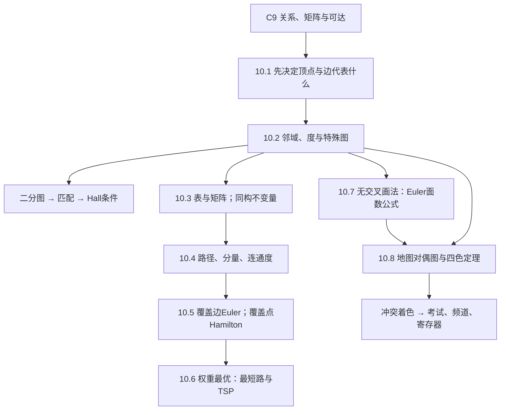

# C10 图 Graphs MOC

> [!abstract] 从第9章的关系走到网络上的问题
> 关系告诉我们“哪些对象联系在一起”，图进一步让我们问：怎样传消息、怎样抵抗故障、怎样走完所有边、怎样最省路，以及哪些任务不能共享资源。本章的主线是**先确定模型，再选与目标相符的判据**。
> 原材料104页已按分节、图示与文本层核查。正文拆为8篇讲义，保持教材顺序；定义、定理、原例及算法进入正文，部分练习中的新概念作相关补充。它是全章学习讲义，**不是全部课后习题与写作项目的解答集**。

## 📖 本章笔记索引

表中是含边界页的材料定位；共享页上的内容按节标题归位，不重复算两次。

| 笔记 | PDF物理页／印刷页 | 核心问题 | 状态 |
|---|---|---|---|
| [[C10.1 图与图模型 Graphs and Graph Models]] | 1–11／641–651 | 如何选择方向、重边、自环，建立模型 | 已整理；当期进度待确认 |
| [[C10.2 图的术语与特殊类型 Graph Terminology and Special Types of Graphs]] | 11–28／651–668 | 度、图族、二分与匹配，Hall条件为何充分 | 已整理；当期进度待确认 |
| [[C10.3 图的表示与图同构 Representing Graphs and Graph Isomorphism]] | 28–38／668–678 | 保存连接，以及同构的排除与验证 | 已整理；当期进度待确认 |
| [[C10.4 连通性 Connectivity]] | 38–53／678–693 | 路径、强弱连通、故障冗余与定长走法 | 已整理；当期进度待确认 |
| [[C10.5 欧拉路径与哈密顿路径 Euler and Hamilton Paths]] | 53–67／693–707 | 覆盖边与覆盖点，欧拉构造、Hamilton条件、Gray码 | 已整理；当期进度待确认 |
| [[C10.6 最短路径问题 Shortest-Path Problems]] | 67–78／707–718 | Dijkstra、Floyd、旅行商与近似条件 | 已整理；当期进度待确认 |
| [[C10.7 平面图 Planar Graphs]] | 78–87／718–727 | 面数与边数界，细分障碍 | 已整理；当期进度待确认 |
| [[C10.8 图着色 Graph Coloring]] | 87–95／727–735 | 冲突图、色数上下界、排程与资源分配 | 已整理；当期进度待确认 |

## 🗺️ 内容地图与阅读顺序

第一遍按10.1至10.8顺读。10.2中的Hall证明最长，但它解决“每项任务有人会做仍分不出去”的关键障碍；可先看两组员工实例，再回看归纳证明。10.3先学固定顶点顺序，再比较矩阵；若忘记矩阵乘法，补 [[C2.6 矩阵 Matrices]]。

10.4的普通矩阵幂接着 [[C9.3 关系的表示 Representing Relations]] 的关系矩阵往前走：布尔乘法只问可达，普通乘法保存走法数量。10.5的欧拉奇偶条件依赖10.2握手定理；10.6的TSP依赖哈密顿定义，但Dijkstra不以先会求哈密顿回路为前提。10.7可以在掌握基本图与握手定理后独立阅读，10.8同时连接二分图与平面图。

本次拆分已经用户确认，未调整教材顺序或迁移旧笔记体例；第9章只增加第10章入口。第11章“树”是自然后续，尚无实际讲义，导航不制造空链接。

## 📐 公式、条件与推导落点

$n$通常为顶点数，$m$为边数；10.7沿原记号用$v,e,r$表示点、边、面。度数、匹配数、走法数是离散个数；带权路线必须保持同一单位。公式旁的节号在对应讲义中有完整解释。

| 名称 | 公式或判据 | 条件、符号与推导落点 |
|---|---|---|
| 无向握手 | $\sum_v\deg(v)=2m$ | 允许环与重边，环对度贡献2；C10.2 §2 |
| 奇度点 | 奇度顶点数为偶数 | 有限无向图；C10.2 §2 |
| 有向握手 | $\sum_v\deg^-(v)=\sum_v\deg^+(v)=m$ | 自环入、出各1；C10.2 §3 |
| 图族点边数 | $K_n:(n,\binom n2)$；$C_n:(n,n)$；$W_n:(n+1,2n)$；$Q_n:(2^n,n2^{n-1})$ | $C_n,W_n$取$n\ge3$，$Q_n$取$n\ge1$；C10.2 §4 |
| 完全二分图 | $\vert V\vert =m+n,\ \vert E\vert =mn$ | 此处$m,n$为两侧点数；C10.2 §5 |
| 二分判据 | 可二着色，等价于不含奇圈 | C10.2 §5，奇圈双向证明在C10.4 §7 |
| Hall条件 | 所有$A\subseteq V_1$有$\vert N(A)\vert \ge\vert A\vert $ | 充要保证覆盖$V_1$的完全匹配；C10.2 §6 |
| 补图的度 | $\deg_{\overline G}(v)=n-1-\deg_G(v)$ | 简单图；正则、度序列、自补关系在C10.2 §4补充 |
| 伪图邻接矩阵度 | $\deg(v_i)=\sum_j a_{ij}+a_{ii}$ | 本书对角元每环只记1；C10.3 §2 |
| 同构 | 双射保持邻接的“当且仅当” | 不变量相同不足以肯定；C10.3 §4–5 |
| 定长走法数 | $(A^r)_{ij}$ | 普通整数矩阵幂，允许重复；C10.4 §7 |
| 连通度 | $\kappa(G)\le\lambda(G)\le\delta(G)$ | 有限简单无向图，完全图取$n-1$，单点/不连通取0；C10.4 §4 |
| 无向欧拉回路／路径 | 非孤立部分连通；奇度点0个／至多2个 | 恰2奇点时仅非闭合；C10.5 §1–2 |
| 有向欧拉 | 各点入出平衡；或仅起终点各差1 | 非孤立部分底层连通；C10.5 §3 |
| Dirac | $\delta(G)\ge n/2$ | 简单图$n\ge3$，充分非必要；C10.5 §5 |
| Ore | 所有非邻点度和$\ge n$ | 简单图$n\ge3$，充分非必要；证明在C10.5 §5 |
| Dijkstra松弛 | $L(v)\gets\min\{L(v),L(u)+w(u,v)\}$ | 非负权；朴素$O(n^2)$；C10.6 §2–4 |
| Floyd | $D^{(k)}_{ij}=\min\{D^{(k-1)}_{ij},D^{(k-1)}_{ik}+D^{(k-1)}_{kj}\}$ | 最外层循环为中间点；$O(n^3)$；C10.6 §4补充 |
| 对称TSP枚举 | $(n-1)!/2$ | 固定起点、反向等价，$n\ge3$；C10.6 §5 |
| 欧拉面数公式 | $v-e+r=2$；$c$分量时$1+c$ | 面包括无界区域；C10.7 §2 |
| 面边界求和 | $\sum_R\deg(R)=2e$ | 桥在同一面边界计两次；C10.7 §3 |
| 平面边数界 | $e\le3v-6$；无三角形时$e\le2v-4$ | 简单平面图$v\ge3$；必要非充分；C10.7 §3 |
| Kuratowski | 非平面$\iff$包含$K_5$或$K_{3,3}$细分子图 | C10.7 §5；困难反方向作为定理使用 |
| 色数 | $\chi(K_n)=n$；$\chi(K_{m,n})=2$；偶圈2、奇圈3 | 两侧非空；C10.8 §4 |
| 四色定理 | $G$平面$\Rightarrow\chi(G)\le4$ | 非平面仍可能只需2色；C10.8 §2 |
| 边／多重着色 | $\chi'(G)\ge\Delta(G)$；含边二分图$\chi_k(G)=2k$ | 与点色数区别；C10.8 §7 |

补充练习定义的聚类系数、随机图与单调性在C10.1 §7；Hall缺额与SDR在C10.2 §6；反向图、带宽在C10.3末段；半径、直径、强连通定向及最优连通在C10.4；Fleury与骑士周游在C10.5；交叉数与厚度在C10.7 §6；独立集、支配集、边着色、多重着色和画廊问题在C10.8。它们是材料中的延伸概念，按各自依赖融入正文，不另外堆成题目清单。

## 📌 Key Terms 中英术语入口

| 中文 | English | 正文落点 |
|---|---|---|
| 顶点、边、端点、自环、重数 | vertex, edge, endpoint, loop, multiplicity | C10.1 §1–2 |
| 简单图、多重图、伪图、混合图 | simple graph, multigraph, pseudograph, mixed graph | C10.1 §2 |
| 有向图、弧、起点、终点 | digraph, arc, initial vertex, terminal vertex | C10.1 §2，C10.2 §3 |
| 相识、影响、合作、引用、先序图 | acquaintanceship, influence, collaboration, citation, precedence graph | C10.1 §3–6 |
| 邻接、关联、邻域、度、入出度 | adjacent, incident, neighborhood, degree, in/out-degree | C10.2 §1–3 |
| 孤立点、悬挂点、正则图、度序列 | isolated, pendant, regular graph, degree sequence | C10.2 §1、§4 |
| 完全图、圈、轮、超立方体 | complete graph, cycle, wheel, hypercube | C10.2 §4 |
| 二分图、二分划分、完全二分图 | bipartite graph, bipartition, complete bipartite graph | C10.2 §5 |
| 匹配、最大匹配、完全匹配 | matching, maximum matching, complete matching | C10.2 §6 |
| 子图、真子图、诱导子图、并图、收缩 | subgraph, proper/induced subgraph, union, contraction | C10.2 §8 |
| 补图、自补图 | complement, self-complementary graph | C10.2 §4补充 |
| 邻接表、邻接矩阵、关联矩阵 | adjacency list/matrix, incidence matrix | C10.3 §1–3 |
| 同构、不变量、稀疏／稠密 | isomorphism, invariant, sparse/dense | C10.3 §2、§4–5 |
| 路径、回路、游走、迹 | path, circuit, walk, trail | C10.4 §1术语对照 |
| 连通、分量、割点、桥、割集 | connected, component, articulation point, bridge, cut | C10.4 §2–4 |
| 点／边连通度、二连通 | vertex/edge connectivity, biconnected | C10.4 §4 |
| 强／弱连通、强分量 | strongly/weakly connected, strong component | C10.4 §5 |
| 欧拉、哈密顿、Gray码 | Euler, Hamilton, Gray code | C10.5 |
| 权重、松弛、最短路、旅行商、近似比 | weight, relaxation, shortest path, TSP, approximation ratio | C10.6 |
| 平面、平面表示、面、细分、同胚 | planar, planar representation, region/face, subdivision, homeomorphic | C10.7 |
| 对偶图、色数、边着色、多重着色 | dual graph, chromatic number, edge/k-tuple coloring | C10.8 |

## 🕒 材料与讲授状态

- **本次原件**：课程库 `pdfs/第十章.pdf`，104页，印刷641–744。使用用户本次放入的独立章节，不再从下载目录自行选择其他版本。与本机Rosen英文第7版相同章节的标题、页码及正文对应。
- **正文范围**：10.1–10.8的85个编号例题（各节重编号）及核心论证已逐节归位。95–97页的Key Terms and Results进入本页术语与公式表；97–98页的Review Questions作为下表的阅读回查入口；98–104页的补充练习、计算项目和写作项目均核查其边界，其中新概念按相关主题补入，未将其标成全部已作答。
- **授课证据**：当前 `pdfs/补充课件/`没有第10章文件，`transcript/未命名.txt`是第9章偏序内容，另外两份已合并转写也不覆盖本章。故教材内容与本次教学推演都不作为当期已讲证据；未改名、改写任何转写稿。
- **笔迹与显示**：104页均有文本层；逐页PDF注释检查为空；页面图逐页回看，未发现手写，计0处、涉及0页。未收到PPTX，不存在本次PPTX包内墨迹待恢复项；未发现动画重复页，没有减少任何正文页的阅读。
- **保留与补足**：原图裁切24张，详见图索引；抽象关系另用Mermaid，数值表和矩阵改写为可复制内容。补全Hall两种归纳情形、同构映射逐边核验、连通度界、欧拉拼接、Ore证明、Dijkstra贪心理由、Floyd中间点不变量、面边界推论、色数上下界。Kuratowski困难方向与四色定理仍明确作为已知定理，未把其深层证明冒充基础推演。

## ⚠️ 材料问题与处理记录

| 原位置 | 原内容或问题 | 影响 | 处理及正文落点 |
|---|---|---|---|
| p.656二分图引入 | “leads us to Definition 5”，但下文实际编号6 | 定位错一号 | 按“二分图定义”归位，C10.2 §5；不沿用错号 |
| p.657例12两处 | 欲着色使“no edge ... connects a red vertex and a blue vertex” | 禁止红蓝边与二着色要求反向，且与同段结论矛盾 | 已按相邻顶点必须异色修正，C10.2 §5；原位置可复查 |
| p.664收缩段 | “merges u and w into a new ... w”，前文端点为u,v | 合并对象变量错写 | 写为把u,v合成w；并区分简单化后的重边，C10.2 §8 |
| p.674同构算法旁注 | 称最好已知算法为指数最坏时间 | 旧版技术状态过时 | 据Babai原论文更新为已知准多项式上界，C10.3 §6；本讲不展开算法 |
| p.679、p.688路径术语 | path允许重复；simple仅限制不重复边，其他书常用另一套命名 | 易把$A^r$误解为无重复点路径数 | 开篇对照walk/trail并在定长公式重申允许重复，C10.4 §1、§7 |
| pp.684–685连通度上界 | $n-1$等界若脱离上下文，容易套到多重图 | 平行边可令边连通度超过$n-1$ | 明确限有限简单无向图，C10.4 §4 |
| p.710例1第二轮 | 把$a,d,e$长度写作7，但边权$2+3=5$，后文亦采用5 | 会把中间候选标签算错 | 独立复算按5，最短$a,d,e,z$长6；C10.6 §1 |
| p.711候选路线说明 | 多处称“只含S中顶点”，未在该处排除目标顶点自身 | 目标未进S时字面上不可能有候选路线 | 改为内部顶点来自S，终点可在外；C10.6 §2 |
| p.713定理1单列文字 | 脱离算法输入时未再次写正权假设 | 可能误用负权Dijkstra | 明确非负条件并给负边反例；C10.6 §4 |
| p.714复杂度常数计数 | 逐轮同时有寻找最小标签、加法及比较；“2(n−1)”并非这些项总和的精确统一界 | 不影响$O(n^2)$，影响精确计数理解 | 每轮按$O(n)$，总$O(n^2)$，C10.6 §4 |
| p.717算法2前说明 | “this algorithm cannot be used to construct shortest paths” | 容易误认为Floyd方法原则上无法恢复路线 | 区分原伪代码只保存距离，增存下一跳即可恢复；C10.6 §4补充 |
| pp.645–648、681–686、732 | 网络规模、历史快照、示例频道限制 | 易当作今天的规模、报价或现行规则 | 数字保留在其原日期或题设范围，未外推为现状；C10.1、C10.4、C10.6、C10.8 |

图同构历史更新的外部依据为 [László Babai，Graph Isomorphism in Quasipolynomial Time](https://arxiv.org/abs/1512.03547)；仅用其准多项式时间结论修正旧旁注。本次数学结果没有因为更换现实网络规模而改变。

## 📋 原章末复习问题的阅读落点

下面把原22道复习问题连接到已讲解的段落。要求自己另画图、编程或查资料的小问仍属于练习任务，未冒充本次已完成的作业。

| 原题号 | 要回查的判断 | 正文位置 |
|---|---|---|
| 1–2 | 图类型与至少四类建模 | C10.1 §2–6 |
| 3–5 | 无向握手、奇度点、有向入出度 | C10.2 §2–3 |
| 6–7 | 图族构造与点边数 | C10.2 §4–5 |
| 8 | 二分与着色；$K_n$仅$n\le2$二分，$C_n$仅偶圈二分，轮图不二分 | C10.2 §5；C10.4 §7 |
| 9 | 表、邻接矩阵、关联矩阵；自己造图的小问保留为练习 | C10.3 §1–3 |
| 10 | 同构、不变量、反例；旧算法状态修正 | C10.3 §4–6 |
| 11 | 连通与分量 | C10.4 §2 |
| 12 | 矩阵表示、重排验证同构、$A^r$定长计数 | C10.3 §2、§5；C10.4 §7 |
| 13 | 七桥与欧拉充要条件 | C10.5 §0–3 |
| 14 | 哈密顿定义与排除条件 | C10.5 §4–5 |
| 15–16 | 带权任务、Dijkstra；另造十点图的小问仍为练习 | C10.6 §0–4 |
| 17–19 | 平面性、Euler界、Kuratowski | C10.7 §1–5 |
| 20–21 | 色数、常见图族与四色边界 | C10.8 §2–4 |
| 22 | 考试、频道与寄存器的着色模型 | C10.8 §5 |

## 🖼️ 原图索引与复算

原图全部使用裸文件名，实际文件在 `离散数学/attachments/`；完整坐标、原件物理页与类型在整理记录的 `figure-manifest.json`。没有原始板书、没有还原板书，24张均为原图裁切。

| 讲义 | 裁图内容 | 原件物理页 |
|---|---|---|
| C10.1 | 模块依赖与程序先序 | 7 |
| C10.2 | 邻域与度两例、员工任务匹配 | 12、19 |
| C10.3 | 同构不变量两例 | 33 |
| C10.4 | 连通与分量、五图连通度、圈与同构两例 | 42、43、47 |
| C10.5 | 七桥、欧拉有向无向六例、弯刀、欧拉路径三例、十二面体环游、哈密顿路径三例、旋转编码 | 53、54、57、58、59、59、63 |
| C10.6 | 航线三权重、计算机网络三权重、Dijkstra逐步标签 | 68、69、73 |
| C10.7 | $K_4,Q_3$平面画法、同胚细分、$K_5$细分障碍、Petersen障碍 | 79、83、84、85 |
| C10.8 | 原地图、对偶图、加边改变色数 | 87、87、89 |

复算从实际输入重新开始：度数与自环、Hall所有任务子集、两组同构映射、五图最小点割与边割枚举、$A^4$与8条走法、欧拉路线边的唯一性、Gray相邻位异或、Dijkstra与Floyd交叉验证、航线及网络三种最短值、五城24回路与原表12项、色数回溯与考试安排、平面图边数与面数。本次发现的原数值错误是p.710的7应为5，其他列入复算的原答案一致。

工作记录、逐页覆盖、原索引快照、复算及入库校验保存在 `课件笔记-staging/离散数学第十章-整理记录/`。图片存在、源图裁切和静态语法检查，与Obsidian实际显示分别记录，不互相替代。

---

**上一章** ← [[C9 关系 Relations MOC]] ｜ **本章起点** → [[C10.1 图与图模型 Graphs and Graph Models]] ｜ **下一章** → 第11章 树 Trees（待整理）
