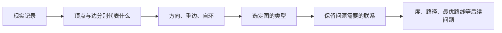
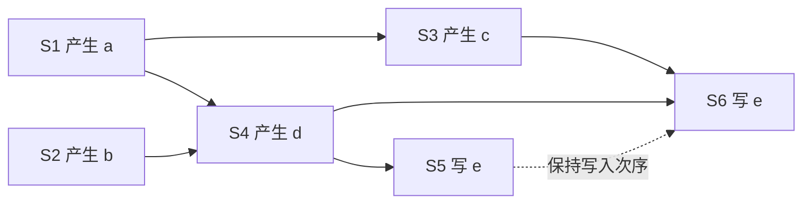

# C10.1 图与图模型 Graphs and Graph Models

> [!abstract] 这一讲的任务
> 你接到一张通信记录表，要回答两个机房能否通信。若把每条记录都当成一条普通连线，方向、重复通话与回送诊断都会丢失。我们先确定“一个顶点是什么、一条边记哪件事”，再决定图的类型。同一份现实记录，因问题不同，可以得到不同的图。

> [!info] 阅读说明
> 对应 §10.1，正文印刷页641–649；原PDF物理页1–9。例1–14的模型及其区别均在正文归位。以本次提供的英文教材为依据；未收到本章课堂转写，是否当期已讲待确认。先修见 [[C9.1 关系及其性质 Relations and Their Properties]]；不要求先学后面的图算法。



## 0. 开场：五次通话能画成一条线吗

设A给B打了三次电话，B给A打了两次。若只画 $A-B$ 一条线，就只能知道两人有过通话，既不知道谁打给谁，也不知道次数。若画 $A\to B$ 与 $B\to A$ 两条箭头，则恢复了方向，仍丢掉次数。要保留全部五次事件，就需要三条 $A\to B$ 和两条 $B\to A$ 的独立有向边。

反过来，如果任务只问“这两个人是否联系过”，五条箭头又是多余的。模型没有唯一的“越复杂越好”：**图应该保留目标问题需要的信息。**

## 1. 从点和线到图的定义

> [!important] 图 Graph
> 图 $G=(V,E)$ 由非空的顶点集 $V$ 和边集 $E$ 构成。每条边关联一个或两个顶点，称为它的端点 endpoints；端点相同的边叫自环 loop。顶点也叫结点 node。本章主要讨论顶点与边都有限的有限图 finite graph。

顶点表达对象的身份，边表达对象间某种选定的联系。用点画顶点、线画边只是表示方法；点的位置、线的长短和弯曲程度一般不属于图的数据。**两条边在纸上相交，不自动产生一个新顶点。** 是否存在连接，只由端点关系决定。第10.7节才会额外问，能否选择一种画法使所有边在顶点外不相交。

以机房网络为例，San Francisco、Los Angeles、Denver、Chicago、Detroit、New York、Washington是顶点，通信链路是边。只有一条无方向链路连接每对不同机房时，可用简单图；增加备用链路就必须能区分同端点的不同边；若机房有自测回送链路，还要允许自环。

不要把多重图的边集简单写成“端点二元集合的集合”：集合不能保存两个相同元素。可令 $e_1,e_2$ 是不同的边，再声明二者端点都为 $\{u,v\}$，这才保存了边的身份。

## 2. 三个问题决定使用哪类图

> [!important] 有向图 Directed graph / digraph
> 有向图的每条边关联一个有序顶点对 $(u,v)$，表示从起点 $u$ 指向终点 $v$ 的弧 arc。$(u,v)$ 与 $(v,u)$ 表达两个方向；它们同时出现不算同方向的重边。

先问方向是否有意义，再问是否允许同一对端点之间的重复边，最后问是否允许自环。本书术语约定如下，后文均沿用这个范围：

| 类型 | 边的方向 | 允许重边 | 允许自环 |
|---|---|---|---|
| 简单图 simple graph | 无向 | 否 | 否 |
| 多重图 multigraph | 无向 | 是 | 否 |
| 伪图 pseudograph | 无向 | 是 | 是 |
| 简单有向图 simple directed graph | 有向 | 否 | 否 |
| 有向多重图 directed multigraph | 有向 | 是 | 是 |
| 混合图 mixed graph | 有向和无向并存 | 是 | 是 |

“允许”不等于“实际一定出现”。边 $\{u,v\}$ 的重数 multiplicity 为 $m$，就是有 $m$ 条不同边具有这对端点。有向情形按有序端点对计算重数，不能把反方向的边合并进去。

不同学科的命名可能不同，尤其“有向图”“多重图”是否容许自环，因此推导前应先写清这三个条件。第9章关系的有向图没有重复的有序对，但可以有 $(a,a)$；不要把“关系表示的图”误认成此处禁止自环的简单有向图。

## 3. 以人为顶点：相识、影响与合作不是同一种边

例1的相识图 acquaintanceship graph 与友谊图 friendship graph把每个人画成一个点。若“相识”采用相互认识的定义，一条无向边足够；通常不记录自己认识自己，也不重复记录认识次数，所以用简单图。若问题改为“谁知道谁的名字”，这种关系可能不对称，就应改用有向图。

例2的影响图 influence graph 中，$a\to b$ 意味着 $a$ 能影响 $b$。影响不能倒读：原例中Deborah可以影响Brian、Fred、Linda，却不被其他人影响；Yvonne与Brian能相互影响，因此二者之间出现相反的两条箭头。这里没有自环和同方向重边，是简单有向图。

例3的合作图 collaboration graph 又回到简单无向图：两人共同发表论文、共同出演影视作品，或在正规赛季效力同一支球队，就连一条边。合作几次仍只记录“有过合作”，而非每次另建一边。Hollywood graph以演员为点，学术合作图以研究者为点，体育合作图以运动员为点；类型相同，顶点与边的现实含义不同。以后“合作距离”要数通过几个中间合作者相连，而不是看两点在纸上离多远。

## 4. 通信与信息网络：箭头保存什么

例4的电话图正是开场任务。每个电话号码是顶点，每次电话是从主叫到被叫的一条有向边，故一般使用有向多重图。原例732-555-1234到732-555-9876有三次，反向有两次；732-555-4444与图内其他号码的呼叫联系只涉及732-555-0011。若只关心“发生过通话”，删去方向并合并重复联系，就得到另一张无向简单图。**这个压缩不可逆：从一条无向边恢复不了原来的五次事件。**

例5的Web graph以网页为顶点，网页A有指向B的超链接，就记 $A\to B$。看见A能链接到B，不等于B链接到A。网页不断创建与删除，图也随时间变化；若要比较两个时段，必须先固定观察时刻。

例6的citation graph以论文、专利或法律意见等文献为顶点，从引用者指向被引用者。模型通常不记录自引到同一篇文献的自环，同一引用关系只记一次，所以是没有自环与重边的有向图。不要只因为引用常指向较早文献，就在未说明资料与时间条件时断言任何引用网络都绝无环。

## 5. 软件依赖：边的方向必须先约定

例7的module dependency graph把程序模块当成点。本书规定：**第二模块依赖第一模块时，从第一模块指向第二模块**。因此边 $A\to B$ 读作“B需要A”，不是“A需要B”。浏览器模型涉及main、display、parser、protocol、abstract syntax tree、page、network等模块；图用于查依赖和安排测试、维护顺序。其他软件工具可能恰用相反约定，应先看边的定义，不能凭“dependency”猜箭头。

例8把这种思想缩小到程序语句。原程序为：

```text
S1: a := 0
S2: b := 1
S3: c := a + 1
S4: d := b + a
S5: e := d + 1
S6: e := c + d
```

$S_3$需要 $S_1$ 产生的 $a$；$S_4$需要 $S_1,S_2$ 的结果；$S_5$需要 $S_4$；$S_6$需要 $S_3,S_4$。用箭头记录这些先后约束，得到precedence graph先序图。于是 $S_1,S_2$ 可以并行，$S_3$ 与 $S_4$也可在各自前置完成后并行；不能因为 $S_3$排在文本第三行就默认必须等 $S_2$。

这里语句还有对同一变量 $e$ 的写入。若要求保存原顺序程序最后的 $e$，$S_5$必须先于 $S_6$，否则较晚执行的 $S_5$会覆盖 $S_6$。这说明并行化不仅检查“读谁产生的数据”，还要检查共享变量的读写冲突；后文中的路径把间接依赖也表达出来。$S_5$以前的必要语句包括 $S_1,S_2,S_4$，不必执行 $S_3$才能算 $e:=d+1$。



![[C10.1-原图-模块依赖与程序先序.png]]

## 6. 交通、生物与竞赛：改变对象就要重新审视模型

例9把机场作为顶点、每天每个航班作为从出发地到目的地的边。同一路线一天多班，故通常是有向多重图。例10把路口作为顶点，道路作为边：双向路可记无向边，单行路记有向边；同时存在二者时用混合图。平行道路需要重边，环行道路可对应自环。若任务求最快路线，还得给边加上时间权重，留到 [[C10.6 最短路径问题 Shortest-Path Problems]]。

例11的生态位重叠图 niche overlap graph把物种作为顶点，共享部分食物资源、存在竞争时连无向边；不需要自环和重边。原例中松鼠squirrel与浣熊raccoon竞争，乌鸦crow与鼩鼱shrew不竞争。“没有边”表达该模型没有记录这类直接竞争，并非宣称两个物种绝无其他生态联系。

例12的蛋白质相互作用图 protein interaction graph把蛋白质作为顶点，相互作用作为无向边。实验会出现假阳性：观察到的边未必是真实相互作用。因此图上的推理是否适用于细胞，还取决于实验输入可靠性；较大的网络可拆成承担相近功能的模块，原图给出了RNA降解复合物的一组蛋白质。旧版给出的世界网络规模和生物统计仅是当时的背景估计，不作为今日规模或定义条件。

例13的round-robin tournament循环赛：每队恰与其他队比赛一次、无平局，用球队作点，从胜者指向败者。任意不同两点恰有一个方向的边，既无自环，也不出现反向同时存在的两边。原六队图中Team 1全胜、Team 3全败。六队共有 $\binom62=15$ 场，胜负方向不改变场数。

例14的single-elimination tournament单败淘汰赛，顶点的身份突然改变为**一场比赛**，从本场比赛指向本场胜者下一次参加的比赛；不能沿用循环赛的“每队一个点”来解释这张图。原图记录2010年NCAA女篮最后16队阶段，Connecticut在决赛战胜Stanford；每场淘汰一队，16队决出一个冠军需淘汰15队，所以有15场比赛。这也预告第11章树的结构。

## 7. 材料中的网络延伸：朋友的朋友与随机图

若只问每个人有几个朋友，度就足够；若想知道“朋友之间是否也相识”，就要看三角形。补充练习定义聚类系数 $C(G)$：在三个互异点组成的有序二步链 $u-v-w$中，端点也有边 $uw$的比例。设三角形数为$t$，则每个三角形给出6种有序排列，而以$v$为中心的有序二步链有$\deg(v)(\deg(v)-1)$种，所以

$$C(G)=\frac{6t}{\sum_v\deg(v)(\deg(v)-1)}.$$

分母为0时没有可供条件抽样的二步链，须另定约定，不直接作除法。三角形的系数为1，至少四点的纯圈为0；这区分了“度相同”与“局部结成小团”。

材料还用随机简单图研究网络：固定$n$个有标号顶点，每对点独立地以概率$p$连边。对某一张指定的$m$边图，其概率为$p^m(1-p)^{\binom n2-m}$；若只问“恰有$m$条边”而不指定哪一张，还需乘$\binom{\binom n2}{m}$。边数期望为$\binom n2p$。当$p=1/2$，全部$2^{\binom n2}$张有标号简单图等可能。

固定顶点集、加边后仍保留的性质称单调递增monotone increasing，例如连通、含哈密顿回路；删边后仍保留的性质称单调递减monotone decreasing，例如平面性。欧拉回路存在性不对加边单调：给偶度图只加一边可能制造两个奇点。随机模型与单调性描述的是图的生成和变化，不能把任一现实网络直接当作独立随机连边的样本。

## 这一讲的三句话

1. 先规定顶点和边的含义，再用方向、重边、自环三个条件选图；问题改变，模型也可能改变。
2. 图的结构取决于端点联系，不取决于画法；线段交叉通常不是顶点，箭头也不能反读。
3. 建模会丢弃信息：把多次有向事件压成一条无向联系后，只能回答压缩后仍被保留的问题。

## 速查表

| 名称 | 公式或判据 |
|---|---|
| 图 | $G=(V,E)$，$V\ne\varnothing$ |
| 简单图 | 无向、无自环、同一无序端点对至多一边 |
| 简单有向图 | 无自环、同一有序端点对至多一边 |
| 重数 | 同一端点对对应的独立边数 |
| 六队循环赛 | $\binom62=15$ |
| $n$队单败淘汰 | $n-1$场，每场淘汰一队 |

> [!tip] 下一讲预告
> 同样有六个顶点的两张图，能怎样用数值区分？下一讲从顶点的度开始，把“有多少连接”变成全图可验证的恒等式。


---

**上一讲** ← [[C9.6 偏序 Partial Orderings]] ｜ **下一讲** → [[C10.2 图的术语与特殊类型 Graph Terminology and Special Types of Graphs]] ｜ **返回课程索引** → [[C10 图 Graphs MOC]]
