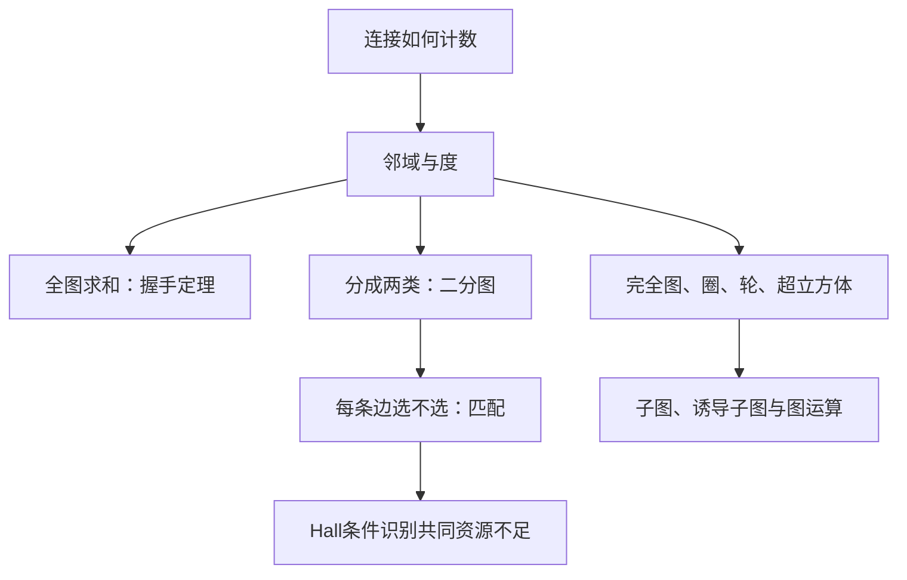

# C10.2 图的术语与特殊类型 Graph Terminology and Special Types of Graphs

> [!abstract] 这一讲的任务
> 你要给若干员工分配任务，每人最多做一项。即使员工数不少于任务数、每项任务都有人会做，分配仍可能失败：几个任务可能挤在同一小组员工身上。我们先学会用邻域与度统计连接，再用二分图和 Hall 条件识别这种瓶颈。

> [!info] 阅读说明
> 对应 §10.2，正文印刷页651–665；PDF物理页11–25。包含例1–19、握手定理、奇度点定理、有向度恒等式、二着色判据、Hall定理及证明、常用图族和图运算。课堂进度待确认。符号与图的类型沿用 [[C10.1 图与图模型 Graphs and Graph Models]]。

## 0. 开场：每项任务有人会做，为何还分不出去

有四项任务：需求requirements、架构architecture、实现implementation、测试testing。四位员工的能力如下，均来自例14的Project 2：Washington只会架构；Xuan会需求、实现、测试；Ybarra只会架构；Ziegler会需求、架构、测试。

逐项看，四项任务都有人能做；整体看，四个人也够做四项任务。可是需求、实现、测试这三项只能交给Xuan或Ziegler，两个人在“每人最多一项”的限制下装不下三项。这个失败不是人数总量不足，而是**某个任务子集的共同邻居不足**。

我们会把它写成 $|N(A)|<|A|$。为了能理解并证明这个判据，先弄清什么叫邻域，为什么它与度不是一回事。

## 1. 邻接、关联、邻域与度

无向图中，$u,v$为同一条边的端点时称为邻接 adjacent，也互为邻居neighbors；该边与两个端点关联 incident。顶点 $v$ 的邻域 $N(v)$是与它邻接的顶点集合。对顶点子集 $A$，

$$N(A)=\bigcup_{v\in A}N(v).$$

这里取的是集合并集。同一个员工同时会做三项任务，在这三项任务的共同邻域里仍只算一个人。

> [!important] 度 Degree
> 无向顶点的度 $\deg(v)$ 是该顶点处的边端数：普通关联边每条贡献1，自环每条贡献2，平行边逐条计数。度0的点为孤立点 isolated vertex，度1的点为悬挂点 pendant vertex。

**例1的简单图 $G$** 可完全由下列邻域重建：

| 点 | 邻域 $N(v)$ | 度 |
|---|---|---:|
| $a$ | $\{b,f\}$ | 2 |
| $b$ | $\{a,c,e,f\}$ | 4 |
| $c$ | $\{b,d,e,f\}$ | 4 |
| $d$ | $\{c\}$ | 1 |
| $e$ | $\{b,c,f\}$ | 3 |
| $f$ | $\{a,b,c,e\}$ | 4 |
| $g$ | $\varnothing$ | 0 |

所以 $g$孤立，$d$悬挂，度数和为18，后面将推出恰有9条边。例1另一张伪图 $H$ 的邻域依次为

$$
\begin{aligned}
N(a)&=\{b,d,e\},&N(b)&=\{a,b,c,d,e\},\\
N(c)&=\{b\},&N(d)&=\{a,b,e\},&N(e)&=\{a,b,d\}.
\end{aligned}
$$

其度依次为 $(4,6,1,5,6)$。这些数据可由边多重集 $ab,ad,ae,ae,bb,bc,bd,be,de,de,de$ 重建。例如 $b$的自环把 $b$放进自身邻域，却贡献两次度；$a$到 $e$的两条边使 $\deg(a)=4$，但 $|N(a)|=3$。**只有在无自环、无重边的简单图中，才总有 $\deg(v)=|N(v)|$。**

![[C10.2-原图-邻域与度两例.png]]

例2把这个量放回生态模型：松鼠与乌鸦、负鼠、浣熊、啄木鸟竞争，所以度为4；鼠mouse只与鼩鼱shrew竞争，是唯一悬挂点；图内没有孤立物种。这里邻接只意味着直接竞争。

## 2. 一条边有两个端点：握手定理及其后果

逐个顶点数度，等于把每条边的两个端点各数一次。普通边给两个不同点各贡献1，自环在同一点贡献2，重边也没有例外。因此

> [!important] 握手定理 Handshaking theorem
> 对有限无向图，若边数为 $m$，则 $\sum_{v\in V}\deg(v)=2m$。允许重边和自环。

例3：10个顶点度都为6，度数和为 $10\cdot6=60$，故 $m=60/2=30$。并非60条边，因为逐点统计把每条边数了两次。

进一步把顶点分成偶度点集合 $V_e$和奇度点集合 $V_o$。有

$$2m=\sum_{v\in V_e}\deg(v)+\sum_{v\in V_o}\deg(v).$$

左侧与第一项都是偶数，所以第二项也为偶数。若有奇数个奇数相加，和会是奇数；因此 **奇度顶点个数必为偶数**。这不是说每个顶点度都为偶数，也不是说偶度点一定有偶数个。若有人给出一张只有三个奇度点的无向图，甚至不必画图，就能判断数据不可能成立。

## 3. 有向边要分入度与出度

对弧 $(u,v)$，$u$是起点initial vertex，$v$是终点terminal vertex。$\deg^-(v)$为入度in-degree，统计以 $v$为终点的边；$\deg^+(v)$为出度out-degree，统计以 $v$为起点的边。有向自环各贡献1次入度与1次出度。

例4原有向图含弧 $aa,ab,ac,ae,bd,cc,cb,dc,de,ea,ed,ee$，另有孤立点 $f$。逐条看箭头得到：

| 顶点 | $a$ | $b$ | $c$ | $d$ | $e$ | $f$ |
|---|---:|---:|---:|---:|---:|---:|
| 入度 | 2 | 2 | 3 | 2 | 3 | 0 |
| 出度 | 4 | 1 | 2 | 2 | 3 | 0 |

每条有向边恰好贡献一次起点和一次终点，故

$$\boxed{\sum_v\deg^-(v)=\sum_v\deg^+(v)=|E|.}$$

本例两行各和为12，与12条弧一致。去掉方向但保留每条边的身份，得到底层无向图 underlying undirected graph；若原有相反两条弧，它们变成两条平行无向边，不能再擅自合并，否则边数会改变。

## 4. 几种反复出现的简单图

例5–8给出四个图族。先抓住构造，数量就能从定义算出来：

| 图族 | 构造 | 顶点数 | 边数 | 顶点度 |
|---|---|---:|---:|---|
| 完全图 $K_n$ | 不同点两两相连 | $n$ | $\binom n2$ | 均为$n-1$ |
| 圈 $C_n$，$n\ge3$ | $v_1v_2,\ldots,v_{n-1}v_n,v_nv_1$ | $n$ | $n$ | 均为2 |
| 轮 $W_n$，$n\ge3$ | $C_n$加中心点及全部辐条 | $n+1$ | $2n$ | 中心$n$、圈上3 |
| 超立方体 $Q_n$，$n\ge1$ | $n$位串，恰差一位时相邻 | $2^n$ | $n2^{n-1}$ | 均为$n$ |

$K_n$的每条边对应一个二元子集，故是 $\binom n2$，不是 $n(n-1)$。$W_n$的下标记录外圈顶点数，**不是全图顶点数**。$Q_n$每个顶点可任选一位翻转得到恰好 $n$个邻居，所以度数和为 $n2^n$，再除2得到边数。

构造 $Q_{n+1}$时复制两个 $Q_n$，分别在标签前补0、1，再把后 $n$位相同的对应点相连。例如 $Q_3$的000与001、010、100相邻，与011不相邻。这个“只改一位”的解释比立方体的透视图更可靠。

### 度序列、正则图与补图

把所有度按非增序列出，得到度序列degree sequence；顺序不同的标号不改变它。所有点度都等于 $r$时称 $r$-正则regular graph，握手给边数 $nr/2$，所以 $nr$必须为偶数。$K_n$是 $(n-1)$-正则，$C_n$是2-正则，$Q_n$是 $n$-正则。度数和偶数只是度序列可实现的必要条件，不保证简单图一定存在，例如三点度序列 $(2,2,0)$会要求前两点互相之外还有邻居，与第三点孤立冲突。

若一个非负整数序列能作为某张简单图的度序列，称可图序列graphic sequence。检查它时，先看每项不超过$n-1$、度数和偶数，再判断是否真能分配邻居；这些快速必要检查通过仍不保证可图。

简单图的补图 $\overline G$使用同一顶点集，对不同点，把“有边”与“无边”互换。因此 $\deg_{\overline G}(v)=n-1-\deg_G(v)$，边数为 $\binom n2-|E|$。若 $G$与补图同构，称自补self-complementary；其边数等于全部可能边数的一半，$n(n-1)/4$必须为整数，所以 $n\equiv0$或1（模4）。这些概念来自本节练习与章末术语，是后面比较同构时可用的不变量。

## 5. 二分图不是“点画在两边”

> [!important] 二分图 Bipartite graph
> 简单图的顶点集能写成不交并 $V=V_1\sqcup V_2$，并且每条边恰有一个端点在 $V_1$、另一个在 $V_2$，则称为二分图，$(V_1,V_2)$为二分划分。两侧内部都没有边，不要求两侧每对点都相连。

例9的 $C_6$可分成 $\{v_1,v_3,v_5\}$与 $\{v_2,v_4,v_6\}$，沿圈交替分组即可。例10的 $K_3$不行：三个点放进两组，至少两点同组，但完全图中这两点有边，违背组内无边。

例11–12原图 $G$可以分为红组 $\{a,b,d\}$和蓝组 $\{c,e,f,g\}$；原图 $H$含三角形，例如 $a,e,f$两两相连，不可能二分。把 $a$涂红，它的邻居 $e,f$都必须涂蓝，边 $ef$立即发生同色冲突。

由此得到**二分图当且仅当可以二着色**的判据。必要性：给两组分别涂两色，边都跨组，所以端点异色。充分性：把同色点归为一组，既然相邻点异色，组内就没有边。这两个方向都只是把同一结构换一种表达。

实际检查时从每个尚未着色的连通部分任取起点，沿边强迫邻点异色；每条边都检查一次。同色端点冲突意味着失败。只查第一个连通部分不够。后续将证明等价判据：**简单图二分当且仅当没有奇圈**，见 [[C10.4 连通性 Connectivity]]。

例13的完全二分图 $K_{m,n}$是在二分条件下再要求跨组点两两相连，顶点数 $m+n$、边数 $mn$，两组度分别为 $n$、$m$。原例 $K_{2,3},K_{3,3},K_{3,5},K_{2,6}$边数分别6、9、15、12。完全二分图通常不是完全图：同组顶点之间仍没有边。

## 6. 匹配与 Hall 定理：检查任意一组任务的资源

匹配 matching是边集的一个子集，任意两条选中边没有公共端点；边的端点称已匹配matched，其余点未匹配unmatched。最大匹配maximum matching使选中边数最多；从 $V_1$到 $V_2$的完全匹配complete matching要求每个 $V_1$顶点都被匹配，未要求覆盖整个 $V_2$。

回到例14的Project 1，能力为Alvarez：需求、测试；Berkowitz：架构、实现、测试；Chen：需求、架构、实现；Davis：需求。一组可行安排是Davis做需求、Chen做架构、Berkowitz做实现、Alvarez做测试，每人、每任务恰一次。Project 2的失败则由开场三项任务集合给出。**每个点至少有一个邻居，只是单元素子集的检查，远远不够。**

![[C10.2-原图-员工与任务匹配.png]]

例15的婚配模型同样把两类人分组，双方都接受彼此时连边；一组不共端点的边表示若干配对。覆盖第一组的完全匹配可以留下第二组未匹配者。它只表达允许配对与数量，不表达偏好排序或稳定婚配。

> [!important] Hall婚配定理 Hall’s marriage theorem
> 有限二分图 $(V_1,V_2)$存在覆盖 $V_1$的完全匹配，当且仅当对所有 $A\subseteq V_1$，都有 $|N(A)|\ge |A|$。

**必要性**直接来自“不同任务不能使用同一个人”：若完全匹配存在，$A$中的每个点都配到一个不同的邻居，至少要有 $|A|$个邻居。

充分性值得展开。对 $|V_1|$作强归纳，空集自然成立，单点时Hall条件保证至少一个邻居。假定更小的第一组都成立，现在分两种情况。

若每个非空真子集 $A\subsetneq V_1$都满足 $|N(A)|\ge |A|+1$，任选一条边 $uv$，先将它匹配，再删去 $u,v$。剩余任意点集 $B$至多失去邻居 $v$，所以 $|N_{\rm 剩}(B)|\ge |N(B)|-1\ge |B|$。归纳可匹配剩余第一组，加回 $uv$就完成了。

若存在非空真子集 $A$恰好 $|N(A)|=|A|$，它已经占满自身全部可用资源。先在 $A$与 $N(A)$之间应用归纳得到完全匹配，再同时删去二者。剩余任意 $B\subseteq V_1\setminus A$有

$$
\begin{aligned}
|N(A\cup B)|&\ge |A|+|B|,\\
|N(A\cup B)|&=|N(A)|+|N(B)\setminus N(A)|.
\end{aligned}
$$

用 $|N(A)|=|A|$相减，得到剩余邻域至少有 $|B|$个顶点；剩余图仍满足Hall条件。归纳匹配剩余部分，把两组互不冲突的匹配合在一起即可。

第一种情况处理“处处有余量”，第二种处理“有一块资源刚好用满”。这说明开场瓶颈判据不仅必要，而且足够。直接枚举所有子集可能很慢，存在性证明与高效寻找匹配的算法是两个问题。

### 练习延伸：Hall缺额与不同代表

对$A\subseteq V_1$定义缺额$\operatorname{def}(A)=|A|-|N(A)|$，令$d=\max_A\operatorname{def}(A)$（空集保证$d\ge0$）。$A$中至少有这份缺额无法同时匹配，所以任意匹配最多覆盖$|V_1|-d$个第一组点。反过来，给第二组添加$d$个与全部第一组点相连的虚拟点，新图满足Hall条件，因而可覆盖全部第一组；删去虚拟点占用的匹配边，至少还覆盖$|V_1|-d$个原点。故最大匹配大小恰为$|V_1|-d$。Project 2缺额为1，最多安排3项任务。

集合族$S_1,\ldots,S_n$的不同代表系system of distinct representatives，SDR，是选$x_i\in S_i$且所有$x_i$互异。把集合编号作左点、候选元素作右点，元素属于该集合时连边，恰好化成Hall匹配：任意编号子集$I$必须满足$|\bigcup_{i\in I}S_i|\ge|I|$。

## 7. 网络拓扑：边少与传递距离之间的取舍

例16的局域网有三种模型：星形是 $K_{1,n}$，设备之间经中心转发；环形是 $C_n$，每台连两台邻居；混合星环是 $W_n$，同时有中心和外圈，增加冗余。

例17进一步比较并行处理器互连。$K_{64}$要求每个处理器63个接口，总计 $\binom{64}2=2016$条链路；全连接便于直接传输，却昂贵。六处理器线性阵列 $P_1-\cdots-P_6$只有5条边，端点之间却需5跳。$m\times m$网格有 $m^2$个处理器，角点度2、其余边界点度3、内部点度4；最远两角需 $2(m-1)$跳，边数 $2m(m-1)$，16处理器的 $4\times4$网格有24条边、最远6跳。

若有 $2^m$个处理器，可用 $Q_m$：每台仅 $m$条直接连接，两个二进制标签之间依次翻转不同位，最多 $m$跳。例如8处理器对应 $Q_3$，12条链路、每点3接口、最远3跳。图族的公式于是回答了硬件成本与通信距离的实际取舍。

## 8. 从旧图产生新图

子图subgraph $H=(W,F)$要求 $W\subseteq V,F\subseteq E$，且保留边的端点都在 $W$中；真子图还要求 $H\ne G$。诱导子图induced subgraph $G[W]$则保留原图中端点均在 $W$的**全部**边，不能任意漏边。

例18的 $K_5$顶点为 $a,b,c,d,e$，取 $W=\{a,b,c,e\}$。原例子图保留 $ab,ac,ae,bc,be$，缺少 $ce$，因此是子图但不是诱导子图；补上 $ce$得到 $K_5[W]=K_4$。

删边 $G-e=(V,E\setminus\{e\})$不删顶点；删点 $G-v$必须同时删掉所有关联边。加边 $G+e$保持顶点不变，在简单图范围内应给尚未相邻的两点加边。

收缩 contraction则删去一条非环边 $uv$并把 $u,v$合并为新点 $w$，所有其他关联边改接 $w$。新图通常不是原图的子图，因为点的身份变了。在简单图约定下，相同新端点的平行边可合并；若保留边身份则可能产生多重图，必须说明约定。

例19原图 $G_1$顶点 $\{a,b,c,d,e\}$、边 $ab,ad,bc,be,ce,de$；$G_2$顶点 $\{a,b,c,d,f\}$、边 $ab,bc,bd,bf,cf$。并图取顶点并与边并，因此

$$
V(G_1\cup G_2)=\{a,b,c,d,e,f\},\quad
E(G_1\cup G_2)=\{ab,ad,bc,be,ce,de,bd,bf,cf\}.
$$

共同的 $ab,bc$各只保留一次。将 $G_1$的 $ce$收缩成 $w$并按简单图合并重边，得到顶点 $a,b,d,w$，边 $ab,ad,bw,dw$；其中 $bc,be$变成同一条 $bw$。这与“只删 $ce$”所得图不同。

## 这一讲的三句话

1. 度统计边端，邻域统计不同邻居；自环与重边使二者不再相等，握手定理仍然成立。
2. 二分图要求每条边跨组；完整分配要求任意任务子集都有足够的共同邻居，而非只检查总人数。
3. 删除、诱导、并与收缩保留的信息不同，先明确操作定义，再使用图的数量公式。

## 速查表

| 名称 | 公式或判据 |
|---|---|
| 无向握手 | $\sum_v\deg(v)=2\vert E\vert $；奇度点数为偶数 |
| 有向握手 | $\sum_v\deg^-(v)=\sum_v\deg^+(v)=\vert E\vert $ |
| 邻域 | $N(A)=\bigcup_{v\in A}N(v)$ |
| 二分 | 可二着色；等价于无奇圈 |
| Hall条件 | 所有$A\subseteq V_1$满足$\vert N(A)\vert \ge\vert A\vert $ |
| $K_n,C_n,W_n,Q_n$的边数 | $\binom n2,n,2n,n2^{n-1}$ |
| 完全二分图 | $\vert V(K_{m,n})\vert =m+n,\ \vert E\vert =mn$ |
| 并图 | $(V_1\cup V_2,E_1\cup E_2)$ |

> [!tip] 下一讲预告
> 既然图不由画法决定，计算机该怎样保存它，又怎样判断两幅不同画法是否其实是同一张图？下一讲进入邻接表、矩阵与同构。

---

**上一讲** ← [[C10.1 图与图模型 Graphs and Graph Models]] ｜ **下一讲** → [[C10.3 图的表示与图同构 Representing Graphs and Graph Isomorphism]] ｜ **返回课程索引** → [[C10 图 Graphs MOC]]
