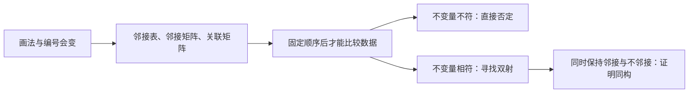

# C10.3 图的表示与图同构 Representing Graphs and Graph Isomorphism

> [!abstract] 这一讲的任务
> 两张网络图看起来完全不同，连接却可能一样；同一张图换一套编号，邻接矩阵也会变。我们先把图存成可计算的数据，再寻找“只改名字、不改联系”的对应，区分同构的证据与必要条件。

> [!info] 阅读说明
> 对应 §10.3，正文印刷页668–675，PDF物理页28–35；例1–11全部归位。先修是 [[C10.2 图的术语与特殊类型 Graph Terminology and Special Types of Graphs]] 的度、邻接和子图，以及 [[C2.6 矩阵 Matrices]] 的矩阵运算。课堂进度待确认。旧版算法复杂度旁注的历史变化另在索引登记。

## 0. 开场：旋转图形不应该改变网络

你把一个四边形的顶点拖到另一侧，两条边交叉成蝴蝶结。网络是否改变？如果只是拖动点、边的端点完全没换，结构没有改变。可是按新的视觉顺序给点编号，就会得到另一张数字矩阵；直接逐项比较“旧编号矩阵”与“新编号矩阵”会错误地说它们不同。

因此有两个不同任务：保存图时必须固定编号；判断结构时允许同时重排顶点编号，但不能随意独立地重排行与列。

## 1. 邻接表：每个顶点连接谁

邻接表 adjacency list为每个顶点列出邻居。有向图列出从该点出发能直接到达的终点，而不是把所有入边、出边混在一行。

例1原简单图的表为 $a:b,c,e$；$b:a$；$c:a,d,e$；$d:c,e$；$e:a,c,d$。由此恢复边集

$$E=\{ab,ac,ae,cd,ce,de\}.$$

无向边在两行出现，表项总数是 $2|E|=12$，不是12条独立边。例2有向图的出邻接表为：

| 起点 | 终点列表 |
|---|---|
| $a$ | $b,c,d,e$ |
| $b$ | $b,d$ |
| $c$ | $a,c,e$ |
| $d$ | 空 |
| $e$ | $b,c,d$ |

$b$、$c$行各有自身，表示自环；$d$没有出边，但其他行出现 $d$，所以它并非孤立点。若允许平行边，表项必须保存重数或独立边身份，否则会把不同边合并。

## 2. 邻接矩阵：行是起点，列是终点

固定顶点顺序 $v_1,\ldots,v_n$。简单图邻接矩阵 adjacency matrix的元素 $a_{ij}$在两点相邻时为1，否则为0。有向图中它表示 $v_i\to v_j$；无向图中矩阵对称；简单图的主对角线全为0。

例3按 $a,b,c,d$排序，原图边为 $ab,ac,ad,bc$，所以

$$A=\begin{pmatrix}0&1&1&1\\1&0&1&0\\1&1&0&0\\1&0&0&0\end{pmatrix}.$$

例如第三行第二列是1，因为 $c$连到 $b$；$a$的度就是第一行和3。例4反向给出矩阵

$$B=\begin{pmatrix}0&1&1&0\\1&0&0&1\\1&0&0&1\\0&1&1&0\end{pmatrix}.$$

只读主对角线上方的1，就得到边 $ab,ac,bd,cd$；对称位置不再另画一条边。这是一个4圈，不是8条边的多重图。

多重图把 $a_{ij}$改为两点间边数，自环在本书的对角元中**每个只记1**。例5的伪图为

$$A=\begin{pmatrix}0&3&0&2\\3&0&1&1\\0&1&1&2\\2&1&2&0\end{pmatrix}.$$

它表示 $ab$三条、$ad$两条、$bc$一条、$bd$一条、$cd$两条、$c$处自环一条，共10条。因为自环对度贡献2，而这里只记一次，故

$$\deg(v_i)=\sum_j a_{ij}+a_{ii}.$$

本例度为 $(5,5,5,5)$，和为20。直接把第三行和4当成 $\deg(c)$就漏了自环的第二个边端。有向多重图中 $a_{ij}$记录从 $i$到 $j$的弧数，行和是出度、列和是入度，不需要为有向自环额外加一次。

### 为什么有时用表，有时用矩阵

邻接矩阵有 $n^2$个位置，判断一条边是否存在只查一个位置。邻接表只保存已有联系，通常空间 $O(n+m)$；普通无序表查询某条边可能要扫描该点全部邻居。若每点度至多常数 $c$，总表项不超过 $cn$，而矩阵仍有 $n^2$项，稀疏图sparse graph用表更省；稠密图dense graph或频繁判断邻接时，矩阵往往更直接。

一个图有 $n!$种顶点排列，矩阵最多出现 $n!$种排列结果；由于对称性，不同排列可能给出相同矩阵，所以不能说一定有 $n!$个不同矩阵。

## 3. 关联矩阵：一列对应一条独立边

固定顶点顺序与边顺序，关联矩阵 incidence matrix $M$为 $n\times m$矩阵：边 $e_j$与顶点 $v_i$关联时 $m_{ij}=1$，否则0。例6的边为

$$e_1=v_1v_4,\ e_2=v_1v_5,\ e_3=v_2v_4,\ e_4=v_2v_5,\ e_5=v_3v_5,\ e_6=v_2v_3,$$

因此

$$M=\begin{pmatrix}1&1&0&0&0&0\\0&0&1&1&0&1\\0&0&0&0&1&1\\1&0&1&0&0&0\\0&1&0&1&1&0\end{pmatrix}.$$

每一非环边列都有两个1。例7的伪图在 $v_1,v_4$各有一条环，$v_1v_2$有两条平行边：

$$M=\begin{pmatrix}1&1&1&0&0&0&0&0\\0&1&1&1&0&1&1&0\\0&0&0&1&1&0&0&0\\0&0&0&0&0&0&1&1\\0&0&0&0&1&1&0&0\end{pmatrix}.$$

第2、3列相同，表示两条独立的 $v_1v_2$边；第1、8列各只有一个1，表示两个环。这种0–1关联矩阵的行和遇环也不等于度。其他资料可能用“环列写2”或有向带正负号的关联矩阵，不能把不同定义的求和公式混用。

## 4. 图同构：不是相似，而是保持全部联系的双射

> [!important] 同构 Isomorphism
> 简单图 $G=(V,E)$与 $H=(W,F)$同构，指存在双射 $f:V\to W$，使所有 $u,v\in V$满足 $\{u,v\}\in E\iff\{f(u),f(v)\}\in F$。这样的 $f$叫同构映射。

“当且仅当”要求边与非边都保持。映射既不能把邻居拆开，也不能把原本不相邻的两点变成邻居。只展示一幅看起来相像的画法，不够构成证明。

例8的 $G$有边 $u_1u_2,u_1u_3,u_2u_4,u_3u_4$；取

$$f(u_1)=v_1,\quad f(u_2)=v_4,\quad f(u_3)=v_3,\quad f(u_4)=v_2.$$

边依次映到 $v_1v_4,v_1v_3,v_4v_2,v_3v_2$，恰为另一图的全部四条边；两个非边 $u_1u_4,u_2u_3$也映到非边。因此两个不同画法的4圈同构。

同构构成等价关系：恒等映射给自反性，逆双射给对称性，复合两个保持邻接的双射给传递性。这解释了为什么可以把所有画法与标号不同、结构相同的图归为同一类。

## 5. 先排除，再构造：不变量的正确用途

同构不变量 invariant是在同构下保持的性质，包括顶点数、边数、各度数出现次数、邻居度的组合、圈与连通结构。**某项不符足以否定，全部所查项目相符仍未必足以肯定。**

例9两图都有5点6边，但 $H$有度1点 $e$，$G$没有，故不同构。例10更隐蔽：都有8点10边，都是四个2度点、四个3度点。可是 $G$的2度点 $a$没有2度邻居，而 $H$的每个2度点都有2度邻居；$a$无处可映，所以不同构。也可比较两图由3度点诱导的子图：一图是一条4点路，另一图是3叶星，度结构不同。

![[C10.3-原图-同构不变量两例.png]]

例11两图都有6点7边，度序列同为 $(3,3,2,2,2,2)$，2度点诱导子图也一致。接下来应尝试构造，而不是宣布同构。先注意 $u_1$是“无2度邻居的2度点”，它只能映到具有同样特征的 $v_4$或 $v_6$。取 $v_6$后，根据邻接与度继续选定

$$
(f(u_1),\ldots,f(u_6))=(v_6,v_3,v_4,v_5,v_1,v_2).
$$

$G$按 $u_1,\ldots,u_6$排序的矩阵为

$$A_G=\begin{pmatrix}
0&1&0&1&0&0\\1&0&1&0&0&1\\0&1&0&1&0&0\\1&0&1&0&1&0\\0&0&0&1&0&1\\0&1&0&0&1&0
\end{pmatrix}.$$

把 $H$的行、列**同时**按 $v_6,v_3,v_4,v_5,v_1,v_2$排序，得到完全相同的矩阵，所以双射确实保持每对顶点的联系。若一次尝试失败，只否定这个候选映射，不能否定所有可能的同构。

用置换矩阵 $P$表达同时换标号，就是 $A_H=P^{\mathsf T}A_GP$，其中 $P$的列按所用对应约定排列。实际手算直接写“按哪些点排序”更不容易把 $P$和 $P^{-1}$混淆。

## 6. 从同构验证到应用

穷举全部 $n!$个双射代价很大；给定一个候选双射，逐对检查只需 $O(n^2)$次邻接比较。**找到映射与验证映射并非同一难度。** 旧版“已知最好算法为指数最坏时间”的旁注已过时：后来的研究给出了准多项式时间上界 $\exp((\log n)^{O(1)})$，来源集中登记在索引；本讲不依赖该算法证明。

化学中用原子作顶点、化学键作边的分子图比较结构；分子式相同不代表分子图同构，同分异构体正是连接不同。若还需保持元素种类与键型，映射必须同时保留这些标签。电路中把器件与连接建模，检验布局是否符合原理图；较大电路之间也可比较同构子图。两类应用都说明“名称或画法不同”与“连接结构不同”需要分开判断。

### 表示的两个延伸：反向图与带宽

把有向图每条弧反向得到converse graph，其邻接矩阵为$A^{\mathsf T}$；若原图与反向图同构，称self-converse。它不要求每条弧都有反向弧，而是允许整体重新标号后恢复结构。

补充练习的图带宽bandwidth把顶点排成$a_1,\ldots,a_n$，统计相邻点编号差的最大值，再在所有排列中取最小：$B(G)=\min\max_{a_ia_j\in E}|i-j|$。它描述怎样重排矩阵把非零项尽量集中在主对角线附近。至少两点的路径按先后排列有带宽1，完全图$n\ge2$有带宽$n-1$，因为首尾两点无论怎样排列都相邻。

## 这一讲的三句话

1. 先固定顶点、边的顺序，再读矩阵；有向邻接矩阵的行表示出发，自环的计数约定须单独检查。
2. 不变量是排除工具；肯定同构需要给出双射并验证全部邻接与非邻接。
3. 图换标号对应矩阵同时换行列，只有一张矩阵长得不同不足以证明图不同构。

## 速查表

| 名称 | 公式或判据 |
|---|---|
| 邻接矩阵 | $a_{ij}$为$i$到$j$的边数；无向时对称 |
| 简单图的度 | $\deg(v_i)=\sum_j a_{ij}$ |
| 本书伪图的度 | $\deg(v_i)=\sum_j a_{ij}+a_{ii}$ |
| 有向度 | 行和=出度，列和=入度 |
| 关联矩阵 | 行=顶点，列=边；关联时为1 |
| 同构 | 双射保持邻接的充要关系 |
| 换标号 | $A_H=P^{\mathsf T}A_GP$（按置换约定） |
| 验证候选映射 | $O(n^2)$次邻接比较 |

> [!tip] 下一讲预告
> 矩阵已经记录了直接连接。间接走两步、三步的路线，为什么会出现在矩阵的幂里？下一讲从路径出发研究连通性。

---

**上一讲** ← [[C10.2 图的术语与特殊类型 Graph Terminology and Special Types of Graphs]] ｜ **下一讲** → [[C10.4 连通性 Connectivity]] ｜ **返回课程索引** → [[C10 图 Graphs MOC]]
