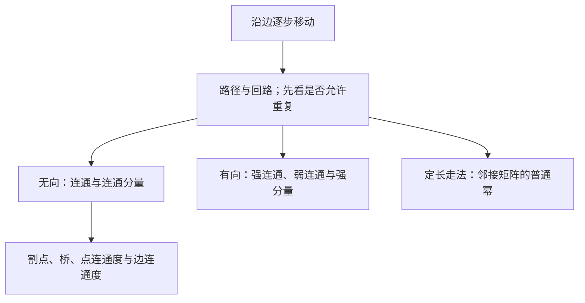

# C10.4 连通性 Connectivity

> [!abstract] 这一讲的任务
> 一张网络“连着”还不够：它可能只有一条关键链路，一断就分裂；单行网络也可能去得到却回不来。我们从路径的精确定义出发，依次问能否到达、需要破坏多少才能断开、能否双向到达，以及指定长度的走法共有多少。

> [!info] 阅读说明
> 对应 §10.4，正文印刷页678–689，PDF物理页38–49，例1–15归入对应论证。沿用本书path/simple path术语，并与其他教材常用的walk/trail作对照，避免把矩阵幂错当成“不重复顶点路径”的计数。课堂进度待确认。



## 0. 开场：有一条路线，与断一条线仍能走，是两回事

假设两栋楼各自有完善网络，楼间只有一条光纤。任意两台计算机之间都能传数据，网络连通。但楼间光纤一断，整网变成两块。给每栋楼内部再加几十条线，仍修补不了这个单点瓶颈。

要区分“现在可达”与“有多少冗余”，首先得确定一条路线究竟由什么组成；随后才能把失效表示成删边或删点。

## 1. 路径的长度数边，不数顶点

本书的path路径是依次衔接的边序列 $e_1,\ldots,e_n$，存在顶点序列 $x_0,\ldots,x_n$使第 $i$条边连接 $x_{i-1},x_i$。有向情形还要求方向是 $x_{i-1}\to x_i$。长度为边数 $n$；长度0只含一个顶点。起终点相同且长度大于0，称回路circuit；本书称不重复边的路径或回路为simple。

> [!warning] 本书的simple不等于“不重复顶点”
> 许多图论资料把允许重复的走法叫walk、不重复边叫trail、不重复顶点叫path。本书的path更接近walk，simple path更接近trail。以下矩阵幂统计允许重复的走法；需要不重复顶点时会明确写出来。

例1原图顶点 $a,b,c,d,e,f$，边为 $ab,bc,ad,ae,be,bf,cd,cf,de,ef$。逐个检查：$a,d,c,f,e$是长4的简单路径；$d,e,c,a$不是路径，因为 $ec$不是边；$b,c,f,e,b$是长4回路；$a,b,e,d,a,b$长5，但重复了 $ab$，不是simple。边在画面上相交的地方不是额外顶点。

多重图还必须区分边的身份。若 $u,v$之间有两条边，顶点序列 $u,v,u$可以两次使用同一条边，也可各用不同一条；只写顶点序列不足以区别这些走法。

例2的相识链把“认识某人的某人”写成路径；六个人依次相连只经过五条边，不是长度6。例3的Erdős number是学术合作图中到Paul Erdős的最短路径长度，Bacon number是影视合作图中到Kevin Bacon的最短路径长度。中心人物自己距离0，直接合作者距离1；若完全不在同一分量，就没有有限距离。“每对人都只隔少数人”是现实网络的经验或假说，不是所有图满足的数学定理。


原例的两个分布表是带日期的历史数据，保留如下以说明“到中心的最短距离”如何分层，不能据此断言如今网络规模相同。

| 距离 | Erdős数人数（2006年初） | Bacon数人数（2011年初） |
|---|---:|---:|
| 0 | 1 | 1 |
| 1 | 504 | 2367 |
| 2 | 6593 | 242407 |
| 3 | 33605 | 785389 |
| 4 | 83642 | 200602 |
| 5 | 87760 | 14048 |
| 6 | 40014 | 1277 |
| 7 | 11591 | 114 |
| 8 | 3146 | 16 |
| 9 | 819 | — |
| 10 | 244 | — |
| 11 | 68 | — |
| 12 | 23 | — |
| 13 | 5 | — |

例如Erdős数2并非“共同发表2篇论文”，而是最少经过两条合作边；统计表人数只是该层大小，不是路径条数。

## 2. 无向连通与连通分量

无向图连通connected，指每对不同顶点之间都有路径；否则不连通disconnected。例4原 $G_1$连通，$G_2$中 $a,d$之间没有路线，所以不连通。只需找到一对不可达点，就能否定全图连通。

为什么连通时总能选一条不重复顶点的路径？在所有 $u$到 $v$走法中取最短者。若某顶点在指标 $i<j$处重复出现，就能删去两次访问之间的闭合段，得到更短走法，矛盾。故最短走法不重复顶点，当然也不重复边。若全图有 $n$点，这条路线至多 $n-1$条边。

**连通分量connected component**是极大的连通子图，不能再加进原图中的顶点或边而保持这一块的连通性。这里“极大”指不能继续扩大，不是说只选顶点数最多的一块。不同分量互不相交，合起来是原图。

例5的 $H$分成 $H_1$的 $\{a,b,c\}$、$H_2$的 $\{d,e\}$、$H_3$的 $\{f,g,h\}$；每块内可达，块间无边。

![[C10.4-原图-连通与分量.png]]

例6的电话联系网络也可能有一个巨大分量及大量小分量：若把通话仅看作无向联系，一串联系能把两个号码归到同一分量；它不证明呼叫方向上相互可达。

### 从最短距离到半径、直径

对连通无权图，$d(u,v)$是最短走法的边数；点$v$的偏心距为$\varepsilon(v)=\max_u d(u,v)$。半径$\operatorname{rad}(G)=\min_v\varepsilon(v)$，直径$\operatorname{diam}(G)=\max_v\varepsilon(v)$，所以$\operatorname{rad}\le\operatorname{diam}\le2\operatorname{rad}$，最后一个不等式来自取一个最小偏心距中心并经它连接任意两点。

例如$K_6$半径、直径均1；$K_{4,5}$均2；$Q_3$两标签的距离等于汉明距离，故两者均3；$C_6$最远相隔3条边，两者也均3。不能用图画中的欧氏距离来计算这些量。

## 3. 割点和桥：删除后分量数是否增加

删掉一个顶点及其关联边使连通分量数增加，该点是割点cut vertex / articulation point；删掉一条边使分量数增加，该边是桥bridge / cut edge。不能只看“这点连得少”或“这边画在中间”。

例7的 $G_1$由三角形 $bcd$、带对角线 $eg$的四边形 $efgh$、边 $ab$与连接边 $ce$组成。完整边集为

$$E_1=\{ab,bc,bd,cd,ce,ef,fg,gh,eh,eg\}.$$

删除 $b$会隔离 $a$；删除 $c$或 $e$会切断左右部分，所以割点为 $b,c,e$。桥恰是 $ab,ce$；其余边都在某个圈上，去掉后可绕圈的另一侧替代。反过来，若某边不是桥，删边后两端仍有替代路线，加回原边就形成含它的圈。因此**无向边是桥，当且仅当不在任何不重复顶点的圈上**。

## 4. 点连通度、边连通度与边界约定

顶点割集vertex cut / separating set是删去后使图不连通的顶点集合。对非完全连通简单图，点连通度 $\kappa(G)$是最小顶点割集大小；完全图没有通常意义的顶点割集，约定 $\kappa(K_n)=n-1$。不连通图及 $K_1$取0。$\kappa(G)\ge k$称 $k$-连通；二连通要求至少三个顶点且没有割点。

边割集edge cut删去后断开图；边连通度 $\lambda(G)$是最小边割集大小；不连通图及单点图取0。这里讨论有限简单无向图，不能把简单图上界 $n-1$不加说明地套在任意多重图上。

原例8–9的五张图可用以下数据重建（每对字母代表一条无向边）：

```text
G1: ab bc bd cd ce ef fg gh eh eg
G2: ab ac bc cd de ef cf
G3: ab ag bg bc gf cf cd fe de
G4: ab ag bg bc gf cf cd ce de df ef af
G5: ab bc cd hg gf fe ah bg cf de ag bh cg ce df bd hf
```

| 图 | $\kappa$ | 最小顶点割集的一个见证 | $\lambda$ | 最小边割集的一个见证 |
|---|---:|---|---:|---|
| $G_1$ | 1 | $\{b\}$ | 1 | $\{ab\}$ |
| $G_2$ | 1 | $\{c\}$ | 2 | $\{ab,ac\}$ |
| $G_3$ | 2 | $\{b,g\}$ | 2 | $\{bc,fg\}$ |
| $G_4$ | 2 | $\{c,f\}$ | 3 | $\{bc,af,fg\}$ |
| $G_5$ | 3 | $\{b,c,f\}$ | 3 | $\{ab,ag,ah\}$ |

见证只给上界，还要排除更小割集：$G_3,G_4$无割点；$G_4$任删一、两条边仍连通；$G_5$任删一、两点或一、两边仍连通。本次已按列出的边集逐个枚举这些较小集合核查，而不是由度数直接猜下界。

![[C10.4-原图-连通度五例.png]]

若 $\delta(G)$表示最小度，隔离一个最小度点只需删除它的所有关联边，所以 $\lambda(G)\le\delta(G)$；对非完全图，删其全部邻居也能把它与至少一个剩余点隔开，故 $\kappa(G)\le\delta(G)$。更完整的关系为

$$\boxed{\kappa(G)\le\lambda(G)\le\delta(G).}$$

补足第一项的理由：若最小边割大小 $k\ge\delta$，结论已由 $\kappa\le\delta$得到。若 $k<\delta$，设删这些边后某一侧为 $S$。假如 $s=|S|\le k$，每点至少有 $\delta-(s-1)\ge k-s+2$条边通向外面，故割边至少 $s(k-s+2)>k$，矛盾。因此两侧各多于 $k$点。删除其中一侧所有割边端点，至多删 $k$点，且该侧仍有点留下，而两侧已经不能相连，给出 $\kappa\le k$。

应用中 $\kappa$度量关键路由器或路口故障，$\lambda$度量关键光纤或路段故障。少于相应数量的任意故障不会断开剩余网络；“恰有这么多”只表示**存在**一种断开的选择，不表示任意这么多故障都会断网。

## 5. 有向网络：强连通与弱连通

有向图强连通strongly connected，要求任意 $u,v$都有 $u\to v$和 $v\to u$的有向路径；弱连通weakly connected只要求忽略方向后的底层图连通。强连通蕴含弱连通，反向不成立，例如只有 $a\to b$的一条弧。

例10原 $G$含覆盖全部五点的有向圈 $a,b,c,d,e,a$，沿圈可以从任一点到任何一点，故强连通，也弱连通。原 $H$只弱连通：点 $a$没有去往 $b$的有向路径。例11的 $H$强分量为 $\{a\}$、$\{e\}$、$\{b,c,d\}$，后一块内有 $b\to c\to d\to b$；跨分量还有 $b\to a$、$d\to e$、$e\to a$。所以不能从无向外观看成“一块”就认定强连通。

强连通分量strong component是极大的强连通子图。相互可达关系是等价关系：长度0给自反，定义给对称，串接路径给传递；故各强分量是等价类，必不相交。把每个强分量缩成一点，分量之间不会形成有向圈，否则这些分量本就相互可达、应合并。

例12的Web graph以1999年网络快照说明这种区别：巨大的弱连通部分内仍有巨强分量GSCC、只能流入GSCC的部分、只能由GSCC到达的部分，以及两方向都不可达但仍处在同一弱分量中的部分。这里的“流入”或“流出”指沿若干超链接形成的路径，不必是直接一条边；数据属于历史快照。

### 练习延伸：强连通定向与最优连通

把无向边分别选一个方向，不允许把一条边同时变成双向弧；本材料把得到强连通图的这种选择称orientation，并称原图orientable。若有桥，它无论指向哪一边，都只能提供一个方向的跨块通路，因此不可能强连通；圈沿同一方向定向则可以强连通。一般资料中的orientation也可能只表示“任意定向”，不额外要求强连通，阅读时须区别。

材料称$\kappa=\lambda=\delta=2m/n$的连通图具有optimal connectivity。最小度等于平均度意味着所有度都等于该值，故必为正则图；圈$C_n$、完全图$K_n$、平衡完全二分图$K_{r,r}$分别给出数值2、$n-1$、$r$的例子。

## 6. 路径与圈怎样继续帮助判同构

例13两图都有6点8边，度序列同为 $(3,3,3,3,2,2)$。$H$有三角形 $v_1,v_2,v_6,v_1$，$G$没有三角形，故不同构；同构会把同长度、顶点互异的圈映成同样的圈。

例14两图都有5点6边，有两个3度点、三个2度点，且都有3、4、5圈，可以沿顶点度对应的路线构造候选映射。原图 $G$的边为 $u_1u_3,u_1u_4,u_1u_5,u_2u_3,u_2u_5,u_3u_4$；$H$的边为 $v_1v_2,v_1v_3,v_1v_5,v_2v_3,v_3v_4,v_4v_5$。对应

$$f(u_1)=v_3,\ f(u_4)=v_2,\ f(u_3)=v_1,\ f(u_2)=v_5,\ f(u_5)=v_4$$

把六条边分别映为 $v_3v_1,v_3v_2,v_3v_4,v_5v_1,v_5v_4,v_1v_2$。它们恰好是 $H$的全部六条边，故同构成立。图中的斜线并非装饰，必须按端点读出实际边集，不能凭顶点摆成五边形就把外轮廓都当成边。

![[C10.4-原图-圈与同构两例.png]]

## 7. 普通矩阵幂为什么能数定长走法

> [!important] 定长路径计数
> $A$为按边数定义的邻接矩阵，允许有向边、自环和重边，则从 $v_i$到 $v_j$的长度 $r$走法数为 $(A^r)_{ij}$。这里是普通整数矩阵乘法，走法允许重复顶点和边。

$r=1$时定义直接成立。假设 $A^r$已经数对，那么每条长 $r+1$的走法都有唯一的倒数第二点 $v_k$。先从 $v_i$走 $r$步到 $v_k$，有 $(A^r)_{ik}$种；再选一条从 $v_k$到 $v_j$的边，有 $a_{kj}$种。固定 $k$相乘，不同 $k$互斥相加，得到

$$\sum_k(A^r)_{ik}a_{kj}=(A^{r+1})_{ij}.$$

因此归纳成立。布尔矩阵乘法只告诉“有无”，普通乘法才保存“多少”；不能混用。

例15按 $a,b,c,d$排序：

$$A=\begin{pmatrix}0&1&1&0\\1&0&0&1\\1&0&0&1\\0&1&1&0\end{pmatrix},\quad
A^4=\begin{pmatrix}8&0&0&8\\0&8&8&0\\0&8&8&0\\8&0&0&8\end{pmatrix}.$$

所以从 $a$到 $d$走4步共有8种：

```text
a b a b d    a b a c d    a b d b d    a b d c d
a c a b d    a c a c d    a c d b d    a c d c d
```

这些走法普遍重复边，反而清楚验证了矩阵幂不是只数“不重复路径”。若要无权最短距离，找使 $(A^r)_{ij}>0$的最小 $r$；连通图无需检查超过 $n-1$才首次出现的可达性，因为最短路线不重复顶点。实际算法通常用广度优先搜索，比逐次做全矩阵幂更合适。

最后兑现上一讲的二分图承诺：二着色沿每条边翻转颜色，绕奇圈一周会要求起点变成相反颜色，故二分图无奇圈。反过来，在每个连通分量中选根，按最短距离的奇偶分组；若有同组相邻点，把两条根路径去掉共同前缀，再加这条边，就会形成奇圈，矛盾。故所有边都跨组，得到二分图。

## 这一讲的三句话

1. 连通问任意两点能否到达；点、边连通度问至少怎样破坏才会断开，找到一个割集只给上界。
2. 有向网络须区分强、弱连通；底层图连成一块，不保证箭头方向上能往返。
3. $(A^r)_{ij}$数允许重复的长$r$走法，用乘法分解一步、求和穷尽中间点，才得到这个公式。

## 速查表

| 名称 | 公式或判据 |
|---|---|
| 路径长度 | 边数；长度0为单点 |
| 连通分量 | 极大连通子图 |
| 割点／桥 | 删除后连通分量数增加 |
| 完全图连通度 | $\kappa(K_n)=\lambda(K_n)=n-1$（$K_1$取0） |
| 简单无向图连通度界 | $\kappa\le\lambda\le\delta$ |
| 强连通 | 任意两点沿方向相互可达 |
| 弱连通 | 底层无向图连通 |
| 定长走法数 | $(A^r)_{ij}$，普通矩阵幂 |
| 二分图 | 不含奇圈 |

> [!tip] 下一讲预告
> 能到达终点并不保证可以每条边恰走一次，也不保证每个点恰访一次。下一讲分别研究这两种看似相近、难度却很不同的任务。


---

**上一讲** ← [[C10.3 图的表示与图同构 Representing Graphs and Graph Isomorphism]] ｜ **下一讲** → [[C10.5 欧拉路径与哈密顿路径 Euler and Hamilton Paths]] ｜ **返回课程索引** → [[C10 图 Graphs MOC]]
