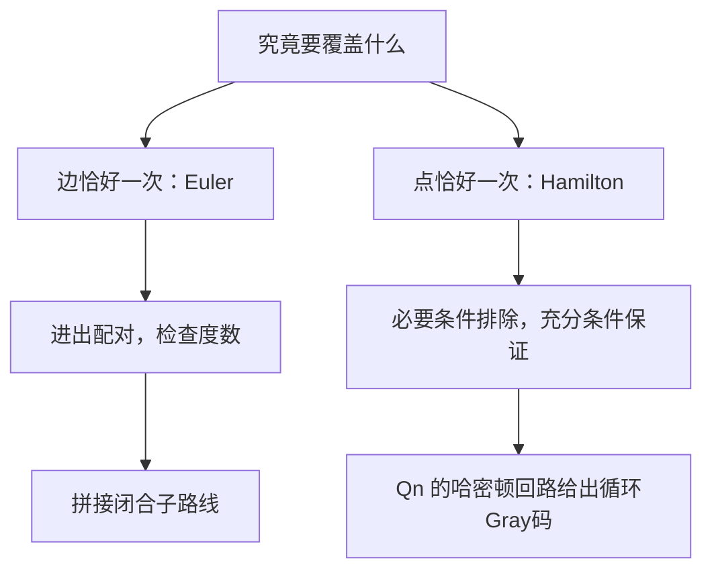

# C10.5 欧拉路径与哈密顿路径 Euler and Hamilton Paths

> [!abstract] 这一讲的任务
> 清扫车要把每条街走一遍，巡检员要把每个站点看一遍。两者都在图上移动，却不能共用一个“每次只走一次”的判断。我们先分清恰好覆盖边与恰好覆盖点，再解释为什么欧拉问题有直接的度数判据，哈密顿问题却需要另一套推理。

> [!info] 阅读说明
> 对应 §10.5，正文印刷页693–703，PDF物理页53–63，包含例1–8、欧拉回路构造算法、欧拉路径定理、Dirac与Ore条件、Gray码。先读 [[C10.4 连通性 Connectivity]]；本书simple path指不重复边，哈密顿条件会进一步要求顶点不重复。课堂进度待确认。



## 0. 开场：七座桥为何不用真的试遍所有路线

哥尼斯堡的河流把地区分成四块。把陆地画成 $A,B,C,D$四个顶点，七座桥是边：$AB$两条、$AC$两条、$AD,BD,CD$各一条。四点度数为 $(5,3,3,3)$。

若你不断试走，失败一次只否定一条候选路线，并不能证明所有路线都失败。转而观察任意中间地区：每进入一次，就要沿另一座尚未走过的桥离开，桥必须成对使用。四个奇度点已经告诉我们，既不能闭合走完，也不能从一处出发、在另一处结束而恰走完七桥。下面把这个“进出配对”变成充要判据。

![[C10.5-原图-七桥与多重图.png]]

## 1. 欧拉路径与回路：边恰好用一次

欧拉回路Euler circuit是不重复边且包含全图每条边的回路；欧拉路径Euler path是不重复边且包含全部边的路径。顶点可以重复，边不可以重复。闭合欧拉回路也属于广义的欧拉路径；后文“只有路径”特指存在非闭合欧拉路径而没有欧拉回路。

例1的 $G_1$由两个三角形 $aeb$与 $ecd$共用点 $e$组成，$a,e,c,d,e,b,a$逐边用完六边，所以有欧拉回路；$G_2$的奇度点超过两个，无欧拉路径；$G_3$有七边，$a,c,d,e,b,d,a,b$为非闭合欧拉路径，却没有回路。重复到 $d$完全允许，重复一条边才不允许。

例2的有向情形还须顺箭头：$H_2$的欧拉回路为 $a,g,c,b,g,e,d,f,a$；$H_3$的欧拉路径为 $c,a,b,c,d,b$；$H_1$没有欧拉路径。它们不能靠忽略方向后找一条路线来替代。

![[C10.5-原图-欧拉有向无向六例.png]]

## 2. 偶度为什么既必要又足够

> [!important] 无向欧拉判据
> 连通的有限多重图（原定理至少两顶点）存在欧拉回路，当且仅当每点度为偶数；存在欧拉路径但无欧拉回路，当且仅当恰有两个奇度点，它们必为两个端点。

必要性来自进出配对：中途每经过一点消耗两条边；起点首次出发与终点最后抵达，在闭合时也组成一对，因此所有度为偶数。若不闭合，起、终点各少了一个配对对象，因此它们是奇度，其他点仍偶度。

充分性先从任一有边顶点出发，只沿未用边前进，直到无边可走。因为每个非起点原度为偶数，进入后已用边数变奇，至少还能离开一次；所以只能在起点停下，先得到一个闭合子路线。注意这时可能还有边没走，**“回到起点”本身不是“已经走完”。**

若有剩余边，原图连通保证已走路线上的某个顶点 $w$仍接到剩余边。删去闭合路线用过的边后，各点剩余度仍偶数；从 $w$再沿未用边走，得到另一条回到 $w$的闭合子路线，把它插入原路线到达 $w$的位置。每次至少删掉一条新边，有限次后用完全部边。这就是算法1的拼接构造，通常称Hierholzer思想。

原构造例先走 $a,f,c,b,a$，剩余三角形走 $c,d,e,c$，在 $c$处拼成 $a,f,c,d,e,c,b,a$。

```text
EulerCircuit(G):
    先确认所有非孤立点在同一连通部分，且每点度为偶数
    stack = [一个有边的起点]
    output = 空列表
    while stack 非空:
        v = stack的末项
        if v还有未使用的关联边:
            取一条独立边 e = vw，标为已用
            把 w 压栈
        else:
            从stack弹出v，加入output
    反转output，得到欧拉回路
```

用边的独立编号标记，避免把平行边误认成同一条边。每条边只处理常数次，合适的邻接表实现耗时 $O(m)$；若包括读入孤立点和检查，写 $O(n+m)$更完整。

例3的弯刀图Mohammed’s scimitars各点度均偶。拼接后原例回路为

```text
a b d g h j i h k g f d c b e i f e a
```

共有18条边，每边恰用一次；弧线的弯曲不影响“进出配对”。

![[C10.5-原图-弯刀欧拉回路.png]]

若只有两个奇点 $s,t$，临时添加一条 $st$边（已有边时允许再加一条独立平行边），两点度都变偶。新图有欧拉回路；从临时边后面切开，再删临时边，就得到原图从一个奇点走到另一个的欧拉路径。这证明了第二个充分方向。

例4第一图的奇点是 $b,d$，可走 $d,a,b,c,d,b$；第二图也只有 $b,d$奇，可走 $b,a,g,f,e,d,c,g,b,c,f,d$；第三图有六个奇点，因此无欧拉路径。

![[C10.5-原图-欧拉路径三例.png]]

> [!warning] 连通条件不能被奇偶条件代替
> 两个互不相连的圈每点都偶，却无法一笔覆盖所有边。如果图带孤立点，而任务只要求覆盖边，应先删去孤立点再检查连通；它们不会阻碍覆盖现有边。没有边的退化情况另按题目约定处理。

### 原练习中的Fleury规则

另一种逐边构造叫Fleury算法：从合适端点出发，在当前尚未走过的边图中，只要还有其他选择就不走桥；若只剩唯一可走边才使用它，每次走后删掉该边。它避免过早切断尚未覆盖的一块。这里的“桥”必须在每次删边后的剩余图中重新判断，不能只计算原图的桥就一直使用。直接反复做连通性检查可能达到二次量级，不能把上一段栈拼接的线性界原样搬来。

## 3. 有向欧拉条件与实际任务

把无向“度为偶数”直接套在箭头图上会失效。若忽略孤立点后的底层图连通：有向欧拉回路要求每点入度等于出度；非闭合欧拉路径要求恰有起点 $s$满足 $\deg^+(s)=\deg^-(s)+1$，恰有终点 $t$满足 $\deg^-(t)=\deg^+(t)+1$，其余点入出相等。必要性仍来自每次进入与离开的配对；充分性可在非闭合情形添加 $t\to s$，再用有向闭合子路线拼接。这补足原节习题16–17所给出的方向条件。

邮递、清扫、网络链路巡检常要覆盖所有边。若不满足欧拉条件，就必须允许部分边重复；中国邮递员问题Chinese postman problem进一步问怎样覆盖所有边、回到起点，并使总路程最小。无权时可数重复边数，有权道路则比较重复路段的权重和，不能只比较街道条数。相关思想也用于布线、组播及DNA序列重建。

## 4. 哈密顿问题改成了每个点恰访问一次

哈密顿路径Hamilton path经过所有顶点恰一次；哈密顿回路Hamilton circuit还沿边回到起点，起点只在首尾重复。它不要求使用图的全部边。一条路线可以是哈密顿回路而非欧拉回路，反之也可以。

Hamilton的Icosian / “A Voyage Round the World”谜题用正十二面体的20个顶点表示城市，要沿边访问每城一次并返回。正十二面体有12个五边形面，不能把“十二”误当成城市数；平面展开图与立体的顶点边结构同构，故可在平面上寻找同一条回路。

![[C10.5-原图-十二面体环游.png]]

例5第一图有 $a,b,c,d,e,a$的哈密顿回路。第二图有叶子 $a$接在三角形 $bcd$的点 $b$上，不能闭合访问叶子，但有 $a,b,c,d$的哈密顿路径。第三图在同一块结构上接出三条末端分支：访问全部点会要求某个通道往返，迫使重复点，因此连哈密顿路径也没有；也可观察其三个度1点不可能同时充当仅有的两个路径端点。

![[C10.5-原图-哈密顿路径三例.png]]

例6再说明两种排除机制：图 $G$的点 $e$度1，不能在回路中一进一出；图 $H$是两个三角形在 $c$处相接，其他四点均度2。它们的两条关联边都被迫使用，就会强迫 $c$在候选回路上有4条边，而一条哈密顿回路在每点只用两条，矛盾。

因此必要条件包括连通、各点度至少2、不能有割点。构造中若遇2度点，两条关联边都必须采用；过早围成只包含部分顶点的小圈会封死其余顶点。但这些条件都不组成一般的充分判据。

## 5. Dirac与Ore：充分条件不等于反向判据

例7的 $K_n$（$n\ge3$）可以按任意顺序访问所有顶点，再回到起点，因为需要的边总存在。更一般地，足够多的连接会保证哈密顿回路：

> [!important] 两个充分条件
> 对有 $n\ge3$个顶点的简单图：
> **Dirac定理**：若每点度至少 $n/2$，则有哈密顿回路。
> **Ore定理**：若每对**不相邻**顶点 $u,v$都有 $\deg(u)+\deg(v)\ge n$，则有哈密顿回路。

Dirac推出Ore，因为两项各至少 $n/2$，相加至少 $n$。但不满足条件不代表没有回路：$C_5$本身就是哈密顿回路，每点度2却小于 $5/2$，不相邻两点度数和4也小于5。

补出Ore条件成立的原因。反设满足它却无哈密顿回路，尽可能加边而保持“无哈密顿回路”，得到极大非哈密顿图。它不能是完全图，所以有非邻点 $u,v$；加上 $uv$后必须出现哈密顿回路，否则还可继续加边。该回路一定使用新边，删去它得到原图中覆盖全部点的路径

$$x_1=u,x_2,\ldots,x_n=v.$$

若某个 $i$同时有 $ux_{i+1}$与 $x_iv$，便可走 $u,x_2,\ldots,x_i,v,x_{n-1},\ldots,x_{i+1},u$闭合覆盖所有点，矛盾。因此在 $i=1,\ldots,n-1$共 $n-1$个位置中，这两类边对应的位置集合不能相交，推出 $\deg(u)+\deg(v)\le n-1$，与Ore条件相反。故原图必有哈密顿回路。

这与欧拉情形很不同：欧拉的判定与构造可线性完成；一般哈密顿回路存在性的判定是NP完全问题。这里的充分条件能迅速处理部分实例，却不能解决所有实例。带权完全图上再问最短哈密顿回路，就是下一讲的旅行商问题。

### 棋盘中的同一思想

材料的骑士周游knight’s tour把每个格子作点，合法“日”字跳跃作边；每格恰访一次是哈密顿路径，最后还能合法跳回起点的reentrant tour对应哈密顿回路。按棋盘黑白格二着色，每一步换色，所以闭合周游必须黑白格数量相同。这个必要条件能排除某些棋盘，却不自动保证其余棋盘都存在周游。

## 6. 例8：Gray码为何是一条超立方体哈密顿回路

旋转编码器把一圈分成 $2^n$个等长区域，每区对应一个 $n$位串。普通二进制的011与100处在相邻区域时，跨边界可能需要同时翻转三位；接触点未同步会读出远离真实位置的码。

改为相邻区域只差一位，就把跨边界的变化限制到一位。Gray码正是把所有 $n$位串排成一个循环，使相邻两项、以及最后与第一项之间都恰差一位。$Q_n$的顶点本来就是全部位串，边本来就表示只差一位，所以寻找循环Gray码等价于找 $Q_n$的哈密顿回路（通常讨论$n\ge2$）。

原例三位码为

```text
000 → 001 → 011 → 010 → 110 → 111 → 101 → 100 → 000
```

8种位串各出现一次，8次转换逐一异或，结果分别为1、2、1、4、1、2、1、4，都是单独一位为1，故包括首尾在内均只翻转一位。例如011旁边改为010，避免011与100之间的三位同时变化。

![[C10.5-原图-旋转编码与Gray码.png]]

还可由短码递归构造：把旧序列正向各项前加0，再把旧序列反向各项前加1。两个半段内部沿用旧的一位变化，连接处只改变新加的首位，首尾也只改变首位。这给出了超立方体哈密顿回路的具体构造，而非只声称“容易找到”。

## 这一讲的三句话

1. 欧拉要求每条边恰一次，哈密顿要求每个点恰一次；先说清覆盖对象，才知道该检查什么。
2. 无向欧拉判据要同时检查非孤立部分连通与奇度点数，偶度的充分性来自闭合子路线的拼接。
3. Dirac与Ore只保证一类图有哈密顿回路；条件失败不能反向否定，Gray码则提供了一个可显式构造的应用。

## 速查表

| 名称 | 公式或判据 |
|---|---|
| 无向欧拉回路 | 非孤立部分连通，全部度偶 |
| 无向非闭合欧拉路径 | 非孤立部分连通，恰两奇点 |
| 有向欧拉回路 | 底层非孤立部分连通，入度=出度 |
| 有向非闭合欧拉路径 | 起点出−入=1、终点入−出=1，其他平衡 |
| Dirac | 简单图$n\ge3$，$\delta\ge n/2\Rightarrow$哈密顿回路 |
| Ore | 非邻点度数和均$\ge n\Rightarrow$哈密顿回路 |
| Gray码 | 全部位串各一次，相邻及首尾汉明距离1 |

> [!tip] 下一讲预告
> 有一条访问路线以后，怎样选总距离最小的一条？下一讲给边加权，先解决两点最短路，再区分它与最短旅行商回路。


---

**上一讲** ← [[C10.4 连通性 Connectivity]] ｜ **下一讲** → [[C10.6 最短路径问题 Shortest-Path Problems]] ｜ **返回课程索引** → [[C10 图 Graphs MOC]]
