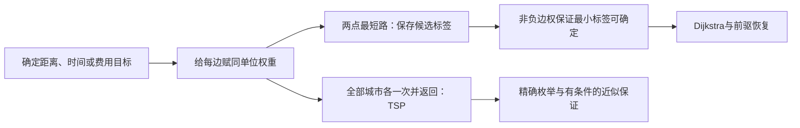

# C10.6 最短路径问题 Shortest-Path Problems

> [!abstract] 这一讲的任务
> 同一组航线，距离最短、飞行时间最短、票价最低可能是三条不同路线。我们先把目标编码成边权，再沿着“已确定最短距离的点”逐步扩展，手算Dijkstra算法，并证明为什么当前最小标签可以永久确定。最后换一个约束，看看为何旅行商问题不能直接用同一贪心选择解决。

> [!info] 阅读说明
> 对应 §10.6，正文印刷页707–716，PDF物理页67–76。包含两类带权网络、例1–2、Dijkstra伪代码与正确性、复杂度、五城旅行商原表与近似算法条件。先修见 [[C10.4 连通性 Connectivity]] 和 [[C10.5 欧拉路径与哈密顿路径 Euler and Hamilton Paths]]。课堂进度待确认。



## 0. 开场：少坐一段飞机，不等于最省钱

假设从A直飞C需600元，经B转机两段各200元。按“经过的边数最少”会选直飞，票价却多200元。无权图的路径长度数边；现在必须把路径代价定义为所用边权之和。

带权图weighted graph给每条边一个数值 $w(e)$，对路线 $P$定义

$$\ell(P)=\sum_{e\in P}w(e).$$

距离使用英里或千米，飞行时间使用分钟，票价使用同一货币；不能把这些数字直接混加。原航线模型分别给同一网络赋航空里程、飞行时间、票价；原计算机网络则分别用地理距离、响应秒数、月租费用。图中的“飞行时间”只包括空中时间，不包括转机等待；若任务改为最早抵达，简单相加空中时间就未必描述原问题。

![[C10.6-原图-航线三种权重.png]]

![[C10.6-原图-网络三种权重.png]]

这两组图的连接相同或按同一对象集合建立，而权重含义不同。图例要先读单位，再沿候选路径逐边求和；边数少的路线不一定权重小，也不能把一张图上最优路线未经计算搬到另一种权重上。

为了让原图中的数字也能直接复查，下面把边权转成表格；B=Boston、NY=New York、C=Chicago、D=Denver、SF=San Francisco、LA=Los Angeles、A=Atlanta、M=Miami。时间统一换成分钟，例如4:05是245分钟，不能按小数4.05小时计算。

| 航线 | 英里 | 空中分钟 | 票价（美元） |
|---|---:|---:|---:|
| SF–NY | 2534 | 245 | 129 |
| SF–C | 1855 | 175 | 99 |
| SF–D | 957 | 140 | 89 |
| SF–LA | 349 | 75 | 39 |
| LA–D | 834 | 120 | 89 |
| D–C | 908 | 130 | 69 |
| LA–NY | 2451 | 230 | 129 |
| C–B | 860 | 130 | 79 |
| C–NY | 722 | 110 | 59 |
| C–A | 606 | 100 | 99 |
| NY–B | 191 | 50 | 39 |
| NY–A | 760 | 115 | 79 |
| NY–M | 1090 | 165 | 99 |
| A–M | 595 | 90 | 69 |

对Boston到Los Angeles的原问题，距离最短是B–C–D–LA，$860+908+834=2602$英里；空中时间最短是B–NY–LA，$50+230=280$分钟即4小时40分；票价最低也是B–NY–LA，$39+129=168$美元。三个目标各自求最小，确实不能只选一条路线通用。

计算机网络另用DA=Dallas；边权仍是该历史示例中的给定数据，不是现行报价：

| 链路 | 英里 | 响应秒数 | 月租（美元） |
|---|---:|---:|---:|
| SF–LA | 349 | 3 | 400 |
| SF–D | 957 | 4 | 1000 |
| SF–C | 1855 | 5 | 1500 |
| LA–D | 1736 | 7 | 1400 |
| LA–DA | 1235 | 5 | 1100 |
| D–C | 908 | 6 | 500 |
| D–DA | 645 | 4 | 600 |
| C–DA | 798 | 5 | 800 |
| C–B | 860 | 3 | 900 |
| C–NY | 722 | 4 | 700 |
| DA–NY | 1372 | 6 | 1200 |
| B–NY | 191 | 2 | 300 |

SF到NY的距离最短路线SF–C–NY为 $1855+722=2577$英里，响应时间最短也是这一路线的 $5+4=9$秒，最低月租为 $1500+700=2200$美元；租金还有SF–D–C–NY的 $1000+500+700=2200$这一并列最优路线。最短值可以唯一，而达到它的路线未必唯一。


## 1. 例1：标签记录的是从起点来的总代价

原六点图边权为 $ab=4,ad=2,bc=3,be=3,de=3,cz=2,ez=1$。要求从 $a$到 $z$的最短距离。

先看源点邻居：到 $d$暂为2，到 $b$暂为4。若只选“当前顶点出发最小的一条边”，会把问题误做成逐步局部游走；Dijkstra要在**所有尚未确定的顶点标签**里选最小者。

确定 $d$的距离2后，经 $d$可到 $e$，候选代价 $2+3=5$。下一步未确定标签为 $b:4,e:5,c:\infty,z:\infty$，所以确定 $b$而不是沿刚到的 $d$继续走。经 $b$给 $c$候选7，给 $e$候选7，保留更小的 $e:5$。再确定 $e$，给 $z$候选6；接着 $z:6<c:7$，故目标距离确定为6，路线

$$\boxed{a\to d\to e\to z,\qquad2+3+1=6.}$$

原文前段有一句把 $a,d,e$长度印作7，但边权 $ad=2,de=3$，本段后文也按5计算；此处采用复算值5，具体位置登记在索引。

## 2. 为什么只需做一次“松弛”

令 $S$为最短距离已经确定的顶点集，$L(v)$为到 $v$的候选距离。候选路线的内部顶点只能来自 $S$，但终点 $v$自身可以尚未进入 $S$；不能把“所有顶点都在 $S$”逐字理解，否则一个尚未确定的终点根本无法被标记。

初始 $L(a)=0$，其余为 $\infty$。每轮从 $V\setminus S$选标签最小的 $u$，把它加入 $S$，再对其他顶点更新

$$\boxed{L(v)\leftarrow\min\{L(v),\ L(u)+w(u,v)\}.}$$

这叫松弛relaxation：旧路线可能已经更好，也可能经新确定的点更好，保留小者。没有边时取 $w(u,v)=\infty$；如果有多个平行选择，先取其中最小权重即可用于单纯最短距离问题。

```text
Dijkstra(G, a, z):
    L[a] = 0；其余 L[v] = ∞
    prev[v] = 未定义；S = 空集
    while z不在S:
        从V\S选L最小的u
        if L[u] == ∞: return 不可达
        把u加入S
        for 每条 u到v 的边，且v不在S:
            if L[u] + w(u,v) < L[v]:
                L[v] = L[u] + w(u,v)
                prev[v] = u
    沿prev从z退回a并反转，返回路线及L[z]
```

停止条件是目标被正式选入 $S$，不是“第一次遇见目标”或“第一次算出有限标签”。要算源点到全图距离，就继续直到所有可达点确定。

## 3. 例2：从原始边权把整张标签表算完

原图边权为

$$ab=4,ac=2,bc=1,bd=5,cd=8,ce=10,de=2,dz=6,ez=3.$$

每行表示选中该点并完成松弛后的标签；$\infty$表示当前还无候选路线：

| 新确定点 | $L(a)$ | $L(b)$ | $L(c)$ | $L(d)$ | $L(e)$ | $L(z)$ |
|---|---:|---:|---:|---:|---:|---:|
| 初始化 | 0 | $\infty$ | $\infty$ | $\infty$ | $\infty$ | $\infty$ |
| $a$ | 0 | 4 | 2 | $\infty$ | $\infty$ | $\infty$ |
| $c$ | 0 | 3 | 2 | 10 | 12 | $\infty$ |
| $b$ | 0 | 3 | 2 | 8 | 12 | $\infty$ |
| $d$ | 0 | 3 | 2 | 8 | 10 | 14 |
| $e$ | 0 | 3 | 2 | 8 | 10 | 13 |
| $z$ | 0 | 3 | 2 | 8 | 10 | 13 |

例如确定 $c$时，$L(b)$从4改善为 $2+1=3$，前驱也从 $a$改为 $c$；确定 $d$时，$L(e)$从12改善为 $8+2=10$。$z$首次得到14，随后还会变成13，直接验证了“首次遇见就停止”的错误。

前驱链 $z\leftarrow e\leftarrow d\leftarrow b\leftarrow c\leftarrow a$恢复

$$\boxed{a,c,b,d,e,z,\qquad2+1+5+2+3=13.}$$

![[C10.6-原图-Dijkstra逐步标签.png]]

## 4. 为什么贪心选择成立，以及负权会坏在哪里

归纳不变量是：$S$内每点标签为真实最短距离；$S$外标签是内部顶点来自 $S$的最短候选路线长度。

现在选中最小标签 $u$。反设存在一条真正更短的 $a$到 $u$路线。沿这条路线找第一个尚未确定的点 $y$，它的前驱在 $S$内（源点已确定的轮次）。当此前驱被处理时，$y$已经获得不大于该路线前缀长度的标签。所有边权非负，所以前缀不可能比整条路线更长，因而

$$L(y)\le\text{前缀代价}\le\text{整条更短路线代价}<L(u).$$

这与 $u$为未确定点中标签最小者矛盾。故 $u$可永久确定。再用一次松弛把所有经 $u$产生的更优候选加入，维持不变量。原节假设正权；同一证明也允许0权，因为只用到了非负。

负边会破坏“前缀不长于整条路线”：例如有向边 $a\to b=2,a\to c=5,c\to b=-4$。算法先固定 $b:2$，但真实最短是 $a,c,b$的1。不能给Dijkstra加一个负边后仍沿用原证明；含负权应换合适算法，还要检查是否有可达负圈导致不存在有限最小值。

朴素实现每轮扫描至多 $n$个标签找最小值，再检查至多 $n$个候选，最多 $n$轮，所以为 $O(n^2)$。原文逐轮常数计数只需按 $O(n)$理解，找最小值与松弛两项都要计入。若用邻接表和二叉堆，可得到常用上界 $O((n+m)\log n)$，这是实现补充，不改变非负条件。

### 补足原材料中的算法2：Floyd全点对最短路

Dijkstra围绕一个源点扩展；Floyd算法同时处理所有起终点。令 $D^{(k)}_{ij}$表示内部顶点只允许来自 $v_1,\ldots,v_k$时，$i$到 $j$的最短距离。初始 $D^{(0)}_{ii}=0$，不同点直接有边则取边权，无边为 $\infty$。一条最优路线要么不经 $v_k$，要么在它处分成前后两段，因此

$$D^{(k)}_{ij}=\min\{D^{(k-1)}_{ij},D^{(k-1)}_{ik}+D^{(k-1)}_{kj}\}.$$

按允许中间点 $k$作为最外层循环，再遍历全部 $i,j$更新，耗时 $O(n^3)$、空间 $O(n^2)$。若把循环顺序随意改成端点在最外层，就失去了这个不变量。每次改善距离时同时保存下一跳，可以恢复路线；原算法2只返回距离矩阵，并非Floyd思想本身不能构造路线。含负边时还需无负圈才能有有限最短距离，最终对角元负值可用来检测负圈。

### 一个可以高效求最长路的特例

材料另问没有有向圈的加权有向图怎样求最长路。若有拓扑顺序，先令源点值0、其余为$-\infty$，按顺序用$L(v)\gets\max\{L(v),L(u)+w(u,v)\}$处理每条$u\to v$；由于所有前驱已处理，不需要Dijkstra的非负条件。它依赖“无有向圈”，不能拿它解决一般图中最长不重复顶点路径问题。

## 5. 五城旅行商：两点最短与访问全图不是同一任务

旅行商问题traveling salesperson problem，TSP要求完整访问所有城市各一次并回到起点，最小化回路总权；它是在带权完全图中找最短哈密顿回路。Dijkstra只求指定起终点的最短路线，未要求途中覆盖其余顶点，不能直接套用。

原五城取D=Detroit、T=Toledo、S=Saginaw、G=Grand Rapids、K=Kalamazoo，单位英里，完整距离表为：

| 城市 | D | T | S | G | K |
|---|---:|---:|---:|---:|---:|
| D | 0 | 58 | 98 | 147 | 135 |
| T | 58 | 0 | 142 | 167 | 133 |
| S | 98 | 142 | 0 | 113 | 137 |
| G | 147 | 167 | 113 | 0 | 56 |
| K | 135 | 133 | 137 | 56 | 0 |

固定D为起点，其余四点有 $4!=24$种排列；无向距离对称，一条回路及其反向长度相同，所以可把反向配成12组。原表各代表路线及结果如下：

| 路线（首尾均为D） | 距离 |
|---|---:|
| D–T–G–S–K–D | 610 |
| D–T–G–K–S–D | 516 |
| D–T–K–S–G–D | 588 |
| D–T–K–G–S–D | 458 |
| D–T–S–K–G–D | 540 |
| D–T–S–G–K–D | 504 |
| D–S–T–G–K–D | 598 |
| D–S–T–K–G–D | 576 |
| D–S–K–T–G–D | 682 |
| D–S–G–T–K–D | 646 |
| D–G–S–T–K–D | 670 |
| D–G–T–S–K–D | 728 |

12组均已从距离表重新求和，并对全部24种顺序枚举，最小为

$$\boxed{D\to T\to K\to G\to S\to D,\quad58+133+56+113+98=458.}$$

任意 $n\ge3$的对称完全图，固定起点、反向合并后共有 $(n-1)!/2$条候选回路。若是有向费用不对称，不能除2。25城已有 $24!/2\approx3.1022\times10^{23}$种；假设每条只需1纳秒，仍约 $9.83\times10^6$年，说明小例能枚举不等于可扩展到大实例。

## 6. 近似算法也要写明保证的条件

精确最优难求时，可接受一条代价 $W'$的回路，使 $W\le W'\le cW$，其中 $W$为真实最优代价，$c\ge1$为近似比。这样的保证不等于“看起来不错”的启发式结果。

原节给出：对满足三角不等式的非负对称距离TSP，有多项式时间的 $3/2$近似算法。三角不等式指 $w(u,v)\le w(u,x)+w(x,v)$，直达不比经中间点绕路更贵。这个条件使跳过重复访问时不会增加路程，是保证的重要基础。对任意无条件权重，不能沿用同样的常数近似保证；相关不可近似结论以 $P\ne NP$等复杂度条件为背景。原书关于某规模实例几分钟得到多少误差的叙述是当时的实践背景，不是所有图的最坏情况保证。

## 这一讲的三句话

1. 最短路的目标由边权含义决定，单位与可加条件要先固定；最少边、最短时间与最低费用不能混用。
2. Dijkstra保存从源点来的候选总代价，每轮固定最小标签；非负边权是这一贪心判断的关键理由。
3. 两点最短路与最短哈密顿回路有不同的覆盖约束；TSP枚举规模及近似比都必须连同适用条件一起写。

## 速查表

| 名称 | 公式或判据 |
|---|---|
| 带权路线代价 | $\ell(P)=\sum_{e\in P}w(e)$ |
| 松弛 | $L(v)\gets\min\{L(v),L(u)+w(u,v)\}$ |
| Dijkstra适用范围 | 非负边权；最小候选标签被选入确定集 |
| 朴素Dijkstra | $O(n^2)$ |
| 堆与邻接表实现 | $O((n+m)\log n)$ |
| 对称TSP候选数 | $(n-1)!/2$，$n\ge3$ |
| 五城原例 | 最短回路458英里 |
| 近似比 | $W\le W'\le cW$ |

> [!tip] 下一讲预告
> 路线可以算对，实际电路却可能在同一块平面上无法避免交叉。下一讲不再比较权重，改问图是否存在无交叉的平面画法。


---

**上一讲** ← [[C10.5 欧拉路径与哈密顿路径 Euler and Hamilton Paths]] ｜ **下一讲** → [[C10.7 平面图 Planar Graphs]] ｜ **返回课程索引** → [[C10 图 Graphs MOC]]
