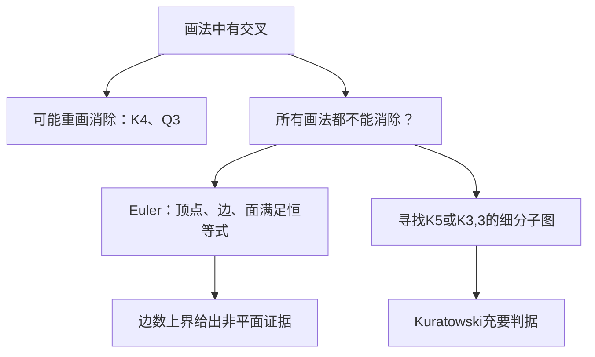

# C10.7 平面图 Planar Graphs

> [!abstract] 这一讲的任务
> 三户住宅各要连接水、电、气三项设施，九条管线必须在同一平面上布置而不交叉。不断改画法并不能证明任务不可能。我们会先区分“这幅图有交叉”与“所有画法都无法避免交叉”，再用面数、边数界和Kuratowski障碍给出可复查的结论。

> [!info] 阅读说明
> 对应 §10.7，正文印刷页718–725，PDF物理页78–85，含例1–9、欧拉公式与证明、边数推论、同胚细分及Kuratowski定理。课堂进度待确认。Kuratowski的困难反方向原节未证明，这里明确作为定理使用，不虚构简短证明。

## 0. 开场：最后一条管线总是交叉，算证明吗

三住宅与三设施的模型是 $K_{3,3}$：两组各三个点，九条跨组边，没有同组边。你画了五次，每次最后一条边都交叉，这只说明五种尝试失败；若要断言“不存在平面画法”，需要覆盖所有画法的论证。

相反，证明“存在”只需给出一幅无交叉画法。两种结论承担的证明任务不同。

## 1. 平面图与平面表示

图可平面嵌入、使边只在共同端点相遇，称平面图planar graph；这样一幅实际无交叉画法叫平面表示planar representation。弯曲边允许，跨线处若没有原顶点就不能擅自添加顶点来“消除交叉”，那会改变图。

例1的 $K_4$画成带双对角线的正方形会交叉，但可以把三个点放在外三角形、第四点放在内部并连到三个角，全部六边都无交叉，所以平面。例2的 $Q_3$也平面：用内、外两个四边形表示两份 $Q_2$，再连四对对应顶点即可。立方体透视图中的交叉不是结构性障碍。

![[C10.7-原图-K4与Q3的平面表示.png]]

### 例3：三住宅问题的全部位置为什么都失败

令住宅为 $v_1,v_2,v_3$，设施为 $v_4,v_5,v_6$。先取四条必需边组成闭合曲线 $v_1,v_4,v_2,v_5,v_1$，它把平面分成内、外两区。若 $v_3$在内部，连接它到 $v_4,v_5$会把内部再分两区。

此时 $v_6$只有三类位置：在外部，连 $v_3$必须穿过闭合曲线；在内部小区 $R_{21}$，所需边 $v_2v_6$必须穿越已有边；在另一小区 $R_{22}$，所需边 $v_1v_6$又被隔开。没有合法位置。若 $v_3$一开始在外部，交换内外区域，以相同的曲线分隔关系重做，仍得到三类位置全部失败。因此不是某幅草图不成功，而是任何平面布置都不成功。后文还会给出更短的数值证明。

电路若对应非平面图，单层无交叉布线不可行，可能需要多层、绝缘跨线；道路网络可能需要立交。图的平面性只判断连接结构，实际器件尺寸、最小间距等几何约束仍可能进一步限制可实现性。

## 2. 面数包括无界的外部区域

固定一幅平面表示，边把平面分成若干区域region / face；最外面的无界区域也算一个面。树虽然没有封闭小圈，仍有外部一个面，不能记0。

> [!important] 欧拉公式 Euler’s formula
> 有限连通平面简单图的顶点数 $v$、边数 $e$、面数 $r$满足 $v-e+r=2$，即 $r=e-v+2$。

原证明从一条边开始，此时 $(v,e,r)=(2,1,1)$。保持最终图的平面画法，每次添加一条与已建部分相接的边，只有两种变化：

- 新边接到一个新点：$v,e$各加1，没有新面，所以 $v-e+r$不变。
- 新边连接两个已有点：两点在同一面的边界上，新边把该面分成两个，$e,r$各加1，$v-e+r$仍不变。

连通性保证始终能继续这样构造直到覆盖全图，故公式保持。单点图也直接满足 $1-0+1=2$。这同时说明同一连通平面图不管怎样无交叉重画，面数都一样，因为 $v,e$没变。

例4有20个点、每点度3。先用握手定理 $2e=20\cdot3=60$，得 $e=30$；再用欧拉公式

$$\boxed{r=30-20+2=12.}$$

不能把度数和60直接当边数。若图有 $c$个连通分量，补加 $c-1$条桥把它们连起来而不新增面，得到扩展式 $v-e+r=1+c$；这说明非连通图不能无条件沿用右侧2。

## 3. 对面作握手：为什么边数不能太多

面的度 $\deg(R)$是沿边界走一周遇到的边的次数。桥的两侧属于同一个面，沿边界会被数两次；不能因为是同一个面就只数一次。每条边有两侧，所以

$$\sum_R\deg(R)=2e.$$

在连通简单平面图且 $v\ge3$时，每个面边界至少有三次边经过，因而 $3r\le2e$。与 $r=e-v+2$联立：

$$3(e-v+2)\le2e\quad\Longrightarrow\quad\boxed{e\le3v-6}.$$

若度都至少6，则 $2e=\sum\deg(v)\ge6v$，但边数界给 $2e\le6v-12$，矛盾。所以**每个有限简单平面图都有度至多5的顶点**；不连通时逐分量应用即可。这个结论将用于后面的着色上界。

例5的 $K_5$有 $v=5,e=10$，却 $3v-6=9<10$，所以非平面。需要注意该判据只有一个方向：例6的 $K_{3,3}$有6点9边，满足 $9\le12$，仍非平面。满足边数界不能证明平面。

若简单图没有三角形，每个面的度至少4，于是 $4r\le2e$，联立欧拉公式得到

$$\boxed{e\le2v-4\qquad(v\ge3).}$$

二分图没有奇圈，尤其没有三角形，所以可用这个更强界。$K_{3,3}$的9条边超过 $2\cdot6-4=8$，非平面。这正式解决开场九条管线不交叉的任务。

## 4. 细分不改变平面性，却会改变数值界

把边 $uv$删去，插入新点 $w$与两边 $uw,wv$，叫初等细分elementary subdivision。新点度为2，只是把原来的线切成两段；可以沿原画法放进去，所以保持平面性。反向压掉这种细分点也不必新增交叉。

两图可从同一图经过若干次细分得到，称同胚homeomorphic。同胚允许边变成较长的链，所以不像同构那样要求顶点数相同。

例7的 $G_1$边为 $ac,ad,bc,bd,be$。原 $G_2$把 $ac$换成 $af,fc$，把 $bc$换成 $bh,hg,gc$，其余边不变；新增点只把已有边延长，故同胚。原 $G_3$则沿 $bc$依次插入 $g,i$，沿 $be$插入 $k,j$；仍可压去这些2度细分点恢复 $G_1$。

![[C10.7-原图-同胚细分三例.png]]

为什么数值界不能识别全部非平面图？把 $K_5$每条边细分一次，得到 $v=15,e=20$，满足 $20\le3\cdot15-6=39$，但仍保留 $K_5$同胚结构，仍非平面。边数界只是粗筛，细分可以让粗筛失去效力。

## 5. Kuratowski定理：寻找藏在大图里的障碍

> [!important] Kuratowski定理
> 有限图非平面，当且仅当包含一个与 $K_5$或 $K_{3,3}$同胚的子图。也就是说，删去某些边、点后，剩下若干连接分支顶点的链，压去细分点就恢复其中一个障碍。

“含这样的子图则非平面”容易理解：若大图有无交叉画法，删去其他内容仍无交叉，再压去细分点就会得到 $K_5$或 $K_{3,3}$的平面画法，矛盾。反方向“所有非平面图都藏着这两种障碍”是深刻的结构定理，本节不证明。

不要写成“原图必须直接含 $K_5$或 $K_{3,3}$”：中间有细分点时，原边并非直接连两个分支点。也不要混成任意边收缩的另一种判据；本节使用的是细分子图。

例8原图 $G$删掉 $h,j,k$及其关联边得到 $H$。其分支顶点是 $a,b,c,g,i$，十条两两连接中，$c$到 $g$这条连接被 $d,e,f$细分成 $c-d-e-f-g$，其余九条直接保留；压掉 $d,e,f$恢复 $K_5$，所以 $G$非平面。

![[C10.7-原图-K5细分障碍.png]]

例9的Petersen图删去 $b$及其三条边。剩下分支点划为 $\{f,d,j\}$与 $\{e,i,h\}$，九条跨组连接中三条变成链：$d-c-h$、$e-a-f$、$i-g-j$；其余六条为直接边。三条链的内部点 $c,a,g$彼此独立，不产生额外分支；压掉它们得到 $K_{3,3}$，因此Petersen图非平面。这比反复调整五角星画法更有决定性。

![[C10.7-原图-Petersen细分障碍.png]]

## 6. 练习中的布局尺度：交叉数与厚度

若同一平面不可避免交叉，交叉数crossing number问在所有一般位置画法中最少需要多少次非端点交叉；它是对画法再取最小值，不是眼前草图交点的数量。$K_5$和$K_{3,3}$非平面，交叉数至少1；两者都能画成只交叉一次，故交叉数为1。

若允许多层，厚度thickness是把边集分成若干平面子图所需的最少层数，每层保留顶点位置的拓扑身份，不把不同层交叉算成同层短路。平面图厚度1；$K_5$厚度2，因为它非平面，而删去一边后的$K_5-e$可平面画出，余下一边单独一层。把图画在环面torus上又改变了允许的曲面，不能因为环面上能无交叉就称它是平面图。

## 这一讲的三句话

1. 平面性是“存在一种无交叉画法”，不是检查眼前的图有没有交叉；证明存在可给图，证明不存在需结构或数量证据。
2. 欧拉公式数入外面，对面统计边时桥要数两次；一般边数界和无三角形边数界都是必要条件。
3. 粗略数量条件未能否定时，寻找 $K_5$或 $K_{3,3}$的细分子图；同胚保留障碍而不要求顶点数相同。

## 速查表

| 名称 | 公式或判据 |
|---|---|
| 连通平面图 | $v-e+r=2$ |
| $c$分量平面图 | $v-e+r=1+c$ |
| 面边界握手 | $\sum_R\deg(R)=2e$ |
| 简单平面图边数界 | $e\le3v-6$，$v\ge3$ |
| 无三角形简单平面图 | $e\le2v-4$，$v\ge3$ |
| 低度顶点 | 至少一个点的度不超过5 |
| 非平面充要障碍 | 包含$K_5$或$K_{3,3}$的细分子图 |

> [!tip] 下一讲预告
> 平面表示把区域分开了，相邻区域怎样用尽量少的颜色区分？下一讲把面变成点，用对偶图把地图着色改写成顶点着色。

---

**上一讲** ← [[C10.6 最短路径问题 Shortest-Path Problems]] ｜ **下一讲** → [[C10.8 图着色 Graph Coloring]] ｜ **返回课程索引** → [[C10 图 Graphs MOC]]
