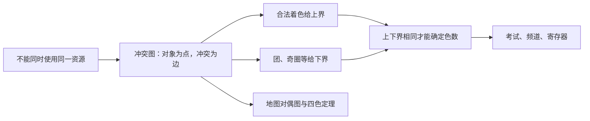

# C10.8 图着色 Graph Coloring

> [!abstract] 这一讲的任务
> 七门考试需要安排时间，有共同学生的两门不能同场。每门单独安排当然可行，但会用七个时段；随手排成三个时段又可能冲突。我们把“不能共享资源”画成边，找出颜色数的下界，再给出达到下界的安排，从而证明最少需要多少时段。

> [!info] 阅读说明
> 对应 §10.8，正文印刷页727–732，PDF物理页87–92；包含原地图、例1–7及四色定理。节后材料另引入边着色、多重着色与贪心算法，作为与正文相连的补充放在后面，不把它们冒认为当期已讲。课堂进度待确认。



## 0. 开场：排出一张表还不能证明最省时段

若四门课两两有共同学生，它们必须占四个不同时间槽，任何三时段安排都不可能。这个结论不靠试排，而靠四门课之间的冲突结构。若随后能把全部七门课排进四个时段，就同时完成“不可能更少”与“四个确实够用”，最小值才被确定。

着色问题的证明总有这两半：**构造给上界，障碍给下界。** 只有一张可行安排，不能自动得到最优性。

## 1. 从地图区域到顶点着色

地图中每个连通区域对应一个顶点，两区域有共同的非零长度边界才连边；只在一个角相碰不算邻接。得到地图的对偶图dual graph，区域着色转化成顶点着色。原节把每个区域视为连通；若同一个行政对象由分离的地块组成、还要求同色，就需额外表达这个约束，不能不加说明套最简单的地图模型。

> [!important] 合法着色与色数
> 简单图的合法顶点着色coloring为每个点赋一种颜色，使相邻点颜色不同。色数chromatic number $\chi(G)$是所有合法着色中最少使用的颜色数。颜色可以解释为时间、频道、寄存器等互斥资源。

有边至少需两色；非空无边图只需一色。自环会要求一个点与自己异色，所以本节先限定简单图。

原地图左图的区域 $A,B,C,D$两两相邻，给出 $K_4$下界4；一组四色安排为 $\{A,G\}$同色、$\{B,E\}$同色、$\{C,F\}$同色、$\{D\}$第四色，故恰需4。右图有三角形 $A,B,C$给下界3；取 $\{A,E\}$、$\{B,D\}$、$\{C\}$三种颜色即可，所以恰需3。原边界与相应对偶图保留如下，观察的是共同边界，不是区域大小或颜色深浅。

![[C10.8-原图-地图与对偶图.png]]

![[C10.8-原图-地图对应的对偶图.png]]

## 2. 四色定理的结论与边界

> [!important] 四色定理 Four color theorem
> 每个有限简单平面图都能合法地用至多4色着色，即 $\chi(G)\le4$。

“至多”不表示每张图都需要4色；树、偶圈只需2色，奇圈需3色。定理也不能倒用：非平面图仍可能只需2色，例如 $K_{3,3}$。$K_5$需5色，与定理不矛盾，因为它非平面。

历史上，Guthrie在1852年提出地图着色问题，Kempe于1879年发表的证明在1890年被Heawood指出缺口；Appel与Haken于1976年给出依赖计算机分类核查的证明，1996年的后续证明把核查构形减少为633种。这个历史说明计算核验必须有可审查的归约与覆盖理由，不能以“试过很多图都成功”替代一般证明。本讲采用定理结论，不尝试用几段归纳冒充完整四色证明。

上一讲的度至多5结论只能直接推出**六色**上界：删去一个至多5度的点，归纳把剩余图涂成6色，再放回该点，它至多看到5种颜色，总有一色可用。把这段证明中的6直接改成4并不成立，因为5个邻居可能占满4色。

## 3. 原例1：一条边也可能改变色数

原图 $G$顶点为 $a,b,c,d,e,f,g$，边为

$$ab,ac,bc,bd,cd,be,cf,de,df,ef,eg,fg.$$

三角形 $abc$迫使至少3色。取 $a$红、$b$蓝、$c$绿后，$d$邻接 $b,c$只能红；$e$邻接 $b,d$只能绿；$f$邻接 $c,d$只能蓝；$g$邻接 $e,f$只能红。其余边检查也无同色冲突，故 $\chi(G)=3$。

$H$只比 $G$多一条 $ag$。如果还只有3色，以上从三角形出发的强迫过程在交换颜色名称后仍相同，最终 $a,g$必同色，而新边要求异色，矛盾。给 $g$第四色就可行，所以 $\chi(H)=4$。这里不是因为“一次涂法失败”就断言3色不可能，而是证明了**任何**三着色都被相同的邻接条件强迫。

![[C10.8-原图-加边改变色数.png]]

## 4. 常见图族的色数

例2的完全图 $K_n$每对点相邻，任意两点不能共色，至少 $n$色；给每点一种颜色恰好可行，故 $\chi(K_n)=n$。

例3的完全二分图 $K_{m,n}$（$m,n\ge1$）两侧分别一种颜色就够，有边又不能只用1色，所以 $\chi=2$。顶点数量增加不一定增加色数，关键是冲突结构。

例4沿 $C_n$交替染红蓝。$n$偶数时，最后一点与第一点不同色，构造成功，且有边给下界2；$n$奇数时，最后一点被迫与第一点同色，二着色失败，必须用第三色。把前 $n-1$点交替着色、末点用第三色即可，于是

$$\chi(C_n)=\begin{cases}2,&n\ge4\text{且}n\text{偶},\\3,&n\ge3\text{且}n\text{奇}.\end{cases}$$

延伸到本章轮图约定：$W_n$由 $n$个圈点加中心组成，中心邻接全部圈点，需要一种没有在圈上出现的颜色，所以 $\chi(W_n)=3$（$n$偶）或4（$n$奇）。这也提供了不含大团却可能需要4色的例子。

## 5. 例5：把七门考试排到最少四个时段

课程编号1至7，冲突边按原题完整列为

$$
12,13,14,17,23,24,25,27,34,36,37,45,46,56,57,67.
$$

例如12表示1与2有共同学生，不表示它们必须连续考试。点1、2、3、4之间六条边齐全，构成 $K_4$，所以至少4个时段。原题的安排是：

| 时间槽／颜色 | 课程 |
|---|---|
| I／红 | 1、6 |
| II／蓝 | 2 |
| III／绿 | 3、5 |
| IV／棕 | 4、7 |

同一槽内的三对 $(1,6),(3,5),(4,7)$都不在边集中，所以没有冲突，4槽可行。结合下界，得到**最少恰为4**。这比只抄图上四种颜色多完成了最优性的一半证明。

例6的频道分配把发射台画成点，原模型规定距离150英里以内的台不能同频道，就在这样的两台之间连边，颜色代表频道。150英里是该历史例题的给定规则，不是这里宣称的现行法规；若干扰判据改变，就先改边，不能沿用旧答案。

例7的寄存器分配把变量画成点，同时需要保存的变量之间连边，颜色代表寄存器。同色变量可以共享寄存器，因为它们没有同时占用需求。最小寄存器数等于该冲突图色数，前提是模型已经准确描述变量的活跃范围。

### 团、独立集与支配集承担不同任务

团clique是一组两两相邻的顶点，最大团大小给色数下界；独立集independent set是一组两两不相邻的点，正是一种颜色可以同时覆盖的集合。独立数$\alpha(G)$为最大独立集大小，一种颜色至多覆盖$\alpha$个点，所以$\chi(G)\ge\lceil n/\alpha(G)\rceil$；给最大独立集共用一色，其余逐点异色，又给$\chi(G)\le n-\alpha(G)+1$。这些界不保证恰好相等。

支配集dominating set则要求每个集合外顶点都邻接至少一个集合内顶点，目标是选尽量少的“覆盖中心”。它不要求选中顶点之间互不相邻，与独立集、匹配和着色均不同。把棋盘格作点、皇后能攻击的格之间连边，放最少皇后控制全盘就对应最小支配集；放皇后的位置自身也视为已覆盖。

## 6. 贪心着色给方案，不自动给色数

节后材料的算法先按度非增排序，从首个未着色点开始涂颜色1，继续把与已涂颜色1的所有点均不相邻的点加入；一轮后用颜色2重复，直到全部着色。每个颜色组内部独立，所以输出必合法。

```text
按度非增排序顶点，c = 0
while 仍有未着色顶点:
    c = c + 1
    本轮集合 I = 空集
    按固定顺序扫描未着色点v:
        若v与I中所有点均不相邻:
            color[v] = c
            把v加入I
```

它可能浪费颜色。用六点二分图检验：两组 $a_1,a_2,a_3$与 $b_1,b_2,b_3$，除 $a_ib_i$外所有跨组边都存在，各点度都是2。合法的降度同序可以取 $a_1,b_1,a_2,b_2,a_3,b_3$。第一轮选 $a_1,b_1$，第二轮选 $a_2,b_2$，第三轮才选 $a_3,b_3$，用了3色；但把全部 $a_i$一色、全部 $b_i$一色只需2色。算法输出的3是上界，不能当成 $\chi=3$。

一般图精确求色数是困难问题；把现实任务转成着色，只是找到了准确模型，并不自动得到高效的全局最优算法。

## 7. 别把点着色、边着色与多重着色混在一起

边着色edge coloring给边赋颜色，任意两条共端点的边必须不同色，最少颜色数记为 $\chi'(G)$。顶点着色防止相邻任务同时使用资源；边着色防止共享同一端点的两项联系同时使用资源。若最大度为 $\Delta$，同一顶点处的 $\Delta$条边两两冲突，所以 $\chi'\ge\Delta$。例如 $C_n$的边着色数也按奇偶为2或3，但 $K_3$的点、边色数偶然相同不代表两种问题等价。

$k$重着色 $k$-tuple coloring为每点分配 $k$种互不相同的颜色，相邻点的颜色集合必须不交，最少总颜色数记 $\chi_k(G)$。例如 $C_4$两侧分别用 $\{1,2\}$与 $\{3,4\}$，得 $\chi_2(C_4)\le4$；任一条边的两个端点必须各有两个不相交颜色，下界4，故恰为4。含边的二分图同理有 $\chi_k=2k$；无边图则只需 $k$色，不能忽略这个边界。

材料还定义边删除意义的色临界图chromatically $k$-critical：$\chi(G)=k$，但删任一条边后色数变为 $k-1$。奇圈为3临界，因为删边变成一条路径；偶圈本来只需2色。临界性描述“每条边对当前色数是否关键”，不同资料若用删点定义，须先区别约定。

## 8. 练习中的画廊问题：用三色挑选守卫位置

简单$n$边形画廊中，守卫$x$能看见$y$，指整条线段$xy$都在多边形内部或边界。设$G(P)$为覆盖特定画廊所需最少守卫数，$g(n)$为所有简单$n$边形里$G(P)$的最大值；不要把一个具体凹多边形的答案与最坏情况函数混在一起。

把简单多边形不添新顶点地三角剖分，并给剖分图顶点三着色。该三着色可按耳三角形归纳：删去只有两条边界边的耳顶点，给较小剖分着色，再给它一种不同于两邻点的颜色。每个三角形的三个顶点两两相邻，因而三色齐全；颜色最少的一组至多$\lfloor n/3\rfloor$个顶点，把守卫放在那里，每个三角形都至少有一个守卫能看见整个凸三角形，故覆盖全图。

梳齿形构造可让不同凹槽各需要独立的视线位置，给出同样的最坏下界，最终画廊定理为$g(n)=\lfloor n/3\rfloor$。这里的保证针对没有洞的简单多边形与点守卫；它不表示每个画廊都必须用这么多人，例如任意凸多边形一个守卫就够。此段是材料练习的延伸推演，三角剖分本身的系统证明属于第5章的工具。

## 这一讲的三句话

1. 用冲突连边，颜色表示可共享的资源；只有“合法方案上界＋不可减少的下界”才能确定色数。
2. 四色定理适用于平面图，非平面不意味着需要五色；完全图、二分图与奇偶圈分别给出典型边界。
3. 贪心算法保证得到合法着色，却可能超过最小色数；点着色、边着色和多重着色也有不同的约束对象。

## 速查表

| 名称 | 公式或判据 |
|---|---|
| 色数 | 合法顶点着色的最少颜色数$\chi(G)$ |
| 团下界 | $K_k\subseteq G\Rightarrow\chi(G)\ge k$ |
| 四色定理 | $G$平面$\Rightarrow\chi(G)\le4$ |
| 完全图 | $\chi(K_n)=n$ |
| 完全二分图 | $\chi(K_{m,n})=2$，$m,n\ge1$ |
| 圈 | 偶圈2，奇圈3 |
| 轮（外圈有$n$点） | $n$偶时3，$n$奇时4 |
| 边色数下界 | $\chi'(G)\ge\Delta(G)$ |
| $k$重着色 | 相邻点颜色集合不交；含边二分图$\chi_k=2k$ |

> [!tip] 下一讲预告
> 图论里有一类图既连通又没有圈，路线结构会变得格外清楚：任意两点之间只有一条不重复顶点的路径。第11章“树”将从这里继续；本章课程边界到此，后续笔记尚未建立。


---

**上一讲** ← [[C10.7 平面图 Planar Graphs]] ｜ **下一讲** → 第11章 树 Trees（当前课程笔记边界，待整理） ｜ **返回课程索引** → [[C10 图 Graphs MOC]]
