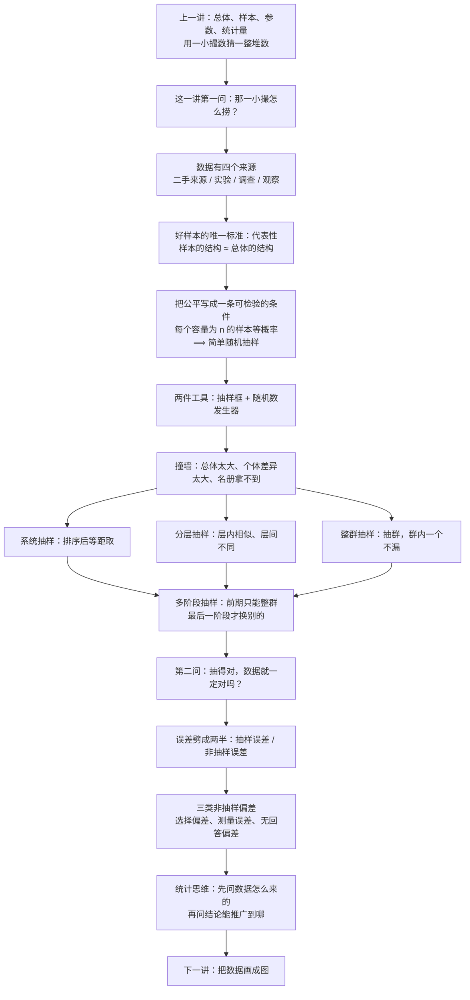
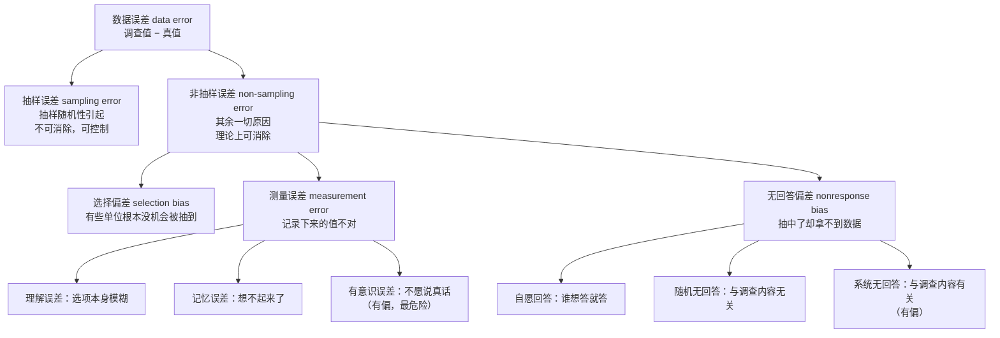
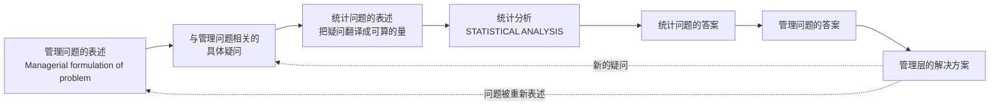

# C1.2 收集数据：抽样方法与代表性 Collecting Data: Sampling Methods and Representativeness

> [!abstract] 这一讲的任务
> 上一讲把六个词定住了：总体、个体、变量、样本、参数、统计量。整门课的工作方式是**用一小撮数去猜一整堆数**——可那一小撮到底该怎么捞出来，上一讲一个字没说。
> 这一讲就补这一环：数据有哪几条来路；什么样的样本算"有代表性"；把"公平"写成一个可以检验的数学条件，就得到**简单随机抽样**，再由它变出系统、分层、整群、多阶段四种变体，每种对应一种为难的场面。
> 后半程换个方向问：**就算抽得完全正确，数据还是会错。** 于是把误差劈成两类，再一条条拆开三类非抽样偏差——包括 1936 年那场把一本杂志送进坟墓的民调。

> [!info] 怎么读这份讲义
> 第 0 节给一个班里就能做的实验：34 个人抽 5 个，三种顺手做法给出三个答案。第 1 节讲数据的四条来路（外加中国统计实践里的报表制度与普查）。第 2 节把"代表性"逼成一个可以量化的标准。第 3 节是全场承重墙：**把公平写成"每个样本等概率"**，再配抽样框与随机数两件工具。第 4–7 节是四种变体，顺序就是它们被逼出来的顺序：先系统（最省事），再分层（最准），再整群（最便宜但最粗），最后多阶段（大工程怎么落地）。第 8 节讲当问题本身就让人说假话时怎么办。第 9–10 节转向误差：先分两类，再拆三类偏差。第 11 节讲统计思维，第 12 节把第一章的要点一次收齐。
> 标注约定：标有 **（拓展）** 或 **【拓展】** 的内容，是**课堂上没有展开、由教材与通行讲法延伸补充**的部分。复习优先级：先掌握未标注的主干，考点集中在主干上。
> 勘误一句话：本篇有一处原话需要更精确地改写（系统抽样四舍五入到底坏了什么），在第 4.5 节；另有一处口算数字口径不一（高收入层到底 100 人还是 1000 人），在第 5.4 节。

---

## 0. 开场：34 个人，抽 5 个（p.28）

一个班 34 人，要抽 5 个人填一份问卷：**你一周平均自习几次？**

三种顺手就能做的抽法，三秒钟内你大概会选一种：

1. **问一句"谁愿意填"，举手的 5 个人填。**
2. **按学号来，1 号到 5 号。**
3. **走到前排，找 5 个面熟的同学。**

三种做法都"抽了 5 个人"，可你心里其实已经知道答案会不一样：

- 第一种抽到的是**愿意填问卷的人**——有时间、有心情、对这事有点在意的人。忙着打工的、天天泡图书馆没空理你的，恰好都不举手。
- 第二种抽到的是**学号靠前的人**。学号常按入学成绩或姓氏排，它跟"一周自习几次"未必无关。
- 第三种抽到的是**坐前排的人**。前排后排的差别，上过课的都懂。

于是同一间教室、同一个问题，三个"样本均值"能差出一大截。**这不是数据在撒谎，是抽法先替你回答了问题。**

> [!question] 停一下，先自己想想
> 这三种做法，哪一种最接近全班 34 人的真实平均？
> 先别急着答。真正的答案是：**这三种做法谁都没有资格谈"接近"**——因为它们仨都算不出一句"我可能错多少"。而要算出这句话，就必须先知道每个同学"被抽中的机会是多大"。这正是这一讲要建立的东西。

这一讲因此分成两半，问两个不同的问题：

- **上半场（1.6 节）：样本怎么捞出来才算数？** 答案是先定义什么叫"公平"，再据此造出五种抽法。
- **下半场（1.7 节）：捞出来之后，数据为什么还是会错？** 答案是误差有两种，一种消不掉、一种能消掉，而后者往往更致命。

---

## 1. 数据从哪来：四条来路（p.29–30）

在讨论"怎么抽"之前，先问一个更靠前的问题：**你手里的数据，是谁弄出来的？**

答案只有四种（p.29–30）：

| 来路 | 谁在控制 | 典型场合 | 数据是几手 |
|---|---|---|---|
| **二手来源 published source** | 别人早就收集好了，你只是取用 | 年鉴、期刊、报纸、网站、国家统计局 | 二手 |
| **设计实验 designed experiment** | **研究者严格控制**实验单元 | 材料在不同温度下的韧性、新药的双盲试验 | 一手 |
| **调查 survey**（观察研究的一种） | 研究者不干预，只发问、记录回答 | 问卷、电话访问、入户调查 | 一手 |
| **观察研究 observational study** | 研究者在**自然状态**下观察并记录 | 蹲点记录客流、观测天体、跟踪股票收盘价 | 一手 |

四条路里，**调查其实是观察研究的一种**（p.30 把 survey 写成 observation study 最常见的类型）。这个从属关系值得留意：调查的本质不是"问"，而是"**不干预**"——你只是记录人家原本是什么样，没有去改变他。对照组、双盲那一套，属于上表第二行，跟调查是两回事。

### 1.1 二手数据为什么总是第一个该看的

二手数据的特点是**便宜、快、范围广**：收集容易、成本低，还能帮你把研究问题框住——先看别人已经做到哪一步，再决定自己还要补什么。所以做任何研究，**第一件事都是翻二手数据**，翻完了发现缺口，才轮到自己动手去拿一手数据。

课堂上给过一条很实在的取数路线：年鉴（一本年鉴八百块，学校图书馆的数据库里能免费全文下载）、国家统计局网站、知网与各类数据库。这些是学校替你付过钱的资源，在校期间随便用；毕业之后再用要重新申请、还要花钱。

> [!note] 二手不等于不可靠，但口径是别人的
> 二手数据最大的坑不是真假，而是**口径**：它统计的是"常住人口"还是"户籍人口"？"收入"是税前还是税后？这些定义是收集者定的，你改不了。所以用二手数据时，第一个动作永远是**读它的定义**，而不是读它的数字。

### 1.2 调查的三种组织形式：报表制度、普查、抽样调查（p.30）

同样是"调查"，按**组织方式**还能再分三类。这三类在中国的统计实践里是常识，也是考试爱问的对比题。

**① 统计报表制度 statistical form。** 政府定好一套统一的表格，让各单位按期填报，逐级汇总。

- 优点：表格设计完善、**高度统一与标准化**、回收率高、内容相对稳定，因此**便于累积数据、便于跨年比较**；而且能一层层往上汇总，满足各级管理部门的需要。
- 缺点：报表太多会**加重基层负担**；一旦出现虚报、瞒报，数据质量就崩了。
- 还有一个容易被忽略的特点：它通常**只覆盖一定规模以上的单位**。比如餐饮业，营业额到 50 万元以上才需要参与报表制度——那些小摊小店，从一开始就不在表里。

**② 普查 census。** 一个不漏地数一遍。

- 优点：能得到**全面**的数据；而且普查结果本身可以**给抽样调查提供抽样框**（这一点后面第 3.4 节会立刻用上）。
- 缺点：要动员大量人力物力财力，**不能经常做**。
- 中国的普查节奏：人口普查**逢 0**（十年一次）、农业普查**逢 6**（十年一次）、经济普查**逢 3 和逢 8**（十年两次）。所以每十年正好 **4 次**普查：$1+1+2=4$。

**③ 抽样调查 sample survey。** 只查一部分，用这一部分去推全体。**这一讲的主角和后面十几章的全部地基。**

> [!important] 三者的关键差别只有三个字：覆盖谁
> 报表制度覆盖"规模以上"，普查覆盖"全部"，抽样调查覆盖"抽中的那些"。
> 覆盖范围决定了你能说什么话：**普查能直接说"总体就是这样"；抽样调查只能说"总体很可能是这样，误差不超过多少"**——而后面那半句，才是统计学存在的理由。

---

## 2. 什么叫"有代表性"（p.31）

抽样调查要成立，样本必须**有代表性 representative**：样本身上体现出来的特征，得是总体典型具有的那些特征（p.31）。

这句话听起来像同义反复，得把它翻译成一个能算的东西。

**翻译的办法是看结构。** 假设全校 60% 的同学用安卓手机、40% 用苹果。你抽 10 个人，如果里头大约 6 个安卓、4 个苹果，这个样本的**结构**就与总体的结构对上了；如果 10 个全是苹果，那不管这 10 个人多典型、多友善，这个样本对"全校用什么手机"这个问题都毫无用处。

> [!important] 代表性的操作性定义
> **代表性 = 样本的结构 ≈ 总体的结构。**
> 注意它和"样本量大"是两件事。结构不对，量再大也只是把同一个偏差重复更多遍。

这句话马上能推出一个反直觉的结论：

> [!question] 停一下，先自己想想
> 一份 10 万人的自愿网上投票，和一份 3000 人的严格随机抽样，哪一个更能代表全体？
> 直觉会说"10 万人的多"。正确答案是**后者**，而且不是"略好一点"，是**前者根本没有资格参与比较**——第 10.2 节会给一个数字，让你看清 10 万人的样本怎么把 50% 算成 25%。

### 2.1 前提：总体本身得是"一个东西"

代表性还有个更靠前的前提，课堂上专门强调过：**统计学的研究对象有三个特征——大量性、差异性、同质性**。

- **大量性**：研究对象必须是"很多个"。两三个东西直接把每个都研究一遍就行，用不上统计学。
- **差异性**：个体之间必须有差异。如果全部一模一样，研究一个就等于研究了全部，也用不上统计学。
- **同质性**：这些个体必须属于**同一性质**的东西。

第三条最容易做错。举个例子：要研究"华工本科生的身高"，总体是什么？"华工所有本科生"——这个答案是**错的**。

因为男生和女生在身高上不具备同质性：男生的分布中心大约在 1.70–1.72 米，女生大约在 1.61–1.62 米。把两拨人混成一个总体，得到的分布是**两个鼓包的混合**，既不是男生的分布也不是女生的分布，你反而找不到规律了。

同样的道理：研究一只股票不同时点的收盘价，可以；把 A 公司、B 公司、C 公司的收盘价混成一个总体，就研究不出任何规律——因为每只股票背后是一家不同的公司，属性不同。

> [!warning] 同质性不是"大家都一样"
> 同质性的意思是"**同一件事的不同个体**"，不是"个体之间没有差别"。差别恰恰是必需的（那是差异性）；不能有的是"两种不同性质的东西混在一起"。
> 这一条与第 5 节的分层抽样是同一个思想的两种用法：**分层就是把"不同质的部分"先分开，再各自研究。**

---

## 3. 简单随机抽样：把"公平"写成一条能检验的条件（p.31–32）

现在正面回答"怎么抽"。先看最朴素的想法。

### 3.1 朴素尝试：每个人被抽中的机会一样

一个班 34 人抽 5 个，"公平"最直觉的含义是：**每个人都有同样的机会被抽到。**

这个想法对不对？**方向对，但不够。**

### 3.2 撞墙：每人机会相同，样本却可能永远长得一样

做一个实验。把 32 个人平均分成 4 组，每组 8 人。现在**随机抽一个组，把这个组的 8 个人全查**。

问：每个人被抽中的机会是多少？——$1/4$。**人人机会相等，完美公平。**

但这个抽法有个致命毛病：**抽出来的样本，永远是"同一个组的 8 个人"。** 它可能是第 1 组的 8 个人，也可能是第 3 组的 8 个人，但绝不可能出现"第 1 组 3 个 + 第 2 组 5 个"这种组合。如果这 4 个组恰好是 4 个不同的专业、4 个不同的年级，那你无论抽多少次，拿到的都是"清一色"的样本——它离总体结构可能远得离谱。

所以"每个人机会相同"是一个**必要条件，不是充分条件**。我们还需要一条更强的要求：**每一种可能的组合，都要有同样的机会出现。**

### 3.3 正式定义：等概率的是"样本"，不是"个人"

> [!important] 定义：简单随机抽样 Simple Random Sample（p.31–32）
> 从总体中抽取 $n$ 个实验单元，如果**每一个容量为 $n$ 的不同样本，被选中的机会都相同**，这个样本就叫**简单随机样本**，这个抽法就叫**简单随机抽样**（记作 SRS）。
> 注意主语：等概率的对象是**样本**（一个组合），不是**个体**。

用"先……再……"讲清动作：**先把总体里每一个单元编号；再从 $1$ 到 $N$ 中随机取出 $n$ 个互不相同的号；最后按号把对应的单元找出来。** 这三步里，"互不相同"和"每一个号机会均等"是关键。

名字怎么来的：**简单**（simple）指的是它不借助任何额外信息——不看性别、不看收入、不看排序，只用一个编号；**随机**（random）指的是编号的选取不受任何人为偏好影响。

**算一下这个"等概率"到底有多严。** 62 个人抽 5 个，可能的样本组合有

$$\binom{62}{5}=\frac{62\times61\times60\times59\times58}{5\times4\times3\times2\times1}=6{,}471{,}002$$

六百多万种组合，每一种的机会都必须一样，也就是 $1/6{,}471{,}002$。反过来看**每个个体**被抽中的机会，则是

$$\frac{n}{N}=\frac{5}{62}=8.06\%$$

这两个数不是一回事：个体概率 $8.06\%$ 只保证"人人有份"，样本组合的等概率才保证"每一批人都有可能"。

### 3.4 两件必备工具：抽样框与随机数发生器（p.33）

要在现实里执行上面那三步，需要两样东西。

**工具一：抽样框 sampling frame。** 就是**包含总体全部单元信息的一份名册**——班级名册、学号表、企业名录、电话号码簿。

抽一个班，抽样框就是点名册（前提是没有同名同姓，有的话得用"张三一、张三二"区分开）；用学号也行，因为学号不会重复。

抽样框难在"全"。一个班的名册好办；整个年级选修统计学的学生名册就开始难了；整个广东省、全中国——抽样框本身就是一个大工程。

**工具二：随机数发生器 random number generator。** 就是**专门用来产生随机数字的工具**，有两种形态：印成表的**随机数表**，和统计软件里现成的函数。

随机数表长这样：一堆数字排成若干行若干列，**表里每一个数字都是随机产生的**。用法有讲究，一共四步：

1. **定起点。** 起点也不能由你挑——真正的随机起点，可以用手机秒表的"分秒"末位定列、再按一次定行。
2. **定方向。** 从左到右、从上到下，还是斜着读，都行，**由你在开始之前定下来，中途不许改**。
3. **定读法。** 62 个人是两位数编号，就**两位一读**。
4. **筛。** 超出范围的号（以及重复的号）**直接跳过**，直到凑够 $n$ 个。

> [!example] 手算：62 人里抽 5 个
> 假设起点定在第三列第五行，方向从左到右、从上到下，两位一读，读出来是
> $$04,\ 18,\ 93,\ 16,\ 72,\ 33,\ 45$$
> 逐个筛：$04$ 在范围内 → 第 1 个；$18$ → 第 2 个；$93$ 超出 62 → **跳过**；$16$ → 第 3 个；$72$ 超出 62 → **跳过**；$33$ → 第 4 个；$45$ → 第 5 个。
> 抽中的学号：$\boxed{04,\ 18,\ 16,\ 33,\ 45}$——五个，够了。

**这里有个学生最爱问的问题：超范围的号能不能"减一减"用掉？**

比如班上有 49 人，读到了 $93$。有人立刻说：$93-50=43$，43 号在范围内，可以用。

这背后是一套完整的设计：**第一轮机会**给 1–49 号；**第二轮机会**给 51–99 号，读到 51–99 就减去 50，映射回 1–49。这样每个人恰好有两次机会，仍然等概率。

那如果是 50 人呢？$93$ 还能用吗？能——只要把 $00$ 规定成 50 号，让 50 号也拿到第二次机会，概率就又平了。**判据只有一条：每个人被抽中的机会是否相等。** 满足这条，怎么设计都行；不满足，看上去再"规整"也是错的。

> [!important] 这句话要记住
> 抽样方法不是从天上掉下来的规矩，是**你自己设计的**。设计得对不对，唯一的检验标准是：**它是否让每个容量为 $n$ 的样本等概率。** 理由充分，方法就成立。

### 3.5 为什么"怎么抽"比"抽多少"更要紧（p.34）

p.34 给了一句很硬的话：**样本是怎么从总体里选出来的，对统计推断至关重要**——因为推断要用到"观察到这个样本的概率"。概率不知道，后面所有的误差、置信度都无从谈起。

这句话在第 5 章以后会变成一个默认前提：**书里给的推断公式（置信区间、假设检验、$t$ 统计量……），前提都是简单随机抽样。** 如果你实际用的是分层、整群、系统抽样，公式照样能用，但**误差项必须改**——只改误差项，别的地方不用动。

> [!note] 这句话对写代码的人意味着什么
> 你在机器学习里做的 `train_test_split`，默认就是**简单随机划分**——所以那些基于 i.i.d. 的评估指标才成立。一旦你的数据是**按用户、按设备、按时间**分群来的，随机划分就会让同一个用户同时出现在训练集和测试集里，指标虚高。这时候正确的做法是**按群划分**（group split），本质就是第 6 节的整群抽样。

### 3.6 优缺点与适用场合：一条最容易被漏掉的话

**优点**（p.33–34）：

- 抽样框完整时，抽起来**简单**——直接从名册里取号就行；
- **公式现成**：用样本统计量估计总体参数最方便，因为所有推断公式都是为它写的。

**缺点**：

- $N$ 很大时，**抽样框难构造**（一个班容易，一个省、一个国家极难）；
- 抽中的单元**分散**，调查成本高——全国简单随机抽样，抽到的人可能在广州、可能在西藏、也可能在上海，光路费就受不了；
- **没有额外信息可用**来提高精度。手里明明知道性别、收入这些信息，简单随机抽样一概不用。

**适用场合**（这一条是考点，而且有个坑）：

> [!important] 简单随机抽样适合什么样的总体
> **① 总体规模不要太大；② 个体之间的差异不要太大。**
> 补一句必须记住的反面：**"不要太大"不等于"越小越好"，太小也不行。** 因为统计学的研究对象本来就有**大量性**这个特征——两三个人的总体，直接问一遍就完了，用不上统计学。

由此自然引出两个追问，也就是后面四种抽法的出生证明：

- 总体**规模很大**怎么办？→ 多阶段抽样（第 7 节），以及整群抽样（第 6 节）。
- 个体**差异很大**怎么办？→ 分层抽样（第 5 节）。
- 名册**拿不到**、或者调查必须省钱省人怎么办？→ 整群抽样（第 6 节）。
- 想要一个规则简单到"谁都能照着做"的办法？→ 系统抽样（下一节）。

---

## 4. 系统抽样：先排序，再等距（p.36）

第一个变体来自一个很实际的抱怨：**随机数表抽出来的号东一个西一个，执行起来太麻烦。**

那能不能定一条"照着走就行"的规则？

### 4.1 动作：三步

> [!important] 定义：系统抽样 Systematic Sampling（p.36）
> 把总体单元**按某个特征排序**，算出**抽样间隔** $k$，在**第一个间隔内随机取一个起点**，然后每隔 $k$ 个取一个，直到取够 $n$ 个。
> $$k=\frac{N}{n}\quad(\text{一般取整})$$

用"先……再……"讲清动作：**先把所有人排成一列；再算出"每隔几个取一个"；然后在头 $k$ 个人里随机点一个起点；最后从这个起点开始，每隔 $k$ 个抓一个。** 它还有个更形象的名字：**等距抽样**——相同的间隔来一个，相同的间隔再来一个。

### 4.2 手算：34 人抽 5 个

$$k=\frac{34}{5}=6.8\ \longrightarrow\ 7$$

第一个间隔是 1–7 号，在里面随机取一个起点。假设取到 **3 号**：

$$3,\quad 3+7=10,\quad 17,\quad 24,\quad 31$$

五个号，齐了。整个过程只用加法，谁都能执行。

### 4.3 优点一：简单到可以写在一张纸条上

系统抽样在市场调研公司里极常用，原因就是**好操作**：只要给调查员一条规则——"进门往右拐，从第二间开始，每隔五间敲一次门"——他就能独立干完，不需要现场查随机数表，也不需要事先拿到完整名册。

### 4.4 优点二：排序信息用对了，精度会提高

系统抽样还有个不那么显眼的优点：如果**排序用的那个特征与研究目标相关**，它会顺带把样本的结构拉近总体。

举个班里的例子。开学想了解同学们的身体状况，34 人抽 5 个，用**体重**排序再等距抽。$k=7$，于是：

- 最轻的 7 个（1–7 号）里出 1 个代表；
- 次轻的 7 个（8–14 号）里出 1 个；
- 中间的 7 个（15–21 号）里出 1 个；
- 再重一点的 7 个（22–28 号）里出 1 个；
- 最重的 6 个（29–34 号）里出 1 个（最后一段只有 6 个人，这正是 4.5 节那个麻烦的根）。

结果：**从最轻到最重，每一段都有代表。** 样本在"体重"这个维度上的结构和总体的结构几乎一样——而体重与健康状况相关，所以这个样本对"健康状况"的代表性也跟着上去了。

这就是系统抽样能提高精度的机理：**排序这一步，等于免费做了一次粗分层。**

### 4.5 缺点一：间隔 k 除不尽的时候，等概率就破了

$34/5=6.8$，不整除。这一除不尽，麻烦就来了。原话把这一条说成"最后几个永远抽不到"，值得把它算清楚——**到底坏了什么，取决于你取整的方向。**

**情形 A：$k$ 取上整（$6.8\to7$）。** 从起点 $s$ 出发取 $s,\,s+7,\,s+14,\,s+21,\,s+28$。

- $s=1$ 得 $1,8,15,22,29$——5 个；
- $s=2$ 得 $2,9,16,23,30$——5 个；
- $\cdots$
- $s=7$ 得 $7,14,21,28$——**只有 4 个**，因为 $35$ 号不存在。

把 7 个起点全走一遍会发现：34 个人**每人恰好被一个起点覆盖一次**，个体被抽中的概率都是 $1/7$，看上去很公平。**但样本量不固定**：有 $6/7$ 的可能拿到 5 个，有 $1/7$ 的可能只拿到 4 个。而"容量为 $n$ 的样本等概率"这条定义，前提是容量真的等于 $n$。更糟的是，如果你为了凑够 5 个而"绕回去"补一个（$35\to1$），1 号就凭空多了一次机会，概率立刻不平。

**情形 B：$k$ 取下整（$6.8\to6$）。** 起点取 1–6，各取 5 个：$s+6j,\ j=0,\dots,4$，最大只到 $6+24=30$。于是 **31、32、33、34 号永远抽不到**——被抽中的概率是 $0$，而前 30 个人是 $1/6$。原话说的"最后几个永远抽不到"，对应的就是这个方向。

> [!warning] 勘误：原话与复算的差别
> 原话把四舍五入的毛病笼统说成"最后几个永远抽不到"。严格复算下来：
> **取下整**（$k=6$）确实让 31–34 号概率为 0；但**取上整**（$k=7$，也就是课上算出来的那个 7）并不会让任何人概率为 0，它坏的是**样本量不固定**（有一个起点只能拿到 4 个）。
> 两种取整都会破坏"等概率"，只是破坏的方式不同。答题时把这两条分开写，比笼统说一句"四舍五入有误差"准确得多。

好在**这个误差会随总体规模增大而变小**：$N$ 越大，$k$ 除不尽的那点余数占的比例越小，影响越可以忽略。而统计学的研究对象第一条特征就是**大量性**，所以实践中这条缺点通常不算致命。

### 4.6 缺点二：名单里藏着周期，等距就会跟它共振

第二个缺点更阴险，而且只有想通"等距"这两个字才想得出来。

场景：流水线上生产零件，由于某个代码或机械手的设定问题，**每生产若干个正品就出一个次品**——次品是按固定周期出现的。

现在你用系统抽样去抽检：$k$ 恰好等于那个周期（或它的整数倍）。会发生什么？

- 要么**抽到的全是次品**，你以为整条线全废了；
- 要么**永远抽不到次品**，你以为整条线完美。

两种结论都错得离谱，而且**错得毫无征兆**——因为你的抽法本身太规整了，规整到跟名单里的隐藏规律踩在同一个节拍上。

> [!important] 一句话记住这两条缺点
> **系统抽样怕两件事：一是 $k$ 除不尽（概率不平），二是名单本身有周期（等距共振）。**
> 第一条随 $N$ 变大而衰减；第二条不会——它只会被"起点随机"部分掩盖，掩盖不了就全错。

后面那张四格对照图（第 ④ 格）就是这个毛病的一次现场演示：64 个人按"每行 8 人"排好，每隔 4 个取 1 个，结果**只落在第 3、7 两列**——16 个样本挤在 2 列、4 个群里，另外 4 个群一个人都没抽到。名单的周期（8）与抽样间隔（4）共振了。

**【拓展】** 这件事在信号处理里有个更有名的名字：**混叠 aliasing**。以间隔 $k$ 采样一个周期为 $k$ 的信号，你采到的是一条直线——不是信号消失了，是你的采样节奏跟它同步了。抽样定理要求采样频率高于信号最高频率的两倍，说的就是**别让采样间隔与对象的周期共振**。同一个道理，在名单抽样里叫"隐藏周期性"，在示波器上叫"混叠"，在机器学习的数据划分里叫"按时间切分时踩到了周期性"（比如按天划分，恰好每天都抽到同一批用户）。

---

## 5. 分层抽样：把差异关到"不抽的那一层"去（p.35）

第二个变体要解决另一个抱怨：**总体内部差异太大，随便抽几个根本代表不了。**

如果差异是客观存在的，能不能**先把差异理清楚，再抽**？

### 5.1 动作：先分层，每层都抽，最后合并

> [!important] 定义：分层抽样 Stratified Random Sampling（p.35）
> 按某个与研究目的相关的特征，把总体**分成两个或更多个层 strata**，使得**层内个体相似、层间个体差异大**；然后在**每一层内部**各抽一个随机样本；最后把各层的样本合起来，构成总样本。

用"先……再……"讲清动作：**先按一个相关特征把人分层；再在每一层里各抽一部分；最后把各层抽到的合在一起。** 注意第三步——**是合并，不是筛选**。

名字怎么来的：**分层**的"层"就是 strata，"分层"就是"把总体切成立体的一层一层"。切的标准不是随意的，必须**与研究目的相关**。

### 5.2 怎么分层：一个卖车的例子

要了解消费者对汽车的喜好，为下一款车做设计。怎么分层？

分层的目标是**层间差异大、层内差异小**，而这里的"差异"指的是**喜好的差异**。什么东西最能把人的购车偏好分开？——**家庭年收入**。

- **低收入层**：手头能匀出三五万买车，选择余地本来就小，"能代步就行"。这一层内部，大家的偏好高度相似——**层内差异小**。
- **高收入层**：预算宽裕，选择余地大。年轻人要高加速、要推背感、要刹车一点就到；上了年纪的要舒适、要安全、要豪华。同一层内部，偏好能差出十万八千里——**层内差异大**。
- 而低收入层与高收入层之间，偏好天差地别——**层间差异大**。

这正是分层想要的格局：**层与层之间差别很大，层内部彼此很像。** 于是"从每一层里各抽几个"就能保证每个类型都有代表，而不是碰运气。

### 5.3 每层抽多少：三种抽法

层分好了，接下来的问题是**每层抽几个**。这一步有三种做法，一种比一种聪明。

**① 等额抽样 equal amount。** 不管每层人多人少，**每层抽一样多**。

例如分三层、总共抽 100 个：

$$\frac{100}{3}=33.3\ \longrightarrow\ 33,\ 34,\ 33$$

（三个数加起来必须正好 100，所以中间那层多拿 1 个。）

毛病很明显：**它假装每层的人数一样多。** 可高收入人群永远是少数，中等和低收入才是大多数。按 33/34/33 抽，等于把只占 1% 的高收入层放大到 33%，把占 49% 的低收入层压缩到 33%——样本的结构与总体的结构彻底对不上。

**② 等比例抽样 proportional。** **按每层占总体的比例分配名额**：

$$n_h=n\times\frac{N_h}{N}$$

其中 $N_h$ 是第 $h$ 层的人数，$N$ 是总体人数，$n$ 是要抽的总数。

> [!example] 手算：1 万人、抽 100 个
> 设总体 $N=10{,}000$，高收入占 1%、中等 50%、低 49%：
> $$N_{\text{高}}=0.01\times10{,}000=100,\quad N_{\text{中}}=5{,}000,\quad N_{\text{低}}=4{,}900$$
> 抽 100 个，按同样比例分：
> $$n_{\text{高}}=100\times\frac{100}{10{,}000}=1,\quad n_{\text{中}}=100\times\frac{5{,}000}{10{,}000}=50,\quad n_{\text{低}}=100\times\frac{4{,}900}{10{,}000}=49$$
> 三个数加起来 $1+50+49=100$ ✓。样本的结构与总体的结构完全一致。

这比等额抽样好得多，因为它至少承认了"每层人数不一样"。

**③ 最优抽样 optimum allocation。** 还能不能更好？能。它把**层内的差异大小**也算进去：

$$n_h\ \propto\ N_h\,\sigma_h$$

也就是：**人多的层多抽，层内差异大的层更要多抽。**

回到汽车的例子，这个改进一目了然：

- 低收入层 $N$ 很大，但 $\sigma$ 很小（大家都要代步车，没得选）——按等比例抽 49 个，其实有点浪费；
- 高收入层 $N$ 很小，但 $\sigma$ 很大（年轻人要性能、年长者要豪华）——按等比例只抽 1 个，抽到谁就是谁，这一个代表不了那一整层。

所以更合理的做法是：**在高收入层多抽几个，在低收入层少抽几个。** 总数还是 100，但每个名额花在了刀刃上。

> [!note] 三种抽法的取舍（拓展）
> - 等额：只有在各层人数**确实相同**、且层内方差也相近时才合理，否则一定扭曲结构。
> - 等比例：**自加权**——每层抽同样的比例，合起来不用加权就能直接算总体，工程上最省事，也是最常用的默认做法。
> - 最优：精度最高，但要事先知道每层的方差 $\sigma_h$，实际中往往只能靠预调查估一个。
> 三者的共同前提是一样的：**层内要随机抽**。分层只决定"抽几个"，不改变"怎么抽"。

### 5.4 为什么它是所有随机抽样里精度最高的

> [!important] 分层抽样最大的优点
> **在几种随机抽样方法里，分层抽样的估计精度最高、抽样误差最小。**

这个结论值得推到底——它凭什么？

先回到一个已经建立的事实：**抽样的目标是让样本的结构接近总体的结构。** 那么误差从哪来？来自"你抽到的结构与总体的结构没对上"的那部分偶然性。

分层抽样做了一件很聪明的事：**它在抽样之前，先把总体里最大的那份差异搬走了。**

具体看它的动作顺序：先分层（层间差异大、层内差异小）→ 每一层都抽 → 合并。

**"每一层都抽"这五个字是关键。** 因为每一层都会被抽到，所以**层与层之间的差异根本没有机会变成抽样误差**——它就像普查一样，一层都没漏。真正带随机性的，只剩下"层内抽哪几个"这一步；而层内差异，已经被你分层时的设计压得很小了。

于是抽样误差只剩下**层内那一点点差异**贡献的部分。

**用数字看这件事有多划算。** 设一个 6 人的小总体：低收入 4 人，购车预算 $1,2,3,4$（万元）；高收入 2 人，$10,12$。总体均值

$$\bar x=\frac{1+2+3+4+10+12}{6}=\frac{32}{6}=5.33$$

把总变异（离差平方和）拆成两块：

| 来源 | 计算 | 数值 |
|---|---|---|
| 层间（两层均值 2.5 与 11 相对 5.33 的偏离） | $4\times(2.5-5.33)^2+2\times(11-5.33)^2$ | $96.33$ |
| 层内（各层内部离差平方和） | $(2.25+0.25+0.25+2.25)+(1+1)$ | $7.00$ |
| 合计 | $96.33+7.00$ | $103.33$ |

核对一遍合计：直接算 $\sum(x_i-5.33)^2$ 也是 $103.33$ ✓。

**层间占了 $96.33/103.33=93.2\%$。** 也就是说，如果分层分得好，九成以上的变异被搬到了"每层都抽、因此不产生抽样误差"的那一边，留给抽样误差的只剩 7%。这就是"分层抽样精度最高"的全部秘密：**它不是把误差算得更准，而是用设计把误差挪走了。**

> [!warning] 勘误：高收入层到底几个人
> 算这一层的人数时，原话有一处口径不一致：先说总体 1 万人、高收入占 1%，那就是 **100 人**；后面举例时又说成"高收入人群有 1000 个"。按 1% 的口径，**应为 100 人**（对应 5000 个中等、4900 个低收入，合计正好 1 万）。
> 记结论就好：**等比例抽样下，高收入层抽到 1 个，这 1 个要代表 100 个人。**

### 5.5 第二个优点，和一个很现实的缺点

**优点二：分层还能"分层汇报"。** 除了估计总体，你还可以用**每一层的样本来估计这一层自己**的参数——用抽中的 49 个低收入者估计 4900 个低收入者，用抽中的 1–2 个高收入者估计那 100 个高收入者。一份数据，两种颗粒度的结论。

**缺点：分层要用的那个指标，往往根本拿不到。**

按家庭年收入分层，前提是你得**知道总体里每一个人的家庭年收入**。这件事有多难？全国每个家庭的年收入——别说全国，一个班的同学家庭年收入都不好问，那是隐私。而拿不到分层指标，分层就无从下手。

所以现实里，分层抽样主要用于**反复进行、且指标已经建好档的调查**：

- **收视率调查**——样本户是长期固定的，每户的人口、收入结构早就登记好了；
- **总统大选民调**——每四年一次，历史数据与选民登记库都在，分层指标现成。

这也解释了为什么分层抽样"精度最高"，却**没有系统抽样用得广**：它贵在前期，只有能反复使用的调查才摊得平这个成本。

---

## 6. 整群抽样：抽群，群内一个不漏（p.35）

第三个变体从最世俗的问题出发：**抽样框拿不到，调查又必须便宜。**

### 6.1 动作：找天然的群，抽群，群内全查

> [!important] 定义：整群抽样 Cluster Sampling（p.35）
> 利用实验单元**天然的分组**（natural grouping）把总体分成若干群；随机抽取若干**群**；然后对被抽中群里的**全部**单元进行调查。

用"先……再……"讲清动作：**先按现成的划分把总体分成一群一群；再随机抽几个群；最后把抽中的群里所有人一个不漏地查完。**

注意它和分层的方向**恰好相反**：分层是"每组都抽一点"，整群是"抽几个组、组内全查"。

名字怎么来的：**整群**的"整"就是"整个群"——抽到哪个群，就把那一整群端走。

### 6.2 一个校园里的例子

要对华工本科生做教学评估，了解上课的出勤与氛围。怎么用整群抽样？

**华工有 28 个学院，就把每个学院当作一个群。** 随机抽 1 个学院，然后对这个学院的**所有**本科生实施调查。

就这么简单。整个抽样过程只需要一样东西：**28 个学院的名字。**

同样的道理还可以用在宿舍上：一栋楼有若干层，把**每一层楼当作一个群**，24 个群（层）里随机抽 5 个群，对被抽中的 5 层楼里的**每一间**宿舍都查。假设全校 228 间宿舍分布在 24 层楼上（平均每层 9.5 间），抽 5 层就是大约

$$5\times9.5=47.5\approx48\ \text{间}$$

和整群抽样给出的"48 间"对得上。

### 6.3 两个优点：只要群的名字，还省钱

**① 抽样框只需要群的名册。** 这是整群抽样最不可替代的地方。要抽 1000 个学生，简单随机抽样需要**全校每个学生的名字**；整群抽样只需要**28 个学院的名字**。抽样框从"几万人"缩到"28 个"——工作量差了三个数量级。

**② 组织实施方便、成本低。** 抽中一个学院，只要通知这个学院的教务员或辅导员，把各班的课表、上课地点报上来，调查组去几间教室就能干完。相比之下，简单随机抽样抽中的 1000 个人散布在全校各个角落，光是找人就够呛。

### 6.4 缺点：群与群之间的差异，全都算进误差里

整群抽样的精度是几种方法里最差的。原因和分层正好互为镜像：

**你只抽了少数几个群，而群与群之间的差异往往很大。** 抽到"未来技术学院"，学风不错，结论挺好看；万一抽到艺术学院或体育学院（人家成天要演出、要训练），上课状况完全是另一回事——用这一个学院去代表整个华工，代表性就没有了。

用一句话概括这种方法的性格：**成本绩效高、统计绩效低**——便宜是真便宜，准是真不准。

### 6.5 想提高精度？只能靠"把群切细"

精度差，但有救。而且救法很朴素：**把群切小，抽更多的群。**

还是那个例子，原本预计调查 1000 个学生：

- **以学院为群**：28 个群里抽 1 个，这一个学院的约 1000 人全查。最省事，最不准。
- **以班级为群**：一个学院约 12 个班，全校就是几百个班。抽 12 个班，把这 12 个班的人全查（每班约 40 人，合 480 人）。这 12 个班可能落在未来技术学院，也可能落在体育学院、经济与金融学院——**跨了学院，代表性一下子好很多。**
- **以宿舍为群**：一个班约 40 人、10 间宿舍，一间宿舍约 4 人。全校按宿舍分群，抽 120 间宿舍，把每间宿舍的人全查（合 480 人）。群更细，更准。
- **再往下分**：一个宿舍 4 张床，一张床 1 个人——480 个群，480 个人。

（四档的样本量在 480–1000 人之间浮动，不必强求一致：这一段要比较的是**群切得多细**，不是样本量。）

最后这一步会暴露一件事：**当"群"细到一个群只有一个人时，整群抽样就退化成了简单随机抽样。**

于是有一条天花板：

> [!important] 整群抽样的精度天花板
> 通过**细分群、增加群数**，整群抽样的精度可以提高，**但最多提高到简单随机抽样的水平，永远超不过它。**
> 因为细分到最后，整群就是简单随机。这也顺带说明：**简单随机抽样是这几种方法的精度基准线**——分层在它之上（把差异搬走了），整群在它之下（把差异放进来了）。

### 6.6 分层与整群：一字之差，方向相反

这两个方法最容易混，因为它们的第一步都是"把总体分成几组"。差别在第二步。

| | 分层抽样 stratified | 整群抽样 cluster |
|---|---|---|
| 分组依据 | 人为按一个**相关特征**切（收入、性别） | 利用**天然**的分组（学院、班级、楼层） |
| 分组的目标 | **层内相似、层间差异大** | 群内什么样都行，只求"群"现成、好找 |
| 第二步 | **每一层都抽**一点 | **只抽几个群**，群内全查 |
| 最大差异落在哪 | 落在**层间**——而层间不被抽样，所以不算抽样误差 | 落在**群间**——而群间正是被抽的对象，全部算进抽样误差 |
| 抽样框要求 | 需要**全员** + 分层指标 | 只需要**群的名册** |
| 精度 | 最高 | 最低 |

> [!important] 用一句话把两者钉住
> **分层把最大的差异放到"不抽的地方"；整群把最大的差异留在"抽的地方"。**
> 抽样误差只从"抽"这个动作里产生，所以前者几乎免费地消掉了九成变异，后者把变异全部背在身上。这就是为什么同一个"先分组"的动作，一个通向最高的精度，一个通向最低的精度。

那张对照图里 ② 与 ③ 的对比就是这个意思：同样 16 个样本，② 每一层都有代表（8/8 层），③ 只覆盖了 2 个群。

![[C1.6–1.7-四种抽样方法对照.png]]
---

## 7. 多阶段抽样：大工程怎么落地（p.36）

最后一种不是新发明，而是把前面几种**串起来用**。

### 7.1 一个真实的规模问题

要了解一个省的农民生产性投资情况。全省有 **100 多万农户**，而这次调查只打算抽 **1000 户**。

直接用简单随机抽样？抽样框就是那 100 万户的完整名册——**这一步就已经做不到了。**

于是一级一级往下抽（p.36 的 multistage sampling）：

1. 全省有 100 多个**县**，从中随机抽 **5 个县**；
2. 每个县约有 60 个**乡**，在抽中的县里各抽 **4 个乡** → $5\times4=20$ 个乡；
3. 每个乡抽 **5 个村** → $20\times5=100$ 个村；
4. 每个村抽 **10 户** → $100\times10=1000$ 户。

$$5\times4\times5\times10=1000\ \checkmark$$

整条链上，每一步只需要**上一级单位的名册**：抽县只需要县名，抽乡只需要乡名，抽村只需要村名，**只有最后一步才需要农户的名字**。

![[C1.6–1.7-多阶段抽样五级阶梯.png]]
### 7.2 铁律：前面的阶段只能用整群抽样

这里有一条实践里极硬的规矩，也是这一讲最该带走的一句操作结论。

> [!important] 多阶段抽样的分阶段规矩
> **前面所有阶段，只能用整群抽样；只有最后一个阶段，才可以考虑简单随机、系统或分层抽样。**
> 理由只有一个字：**省**。大规模调查必须**简化**抽样、简化到能执行。而"简化抽样框"这件事，只有整群抽样做得到——它只要群的名字。

把这条理由推一遍，就知道别的抽法为什么不行：

- **改用简单随机**：需要**所有人**的名册。100 万个农户的名字，一开始就得有——这正是做不到的那件事。
- **改用系统抽样**：需要**所有人按某个特征排好序**。排序就得先有每个人的那个特征值，等于把全员数据拿一遍，照样不省。
- **改用分层抽样**：需要**所有人的分层指标**（比如家庭年收入）。这比名册更难——名册还能从户籍系统调，家庭年收入是隐私，问都问不出来。

结论很清楚：**中间任何一个阶段只要换了别的抽法，那个阶段就必须先把"全员的某个变量值"拿齐，简化立刻失效。**

> [!tip] 一句话记住
> **前期整群，末期才自由。** 前期整群是为了把抽样框一级级"缩小"；最后一阶段的总体已经很小、名册也拿得到了，这时候才轮到简单随机、系统、分层去发挥作用。

**【拓展】** 我国的大型社会调查（如 CGSS、CFPS）基本都是这个结构：先抽区县（整群）→ 再抽街道/乡镇（整群）→ 再抽居委会/村（整群）→ 最后在村居内按户籍名册抽户（这一步才可能是系统或简单随机）。名字叫"分层多阶段"还是"多阶段"，取决于每一层内部是否还做了分层，但"前期整群"这条骨架不变。

---

## 8. 随机化回答：当问题本身会让人说假话（p.36）

到这里，"怎么抽"的技术问题基本解决了。但还有一类调查，抽得再对也拿不到真话。

### 8.1 撞墙：敏感问题一定会被有意识地答错

问一个人"你多大了"，得到的答案常常不是真话——"年方二十八"是一种礼貌，也是一种数据污染。问收入、问婚恋、问病史，情况更严重。

课堂上讲过一个真实得有点过分的例子。有家医科大学到一所高校做**免费**的女性健康筛查，顺带收集研究数据。问卷的第一页要求填**全部个人信息**：学院、专业、联系方式，一样不落；翻过去，全是**隐私问题**：什么时候交男朋友、什么时候结婚、有没有流产……而填好的问卷就**摊在桌子上**，一摞新的、一摞填过的，谁都能翻。

结果可以预料：**被调查者为了自我保护，会按"道德典范"的标准把问卷填完。** 数据看起来干干净净，实际上系统性失真。

这类误差叫**有意识误差 conscious bias**（第 10.3 节正式讲）。它不是随机噪声，是**朝着一个方向的偏移**——所以样本再大也压不平它。

**常见的补救**：匿名、编号代替姓名（编号与姓名的对照表单独保密）、把问卷投进锁起来的箱子。这些都是有效的手段，但它们只解决"**敢不敢说**"，没解决"**说了也还是能被认出来**"。

### 8.2 一个更彻底的设计：随机化回答

如果问题敏感到"匿名也不放心"，就需要一个**连你自己都不知道自己在回答哪个问题**的设计。

> [!important] 定义：随机化回答 Randomized Response（p.36）
> 给被调查者一个**随机装置**（掷硬币、转盘、抽签），由装置的结果决定他**回答哪一个问题**：
> - 一半概率回答**敏感问题**（"你是否……？"）；
> - 一半概率回答一个**无关且已知比例**的问题（"你的学号末位是奇数吗？"，概率 $1/2$）。
> 被调查者只报"是/否"，不告诉任何人他回答的是哪一题。

用"先……再……"讲清动作：**先让被调查者自己掷一次硬币（不给你看）；再按结果决定答哪一题；最后只把"是"或"否"交上来。**

为什么这样就能拿到真话？因为**个体层面不可识别**：某个人答"是"，你无法判断他是"敏感问题上答是"还是"无关问题上碰巧答是"。有了这层保护，他才敢照实说。

而**群体层面是可解的**。设敏感问题的真实比例是 $p$，无关问题的"是"比例是 $1/2$（学号末位奇数）。那么总体答"是"的比例是

$$P(\text{是})=\underbrace{\tfrac12\,p}_{\text{抽到敏感题并答是}}+\underbrace{\tfrac12\times\tfrac12}_{\text{抽到无关题并答是}}=\frac{p}{2}+\frac14$$

反过来解出

$$\boxed{\ \hat p=2\hat P-\frac12\ }$$

**手算一遍。** 调查 1000 人，收到 350 个"是"，即 $\hat P=0.35$：

$$\hat p=2\times0.35-\frac12=0.70-0.50=\mathbf{0.20}$$

于是估计出敏感行为的比例约 **20%**。注意这个数**只能对群体说**——任何一个人的答案都不能反推。

> [!note] 代价：用噪声换真话（拓展）
> 随机化回答不是免费的。它把每个人的答案掺进了一半随机噪声，所以同样的样本量下，估计的**方差更大**、置信区间更宽。这是一笔交易：**用精度换真实性**。对于"不问就永远得不到真数据"的敏感问题，这笔交易通常划算；对于不敏感的问题，就没必要多此一举。

---

## 9. 误差分两类：能消掉的和消不掉的（p.37）

前半场解决了"怎么抽"。现在换一个方向问：

> [!question] 停一下，先自己想想
> 如果抽样方法完全正确、样本量也足够大，调查结果是不是就一定等于真值？

**不是。** 抽得再对，数据还是会错。而且错的方式有两种，性质完全不同——一种**消不掉**，一种**能消掉**。这一步分不清，后面十几章的误差分析就无从下手。

**先把"误差"定义清楚。** 数据误差 data error 就是**调查得到的值与真实值之差**。研究误差的目的不是消灭误差（消灭不了），而是**找到它产生的原因，然后采取措施避免、减少或控制它**。

### 9.1 抽样误差 sampling error

> [!important] 定义：抽样误差
> 由于**抽样的随机性**而产生的误差——你抽到的这一批人，碰巧与总体不完全一样。
> 它的性质：**不可消除（cannot be eliminated），但可以控制（can be controlled）。**

为什么不可消除？因为你永远只看了总体的一部分，那一部分总会有偶然的偏差。为什么可以控制？因为**加大样本量、改进抽样设计**都能把它压小。它本质上就是"随机误差"，与"抽样"这个词在这里是同义的。

### 9.2 非抽样误差 non-sampling error

> [!important] 定义：非抽样误差
> 抽样误差**以外**的一切导致数据失真的因素——问卷设计得含糊、被调查者记不清、不愿说真话、抽中了却联系不上……
> 它的性质：**理论上可以消除（can be eliminated in some way）。**

"理论上"这三个字要打个折扣。测量误差就是非抽样误差，但谁能保证测量没有误差？只能说"用更精确的仪器，误差更小"。所以准确的表述是：**非抽样误差原则上可以通过改进设计来消除，但实际中往往只能减小。**

非抽样误差分三类（p.37）：**选择偏差、测量误差、无回答偏差**。第 10 节逐个拆。

### 9.3 一张靶纸看清两者的区别

把这两类误差画成打靶，区别立刻出来：

- **靶心**是真值；
- **弹着点**是你一次一次的估计值；
- **弹着点散得多开**，对应抽样误差；
- **弹着点的中心离靶心多远**，对应有偏的非抽样误差。

![[C1.6–1.7-抽样误差与有偏误差-打靶图.png]]
四个格子对应四种处境：

| 处境 | 表现 | 对应什么 |
|---|---|---|
| 偏差小、散布小 | 又准又稳 | 抽样方法对、样本量够、问卷设计好 |
| **偏差大、散布小** | **稳稳地错** | 选择偏差、有意识误差——**加样本量完全没用** |
| 偏差小、散布大 | 大致在靶心附近，但每次都不一样 | 小样本的抽样误差——**加样本量有效** |
| 偏差大、散布大 | 又偏又散 | 小样本 + 有偏的抽法/问法，电视民调的典型样子 |

> [!important] 这张图要带走的一句话
> **加大样本量只能让弹着点更集中，绝不会把靶心挪过来。**
> 所以"样本太小"和"样本有偏"是两种病，吃的不是同一种药。而现实中，人们一看到结果不对，第一反应总是"再多发点问卷"——可这一招只能治"散布"（表格第 3、4 行），治不了"偏差"（第 2 行）。

**【拓展】** 这副靶纸就是机器学习里 **bias–variance** 那张图的统计学原版：偏差 bias 对应"模型系统性偏离真实规律"（加数据救不了，得换模型/换特征），方差 variance 对应"换个训练集结果就变"（加数据有效）。训练集里混进了有偏的采样（比如只采集了某类用户的行为），得到的模型就是第二格——**在测试集上看起来很稳，稳稳地错。**

---

## 10. 三类非抽样误差（p.37）

### 10.1 选择偏差：有些单位根本没资格被抽到

> [!important] 定义：选择偏差 Selection Bias（p.37）
> 总体中的**一部分单元被排除在抽样之外**，以至于它们**完全没有机会**被选中。
> 中文里更直白的叫法是**抽样框误差**——你的抽样框根本没能覆盖你要研究的那个总体。

注意它和"运气不好抽偏了"的区别：抽偏了是抽样误差（下次可能抽对），**选择偏差是结构性的，抽多少次都抽不到那些人**。

**1936 年那场民调。** 美国大选，《文学摘要》（*Literary Digest*）杂志做了一次史无前例的预测：

| 项目 | 数字 |
|---|---|
| 寄出问卷（按电话簿 + 汽车登记簿的名单） | 1000 万份 |
| 实际寄回 | 230 万份（回收率 $230/1000=23\%$） |
| 预测结果 | 兰登以 $3:2$ 击败罗斯福（即 60% 对 40%） |
| 实际结果 | **罗斯福以 60.8% 的普选票大胜，选举人票 523 : 8** |

230 万份问卷，在当时是天文数字，比今天任何一家民调机构的样本都大。结果错得离谱，杂志信誉扫地，不久破产。

**错在哪？** 错在名单：1936 年的美国，**不是人人都有电话，更不是人人都有汽车**。有电话、有车的人，是较富裕的那一部分，而那一部分恰好更偏向兰登。**穷人在抽样框里根本不存在**——他们没有机会被抽到，不是运气问题，是资格问题。

**同一年，另一个人用完全不同的方法做对了。** 乔治·盖洛普（George Gallup）刚创立美国民意研究所，他只调查了 **5 万人**（其中真正用于分析的样本只有 **3000 人**），用的是**按登记选民名单的随机抽样**，准确预测了罗斯福当选；他甚至还预测"《文学摘要》的结论只有 1% 的概率是对的"。

**230 万对 3000，后者赢。** 这一仗之后，现代抽样方法才算真正立住了。

**怎么改？** 一句话：**选那个最贴近调查内容的抽样框**（select the sampling frame most appropriate to the survey content）。要问全体选民，就得有一份覆盖全体选民的名单，而不是"有车有电话的人"的名单。

### 10.2 电视民调与网络投票：为什么必然有偏

把同一套逻辑搬到今天的电视民调和网络投票上，会发现它们**同时犯了三个错**，而且每一个都足以致命。

**错一：没有抽样框。** 观众打电话投票、网友点一下鼠标投票，谁是"总体"？是全体观众？全体国民？还是"刚好在看这个节目、刚好有手机、刚好愿意花两毛钱"的那批人？**这个总体压根没有被定义，更没有一份名单。** 没有抽样框，就谈不上随机抽样。

**错二：入样概率未知，且有些人是 0。** 随机抽样的全部力量来自"我知道每个人被抽中的概率"。而自愿投票里，一个人的入样概率取决于他看不看这个节目、有没有手机、想不想花钱——**你一个都算不出来**。更要命的是，有些人概率是 0：不看电视的、不上网的、没有手机的，他们**永远进不了这个样本**。这正是选择偏差。

**错三：回答的概率与观点高度相关。** 这一条最隐蔽。就算所有人都能投票，去投的人也**不是随机的一批人**：被政策伤到利益的人有强烈动机去打这个电话，一般支持的人懒得动，无所谓的人根本不参与。

第三个错可以算给你看。假设真实的支持率是 $50\%$，但**支持者里只有 10% 会去投票，反对者里有 30% 会去投票**：

$$P(\text{观测到支持})=\frac{0.5\times0.10}{0.5\times0.10+0.5\times0.30}=\frac{0.05}{0.20}=25\%$$

**真实 50%，观测 25%——差了一倍，而且方向永远一致（永远偏低）。** 这不是"运气不好抽偏了"，这是**机制决定的偏移**。你把样本量从 1 万加到 100 万，那个 25% 只会更稳定地停在 25%。

> [!important] 三件事一起犯，结果可以提前写出来
> 电视民调、网络投票、来电投票、公众号投票……全都有同一个特征：**结论的方向在投票开始之前就已经定了。**
> 它们能告诉你的是"**最愤怒的那批人怎么想**"，而不是"大家怎么想"。把前者当后者用，就是第 0 节那三种顺手抽法的放大版。

### 10.3 测量误差：记录下来的值不对

> [!important] 定义：测量误差 Measurement Error（p.37）
> 记录下来的**数据值本身不准确**。在调查中，常见来源是**含糊的或引导性的问题**（ambiguous or leading questions），以及**访问者对被访者的影响**（interviewer's effect）。

它有三种典型形态，性质完全不同：

**① 理解误差 understanding error。** 问题或选项本身是模糊的，不同的人理解成不同的意思。

经典例子：问"你经常去公园吗？"，选项是 `often / always / sometimes`。**什么叫"经常"？** 一周三次还是一月三次？每个人心里的尺子不一样，答案就没有可比性。

改法：**把模糊的刻度换成具体的数字。** 不问"你经常抽烟吗"，改问"一天抽几根"——一天一根、一天五根以内、一天半包、一天一包，选项一具体，误差就下来了。

**② 记忆误差 memory error。** 被调查者记不清了，只能估一个。

最典型的证据是**体重**：让一群人自己报体重，把"体重"对"出现频次"画出来，会看到**整数处明显堆高**——逢 5、逢 10 的体重出现得特别多。原因很简单：谁记得住自己 63.4 公斤？记住个大概，报到 65 就完事了。

改法：**缩短需要回忆的时间跨度。** 与其让他在脑子里回忆，不如当场放一台秤，称完再填——误差立刻小一个量级。同理，"过去一年你看了几次病"远不如"上个月你看了几次病"可靠。

**③ 有意识误差 conscious bias。** 被调查者**知道真相，但不愿意说**。

- 问年龄，答案永远偏年轻（"年方二十八"）；
- 问收入，答案偏中间（太高怕露富，太低怕丢面子）；
- 问那些"摊在桌子上、谁都能翻"的隐私问卷，答案会按道德典范来写。

**这三种里，前两种是随机方向的，第三种是有偏的。** 理解误差有人理解得宽、有人理解得窄；记忆误差有人报多、有人报少——**平均下来大致抵消**。但有意误差**朝一个方向偏**：年龄全都偏小、隐私全都很"干净"。所以它最危险：

> [!important] 为什么有意识误差最严重
> 因为它是**系统性偏移**，不是噪声。噪声可以靠加样本量平均掉，偏移不能——你只是把同一个错误测了更多遍。
> 这正是第 9.3 节靶纸上"偏差大、散布小"那一格：**很稳，但稳稳地错。**

**一个三百年前的例子。** 中国历史上有一份人口数据出现过诡异的现象：康熙五十年到乾隆六年，**30 年间**（1711 → 1741）在册人口一下涨了好几倍。人口的自然增长绝不可能这么快。

原因不在生育率，在**税收**。清初按人丁征税，家里有九十个壮丁的，只报两三个——**少报就少交税**，这是赤裸裸的有意识误差。康熙五十一年定下"**滋生人丁，永不加赋**"（新增人口不再加税），瞒报的动机一消失，数字立刻"涨"了上来。

**数字跳的那一下，量的不是人口，是人的动机。**

**怎么改？** 三条：做好沟通、**保护隐私与保密**（匿名、编号、单独保管对照表）、**尽量避免敏感问题**。这三条都是"消除动机"，而不是"消除误差"——因为误差的根源在人，不在仪器。

### 10.4 无回答偏差：抽中了，却拿不到数据

> [!important] 定义：无回答偏差 Nonresponse Bias（p.37）
> 研究人员**无法获得**被抽中的那些单元的数据。
> 注意它的性质：它常常是**选择偏差的一种**——因为"谁不回答"本身就构成了一次筛选。

它有三种，性质差别很大，**处方也完全不同**。

**① 自愿回答 voluntary response（自愿样本）。** 回答与否完全由被调查者自己决定。

这是一切民调类错误的温床。它的偏差机制值得说透：**只有态度极端的人才会花力气去回答。**

一个亲身例子。某运营商寄来一份信号质量问卷，全是问答题。收到时懒得填——**问答题太麻烦**，谁愿意写一大段？于是一直搁着。直到某天经历了严重的信号故障，气得不行，回家翻箱倒柜把问卷找出来，"洋洋洒洒写了一大篇"。

这就是自愿样本的画像：**平时不填，有意见才填。** 于是样本里塞满了"有意见的人"，比例严重失真。

**但这里有个反转，很值得记。** 这份问卷最"没价值"的部分，恰恰是那些选择题：如果它问"你对信号满意吗？A 满意 B 一般 C 不满意"，那份 ABCD 的统计**毫无意义**——因为回答的人已经被筛过一遍了。真正有价值的是**问答题**：它能告诉你"**有极端态度的人，为什么这么极端**"。

所以自愿样本的正确用法是：**放弃频率统计，只用它做定性挖掘。**

**② 随机无回答 random nonresponse。** 不回答的原因与调查内容**无关**——出差了、搬家了、邮箱换了、刚好在旅游。这批人相当于随机缺席。

处方很简单：**加大发放量。** 1000 份问卷只回收 800 份（回收率 80%），而你需要 1000 份有效问卷，那就发

$$\frac{1000}{0.8}=1250\ \text{份}$$

按 80% 的回收率倒推，发 1250 份，期望回收 1000 份 ✓。

**③ 系统无回答 systematic nonresponse。** 不回答的原因与调查内容**直接相关**——看了问卷就不想答。发的 1000 份里有 200 份没回，一查，这 200 人要么是政府官员，要么是家庭非常富裕的人：**"我凭什么告诉你这些？"**

这一类的处方和前一类完全不同：**加大样本量没用。** 你把 1000 份加到 2000 份，不愿意答的那类人还是不会答，样本结构照样缺一块。

正确的做法是**逐个突破 + 用小样本代表**：这 200 份很难全拿到，但能不能想办法攻下 5 份？通过朋友、亲戚、熟人关系，找到同类型的人填几份，**用这 5 份去代表那 200 个人**。这叫"补救工作"——不是把缺失补满，而是**把缺失的那一类人的特征补进来**。

> [!warning] 一条最容易搞反的对应关系
> **随机无回答 → 加大样本量（有效）；系统无回答 → 加大样本量（无效），必须做结构补救。**
> 判断属于哪一种，只问一句：**不回答的人，和调查内容有关吗？**

### 10.5 便利样本与自愿样本：两种"不算数"的样本（拓展）

这两个词经常被混着用，其实决定权在谁手里是不一样的：

| | 自愿样本 voluntary sample | 便利样本 convenience sample |
|---|---|---|
| 谁做的决定 | **被调查者自己**决定要不要参与 | **研究者**挑最方便的那批人 |
| 典型样子 | 电视民调、网络投票、寄回的问卷 | 在食堂门口拦人、只问室友、只查手边的数据 |
| 偏差方向 | 偏向**态度极端**的人 | 偏向**离研究者近**的人（同专业、同楼层、同城市） |
| 入样概率 | 未知，且部分人为 0 | 未知，且大部分人为 0 |

共同点只有一条，也正是要害：**入样概率未知**。概率不知道，第 3.5 节说的那句"推断要用样本被观察到的概率"就无从谈起，于是**任何误差范围、任何置信度都算不出来**。

区别在于**偏差偏向谁**：自愿样本筛的是"态度"，便利样本筛的是"距离"。前者让你误判舆论，后者让你误判用户——第 0 节那三种顺手抽法，第 1 种是自愿样本，第 3 种（找前排熟人）是便利样本。

---

## 11. 统计思维：把"变异"当成前提（p.39–41）

### 11.1 什么是统计思维

> [!important] 定义：统计思维 Statistical Thinking（p.39）
> 运用**理性的思考**与**统计学的科学方法**，去**批判性地评估数据与由数据得出的推断**。
> 这个过程有一个根本前提：**总体与过程数据中都存在变异**（variation exists in populations and process data）。

名字拆开看：**统计 + 思维**。它强调的不是"会算"，而是"**会怀疑**"——拿到一个数字，先问它是怎么来的，再问它能推到哪儿。

而它赖以成立的那条前提，正是这一讲反复出现的东西：**变异是常态，不是异常。** 个体之间有差异（第 2.1 节的"差异性"）、样本与总体之间有差异（抽样误差）、同一个问题不同人回答有差异（测量误差）。**统计学不消除变异，它量化变异、并把变异纳入结论。**

用这条前提可以把整讲串成三个动作：

1. **问数据怎么来的**——是二手还是自己收集的？抽样框覆盖了谁？谁没机会被抽到？（第 1、3、10 节）
2. **问变异有多大**——抽样误差多大、有没有系统性偏移？（第 9 节）
3. **问结论能推广到哪**——这个样本代表的是哪个总体？（第 2 节）

### 11.2 管理问题与统计问题的循环（p.40）

统计从来不是从"数据"开始的，而是从"**一个现实中的麻烦**"开始的。p.40 把这个过程画成一个闭环：

这个环有三个地方值得停一下：

- **左边两格是"翻译"。** 老板说的是"销量掉了"，统计要问的是"客单价降了还是客流降了？降了多少？这个降幅是波动还是趋势？"翻译不准，后面全白算。
- **中间那一格是唯一"算"的地方。** 前面是问题，后面是解释，只有这里是方法。
- **右边回头的两条虚线才是关键。** 分析结果几乎总会引出新问题（"分渠道看呢？""上个月呢？"），甚至会逼你**重新表述最初的问题**。**一次分析就结束的，通常不是统计分析，是报表。**

一个具体的走法：某门店销量下滑（管理问题）→ 是不是客单价下降了（统计问题）→ 抽 200 笔订单算平均客单价，并给出置信区间（统计分析）→ "客单价下降了 8%，且这个降幅不太可能是抽样波动"（统计问题的答案）→ "问题在定价或品类结构，不在客流"（管理问题的答案）→ 调价或换品类（方案）→ 三个月后再看（新问题）。

### 11.3 软件与理解：工具不能替你想（p.41）

p.41 列了三样最常见的统计软件：**SPSS、MINITAB、Excel**。任何方法在软件里都只是点几下。

但同一页还写了第二件事，比第一件重要：**你需要统计学的理解**——具体是两样东西：

- **假设 assumptions**：这个方法成立的前提是什么？（比如推断公式默认简单随机抽样——第 3.5 节那句话。）
- **局限 limitations**：它在什么情况下会骗你？（比如样本有偏时，$p$ 值再小也没有意义。）

> [!important] 这一条与前面全部内容的接口
> 软件会替你算，但不会替你**检查前提**。而这一讲讲的每一条——抽样框覆盖了谁、层怎么分、误差是哪一类——**全都是前提**。前提错了，软件算得越顺，错得越体面。

---

## 12. 第一章要点回顾（p.42–47）

p.42–47 把整章压成了五块。它们值得单独抄一遍，因为这是第一章的"考试提纲"。

**① 统计应用的两种类型（p.42–43）**

| | 描述统计 Descriptive | 推断统计 Inferential |
|---|---|---|
| 第一步 | 确定总体与样本 | 确定总体 |
| 第二步 | 确定变量 | 确定变量 |
| 第三步 | **收集数据** | **收集样本数据**（总体的子集） |
| 第四步 | **描述数据** | **基于样本推断总体** |
| 第五步 | — | **给出推断的可靠性度量** |

两栏的差别只在后两步：描述统计到"说清楚这份数据"为止；推断统计必须多走一步——**用样本说总体，并且说明这个说法有多可靠。** 那第五步就是第 6 章之后全部的内容。

**② 数据的类型（p.44）**

- **定量数据 quantitative**（数值性的）：可加减，进一步分间隔数据与比例数据；
- **定性数据 qualitative**（分类性的）：只能归类，进一步分分类数据与顺序数据。

**③ 数据收集的方式（p.45）**

1. 观察（如调查）observational / survey
2. 二手来源 published source
3. 设计实验 designed experiment

**④ 随机抽样的类型（p.46）**

1. 简单随机抽样 simple random sample
2. 分层随机抽样 stratified random sample
3. 整群抽样 cluster sample
4. 系统抽样 systematic sample
5. **随机化回答抽样 random response sample**

第 5 条容易被当成"另一类抽样"，其实它解决的不是"抽谁"，而是"**怎么问**"——它照样可以建立在简单随机抽样之上（第 8 节）。

**⑤ 非随机样本的问题（p.47）**

1. 选择偏差 selection bias
2. 无回答偏差 nonresponse bias
3. 测量误差 measurement error

### 12.1 五种抽法一张表

| 方法 | 一句话动作 | 抽样框要求 | 精度 | 什么时候用 |
|---|---|---|---|---|
| 简单随机 SRS | 全员编号，随机取 $n$ 个 | **全员名册** | 基准 | 总体不大、差异不大 |
| 系统 systematic | 排序后每隔 $k$ 个取一个 | 全员名册（已排序） | 有排序信息时↑ | 现场执行要简单；名单现成 |
| 分层 stratified | 分层，每层各抽，再合并 | 全员 + **分层指标** | **最高** | 差异大、且分层指标拿得到 |
| 整群 cluster | 抽几个群，群内全查 | **只要群的名册** | **最低** | 名册难拿、调查要省钱 |
| 多阶段 multistage | 一级级往下抽 | 逐级的名册 | 介于其间 | 大规模调查（前期只能整群） |

---

## 这一讲的三句话

1. **抽样的全部力量来自"等概率"三个字。** 简单随机要求的是**每个容量为 $n$ 的样本**等概率，不是"每个人机会相同"；抽样框和随机数是执行它的两件工具。概率一旦不知道，误差和置信度就都算不出来——这也是电视民调、网络投票、便利样本注定不算数的根本原因。
2. **四种变体对应四种为难：差异大用分层（把最大差异搬到不抽的地方，精度最高）、名册难拿用整群（把差异留在抽的地方，精度最低）、要简单规则用系统（怕除不尽、怕周期共振）、大工程用多阶段（前期只能整群，最后一阶段才自由）。**
3. **误差有两种：抽样误差消不掉但能控制，非抽样误差原则上能消掉却常常更致命。** 加大样本量只能让弹着点更集中，绝不会把靶心挪过来——所以"样本太小"和"样本有偏"必须分开诊断，先问一句：**不回答（或没被抽到）的那些人，和调查内容有关吗？**

---

## 相关笔记 Related Notes

- 上一讲：[[C1.1 统计学是什么：从数据到决策]]（总体/样本/参数/统计量、描述与推断；电视民调的第一次登场）
- 下一讲：[[C2.1 定性数据的呈现]]（数据拿到手之后，第一件事是把它画成表和图）
- 本篇直接铺垫的后续内容：
  - [[C5.1 抽样分布：统计量也是随机变量]]（"样本均值自己也有分布"——抽样误差从这里开始被量化）
  - [[C6.1 参数估计与置信区间]]（"可靠性"到底长什么样，第 3.5 节那句伏笔在这里兑现）
  - [[C2.3 集中趋势：均值、中位数、众数]]（"样本结构 = 总体结构 ⟹ 均值不变"，是代表性最直白的一次应用）
- 返回：[[统计学课程 MOC]]
