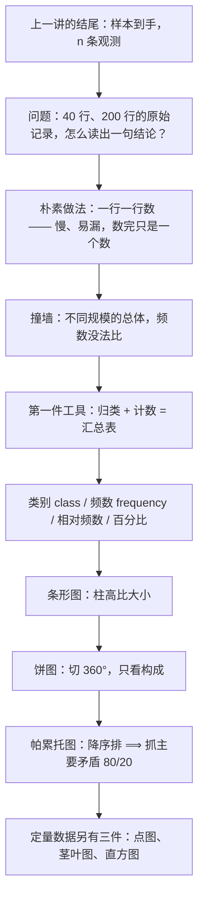
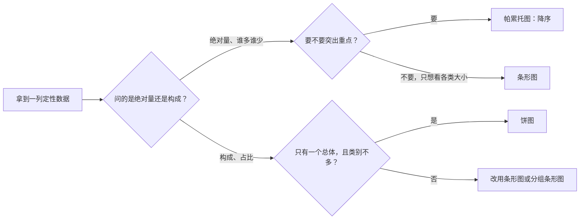

# C2.1 定性数据的呈现 Describing Qualitative Data

> [!abstract] 这一讲的任务
> 上一讲收尾时，我们手里终于有了一个**有代表性的样本**：$n$ 个观测，一条一条，像一本流水账。可老板不读流水账，他只问一句话——"哪一类最多、占多少"。
> 这一讲就是把这本流水账压成**几行表格、一张图**的第一套工具。它不涉及任何平均数、任何平方和：**定性数据只能计数，不能求平均**。整套工具就围绕"数一数"展开。

> [!info] 怎么读这份讲义
> 第 0–2 节是主干，也是全篇唯一需要慢读的地方：先看一张读不出结论的表，撞一次墙，才引出"类别 + 频数 + 相对频数"这套记号；后面三种图全部建在它上面。
> 第 3–5 节一张图一节，每节都回答同一个问题的两面：**它替我们省了什么力，又偷偷扔掉了什么信息**。第 6 节把三种图的适用场合并列成一张表；第 7 节是读表、画图、回答问题的完整练习。
> 标有 **（拓展）** 或 **【拓展】** 的内容，是课堂上没有展开、由教材与通行讲法延伸补充的部分。复习时先掌握未标注的主干（考点集中在这里）。
> 一句话勘误：帕累托法则的原话是"**80%** 的财富落在 **20%** 的家庭手里"，口述时把 80 说成了 18；正文按原话写，详见第 5 节。

---

## 0. 开场：一张读不出结论的表

全美排名最高的 **40 家公司**，2015 年的高管薪酬调查。表里一行一家公司，列是：公司名、CEO 姓名、年薪、**最高学历**，以及最后一列——这位 CEO 的薪酬是本公司普通员工的多少倍。倍数最高的一家公司，是 **1900 多倍**；而且排名越靠前，这个倍数越大——同一列数字里还藏着另一条规律。

现在有人问你：

> [!question] 停一下，先自己想想
> 这 40 位 CEO，是不是都读到硕士、博士了？

这个问题**能**从表里回答，但你要做的事是这样的：把 40 行从头看到尾，看到"本科"记一笔，看到"硕士"记一笔，看到"MBA"记一笔，看到没有大学学位的再记一笔。数完才发现答案有点反直觉：

- **人数最多的那一档是本科学历**，不是硕士也不是博士；
- 博士只有极少数几个；
- 还有几位根本没有大学学位。

于是一个更值得注意的事实浮出来：**这张表里真正被问到的，不是哪一位 CEO 的学历，而是"学历这一列，40 个人分别落在哪几档、每档几个人"。** 原始表把 40 条记录并排放着，每条都完整，但**没有一条在回答这个问题**。

这个动作里已经藏了两个概念：**"落在哪一档"** 和 **"这一档有几个人"**。整节 2.1 就是把这两个词做成工具。

> [!note] 同一张表，两种列
> 这张表同时装着两种数据：公司名、学历是标签；年薪、薪酬倍数都是数。表格可以混装，**但图不能**——一张图只能对一列做一件事。所以描述之前，第一件要判断的事是：**这一列属于哪一类数据**。

---

## 1. 描述统计有两条路，先走看得见的那条（p.3–9）

第 2 章的题目叫"描述一组数据的方法"（Methods for Describing Sets of Data）。"描述"这个词在这里很具体：**把手里这份数据说清楚，不往外推**。把所有方法排一排，其实只有两条路：

1. **用图、用表**：数据长什么样，一眼看过去；
2. **用数**：均值、方差、百分位数，把数据的某个侧面压缩成一个数字。

两条路要回答的是同一件事，只是精度与直观各占一头。这一章的顺序是先图后数，理由很实际：**看图形状，你才知道该算哪个数**——这也是后面 [[C2.3 集中趋势：均值、中位数、众数]] 里"偏态该看中位数"那类判断的来源。

那第一条路从哪里起步？不是从画图开始，是从**分类**开始。第 1 章已经把数据分成两类：

- **定性数据 qualitative data**（也叫品质数据、分类数据）：每次观测记下来的是一个**标签**，比如专业、学历、浏览器品牌；
- **定量数据 quantitative data**：每次观测记下来的是一个**数**，比如年薪、销售额、身高。

判断标准只有一条：**能不能对这个变量做加减**。年薪可以加，能算平均；专业不能加——"会计学 + 经济学"不是一个东西，所以定性数据**只能计数**。这句话就是整节 2.1 全部工具的来源。

两类数据各自的家谱是这样分的（p.8）：

| 数据类型 | 第一件工具 | 由它派生的图 |
|---|---|---|
| **定性数据** | 汇总表 summary table | 条形图、饼图、帕累托图 |
| **定量数据** | 频数分布 frequency distribution | 直方图 histogram |
| 定量数据（另一条支路，不分组） | 保留原始数值 | 点图 dot plot、茎叶图 stem-and-leaf display |

读这张表要看出两个不对称：

- **定量数据多一条支路**。它可以先分箱（把数值剁成区间）再计数，走"频数分布 → 直方图"；也可以一个数都不合并，直接把原始值摆出来，走点图、茎叶图。定性数据没有这个选择，它天生就是"类别 + 计数"。
- **反方向走得通**。定量数据可以被人为降级成定性数据（把年薪分成"高/中/低"三档，然后数人数），但定性数据没法升级——标签里没有大小顺序，硬要算平均只会得到一串没有意义的数。

> [!question] 停一下，先自己想想
> 如果只有 6 个观测，还需要汇总表吗？

不需要。6 条记录扫一眼就数清了，中间加一张表纯属折腾。汇总表的价值随 $n$ 的增长才出现：观测越多，"一行一行数"越不可靠，而把 $n$ 条记录折成 $k$ 行（$k$ 是类别数）这件事本身就越值钱。**它买的不是信息，是注意力的节省。**

---

## 2. 汇总表：把 $n$ 条记录折成"类别 + 频数"（p.7, p.10–11）

### 2.1 先撞墙：一行一行数，错在哪

回到上一节开头那个场景：手上有 **200 名学生的专业登记**，要回答"哪个专业人最多、占多少"。

**朴素尝试一：把 200 个专业名念一遍。** 念完没人记得住，念的人自己也不知道哪个最多。

**朴素尝试二：一行一行数，把结果记在纸上。** 这个办法能得到答案，但有三个毛病：

1. **容易漏、容易重**。200 行不是小数目，数到第 130 行时你已经记不清前面数过谁；
2. **数完只是一个数**。"会计专业 130 人"这句话单独站着，读者不知道这是多还是少——130 人放在 200 人的院里是压倒性多数，放在 2000 人的大学里就不算什么；
3. **换个规模就没法比**。隔壁学院 500 人、会计 250 人，两个 130 和 250 摆在一起，谁的比例更高？口算不出来。

三个毛病指向同一件事：**光有"个数"不够，还必须同时给出"总数"，并且把两者的关系算出来。** 这就是汇总表要装的三样东西。

### 2.2 从"有几个"到"占多少"

先把两个基础词说清楚。它们看着像术语，其实都是日常动作的名字：

> [!important] 类别与频数
> **类别 class**：把每个观测按它落在哪一档贴一个标签，一档叫作一个类别。名字来自 classify（分类）——**分类的结果**就是类别。专业这一列的类别是"会计学、经济学、管理学"。
> **频数 class frequency**：落在某一类别里的观测个数。frequency 就是"出现的次数"。200 人里 130 人学会计，会计这一档的频数就是 130。
> 两个词合起来才构成一次"计数"：**先按类别把观测分堆，再数每堆有几个。** 手工做这件事时，每见到一个观测就在对应那一档画一笔竖线，五笔一组（tally）——汇总表里"频数"那一栏，最初就是这样一笔一笔数出来的。

现在把三样东西一次补齐——类别、频数、总数，再让总数与频数相除：

> [!important] 相对频数与百分比
> **相对频数 class relative frequency**：某一类别的频数除以观测总数。
> $$\text{相对频数}=\frac{\text{该类别的频数}}{\text{观测总数}}=\frac{f_i}{n}$$
> relative 是"相对的"，相对谁？相对总数。它问的不是"有几个"，而是"**占多大比例**"。
> **百分比 class percentage**：相对频数乘以 100。percent 拆开是 per cent，**每一百里面占多少**。$0.65$ 说成 $65\%$。
> 三者的关系是一条单向链：**数个数 → 除以总数 → 乘 100**。反过来推不回去（百分比丢了总数，这一点第 4 节会变成一个大坑）。

为什么要多算一个相对频数？因为它**把总体规模从式子里约掉了**。200 人里 130 个会计是 $65\%$；500 人里 250 个会计是 $50\%$——两个比例可以直接比大小，两个频数不能。

### 2.3 手算一遍：200 名学生的专业分布

> [!example] 例：把 200 条记录做成汇总表
> 会计学 130 人，经济学 20 人，管理学 50 人，合计 200 人。

| 类别（专业） | 频数 $f_i$ | 相对频数 $f_i/n$ | 百分比 | 饼图里该占的角度 |
|---|---:|---:|---:|---:|
| 会计学 Accounting | 130 | $130/200=0.650$ | $65\%$ | $360°\times0.650=234°$ |
| 经济学 Economics | 20 | $20/200=0.100$ | $10\%$ | $360°\times0.100=36°$ |
| 管理学 Management | 50 | $50/200=0.250$ | $25\%$ | $360°\times0.250=90°$ |
| **合计** | **200** | **1.000** | **100%** | **360°** |

两列自检必须过：

- 频数一列加起来等于 $n$：$130+20+50=200$ ✓
- 相对频数一列加起来等于 $1$：$0.65+0.10+0.25=1.000$ ✓
- 角度一列加起来等于 $360°$：$234+36+90=360$ ✓

> [!warning] 百分比加起来不等于 100 时，先别怀疑数据
> 只要有一档的相对频数除不尽（比如 $1/3=0.333\ldots$），四舍五入之后百分比可能加成 $99.9\%$ 或 $100.1\%$。这是**舍入的账**，不是数据错。遇到这种情况，正文里要写"因四舍五入，合计不等于 100%"，而不是偷偷改掉某一档的数字去凑整。

### 2.4 回头看：这张表里，数据到底在哪一半

表做完了，问一个看起来很简单的问题。

> [!question] 停一下，先自己想想
> 左边一列写着"会计学、经济学、管理学"，右边一列写着"130、20、50"。**数据**在哪一半？

答案是：**左半边是数据，右半边是数据的分布。**

左列记的是"这 200 个观测各自取到了哪个类别"——只不过 200 条记录被压成了 3 个不同的取值。右列记的是"每个取值出现了多少次"。**没有右列，左列只是一份标签清单；没有左列，右列只是三个不知道属于谁的数。**

这个区分不是文字游戏。下一讲画直方图时，同一件事会变成一句操作规则：**横轴上放变量的取值，纵轴上放它出现的次数**——横轴管"数据是什么"，纵轴管"分布长什么样"。定性数据的表格，就是这句话最早的版本。

> [!note] 六个频数对得上，标签对不上
> 开场那 40 位 CEO 的学历，口头报过六档频数：**17、5、3、9、4、2**。六个数字加起来正好是 **40**，与 40 位 CEO 严丝合缝——所以"40 家"这个规模是对的。
> 但哪一档对应哪个数字，已经辨不清了（"17 个拿法律学位的"疑为"17 个拿本科学位的"）。既然对不上号，本篇就不拿它画图，后面的所有演算都用规模整齐的 200 人专业数据——**数字对不上号的表，宁可不画，也不要画一张自己都不信的表。**

---

## 3. 条形图：柱子的高度就是频数（p.12）

汇总表已经能回答"哪个最多"了，为什么还要画图？

因为表是**逐行**读的，图是**整片**看的。一排柱子的高矮，扫一眼就有结论；一张四行的表，读的人得自己在脑子里比较大小。图替我们做的是"把比较变成视觉"这件事。

> [!important] 条形图 Bar Graph
> 横轴放定性变量的**类别**，每个类别画一根**垂直的柱子**，柱子的高度表示这一类的频数、相对频数或百分比三者之一。
> 做法只有三步：**先给每个类别定一个位置，再按数值定柱高，最后把纵轴标清"这是频数还是百分比"**。

![[C2.1-同一组数据的三种图.png]]
图里左边那幅就是条形图，用的正是上一节 200 名学生的数据。三根柱子的高度 130、20、50，和表里的频数一一对应；柱子之间按表格顺序站着（会计、经济、管理），**没有排序**——这是条形图和帕累托图唯一的区别，第 5 节再讲。

### 3.1 画图的三条规矩，每条都有一个理由

| 规矩 | 理由 |
|---|---|
| 所有柱子**等宽** | 宽度不携带任何信息，只表示"同一个变量"。宽窄不一会让读者以为宽的那根更重要 |
| 纵轴**从 0 起** | 柱高要能直接比。若纵轴从 90 起，经济学那 20 人连柱子都画不出来，读者会以为这一档不存在 |
| 柱子之间**留缝** | 类别之间没有"中间态"：会计学与经济学之间不存在"半个会计" |

只有第三条需要多说两句，因为它是**条形图与直方图的分界线**。直方图（下一讲）的柱子必须**贴在一起**，因为它的横轴是连续区间：$[0,10)$ 与 $[10,20)$ 是紧挨着的，第一个区间的右端点就是第二个的左端点。而"会计学"和"经济学"之间空着的那一段，**没有任何观测可以落进去**——所以柱子必须分开站。

> [!warning] 一条流传很广、但并不准确的说法
> 常听到"横向条形图画分类变量、纵向柱形图画数值变量"。**方向不是判据。** 类别名太长（比如一长串产品型号）时，横向条形图更好读，这纯粹是排版选择；反过来，纵向柱形图也能画分类变量。
> 真正的分界是两条：**横轴上放的是类别还是数值区间**，以及**柱子之间留不留缝**。按方向去记，遇到横向的直方图就会判错。

实际作图时，纵轴上的数有三种合法取法：频数、相对频数、百分比。三者只差一个换算系数，**画出来的形状完全一样**，只是刻度不同。真正要防的是**一张图里混用两种刻度**——左轴频数、右轴百分比却只标了一条轴，读者会把 130 和 65% 当成两件事去比。

---

## 4. 饼图：把一个圆切成 360 份（p.14）

条形图回答"谁多谁少"，但有些问题问的不是多少，而是**构成**："这个盘子由什么组成？"——这时用饼图。

> [!important] 饼图 Pie Chart
> 把一个圆看成"总量 $360°$"，每个类别切走一块，**这一块的角度与它的相对频数成正比**：
> $$\text{扇形的角度}=360°\times\text{该类的百分比}=360°\times\frac{f_i}{n}$$
> 一句话就能记住动作：**先把总量当成 360 度，再按占比把圆切开。** 名字很直白——pie，一块派切开分给几个人。

同一个 200 名学生的例子，三个角度算出来就是上一节表格最后一列：

- 会计学 $65\%$：$360°\times0.65=234°$
- 经济学 $10\%$：$360°\times0.10=36°$（p.14 专门标了这一格，写成 $(360°)(10\%)=36°$）
- 管理学 $25\%$：$360°\times0.25=90°$

三块加起来 $234+36+90=360°$ ✓，和"相对频数加起来等于 1"是同一件事乘以 360。

### 4.1 什么时候该用饼图

先看一个更朴素的问题：你自己什么时候会想起饼图？

答案通常是——**当你要说"占了百分之多少"的时候**。饼图天生适合表达**结构**：一个总体被切成几块，每块占多大份额。它不适合表达**绝对量**：饼上没有刻度，你读不出"这一块到底是 130 人还是 130 万人"。

所以选择规则可以写得很硬：

- 要**比较各类的大小**（谁多、多多少）→ 用条形图；
- 要**说明构成的比例**（占了百分之多少、合起来是一整个）→ 用饼图。

这条规则背后有一个更基础的差别：**条形图的纵轴是有刻度的，饼图的角度没有刻度**。人眼比较两条线段的长度很准，比较两个扇形的角度很不准——这是第 6 节那张选择表的依据之一。

### 4.2 撞墙：饼图丢掉的那件东西

现在把饼图推到它做不到的地方。

> [!question] 停一下，先自己想想
> 同一个公司，2023 年新客户占 $30\%$、老客户占 $70\%$；2024 年还是 $30\%$ 和 $70\%$。这两年的客户构成变了吗？

**构成没变，生意变了。** 如果 2023 年总量 10 万人、2024 年总量 20 万人，那么老客户从 7 万涨到了 14 万，翻了一倍——可两张饼画出来**一模一样**，因为饼图只保存"占比"，把"基数"整个扔掉了。

![[C2.1-饼图丢失基数-比较多个总体要用条形图.png]]
这就是饼图不能用来**比较多个总体**的根本原因。把两个总体并排画成两张饼，读者能做的只有比角度：$30\%$ 对 $40\%$，差 $36°$，在没有标注的情况下几乎看不出来；而如果两个总体的规模不同，"哪一块更大"这个问题在饼图里**根本没有答案**——一张饼上的 $70\%$ 完全可能比另一张饼上的 $30\%$ 更小。

要比较多个总体，正确的工具是**分组条形图 grouped bar graph**：每个类别画一组柱，每个总体一根，并排站着。柱子有共同刻度的纵轴，长度可以直接比，基数也还在轴上。**【拓展】** 这一节只讲定性数据的三张图，分组条形图在第 8 节"双变量关系"里才正式出现，这里先记住它的形状就够了。

### 4.3 饼图还有两个具体的失手点

- **小块看不见**。$1\%$ 对应 $3.6°$，在图上就是一道缝（第 7 节那道题的 "Others" 就是这一档）。类别一多，饼图会碎成一圈细条，谁大谁小全靠标注。
- **它经不起美化**。把饼"立起来"做成三维，靠前的几块会被放大，靠后的被压扁——同一份数据，换一个视角就换了结论。**【拓展】** 这一点属于"用真数据说假话"，第 2.8 节专门列了六种手法。

> [!warning] 饼图的三条使用边界
> 1. 只描述**一个总体**的内部构成，不能拿来做总体之间的比较；
> 2. 类别数控制在 **5–6 个以内**，再多的类别要么合并成"其他"，要么换条形图；
> 3. 想看**绝对量**的时候不要用它——它连基数都没画出来。

---

## 5. 帕累托图：排序是为了抓主要矛盾（p.16）

### 5.1 从条形图到帕累托图，只差一个动作

第 3 节的条形图按表格顺序站队：会计、经济、管理，高度 130、20、50。可如果读者只想知道"最该管哪一档"，这个顺序是在**添麻烦**——他得把三根柱子全比一遍。

于是有了这样一个念头：**把最高的柱子搬到最左边，第二高的挨着它，一路降下去。**

> [!important] 帕累托图 Pareto Diagram
> 它是一张**按高度降序排列**的条形图：类别从左到右，柱高从大到小。
> 做法只有一句：**先算每类的频数（或百分比），再按大小排队，最高的站最左、最矮的站最右。**
> 名字来自意大利经济学家 **维尔弗雷多·帕累托 Vilfredo Pareto**——他研究财富分布时发现，少数家庭占有了绝大多数财富，这个"少数—多数"的不平衡后来被概括成帕累托法则。

![[C2.1-同一组数据的三种图.png]]
图的右边那幅就是帕累托图：会计 130 在最左，管理 50 居中，经济 20 在最右。和左边那幅条形图比，**数据一个没变，只是排队换了**。信息量却变了——读者一眼看到的第一根柱子，就是最重要的那一类。

### 5.2 为什么要降序：它省掉的是"比较"这一步

排序的真正目的，不是好看，而是**把"最重要的类别"放到读者第一眼会看的地方**。一张条形图要读完所有柱子才能下结论；一张降序的帕累托图，读完第一根就可以。

> [!important] 帕累托法则（80/20 法则）
> 帕累托的原话是：**80% 的财富落在 20% 的家庭手里**。把它搬到"分类计数"的场合，意思就变成一句工作准则：
> **少数几个类别，承担了绝大部分的量；剩下那一大堆类别，合起来也只占一小角。**
> 英文里这句话有个更传神的说法：**the vital few and the trivial many**——"要紧的少数，和无关紧要的多数"。

这也解释了为什么帕累托图一定要降序：**它要找的从来不是"平均"，而是那个吃掉了大头的少数。** 排序之后，那几根"要紧的少数"天然落在最左边，累计一加就知道它们合起来占了多少。

> [!warning] 两处口误，别跟着记错
> 1. **18% 还是 80%？** 口述时把这句话说成了"18% 的财富落在 20% 的家庭手里"，前后矛盾（18 + 20 远小于 100）。帕累托的原话是 **80%**，这也正是"二八法则"这个名字的由来。
> 2. **"重要的多数"还是"重要的少数"？** 口述时说过"帕累托图的目的就是找到最重要的多数"。**说反了。** 要找的是 the vital few——**要紧的少数**。要是"多数"才重要，那排序、降序、累计百分比这一整套动作就都没有意义了。

### 5.3 读法：四步，外加一条累计折线

拿到一张帕累托图，按这个顺序读：

1. **看第一根柱子**：谁最大、占多少。
2. **看前两根、前三根的累计**：要紧的少数加起来到了多少。
3. **找"拐点"**：累计曲线开始变平的地方，就是"再往后都是无关紧要的多数"。
4. **看最右边那一小撮**：它们合起来如果只有几个百分点，就别在它们身上花力气。

**【拓展】** 工程与质量管理里的帕累托图，通常会在柱子上再叠一条**累计百分比折线**：把降序后的百分比一路累加，画成折线，右轴标 0–100%。有了这条线，"占了 80% 的到底是几类"就变成一个刻度问题，不用心算。

![[C2.1-帕累托图与累计百分比.png]]
这张图画的是第 7 节那道浏览器市场份额题。降序之后第一根柱子就是 $81\%$，直接越过 $80\%$ 那条虚线——**只要抓一个类别，就抓住了八成市场**；到第二根柱子累计 $95\%$，第三根 $99\%$，第四根 $100\%$。这就是"要紧的少数"最干净的样子。

> [!warning] 帕累托图最容易被误用的两处
> 1. **它只能排"一个总体的构成"。** 想看两年之间哪一类涨了，得用分组条形图或并排的帕累托图，不能把两年的柱子混在一张图上排序。
> 2. **排序的度量必须统一。** 一类用频数排、另一类用百分比排，得到的顺序没有意义。要排就全用频数，或全用百分比。

---

## 6. 三张图怎么选（p.17）

到这里，定性数据的家底齐了：一张表、三张图。它们不是三个可以随便替换的选项，而是**回答三类不同问题的工具**。

| 你想回答的问题 | 用哪个 | 它凭什么胜任 | 它扔掉了什么 |
|---|---|---|---|
| 每类各有几个、各占多少 | **汇总表** | 数字精确，可以核对、可以复算 | 直观性——要逐行读 |
| 哪一类最多、比别类多多少 | **条形图** | 长度是最容易比大小的视觉量，纵轴有刻度 | 类别之间的优先级（没有排序） |
| 这个总体由什么构成、占比如何 | **饼图** | 一眼看出"合起来是一个整圆" | **基数**（总量）、小类、跨总体比较的能力 |
| 主要矛盾在哪、先抓哪几类 | **帕累托图** | 降序 + 第一根柱子即答案 | 类别之间的等价关系（排序本身是一种主张） |

再压成一句判断顺序，做题时按这个走：

> [!warning] 一条比选图更重要的原则
> **图不能是唯一的知识载体。** 一张图放在报告里，旁边必须有一句话把结论写出来："会计专业占 $65\%$，比其余两个专业加起来还多。" 只放图不写结论，读者可能读出完全不同的东西——图是给人**验证**结论的，不是让人**猜**结论的。

> [!note] 【拓展】这套东西在写代码时的名字
> - `pandas` 里 `df['专业'].value_counts()` 输出的就是一张汇总表；加 `normalize=True`，那一列就是相对频数。
> - `seaborn.countplot` 画的是条形图；`value_counts().plot(kind='bar')` **默认按类别顺序、不排序**——想得到帕累托图，得先 `sort_values(ascending=False)` 再画。
> - 帕累托图的工程对应物是**错误分析 error analysis**：把模型犯的错按类别分组、降序排一遍，常见的情形是大部分错误集中在少数几类上——和"要紧的少数"是同一件事，处理顺序也因此有了依据。
> - "饼图丢基数"的教训在机器学习里叫**类别不平衡 class imbalance**：正样本占 $1\%$、负样本占 $99\%$，饼图上只是一道缝，可那一类的绝对样本数可能上万。只看占比去做重采样决策，就会栽在这里。

---

## 7. Thinking Challenge：2006 年的浏览器市场（p.18–21）

> [!example] 题目（IRI 分析师的任务）
> 你要向老板汇报 2006 年各网页浏览器的市场份额。请用**条形图、饼图、帕累托图**三种方式描述这份数据，并回答：哪一类最多、占比多少？
>
> | 浏览器 Browser | 市场份额 Mkt. Share (%) |
> |---|---:|
> | Firefox | 14 |
> | Internet Explorer | 81 |
> | Safari | 4 |
> | Others | 1 |

先看清这份数据的类型：**浏览器品牌是定性的**（标签），而表里给的第二列已经是**百分比**，不是频数。四个数加起来 $14+81+4+1=100$ ✓——**这张表本身就已经是一张相对频数表**，所以画饼图时不需要再除以总数，直接用百分比乘 $360°$。

### 7.1 条形图：照表格顺序站

横轴按原表顺序摆 Firefox、Internet Explorer、Safari、Others，纵轴 0–100%，柱高就是那四个百分比。**条形图不排序**——这是它和帕累托图的分工：条形图回答"各类各是多少"，顺序不影响这个回答。

### 7.2 饼图：先算角度，再切圆

$$\text{角度}=360°\times\text{百分比}$$

| 浏览器 | 份额 | 扇形角度 |
|---|---:|---:|
| Internet Explorer | $81\%$ | $360°\times0.81=291.6°$ |
| Firefox | $14\%$ | $360°\times0.14=50.4°$ |
| Safari | $4\%$ | $360°\times0.04=14.4°$ |
| Others | $1\%$ | $360°\times0.01=3.6°$ |
| **合计** | **100%** | **360°** |

$291.6+50.4+14.4+3.6=360$ ✓。画出来是一张几乎被 IE 占满的圆：$291.6°$ 已经是四分之三个圆还多，而 Others 只有 $3.6°$——**一条缝**，不标数字根本看不出它的存在。这张图把第 4 节说的"小块看不见"演得清清楚楚。

### 7.3 帕累托图：降序之后，主要矛盾自己浮出来

按份额从大到小重排：**Internet Explorer 81 → Firefox 14 → Safari 4 → Others 1**。累计百分比依次是：

| 排位 | 浏览器 | 份额 | 累计 |
|---|---|---:|---:|
| 1 | Internet Explorer | $81\%$ | $81\%$ |
| 2 | Firefox | $14\%$ | $95\%$ |
| 3 | Safari | $4\%$ | $99\%$ |
| 4 | Others | $1\%$ | $100\%$ |

（图见第 5 节那张累计百分比图。）读出来的结论是：**一家独占八成，前两名合计 $95\%$，剩下两个加起来只有 $5\%$。**

### 7.4 回答题目

- **哪一类最多？** Internet Explorer，市场份额 **$81\%$**。
- **占多少？** $81\%$，也就是将近五分之四；换成饼图上的角度是 $291.6°$。
- 顺带一句更有用的话：**前三名合计 $99\%$**，Others 那一档（$1\%$）在 $81\%$ 面前基本可以忽略。

> [!warning] 这道题的两个常见失手
> 1. **把百分比又算了一遍相对频数。** 表里给的已经是百分比，再除以 100 就得 $0.81\%$，饼图会缩成一条线。看表先问一句：这一列是**频数**还是**相对频数**？
> 2. **把条形图也排了序。** 排序不是错，但那样画出来的已经不是条形图，而是帕累托图。要交三种图，就得让三种图各自保留自己的特征——**条形图看各类大小，帕累托图看优先顺序**，两者问的不是同一件事。

---

## 8. 定性数据只是第一格（p.5, p.8）

这一讲把定性数据能用的工具用完了：一张汇总表，三张图。回头看那张家谱表，它只填满了半张纸。

另一半是定量数据。它的取值是数，所以多出一条路：**可以先分箱再计数**（频数分布 → 直方图），也可以**一个数都不合并**，直接把原始值摆出来（点图、茎叶图）。多出来的这三件工具，各自解决一个定性数据的图解决不了的问题：

- **点图**：$n$ 很小的时候，一个观测一个点，一个都不丢；
- **茎叶图**：既保留全部原始数值，又能看出分布形状——它同时是图和表；
- **直方图**：$n$ 很大时，把区间的高度堆起来，看整体形状。

而直方图那件最显眼的特征，这一讲已经埋好了伏笔：**柱子要贴在一起**。下一讲就从这里接着讲。

> [!tip] 下一讲预告
> 下一讲换数据类型，也换问题。定性数据问的是"哪一类多"，定量数据问的是"**这一堆数长什么形状**"——对称还是偏斜，单峰还是双峰。
> 而形状这件事，直接决定后面该用均值还是中位数。第 2.2 节会先造三件看形状的工具，然后当场用它们判一次形状。

---

## 这一讲的三句话

> [!important] 记住这三句
> 1. **定性数据的第一步是归类计数，不是画图。** 凑齐"类别 + 频数 + 相对频数"三样东西，才有"分布"可谈；相对频数把"多少"换算成"占多大比例"，不同规模的总体才能放在一起比。
> 2. **三张图各有各的活。** 条形图比大小（长度）、饼图看构成（角度、只限一个总体）、帕累托图抓主要矛盾（降序 + 累计，二八法则）。
> 3. **每张图都扔掉了一些东西，先看它扔了什么。** 饼图扔掉基数、条形图扔掉优先级、帕累托图的排序本身是一种主张；选图就是选"我愿意放弃哪部分信息"。

> [!tip] 速查表
> | 名称 | 公式 / 做法 |
> |---|---|
> | 相对频数 | $f_i/n$（该类别频数 ÷ 观测总数） |
> | 百分比 | 相对频数 $\times 100$ |
> | 自检 | 频数合计 $=n$；相对频数合计 $=1$；角度合计 $=360°$ |
> | 饼图角度 | $360°\times$ 百分比 |
> | 条形图 | 类别在横轴，柱高等宽、零起点、**柱间留缝** |
> | 帕累托图 | 条形图 + 按高度**降序**，最高的在最左 |
> | 累计百分比 | 降序后逐类累加；累计到 80% 用掉几类，就是"要紧的少数" |

---

## 相关笔记 Related Notes

- 相关：[[C1.1 统计学是什么：从数据到决策]]（定性数据与定量数据的分界、总体与样本）、[[C2.3 集中趋势：均值、中位数、众数]]（为什么定性数据不能求平均，只能取众数）、[[C2.8 散点图、时间序列图与误导性图表]]（纵轴不从零起、三维饼图这类"用真数据说假话"）
- 上一讲：[[C1.2 收集数据：抽样方法与代表性]]
- 下一讲：[[C2.2 定量数据的图形：点图、茎叶图与直方图]]
- 返回：[[统计学课程 MOC]]
