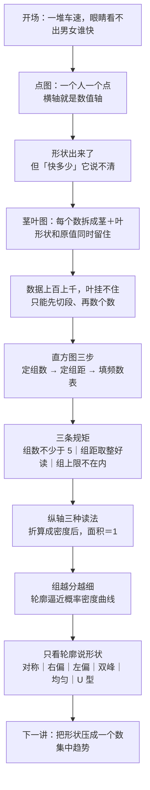

# C2.2 定量数据的图形：点图、茎叶图与直方图 Graphical Methods for Describing Quantitative Data

> [!abstract] 这一讲的任务
> 上一讲把定性数据画成了条形图、饼图、帕累托图——那些图的横轴是**类别**，类别之间没有大小，所以只能比高矮、比长短。定量数据不一样：它的每个值都站在一条数轴上，能比大小、能相减、能切段。这一讲就把"数轴"这件事用足，造出三张图：**点图**、**茎叶图**、**直方图**。
> 三张图要干的活是同一件：**把一堆看不出名堂的数字，变成一眼能看出的形状**。形状一出来，"数据集中在哪、散得多开、有没有偏、有几个峰"就都能读了——而这些正是后面所有数值描述（均值、方差、偏态）想要压缩的东西。

> [!info] 怎么读这份讲义
> 第 0 节是引子：一堆车速摆在面前，眼睛看不出男女谁快，一张点图就解决了；但"快多少"它答不了，这条线留到后面。第 1 节说清为什么定量数据要多出三张图。第 2–4 节是主体，三张图各一节，每节都先讲"这张图解决什么坎"，再讲怎么画、怎么读、什么时候不该用它。第 5 节把三张图摆在一起比。第 6 节从直方图一路走到**概率密度曲线**（这是本章最要紧的一个观念，别跳）。第 7 节专门练"看轮廓说形状"。第 8 节收口。
> 画图这件事软件都会做，**读图只能自己练**——这一讲的重心全在"怎么看"。
> 标有 **（拓展）** 或 **【拓展】** 的内容，是课堂上没有展开、由教材与通行讲法延伸补充的部分。复习时先掌握未标注的主干，考点集中在主干上。
> 一句话勘误：原话把电脑销售量那批数据的组数记成 8 组、组距取 10，这两个数不能同时成立（8 组 × 组距 10 只盖到 220，而最大值是 237），应为 10 组，详见 4.4。

---

## 0. 开场：男生开车快，还是女生开车快

一份发给 MBA 学生的问卷里有一个问题：**你开过的最快车速是多少？**（What is the fastest speed you have ever driven?）

答案收回来，是一串数字：一百三十几、一百二十几、一百一十几……全班的、全年级的、好几届的，摊在一起。问题只有一句：

**男生开得快，还是女生开得快？**

> [!question] 停一下，先自己想想
> 不许画图，就给你这两串数字——你能说出谁快吗？如果能，你凭什么？

答案是不能。这不是数据量的问题。就算只有几十个数，人的眼睛也没办法在两串长短不齐、大小交错的三位数里比出"整体谁靠右"。数字本身没有"形状"，你得先给它一个形状。

于是做一件最朴素的事：**把数轴画出来，一个人打一个点。**

横轴是车速（每小时多少英里，mph），谁开过多少，就在那个位置上点一个点；同一个速度有两个人开到过，就往上叠第二个点。就这么简单，一画完，答案自己跳出来了：

- 125 这个位置，男生堆了 6 个点，女生**一个也没有**；
- 120 这个位置，女生有 2 个；
- 男生那一堆点整体压在右边，女生那一堆压左边。

**男生的点整体更靠右。** 就这样，"男生开得比女生快"这句话从一句没法验证的感觉，变成了一句能指着图说的话。

这就是**点图**（dot plot）：一个人，一个点。

但故事不能停在这儿。有人立刻会追问下一句：

> [!warning] 撞墙：快多少？
> "男生比女生快"——快多少？10 mph？2 mph？还是只有 0.5 mph？点图给你的是"整体靠右"这个**印象**，它给不出一个能写进报告的数。

这道墙不是点图的错，是"图"这种形式本身的局限：图擅长让人看见**形状**，不擅长给出**数值**。要回答"快多少"，得换成另一种东西——把一堆数压成几个数。那时用的是一组叫**五数概括**（five-number summary）的东西：最小值、下四分位数 $Q_1$、中位数、上四分位数 $Q_3$、最大值，五个数把数据从小到大切四刀。

它就真的回答了这个问题。两组数据里出现了同一个数：

$$\text{男生：}Q_1=95\ \text{mph}\qquad\qquad \text{女生：}Q_3=95\ \text{mph}$$

**同一个 95，含义完全相反。** 男生那边它是**下**四分位数：四分之三的男生开得比 95 还快，只有四分之一比他慢；女生那边它是**上**四分位数：只有四分之一的女生开过 95 以上。一个是被四分之三的人越过的底，一个是被四分之三的人够不着的顶。

这条线先记着，后面会正式讲（见 [[C2.7 异常值、四分位数与箱线图]]）。**这一讲要解决的，是前面那一层：怎么让一堆数字长出形状来。**

---

## 1. 定量数据比定性数据多出哪三张图（p.22–23）

上一讲的四件套——汇总表、条形图、饼图、帕累托图——本来是给**定性数据**（性别、品牌、行业）用的。定性数据的横轴上是类别，类别之间没有大小关系，"汽车品牌"和"手机品牌"没法相减。

定量数据其实**也能用这四件套**：把每个出现过的数值当成一个类别，照样能数个数、画条形图。但那样做等于把定量数据降级成定性数据——**丢掉了它最值钱的两条信息：值有大小顺序，而且可以相减。** 3 台和 5 台差 2 台，这个"2"是有意义的；"汽车"和"手机"之间就没有这种差。

所以定量数据有自己专属的三张图。三张图的共同点是：**它们的横轴都是一条真正的数轴**（不是一排并列的类别），所以图上任意两点的水平距离，就是两个数值的真实差距。三张图的区别只在"怎么把观测堆到这根轴上"：

| 图 | 怎么堆 |
|---|---|
| 点图 Dot plot | 一个观测一个点，**堆在它自己的数值位置上** |
| 茎叶图 Stem-and-leaf | 按高位**分行**，最后一位数字**排成一行** |
| 直方图 Histogram | 把数轴**切成等宽的段**，每段只记"落进来几个" |

把"数据呈现"的分支画出来（p.23）是这样的：左边是定性数据 → 汇总表 →（条形图、饼图、帕累托图）；右边是定量数据 →（点图、茎叶图、直方图），而且定性那三张图它**全都还能用**。反过来不成立——定性数据用不了点图，因为它没有一条数值轴可站。

**这就是"定量数据多出三张图"的真正原因**：不是教材想多凑几个名词，而是定量数据比定性数据多了一条数轴，多出来的三张图都是围着这条轴想办法。

---

## 2. 点图：一个点就是一个观测（p.24）

### 2.1 先有人话，再有名字

想象你手上只有十几二十个数，你想知道它们"散在哪些地方"。最笨但最忠实的办法：**画一条横轴，让每个数自己站到自己的位置上。** 站完了，哪儿挤、哪儿空、有没有孤零零一个站在远处——全都看得见。

这个东西叫**点图**（dot plot）。名字是字面意思：dot（点）+ plot（图）。**一个点代表数据集里的一个观测，不是一类、不是一组。** 这句话是它全部意义所在：图上有多少个点，样本量 $n$ 就是多少，一个不多一个不少。

> [!important] 点图的定义（p.24、p.30）
> 1. 横轴是这个定量变量的一个**刻度**（英文里说的是 a scale for the quantitative variable），比如"百分比"。
> 2. 每个观测的数值，落在横轴上对应的位置，用一个点标出来。
> 3. 同一个数值重复出现时，这些点**在同一个位置上下叠放**，形成一个"堆"（a pile at a particular numerical location）。

### 2.2 画一遍，读一遍

用一批具体数据走一遍。某电脑公司四个月里 10 天的日销售量（台）：

$$21,\ 24,\ 24,\ 26,\ 27,\ 27,\ 30,\ 32,\ 38,\ 41$$

画法：横轴是台数，21 打一个点，24 打两个点（上下叠），26 一个，27 两个，30、32、38、41 各一个。一共 10 个点，$n=10$，对得上。

图上立刻有三件事可以读：

- **聚在哪**：大半的点挤在 21–32 这一段（10 个里有 8 个），说明"平常一天就是二三十台"。
- **散多宽**：最左 21、最右 41，横跨 20 台。
- **有没有孤点**：38、41 那两个点离主堆有点远——它们可能是周末、可能是促销日，也可能只是正常的波动。**点图只能提醒你有这么两个点，不能告诉你它是异常值**，判据要等 [[C2.7 异常值、四分位数与箱线图|2.7 节的 1.5×IQR]] 才给得出。

### 2.3 再看一个真实例子：研发投入占比

某位财务分析师关心高科技公司"舍得在研发上花多少钱"。她算的指标是**研发支出占总收入的百分比**（RDPCT），把每家公司的这个百分比画在同一根横轴上（p.24）：横轴从 3.5% 一直排到 14.5%，一家公司一个点。

读出来的东西是：

- **峰在 6.5%–8.0% 这一带**（8.0% 那一摞最高），也就是说"研发投入占收入 7% 上下"是这批公司里最典型的做法；
- **主体落在 6%–11% 之间**，这条带子之外的点不多；
- **两头都有散点**：最低 5.2%，最高 13.5%；
- **右尾巴比左尾巴长**：从峰往右能拖到 13.5%，往左只到 5.2%——已经开始有"右偏"的样子了（第 7 节正式讲）。

> [!warning] 一处对不上的地方
> 这个例子在口头上被说成"抽了 15 家公司"，但图上点数远不止 15 个（数下来四十个上下）。这是沿用的旧示例数据，**家数对不上不影响读法**，本节用它的目的只是演示"横轴是百分比、一家公司一个点"这种画法，不采用它的样本量。

### 2.4 点图的边界

点图几乎不需要学，但它有明确的失效场合：

- **数据一多就糊**。上百个点会挤成一片黑，堆高也数不清了。样本量超过几十个，就该换直方图。
- **数值带很多位小数时会挤**。大家都落在 6.42、6.43、6.44 这种密的位置上，点互相压住。软件常用"抖动"（jitter）或直接四舍五入到一位来解决，但那就成了半个茎叶图。
- **它不压缩任何信息**，所以也不能告诉你"每个组里各有多少个"——它只是把原值摆出来。

它最大的用处反而是在**很少的数据**上：$n$ 十几二十个的时候，点图是最诚实的一张图，因为**每一个观测都还在图上，没有被汇总掉**。

---

## 3. 茎叶图：把一个数拆成"茎"和"叶"（p.26、p.30）

### 3.1 它解决的那道坎

点图有个隐性的毛病：**横轴上每个点的具体数值，是"看位置估"出来的。** 41 那个点，你知道它在 40 和 45 之间，但"41"这个数字本身并没有写在图上。

如果数据是三位数、四位数，位置越挤，估得越不准。这就尴尬了：**要么保留原值但看不见形状（原始数据表），要么看见形状但丢掉原值（点图）。** 茎叶图就是冲着这个两难来的：**它要同时做到两件事——形状看得见，原值也读得回。**

### 3.2 拆数：茎和叶

做法一句话：**把一个数写成"前面几位 + 最后一位"，前面几位竖着排成一列当骨架，最后一位挂到对应的那一行去。**

- 前面那几位（高位）叫**茎**（stem）；
- 最后一位（个位）叫**叶**（leaf）；
- 名字就是这么来的：茎在左边竖着长，叶在右边横着挂，整张图像一棵**横躺的树**。英文也叫 stemplot。

用 10 个观测走一遍。数据还是那 10 天：

$$21,\ 24,\ 24,\ 26,\ 27,\ 27,\ 30,\ 32,\ 38,\ 41$$

**第一步：定茎取几位。** 这批数是两位数，取十位当茎，个位当叶。

**第二步：茎按从小到大排成一列。** 出现过的十位只有 2、3、4，就三行。

**第三步：每个观测的叶，写到对应茎那一行，同一行的叶按从小到大排。**

$$\begin{array}{c|l} 2 & 1\,4\,4\,6\,7\,7\\ 3 & 0\,2\,8\\ 4 & 1 \end{array}$$

核对：叶一共 $6+3+1=10$ 片，等于 $n=10$，一片不多一片不少。逐片读回去：2 行是 21、24、24、26、27、27；3 行是 30、32、38；4 行是 41。**原始数据一个没丢。**

![[C2.2-点图与茎叶图-同一批数据两种画法.png]]
### 3.3 课堂上那段"念一遍就懂"

茎叶图这个概念，其实念一串数就讲完了。150 多台的销售日里，那几天的数字是：

$$150,\ 152,\ 153,\ 153,\ 154,\ 155,\ 156,\ 158,\ 159$$

念出来是这样：**一五零、一五二、一五三、一五三、一五四、一五五、一五六、一五八、一五九。**

听出来了没有？**"一五"是一直不变的那一截（茎），变来变去的只有最后一位（叶）。** 于是这一整行写成

$$15 \mid 0\,2\,3\,3\,4\,5\,6\,8\,9$$

个位往右边从小到大排，十位百位往左边当茎——**这就是茎叶图。**

### 3.4 它比点图多给了什么

**第一，频数能数出来。** 一行里有几片叶，就说明这个高位区间里有几个观测。比如 19 那一行如果是

$$19 \mid 6\,6\,6\,6\,6$$

那读出来的就是一句完整的话：**196 台这个销量，出现过 5 天。** 点图做不到——它只能让你看见"19 那里有一摞"。

**第二，形状也能看出来。** 把这张图**顺时针转 90°**：茎变成横轴，每片叶变成一个小方块，一行叶的长度就变成一根柱子的高度——**它就是一张直方图，只是每个小方块里还写着它自己的数值。** 所以茎叶图常被叫作"**倒过来的直方图**"，更准确的说法是：**茎叶图 = 直方图 + 原始数据**。

**第三，顺序信息白送。** 因为同一行的叶是按从小到大排的，把各行接起来读，就等于把数据排了序——后面求中位数、四分位数时直接就能用。

### 3.5 叶的位数与它的极限

**"一个叶代表多少"，要事先声明。** 本讲默认**叶的单位是 1**（叶就是个位）。如果数据是 141、237 这种三位数，茎就取**前两位**（百位＋十位），叶取个位；如果数据是 6.42、6.75 这种带两位小数的，茎取整数部分、叶取两位小数，这时叶的单位是 0.01。**一条铁律：茎和叶拼回去必须等于原数。**

茎叶图也有撑不住的时候：

- **数据一多，一行会长到画不下**（一行五十片叶就没法看了，不如直方图）；
- **量级跨度太大时**（从 3 到 3000），一行会空、一行会爆，得先把茎拆成多行（如 $2^{*}$、$2t$、$2f$、$2s$、$2\cdot$ 各管一个小区间），或者干脆换直方图；
- **位数参差不齐时**要先统一（比如把 7 写成 07），否则叶对不齐。

所以它的**适用区间**很明确：**样本量几十到一百出头、要看原值、要能手算**的时候，茎叶图是最好用的一张图。

---

## 4. 直方图：先把数轴切段，再数个数（p.28–29）

### 4.1 到了上百上千个观测，只剩一条路

点图糊了，茎叶图的叶挂不下了。这时候必须做一个取舍：**放弃"每个值是多少"，只保留"每组有几个"。**

具体动作分两步，顺序不能反：**先把数轴切成若干个等宽的段**（每一段叫一个**组**，也叫**组区间** class interval；这一段的宽度叫**组距** class width），**再数每一段里落进了几个观测**（这个个数叫**频数**，frequency）。最后把"每段几个"画成一根高度等于个数的柱子。

它叫**直方图**（histogram），在所有定量数据的图里是**用得最多的一张**。名字是照着样子取的：中文的"直方"就是**一排立着的方块**；英文 histogram 拆开是 histo-（竖起来的立柱）＋-gram（画出来的东西），也就是"由立柱组成的图"。

> [!warning] 直方图不是条形图，最容易混的一处
> 条形图（bar chart）的柱子之间**有空隙**：横轴是并列的类别，没有顺序也没有宽度，柱子的宽窄是画图的人随便定的。
> 直方图的柱子之间**必须紧贴**（bars touch）：横轴是连续的数轴，柱子的宽度**就是组距**，它不是装饰，是刻度的一部分。正因为柱宽有含义，柱子的**面积**才有含义（4.6 节要用到这一条）。

### 4.2 第一步：定组数（p.28）

组数 $k$ 定多少？直觉是"越多越细越好"，但那不对（下一小节就讲为什么）。这里先给一个能算的起点：

$$\boxed{\ k=1+3.322\log_{10} n\ }\qquad(\text{等价于 } k=1+\log_2 n)$$

这叫 **Sturges 公式**，$n$ 是你手上的观测个数。

> [!question] 停一下，先自己想想
> 为什么是 $\log$，不是直接拿 $n$ 开方、或者干脆按 $n$ 的某个固定比例？观测从 120 个涨到 120 万个，涨了一万倍，组数该涨多少？

答案是：**组数几乎不涨。** 算一算就知道：

| 观测个数 $n$ | 120 | 1 200 | 12 000 | 1 200 000 |
|---|---|---|---|---|
| Sturges 组数 $k$ | 7.91 | 11.23 | 14.55 | 21.20 |

$n$ 涨**一万倍**，组数只从 8 涨到 21。$\log$ 的作用就是把"翻十倍"变成"加 3.3"。

道理在**每组里装多少个观测**：$n=120$、$k=8$ 时，平均一组 15 个观测，柱子的高矮是稳的；$n=120$ 万、$k=21$ 时，平均一组约 5.7 万个，柱子只会更稳。**组数的意义是"把轮廓的分辨率调到刚好能看出形状"，跟样本量同步增长的是"每组的个数"，不是"组的个数"。** 所以组数只需要随 $n$ 的**量级**慢慢长。

拿电脑销售量那批数据算：$n=120$ 天，$k=1+3.322\log_{10}120=7.91$，取 8 组。这个数只是一个**参考起点**，但它不是随便定的：统计软件默认的分组，用的就是这一类经验公式。

> [!warning] 两个口径给出两个数，别硬凑
> p.28 另给了一张经验表：观测数 **少于 25 → 5–6 组；25–50 → 7–14 组；多于 50 → 15–20 组**。这批 $n=120$ 的数据落进最后一档，表说 **15–20 组**，而 Sturges 公式给 **8 组**，差了一倍多。
> 两个都是经验起点，谁也不比谁"正确"。实际操作是：**用公式起步，看轮廓出来没有**——出不来就加组，柱子开始乱抖就减组。把这两条当"上下限"来回夹，只会把自己夹死。

### 4.3 组数：多也不行，少也不行

这一条在课上被反复强调，因为它是"为什么需要公式"的真正答案。

**组太少会怎样？**

- **1 组**：一根柱子竖在那儿，什么也没说。
- **2 组**：一多一少，也等于什么都没说。
- **3 组**：麻烦在这儿——**几乎任何数据都会长成"中间多、两边少"**。你说它"接近正态"，其实是你把它切成了三块才长这样的。**形状是你切出来的，不是数据告诉你的。**

**组太多会怎样？**

- **每个观测一组**（"每个人一组"）：所有柱子一样高，只剩一排噪声，轮廓彻底消失。这叫**过度分组**。

**所以经验下界是：不少于 5 组。** 这也解释了那个公式存在的意义——它替你在"看不见形状"和"全是噪声"之间挑一个起点。

### 4.4 第二步：定组距，第三步：填频数表

组数定了，组距就接着定：

$$w=\frac{\max-\min}{k}$$

电脑销售量：最小值 141 台，最大值 237 台，$\max-\min=96$，所以

$$w=\frac{96}{7.91}=12.14\ \approx\ 12$$

**但 12 不好用。** 从 141 起，组距 12 切出来是 141–153、153–165、165–177……边界全是"153""165"这种数，读一眼都得算半天。所以取整成 **10**：

$$140\text{–}150,\quad 150\text{–}160,\quad 160\text{–}170,\ \dots$$

两个细节：

- **第一组的下限要略小于最小值。** 最小值是 141，第一组就从 **140** 起（140 < 141），不能从 141 起——万一数据里还有 140.4 这种值就漏了。
- **组距一取整，组数就跟着变。** 组数和组距只能定一个，另一个是算出来的。

> [!warning] 这里有一个必须对齐的数
> 原话把组数记成 **8 组**、组距取 **10**，这两个数**不能同时成立**：8 组 × 组距 10 = 80，从 140 起只盖到 **220**，而最大值 237 落在 220–240 那一段里，整段被丢掉了。
> 按"组距 10、从 140 起"复算，要盖住 237 需要
> $$\left\lceil\frac{237-140}{10}\right\rceil=\lceil 9.7\rceil=10\ \text{组},$$
> 也就是 140–150、150–160、…、**230–240**，十组。反过来，如果坚持 8 组，组距就得取 $96/8=12$（用 12 就回到上面那个"边界不好读"的问题）。
> **结论：组距定 10，组数就是 10。** 频数表照十行填。

频数表长这样（前两组是课上给出的数：140–150 有 **4 天**，150–160 有 **9 天**）：

| 组（台） | 频数（天） |
|---|---|
| 140–150 | 4 |
| 150–160 | 9 |
| 160–170 | … |
| … | … |
| 230–240 | … |

填完表，把每一行画成一根高度等于频数的柱子，就是直方图。

### 4.5 200 台到底算哪一组：组上限不在内

数频数的时候一定会撞上这个问题：

> [!question] 课堂追问
> 这一天的电脑销售量**正好是 200 台**。它进 190–200 这一组，还是进 200–210 这一组？

说句实话，这问题听起来有点无聊。但它必须有答案，而且答案不能靠猜。

**统计里的约定是：组上限不在内。**

$$[190,\ 200)\qquad [200,\ 210)$$

每一组都是**左闭右开**：下限算进来，上限不算。所以 200 台进 **200–210** 那一组。

**为什么非得这么约定？** 因为不定这条，两种错法都躲不开：

- 如果两组**都包含** 200，那 200 就被数了两次，频数加起来会超过 $n$；
- 如果两组**都不包含** 200，那 200 就没人要，频数加起来会少于 $n$。

一端闭、一端开，每个观测**恰好**落进一组，**频数加起来才等于 $n$**。这条约定的全部意义就这一句：**不重不漏。**

### 4.6 纵轴的三种读法，以及"面积等于 1"到底在说什么

同一根柱子，纵轴可以从三个角度读：

| 纵轴画什么 | 这根柱子的高度 | 这批数据的合计 |
|---|---|---|
| 频数 frequency | 这一组里有几个观测 | $n$ |
| 相对频数 relative frequency | 这一组占多大比例（个数 / $n$） | $1$ |
| 百分比 percent | 上面那个数 ×100 | $100\%$ |

三者只差一个常数 $n$，所以柱子高矮的相对关系一模一样，换的只是"单位"。

接下来是这一节真正要紧的一问：

> [!question] 课堂追问
> 常说"直方图下面的面积等于 1"。可每一组明明只有几个观测，柱子高度是 3、5、2 这种整数，面积怎么会是 1？

答案藏在**"面积"这个词的两个用法**里，得先把横轴的单位说清楚。

用那 10 个观测（21, 24, 24, 26, 27, 27, 30, 32, 38, 41）分成三组来验算：组距 10，三组的频数是 **3、5、2**，相对频数是 **0.3、0.5、0.2**。

![[C2.2-直方图与频率多边形-纵轴的三种读法.png]]
- 若纵轴直接画**频数**：每根柱的面积 = 组距 × 频数 = $10\times3=30$、$10\times5=50$、$10\times2=20$，总面积 $=100$，**根本不是 1**（它等于"组距 × $n$"）。
- 若先把纵轴折算成"**每个单位横坐标上摊到多少相对频数**"，即 $\text{相对频数}\div\text{组距}=0.03,\ 0.05,\ 0.02$：这时每根柱的面积 $=0.03\times10=0.3$、$0.05\times10=0.5$、$0.02\times10=0.2$，三块加起来**正好是 1**。

所以"面积等于 1"这句话成立，前提是**纵轴画的是密度**（相对频数 ÷ 组距），而不是频数。课上那句"把组距当成单位 1、纵轴看成频率"，做的就是这个折算：**宽度当 1，高度当相对频数，面积就是相对频数，全部加起来就是 100% 的可能性。**

这个"面积 = 可能性"的读法现在只是一个技巧，到第 6 节它会变成整章的地基，到第 4 章会变成**概率密度函数**的定义。

---

## 5. 三张图各自回答什么问题（p.30–31）

到这儿三张图都出来了。它们不是三个并列的知识点，而是**同一根数轴的三种堆放方式**，各自能回答的问题不一样：

| 你想问的 | 点图 | 茎叶图 | 直方图 |
|---|---|---|---|
| 数据集中在哪个值附近？ | 点最密的那一段 | 叶最长的那一行 | 最高的那根柱 |
| 散到什么程度？ | 最左点到最右点 | 第一条茎到最后一根茎 | 整块矩形覆盖多宽 |
| 有没有离群的观测？ | **直接看见孤零零的点** | 看见孤零零的几片叶（值还在） | 只看得见"孤立的一根柱"，值没了 |
| 能读回原始数值吗？ | 能（横坐标就是原值） | 能（叶就是原值的位） | **不能**（只剩组区间和个数） |
| 数据量上限 | 几十个 | 一百出头 | 不限 |
| 分辨率能调吗？ | 不能 | 能（换茎的位数） | 能（改组距） |
| 适合的场合 | 少量数据、要看每个观测 | 中等数据、要形状又要原值、要能手算 | 大量数据、只关心轮廓 |

**选择规则就这一条：先看 $n$。**

- $n$ 十几到几十、每个观测都重要 → **点图**最诚实；
- $n$ 几十到一百多、既要形状又要能查回原值 → **茎叶图**；
- $n$ 上百上千、只关心形状 → **直方图**；
- 要比较**两个总体**（男/女、两个班、两个季度）→ 两张直方图必须**共用同一套组限**，否则柱子的宽窄不一样，比出来的是分组方式，不是数据。更省事的办法是画成频率多边形叠在一张图上（第 6 节）。

从点图、茎叶图到直方图，**丢掉的正是"每组里每个值具体是多少"**。这不是缺陷，是压缩的代价：压缩得越狠，越能看大轮廓，也越查不回细节。

> [!tip] 画图交给软件，读图只能自己练
> 这三张图任何一个统计软件包都能一键出图（R 的 `hist`、Python 的 `matplotlib.pyplot.hist`、Excel 的数据分析工具库）。所以这一讲的重心从来不是"怎么画"，而是"**怎么读**"——拿到一张图，能说出数据聚在哪、散多开、尾巴朝哪、有几个峰。

---

## 6. 从频率多边形到概率密度曲线（p.29 之后）

### 6.1 折线：把每根柱压成一个点

直方图有一个隐藏的毛病：**它长什么样，取决于你怎么分组。** 起点挪半格、组距改成 8，轮廓就跟着变一点——同一批数据能画出好几个"看起来不太一样"的直方图。

想要一张不受分组边界影响的图，就做一件事：**在每根柱顶的正中间取一个点**（那个位置的横坐标叫**组中点** class midpoint），**把这些点连成折线**；再在最左、最右各补一个频数为 0 的点，让折线两端落回横轴。

这就是**频率多边形**（frequency polygon），也叫折线图（line chart）。

为什么值得单独画它：柱子被压成了点，**两组数据就可以直接叠在一张图上比**（两条折线交叉、谁在上面一目了然），而两张直方图摞在一起是没法读的。

### 6.2 细分到极限：轮廓变成一条曲线

现在把"组越分越细"这件事推到极限。

用 100 万个服从**标准正态分布**的随机数（均值 0、标准差 1）做一次实验，其他都不动，只改组数，一路试 10 组、20 组、50 组、100 组、500 组（下面四幅图是其中的 10、20、100、500 组）。

![[C2.2-组距越小直方图逼近概率密度曲线.png]]
- 10 组时，直方图是几个宽台阶，只能看出"中间高两边低"；
- 20 组时台阶变窄，轮廓开始成形；
- 100 组时已经能看出钟形；
- 500 组时，**柱顶的锯齿几乎被磨平，整张图贴在一条光滑曲线上**。

这条曲线就是**概率密度曲线**（probability density curve）。**数据量足够大 + 组距足够小 ⇒ 直方图的轮廓收敛到概率密度曲线。** 这是本讲最重要的一句结论：直方图是"离散版"的分布，概率密度曲线是它的极限。

顺手核对一下这批模拟数据（100 万个）：

| 项目 | 实测 | 理论 |
|---|---|---|
| 均值 | 0.0016 | 0 |
| 标准差 | 1.0006 | 1 |
| 落在 $\pm1$ 内的比例 | 0.6828 | 0.6827 |
| 落在 $\pm2$ 内的比例 | 0.9543 | 0.9545 |
| 落在 $\pm3$ 内的比例 | 0.9973 | 0.9973 |

后三行就是 2.5 节要讲的**经验法则**（68%–95%–99.7%），现在是"从图上量面积量出来的"（见 [[C2.5 标准差怎么用：切比雪夫定理与经验法则]]）。

### 6.3 "概率密度"四个字怎么理解

课堂上是拿物理里的密度来类比的，这个类比非常好用：

- 物理里的**密度**是**单位体积的质量**。铁块密度大，说的是"同样大小的一块，铁更沉"，而不是"铁块有 7.8 千克"。
- **概率密度**是**单位横坐标上的概率**。它说的不是"这个值有多大概率"，而是"这个位置附近，每单位横轴上摊到多少概率"。

所以**概率是面积，不是高度**。要问"考试成绩落在 80–90 分之间的概率有多大"，你得看那段区间下面的面积，而不是看某一点的高度。

一个直接的推论：**一条竖线本身没有概率。** 连续变量取某个**确切值**的概率是 0（身高恰好 170.0000… 厘米），这也正是为什么必须说"单位横坐标"——把区间缩到一个点，面积就缩到 0 了。

### 6.4 横纵轴各放什么：一条不能破的规矩

读这类图，两个轴的身份必须分清：

- **横轴 = 你感兴趣的那个变量。** 想研究身高就放身高，想研究考试分数就放考试分数。
- **纵轴 = 它出现的可能性**（个数、相对频数、百分比、密度，四选一）。

**纵轴不能换成另一个变量。** 这一条在课上被反复用反例砸：

- ❌ 把"学习成绩"放横轴、"智商"放纵轴：那不是分布图，那是散点图（两个变量的关系，2.8 节才讲）。
- ❌ 把"产业链的上游/中游/下游"放横轴、"利润"放纵轴（就是那条"微笑曲线"）：同样不行——纵轴不是"出现的可能性"，画的就不是分布。

**唯一允许的换法，是把纵轴从"个数"换成"相对频数/百分比/密度"**，那是换刻度，含义不变。

顺带一个经济学里的对照：**供给曲线与需求曲线**（横轴价格、纵轴数量）。它之所以能当分布图来看，正是因为它的纵轴也是"这个价格下会出现多少交易/多少需求"——**数量意义上的可能性**。

---

## 7. 只看轮廓：六种一眼能认出的形状

图都画出来了，接下来是把轮廓翻译成一句话。下面六种是最常遇到的（横轴是变量，纵轴是可能性）：

![[C2.2-六种分布形状-对称右偏左偏双峰均匀U型.png]]
### 7.1 对称 symmetric

左右镜像：峰在中间，往两边下降的速度一样。最典型的是**正态（钟形）**。

课堂上的例子是两个：**考试成绩**（人足够多时）和**身高**。为什么这两个会是对称的？因为它们是**多种随机因素叠加**的结果——考试成绩取决于努力、智商、学习方法；身高取决于遗传、营养、运动。多个独立因素往同一个数上叠加，结果就会挤在中间，两边对称地散开。

### 7.2 右偏 right-skewed

峰偏向左边，**尾巴拖在右边**，而且拖得很长。课堂上给的典型例子是**收入**：中低收入的人最多（峰在左边），收入越高人越少，尾巴一路往右拖。

右偏的关键性质是：**它被极大值（长尾那边的极值）拽得很厉害。** 100 个人里出现一个月入百万的，中位数几乎不动，均值会被拉走一截。下一讲要讲的"偏态下均值、中位数、众数的位置关系"就是从这里来的。

**记法**：把峰想成一个脑袋。**脑袋往左倒，尾巴就翘到右边——叫右偏。**（右偏 = 右尾长。中文按尾巴命名，英文 right-skewed 也是按尾巴。）

### 7.3 左偏 left-skewed

和右偏镜像：峰偏右，**尾巴拖在左边**，**被极小值往下拽**。

收入、房价、排队等待的时间这类变量天然是右偏的；左偏常见于"有个天花板"或"有个硬下限被打穿"的场合——比如一份很简单的考试，大部分人都考得很好、少数人失手考得很差，那几个低分把尾巴拖向左边。

### 7.4 双峰 bimodal、均匀 uniform、U 型 U-shaped

- **双峰**：两个峰，中间凹下去。读法上它常常是个警报：**很可能是两个不同的总体被混在一张图里了**（比如男女身高画在一起、两个班成绩画在一起）。看到双峰，第一反应应该是"这批数据要不要拆开看"。
- **均匀**：各段差不多高，范围内各处一样常见（比如 0 到 1 之间的随机数）。
- **U 型**：两端多、中间少。课堂上的例子是**按年龄看的死亡率**：刚出生的婴儿死亡率高，年龄往上走死亡率降下来，到青壮年最低，然后再往上又高起来——两头高、中间低，一个 U。

> [!note] 【拓展】双峰与均匀
> 正课重点讲的是对称、右偏、左偏这三种（后面的偏态、均值与中位数的位置关系都围着这三种转）。双峰与均匀、U 型是读图时一定会遇见的形状，这里补上，只要求"看见能认出来"，不要求算。

### 7.5 怎么练"看轮廓"

三步，只用眼睛，不看具体数值：

1. **找峰**：最高的那一处（或那几处）在哪？有几个？
2. **看尾巴**：峰的左边拖得长，还是右边拖得长？拖得长的那边有什么极值？
3. **看有没有断层**：柱与柱之间有没有"掉到很低"的缺口？缺口常常意味着两类东西混在一起。

> [!warning] 别被横轴骗了
> 轮廓是相对**横轴刻度**说的。同一批数据，横轴截断一段、或者起点不从 0 开始，看起来的偏斜方向和陡缓都会变。直方图的横轴一旦被剪裁，形状就会被夸大——这件事在第 2.8–2.10 节讲"误导性图表"时会专门拆（见 [[C2.8 散点图、时间序列图与误导性图表]]）。所以读图的第一步永远是：**先看两个轴标的是什么、单位是什么、从哪开始。**

---

## 8. 收束：四条定义与一张速查表（p.30–31）

把这一讲的东西压成四句话，每一句都是定义级的：

> [!important] 这一讲的四条
> 1. **点图 Dot plot**：数据集里每个定量观测的数值，都在一条水平刻度上用一个点标出；数值重复时，点上下叠放。（p.30）
> 2. **茎叶图 Stem-and-leaf display**：把每个观测的数值**分成"茎"和"叶"两部分**；可能的茎按顺序排成一列；每个观测的叶放进对应茎的那一行；同一行的叶按**从小到大**横向排列。（p.30）
> 3. **直方图 Histogram**：把变量的取值范围**分成等宽的组区间**，这些区间构成横轴的刻度；数出每组的频数（或相对频数）；在每组区间上画一根横放的矩形，高度等于该组的频数或相对频数。（p.31）
> 4. **三条操作规矩**：组数不少于 5（起点用 $k=1+3.322\log_{10}n$）；组距 $=(\max-\min)/k$ 并取整成好读的数；每组**左闭右开**，组上限不在内。

**回头看这一讲走过的路**：一堆看不清的数字 → 给每个观测一个位置（点图，形状出现了，但值只能估）→ 把每个数拆成茎和叶（茎叶图，形状和原值同时留住）→ 数据太多挂不住，只能切段数个数（直方图，形状最清楚，原值丢了）→ 组越切越细，轮廓收敛成一条曲线（概率密度曲线）→ 最后把轮廓翻译成一句话（对称、右偏、左偏、双峰、均匀、U 型）。

**每一步都在做同一件事：用"少一点的信息"换"看得见的形状"。** 这一讲换到"图"，下一讲换到"数"。

> [!tip] 速查表
> | 名称 | 一句话做法 | 什么时候用 |
> |---|---|---|
> | 点图 | 一个观测一个点，重复就往上叠 | $n$ 小，要看清每个观测 |
> | 茎叶图 | 高位当茎排一列，个位当叶排一行 | $n$ 中等，要形状也要原值 |
> | 直方图 | 切等宽组、数组内个数、每组建一根紧贴的柱 | $n$ 大，只看形状 |
> | Sturges 组数 | $k=1+3.322\log_{10}n=1+\log_2 n$ | 定组数的起点 |
> | 组距 | $w=(\max-\min)/k$，取整成好读的数 | 定完组数立刻算 |
> | 组上限不在内 | 每组写成 $[\text{下限},\text{上限})$ | 数频数，保证不重不漏 |
> | 相对频数 | 频数 $/\,n$；百分比 $=$ 相对频数 $\times100$ | 换纵轴的刻度 |
> | 面积 $=1$ | 纵轴画"相对频数 ÷ 组距"时成立 | 读概率、通向密度曲线 |
> | 频率多边形 | 连每根柱顶的**组中点**，两端接回横轴 | 两组数据叠在一张图上比 |

> [!tip] 下一讲预告
> 图能让人看见形状，但一张图不方便写进报告、也不方便丢进公式里算。所以还得再压缩一次：**只用几个数，把这个形状说清楚**。
> 第一组数是"形状的中心在哪"——均值、中位数、众数。下一讲就讲这三个数各自怎么算、为什么有时候会打架（收入那种右偏数据里，均值会被一个百万月薪拽走），以及它们的位置关系和偏态的一一对应。

---

## 这一讲的三句话

1. **三张图是同一根数轴的三种堆放方式。** 点图把观测堆在位置上（一个点一个观测），茎叶图按高位分行、用叶保住每一位原值，直方图把数轴切成等宽组、只留每组的个数。数据越多，压得越狠，形状越清楚，细节越查不回。
2. **直方图不是随手画的。** 组数（$k=1+3.322\log_{10}n$，且不少于 5 组）、组距（$(\max-\min)/k$，取整成好读的数）、组上限不在内（$[\text{下限},\ \text{上限})$）三条规矩定完，同一批数据能画出什么形状才算数；而"面积 $=1$"只在纵轴折算成密度时才成立。
3. **图的全部用处是让形状显形。** 对称、右偏（收入）、左偏、双峰、均匀、U 型，都是轮廓上的差别；而"轮廓"这件事从直方图一路通到概率密度曲线——组距越小、数据越多，直方图就越贴着那条曲线。

---

## 相关笔记 Related Notes

- 相关：[[C2.1 定性数据的呈现]]（条形图与直方图的区别就在这里）、[[C2.7 异常值、四分位数与箱线图]]（五数概括与箱线图）、[[C2.5 标准差怎么用：切比雪夫定理与经验法则]]（68–95–99.7 从面积读出来）、[[C2.8 散点图、时间序列图与误导性图表]]（横轴被剪裁会骗人）
- 上一讲：[[C2.1 定性数据的呈现]]
- 下一讲：[[C2.3 集中趋势：均值、中位数、众数]]
- 返回：[[统计学课程 MOC]]
