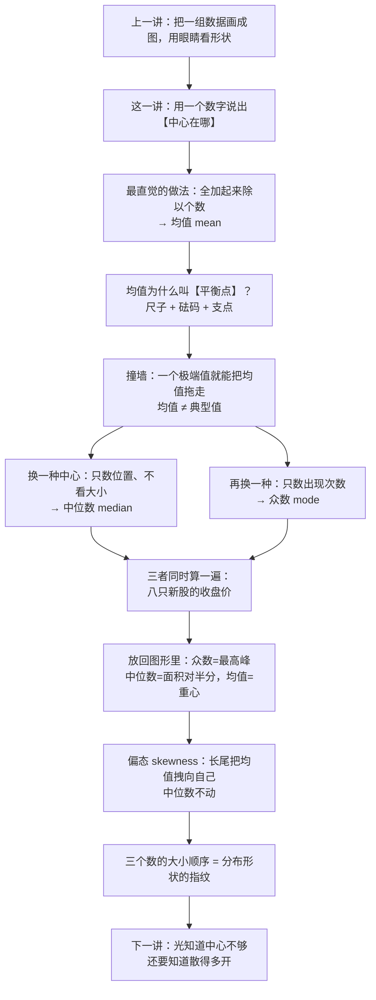
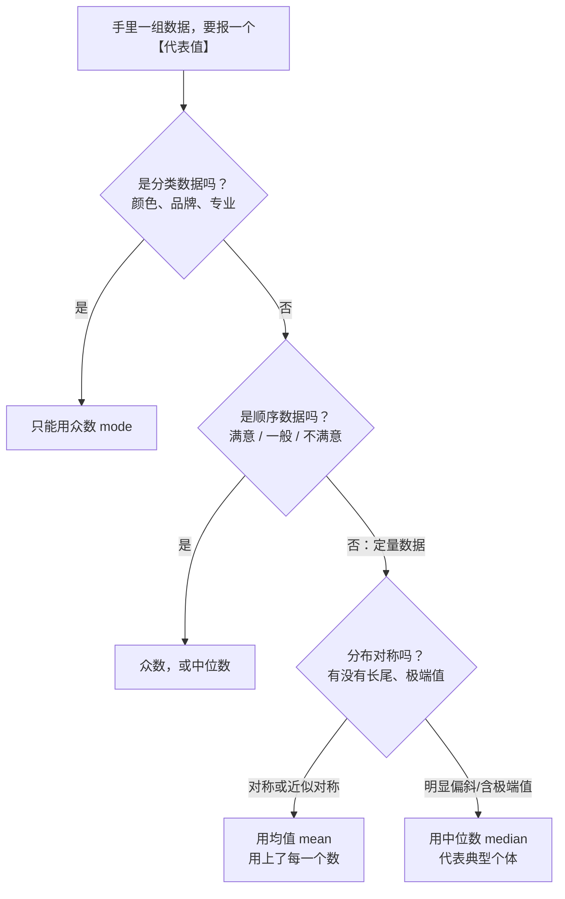

# C2.3 集中趋势：均值、中位数、众数 Numerical Measures of Central Tendency

> [!abstract] 这一讲的任务
> 上一讲把一组数据画成点图、茎叶图、直方图，用眼睛看形状。可是要比较两个班、两家公司、两个月的销量，图就不够用了——必须落到**数**上。
> 这一讲讲第一个数：这组数据的**中心在哪**。做法有三种——**均值 mean、中位数 median、众数 mode**。它们不是"同一个答案的三种精度"，而是三个**不同的问题**；一遇到极端值或偏斜的分布，三个答案就会明显分开。
> 把这三个数讲清楚，你手里就有了两件事：判断一组数据"典型值"该报哪个，以及从三个数的相对位置**反推数据的形状**。

> [!info] 怎么读这份讲义
> 按小节读。第 0 节给一个"两个说法都对"的工资单，把矛盾先摆出来；第 1–2 节补上两个特征与记号；第 3 节把均值逼到"支点"这一步（这是全篇的物理直觉，别跳）；第 4–5 节讲它的两处软肋；第 6–7 节引出中位数与众数；第 8 节三个一起算一道题；第 9–10 节把三个数放回图形里，得到"偏态 ⟹ 三者顺序"这条最常考的结论；第 11 节是取舍，第 12 节把"均值 vs 期望值"分清，第 13 节是接到机器学习上的**拓展**。
> 标注约定：标有 **（拓展）** 或 **【拓展】** 的内容，是**课堂上没有展开、由教材与通行讲法延伸补充**的部分。复习时先掌握未标注的主干——考点集中在主干上。
> 勘误一句话：本篇没有需要更正的印刷错误；唯一容易算崩的一处是第 3 节那个**分母**（数据少了一个，$n$ 要跟着减），详见该节。

---

## 0. 开场：一张工资单，两个都正确的说法（p.33）

一家小公司 11 个员工，工资单是这样的：

| 月工资 | 几个人 |
|---|---|
| \$400,000 | 1（老板） |
| \$70,000 | 2 |
| \$50,000 | 2 |
| \$30,000 | 1 |
| \$20,000 | 5 |

总裁对媒体说：**"我们公司的平均工资是 \$70,000。"**
工会代表在同一条新闻里说：**"大多数员工只拿 \$20,000。"**

两边都没撒谎。

先把总裁那个数验一遍：全部加起来是 \$770,000，除以 11 个人，正好 \$70,000。**一分不差。**

再看工会那句：\$20,000 在表里出现了 5 次，是出现次数最多的那一档，"大多数"这三个字也站得住。

那"中间那个员工"拿多少？排好队数到第 6 位（一共 11 人，中间就是第 6 个）：\$20,000 占前 5 位，第 6 位是 \$30,000。

于是**同一组数据给出了三个都正确的"代表值"**：

$$\underbrace{70{,}000}_{\text{均值 mean：总额摊平}}\qquad \underbrace{30{,}000}_{\text{中位数 median：排队站中间}}\qquad \underbrace{20{,}000}_{\text{众数 mode：出现最多}}$$

最大的那个是最小的 3.5 倍。这不是谁算错了，而是三个数在回答三个不同的问题：**"总额摊平后每人多少""排好队站中间的是谁""哪一种最常见"。**

> [!question] 停一下，先自己想想
> 如果只准你报一个数来描述这 11 个人的工资，你报哪个？为什么？
> 先把你的答案记下来——第 11 节会回来对，届时你会发现"报哪个"取决于你想让别人形成什么印象。

上一讲的三张图能让你**看见**这组数据：一个点在 40 万那里孤零零地飞出去，其余挤在 2–7 万之间。可是图形没法比较：两家公司、两个月份、两个班，总不能每次都把图叠在一起看。要比较就得有数，而"用哪个数"正是这一讲要解决的问题。

---

## 1. 一组数据先要说清两件事：中心与变异（p.34–35）

给你一列数，你最先想知道的其实是两件事：

1. **它们聚在哪里？**——大部分数堆在轴的哪一段附近。
2. **它们摊得多开？**——是紧紧挤成一团，还是散得很宽。

第一件事叫**集中趋势 central tendency**，也叫**位置 location**；第二件事叫**变异 variation**，也叫**离散程度 dispersion**。统计描述的第一层就是把这两件事各用一个数说清楚。换句话说，**集中趋势就是拿一个数值去代表一整组数**——它必须是"最有代表性"的那一个。

名字拆开看：**集中 + 趋势**。"集中"说的是数据堆在某个数值附近，"趋势"这两个字很关键——它是**倾向**，不是每个数都正好落在那里。p.34 的措辞是"数据倾向于聚集、居中于某些数值附近"（the tendency of the data to cluster, or center, about certain numerical values）。p.34 画的是两条形状一样、位置不同的曲线：差异只在"中心在哪"；p.35 画的是两条中心相同、胖瘦不同的曲线：差异只在"散得多开"。

这两件事为什么必须分开讲？因为**只说中心，你无法判断这个中心有多可信**。举个日常的例子：两个班都报"平均身高 1.70 米"。A 班的人从 1.68 到 1.72，那 1.70 几乎就是每个人；B 班从 1.52 到 1.92，1.70 只是"中间那个"，具体到某个人一点参考价值都没有。**中心给出位置，变异给出这个位置的代表性有多强。**

这一讲只做第一件事。第二件事是 [[C2.4 离散程度：极差、方差与标准差]] 的任务，但两件事的接口现在就埋下了：**离散程度越小，集中趋势的代表性越强。**

---

## 2. 先用记号把"样本"和"总体"分开（p.36）

在写公式之前，得先把记号定下来，否则后面每次说"平均"都要重新解释是哪一个。

统计学的全部工作方式是**用一小撮数去猜一整堆数**：那一小撮是我们真的能拿到、能算的；那一整堆往往拿不到（全中国家庭收入、全厂所有产品的寿命）。同一件事因此有两套名字。

先把要用的记号认全，定义留到下一节：表里第一行的**均值**，就是开场算的那个"全部加起来除以人数"（$\$70{,}000$ 就是它）；第二行是"个数"，它决定第一行除法的分母。

| 量 | 样本 Sample | 总体 Population |
|---|---|---|
| 均值 Mean | $\bar x$（x bar） | $\mu$（mu，读"缪"） |
| 容量 Size | $n$（小写） | $N$（大写） |

p.36 就是这张表。读法要念对：$\bar x$ 读作 "x bar"，$\mu$ 读作 "mu"。

$\bar x$ 这个名字是"动作 + 结果"：先把这个样本的每个 $x_i$ 加总，再除以个数；顶上盖一条横杠，表示"这些数被拉平了"——一条杠压在 $x$ 上面，就是"压平"的图形化说法。

$\mu$ 则是那个我们**想知道但通常不知道**的真值：所有可能观测值的平均。它是固定的，不随你抽哪一批人而变。

大小写的分工也是通行约定：**小写管样本（小的一份），大写管总体（大的那堆）**。这条约定从第 2 章一直用到最后一章：$s$ 与 $\sigma$、$\bar x$ 与 $\mu$、$n$ 与 $N$ 全是这个套路。

> [!note] 前置工具：求和号 $\Sigma$
> $\Sigma$ 是希腊字母 sigma 的**大写**，在数学里只干一件事：**把后面那一串按指标逐个加起来**。它是个"加法的缩写"，没有别的玄机。
> $$\sum_{i=1}^{n}x_i \;=\; x_1+x_2+\cdots+x_n$$
> 下标 $i=1$ 说"从第 1 个开始"，上标 $n$ 说"加到第 $n$ 个为止"。$i$ 只是个临时编号（叫哑变量），换成 $j$、$k$ 完全一样。
> 所以均值的完整写法是
> $$\bar x=\frac{\sum_{i=1}^{n}x_i}{n}$$
> 分子是一个数（总和），分母是一个数（个数），整条式子就是"总和 ÷ 个数"。以后凡是看到 $\Sigma$，先在心里把它读成"全部加起来"。

> [!warning] $\bar x$ 与 $\mu$ 差的不只是符号
> $\bar x$ 是一个**算出来的、会随样本变的数**——换一批员工就换一个值；$\mu$ 是一个**固定的真值**——你抽不抽、抽谁，它都在那儿。第 5 章会把这句话升级成"$\bar x$ 是一个随机变量"，那时这个区别会成为整章的主线。现在先记住：**一个是估计值，一个是被估计的对象。**

---

## 3. 均值：把 n 个数摊平，它自然落在支点上（p.37–38）

> [!important] 定义：样本均值 Sample Mean
> 一组定量数据的均值，等于**所有观测值之和除以观测值的个数**：
> $$\boxed{\ \bar x=\frac{\sum_{i=1}^{n}x_i}{n}=\frac{x_1+x_2+\cdots+x_n}{n}\ }$$
> 它是最常用的集中趋势度量（p.37 第 1 条）。总体均值记作 $\mu$，公式形状一样，只是分母换成 $N$、求和范围换成整个总体。

用"先……再……"讲清动作：**先把这一列数全部加起来，得到总量；再把这个总量平均分给 $n$ 个单位。** 每人分到多少，就是均值。所以均值的口语解释永远是"**如果大家平分，每人多少**"。

为什么叫**算术平均 arithmetic mean**？"算术"在这里指的是只用加法与除法——最朴素的两个运算，不掺平方、不开方、不取对数。英文里 mean 是"中间的、平均的"，而 arithmetic 就是给它限定"用算术的办法平均"，与后面的几何平均、调和平均区分开。

**手算第一例（p.38）**。六个观测值：$10.3,\ 4.9,\ 8.9,\ 11.7,\ 6.3,\ 7.7$。

$$\sum x_i = 10.3+4.9+8.9+11.7+6.3+7.7=49.8$$
$$\bar x=\frac{49.8}{6}=8.30$$

计算本身一步都不难，p.38 给的就是这个 8.30。但**会算不等于懂**。这里有两个问题值得停下来：

> [!question] 停一下，先自己想想
> ① 为什么它偏偏叫"平衡点 balance point"？一根尺子上怎么会平衡？
> ② 如果我把 11.7 改成 117，均值变成多少？（先算，第 4 节会用）

第 ② 问的答案是 $25.85$（因为 $49.8-11.7+117=155.1$，$155.1/6=25.85$）——一个数改成十倍，均值涨了两倍多。这个现象第 4 节正式讲。第 ① 问是下一小节。

### 3.1 一把尺子、九个砝码：为什么它叫平衡点（p.37 第 2 条）

把数据想成"挂在尺子上的重物"：

- **尺子**就是横轴，刻度是变量值；
- **每个观测值的位置**就是砝码挂的位置；
- **砝码的重量**就是它的权重（等权时每个砝码一样重，就是直方图里每根柱子的高度）；
- **支点**放在哪儿，尺子才不歪？

先做一个干净的实验：位置 $1,2,3,\dots,9$ 上各挂一个**相同**的砝码。均值是 $45/9=5$。把支点放在刻度 5 上，尺子水平——两边一样重。

**现在把挂在 8 号位的那个砝码拿走。** 剩下的和是 $37$，个数变成 $8$，所以

$$\bar x_{\text{新}}=\frac{37}{8}=4.625$$

这里最容易翻车的是分母：**拿掉了一个砝码，$n$ 必须从 9 跟着改成 8**。如果仍然除以 9，会得到 $37/9=4.111$——那是个错数。第一次做这道题时确实写成过 $37/9$：砝码拿掉了，分母忘了跟着减，**改了分子没改分母**。

支点还留在 5 会怎样？左边力矩是 $(5-1)+(5-2)+(5-3)+(5-4)+(5-5)=10$，右边力矩是 $(5-6)$ 的绝对值加起来 $1+2+4=7$。左重右轻，尺子往左倒。

**把支点挪到 4.625**：左边 $(4.625-1)+(4.625-2)+(4.625-3)+(4.625-4)=8.5$，右边 $(5-4.625)+(6-4.625)+(7-4.625)+(9-4.625)=8.5$。又平了。

![[C2.3-砝码与支点-均值是平衡点.png]]
这就是"平衡点"的全部内容：**均值不是随便一个"中间"，它是这堆重量自己选出来的重心。** 数据的分布一改（拿掉一个、加一个、某个值变大），重心就跟着挪，而挪到哪儿是可以精确算出来的——算它的那个数就是均值。

> [!note] 一句话记住这层关系
> 均值 ⟷ 重心 ⟷ 支点。三者是同一件事的三种说法：物理上是"撑得住的位置"，几何上是"面积的重心"，代数上就是 $\sum x_i/n$。这也是为什么直方图的重心位置能被"高矮"和"位置"一起决定——第 10 节解释偏态时还要用到这一条。

### 3.2 把"平衡"翻译成公式：偏差之和为零

杠杆平衡的条件是"左边力矩 = 右边力矩"，也就是

$$\sum_{x_i<\bar x}\big(\bar x-x_i\big)\;=\;\sum_{x_i>\bar x}\big(x_i-\bar x\big)$$

把两边都挪到等号左边、合并成一个求和：

$$\boxed{\ \sum_{i=1}^{n}\big(x_i-\bar x\big)=0\ }$$

**验算。** 取 $1,\dots,9$，均值 5，偏差是 $-4,-3,-2,-1,0,1,2,3,4$，加起来 $0$ ✓。取 p.38 那六个数，均值 8.30，偏差是 $2.0,-3.4,0.6,3.4,-2.0,-0.6$，加起来 $0$ ✓。

这条式子说的是：**均值以上的偏差，正好把均值以下的偏差抵消干净。** 换句话说，均值是唯一一个"让所有偏差净额为零"的点——上面多一点就往下挪，下面多一点就往上挪，挪到刚好抵消为止，那就是均值。

> [!warning] 这个"恒等于零"是一条伏笔
> 后面要度量"数据离中心有多远"，最自然的想法是"偏差的平均"。可是 $\sum(x_i-\bar x)=0$ 永远成立，这个平均值恒等于 0，什么都测不出来。所以才不得不**先平方再平均**——那一平方，正是 [[C2.4 离散程度：极差、方差与标准差]] 里方差公式的起点，也是"为什么除以 $n-1$ 而不是 $n$"那条线索的开头。现在只要记住这个恒等式。

### 3.3 停一下：我们刚才干了什么

- 均值 = 总和 ÷ 个数，一句话就能算（p.38 的 8.30）；
- 它同时是**重心/支点**：把每个数看成砝码，支点撑在均值处正好平衡（图 1）；
- 平衡这件事可以翻译成一条恒等式 $\sum(x_i-\bar x)=0$，它在后面讲方差时还会出现。

到这里，均值看起来完美：好用、好算、有物理意义。**它的毛病在下一节。**

---

## 4. 均值的软肋：一个 1.9 米的人走进房间（p.37 第 3 条）

p.37 第 3 条写得很干脆："受影响于极端值（outliers）"。但"受影响"到底有多大？值得算一遍。

**题目。** 房间里已有 10 个人，平均身高 1.6 米。现在走进来第 11 个人，身高 1.9 米。这 11 个人的平均身高是多少？

> [!question] 停一下，先猜
> 猜一个数再动笔。1.63？1.70？1.75？猜完看下面的算式。

10 个人的总和是 $10\times1.6=16$ 米，加上 1.9：

$$\bar x=\frac{16+1.9}{11}=\frac{17.9}{11}=1.6273\ \text{米}$$

**只涨了 2.7 厘米。** 一个比别人高 30 厘米的人走进来，均值只挪了 2.7 厘米——因为他的"额外身高"要被 11 个人分摊。

接着把人数换成 20、100：

| 原来的人数 $n$ | 总和 | 新均值 | 比 1.6 高出 |
|---|---|---|---|
| 10 | $16+1.9=17.9$ | $17.9/11=1.6273$ | 2.7 厘米 |
| 20 | $32+1.9=33.9$ | $33.9/21=1.6143$ | 1.4 厘米 |
| 100 | $160+1.9=161.9$ | $161.9/101=1.6030$ | 0.30 厘米 |
| 1000 | $1600+1.9=1601.9$ | $1601.9/1001=1.6003$ | 0.03 厘米 |

看出规律了吗？把式子拆开就一目了然：

$$\bar x_{\text{新}}=\frac{1.6n+1.9}{n+1}=1.6+\frac{0.3}{n+1}$$

那个 $0.3$ 是极端值相对原均值的偏差，它要被 $n+1$ 个人**平分**。所以：

> [!important] 关于极端值的两条结论（外加一条推论）
> **① 极端值一定会拉动均值**，方向朝着它自己——这是"受影响"的确切含义。
> **② 样本越大，拉动越小**，且是严格按 $1/(n+1)$ 衰减：10 个人时挪 2.7 厘米，100 个人时挪 3 毫米，1000 个人时只有 0.3 毫米。所以只要数据量足够大，均值仍然是相当有代表性的——而统计学的研究对象本来就是"大量的"。
> **③（推论）** 拉扯的力度 = 偏差大小 × 它在总数里占的份量。极端值之所以危险，**不是因为它"极端"，而是因为它在小样本里占的份量大**。同一笔 40 万的工资放在 11 个人里能翻天，放在 10000 个人里几乎看不见。

第 ③ 条正好解释开场那张工资单：10 个普通员工的均值是 $370000/10=3.7$ 万；老板一个人拿 40 万进来，均值变成 $(370000+400000)/11=7$ 万。抬高了 $(40-3.7)/11=3.3$ 万——和身高那道题是**同一个公式**：偏差 36.3 万被 11 个人平分，只是这次"新人"太重，平分完也还有 3.3 万。

### 4.1 第二个追问：如果比例不变，人数变了呢？

身高那道题是"往一堆同类里塞进一个异类"。还有另一种"人数变多"：**整批人按同样的比例复制。**

**题目。** 一次小测三道题，每题 1 分。全班 30% 的人得 3 分，50% 得 2 分，10% 得 1 分，10% 得 0 分。平均分是多少？

按定义直接算（设全班 $N$ 人，每一档的人数分别是 $0.3N$、$0.5N$、$0.1N$、$0.1N$）：

$$\bar x=\frac{0.3N\cdot 3+0.5N\cdot 2+0.1N\cdot 1+0.1N\cdot 0}{N}$$

分子分母里的 $N$ **约掉了**：

$$\bar x=0.3\times 3+0.5\times 2+0.1\times 1+0.1\times 0=0.9+1.0+0.1+0=2.0$$

答案是 **2.0 分**，而且这个 2.0 **与人数完全无关**：10 个人是 2.0，20 个人是 2.0，200 个人还是 2.0。只要**结构**（各档所占的比重）不变，均值就一分不动。

> [!important] 由这道题得到的一句话
> **样本的结构 = 总体的结构 ⟹ 样本均值 = 总体均值。**
> 这不是巧合，是加权平均的直接后果：$\bar x=\sum_k p_k v_k$，其中 $p_k$ 是各类的比重、$v_k$ 是各类的取值。人数只进分子分母各一次，被约掉了；**决定均值的是比重，不是人数。**

这句话是抽样理论的第一块砖：抽样的要点不在"多"，而在"**结构像**"。分层抽样（stratified sampling）费那么大劲按比例分配名额，图的就是这一条——让样本的结构尽量贴近总体的结构，代表性才强。这条线在第 1 章的 [[C1.2 收集数据：抽样方法与代表性]] 已经埋过，第 5 章的 [[C5.1 抽样分布：统计量也是随机变量]] 会正式回收。

两小节放在一起，规律很清楚：**同样是"人数变多"，结果完全相反。** 往一堆同类里塞异类（身高题），人越多影响越小；把同一批结构等比放大（分数题），均值一点不变。区别在于——**前者改变了数据的结构，后者没有。**

---

## 5. 「average」不是「mean」：收入数据报的到底是哪一个（p.33）

回到开场那张工资单。注意总裁用的词：**average**。

问题就出在这儿。**average 是个口语词**，凡是"取中"都能叫 average：均值是 average，中位数是 average，众数在某些语境下也是 average（比如"the average customer"其实是"最典型的顾客"，那是众数）。而 **mean 是专名**，专指算术平均 $\sum x_i/n$。

这两个词在很多场合被混着用，后果不小。

**一个真实的口径。** 美国人口普查局每年都会发布全国家庭年收入，媒体引用得最多的那个数字，标题上写的是 **real median household income**——是**中位数**，不是算术平均。原因正是第 4 节讲的那件事：家庭收入一定是**右偏**的——大多数家庭挤在左边、少数极高收入者把右边拉出一条长尾（形状的正式说法见第 10 节）。如果用算术平均，一个 Elon Musk 就能把全国"平均收入"抬高一大截，那个数就不再代表"典型家庭"了。中位数只数位置，长尾再长也动不了它。

所以新闻里那句 "average household income" 到底指哪个，**必须看它背后的口径**——它可能指 mean，也可能指 median，而两者在收入这种右偏数据上能差出好几万。

> [!important] 两个词的分工
> **average**：泛称，指"某个有代表性的值"，具体是哪一个看上下文。
> **mean**：专指算术平均，公式 $\sum x_i/n$。
> 看到一个 "average"，第一反应应该是问一句：**是哪一个 average？** 这一问问习惯了，很多统计新闻的误导就不容易上当了。

p.33 那两句针锋相对的话，用这两个词一解释就通了：总裁的 "average pay is \$70,000" 是 **mean**（而且算得没错，确实是 7 万）；工会的 "most workers earn only \$20,000" 是 **mode**。**两个 average，两个真相。**

---

## 6. 中位数：先排序，再数位置（p.39–41）

如果均值会被极端值拖走，那能不能换一种"中心"——它压根不看数值多大，只看"第几个"？

可以。这就是**中位数 median**。

> [!important] 定义：中位数 Median
> 把观测值**从小到大排好序**，位置在正中间的那个值就是中位数。
> - $n$ 为**奇数**：取正中间那一个；
> - $n$ 为**偶数**：取中间两个的**平均**。
> 中位数在序列中的位置是
> $$\text{Positioning Point}=\frac{n+1}{2}$$
> 它**不受极端值影响**（p.39 第 4 条）。

用"先……再……"说清动作：**先把所有数从小到大排队；再算出位置 $(n+1)/2$，数到那个位置上把值取出来。** 位置是整数就直接取；位置是半点（如 3.5），就取相邻两个数的平均。

为什么叫**中位数**？"中"是位置在中间，"位数"强调它跟"第几位"有关——**它只数个数，不称重量**。英文 median 在几何里就是"中线"，同源的词都带"把东西对半分"的意思。

这里有一句话必须说准：**中位数是"中间位置上的那个变量值"，不是"中间那个位置编号"本身。** 听起来像抠字眼，但第 9 节在分布图上找中位数时，全靠这句话——位置是抽象的，值是具体的，找的是后者。

**奇数个（p.40）。** 原始数据 $24.1,\ 22.6,\ 21.5,\ 23.7,\ 22.6$，五个数。

先排序：$21.5,\ 22.6,\ 22.6,\ 23.7,\ 24.1$；位置 $(5+1)/2=3$；第 3 个是 **22.6**。

顺手把另外两个也算出来对照：均值 $114.5/5=22.9$；22.6 出现了两次，是最多的，所以众数也是 **22.6**。三个数分别是 $22.9$、$22.6$、$22.6$——只有 0.3 的差距。这种"三个数挤在一起"的情形，是数据左右比较对称的信号（第 8、10 节会反复用到这个观察）。

**偶数个（p.41）。** 原始数据 $10.3,\ 4.9,\ 8.9,\ 11.7,\ 6.3,\ 7.7$，六个数。

排序：$4.9,\ 6.3,\ 7.7,\ 8.9,\ 10.3,\ 11.7$；位置 $(6+1)/2=3.5$，落在第 3、第 4 个之间：

$$\text{Median}=\frac{7.7+8.9}{2}=8.30$$

注意这个 8.30 和 p.38 算出来的均值一模一样。**不是巧合，也不是算错**——同一组数、几乎对称，两个"中心"自然重合。等第 10 节讲完偏态，"两者相等"会被翻译成一句可用的判断。

> [!warning] 必须先排序，这是全节最容易犯的错
> 原始数据里第 3 个是 8.9。直接数"第 3 个"报 8.9 就错了——**原始数据没有排序，"第 3 个"毫无意义。** 中位数的一切结论都建立在"已经从小到大排好"这个前提上。位置公式 $(n+1)/2$ 算的是**排好序之后**的位置。

**为什么它不怕极端值？** 因为它只数个数。极端值变大变小，只改变"那个位置上的数有多大"，不改变"它是第几个"。做一次对照实验就很清楚：把 p.41 那组数里的 11.7 改成 117（放大十倍），

- 中位数：排序变成 $4.9,\ 6.3,\ 7.7,\ 8.9,\ 10.3,\ 117$，位置还是 3.5，中位数还是 $(7.7+8.9)/2=\mathbf{8.30}$——**一动不动**；
- 均值：$(49.8-11.7+117)/6=155.1/6=\mathbf{25.85}$——**翻了 3 倍多**。

一次改动，一个数完全不动，另一个数面目全非。这就是"稳健 robust"这个词的来历：**对个别观测值的改动不敏感。**

**代价也要说清楚。** 中位数浪费信息：它只用了"位置"，完全不管两边离得多远。同样是中位数 8.30，一组数据可能是 $8.2,8.25,8.3,8.35,8.4$，也可能是 $0,3,8.3,500,900$——中位数一样，分布天差地别。而且小样本时它很不稳：5 个数的中位数只由第 3 个数决定，你把最小的改小、最大的改大，它无动于衷（这是优点），但你把第 3 个稍微动一下，它就跟着跳（这是缺点）。

> [!note] 伏笔
> 中位数其实就是**第 50 百分位数**——把数据从小到大排，50% 的位置对应的值。第 2.6 节的 [[C2.6 百分位数与 z 分数]] 会把这个概念一般化：不只是"对半分"，还可以 10%、25%、90% 地切。

---

## 7. 众数：数出现次数的那一个（p.42–43）

还有第三种"中心"，它连位置都不数，只数**次数**。

> [!important] 定义：众数 Mode
> 一组数据中**出现次数最多**的那个观测值（p.42 第 2 条）。
> - 可能**没有**众数（每个值都只出现一次）；
> - 可能**有多个**（两个值并列出现次数最多，叫双众数 bimodal）；
> - **不受极端值影响**；
> - 定量数据与定性数据都能用（p.42 第 5 条）。

用"先……再……"讲动作：**先数清楚每个取值出现了几次；再挑出现次数最多的那个值。** 就这么两步。

为什么叫**众数**？"众"就是多；英文 mode 指的是"最常出现的那个样子/型"。它衡量的是**数据集中在哪里最密**（p.42："用它来定位大部分数据集中所在的区域"），而不是"平均下来是多少"。

p.43 给了三种情形，一个都不能少：

| 情形 | 数据 | 众数 |
|---|---|---|
| 没有众数 | $10.3,\ 4.9,\ 8.9,\ 11.7,\ 6.3,\ 7.7$ | 每个值都只出现一次 ⟹ **无众数** |
| 一个众数 | $6.3,\ \mathbf{4.9},\ 8.9,\ 6.3,\ \mathbf{4.9},\ \mathbf{4.9}$ | 4.9 出现 3 次 ⟹ **众数 = 4.9** |
| 不止一个 | $21,\ \mathbf{28},\ \mathbf{28},\ 41,\ \mathbf{43},\ \mathbf{43}$ | 28 和 43 各出现 2 次 ⟹ **双众数** |

（这些例子的样本量只有 6 个，只作演示用；现实数据里"几个值并列最多"很常见，报告时该把并列的众数都写出来。）

**众数的独门用途：分类数据。** 这是它不可替代的地方。

- 分类数据（颜色、品牌、性别）**没法排序**，所以没有中位数；
- 也没法相加，所以没有均值——"红 + 蓝"等于什么？
- 只剩众数可用："卖得最好的颜色是黑色""投诉最多的类别是物流"。

顺序数据（满意/一般/不满意）比分类数据多一个"能排序"，所以中位数也可以用；但"满意"和"一般"之间差多少没人说得清，相加仍然没有意义，均值还是不能用。**能把三个数都用上的，只有定量数据。**

p.42 还留了一句很实在的提醒：**对某些定量数据，众数不一定有明确意义。** 因为连续取值的数据往往"每个值只出现一次"（8.31、8.32、8.33……），于是根本没有众数；或者出现次数最多的纯属偶然。所以在定量数据上，众数通常只在两种场合有用：一是数据本身离散且重复多（鞋码、家庭人口数、每题得分）；二是看**分组后的频数**——那其实就是直方图最高的那一根柱子（第 9 节会把它和"峰"连起来）。

> [!note] 分组数据的众数（拓展）
> 数据已经分了组（如"20–30 万：12 人"）时，众数取**频数最高的那一组的组中值**。这只是近似——真实的众数藏在组内，分组越粗、近似越糙。第 2.1 节的汇总表和第 2.2 节的直方图都在做同一件事，只是把"原始值"换成了"组"。

### 7.1 三个数放到同一组数据上：极端值到底动了谁

工具齐了，回到开场那张工资单（11 个人）：均值 $77/11=7$ 万；中位数排到第 6 位是 $3$ 万；众数是出现 5 次的 $2$ 万。

**现在只改一个数**——把老板的 40 万改成 400 万。总额从 77 万变成 437 万：

$$\bar x_{\text{新}}=\frac{437}{11}=39.7\ \text{万}\quad(\text{是原来的 }5.7\text{ 倍})$$

而中位数还是 $3$ 万、众数还是 $2$ 万，**一动没动**。

![[C2.3-极端值只拖走均值.png]]
读图时注意两件事：**① 两个子图的横轴刻度不同**——上图到 40 万，下图到 400 万，正因为只改了一个数，横轴被迫拉长十倍，而聚在左边的那十个点形状丝毫未变；**② 三条竖线的反应完全不同**——均值那条红线跟着极端值一路跑到最右边，中位数与众数的竖线钉在原地。

这句话就是这一讲的中心思想：**极端值只拽得动"要称重量"的那个度量。**

---

## 8. 三个一起算：八只新股的收盘价（p.44–48）

概念讲完了，把三个工具放到同一道题上跑一遍。这是一道完整的"描述性分析"练习。

> [!example] Thinking Challenge（p.44）
> 你是一家证券公司的金融分析师，收集了 8 只新股的收盘价：
> $$17,\ 16,\ 21,\ 18,\ 13,\ 16,\ 12,\ 11$$
> 请用集中趋势描述这些股价。

**第一步：均值（p.45）。**

$$\sum x_i=17+16+21+18+13+16+12+11=124,\qquad \bar x=\frac{124}{8}=15.5$$

**第二步：中位数（p.46）。** 先排序，再数位置：

| 排序后 | 11 | 12 | 13 | 16 | 16 | 17 | 18 | 21 |
|---|---|---|---|---|---|---|---|---|
| 位置 | 1 | 2 | 3 | **4** | **5** | 6 | 7 | 8 |

位置 $(8+1)/2=4.5$，落在第 4、第 5 个之间，而这两个都是 16：

$$\text{Median}=\frac{16+16}{2}=16$$

**第三步：众数（p.47）。** 16 出现了 2 次，其余各 1 次：

$$\text{Mode}=16$$

p.48 那张总结表把三者的"公式"与"身份"对在一起，值得抄下来：

| 度量 Measure | 公式 Formula | 描述 Description |
|---|---|---|
| 均值 Mean | $\sum x_i/n$ | 平衡点 Balance Point |
| 中位数 Median | 位置 $(n+1)/2$ | 排序后位于中间的值 Middle Value When Ordered |
| 众数 Mode | 无公式（数频数） | 出现最频繁 Most Frequent |

> [!question] 停一下：15.5、16、16 —— 这三个数几乎一样，说明了什么？
> 想清楚再往下看。

答案：说明这组数据**左右基本对称、没有明显的极端值**。8 个价格从 11 到 21，最大最小只差 10，离中心都不远。三个"中心"是从三个不同角度找的，如果它们指向同一个地方，那这个地方就是数据真正密集的位置——**"三个数一致"本身就是一条关于形状的信息**，比单独看任何一个都强。

细看还有一点：均值 15.5 略小于中位数 16，方向上有一点"尾巴拖向左"的苗头——也就是第 10 节要正式定义的**左偏**。不过 8 个样本实在太小，这种 0.5 的差距不该过度解读——**小样本里任何指标都会抖。**

> [!tip] 解题时的顺序
> 拿到一组数要"描述集中趋势"，按这个顺序走最不容易漏：① 先看数据类型（分类/顺序/定量）决定哪几个能用；② 定量数据先算均值；③ 排序算中位数；④ 数频数找众数；⑤ **比较三者**，差距大就说明有偏斜或极端值，回头查是哪个点造成的。

---

## 9. 回到图形：三个数分别是图上的哪个点（p.49）

三个数都能算。但它们的**几何身份**是什么？把一组数据画成分布曲线（直方图的极限，纵轴是密度），三个数就变成图上的三个位置。

前提只有一条：**曲线下的面积 = 比例（概率）**。横轴某个区间上的面积，就是"落在那个区间的观测值占多大比例"。整条曲线下的总面积是 1。

> [!important] 三个数在图上的位置
> - **众数 = 最高峰**的横坐标。哪个值出现得最频繁，密度就在哪里最高。
> - **中位数 = 把面积一分为二**的那条竖线。它左边占 50%，右边占 50%。
> - **均值 = 重心（支点）**。把曲线下的面积想成一块均匀的薄板，能把它水平支住的那个点就是均值。

众数最好找——找峰，读横坐标。均值也不难理解——第 3 节的杠杆原封不动搬过来，只是把"离散的砝码"换成了"连续的面积"。

中位数是三个里最容易找错的。

> [!question] 停一下：中位数是不是"最小值与最大值的中点"，也就是 $\dfrac{\min+\max}{2}$？
> 直觉上很顺：中位数在中间，区间中点也在中间，那不就是一个东西吗？

**不是。** 这个猜法错得很典型，值得看清楚它错在哪：

1. $\dfrac{\min+\max}{2}$ **只用到两个数**（最小的和最大的），中间那几十个数全被丢掉了。可中位数的定义是"一半的数比它小"，是**个数**意义上的中间，不是**范围**意义上的中间。
2. 它毫无稳健性可言：把最大值从 11.7 改成 117，$\dfrac{\min+\max}{2}$ 立刻从 8.3 跳到 60.95——这恰恰是中位数最该免疫的那类改动。
3. 正确的做法只有一条：**在面积上对半分**。找到那条竖线，让左边面积 = 右边面积 = 0.5。

第 2 点算给你看：$(\min+\max)/2=(4.9+11.7)/2=8.3$，改成 117 后是 $(4.9+117)/2=60.95$。而真正的中位数从头到尾都是 8.30。**两个"中点"长得像，抗干扰能力差了一个量级。**

> [!important] 三者的信息来源不同（这一条是整篇的枢纽）
> - **众数**只用**频数**：谁出现得多。
> - **中位数**只用**个数/面积**：谁站在中间。数值多大，它不管。
> - **均值**把**值 × 权重**全用上：既要位置，又要份量。
> 用到的信息越多，对这个量的"变化"就越敏感。**敏感与稳健是一枚硬币的两面**：均值信息用得最全（所以效率最高），也最容易被一个异常点带偏；中位数只用一个位置（所以浪费信息），但几乎刀枪不入。没有哪个更好，看你要什么。

---

## 10. 偏态：长尾一出现，三者就分家（p.49）

现在把"重心被拖走"这件事画出来，三个数就会明显地分开。

> [!important] 定义：偏态 Skewness
> 分布**不对称**、往一边拖出一条长尾巴，就叫偏态（p.49 把 skew 直接注解为 symmetry——它测的就是对称性）。名字拆开看：**偏** = 歪向一边，**态** = 分布的样子；英文 skew 的原意就是"歪、斜"。尾巴在右边叫**右偏 right-skewed**（正偏），尾巴在左边叫**左偏 left-skewed**（负偏）。完全对称时，偏度为 0。

**命名规则只有一条：看尾巴，不看峰。** 长尾拖向哪边，就叫哪边偏。很多人会记反，因为第一眼看到的是"峰歪向了另一边"——峰在左边、尾巴拖到右边，那叫**右偏**。换个说法：右偏 = 大部分数据挤在左边，少数很大的值把右边拉长。

三个数在三种形状下的相对位置：

| 形状 | 大小关系 | 谁被拖走了 |
|---|---|---|
| 对称 Symmetric | $\text{mean}=\text{median}=\text{mode}$ | 没人被拖 |
| 右偏 Right-skewed（长尾在右） | $\text{mode}<\text{median}<\text{mean}$ | 均值被拽向右边 |
| 左偏 Left-skewed（长尾在左） | $\text{mean}<\text{median}<\text{mode}$ | 均值被拽向左边 |

![[C2.3-偏态与三者位置.png]]
**为什么会这样？** 回到第 9 节那句"信息来源不同"：

- **中位数只数面积。** 把最大值改大，只是让右边那条尾巴更长、更细——但面积还是对半分，那条竖线纹丝不动。所以中位数**永远在"一半一半"的位置**。
- **均值要乘距离。** 重心被"远处的重量"拽得最狠：尾巴拖得越远，那里的力矩越大，重心就越往那边偏。所以均值**永远偏在长尾那一侧**。
- **众数只看峰。** 峰在哪它在哪，和尾巴无关。长尾越拖，峰相对越靠**另一头**。

于是右偏时（尾巴在右），顺序自然是 众数 < 中位数 < 均值——**均值被尾巴拽到了最右边**。

> [!important] 考场上的判据
> 只比较**均值与中位数**就够了：
> $$\bar x>\text{median}\ \Longrightarrow\ \text{右偏},\qquad \bar x<\text{median}\ \Longrightarrow\ \text{左偏}$$
> 因为中位数稳稳待在"面积中点"，均值的偏移方向直接告诉你尾巴朝哪边。这是最快、最不容易出错的一条，也是"给一张分布图问三个数大小顺序"这类题的解法：先看尾巴方向，再排顺序。

> [!warning] 一个诚实的边界
> "众数排第三"是**经验规律**，不是定理：它要求分布**单峰**、尾巴单调。多峰分布里，众数可能出现在任何一个峰上，与均值、中位数的相对位置没有固定关系（p.49 的三张图也只标了均值与中位数，没标众数）。所以可靠的是**均值与中位数的相对位置**，众数的位置只在典型单峰情形下当参考。

用两个例子把这张表钉住：

- **收入**（右偏）：绝大多数家庭在中间，少数极高收入把右边拉长 ⟹ 均值 > 中位数。这就是第 5 节"官方报中位数"的原因。
- **考试分数**（常常左偏）：大多数人考得不错、堆在高分一侧，少数人考得很低把左边拉长 ⟹ 均值 < 中位数。所以当有人抱怨"班级平均分被几个不及格的拉下来了"时，他说的"平均分"（均值）确实低于班上的"中间水平"（中位数）——这两句话可以同时为真。

---

## 11. 该用哪一个

三个数都算得出来，那报告时用哪个？答案取决于两件事：**数据是什么类型**，以及**分布是什么形状**。

> [!important] 三条取舍规则
> **① 对称或近似对称 ⟹ 用均值。** 它用上了每一个观测值，信息利用率最高；而且后面所有推断统计（样本均值、$t$ 检验、方差分析、回归）全都建立在均值之上——它是整个课程的主干。
> **② 明显偏斜、或含极端值 ⟹ 用中位数。** 它代表"典型个体"，不会被少数极端点劫持。收入、房价、财富、企业规模、响应时间这类右偏数据，都该报中位数。
> **③ 分类数据 ⟹ 只能用众数；顺序数据 ⟹ 众数或中位数。** 这不是偏好问题，是可行性问题：不能排序就没有中位数，不能相加就没有均值。

**一个房价的例子。** 某小区一年成交 100 套：90 套在 300 万上下，另 10 套是 2000 万的别墅。

$$\bar x=\frac{90\times300+10\times2000}{100}=\frac{47000}{100}=470\ \text{万},\qquad \text{median}=300\ \text{万}$$

中介挂出的"小区均价 470 万"**没有撒谎**，但一个想买房的家庭看到的"典型价格"是 300 万——那 10 套别墅把均值抬了 170 万，而中位数一动没动。这正是开场那张工资单的翻版：**均值描述的是"总量摊平"，中位数描述的是"典型个体"，两个问题都合法，看你想回答哪一个。**

> [!tip] 实务建议：把两个都报出来
> 只报一个数，等于替读者做了一个他没同意的假设。稳妥的做法是**均值 + 中位数一起报**，必要时补一句众数。
> 而且**两者不一致本身就是结论**：差距大 ⟹ 数据偏了、有极端值 ⟹ 均值不足以代表"典型个体"。差距小 ⟹ 分布大致对称 ⟹ 用均值放心。

---

## 12. 均值与期望值：算法一样，身份不同（接到第 5 章）

最后要把一组容易混的词分开：**算术平均（均值）** 和 **期望值 expected value**。

它们**算起来一模一样**——都是"取值 × 权重"再加起来。等权时（每个观测值权重都是 $1/n$），就退化成 $\sum x_i/n$。既然算法一样，为什么要有两个名字？

区别不在算法，在**身份**：

| | 均值 mean | 期望值 expected value |
|---|---|---|
| 描述对象 | 一组**已经发生、已经确定**的数据 | 一个**还没发生**的随机变量 |
| 权重来自 | 每个观测值各占 $1/n$ | 每个可能取值的**概率** |
| 时态 | 过去/现在（数已经在那儿了） | 未来（只知道可能性） |
| 例子 | 这个班这次统计学考试的平均分 | 下一位同学"将要"拿到的分数的期望 |

一句话：**期望值 = 用概率加权的均值；算术平均只是"每个权重都是 $1/n$"的特例。**

一个经典对照：掷一颗公平的骰子，期望点数是

$$E(X)=\frac{1}{6}(1+2+3+4+5+6)=3.5$$

但骰子**永远掷不出 3.5**。它不是"某个结果"，而是"无数次重复的平均会趋近的那个值"。而如果你已经掷了 100 次、记下了 100 个数，那 100 个数的平均就是**均值**——一个实实在在、算得出来的数。

> [!warning] 为什么要费劲分开
> 第 5 章要写一条极重要的式子：
> $$E(\bar x)=\mu$$
> 左边是**期望**（对一个随机变量 $\bar x$ 求，用概率加权），右边是**总体均值**（一个固定的数）。如果把"均值"和"期望"当成同一个词，这句话就变成了"均值等于均值"——同义反复，什么都没说。它不是同义反复：它说的是"**样本均值这个随机变量的期望，恰好等于总体均值**"，也就是**无偏性**。
> 分清这两个词，是理解无偏估计的第一步（[[C5.1 抽样分布：统计量也是随机变量]]）。

> [!question] 停一下，用一句话回答
> "这次考试全班的平均分"和"下一个走进考场的人的期望得分"，是同一个东西吗？

不是。前者是对已经发生的这一批分数做算术平均（均值）；后者是对"还没发生的那个分数"这个随机变量，按分数的概率分布加权求和（期望值）。数值上它们可能很接近（如果那个人是从这个班里随机抽的），但**逻辑身份完全不同**：一个是描述，一个是预测。

---

## 13. 三个数其实是三种"损失"下的最优答案（拓展：课堂未讲解）

**【拓展】** 这一节超出本讲范围，但它能把三个数从"三种习惯做法"提升成"同一个问题的三个解"，对后面学回归、学机器学习很有用。

问题可以统一成一句话：**找一个常数 $c$，让它"离所有数据最近"。** 三个数就是"最近"的三种定义：

$$\arg\min_c \sum_{i=1}^{n}(x_i-c)^2=\bar x,\qquad
\arg\min_c \sum_{i=1}^{n}|x_i-c|=\text{median},\qquad
\arg\min_c \sum_{i=1}^{n}\mathbf 1\{x_i\neq c\}=\text{mode}$$

- **平方误差**最小 ⟹ 均值。平方会把"远"放大（距离 10 变成 100），所以均值必须去迁就那个最远的点——这从数学上解释了第 4 节"均值怕极端值"。
- **绝对误差**最小 ⟹ 中位数。绝对误差不放大远距离，随便哪个远点都只算一次，所以中位数岿然不动。这就是第 6 节的"稳健"。
- **数错个数**（0–1 损失）最小 ⟹ 众数。要让"猜错的次数"最少，当然猜出现最多的那个。

用第 8 节那 8 个股价验算一遍（$11,12,13,16,16,17,18,21$）：

| 损失函数 | 最优 $c$ | 最小损失值 | 若错用另一个 $c$ |
|---|---|---|---|
| 平方误差 $\sum(x_i-c)^2$ | $15.5$ | $78$ | 换成 $16$：$80$ |
| 绝对误差 $\sum\lvert x_i-c\rvert$ | $16$ | $20$ | 换成 $15.5$：$21$ |
| 猜错个数 | $16$ | $6$ | 换成 $15.5$：$8$ |

三个数各自在自己的损失下最优，在别人的损失下不是。**没有"最正确的中心"，只有"和你的损失函数匹配的中心"。**

接到 AI 上就更清楚了：

- 回归用 **MSE** 损失训练，模型学到的其实是"给定输入时输出的**条件均值**"；换成 **MAE/L1** 损失，学到的就是**条件中位数**——这就是"稳健回归"为什么能抵抗标签里的离群点。
- 分类用**交叉熵/0–1 损失**，最优的常数答案就是"最常出现的类"，也就是**众数**——多数投票（majority vote）的理论根据。
- 图像去噪里的**中值滤波 median filter** 就是每个小窗口取中位数：椒盐噪声是极端值，中位数对它免疫，所以能一边去掉黑白噪点一边保住边缘。

一句话收尾：**你选哪个"中心"，等于你在说"我打算用哪种方式惩罚错误"。**

---

> [!tip] 速查表
> | 名称 | 定义 / 公式 | 抗极端值 | 能用于 |
> |---|---|---|---|
> | 均值 $\bar x$ | $\dfrac{\sum_{i=1}^{n}x_i}{n}$ | 弱（被拖走，且按 $1/(n+1)$ 衰减） | 定量 |
> | 中位数 | 排序后位置 $\dfrac{n+1}{2}$ 上的值；$n$ 偶数取中间两个的平均 | 强 | 定量、顺序 |
> | 众数 | 出现次数最多的值（可无、可多个） | 强 | 定量、顺序、分类 |
> | 偏心判据 | $\bar x>\text{median}$ ⟹ 右偏；$\bar x<\text{median}$ ⟹ 左偏 | — | 定量 |
> | 三者顺序 | 右偏：mode < median < mean｜对称：三者相等｜左偏：mean < median < mode | — | 单峰分布 |
> | 均值 vs 期望 | 期望值 = 用概率加权的均值；均值针对已发生的数据 | — | — |

> [!tip] 下一讲预告
> 这一讲把"中心"钉住了，但两个中心一样的分布可以长得完全不同——一个瘦高、一个矮胖。**光报中心，等于只说了半句话。**
> 下一讲补上另一半：**离散程度**。从最糙的极差（最大值减最小值）开始，看它为什么"看不见中间"，再逼出方差与标准差；顺带回答一个悬了一整讲的问题：既然 $\sum(x_i-\bar x)$ **恒等于零**（第 3.2 节那条伏笔），那"平均偏离"到底该怎么定义，为什么最后要除以 $n-1$。

---

## 这一讲的三句话

1. **均值是支点，中位数是"第几个"，众数是"出现几次"——三个数回答的是三个不同的问题，不是同一个问题的三种精度。**
2. **极端值只拖得动均值。** 中位数只数面积、众数只数频数，它们对"某个值究竟有多大"根本不在意；偏态下三者顺序不同（右偏 mode < median < mean，左偏反过来），根源就在这一句。
3. **对称用均值、偏态用中位数、分类数据只能用众数；看到 "average" 先问是哪一个 average，看到 "expected" 先问是不是还没发生。**

---

## 相关笔记 Related Notes

- 相关：[[C2.2 定量数据的图形：点图、茎叶图与直方图]]（形状、峰与长尾的可视化）、[[C2.1 定性数据的呈现]]（分类数据只有众数可用）、[[C2.4 离散程度：极差、方差与标准差]]（中心有多可信，靠它来量）、[[C2.6 百分位数与 z 分数]]（中位数 = 第 50 百分位数）、[[C5.1 抽样分布：统计量也是随机变量]]（$E(\bar x)=\mu$ 与均值/期望的分工）、[[C1.2 收集数据：抽样方法与代表性]]（样本结构 = 总体结构）
- 上一讲：[[C2.2 定量数据的图形：点图、茎叶图与直方图]]
- 下一讲：[[C2.4 离散程度：极差、方差与标准差]]
- 返回：[[统计学课程 MOC]]
