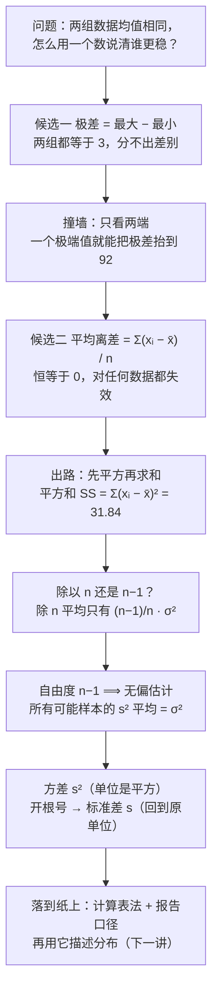

# C2.4 离散程度：极差、方差与标准差 Numerical Measures of Variability

> [!abstract] 这一讲的任务
> 上一讲把一组数据的"中心"定住了：均值、中位数、众数各给一个数，告诉你数据往哪儿集中。可中心周围到底有多挤，它一个字都没说。两只新股过去八个交易日的平均收盘价可以一模一样，一只纹丝不动、一只上蹿下跳，而"平均 15.5 元"对这两只的描述力完全不同。
> 这一讲造第二个数，专门量"摊得开不开"，并正面回答每年都有人问的那句：**样本方差为什么除以 $n-1$，而不是 $n$？**

> [!info] 怎么读这份讲义
> 第 1 节说清"为什么还缺一个数"；第 2–3 节是两个失败的候选（极差、平均离差）——**看懂它们怎么倒下，比记住公式重要**；第 4–6 节才是方差与标准差，以及 $n-1$ 的正经来历；第 7 节是考场上要写的那种算式表；第 8 节把三个测度摆在一起比。
> 标注约定：标有 **（拓展）** 或 **【拓展】** 的内容，是课堂上没有展开、由教材与通行讲法延伸补充的部分。复习优先级：先掌握未标注的主干，考点集中在主干上。
> 已知勘误一句：p.52 那张"平衡点"示意图上标注的是 $\bar x=8.3$，而支点画在标尺 8 的位置，两者对不上；图里没给六个观测值的具体数值，没法互相校验，只当"均值 = 支点"的示意看，别把 8.3 当数据记（详见第 4 节）。

---

## 0. 开场：两只看上去一样的新股

你在券商做分析，客户手上有个打新的额度，问你这两只刚上市的股票哪只"更值得拿几天"。

你把过去八个交易日的收盘价抄下来：

| | 第 1 天 | 2 | 3 | 4 | 5 | 6 | 7 | 8 | 平均 |
|---|---|---|---|---|---|---|---|---|---|
| A | 17 | 16 | 21 | 18 | 13 | 16 | 12 | 11 | 15.5 |
| B | 15.4 | 15.6 | 15.5 | 15.5 | 15.7 | 15.3 | 15.6 | 15.4 | 15.5 |

两只的平均收盘价都是 15.5 元。如果只报这一个数，它们没有任何区别。

可你盯着这两列数就知道它们不是一回事：A 从 21 跌到 11，八天里跑了一个大来回；B 一直在 15.5 附近贴着走，最大偏离不过两毛。客户要的"这只有多不稳"，均值给不了。

于是你做了这么一件事：**先承认中心已经有了，再去找一个数，衡量这些点离中心有多远、散得有多开。** 这件事有个正式的名字，叫测**离散程度**。

> [!question] 停一下，先自己想想
> 假设只准你报一个数来概括"这列数有多不稳"，你会报什么？
> 现成的候选至少有三个：① 最大值减最小值；② 每个数与均值差多少，取平均；③ 每个数与均值差多少，平方以后再加起来。先自己选一个，并且想清楚它在什么情况下会骗你——往下第 2、3 节，这三个方案会依次撞墙，你可以对照一下自己选的那个是在第几节倒下的。

---

## 1. 中心讲完了，还差一半（p.50–52）

先把缺口的形状说清楚。上一讲的三个测度回答的是同一个问题：**这堆数往哪儿集中？** 均值给了重心的位置，中位数给了排序后的中点，众数给了最常出现的那个值。

但它们都只回答了一半。同样一个"均值 15.5 元"，配上一列几乎不动的价格，你就敢说"这只很稳，15.5 有代表性"；配上一列从 11 跳到 21 的价格，15.5 就只是个数学结果，谁也不敢拿它预测明天。

> [!important] 这一讲要造的东西
> 一个**离散程度测度**（measure of dispersion / variability）：把一组数据的"散开程度"压缩成一个数。
> 它和集中趋势是一对：**离散程度越小，集中趋势的代表性越强；离散程度越大，那个"中心"越不可信。** 方差越小，均值的代表性越强——这句话是这一讲全部动机的来源。

为什么非要有这个数？因为我们做的一切估计，估的都是"这组数据里最有代表性的那个值"。估完之后第一个要回答的问题就是：**它有多可靠？** 没有离散程度，这个问题没法开口。

造这个数之前，先把两件工具备好，后面每一步都要用：

- **离差 deviation**：先把这个观测值减去均值，再看差多少。$x_i-\bar x$ 就是第 $i$ 个观测的离差。减出来是正的，说明这个点在均值右边；负的，在左边。
- **平方和 sum of squares**，记作 $SS$：先把每个离差平方，再全部加起来。
  $$SS=\sum_{i=1}^{n}(x_i-\bar x)^2=(x_1-\bar x)^2+(x_2-\bar x)^2+\cdots+(x_n-\bar x)^2$$
  求和号 $\sum$ 的意思是"把下标 $i$ 从 1 走到 $n$，每一项都算出来，然后全部相加"，它就是一个写得紧凑的加法。

看一个具体的小例子，后面会反复用它（p.56）：六个数 $10.3,\ 4.9,\ 8.9,\ 11.7,\ 6.3,\ 7.7$，均值 $\bar x=49.8/6=8.3$。逐个算离差：

$$10.3-8.3=+2.0,\quad 4.9-8.3=-3.4,\quad 8.9-8.3=+0.6$$
$$11.7-8.3=+3.4,\quad 6.3-8.3=-2.0,\quad 7.7-8.3=-0.6$$

有正有负，说明这些点确实分居均值两侧。现在问：**这六个数的离散程度有多大？** 下面三个候选方案，一个一个试。

---

## 2. 候选一：极差 range（p.51）

最省事的想法是：**先把最大的挑出来、最小的挑出来，再相减。** 差多大，就说明这堆数摊得多开。

> [!important] 极差 Range
> $$\text{Range}=x_{\text{largest}}-x_{\text{smallest}}$$
> 两个优点：**好算、好懂**（easy to compute and easy to understand）。它连均值都不用先求，扫一眼数据就能报。

名字也直白：range 就是"范围、跨度"，量的是这堆数**覆盖了多长一段区间**，所以它的描述栏写的是 **Total Spread（总跨度）**。

拿它去量两组数：第一组 $7,\ 8.5,\ 8.5,\ 8.5,\ 8.5,\ 8.5,\ 8.5,\ 10$（七到十之间，其余全挤在中间），第二组 $7,7,7,7,10,10,10,10$（一半在 7、一半在 10）。两组的极差都是 $10-7=3$——一模一样。

可这两组数据的"散"完全不是一回事：第一组的点密密麻麻挤在中段，第二组只在两个端点上各堆四个，中间是空的。极差对此毫无知觉。

（p.51 印的那两组 $7,7,8,8,9,9,10,10$ 与 $7,8,9,9,10,10,10,10$ 说的是同一件事：极差都是 $10-7=3$，一个均匀铺开、一个往两端分堆。）

![[C2.4-极差看不见中间.png]]
> [!warning] 极差的三处硬伤
> 1. **它只用了两个数。** $n$ 个观测里，只有最大和最小的那两个参与了计算，剩下 $n-2$ 个白测了。数据量越大、这个浪费越刺眼——一百个点的样本，极差和其中九十八个点无关。
> 2. **它看不见中间怎么排布。** 上面那两组数据极差都是 3，但一个全挤在中段、一个全挤在两端。上图把这种差别画出来了：每栏标题下的 $s$ 就是**标准差**——一个第 6 节才正式定义的离散程度测度，现在只要记住"它也是量离散程度的，越大越散"，就可以直接对比（0.80 对 1.60，差了一倍）。
> 3. **一个极端值就能把它整个毁掉。** 取九个 8 再掺一个 100：极差从 0 一下子变成 92。可数据里有 90% 的点连动都没动。这是"不敏感"的另一面——它对**一个**点的异常过度敏感，对**其余所有**点的变化完全麻木。

所以它的定性评价是 **insensitive measure of data variation**（对数据变异的反应很迟钝）：两组数据的极差可以相同，而变异程度天差地别。用一句话概括：**极差量的是"跨了多长"，不是"摊得多开"。**

> [!note] 那它还有用吗（拓展）
> 有，而且用得不少。质量控制里的 **$R$ 图**（第 13 章）就是拿极差监控过程的波动——那里样本量固定很小（$n=4\sim5$），"只用了两个数"不再是浪费，反而成了优点：算得快、对异常敏感，正好用来报警。**极差是"哨兵"，不是"体温计"**：它擅长发现异常，不擅长描述整体。

极差这条路走不通。我们需要的是一个**让每个观测都发言**的测度。于是有了候选二。

---

## 3. 候选二：平均离差——它恒等于 0（p.52）

顺着"让每个数都发言"的直觉，最自然的写法是：每个数与均值差多少，全算出来，再取平均：

$$\frac{1}{n}\sum_{i=1}^{n}(x_i-\bar x)$$

这就是**平均离差**（mean deviation）：它确实用到了每一个观测，而且单位跟原数据一样。看起来很完美。

现在把它代进第 1 节那六个数。离差我们已经算过了：$+2.0,\ -3.4,\ +0.6,\ +3.4,\ -2.0,\ -0.6$。加起来：

$$2.0-3.4+0.6+3.4-2.0-0.6=0$$

**正好是 0。** 而且是除以 6 之前就已经是 0 了。

![[C2.4-离差抵消与平方.png]]
这可能只是巧合吗？换一组数试试——不用试，因为这件事跟数据无关，它是一条恒等式：

> [!important] 离差之和恒等于 0
> $$\sum_{i=1}^{n}(x_i-\bar x)=\sum_{i=1}^{n}x_i-n\bar x=n\bar x-n\bar x=0$$
> 第二步用了 $\sum x_i=n\bar x$（这正是均值的定义），所以对**任何**一组数据都成立。

**于是撞墙了。** 平均离差对任何数据都返回 0——第 0 节那两只走势天差地别的股票，平均离差也都是 0；一整列一模一样的常数，平均离差还是 0。一个测度如果不管输入什么都输出同一个数，它就一点信息也没有。

失败的原因很清楚：**正的离差和负的离差互相抵消了。** 均值左边的点说"我离得很远"，右边的点也说"我离得很远"，一加，全都对冲掉了。

> [!question] 停一下，那怎么办
> 既然问题出在"正负相消"，出路只有一条：**想办法让每一项都变成非负的**，这样谁也不能抵掉谁。你能想到几种做法？

两种。第一种是取绝对值，$\frac1n\sum|x_i-\bar x|$，叫**平均绝对离差**（mean absolute deviation, MAD）；第二种是平方，$(x_i-\bar x)^2$。教材选了后者。

> [!note] 为什么不选绝对值（拓展）
> 直觉上绝对值更"老实"——它不放大偏差，量出来的单位也还是原单位。它落选有三个原因：
> 1. **代数上不好用。** 绝对值在 $x_i=\bar x$ 处有一个尖点，不能求导；而平方可以展开：$\sum(x_i-\bar x)^2=\sum x_i^2-n\bar x^2$，后面几乎所有公式（方差分解、回归、方差分析）都靠这条展开式往下推。
> 2. **数学性质差。** 平方和在正态总体下服从**卡方分布**（$\chi^2$，一种专门描述平方和的分布），这是第 6 章造 $t$ 区间、第 7 章做方差检验的地基；绝对离差没有这样干净的分布。
> 3. **放大远离中心的点。** 平方是"越远罚得越重"，一个偏离两个标准差的点，平方后权重是偏离一个标准差那个点的四倍。对"离散程度"这件事来说，这恰恰是我们想要的灵敏度。
>
> 代价也要认：**平方把单位也平方了**，这个问题第 6 节用开根号解决。

---

## 4. 方差 variance：让每个观测都发言（p.52、p.54）

把上一步的选择落地，就得到了这一讲的主角。

> [!important] 定义：样本方差 Sample Variance
> $$s^2=\frac{\sum_{i=1}^{n}(x_i-\bar x)^2}{n-1}=\frac{(x_1-\bar x)^2+(x_2-\bar x)^2+\cdots+(x_n-\bar x)^2}{n-1}$$
> 一句话说动作：**先把每个观测与均值的差平方，再全部加起来，最后除以 $n-1$。**

名字拆开看：variance 出自 vary（变化、变动），量的是"变动有多大"；中文叫**方差**，就是"离差的平方"的简称——先取差，再平方。分子那个平方和 $SS$ 是个有独立名字的中间量，后面回归（第 11 章）、方差分析 ANOVA（第 9 章）里到处出现——它们做的都是把平方和拆成几块这件事。

分子为什么必须是平方？把第 3 节的两条结论并排摆在一张图上（上图），就一目了然：

- 左图：离差有正有负，加起来恒等于 0，这条路走死了；
- 右图：平方之后每一项都是正的，**再也抵不掉**，于是"离得远"这件事第一次能被累加出来。

同一组数，左边加起来是 0，右边加起来是 31.84。方差要用的就是右边这个数。

代进 p.56 那六个观测，一步一步做（这就是第 7 节"计算表法"的原型）：

| $i$ | $x_i$ | $x_i-\bar x$ | $(x_i-\bar x)^2$ |
|---|---|---|---|
| 1 | 10.3 | $+2.0$ | 4.00 |
| 2 | 4.9 | $-3.4$ | 11.56 |
| 3 | 8.9 | $+0.6$ | 0.36 |
| 4 | 11.7 | $+3.4$ | 11.56 |
| 5 | 6.3 | $-2.0$ | 4.00 |
| 6 | 7.7 | $-0.6$ | 0.36 |
| 合计 | 49.8 | $0$ | **31.84** |

$$s^2=\frac{31.84}{6-1}=\frac{31.84}{5}=6.368$$

到这一步，分子已经定了。剩下的问题是分母：**为什么是 $n-1=5$，而不是直觉上更"平均"的 $n=6$？** 这是整节课最重要的一处，下一节专门处理。

![[C2.4-平衡点示意图-均值是支点.png]]
> [!warning] 顺带说明这张平衡点示意图（p.52）
> 图想表达的是"均值是这堆数的平衡点"：几个点压在一根无重量的尺子上，支点必须放在均值处才不倾。这和上一讲"均值 = 平衡点"是同一件事，只是换了个画法。
> 但图上标的是 $\bar x=8.3$，而支点落在标尺 8 的位置，两个数对不上。图里并没有给出这些点的具体数值，所以没法用算术判定哪个对——**读这张图只取"支点 = 均值"这个意思**，8.3 这个数不要背。

---

## 5. 除以 $n$ 还是 $n-1$：自由度与无偏（p.53–54）

> [!question] 停一下，先自己想想
> 六个数算出了一个平方和 31.84。要把它"平均"成一个典型水平，除以 6 看起来天经地义——毕竟你加了六项。可公式偏要除以 5。
> 先猜一个理由，再往下看。你的理由如果只是"教材就这么写的"，那这一节对你没用。

### 5.1 先听那个流传最广的解释

通俗的解释是这样的：**样本总是比总体"窄"一点，用样本算出来的离散程度会偏小，所以要放大一点再报。**

方向是对的，但它太含糊：放大一点是放大多少？1.1 倍还是 10 倍？这句话解释不了为什么偏偏是 $n-1$。严格的说法要强得多——**不是"大一点"，而是要刚好大 $\frac{n}{n-1}$ 倍**，也就是把除以 $n$ 换成除以 $n-1$。为什么恰好是这个倍数，得算。

### 5.2 用一个小总体把它算穿

拿一个能穷举的总体：$\{1,2,3,4\}$。它的均值 $\mu=2.5$，按总体口径

$$\sigma^2=\frac{(1-2.5)^2+(2-2.5)^2+(3-2.5)^2+(4-2.5)^2}{4}=\frac{2.25+0.25+0.25+2.25}{4}=1.25$$

现在从里面抽 $n=2$ 的样本，"容量相同的所有可能的样本"一共有 $4^2=16$ 个（有放回地抽，第 5 章讲抽样分布时默认就是这个口径）。把每个样本的两种方差都算出来，按样本对归组：

| 两数之差 | 样本对 | 个数 | $SS$ | 除 $n$（$=2$） | 除 $n-1$（$=1$） |
|---|---|---|---|---|---|
| 0 | (1,1) (2,2) (3,3) (4,4) | 4 | 0 | 0 | 0 |
| 1 | (1,2) (2,1) (2,3) (3,2) (3,4) (4,3) | 6 | 0.5 | 0.25 | 0.5 |
| 2 | (1,3) (3,1) (2,4) (4,2) | 4 | 2 | 1 | 2 |
| 3 | (1,4) (4,1) | 2 | 4.5 | 2.25 | 4.5 |

十六个样本各自算一个方差，再对这十六个数取平均：

$$\text{除 }n:\ \frac{4\times0+6\times0.25+4\times1+2\times2.25}{16}=\frac{10}{16}=0.625$$
$$\text{除 }n-1:\ \frac{4\times0+6\times0.5+4\times2+2\times4.5}{16}=\frac{20}{16}=1.25$$

看清楚这两个数：**真值是 1.25。除 $n$ 的那一版平均下来只有 0.625，正好是真值的一半；除 $n-1$ 的那一版平均下来恰好 1.25。**

> [!important] 这就是 $n-1$ 的全部理由
> 除 $n$ 会系统性偏小：它平均下来只有真值的 $\dfrac{n-1}{n}$。乘上 $\dfrac{n}{n-1}$——也就是把分母换成 $n-1$——刚好补回来。
> 一般的结论是：$\displaystyle E\Big[\sum_{i=1}^n (x_i-\bar x)^2\Big]=(n-1)\sigma^2$。所以除以 $n-1$ 之后，样本方差的"平均"等于总体方差；除以 $n$ 则只有 $\frac{n-1}{n}\sigma^2$。
> 记号 $E[\cdot]$ 读作"期望"，在这里就是刚才做的那件事：**把容量相同的所有可能样本都算一遍，再取平均**。第 4 章会正式引入它，现在照这句话读就够。

算一下这个偏差在真实样本量下有多大：$n=6$ 时 $\frac{n-1}{n}=\frac56=0.8333$，除 $n$ 的方差平均只有真值的 83.3%，少报 16.7%；$n=8$ 时是 $\frac78=0.875$，少报 12.5%。**样本越小，偏得越狠**——这也解释了为什么 $n$ 很大时两种口径几乎一样。

### 5.3 换一个说法：自由度

为什么偏偏少掉那一份？账其实很好算：那 $n$ 个离差不是各自独立的，它们被一条约束绑着——

$$\sum_{i=1}^{n}(x_i-\bar x)=0$$

只要知道其中 $n-1$ 个，最后一个就被定死了，没有任何自由度。所以这堆离差里**真正能自由变动的只有 $n-1$ 个**。

> [!important] 自由度 Degrees of Freedom
> 说白了就一句话：**先算出所有离差，再要求它们加起来等于 0——有了这条约束，只有 $n-1$ 个离差能自己说了算，最后一个被前面那些锁死。能自己说了算的个数，就是自由度。**
> 名字也是这个意思：degree（度数、个数）+ freedom（自由），自由度 = 可以自由取值的个数。
> 除以自由度，才叫"按真正独立的项数取平均"。除以 $n$ 相当于假装有 $n$ 份独立信息，实际上只有 $n-1$ 份。

这个直观解释和 5.2 的穷举是同一件事的两面：5.2 算的是"平均下来差多少"，5.3 说的是"为什么会差"。两者都要会——考试喜欢问"为什么除以 $n-1$"，标准答案是后者，能报出前者的人才是真懂。

### 5.4 正规的名字：无偏估计量

> [!important] 无偏估计量 Unbiased Estimator
> 一个估计量如果有这样的性质——**容量相同的所有可能样本算出来的估计值，它们的平均等于总体的真值**——就叫无偏估计量。
> 用符号说：$E[\hat\theta]=\theta$。样本方差 $s^2$（除 $n-1$）是 $\sigma^2$ 的无偏估计量；除 $n$ 的那一版不是，它平均下来只有 $\frac{n-1}{n}\sigma^2$，系统性地偏低。

前面反复说的"我们算样本的指标，从来不是为了样本本身，而是为了了解总体"，在这句话上兑现了：**既然目的是估总体，那这个估计在平均意义上不能偏。** 除 $n-1$ 不是一个算术习惯，它是一条"不准系统性说谎"的要求。

![[C2.4-除以n与n减1的无偏性.png]]
这张图是把 5.2 的穷举换成大样本做了一遍：总体取 $\sigma^2=6.25$，每次抽 $n=6$，重复 20 万次。两条分布的形状几乎一样，**位置不一样**：橙的那条（除 $n$）整体偏在真值左边，平均 5.21；蓝的那条（除 $n-1$）平均 6.25，正压在真值上。5.21 这个数也能手算：$\frac56\times6.25=5.2083$。

> [!warning] 这里最容易混的两件事
> - **"无偏"说的是平均意义，不是"每个样本都准"。** 单次抽样算出来的 $s^2$ 照样会偏离 $\sigma^2$ 很远（上图两条分布都很宽），无偏只保证**反复抽、反复算、取平均**时不偏。
> - **无偏不是唯一标准。** 一个估计量可以无偏但很散（方差大），也可以有一点偏但非常集中。评价点估计好坏还有**有效性**（方差越小越有效）和**一致性**两条，那是第 5 章的事。

### 5.5 总体方差与记号表

这里有一个很值得记住的追问：**手上只有样本方差的公式，那总体方差怎么写？**

两者长得几乎一样，只有一处不同：

$$\sigma^2=\frac{\sum_{i=1}^{N}(x_i-\mu)^2}{N}\qquad\text{vs}\qquad s^2=\frac{\sum_{i=1}^{n}(x_i-\bar x)^2}{n-1}$$

- 总体方差：除以 $N$（总体容量），离差减的是总体均值 $\mu$；
- 样本方差：除以 $n-1$（自由度），离差减的是样本均值 $\bar x$。

**分子其实也不同**（一个减 $\mu$、一个减 $\bar x$），第一眼看很容易把差别归到分子上去；但真正让两个公式对不上、也是唯一需要解释的那一处，是**分母**：$n-1$ 对 $N$。分子那一处是被动的——你手上只有 $\bar x$，没有 $\mu$。

> [!important] 记号表（p.53）
> | 测度 Measure | 样本 Sample | 总体 Population |
> |---|---|---|
> | 均值 Mean | $\bar x$ | $\mu$ |
> | 标准差 Standard Deviation | $s$ | $\sigma$ |
> | 方差 Variance | $s^2$ | $\sigma^2$ |
> | 容量 Size | $n$ | $N$ |
>
> 四个记号两两成对，记法有个规律：**希腊字母归总体，拉丁字母归样本**（$\mu,\sigma$ 对 $\bar x,s$），大写字母归总体容量（$N$），小写归样本容量（$n$）。这个约定从这一章一直到最后一章都不变。

> [!note] 自由度这个坑，先记着（伏笔）
> 自由度在这里只是"$n-1$ 个离差能自由变"这么一句直观话。它真正的技术内容要到推断统计才讲得清——那时会看到 $t$ 分布的参数就是自由度、$\chi^2$ 分布的自由度也是它，而**抽样分布是整个推断统计的理论基础**。
> 现在只需要记住三件事：样本方差的分母是 $n-1$；$n-1$ 叫自由度；这样除才无偏。剩下的，第 6 章讲 $t$ 区间时回收。

---

## 6. 标准差 standard deviation：把单位拿回来（p.55）

方差很好，但它有一个致命的实用缺陷：**单位被平方了。**

拿 p.58 那只股票 A 来说，$s^2=11.14$。它的单位是"元的平方"。客户问"这只有多不稳"，你答"11.14 元的平方"，这句话没法听：11.14 跟股价 15.5 元不在同一把尺子上，比不了大小；也没法顺着它说出"典型情况下会偏离均价多少元"——那个量级（3 元）要开完根号才冒出来。

修法只有一步：**开根号。**

> [!important] 定义：样本标准差 Sample Standard Deviation
> $$s=\sqrt{s^2}=\sqrt{\frac{\sum_{i=1}^{n}(x_i-\bar x)^2}{n-1}}$$
> 动作：先按上一节算出方差，再开平方。

名字拆开：standard（标准的、通用的）+ deviation（偏离）。它是"偏离的标尺"——一支**跟原数据同单位**的尺子，量出来可以直接和均值、和原始观测比。

$$s=\sqrt{6.368}=2.5235\approx2.52\quad\text{（p.56 那六个数）}$$
$$s=\sqrt{11.14}\approx3.34\quad\text{（p.58 那只股票，单位：元）}$$

对股票 A 这句话现在能说了：**收盘价平均 15.5 元，典型偏离约 3.34 元。** 15.5 和 3.34 同一把尺子，读者立刻有感觉。

> [!warning] 三个关于单位的易错点
> 1. **方差的单位是原单位的平方，标准差的单位是原单位。** 报"离散程度"通常报 $s$，算的过程用 $s^2$——两者的关系是"平方/开方"，不是"两种不同的测度"。
> 2. **别把标准差读成"平均偏差"。** 它是"先把偏差平方、取平均、再开根号"（统计上叫均方根），和"把偏差直接取平均"不是一回事：p.56 那组数 $s=2.52$，而平均绝对离差是 $\frac{2.0+3.4+0.6+3.4+2.0+0.6}{6}=2.0$。两个数不一样，别混。
> 3. **$s=0$ 当且仅当所有观测相等。** 平方和为零只能是每个离差都是零。这时极差也是 0，两者在这一点上一致。

> [!note] 接到 AI 上：代码里的 $n$ 与 $n-1$（拓展）
> 写代码时这个分歧就藏在 `ddof`（delta degrees of freedom）这个参数里：
> - `numpy.std(a)` 默认 `ddof=0`，**除以 $n$**；要无偏得写 `numpy.std(a, ddof=1)`；
> - `pandas.Series.std()` 默认 `ddof=1`，**除以 $n-1$**——同一个库的两个包默认口径不同，这是新手最常见的"数字对不上"来源；
> - `torch.std` / `torch.var` 默认 `correction=1`（无偏），但 `nn.BatchNorm2d` 归一化时用的是**除以 $N$** 的有偏版本——因为那里要的不是"估计总体方差"，而是"把这一批数标准化"。
>
> 判断标准很简单：**你在"估计一个未知的总体参数"就用 $n-1$；你在"描述手上这批数本身"就用 $n$。** 用 p.58 的数据验一下：`np.std(A)=3.1225`、`np.std(A, ddof=1)=3.3381`——后者才是我们要报的 3.34。

---

## 7. 计算表法：一张表算完（p.54、p.56）

公式会背不等于会算。手工算方差的标准流程是固定的五步，照做就不会乱：

第 2 步后面那个检查值得单独说：**离差之和必须等于 0**。算完不检查，一个符号写错就会一路错到底，而这一步只要两秒钟。

### 7.1 例题（p.56）：六个观测

数据 $10.3,\ 4.9,\ 8.9,\ 11.7,\ 6.3,\ 7.7$。第 4 节的表已经把它算完了，这里补上最后两步：

- $SS=31.84$，$n-1=5$，所以 $s^2=31.84/5=6.368$（精确值，不是四舍五入）；
- $s=\sqrt{6.368}=2.5235\approx2.52$。

顺手记两个对照数：如果错把分母写成 $n=6$，得到 $31.84/6=5.3067$，**比正确值小 1.06**；如果只看极差，得到 $11.7-4.9=6.8$。同一批数据，三个"离散程度"——这就是为什么必须说清用的是哪一个。

### 7.2 Thinking Challenge（p.57–59）：新股收盘价

> [!example] 题目原文
> You're a financial analyst for Prudential-Bache Securities. You have collected the following closing stock prices of new stock issues: **17, 16, 21, 18, 13, 16, 12, 11**.
> What are the **variance** and **standard deviation** of the stock prices?

这正是第 0 节开场那只股票 A。课上把它留给你自己动手——公式既然都写出来了，剩下的是算术。步骤照样五步，先求均值：

$$\bar x=\frac{17+16+21+18+13+16+12+11}{8}=\frac{124}{8}=15.5$$

再逐行算离差与平方：

| $i$ | $x_i$ | $x_i-\bar x$ | $(x_i-\bar x)^2$ |
|---|---|---|---|
| 1 | 17 | $+1.5$ | 2.25 |
| 2 | 16 | $+0.5$ | 0.25 |
| 3 | 21 | $+5.5$ | 30.25 |
| 4 | 18 | $+2.5$ | 6.25 |
| 5 | 13 | $-2.5$ | 6.25 |
| 6 | 16 | $+0.5$ | 0.25 |
| 7 | 12 | $-3.5$ | 12.25 |
| 8 | 11 | $-4.5$ | 20.25 |
| 合计 | 124 | $0$ | **78.00** |

$$s^2=\frac{78}{8-1}=\frac{78}{7}=11.142857\approx11.14$$
$$s=\sqrt{11.142857}=3.3381\approx3.34$$

两点注意：

- **离差和检查通过**（$+1.5+0.5+5.5+2.5-2.5+0.5-3.5-4.5=0$），说明均值没算错。
- p.59 上写的是 $s=\sqrt{11.14}\approx3.34$，用的是四舍五入后的 $11.14$；按精确值 $78/7$ 算是 $3.3381$，两者都落在 $3.34$。**中间步骤尽量留精确值**，只在最后一步取整——误差会一层层放大，而方差这一步的误差还要被开根号传下去。

> [!warning] 报告结果时要说清三件事
> 1. **这是样本还是总体？** 决定分母是 $n-1$ 还是 $N$。题目里没有明说时，按"这是一次抽样、要对总体说话"处理，也就是用 $s^2$ ——课上专门点过：这道题没有说明是样本还是总体，如果是总体，分母就不减 1。
> 2. **单位是什么？** 股价的 $s^2$ 单位是"元的平方"，$s$ 的单位是"元"。
> 3. **保留几位？** 一般报 2–3 位，且 $s$ 与 $s^2$ 的位数要对得上（$s^2=11.14$ 对应 $s=3.34$，而不是 $s^2=11.1429$ 对应 $s=3.34$ 这种半截式报法）。

> [!note] 另一个算法：平方和公式（拓展）
> 手算时还有一个等价写法，可以省掉"逐行算离差"这一步：
> $$s^2=\frac{\sum x_i^2-\dfrac{(\sum x_i)^2}{n}}{n-1}$$
> 它把两列数算完就结束：一列是 $\sum x_i$，一列是 $\sum x_i^2$。对 p.58 的八个数，
> $$\sum x_i^2=289+256+441+324+169+256+144+121=2000,\qquad \frac{(\sum x_i)^2}{n}=\frac{124^2}{8}=1922$$
> $$s^2=\frac{2000-1922}{7}=\frac{78}{7}=11.142857$$
> 和逐行表的结果完全相同——因为 $\sum(x_i-\bar x)^2=\sum x_i^2-n\bar x^2$ 是恒等式。
>
> **它的价值在于给逐行表当校验，不在于替代逐行表。** 两个算法算出的 $SS$ 都必须是 78，对不上就是算错了。它的风险也很明确：$\sum x_i^2$ 与 $(\sum x_i)^2/n$ 是两个接近的大数相减，有效数字会被吃掉（一个平方算错，$2000$ 就会变成别的数，而你还看不出错在哪），所以**只有在电子表格或代码里才推荐用它**。

---

## 8. 三个测度摆在一起（p.60）

> [!important] 离散程度测度一览（p.60）
> | 测度 Measure | 公式 Formula | 描述 Description |
> |---|---|---|
> | 极差 Range | $X_{\text{largest}}-X_{\text{smallest}}$ | Total Spread（总跨度） |
> | 标准差（样本）Standard Deviation (Sample) | $\sqrt{\dfrac{\sum(x_i-\bar x)^2}{n-1}}$ | Dispersion about Sample Mean |
> | 标准差（总体）Standard Deviation (Population) | $\sqrt{\dfrac{\sum(x_i-\mu_x)^2}{N}}$ | Dispersion about Population Mean |
> | 方差（样本）Variance (Sample) | $\dfrac{\sum(x_i-\bar x)^2}{n-1}$ | Squared Dispersion about Sample Mean |

这张表本身还有两处要提醒：

- 表里**没有"总体方差"这一行**——它当然存在（$\sigma^2=\sum(x_i-\mu)^2/N$，第 5.5 节给过），只是这张表省了。做题时如果题目问总体方差，别被表的行数带跑。
- 总体标准差那一行印的是 $(x_i-\mu_x)^2$，下标多了一个 $x$。按记号约定它应该是 $\mu$——$\mu_x$ 一般用来指"某个变量 $X$ 的均值"，这里指的就是总体均值本身，写成 $\mu$ 更清楚。

再把第 7 节的两个算例并排，看清楚"同一批数据、不同测度"的差别：

| 数据 | 极差 | 除 $n$ 的方差 | $s^2$（除 $n-1$） | $s$ |
|---|---|---|---|---|
| p.56 的六个观测 | 6.8 | 5.3067 | **6.368** | **2.52** |
| p.58 的八只股价 | 10 | 9.75 | **11.14** | **3.34** |

读数三条：

1. 极差和 $s$ 单位相同，但数值大得多——它量的是"最远两点的距离"（6.8 与 10），$s$ 量的是"典型的偏离"（2.52 与 3.34）。
2. $s^2$ 与 $s$ 的数值可以差好几倍（$11.14$ 对 $3.34$）：平方会把大于 1 的偏离放大、小于 1 的偏离缩小。**比较不同数据集的离散程度时，要么都用 $s$、要么都用 $s^2$，不能混。**
3. 除 $n$ 与除 $n-1$ 的差在小样本时最明显：除 $n$ 的那一版比 $s^2$ 小 $\frac{1}{n}$，$n=6$ 小 16.7%、$n=8$ 小 12.5%；反过来说，$s^2$ 永远是它的 $\frac{n}{n-1}$ 倍。

> [!question] 停一下，我们刚才干了什么
> 我们从一个说不清的问题出发（"这堆数有多散？"），试了两个候选：极差只看两端、平均离差恒为零，都倒下了；于是把离差平方再加总，得到平方和；再为"除以几"找一个不能系统性说谎的理由，得到自由度 $n-1$；最后为了单位开根号，得到标准差。
> 一句话把这条链串起来：**离散程度 = 让每个观测都发言，发言的音量按偏离的平方算，最后除以真正独立的份数。** 单位靠开根号换回来。

---

## 这一讲的三句话

1. **极差量的是"跨了多长"，不是"摊得多开"。** 它只用两个观测，一个极端值就能骗过它；要描述离散程度，必须让每个观测都参与。
2. **方差 = 离差平方和 ÷ 自由度。** 除 $n$ 会系统性偏小，平均只有 $\frac{n-1}{n}\sigma^2$；除 $n-1$ 才无偏。$n-1$ 不是习惯，是"$n$ 个离差被一条约束锁住一个"的算术后果。
3. **方差的单位是平方，标准差的单位是原单位。** 算的过程用 $s^2$，报告的时候用 $s$；两者只差一次开根号，但读法完全不同。

> [!tip] 速查表
> | 名称 | 公式 | 单位 | 一句话 |
> |---|---|---|---|
> | 极差 | $x_{\max}-x_{\min}$ | 原单位 | 只看两端，不敏感 |
> | 离差 | $x_i-\bar x$ | 原单位 | 和恒为 0 |
> | 平方和 | $SS=\sum(x_i-\bar x)^2$ | 原单位的平方 | 方差/标准差的分子 |
> | 样本方差 | $s^2=\dfrac{SS}{n-1}$ | 原单位的平方 | 除自由度，无偏 |
> | 样本标准差 | $s=\sqrt{s^2}$ | 原单位 | 与均值可直接比较 |
> | 总体方差 | $\sigma^2=\dfrac{\sum(x_i-\mu)^2}{N}$ | 原单位的平方 | 除 $N$，不是 $n-1$ |
> | 总体标准差 | $\sigma=\sqrt{\sigma^2}$ | 原单位 | 希腊字母归总体 |
> | 自由度 | $n-1$ | 无 | $n$ 个离差里能自由变的个数 |
> | 两种分母的关系 | 除 $n$ 平均 $=\frac{n-1}{n}\sigma^2$ | — | 样本越小，偏得越狠 |

> [!tip] 下一讲预告
> 现在你手上有了两个数：均值 $\bar x$ 和标准差 $s$。把它们拼起来，说"数据大多落在 $\bar x\pm ks$ 之间"——这句话对**任何**分布都成立吗？
> 不成立。下一讲给两个回答：不知道分布形状时，能保证的只有切比雪夫不等式给的一个很松的下界；一旦知道数据近似正态，同一个 $k$ 就能说出精确得多的比例。**$s$ 到底怎么用，取决于你对分布知道多少。**

---

## 相关笔记 Related Notes

- 同一章：[[C2.2 定量数据的图形：点图、茎叶图与直方图]]（先看形状，再算数字，是这一章的顺序）
- 后续：第 5 章讲抽样分布时会正式展开无偏性与有效性（本讲的 $n-1$ 是那条线的起点）
- 上一讲：[[C2.3 集中趋势：均值、中位数、众数]]
- 下一讲：[[C2.5 标准差怎么用：切比雪夫定理与经验法则]]
- 返回：[[统计学课程 MOC]]
