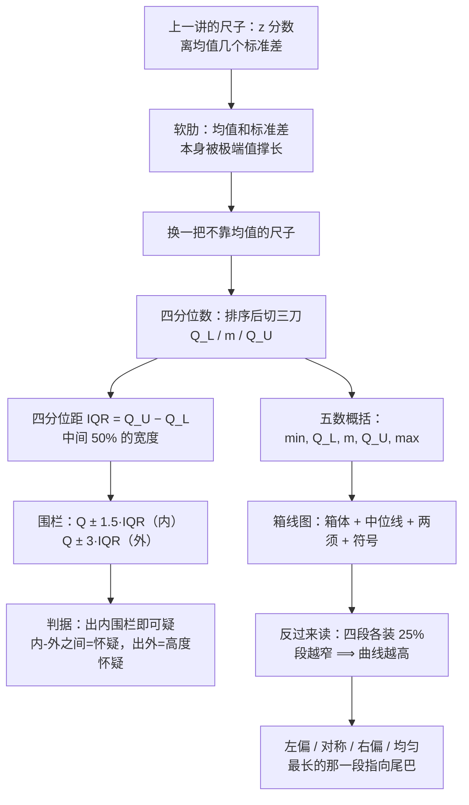

# C2.7 异常值、四分位数与箱线图 Outliers, Quartiles & Box Plots

> [!abstract] 这一讲的任务
> 上一讲把"这个观测离均值几个标准差"算成了一个数 $z$，于是有了第一把判异常的尺子。可这把尺子的分子分母里都有均值和标准差——它们本身最怕极端值，一个特别大的观测会把尺子自己撑长，于是它反而不显眼了。
> 这一讲换一把不靠均值的尺子：先往排好序的数据上切三刀得到**四分位数**，量出中间那 50% 的宽度 **$IQR$**，用 $1.5\times IQR$ 围出**围栏**，凡是跑出围栏的点就判为异常值；再把这五个位置画成**箱线图**。最后还要反过来用：给你一幅箱线图，你要能读出分布是左偏、右偏还是均匀——**这一条是考点**。

> [!info] 怎么读这份讲义
> 第 0 节是一个真实项目里的场景；第 1 节讲异常值从哪来（成因决定处置方式）；第 2–4 节把四分位数和 $IQR$ 造出来并手算一遍；第 5 节画箱线图；**第 6 节是重点**：从箱线图反推分布形状，其中右偏那一幅要读到能自己画出来；第 7 节把围栏判据和上一讲的 $z$ 分数判据并排比较。
> 标注约定：标有 **（拓展）** 或 **【拓展】** 的内容，是课堂上没有展开、由教材与通行讲法延伸补充的部分。复习优先级：先掌握未标注的主干内容（考点集中在这里），行有余力再看拓展。
> 一句勘误：p.82 把 $(7.7+8.9)/2$ 算成了 $8.8$，正确是 $8.3$；p.84 与 p.88 把上四分位数写成「bottom half（下半段）的中位数」，两处都应是 **top half**。详见第 2、4 节。

---

## 0. 开场：一份"断崖式"的运输量数据

2004 年，一家航空油料集团想做一件看上去很划算的事：它每年的航空燃油运输量很大，过去全靠租用别人的海船，于是打算自己组建一支海上运输船队，把运输成本留在集团内部。要说服董事会，就得先做一份可行性分析：把历年海上运油量的数据拉出来，看趋势、建模型、预测未来能不能盈利。

数据拉出来，问题也出来了。历史上这条曲线一直是平缓上升的，唯独 2003 年那一段像断崖一样栽了下去。

这时候摆在你面前的是三个问题，顺序不能乱：

1. **这条数据是真的吗？** —— 会不会是录入时小数点错了、或者单位从吨写成了桶？
2. **它属于这批数据吗？** —— 会不会 2003 年统计口径变了，把另一类业务也算了进来？
3. **如果它既没录错、口径也没变呢？**

第 3 个问题的答案是：2003 年有 SARS。这种"百年一遇"的事件真实发生了，数据完全正确，可它不代表常态。

**你刚才做的这三步——发现反常、追问成因、决定这条数据留不留——就是一次完整的异常值排查。** 这一讲要把第一步做成一个能照着执行的判据，因为光靠"看着不对劲"是靠不住的：数据一多，人眼根本看不过来；而且"离得远"这三个字没有刻度。

---

## 1. 异常值：三种成因，三种处置（p.79–80）

先把刚才那个"断崖式下跌"变成一个名字。一批数据画出来，绝大多数观测挤成一团，个别几个远远地待在一边——这种**离群而居**的观测，就叫异常值。

> [!important] 定义：异常值 Outlier
> 一个观测（或测量值），如果相对于数据集里其他观测而言**异常地大或异常地小**，就称为异常值。

这句话里唯一要紧的词是"相对于其他观测"。同样一个数 100，放在一群 90–110 的数里很正常，放在一群 3–5 的数里就是异常值。**异常不是绝对值的大小，是相对位置。**

> [!question] 停一下，先自己想想
> 既然异常值只是"离群"，那我们该拿它怎么办？删掉、改成看起来合理的值、还是留着？

先别急着答。因为**处置方式完全取决于成因**，而成因只有三类（p.80）：

| 成因 | 具体情形 | 该做什么 |
|---|---|---|
| ① 观测、记录或录入出错 | 抄错、小数点错位、单位写错、录入时多打一个 0 | 回原始记录核对，能改就改正；改正不了就删除 |
| ② 这条观测来自另一个总体 | 抽样框里混进了不该抽的对象，比如统计"本院学生"却抽进了一个访问学者 | 删除，并且回头查抽样环节——**这是流程问题，不是数据问题** |
| ③ 观测正确，但它是一次罕见（偶然）事件 | 疫情、地震、政策突变、某只股票上市首日暴涨 | 不能改也不能随手删，先问"我要的规律是什么" |

第 ③ 类最难，也最常见。它的处理原则是：**先把它放到一边，找出一般规律，再单独回来看它。** 理由很实在——如果你直接拿这组数据去跑回归，那条断崖式的点会把整条拟合线往下拽，你得到的"规律"其实是这一个点造成的，换一年数据就全变了。找规律的时候，一个百年一遇的事件不提供关于常态的信息。

反过来也要记住代价：**删掉的每一条都是真实发生过的信息。** 所以删之前必须能说出"它属于哪一类"，而不是"它看着不顺眼"。这一讲剩下的部分，就是在造那个"能说出理由"的判据。

> [!warning] 三条最常见的误读
> - **异常值 ≠ 错误值。** 三类成因里只有第一类是错误。把第三类当错误删掉，等于把最有信息量的观测扔了。
> - **异常值 ≠ 坏数据。** 信用卡欺诈检测里，我们要找的恰恰就是异常值——那是目标，不是噪声。
> - **"先删了再说"不叫数据清洗。** 清洗要留下记录：删了几条、依据是哪条判据、删完结论变了没有。

---

## 2. 四分位数：往排序好的数据上切三刀（p.81–84）

现在开始造尺子。第一件事是**只保留位置信息**：把数据从小到大排成一列，此后不再看数值大小，只看"排在第几位"。这样做的直接好处是，端点上那个巨大的数无论多大，都只占一个位置。

> [!important] 四分位数 Quartiles
> 把排序后的数据切成四段等长（按观测个数算）的序列，需要下三刀。这三刀落在的值叫**四分位数**：
> - 第一刀 $Q_L$（lower quartile，下四分位数）= 第 25 百分位数；
> - 第二刀 $m=Q_2$（middle quartile）= 中位数，即第 50 百分位数；
> - 第三刀 $Q_U$（upper quartile，上四分位数）= 第 75 百分位数。

**为什么叫四分位数？** quartile 来自 quarter（四分之一）：把全体观测按大小切成四份，切点就叫四分位数。同理切成十份叫十分位数 decile（9 刀），切成一百份叫百分位数 percentile（99 刀）。

**为什么切四份只要三刀？** 这个数一数就明白，而且它是所有"分位数"命名的来源：分 2 份要 1 刀，分 3 份要 2 刀，分 $k$ 份要 $k-1$ 刀。所以四分位数有 3 个、十分位数有 9 个、百分位数有 99 个。（p.70–78 讲过百分位数，这里只是把它按四等分重新命名。）

这三个数还有另一个名字：**非中心趋势的度量 measure of noncentral tendency**。因为中位数坐在正中间，而 $Q_L$、$Q_U$ 一左一右，它们描述的是"偏离中心的那几个位置"，不是中心本身。

### 2.1 怎么算：两条路线

**路线一（本课程例题一律用这条）：对半再取中位数。** 先用中位数把数据分成下半段和上半段；下四分位数就是**下半段的中位数**，上四分位数就是**上半段的中位数**。名字里的"lower / upper"就是这么来的——lower 指下半段。

**路线二（通用公式，任何分位数都能用）：先算位置，再插值。**

$$\text{第 } i \text{ 个 } k\text{ 分位数的位置}=\frac{i\,(n+1)}{k}$$

- 四分位数取 $k=4$：$i=1,2,3$ 分别给第 1、2、3 个四分位数的位置；
- 十分位数取 $k=10$，百分位数取 $k=100$，公式形状完全一样；
- 位置算出来通常不是整数，落在第 $j$ 个与第 $j+1$ 个观测之间，就用**差值法**插值：位置 $j+t$ 处的值 $=x_{(j)}+t\left(x_{(j+1)}-x_{(j)}\right)$。

**自检一下这个公式对不对**：取 $k=4,\ i=2$，位置是 $\dfrac{2(n+1)}{4}=\dfrac{n+1}{2}$，正是中位数的位置；取 $k=10,\ i=5$ 得同一个式子，第 5 十分位数也是中位数；取 $k=100,\ i=50$ 还是它。三条路都通向中位数，说明公式没写错。

**两条路线会给出不同的答案，这一点必须知道。** 拿 p.82 那组六个数举例：路线一给 $Q_L=6.3$；路线二给位置 $\frac{1\times 7}{4}=1.75$，插值得 $4.9+0.75\times(6.3-4.9)=5.95$。差了 $0.35$。

为什么允许两个答案？因为"第 25 百分位数"这个位置**本来就落在两个观测之间**，怎么把中间那段空缺补上是一种约定。考试按例题的做法（路线一）答题；只有在用软件或做大样本时才用路线二的插值。对异常值判据来说，这点差别几乎不会改变结论——它要的是"大致多宽"，不是小数点后第二位。

> [!note] 严格的分位数是面积，不是个数（拓展）
> 计数法（数第几个）只是近似。**严格定义下，分位数由概率分布决定：$p$ 分位数是使分布函数等于 $p$ 的那个 $x$。** 换句话说，真正被四等分的是**概率面积**，不是观测个数——样本小的时候两者才会差开。这句话现在先记着，第 6 节会变成一个非常有力的工具。

### 2.2 手算 p.82–84 的例子

原始数据（顺序是乱的）：

$$10.3,\quad 4.9,\quad 8.9,\quad 11.7,\quad 6.3,\quad 7.7$$

**第一步排序**（这一步不能省，四分位数只对排序后的数据有意义）：

$$4.9\quad 6.3\quad 7.7\ \big|\ 8.9\quad 10.3\quad 11.7$$

**第二步取中位数 $Q_2$**：$n=6$ 是偶数，中间隔着第 3、4 两个观测，取它们的平均：

$$m=\frac{7.7+8.9}{2}=8.3$$

> [!warning] 原稿的一处算术错误
> p.82 把这个结果印成了 $8.8$。$(7.7+8.9)/2=16.6/2=8.3$，写成 $8.8$ 是把两个数当成了"$7.7$ 与 $9.9$"或者单纯加错。后面的上下四分位数都不受影响，但这处必须按 $8.3$ 记。
> 顺便一个漂亮的巧合：这组数的均值也是 $8.3$（$49.8/6$），与中位数相等——说明这组数本身相当对称，没有任何一侧拖着长尾巴。

**第三步切两半，各取中位数**：下半段是 $4.9,\ 6.3,\ 7.7$，上半段是 $8.9,\ 10.3,\ 11.7$，各三个数，中位数就是中间那个：

$$Q_L=6.3,\qquad Q_U=10.3$$

（p.84 在算 $Q_U=10.3$ 时把它说成「下半段（bottom half）的中位数」，那是笔误：$10.3$ 来自上半段，下半段给的是 $6.3$。数值没错，措辞错了。）

排在一行看，就是四个等份、四个 $25\%$：

![[C2.7-四分位数切四段与四分位距.png]]
图里那条从 $6.3$ 拉到 $10.3$ 的箭头，就是下一节要单独命名、单独使用的量。

---

## 3. 四分位距 IQR：把中间那 50% 量出来（p.85）

三个位置有了，还缺一个"有多散"的数。这一步要小心，因为随手就能想到的两个候选都不合格：

- **极差 $=\text{最大}-\text{最小}$**：完全由两个最极端的观测决定。一个录错的 0 就能把它撑到天上，于是它对异常值毫无抵抗力——**用一把会被异常值污染的尺子去量异常值，是循环论证。**
- **标准差 $s$**：要好一些，但它把每个观测与均值的差平方后再平均，那个平方把大偏差放大得厉害，所以它同样会被极端值拽走。下面那张表给了具体数字：把 $11.7$ 改成 $111.7$，标准差从 $2.52$ 涨到 $42.53$，涨了将近十七倍。

那就别用两头，**只用中间**。既然 $Q_L$ 与 $Q_U$ 已经把中间一半的观测围住了，这两个数之差就描述了这半数数据铺开的宽度：

> [!important] 四分位距 Interquartile Range
> $$\boxed{\ IQR=Q_U-Q_L\ }$$
> - 也是一种离散程度的度量（a measure of dispersion）；
> - 别名 **midspread**（中间铺开的那一段）；
> - 描述的是**中间 50% 数据的变动范围**；
> - **不受极端值影响**。

**为什么叫这个名字？** inter-（在……之间）+ quartile（四分位数）+ range（跨距）——"两个四分位数之间的跨距"。别把它和极差 range 混：range 是"最大最小之间"，IQR 是"第 25 与第 75 百分位数之间"，一个管全体、一个管中间。

> [!question] 课堂追问：$IQR$ 到底在衡量什么？
> 它是两个值之间的距离，这个距离能说明什么问题？换个问法：$IQR$ **越小**说明什么？如果 $IQR=0$ 又说明什么？

答案顺着定义就出来了：$IQR$ 是中间那一半数据的宽度，**它越小，说明中间 50% 的数据挤得越紧，集中度越高**。极端情形 $IQR=0$ 意味着中间那一半的观测**全都等于同一个值**——那已经不是"集中"，是整个中间段只有一档。这种情形在数值型数据里几乎见不到，**顺序型（等级）数据里才会出现**，因为等级只有少数几档。

**为什么它不受极端值影响？** 因为 $Q_L$、$Q_U$ 只由"排在第几位"决定。把最大值从 $11.7$ 改成一个天文数字，排序结果不变、位置不变、$Q_L$ 与 $Q_U$ 一动不动。这与第 2 节开头"只保留位置信息"的设计是同一件事，现在收到了回报。用下面这张表看得最清楚——右侧一列，$IQR$ 一分没变：

| 统计量 | 原数据 | 把 $11.7$ 改成 $111.7$ | 变化 |
|---|---|---|---|
| 均值 $\bar x$ | $8.3$ | $24.97$ | **+201%** |
| 标准差 $s$ | $2.52$ | $42.53$ | **×16.9** |
| 中位数 $m$ | $8.3$ | $8.3$ | 不变 |
| 下四分位数 $Q_L$ | $6.3$ | $6.3$ | 不变 |
| 上四分位数 $Q_U$ | $10.3$ | $10.3$ | 不变 |
| 四分位距 $IQR$ | $4.0$ | $4.0$ | **不变** |

正因为这样，**$IQR$ 才有资格当"异常"的标尺**：污染不了自己的尺子，才量得出污染。

---

## 4. 手算一遍：八只新股的 $Q_L$、$Q_U$ 与 $IQR$（p.86–89）

> [!example] Thinking Challenge（p.86）
> 你是 Prudential-Bache Securities 的财务分析师，收集到了下面这八只新发行股票的收盘价：
> $$17,\ 16,\ 21,\ 18,\ 13,\ 16,\ 12,\ 11$$
> 求四分位数 $Q_1$、$Q_3$，以及四分位距 $IQR$。

**排序**（八个数，四四分组最整齐）：

$$11\quad 12\quad 13\quad 16\ \big|\ 16\quad 17\quad 18\quad 21$$

**中位数**：$n=8$，中间隔着第 4、5 位，两个都是 $16$：

$$m=\frac{16+16}{2}=16$$

**下半段** $11,\ 12,\ 13,\ 16$ 的中位数落在中间两个数上：

$$Q_L=\frac{12+13}{2}=12.5$$

**上半段** $16,\ 17,\ 18,\ 21$ 的中位数同样取中间两个：

$$Q_U=\frac{17+18}{2}=17.5$$

**四分位距**：

$$IQR=Q_U-Q_L=17.5-12.5=5$$

> [!warning] 第二处原稿笔误
> p.88 写的是「$Q_U$ is the median of the **bottom** half」。$Q_U$ 必须是**上半段**（top half）的中位数，下半段算出来是 $12.5$，那是 $Q_L$。数值 $17.5$ 本身是对的，只是这句话里的 half 写反了。

**用路线二复核一遍**：$n=8$，$Q_L$ 的位置是 $\frac{9}{4}=2.25$，插值得 $12+0.25\times(13-12)=12.25$；$Q_U$ 的位置是 $\frac{27}{4}=6.75$，插值得 $17+0.75\times(18-17)=17.75$。于是 $IQR=17.75-12.25=5.5$。

两条路线给出 $5$ 和 $5.5$——**差 $0.5$，但"中间 50% 的宽度大约是 5"这个结论没变**。判异常值时这种量级的差不会改变任何一个点是否出界，所以两种做法都能用；答题时跟例题保持一致即可。

**这五个数先记下，下一节要直接拿来画图**：$11,\ 12.5,\ 16,\ 17.5,\ 21$。

---

## 5. 五数概括与箱线图怎么画（p.90–92）

现在手上有五个数，它们把一批数据的"位置"和"离散"压缩成了一句极短的话。可五个数念出来，听的人还是得在脑子里拼图：最小值在哪儿、$Q_L$ 离它多远、中位数偏不偏……

有没有办法让这五个数直接变成"一眼能看出的形状"？先把这句话本身起个名字：**用五个数概括一批数据，就叫五数概括。**

> [!important] 五数概括 Five-Number Summary
> 就是这五个数：**最小值、$Q_L$、中位数 $m$、$Q_U$、最大值**。
> 它们一句话说完了分布的位置（$Q_L,m,Q_U$ 在哪）、离散（两端离中间多远）、以及对称与偏斜（中位数在箱内偏哪边）。

**箱线图 box plot 就是把五数概括画成图。** 说白了就一句话：**先用 $Q_L$ 和 $Q_U$ 画一个箱子、在箱子里标出中位数，再从箱子两端各拉一条线（须）伸向数据的两头。** 英文也叫 box-and-whisker plot（箱须图）。

> [!note] 别和股票 K 线图混起来
> 它看起来确实有点像股票软件里的 K 线（实体 + 上下影线），但含义完全不同：K 线的实体是开盘价与收盘价、影线是当日最高最低价；箱线图的箱体是 $Q_L$ 到 $Q_U$、须的末端是**围栏以内最远的那个观测值**（注意不是最大值，理由见下）。两条"影线"一个说当日振幅、一个说四分位距，不能互相套用。

画法分四条，后两条讲围栏——**围栏是这一节真正的新东西**。围栏（fence）就是"警戒线"：它**本身不是数据里的任何一个值**，而是我们按数据的宽度在两侧划出的两条虚拟界线，再拿真实观测去跟它比。界内算一般观测，界外就可疑了。

> [!important] 箱线图的画法（p.91–92）
> 1. **画箱子**：两端（铰链 hinges）取在 $Q_L$ 与 $Q_U$；中位数用箱内的一条线或一个符号（如 `+`）标出。
> 2. **内围栏 inner fences**：从每个铰链往外量 $1.5\times IQR$ 的两个位置，$Q_L-1.5\,IQR$ 与 $Q_U+1.5\,IQR$。**须从铰链画到内围栏以内最远的那个观测值**，而不是画到围栏位置本身。
> 3. **外围栏 outer fences**：再往外，距铰链 $3\times IQR$ 的两个位置。落在这两组围栏之间的观测值用一种符号（常用 `*`）表示，超出外围栏的用另一种（常用 `0`）。
> 4. 各软件用的符号不一样；手画时可以自定，只要在图上说清楚。

两条围栏用的都是 $IQR$，不是标准差——这正是第 3 节绕那么大一圈换尺子的用处：**围栏架在 $IQR$ 上，才不会跟着极端值一起跑。**

第 2 条里藏着初学者最容易看错的一处：

> [!question] 为什么软件画出来的须，末端常常不是最大值？
> 因为超界的观测值**不参与画须**，它被单独画成一个点（`*` 或 `0`）。所以须的长度表示的不是"数据的范围"，而是"**围栏以内**数据的范围"。

把第 4 节那八只新股接上，用 $Q_L=12.5$、$Q_U=17.5$、$IQR=5$ 算一下围栏：

$$Q_L-1.5\,IQR=12.5-7.5=5,\qquad Q_U+1.5\,IQR=17.5+7.5=25$$

$$Q_L-3\,IQR=12.5-15=-2.5,\qquad Q_U+3\,IQR=17.5+15=32.5$$

最小值 $11>5$、最大值 $21<25$，两条须于是老老实实伸到两个端点，一个符号都不出现。整幅图就是：

![[C2.7-箱线图的结构与围栏.png]]
图的上半幅是这组股票价格；下半幅换了一组带异常值的数据，把围栏与两种符号都用上了。注意下半幅里那些"须够不到的点"：须停在围栏以内最后一个观测上，超界的点被单独拎出来画。

> [!example] 把 $21$ 改掉，看须怎么变
> 内围栏 $[5,25]$ 不变（$Q_L,Q_U$ 都只看位置）。若最大值换成 $28$：$28$ 落在内围栏 $25$ 之外、外围栏 $32.5$ 之内 → 须只到 $18$，$28$ 画成 `*`，判为**怀疑异常 suspect outlier**。
> 若最大值换成 $61$：越过外围栏 → 须仍到 $18$，$61$ 画成 `0`，判为**高度怀疑 highly suspect outlier**。
> 这两个例子里，"须到 $18$ 为止"是关键——$18$ 是围栏以内最远的观测，$21$（或 $28$、$61$）都不再是须的终点。

---

## 6. 反过来读：从箱线图看出分布的形状（p.93）

这是本讲最重要的一节，也是**考试最可能落在的地方**。前面是"有数据 → 画图"，现在反过来：**只给你一幅箱线图，你要能说出这批数据的分布长什么样。**

### 6.1 先猜一猜

> [!question] 停一下，先自己想想
> 一幅箱线图：箱子很窄；左边那条须很短，右边那条须很长；中位数靠近箱子的左边缘。把这批数据画成直方图，最可能是什么形状？为什么？

最顺口的答案是："右边那条须那么长，说明右边的数据多、右边散得开，所以直方图右边应该高。"——**这个答案正好反了。** 下面把它推翻。

### 6.2 撞墙：须长不等于数据多

回到四分位数的定义：三刀把排序后的数据切成四段，每段装 **25%** 的观测。

**四段装的观测个数永远相等，一段都不多。** 变的只有宽度。

也就是说，箱线图上那四段——最小→$Q_L$、$Q_L$→$m$、$m$→$Q_U$、$Q_U$→最大——**每一段都恰好装着四分之一的样本**。既然装的量一样，宽的那一段只能说明：在那段区间里，观测是稀疏的（同样多的观测摊在更长的距离上）。所以"右须长"说明的是**右边稀薄且拖得远**，恰恰不是"右边数据多"。

### 6.3 关键一步：宽度 × 高度 = 面积

把箱线图直接叠在密度曲线（或直方图）下面，同一根横轴，就一目了然了：既然每段装着 25% 的观测，那么在密度图上，**每段下方的面积就是 25%**。

四块面积相等，宽度不同，那么高度必须跟着变：

$$\text{段内平均高度}\approx\frac{25\%}{\text{段宽}}\quad\Longrightarrow\quad\text{段宽}\propto\frac{1}{\text{密度}}$$

一句话：**段越窄，曲线越高；段越宽，曲线越矮。** 这就是从箱线图反推形状的全部秘密——它不是猜出来的，是"面积相等"逼出来的。

![[C2.7-偏态对应的箱线图.png]]
三个面板共用同一根横轴：上排是密度曲线、每块涂色区域各占 25% 的面积，下排是按这条曲线精确算出的箱线图。看左偏那一幅：最左一段（最小→$Q_L$）几乎占了全距的六成，因为那里是尾巴，密度低到几乎贴地，同样 25% 的观测必须摊在很长的距离上；而箱内的两段挤在峰附近，就很短。

### 6.4 于是有了读图规则

| 箱线图的特征 | 分布的形状 | 为什么 |
|---|---|---|
| 四段几乎等长、两须差不多长 | **均匀分布** | 密度是平的，同样的面积只要同样的宽度 |
| 箱短、两须长、左右对称 | **正态（对称）分布** | 峰在中间高、两侧尾巴细长，两端各 25% 要拖很远；且左右镜像相等 |
| 两头比中间还短一点 | **U 型（两头沉）** | 数据堆在两端，两端的密度反而高 |
| 右须最长、中位数靠左、箱窄 | **右偏 Right-Skewed** | 尾巴朝右：右侧稀薄且长，上端那 25% 一路拖出去 |
| 左须最长、中位数靠右、箱窄 | **左偏 Left-Skewed** | 尾巴朝左，镜像情形 |

课堂上这一段是连着问下来的，答案都在同一把尺子上：**正态分布的箱线图长什么样？** 箱子要短、两边须要长，而且左右对称——因为正态的峰又高又集中（中间 50% 挤在 $\pm0.674\sigma$ 里），两端的 25% 却要一直铺到 $\pm3\sigma$ 之外才基本没了。**那这幅图为什么最可能不是正态？** 因为它箱子不算短、须也不够长。**均匀分布更可能吗？** 更可能——四段长度差不多。**还有点像什么？** 两头比中间短一点的 U 型。

把这四张卡并排放在一起，就是看到箱线图时要做的第一件事：把四段的长度比出来。

![[C2.7-箱线图读形状速判卡.png]]
四段长度占全距的百分比，就是第一眼该算的四个数。均匀分布是 $25/25/25/25$，正态是 $39/11/11/39$，右偏是 $17/10/13/60$，左偏是它的镜像。

### 6.5 右偏箱线图：亲手画一遍（考点）

现在把最常考的那一幅从头画出来。设数据右偏——绝大多数观测挤在左边、少数几个值拖出一条长长的右尾。画法是**从密度曲线倒推**，不是凭印象：

1. **峰在左边**，所以密度最高的地方在左段。最高的地方对应**最窄的一段**：最小→$Q_L$ 这一段很短。（上图里它占全距的 $17\%$。）
2. **从峰往右，密度一路下降**，所以往右的三段依次变宽：$Q_L\to m$ 占 $10\%$，$m\to Q_U$ 占 $13\%$，$Q_U\to$ 最大占 $60\%$。
3. **箱子因此很窄**（中间 50% 挤在峰附近），而**右须最长**，因为上端的 25% 被那条长尾带到了很远的地方。
4. **中位数被挤向左边**：箱内左半边比右半边窄（$10\%$ 对 $13\%$），所以中位线离 $Q_L$ 近、离 $Q_U$ 远。

四条合起来就是一句话：**窄箱 + 右须最长 + 中位线偏左 = 右偏。** 手画时按这个顺序落笔：先画一个窄箱，把中位线画在偏左的位置，左侧须画短、右侧须画明显更长，最后在右须外端收一个小竖杠。左偏就是把整幅图左右翻过来。

> [!important] 这一条是考点
> 题目的两种问法都要会：
> - **给四段长度（或给一幅箱线图），问分布形状**：先找最长的一段，它在右边就是右偏、在左边就是左偏；再用中位线的位置复核一遍（右偏时中位线靠左）；两重证据必须同向，不同向就说明这组数据不单一（可能是双峰或混了两个总体）。
> - **给"右偏分布"，要求画出大致的箱线图**：箱窄、右须最长、中位线偏左，三点缺一不可。只把须画长、忘了箱窄和中位线偏左，拿不到全分。

> [!warning] 三个必踩的坑
> 1. **把须长当成数据多。** 每段都是 25%，须长只说明那里稀薄。
> 2. **只看箱子不看中位线。** 中位线在箱内的位置是第二重证据，也是唯一能区分"箱窄"到底窄在哪一边的信息。
> 3. **把偏的方向说反。** **偏态的方向取尾巴的方向，不取数据密集的方向。** 右偏 = 尾巴朝右 = 右侧稀薄 = 右须最长。"右偏"这个名字来自尾巴，不来自人群。

### 6.6 这里有一处印刷问题

p.93 上排的三条密度曲线是对的（左偏、对称、右偏各一条），但下排配的三幅箱线图**没有遵守"每段 25% 面积"这条规则**：左右两幅几乎是同一幅图的镜像（四段的长度比一模一样），箱子都偏宽、须都偏短，看不出长尾该有的那一段——右偏那一幅更明显，它的右须甚至没有箱内右半边宽。这与第 6.3 节的推导矛盾。

唯一对得上的是中间那幅（对称）：两须等长、箱内两半等宽，须长约为箱半宽的 $2.9$ 倍。这个数自洽——正态的中间 50% 挤在 $\pm0.674\sigma$ 里，而 25 个样本能见到的最极端观测大约在 $\pm2\sigma$，两者之比 $\dfrac{2}{0.674}\approx3.0$，与图上量到的 $2.9$ 基本一致。也就是说，只有中间那一幅是按分布真算出来的。

所以这一节正确的参照是上图（按分布精确计算的三幅）与速判卡，不是 p.93 下排那三幅示意图。

---

## 7. 两条判据并列：围栏与 $z$ 分数（p.94）

判据现在有两条，一条来自这一讲的 $IQR$，一条来自上一讲的 $z$ 分数。

> [!important] 两条判据
> **箱线图 / 围栏判据**：落在内围栏与外围栏之间的观测，判为**怀疑异常值 suspect outlier**；超出外围栏的，判为**高度怀疑异常值 highly suspect outlier**。
> **$z$ 分数判据**：$|z|>3$ 的观测视为异常值；对某些强偏态的数据集，$|z|>2$ 就可能算异常值。

**$3$ 和 $2$ 这两个门槛是怎么来的？** 上一讲的**经验法则**直接给出答案（它只管近似对称、中间高两边低的分布）：$|z|<2$ 之间约 $95.45\%$，所以超出 $\pm2$ 的只有约 $4.55\%$（大约 22 个里 1 个）；$|z|<3$ 之间约 $99.73\%$，超出 $\pm3$ 的只有 $0.27\%$（大约 370 个里 1 个）。一个"二十分之一不到"的事件算不上罕见，而"四百分之一"就很少见了——门槛的本质是**你对"罕见"的定义**。

**两条判据的差别只有一个：用什么衡量离散。** $z$ 分数用标准差；围栏用 $IQR$。于是：

- 数据近似对称、没有极端值时，两者给出的名单基本一致；
- 数据强偏态（或有真异常值）时，标准差被长尾撑大 → 分母变大 → 真异常值的 $|z|$ 反而变小，于是**$z$ 判据失灵**；而 $IQR$ 只由位置决定，不受影响。

这也解释了"强偏态时门槛为什么下调到 $2$"：p.94 对这一条只给了结论，通行的解释是——在偏态数据里 $z$ 这把尺子本身已经不可靠，与其用高门槛漏掉，不如降门槛把可疑的点都报出来、交给人去核（**这一步是通行推论，不是原印的原文**）。

> [!tip] 两个判据怎么配合用
> 实务里的顺序是：**先用箱线图把可疑点圈出来（不依赖分布、不受极端值污染），再用 $z$ 分数排序（看谁最离谱），最后人工归因**。单独任何一条都不该直接删数据；两条都指向同一个点，才值得动它。

判出异常值之后，处置上仍然要回到第 1 节那张表：**先归类，再决定**。录错了就改，抽错总体就删，真实事件就先放到一边——**因为它会把你要找的规律带偏**。就像找规律这件事本身：大盘在低位、个股也在低位，两个"低"叠起来胜算才高；一个百年一遇的事件混进样本，你拟合出来的"规律"只是那一年。

---

## 8. 检出之后：这条判据在真实数据里怎么用（拓展）

**【拓展】** 这一段是工程实践，课堂上没有展开。

- **五数概括几乎是所有表格软件的标配**：`pandas` 的 `df.describe()` 会直接给出 `min / 25% / 50% / 75% / max` 六个数（多了一个均值），就是五数概括；它用的是**插值法**（第 2 节的路线二），所以和例题的铰链法会有 $0.1$ 量级的小差别，不足为奇。
- **箱线图的默认围栏就是 $1.5\,IQR$**：`matplotlib.pyplot.boxplot` 的参数 `whis` 默认 $1.5$，改成 $3.0$ 就只剩"高度怀疑"的那些点；`seaborn.boxplot` 同理。
- **判据要写进报告**："剔除了 3 条 $|z|>3$ 且超出外围栏的观测，原因是录入单位错误"，这样的句子是可以被审计的；"清理了异常值"不行。
- **箱线图有它看不见的东西**：它只记录五个位置，**丢掉多峰信息**。一组合并了两个总体的数据（比如两个班级的成绩）可以画出和单峰数据一模一样的箱线图。所以箱线图配直方图，才是完整的看图方式；只有箱线图时，要警惕"看起来单峰"的错觉。
- **样本太小时箱线图几乎没有信息量**：$n<10$ 时 $Q_L$、$Q_U$ 本身就由一两个观测决定，须和异常值的判断都不稳。这时候不如直接把每个点画出来（点图，见 [[C2.2 定量数据的图形：点图、茎叶图与直方图]]）。

---

## 这一讲的三句话

1. **异常值先分成因，再谈处置。** 录错就改、抽错总体就删、真实事件先放一边——因为它会把你要找的规律带偏。删之前必须说得出它属于哪一类。
2. **$IQR=Q_U-Q_L$ 量的是中间 50% 的宽度，只由排序位置决定，所以极端值动不了它。** 这正是它能当尺子的唯一理由：一把污染不了自己的尺子，才量得出污染。
3. **箱线图的四段各装 25%：段越窄，曲线越高。** 右偏 = 尾巴朝右 = 右须最长 + 中位线偏左 + 窄箱；这一条是考点，正反两种问法都要会。

> [!tip] 速查表
> | 名称 | 公式 / 做法 |
> |---|---|
> | 分位数的位置（通用） | 第 $i$ 个 $k$ 分位数在 $(n+1)\cdot\dfrac{i}{k}$ 位，用差值法插值 |
> | 下 / 上四分位数（例题算法） | $Q_L$ = 下半段的中位数，$Q_U$ = 上半段的中位数 |
> | 四分位距 | $IQR=Q_U-Q_L$（中间 50% 的宽度） |
> | 内围栏 | $Q_L-1.5\,IQR$ 与 $Q_U+1.5\,IQR$（出界 → 怀疑异常，`*`） |
> | 外围栏 | $Q_L-3\,IQR$ 与 $Q_U+3\,IQR$（出界 → 高度怀疑，`0`） |
> | 五数概括 | 最小, $Q_L$, $m$, $Q_U$, 最大 |
> | $z$ 判据 | $\lvert z\rvert>3$；强偏态时 $\lvert z\rvert>2$ |
> | 四段占比（读图参考） | 均匀 $25/25/25/25$；正态 $39/11/11/39$；右偏 $17/10/13/60$ |

> [!tip] 下一讲预告
> 到这儿为止，我们画的每一幅图都只讲**一个**变量：它的中心在哪、散得多开、有没有离群的点。可现实里的问题几乎都是"两个变量一起动"——广告费涨了，销量跟不跟？价格降了，利润会不会反而少？
> 下一讲把两个变量放进同一张**散点图**，看它们怎么一起动；再往后还要看时间序列图，以及六种**用真数据说假话**的图形手法——那些图每一张都是对的，结论却全是错的。

---

## 相关笔记 Related Notes

- 相关：[[C2.6 百分位数与 z 分数]]（百分位数与另一条判据）、[[C2.3 集中趋势：均值、中位数、众数]]（中位数与均值的抗干扰性）、[[C2.4 离散程度：极差、方差与标准差]]（为什么这里改用 $IQR$）、[[C2.2 定量数据的图形：点图、茎叶图与直方图]]（小样本时更好的看图方式）
- 上一讲：[[C2.6 百分位数与 z 分数]]
- 下一讲：[[C2.8 散点图、时间序列图与误导性图表]]
- 返回：[[统计学课程 MOC]]
