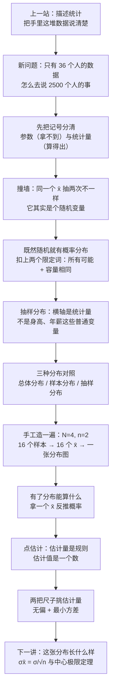
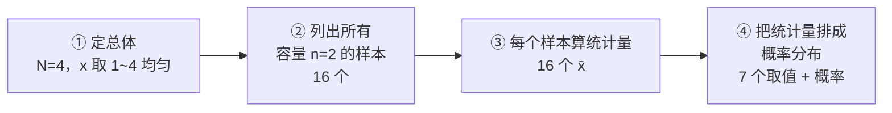

# C5.1 抽样分布：统计量也是随机变量 Sampling Distribution

> [!abstract] 这一讲的任务
> 前面几讲都在做同一件事：把**手里已经有的**这堆数据说清楚——画成图、算出中心与离散程度。从这一讲起，问题的方向换了一头：手里只有一小撮数据，要去说**那一整堆拿不到的数据**。
> 这一讲只造一件东西——**抽样分布**。为了造它，先要接受一个反直觉的结论：**你算出来的那个 $\bar x$ 不是一个数，是一个随机变量**。一旦接受这一点，"用样本猜总体"就从一句口号，变成了可以算概率的技术。
> 它是整门课的地基：后面的参数估计、假设检验、回归，全都建在这张分布图上。地基没打，后面每一层都只能靠背。

> [!info] 怎么读这份讲义
> 按小节读。第 0 节给一个"三个人抽同一个总体、报出三个数"的场景，把矛盾先摆出来；第 1 节把参数与统计量的记号钉死；第 2 节是本篇的转折点（统计量凭什么算随机变量）；第 3 节分清三个长得几乎一样的分布，**这是全篇的枢纽，别跳**；第 4 节用一个 $N=4$、$n=2$ 的玩具总体把抽样分布手工造一遍；第 5 节看它能算什么；第 6 节讲点估计；第 7 节讲无偏与最小方差（只讲人话，正式展开在第 6 章）；第 8 节是速查。
> 标注约定：标有 **（拓展）** 或 **【拓展】** 的内容，是**课堂上没有展开、由教材与通行讲法延伸补充**的部分。复习时先掌握未标注的主干——考点集中在主干上。
> 勘误一句话：本篇有三处容易摔跤——$16$ 个样本不是 $C_4^2=6$、组合数要分清三种口径、同一个字母 $N$ 在两处公式里含义不同。都在第 4、5 节点名了。

---

## 0. 开场：三个人抽同一个总体，报出三个数（p.1–4）

一家公司有 **2500 名管理人员**。董事会想知道：我们公司管理人员的**平均年薪**是多少？

最可靠的办法是把 2500 个人的年薪全算一遍。可这件事在现实里通常做不成：数据散在几个系统里、有人离职、有人刚调岗，等你统计完，口径已经变了。于是退一步——**抽 36 个人，算这 36 个人的平均年薪**。

第一个人抽了 36 人，算出 **38.9 万元**。
第二个人重新抽了 36 人，算出 **32.9 万元**。
第三个人再抽 36 人，算出 **34.7 万元**。

（这三个数来自一次模拟：总体 2500 个年薪的均值是 $34.4$ 万元。现实中这个 $34.4$ 是未知的，正是我们想求的东西。）

> [!question] 停一下，先自己想想
> 三个人都没算错，为什么答案不一样？更狠一点：**如果不准你算全部 2500 个人，你凭什么相信其中任何一个数？**

答案在两个字上：**抽样**。同一个总体，抽到的 36 个人不同，算出来的平均年薪自然不同。三个人算的都是"他们那 36 个人的真实平均"——谁也没算错；但没有一个人等于 2500 人的真实平均。

这就把人逼到一个很尴尬的位置：**我们要的那个数（总体平均）永远不知道，而我们手里的这个数（样本平均）每次都不一样。** 那还怎么谈"估计得准不准"？

这一讲的全部工作，就是把"**每次都不一样**"这五个字，变成一张可以算概率的图。

### 0.1 为什么这一节是整门课的地基（p.1–4）

把整门课想象成盖一栋楼：

| 楼的部分 | 统计学的对应 |
|---|---|
| 地基 | **抽样分布**（这一讲） |
| 梁和柱 | 参数估计、假设检验 |
| 一层层往上摞的楼层 | 回归、方差分析、控制图、非参数方法 |

现在的人盖楼都是框架结构：**地基打完，立柱、架梁，然后才能一层一层往上摞。** 这门课的顺序同样是"环环相扣、层层递进"：地基这一块如果没弄懂，后面不是"学得吃力"，而是**根本接不上**——因为后面的每一个公式，都是在这张分布图上做的。

顺便把一个现实情况说清楚：这门课的分数，**一半以上落在推断统计**（也就是从这一讲往后的全部内容）。所以这一节不是"了解一下"，它是后面所有东西的入场券。

还有一个让人心里舒服一点的事实：抽样分布这个概念，是公认的**最容易卡壳**的地方——顶尖大学的统计课上，它照样是学生卡得最久的节点之一。卡壳本身不稀奇；稀奇的是**卡在这里还能往下走**，因为这里断了，后面全是死的。所以这一讲宁可慢。

> [!note] 前置说明：第 3、4 章课堂不学
> 概率、随机变量、离散与连续分布（第 3、4 章）在这门课上不单独讲——此前的数理统计课已经讲过。本篇只借用三个概念：**随机变量**（取值由试验结果决定、试验前不知道的量）、**期望值**（用概率加权的平均）、**方差**（散布的度量）。忘了的话，读到第 2、7 节时回头补一下 C4.4 正态性判断、均匀分布与指数分布 即可。

---

## 1. 参数与统计量：一对双胞胎，一个永远拿不到（p.6–7）

先把身份分清楚。否则后面每说一句"平均"，都得停下来解释"你说的是哪个平均"。

> [!important] 定义：参数与统计量（p.6）
> **参数 parameter**：对**总体**的数值描述。因为它建立在总体全部观测值上，所以它的值**几乎总是未知**的。
> **统计量 sample statistic**：对**样本**的数值描述，由样本里的观测值**算出来**。

用"先……再……"说清这两个身份：

- **参数**：先认定"我要研究的全体是谁"（2500 名管理人员），**再**把这个全体的某个特征（平均年薪）用一个数表示。这个数客观存在，但通常拿不到。
- **统计量**：先抽出一部分（36 人），**再**对这 36 个人的数据做运算（加起来除以 36），得到一个数。这个数一定拿得到，但它随抽样而变。

**为什么非得有两个名字？** 因为整门课的动作就是一句话：**用能拿到的，去猜拿不到的。** 如果两边共用同一个词，这句话就变成了"用平均去猜平均"——听起来像废话，而且没法追问"猜得准不准"。分成两个名字，才有"估计"这个动作。

**名字怎么来的？** 有个现成的记忆钩子：**parameter 与 population 同一个首字母 P**，**statistic 与 sample 同一个首字母 S**。英文里 statistic（单数）指"一个统计量"，statistics 才是"统计学"这门学科。

### 1.1 四对记号，一张表背完（p.7）

| 量 Measure | 样本统计量 Sample Statistic | 总体参数 Population Parameter |
|---|---|---|
| 均值 Mean | $\bar x$（x bar） | $\mu$（mu，读"缪"） |
| 标准差 Standard Deviation | $s$ | $\sigma$（sigma） |
| 方差 Variance | $s^2$ | $\sigma^2$ |
| 比例 Proportion | $\hat p$（p hat） | $p$ |

四对一一对应，就是后面所有推断的**四个插座**：

$$\bar x \to \mu,\qquad s \to \sigma,\qquad s^2 \to \sigma^2,\qquad \hat p \to p$$

第三个插座要专门说一下，因为它的名字有点绕。**比例 proportion**：总体里"具备某个特征的人占多大比例"记作 $p$。比如 2500 名管理人员里，参加过管理培训的人占 $p$；抽出的 36 人里，参加过的人占 $\hat p$。名字里的"二项比例 binomial proportion"是说这个比例来自"是/否"两分类的计数——每个人要么参加过，要么没参加。

读法要念对：$\bar x$ 读 "x bar"，$\hat p$ 读 "p hat"。两条符号的"帽子"和"横杠"都不是装饰：

- $\bar x$ 上那条**横杠**表示"这些数被拉平了"——求和再除以个数；
- $\hat p$ 上那顶**帽子**表示"这是估出来的"，同一顶帽子后面还会出现在 $\hat\mu$、$\hat\sigma$ 上，凡戴帽子的都是估计值。

> [!warning] 三个最容易写反的地方
> **① 谁在左、谁在右。** 能算出来的（$\bar x, s, s^2, \hat p$）是统计量；想知道而不知道的（$\mu, \sigma, \sigma^2, p$）是参数。写成"$\mu$ 估计 $\bar x$"就整个反了。
> **② 拉丁字母 vs 希腊字母。** 这门课的分工是：**拉丁字母管样本，希腊字母管总体**。从第 2 章一路用到最后一章，没有例外。
> **③ $s^2$ 与 $\sigma^2$ 差的不只是字母。** 一个是抽出来算的，一个是真的；而且算 $s^2$ 时分母还要少一个（第 2.4 节讲过，第 7 节会用抽样分布再解释一遍为什么）。

### 1.2 一个必须现在埋下的伏笔

看这张表的左列。四个统计量里，我们最关心 $\bar x$——它是 $\mu$ 的估计量，也是后面所有推断的主角。

在 [[C2.3 集中趋势：均值、中位数、众数]] 里已经说过一句：$\bar x$ 是**算出来的、会随样本变的数**，$\mu$ 是**固定的真值**。当时那句话只是提醒；这一讲要把它升级成整个第 5 章的主线——

$$\bar x\ \text{不是"一个数"，而是"一个会变的数"。}$$

它凭什么"会变"？变了以后又怎么描述？这就是下一节。

---

## 2. 撞墙：同一个 $\bar x$，抽两次就不一样（p.4、p.8）

回到开场那个场景。三个人各抽 36 人，得到 38.9、32.9、34.7。现在做个思想实验：**如果让同一个人一遍又一遍地抽下去呢？**

- 抽 10 次，得到 10 个不同的平均年薪；
- 抽 1000 次，得到 1000 个；
- 抽遍"所有可能的 36 人组合"，会得到 $10^{80}$ 量级那么多个均值（第 3 节会把这个数算出来）；
- 或者让计算机替我们抽上一百次、几千次：把这一百个（几千个）均值堆成一张直方图——**那张图就是抽样分布的样子**（第 3.2 节那张图的右边一格就是这么来的，2000 次重复）。

**朴素的想法**：那就多抽几次，取这些平均值的平均，总该稳定了吧？

**撞墙的地方**：这个"平均的平均"确实会稳定下来（第 7 节会证明它稳定在 $\mu$ 上），但它仍然回答不了最初的问题——**我手里这单独一个 38.9 万，到底离真值有多远？** 把 1000 个样本都抽完，成本早就超过直接统计 2500 人了，这条路在实践上是死的。

必须换一个思路：**不去追具体的数值，去追"这个数值会怎么分布"。**

在追之前，先承认一件反直觉的事。

### 2.1 你算出来的那个数，是随机变量

把 $\bar x$ 的来历拆开：

1. 抽哪 36 个人？——**随机**的（谁被抽中是碰运气）；
2. 这 36 个人定了，$\bar x$ 就定了——算法本身没有任何随机性，就是加起来除以 36。

所以随机性**不在算法里，在输入里**。输入是随机的，输出就是随机的。

这正是**随机变量 random variable** 的定义：**取值由试验结果决定、试验之前不知道会取什么的量**。第 4 章用它描述"掷一次骰子的点数"，现在用它描述"抽一次样本算出的 $\bar x$"。

- 掷骰子之前，你不知道这次是几点；
- 抽样本之前，你不知道这次的 $\bar x$ 是多少。

两件事的结构一模一样。只是骰子的"可能取值"是 $1,2,3,4,5,6$，而 $\bar x$ 的可能取值是一大堆小数。

> [!important] 这一讲的转折点
> **样本统计量是随机变量。** 这不是比喻，是字面意思：它在抽样前没有确定值，抽样后才有；重复抽样会得到不同的值。
> 推到这一步，"抽样分布"这个名字就只是"给它配一个概率分布"而已——随机变量都有概率分布，天经地义。

**这里有个心理障碍要拆掉。** 很多人卡住是因为："$\bar x$ 明明是我自己算出来的，我按计算器它还能变？"

能。变的不是计算器，是**喂给计算器的数据**。同一个公式 $f$，喂进去的样本 $X_1,\dots,X_n$ 是随机的，输出的 $f(X_1,\dots,X_n)$ 当然也是随机的。这一点和第 4 章的"随机变量的函数仍是随机变量"完全一致。

### 2.2 抽样分布：给这个随机变量配一张分布图

> [!important] 定义：抽样分布 Sampling Distribution（p.8）
> 从一个容量为 $n$ 的样本算出的统计量，它的**概率分布**，叫这个统计量的**抽样分布**。
> 完整说法（把限定条件补全）：**容量相同的所有可能样本的、某个统计量的概率分布。**

**名字逐字拆开：**

- **抽样**——这个分布的"原料"来自抽样这个动作：横轴上的每一个值，都是某个样本算出来的；
- **分布**——它是一个概率分布：横轴上每一段对应一个概率（连续情形下是面积）。

合起来：**"由抽样造出来的、关于某个统计量的概率分布"**。名字里没有"总体"也没有"样本数据"，因为它的主角既不是总体也不是样本，而是**统计量**。

定义里有两个词必须单独交代，它们决定了这个分布成不成立。

**① 为什么是"所有可能"？**

因为我们要问的是"**如果一遍遍地抽，$\bar x$ 会怎么分布**"。要回答这种"如果重复无数次"的问题，唯一的办法就是把**全部可能性**摊开。全部可能性都算进去，就没有"运气"的余地了——第 7 节讲无偏性时会看到，正是这个"全部可能"让偶然性互相抵消，只剩下必然性。

**② 为什么死咬"容量相同"？**

这一条容易被当成套话，其实它是硬需求。看一组数：

| 样本容量 $n$ | $\bar x$ 的散布（标准误，万元） |
|---|---|
| 1 | $18.68$ |
| 36 | $3.11$ |
| 144 | $1.56$ |
| 576 | $0.78$ |

（同一份模拟数据，总体标准差 $\sigma = 18.68$ 万元。）

$n=1$ 时，"平均"退化成"抽到的那一个人"，散布和总体一样大；$n$ 一变大，散布就一路缩小。也就是说——

$$\text{容量 }n\text{ 不同的 }\bar x\text{，是两个不同的随机变量，各有各的分布。}$$

把不同 $n$ 的均值混在同一张图上，横轴上刻度的"单位"都不一样了（一个是"一个人的年薪"，一个是"36 个人的平均"），得到的图不对应任何一个统计量。要让"这个统计量"有一个确定的分布，必须先把 $n$ 钉死。

> [!note] 这条答案是补出来的
> 定义里为什么非写"容量相同"，教材通常一句带过。上面的回答借用了后面才给出的结论 $\sigma_{\bar x}=\sigma/\sqrt n$（下一讲正式推）。拿后面的结论回答前面的问题不算循环论证——它只是说明：**这个限定词不是形式主义，它背后有一个随 $n$ 变化的量。**

**记法。** 横轴既然是 $\bar x$，那么这张分布的：

- 均值记作 $\mu_{\bar x}$（读 "mu sub x bar"），也叫 $E(\bar x)$；
- 标准差记作 $\sigma_{\bar x}$，它还有个专名叫**标准误 standard error**——"标准误"三个字就是"抽样分布的标准差"：它量的是"一次估计大概会差多少"，所以叫"误"（下一讲的主角）。

规则不变：**曲线下的面积 = 概率**。这是从第 2 章一路带过来的约定。

---

## 3. 三种分布：横坐标上放的到底是谁（p.8–9）

现在有三个词摆在一起，长得几乎一样：

- **population distribution** 总体分布
- **sample distribution** 样本分布
- **sampling distribution** 抽样分布

英文里前两个只差一个字母（sample / sampling），中文里"样本分布"和"抽样分布"更像绕口令。可它们描述的是三件完全不同的事。

**怎么分清？只看一个地方：横坐标上放的是谁。**

### 3.1 三种分布排一排

> [!important] 三种分布的对照（这一节的枢纽）
> | | 总体分布 population | 样本分布 sample | 抽样分布 sampling |
> |---|---|---|---|
> | **横坐标** | 变量本身（年薪 $x$） | 变量本身（年薪 $x$） | **统计量**（$\bar x$、$\hat p$、$s^2$……） |
> | **数据来自** | 总体全体 $N$ 个个体 | 抽出的 $n$ 个个体 | **所有**容量为 $n$ 的可能样本 |
> | **性质** | 通常未知，可先假设形状 | **经验分布**（事实上发生） | **理论分布**（想象中走遍全部可能） |
> | **用途** | 我们想知道的对象 | 描述这一批数据 | 提供统计量的**概率信息** |

**逐个说。**

**① 总体分布 population distribution。** 2500 个管理人员的年薪构成的分布——全体每一个个体都算在内，横轴是年薪。它**通常不知道**；如果知道，那就不需要推断了。能做的只是"先假设它服从某种形状"（比如假设年薪服从正态分布），但**均值多少、方差多少，还得靠样本去估**。注意这里的两层：形状可以假设，参数不能假设。

**② 样本分布 sample distribution。** 抽出的 36 个人的年薪构成的分布，横轴还是年薪，只是人少了一大截。它有一个专门的性质：**经验分布 empirical distribution**。"经验"这两个字在这里的意思是"**事实上发生**"——这 36 个人是实打实抽出来的，每个数都真实存在。往上抽到 $n=18$、$36$、$100$、$1000$，画出来的直方图会一个比一个更像总体分布：容量小的时候完全不像，$n=1000$ 时已经相当接近。

但"越像越好"这条路走不通。总体才 2500 人，样本要抽到 1000 人才像样——那还叫抽样吗？统计学的全部价值在于**用远小于总体的样本办事**；样本容量一旦逼近总体容量，这门课就没有存在的必要了。

所以结论有点反直觉：**样本分布不重要，可以扔掉。** 它只是把手里这批数据换个方式再说一遍（这正是描述统计干的事），它不告诉我们任何关于"没抽到的那部分"的信息。真正有用的，是下一种。

> [!warning] "经验"这个词的两个含义，别混
> 这里的**经验分布**指的是"来自实际观测数据的分布"。第 2 章那条**经验法则**（68%–95%–99.7%）指的是"靠经验总结出来的比例规律"，两者只是共用了一个词。别把"经验分布"读成"经验法则那种分布"。见 [[C2.5 标准差怎么用：切比雪夫定理与经验法则]]。

**③ 抽样分布 sampling distribution。** 横轴换成了 $\bar x$——不是某个人的年薪，而是"**36 个人的平均年薪**"这个算出来的数。

它和上面两种最大的不同有两条：

- **它是理论分布 theoretic distribution。** 没有人会为了求 $\mu$，真的把 $\binom{2500}{36}$ 个样本全抽出来、每个算一个均值——那还不如直接把 2500 个人都算一遍来得快。所以这张分布图不是"抽出来的"，是"**想象中把所有可能走一遍**"推出来的。
- **它能提供概率。** 有了它，就能回答"抽一个 36 人的样本，均值落在 30–40 万之间的概率是多少"这类问题。

### 3.2 三个图摆在一起看

（下面这张图是把同一份模拟数据画了三遍，三种分布各占一格。）

![[C5.1–5.2-三种分布的横坐标不同.png]]
读这张图，只读三件事：

1. **横轴。** 左、中两张的横轴是"年薪 $x$（万元）"；右图的横轴是"**样本均值 $\bar x$**（万元）"——同一个词"万元"，含义已经变了：前者是"一个人拿多少"，后者是"36 个人平均拿多少"。
2. **散布。** 左图从 7 万一路铺到 180 万开外（右偏的长尾），标准差 $18.7$ 万；右图只铺在 26–48 万之间，标准差 $3.1$ 万，**只有前者的六分之一**。为什么缩得这么厉害？因为 36 个人一平均，高的被低的拉回来——这正是下一讲 $\sigma_{\bar x}=\sigma/\sqrt n$ 要解释的事，$\sqrt{36}=6$。
3. **毛糙程度。** 中间那张（样本分布）只有 36 个观测，柱子高低起伏很大；右图是 2000 次重复的均值堆出来的，轮廓已经很光滑。**观测越多，分布形状越清楚**——这条对样本分布和抽样分布都成立，只是"多"的来源不同：前者靠样本容量，后者靠重复次数。

### 3.3 横坐标是统计量，这句话到底改变了什么

> [!important] 全篇最该带走的一句
> **总体分布和样本分布的横轴是"普通变量"（身高、年薪、考试成绩）；抽样分布的横轴是"统计量"（样本均值、样本比例、样本方差）。**
> 换句话说：抽样分布的横轴上，每一个点都是一个**由样本算出来的数**，不是某个人身上的某个属性。

这句话看着像定义复述，实际改变了"面积 = 概率"这句话的**主语**：

- 左图问：随便抓一个管理人员，他年薪落在 30–40 万的概率多大？——**关于一个人的问题**；
- 右图问：随便抽 36 个人算个均值，这个均值落在 30–40 万的概率多大？——**关于一次抽样的问题**。

后面整门课要问的，全是后一种。假设检验问"如果真实均值是 50 万，我抽到的均值这么小，概率有多大"；置信区间问"哪些总体均值，能让我抽到这样的样本不至于太离谱"。这些句子里，概率的主语全是"**统计量**"。所以横轴上必须放统计量，否则问题都问不出来。

### 3.4 还有一句话要提前拆掉：抽样分布不必"像"总体分布

第一次看到 p.14 的对照图（总体 2.5、抽样分布 2.5，但形状一个平一个尖），很容易冒出一个疑问：抽样分布和总体分布长得也不像啊，那它有什么用？

**它不需要像。** 抽样分布的任务不是模仿总体的形状，而是**提供统计量的概率信息**。而且"分布"这个东西本来就有三种表达方式：

1. 图形（直方图、密度曲线）；
2. 表格（取值 + 概率）；
3. **几个特征值**（集中趋势、离散程度）。

推断统计真正用到的，几乎只有第三种。因为我们想知道的往往只是总体的一两个特征值——集中趋势最典型的是均值，离散程度最典型的是标准差。既然如此，抽样分布只需要把**它自己的**中心和散布交代清楚就够了。

这就把下一讲的内容提前点名了：抽样分布的两个特征值 $\mu_{\bar x}$ 和 $\sigma_{\bar x}$ 各等于什么。这两个数，也正好是第 7 节"无偏"与"最小方差"这两个词的语言。

### 3.5 到底有多少个"所有可能样本"？算给你看

$\binom{2500}{36}$ 这个数大到没有直觉，值得写出来（都取了常用对数）：

| 抽样方式 | 个数 | $\lg$（约） |
|---|---|---|
| 不可重复、不计顺序 | $\binom{2500}{36}$ | $80.6$ |
| 不可重复、计顺序 | $P(2500,36)=\dfrac{2500!}{(2500-36)!}$ | $122.2$ |
| 可重复、计顺序 | $2500^{36}$ | $122.3$ |
| 可重复、不计顺序 | $\dfrac{2500^{36}}{36!}$ | $80.8$ |

$\lg \approx 80$ 意味着**大约 $10^{80}$ 个**——宇宙里的原子数才 $10^{80}$ 量级。所以"把所有样本都抽一遍"不是"费点时间"的问题，是物理上不可能。

> [!warning] 一个顺口就会说错的计数
> "$2500$ 的 $36$ 次方，再除以排序"这句话常被顺手说出来——前半句对（$2500^{36}$ 正是可重复、计顺序），后半句错位：**要除以 $36!$ 才是"不计顺序"**，那是另一个口径（$10^{80.8}$ 而不是 $10^{122.3}$）。
> 计数之前先问两件事：**放不放回？计不计顺序？** 四个答案，四个数，差几十个数量级。

这也解释了为什么定义里非写"所有可能"不可：它是个**理论上**的集合，不是操作上的清单。抽样分布之所以是"理论分布"，根子就在这里。

### 3.6 为什么说"造出一个抽样分布就能当统计学家"

这句话不是玩笑，它有底账。统计里最有名的四族分布——**正态分布、$t$ 分布、$F$ 分布、卡方分布**——在各自的岗位上，扮演的都是"某个统计量的抽样分布"：

| 分布 | 它是谁的抽样分布 |
|---|---|
| 正态 $z$ | 标准化后的样本均值（下一讲） |
| $t$ | 总体方差未知时，标准化后的样本均值（第 6 章） |
| 卡方 $\chi^2$ | 样本方差的（缩放后）分布（第 6、7 章） |
| $F$ | 两个样本方差之比的分布（第 8 章起） |

换句话说，统计学的历史有一大半是"**造分布**"的历史：谁能构造出一个有用的抽样分布，把某个统计量的行为说清楚，谁就为后面所有人提供了工具。$F$ 分布就是 Ronald Fisher 造出来的——他既是推断统计的主要奠基人之一，也把这个分布留在了教科书里。

所以抽样分布不是一个"必须背下来的定义"，它是一个**可以发明的东西**。理解了它的构造逻辑（所有可能 + 容量相同 + 某个统计量），你就理解了后面每一个分布是怎么来的；反之，只背结论，$t$、$F$、$\chi^2$ 就是四张没有来历的表。

---

## 4. 手工造一个抽样分布：$N=4$，$n=2$（p.9–14）

"所有可能样本"在实践中抽不完，那怎么让人相信抽样分布真的存在？

办法是换一个**小到能手工枚举**的总体。这不是真实案例（真实研究里不会有人研究 $N=4$），它是一台**慢镜头**：把抽样分布是怎么一步步长出来的，每一帧都摊开给你看。

### 4.1 先定总体（p.9–10）

- 总体容量 $N=4$；
- 随机变量 $x$ 只取四个值：$1,\ 2,\ 3,\ 4$；
- 每个值出现的机会一样——**均匀分布 uniform distribution**，所以 $P(x)=1/4$。

先算总体的两个特征值（这是后面一切对照的基准）：

$$\mu=\frac{1+2+3+4}{4}=\frac{10}{4}=2.5$$

$$\sigma^2=\frac{(1-2.5)^2+(2-2.5)^2+(3-2.5)^2+(4-2.5)^2}{4}=\frac{2.25+0.25+0.25+2.25}{4}=\frac{5}{4}=1.25$$

$$\sigma=\sqrt{1.25}=1.1180$$

$N=4$ 小到可以画成一张"四根柱子一样高"的图——就是 4.4 节那张图（样本均值抽样分布）的左半边。

### 4.2 列出所有容量相同的样本（p.11）

现在规定：样本容量 $n=2$，**可重复抽样**（抽完放回，同一个人可以被抽两次），**计顺序**（先抽到 1 再抽到 2，和先抽到 2 再抽到 1，算两个样本）。

第一观测有 4 种取法，第二观测也有 4 种：

$$4\times 4 = 16\ \text{个样本}$$

| 第一观测 ↓ ／ 第二观测 → | 1 | 2 | 3 | 4 |
|---|---|---|---|---|
| **1** | $(1,1)$ | $(1,2)$ | $(1,3)$ | $(1,4)$ |
| **2** | $(2,1)$ | $(2,2)$ | $(2,3)$ | $(2,4)$ |
| **3** | $(3,1)$ | $(3,2)$ | $(3,3)$ | $(3,4)$ |
| **4** | $(4,1)$ | $(4,2)$ | $(4,3)$ | $(4,4)$ |

> [!warning] 16 不等于 $C_4^2=6$，这是全篇第一个坑
> 讲到这张 4×4 表时，很容易顺口来一句"就是 $C_4^2$ 嘛"——**$C_4^2=6$，和 16 对不上**。
> - $16=4^2$：**可重复、计顺序**（这张表用的口径）；
> - $C_4^2=6$：**不可重复、不计顺序**；
> - $P_4^2=12$：不可重复、计顺序。
>
> 三个数都对，只是对应三种不同的抽样规则。**抽样规则是抽样分布定义的一部分**——规则变了，分布就变了（4.6 节会验证这一点）。

### 4.3 每个样本算一个均值（p.11 右表）

$n=2$，所以每个样本的均值就是两个数的平均：

| 第一观测 ↓ ／ 第二观测 → | 1 | 2 | 3 | 4 |
|---|---|---|---|---|
| **1** | $1.0$ | $1.5$ | $2.0$ | $2.5$ |
| **2** | $1.5$ | $2.0$ | $2.5$ | $3.0$ |
| **3** | $2.0$ | $2.5$ | $3.0$ | $3.5$ |
| **4** | $2.5$ | $3.0$ | $3.5$ | $4.0$ |

16 个数摆在这里，但**这不是抽样分布**——抽样分布要的是"每个取值出现的概率"，所以还得数频数。

### 4.4 数频数：抽样分布长出来了（p.12）

把 16 个均值从小到大排好，数每一个出现了几次：

| $\bar x$ | $1.0$ | $1.5$ | $2.0$ | $2.5$ | $3.0$ | $3.5$ | $4.0$ |
|---|---|---|---|---|---|---|---|
| 出现次数 | 1 | 2 | 3 | **4** | 3 | 2 | 1 |
| 概率 $P(\bar x)$ | $\frac{1}{16}$ | $\frac{2}{16}$ | $\frac{3}{16}$ | $\frac{4}{16}$ | $\frac{3}{16}$ | $\frac{2}{16}$ | $\frac{1}{16}$ |

三项检查，缺一不可：

1. **概率之和** $\frac{1+2+3+4+3+2+1}{16}=\frac{16}{16}=1$ ✓
2. **可能取值只有 7 个**：$1.0$ 到 $4.0$ 每隔 $0.5$ 一个。注意不是 16 个——**16 个样本，7 个不同的均值**，因为不同的样本可以算出同一个均值。
3. **形状**：中间高、两头低。

![[C5.1–5.2-16个样本均值的抽样分布.png]]
> [!important] 为什么中间高、两头低？
> 因为**"算出中间那个均值"的组合更多**。
> 均值要等于 $2.5$，两个数之和必须是 $5$：$(1,4)$、$(2,3)$、$(3,2)$、$(4,1)$——**4 种**。
> 均值要等于 $1.0$，两个数之和必须是 $2$：只有 $(1,1)$——**1 种**。
> 极端值要靠"两个都极端"才凑得出来（两个都取 1），中间值有"一个高一个低"的多种搭配。所以中间的柱子自然最高。

这一步是**下一讲中心极限定理的预演**：总体明明是平顶的（四个值一样常见），一取平均，分布就鼓起来了。**"平均"这个动作本身会把分布往中间挤**——取平均的人越多，挤得越狠，最后挤成钟形。这条规律不是巧合，是组合计数决定的。

### 4.5 两个特征值：中心没动，散布变窄（p.13–14）

**先算中心。**16 个均值再平均一次：

$$\sum \bar x = 1(1.0)+2(1.5)+3(2.0)+4(2.5)+3(3.0)+2(3.5)+1(4.0)=40$$

$$\mu_{\bar x}=\frac{40}{16}=2.5$$

**等于总体的 $\mu=2.5$。** 一分不差。这正是第 7 节"无偏"的定义在起作用——不是巧合，是定理。

**再算散布。**

$$\sigma_{\bar x}^2=\frac{\sum(\bar x-2.5)^2}{16}=\frac{10}{16}=0.625,\qquad \sigma_{\bar x}=\sqrt{0.625}=0.7906$$

（分子那 $10$ 是这样来的：七个取值分别贡献 $1(1.5)^2+2(1.0)^2+3(0.5)^2+4(0)^2+3(0.5)^2+2(1.0)^2+1(1.5)^2=10$。）

而这个 $0.625$ 恰好等于 $\dfrac{\sigma^2}{n}=\dfrac{1.25}{2}$，$0.7906$ 恰好等于 $\dfrac{\sigma}{\sqrt n}=\dfrac{1.1180}{\sqrt 2}$。

> [!note] 这两个式子下一讲才正式登场
> $\mu_{\bar x}=\mu$、$\sigma_{\bar x}=\sigma/\sqrt n$ 是样本均值抽样分布的两条通用性质，属于下一讲（[[C5.2 样本均值的抽样分布与中心极限定理]]）的主干。这里先当**验证**用：手算出来的 $2.5$ 和 $0.7906$，与公式算出来的一模一样——说明公式不是天上掉的，它就是这张枚举表的缩写。

### 4.6 换个抽样规则，分布就变了

同一件事，只把"可重复"改成"不可重复"（抽完不放回），看会发生什么：

- 样本数从 16 变成 $C_4^2=6$：$\{1,2\},\{1,3\},\{1,4\},\{2,3\},\{2,4\},\{3,4\}$；
- 均值：$1.5,\ 2.0,\ 2.5,\ 2.5,\ 3.0,\ 3.5$；
- 中心：$\dfrac{1.5+2.0+2.5+2.5+3.0+3.5}{6}=\dfrac{15}{6}=2.5$——**还是 2.5**；
- 散布：$\dfrac{\sum(\bar x-2.5)^2}{6}=0.4167$，明显**小于** $0.625$。

两条结论：

1. **中心不动**——不管怎么抽，均值的均值都是 $\mu$（这条是普适的，第 7 节讲）；
2. **散布变了**——不放回抽样让样本之间"不重复"，等于多带了一点总体的信息，所以估计更集中。

所以写抽样分布时，**"怎么抽"必须交代清楚**。这也是为什么完整定义里除了"容量相同"，还得默认一个抽样规则。

### 4.7 停一下，我们刚才干了什么

把这一节的动作压缩成四步——这就是"开发抽样分布"（developing sampling distributions）的全部流程：

真实研究里第 ② 步做不了（$10^{80}$ 个），所以第 4 节这种枚举只用于**教学与验证**。真实情况怎么办？下一讲回答：不问"它是怎么来的"，改问"它长什么样"——中心在哪、散多宽、什么形状。

---

## 5. 有了这张分布，能算什么（p.12–14）

分布造出来了，就该用它。抽样分布最直接的用法是**查概率**——就像查标准正态表一样，只不过这次查的是"样本均值"的表。

用第 4 节那 16 个样本：

$$P(\bar x=2.5)=\frac{4}{16}=0.25$$

$$P(\bar x\ge 3.5)=\frac{2}{16}+\frac{1}{16}=\frac{3}{16}=0.1875$$

$$P(\bar x<2)=\frac{1}{16}+\frac{2}{16}=\frac{3}{16}=0.1875$$

$$P(\bar x=4.0)=\frac{1}{16}=0.0625$$

**这些数在说什么？** 它们说的是："如果总体真的是 $1,2,3,4$ 均匀，那么抽两个数算平均，**平均恰好等于 2.5** 的机会是 25%；**平均大到 3.5 以上**的机会只有 18.75%；**平均恰好等于 4.0**（也就是抽到 $(4,4)$）的机会只有 6.25%。"

### 5.1 反过来用：这才是推断统计的姿势

上面是"已知总体，问样本"。推断统计要做的是**反方向**：

> 我抽到一个样本，均值是 $4.0$。这个样本真的来自"$1,2,3,4$ 均匀"的总体吗？

概率只有 $6.25\%$。概率这么小的事件居然发生了，两种解释：要么运气特别差，要么——**总体根本不是均匀的**。这就是假设检验的全部逻辑雏形（第 7 章），也是"p 值"这个概念的来历（[[C7.2 p 值与显著性水平]]）：**问的不是"总体是什么"，而是"如果总体是某某，出现我手上这个统计量的概率有多大"。**

> [!important] 为什么"只抽一个样本"也能有科学依据地推断
> 凭的就是这张分布。我们从不真的去抽所有可能样本，但抽样分布告诉我们"所有可能样本的均值会怎么分布"；拿到一个样本，就相当于从这张分布里抽了一个值，于是可以算概率、可以判断稀奇不稀奇。
> 一句话：**抽样分布是把"一个样本"接回"所有可能"的那根线。**

### 5.2 别把话说满：这张表是我们"偷看"出来的

必须承认一个边界：第 4 节能造出这张分布，是因为**总体完全已知**（就四个数）。现实中总体未知，我们造不出它——真要造，得先知道 $\mu$ 和 $\sigma$，而那正是想求的东西。

所以真实的用法不是"枚举"，而是"**知道它的形状和参数**"：只要知道抽样分布的中心是 $\mu$、标准差是 $\sigma/\sqrt n$、形状近似正态，不必枚举也能算概率。这就是下一讲的三件事。

> [!warning] 同一个字母 $N$，两个意思
> 算总体均值时写的是 $\mu=\dfrac{\sum x_i}{N}$，这里的 $N$ 是**总体容量**（本讲 $N=4$）。
> 算"所有样本均值的平均"时写的是 $\mu_{\bar x}=\dfrac{\sum \bar x_i}{N}$，这里的 $N$ 变成了**样本的个数**（本讲 $16$）。
> 同一个字母在两页上换了身份，读公式时务必先问一句：这个 $N$ 数的是什么？

---

## 6. 点估计：一条规则，还是一个数（p.15–16）

抽样分布讲完了，现在我们手上有了"评价一个统计量"的工具。接下来要问：**统计量是拿来干什么的？**

一句话：**拿样本里的一个数，去顶总体里的一个数。** 这个"顶"的动作有正式名字。

> [!important] 定义：点估计量 Point Estimator（p.16）
> **点估计量**是一条**规则或公式**，它规定"怎样用样本数据算出一个数，这个数用来估计总体参数"。
> 把某个具体样本代进这条规则，算出来的那个数叫**点估计值 point estimate**。

**拆开看这个区分，它比听起来重要：**

| | 点估计量 estimator | 点估计值 estimate |
|---|---|---|
| 是什么 | 一条规则（公式） | 一个数 |
| 例子 | $\bar x=\dfrac{\sum x_i}{n}$ | $38.9$ 万元 |
| 身份 | **随机变量**（换样本就换结果） | 确定的值 |
| 有几个 | 每个参数可以有很多个候选 | 一次抽样只有一个 |

用"先……再……"讲清动作：**先**选定一条规则（比如"求和再除以 $n$"），**再**把某一次抽样得到的那批数代进去，算出一个数。规则不变，代进去的数变了，结果就变——所以**估计量是随机变量，估计值不是**。

### 6.1 四个常用估计量

| 想估计的参数 | 点估计量（规则） | 一句人话 |
|---|---|---|
| $\mu$ | $\bar x=\dfrac{\sum x_i}{n}$ | 全部加起来除以个数 |
| $\sigma$ | $s=\sqrt{\dfrac{\sum(x_i-\bar x)^2}{n-1}}$ | 先算偏差平方和，再除以 $n-1$，最后开方 |
| $\sigma^2$ | $s^2$ | 同上，不开方 |
| $p$ | $\hat p=\dfrac{x}{n}$（$x$ 是"是"的个数） | 数一数有多少个"是"，除以总个数 |

这四条一列出来，第 3 节那句话就落地了：**每一个估计量都有自己的抽样分布**（因为每个都是随机变量）。所以"哪个估计量更好"这个问题，可以变成一个画图的问题——把候选者的抽样分布都画出来，看谁的中心对、谁的山瘦。

这就是下一节。

> [!note] 点估计的完整讲法不在这里
> 点估计与区间估计要放在一起讲才顺（先知道"要估什么"，再谈"估得好不好"），所以完整内容留到 [[C6.1 参数估计与置信区间]]。本节只钉住一件事：**估计量 = 规则 = 随机变量**。这句话是抽样分布与后面所有推断之间的桥。

---

## 7. 两把尺子：无偏性与最小方差（p.17–19）

现在正面回答那个一直悬着的问题：**凭什么用 $\bar x$ 估计 $\mu$？**

因为候选者不止一个。想估计 $\mu$，下面这些都能算：

| 候选估计量 | 怎么算 | 直觉评价 |
|---|---|---|
| $\bar x$ | 全部加起来除以 $n$ | "最正的做法" |
| $x_1$ | 只取第一个观测值 | 省事，但只用一个数 |
| 中位数 | 排序取中间 | 抗极端值 |
| 截尾均值 | 去掉最大最小再平均 | 更抗极端值 |
| 样本最大值 | 取最大 | 一眼就知道不对 |

**朴素的想法**：既然都要用，那就挑一个"平均下来最接近 $\mu$"的。这个想法对了一半——"平均下来接近"正是第一把尺子。

### 7.1 第一把尺子：无偏性 unbiasedness

> [!important] 定义：无偏估计 Unbiased Estimate（p.17）
> 如果一个统计量的**抽样分布的均值**，正好等于它想要估计的总体参数，这个统计量就叫该参数的**无偏估计**。
> 如果抽样分布的均值**不等于**那个参数，就叫**有偏估计 biased estimate**。

用"先……再……"讲清动作：**先**把这个估计量的抽样分布画出来（所有可能样本的估计值 + 各自的概率），**再**求这个分布的均值；如果这个均值落在真值上，就是无偏。

**名字怎么来的？** **无 + 偏** = 没有系统性偏移。英文 bias 的原意是"斜、偏"——像一把秤的指针，如果每次都往同一边偏，那叫有偏；如果左右乱晃但平均下来正中，那叫无偏。

> [!important] 无偏 ≠ 每次都对
> 无偏说的是"**平均下来不偏**"：单个样本可能高估，也可能低估，但**不能系统性地总往一个方向偏**。
> 这一点最容易被误解成"无偏就是准"。不是。一个无偏估计量单次可能错得很离谱；它保证的只是"重复无数次之后，平均下来正中靶心"。

### 7.2 为什么"平均下来"会正中：必然性与偶然性

这里有个很朴素的道理，值得用日常经验讲一遍。

一个人的真实水平是**必然性**（水平就这么多）；某一次考试考多少，还掺了**偶然性**——今天状态好、心情顺，可能超常发挥；今天熬夜、状态差，可能失手。但把很多次考试平均一下，超常的与失手的互相抵消，平均分就回到了真实水平附近。

**"所有可能样本"就是那个"很多次"。** 一旦把所有可能性全都算进去，就不再有任何运气成分——因为运气已经被穷尽了。剩下的只有必然性，也就是总体的真值。

所以：

$$\mu_{\bar x}=E(\bar x)=\mu$$

左边是"所有可能样本均值的均值"，右边是总体真值。**这不是巧合，是"所有可能"这个词的直接后果**——这也解释了为什么定义里非要有"所有可能"。

### 7.3 手算验证：两个无偏的例子（p.18–19）

> [!example] 例 A（p.18–19 的原题）
> 一个离散总体，$x$ 取 $0,\ 2,\ 3$，概率各 $1/3$。先算出总体的 $\mu$、$\sigma^2$、$\sigma$；再取 $n=2$、不可重复抽样，验证 $E(\bar x)=\mu$。

$$ \mu=\frac{0+2+3}{3}=\frac{5}{3}=1.6667 $$

$$ E(X^2)=\frac{0^2+2^2+3^2}{3}=\frac{13}{3}=4.3333 $$

$$ \sigma^2=E(X^2)-\mu^2=4.3333-2.7778=1.5556,\qquad \sigma=\sqrt{1.5556}=1.2472 $$

（题面给的是 $1.667$、$1.556$、$1.247$；我这里多留了一位小数，数值一致。）

现在取 $n=2$、**不可重复**抽样。三个样本、三个均值、各占 $1/3$：

| 样本 | $\{0,2\}$ | $\{0,3\}$ | $\{2,3\}$ |
|---|---|---|---|
| $\bar x$ | $1$ | $1.5$ | $2.5$ |
| $p$ | $\frac13$ | $\frac13$ | $\frac13$ |

$$ E(\bar x)=\frac{1+1.5+2.5}{3}=\frac{5}{3}=1.6667=\mu\ ✓ $$

**$\bar x$ 是 $\mu$ 的无偏估计。** 顺手把这个抽样分布的标准差也算出来，备用：

$$ \sigma_{\bar x}^2=\frac{(1-1.6667)^2+(1.5-1.6667)^2+(2.5-1.6667)^2}{3}=0.3889,\qquad \sigma_{\bar x}=0.6236 $$

比总体的 $1.2472$ 小——平均了一次，就收窄一次。

**例 B（第 4 节的 16 个均值）。** $\mu_{\bar x}=40/16=2.5=\mu$ ✓。同一件事，一个 $16$ 个样本、一个 $3$ 个样本，结论相同。

### 7.4 反例：一个真的会偏的估计量

光说 $\bar x$ 无偏不够，得看一个会偏的，才知道"偏"是什么手感。

**候选：用 $\dfrac{\sum(x_i-\bar x)^2}{n}$ 估计 $\sigma^2$**（注意分母是 $n$，不是 $n-1$）。

在第 4 节那 16 个样本上验算：每个样本只有两个数，$\sum(x_i-\bar x)^2/2$ 就等于 $(a-b)^2/4$。16 个样本平均下来：

$$ E\!\left[\frac{\sum(x_i-\bar x)^2}{n}\right]=0.625 $$

而总体的 $\sigma^2=1.25$。**恰好是一半。**

$$\frac{n-1}{n}\sigma^2=\frac{1}{2}\times1.25=0.625\ ✓$$

也就是说，分母用 $n$ 的这个估计量，**平均下来系统性地少算**——不是偶尔少，是稳定地按 $(n-1)/n$ 打折。这就叫**有偏**。

分母改成 $n-1$，正好把这个折扣补回来：

$$ E(s^2)=E\!\left[\frac{\sum(x_i-\bar x)^2}{n-1}\right]=\sigma^2 $$

**这就是第 2.4 节"为什么除以 $n-1$"的正式理由**（当时只能说"这样才是无偏的"，现在有抽样分布可以算了）。见 [[C2.4 离散程度：极差、方差与标准差]]。

> [!warning] 别把"有偏"读成"坏"
> 有偏只是一个属性，不是判决。方差的估计量 $\frac{1}{n}\sum(x_i-\bar x)^2$ 虽然有偏，但在某些准则下（比如均方误差）反而更好用——机器学习里天天在用这一支。见本节末的拓展。

### 7.5 第二把尺子：最小方差 minimum variance

无偏只能筛掉"系统性偏移"的那批，筛不掉全部。看下面这个候选：

**用第一个观测值 $x_1$ 估计 $\mu$。** 它无偏吗？无偏——因为 $x_1$ 就是从总体里随机抽的一个，它的期望就是 $\mu$。

但它显然不如 $\bar x$ 好：**它把另外 $n-1$ 个观测值全扔了。** 信息用得少，单次估计就飘得厉害。

> [!question] 停一下：两个都无偏，凭什么说 $\bar x$ 更好？
> 提示：把两个估计量的抽样分布都画出来，它们的中心都在 $\mu$ 上，区别只剩一个——**胖瘦**。

![[C5.1–5.2-无偏与最小方差.png]]
> [!important] 定义：最小方差估计量 Minimum Variance Estimator
> 在**所有无偏估计量**里，抽样分布的**方差最小**的那一个。

**名字**：最小 + 方差——比的就是"散布"。分布的方差越小，山越瘦、越尖，单次估计落进真值附近的概率就越大。

**为什么方差小就好？** 因为实际工作中我们只抽一次。这一次的估计值离真值有多远，取决于这张分布有多胖：山越瘦，落在近处的概率越大；山越胖，动不动就偏出去老远。**无偏管"方向"，方差管"距离"。**

| 估计量 | 无偏？ | 抽样分布的方差 |
|---|---|---|
| $\bar x$ | 是 | $\dfrac{\sigma^2}{n}$ |
| $x_1$（只用第一个观测值） | 是 | $\sigma^2$——比 $\bar x$ 大 $n$ 倍 |
| 中位数（总体正态时） | 是 | $\approx\dfrac{\pi}{2}\cdot\dfrac{\sigma^2}{n}\approx1.57\dfrac{\sigma^2}{n}$ |
| 样本最大值 | 否（系统性偏高） | — |

（中位数那一行是标准结论：正态总体下中位数的方差约是均值的 $1.57$ 倍，所以同样样本量，均值的估计效率更高。这条不在主干里，只作对照。）

> [!warning] 两把尺子的顺序不能颠倒
> 必须**先无偏，再比方差**。一个"有偏但方差为零"的估计量，意思是"每次都错得一模一样"——再稳也没有用（比如不管抽到什么都报 $3.0$）。
> 方差只有在"中心已经对了"的前提下，才是一个优点。

### 7.6 期望值 vs 算术平均：一个词的区别

上面反复写 $E(\bar x)=\mu$。这个 $E$ 是**期望值 expected value**，不是算术平均 mean。两者的算法一模一样（都是加权平均），区别在"时态"：

| | 均值 mean | 期望值 expected value |
|---|---|---|
| 针对什么 | 已经发生、已经确定的数据 | 还没发生的随机变量 |
| 权重来自 | 每个观测值各占 $1/n$ | 每个可能取值的概率 |
| 时态 | 过去/现在 | 未来 |
| 例子 | 这次考试全班的平均分 | 下一个考生"将要"拿到的分数的期望 |

所以 $E(\bar x)=\mu$ 必须读成："**样本均值这个随机变量的期望，等于总体均值**"。如果读成"均值等于均值"，就变成了同义反复，什么都没说——而它其实是全部推断统计的第一条命。

（这组对照在 [[C2.3 集中趋势：均值、中位数、众数]] 第 12 节讲过，这里因为要用，再压缩一遍。）

### 7.7 为什么不在这里把证明做完

抽样分布的均值与方差（$\mu_{\bar x}=\mu$、$\sigma_{\bar x}=\sigma/\sqrt n$）的推导，需要用到期望的线性性质与方差的性质，正式推导放在下一讲；而"无偏性/最小方差"这两把尺子的**完整用法**（怎么比较、怎么选、跟区间估计怎么配合），放到参数估计那一章更顺——因为那时才真正有一个"要估的对象"，也才谈得上"估得好不好"。

本篇的任务到此为止，把三件事钉住：

1. 什么叫无偏：抽样分布的中心落在真值上；
2. 什么叫最小方差：在所有无偏者里散布最小；
3. 为什么用这两把尺子：一个管方向，一个管距离；$\bar x$ 两条都占，所以它是估计 $\mu$ 的默认答案。

正式展开见 [[C6.1 参数估计与置信区间]]。

### 7.8 偏差–方差权衡与 bootstrap（拓展：课堂未展开）

**【拓展】** 这两条尺子背后各有一个数，把它们合起来，就是机器学习里最常被引用的那条权衡。

**① 均方误差可以拆成"偏差的平方 + 方差"。** 对一个估计量 $\hat\theta$：

$$\text{MSE}(\hat\theta)=E\big[(\hat\theta-\theta)^2\big]=\underbrace{\big(E[\hat\theta]-\theta\big)^2}_{\text{偏差 bias}^2}+\underbrace{\text{Var}(\hat\theta)}_{\text{方差}}$$

这条式子说明：**"无偏 + 最小方差"只是众多准则里的一种。** 如果允许一点偏差能换来方差的大幅下降，总的 MSE 反而更小——这就是很多机器学习模型"故意加一点偏"的原因（正则化、收缩估计、朴素贝叶斯的平滑）。

- 第 7.5 节表里"中位数方差是均值的 $1.57$ 倍"，说的就是同一件事的正面：**偏差为零时，比方差**；
- 而"用 $\frac1n\sum(x_i-\bar x)^2$ 估 $\sigma^2$"是有偏的，但它的 MSE 更小——这就是"有偏但可用"。

**② bootstrap：用重抽样把抽样分布"模拟"出来。** 第 4 节的枚举做不了（$10^{80}$ 个样本），但可以**用计算机重抽**：从手里的样本中有放回地抽 $n$ 个，算一个统计量；重复几千次，就得到这个统计量的**近似抽样分布**。这叫 bootstrap（自助法）。它做的正是第 4 节那件事——只不过把"所有可能"换成了"大量随机重复"，把理论计算换成了模拟。

这条线在 AI 里到处都是：bagging 与随机森林靠重抽样降方差；交叉验证的波动本质上也是抽样分布；模型指标报"均值 ± 标准差"时报的就是估计量的标准误。第 0 节那"三个人三个数"，换个说法就是"同一个估计量的三次抽样实现"。

---

## 8. 速查与下一讲（p.19）

> [!tip] 速查表
> | 名称 | 内容 |
> |---|---|
> | 参数 parameter | 对总体的数值描述，几乎总是未知：$\mu,\ \sigma,\ \sigma^2,\ p$ |
> | 统计量 statistic | 由样本算出的数值描述：$\bar x,\ s,\ s^2,\ \hat p$ |
> | 随机变量 | 取值由试验结果决定、试验前不知道的量。**统计量就是随机变量** |
> | 抽样分布 | **容量相同的所有可能样本**的某个**统计量**的概率分布 |
> | 三种分布 | 总体分布（横轴=变量，全体）／样本分布（横轴=变量，经验）／抽样分布（横轴=**统计量**，理论） |
> | 点估计量 | 一条规则；点估计值 = 代入样本后得到的一个数 |
> | 无偏 | 抽样分布的均值 = 被估参数 |
> | 最小方差 | 所有无偏估计量中抽样分布方差最小 |
> | 面积 | 曲线下面积 = 概率（横轴是统计量的取值） |

> [!tip] 关键数字（都复算过）
> | 场景 | 数 |
> |---|---|
> | 总体 $1,2,3,4$ 均匀：$\mu$ / $\sigma^2$ / $\sigma$ | $2.5$ / $1.25$ / $1.1180$ |
> | $n=2$ 可重复：样本数 | $16=4^2$ |
> | 16 个均值的频数 | $1,2,3,4,3,2,1$（7 个不同取值） |
> | 抽样分布的 $\mu_{\bar x}$ / $\sigma_{\bar x}^2$ / $\sigma_{\bar x}$ | $2.5$ / $0.625$ / $0.7906$ |
> | $n=2$ 不可重复：样本数 / 方差 | $6$ / $0.4167$ |
> | $x=0,2,3$ 各 $1/3$：$\mu$ / $\sigma^2$ / $\sigma$ | $1.6667$ / $1.5556$ / $1.2472$ |
> | 该例 $n=2$ 的 $E(\bar x)$ / $\sigma_{\bar x}$ | $1.6667$ / $0.6236$ |
> | $\binom{2500}{36}$ / $2500^{36}$ | $\approx10^{80.6}$ / $\approx10^{122.3}$ |
> | 有偏的方差估计 $E[\frac{1}{n}\sum(x_i-\bar x)^2]$（$n=2$） | $0.625=\frac12\sigma^2$ |

> [!tip] 下一讲预告
> 这一讲把抽样分布"造"出来了，但每次都要枚举吗？不用。下一讲给出它的三条通用性质：
> ① 中心 $\mu_{\bar x}=\mu$（这一讲已手算验证）；② 散布 $\sigma_{\bar x}=\dfrac{\sigma}{\sqrt n}$，这个 $\sigma_{\bar x}$ 有个专名叫**标准误**；③ 形状——总体正态时它精确正态，总体不正态时样本一大它**近似**正态，这就是**中心极限定理**。
> 名字拆开看：**中心**指它始终围着均值转，**极限**指样本量 $n\to\infty$ 时分布趋于正态——两个词各说一半。
> 有了这三条，就不必枚举也能算概率；而这个"近似正态"正是后面所有 $z$ 检验、$t$ 检验、置信区间的物理基础。

---

## 这一讲的三句话

1. **统计量是随机变量**：抽之前不知道、抽完才知道，所以它有概率分布——这个分布叫抽样分布；它的横轴是**统计量**，不是年薪、身高这类普通变量。这句话是整门课从描述走向推断的转轴。
2. **三种分布只差一个字母，横轴差得很远**：总体分布与样本分布的横轴是变量本身（后者是经验分布），抽样分布的横轴是统计量（理论分布）；容量必须钉死，因为 $n$ 一变，$\bar x$ 就是另一个随机变量。
3. **挑估计量就看两把尺子**：中心对不对（无偏）、山瘦不瘦（最小方差）。$\bar x$ 两条都占，所以它是估计 $\mu$ 的默认答案；而"分母用 $n$ 会系统性少算（$n=2$ 时正好少一半）"这个反例，正好把第 2 章那个 $n-1$ 解释清楚了。

---

## 相关笔记 Related Notes

- 相关：[[C1.1 统计学是什么：从数据到决策]]（参数与统计量的第一面）、[[C1.2 收集数据：抽样方法与代表性]]（怎么抽决定分布长什么样）、[[C2.3 集中趋势：均值、中位数、众数]]（均值 vs 期望值、$E(\bar x)=\mu$ 的伏笔）、[[C2.4 离散程度：极差、方差与标准差]]（为什么除以 $n-1$，本篇给了正式理由）、[[C2.5 标准差怎么用：切比雪夫定理与经验法则]]（"经验"一词的另一个含义）、C4.4 正态性判断、均匀分布与指数分布（随机变量、期望与方差的前置，课堂未讲）
- 后续：[[C5.2 样本均值的抽样分布与中心极限定理]]（$\mu_{\bar x}$、$\sigma_{\bar x}=\sigma/\sqrt n$、标准误、中心极限定理）、[[C5.3 样本比例的抽样分布]]（把主角从 $\bar x$ 换成 $\hat p$）、[[C6.1 参数估计与置信区间]]（点估计、无偏与最小方差的正式展开）
- 上一讲：C4.4 正态性判断、均匀分布与指数分布
- 下一讲：[[C5.2 样本均值的抽样分布与中心极限定理]]
- 返回：[[统计学课程 MOC]]
